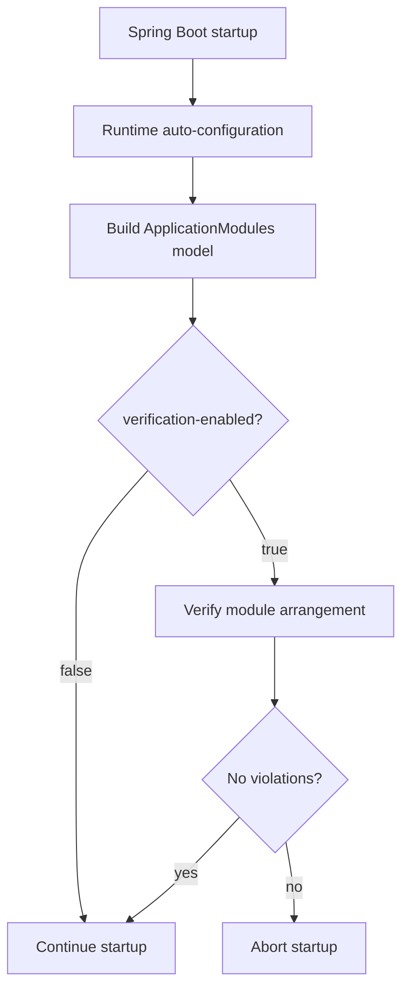

# ApplicationModulesRuntime và model lúc chạy

Spring Modulith có thể sử dụng cấu trúc mô-đun ngay khi ứng dụng Spring Boot chạy. Khi bổ sung module runtime support, ứng dụng có thể truy cập mô hình `ApplicationModules`, kiểm tra kiến trúc lúc khởi động và thực thi các tác vụ khởi tạo theo thứ tự dependency giữa các mô-đun.

Điểm cần phân biệt là mô hình mô-đun mô tả cấu trúc kiến trúc được suy ra từ mã nguồn và package. Nó không phải bản ghi theo dõi mọi lời gọi giữa các bean khi ứng dụng hoạt động. `ApplicationModulesRuntime` cung cấp mô hình đó cho runtime; `RuntimeApplicationModuleVerifier` có thể dùng nó để xác minh cấu trúc lúc khởi động; `ApplicationModuleInitializer` cho phép chạy tác vụ khởi tạo theo thứ tự topo của module graph.

## 1. Runtime support được cung cấp bởi module riêng

Để Spring Modulith khởi tạo mô hình mô-đun trong ứng dụng production, thêm artifact `spring-modulith-runtime` vào runtime classpath. Với Gradle:

```groovy
dependencies {
    runtimeOnly 'org.springframework.modulith:spring-modulith-runtime'
}
```

Với Maven:

```xml
<dependency>
    <groupId>org.springframework.modulith</groupId>
    <artifactId>spring-modulith-runtime</artifactId>
    <scope>runtime</scope>
</dependency>
```

Nên dùng Spring Modulith BOM hoặc cơ chế quản lý dependency của Spring Boot mà dự án đã chọn để các artifact Modulith có phiên bản tương thích. Không trộn các phiên bản khác nhau giữa `spring-modulith-core`, `spring-modulith-runtime` và các integration liên quan.

Khi artifact runtime có trên classpath, Spring Boot auto-configuration đăng ký các thành phần chính:

| Thành phần | Vai trò |
|---|---|
| `ApplicationModulesRuntime` | Cung cấp quyền truy cập tới một `ApplicationModules` model được khởi tạo cho ứng dụng |
| `SpringBootApplicationRuntime` | Xác định lớp ứng dụng Spring Boot làm điểm bắt đầu để phát hiện mô-đun |
| `RuntimeApplicationModuleVerifier` | Xác minh cấu trúc mô-đun lúc khởi động nếu property runtime verification được bật |
| Application-started listener | Gọi các bean triển khai `ApplicationModuleInitializer` sau sự kiện `ApplicationStartedEvent` |

Nếu không thêm `spring-modulith-runtime`, các thành phần runtime trên không được auto-configure theo cách này. Các bài kiểm tra kiến trúc dùng `ApplicationModules.of(…).verify()` vẫn có thể được thực hiện trong test source set thông qua dependency test/core tương ứng; runtime support giải quyết nhu cầu sử dụng mô hình trong ứng dụng đang chạy.

## 2. ApplicationModulesRuntime và ApplicationModules khác nhau thế nào?

`ApplicationModules` là mô hình mô-đun được tạo từ package gốc của ứng dụng. Nó chứa các `ApplicationModule`, các package base, API được công khai và quan hệ dependency được suy ra từ mã nguồn.

`ApplicationModulesRuntime` là lớp runtime triển khai `Supplier<ApplicationModules>`. Nó quản lý việc khởi tạo mô hình cho lớp ứng dụng và cung cấp mô hình qua phương thức `get()`. Theo API, việc bootstrap được thực hiện một lần cho mỗi application class trong runtime tương ứng. Vì tài liệu cài đặt khuyến nghị khai báo `spring-modulith-runtime` ở scope `runtimeOnly`, mã ứng dụng có thể inject interface JDK `Supplier<ApplicationModules>` thay vì tham chiếu trực tiếp implementation `ApplicationModulesRuntime`.

```mermaid
flowchart TD
    app[Spring Boot application] --> runtime[ApplicationModulesRuntime]
    runtime -->|get()| model[ApplicationModules model]
    model --> orders[orders module]
    model --> inventory[inventory module]
    model --> customers[customers module]
```

Vì vậy, khi cần đọc cấu trúc mô-đun trong một Spring bean mà vẫn giữ dependency runtime ở scope `runtimeOnly`, hãy inject `Supplier<ApplicationModules>`, sau đó gọi `get()` để lấy model:

```java
package com.acme.shop.diagnostics;

import java.util.List;
import java.util.function.Supplier;

import org.springframework.modulith.core.ApplicationModule;
import org.springframework.modulith.core.ApplicationModules;
import org.springframework.stereotype.Component;

@Component
public class ModuleCatalog {

    private final Supplier<ApplicationModules> modules;

    public ModuleCatalog(Supplier<ApplicationModules> modules) {
        this.modules = modules;
    }

    public List<String> modulePackages() {
        return modules.get().stream()
                .map(ApplicationModule::getBasePackage)
                .map(javaPackage -> javaPackage.getName())
                .toList();
    }
}
```

`ApplicationModulesRuntime` thuộc package `org.springframework.modulith.runtime`; `ApplicationModules` và `ApplicationModule` thuộc package `org.springframework.modulith.core`. Bean runtime triển khai `Supplier<ApplicationModules>`, vì vậy Spring có thể inject abstraction `Supplier<ApplicationModules>` khi ứng dụng chỉ cần đọc model. Nếu dự án chủ động đưa `spring-modulith-runtime` vào compile classpath, có thể inject kiểu cụ thể `ApplicationModulesRuntime`; cách đó làm mã nguồn phụ thuộc trực tiếp vào implementation runtime. Mô hình được cung cấp qua `get()` là nguồn thông tin kiến trúc để tra cứu, không phải một registry để đăng ký hoặc khởi tạo bean nghiệp vụ.

## 3. Tra cứu mô-đun và dependency trong model

`ApplicationModules` cho phép duyệt qua các mô-đun hoặc tra cứu một mô-đun cụ thể. Ví dụ, lấy mô-đun `orders` và xem các dependency trực tiếp:

```java
package com.acme.shop.diagnostics;

import java.util.List;
import java.util.function.Supplier;

import org.springframework.modulith.core.ApplicationModule;
import org.springframework.modulith.core.ApplicationModules;
import org.springframework.stereotype.Component;

@Component
public class ModuleDependencyInspector {

    private final Supplier<ApplicationModules> modulesSupplier;

    public ModuleDependencyInspector(Supplier<ApplicationModules> modulesSupplier) {
        this.modulesSupplier = modulesSupplier;
    }

    public List<String> directDependenciesOfOrders() {
        ApplicationModules modules = modulesSupplier.get();

        ApplicationModule orders = modules.getModuleByName("orders")
                .orElseThrow(() -> new IllegalArgumentException("Unknown module: orders"));

        return orders.getDirectDependencies(modules)
                .uniqueModules()
                .map(ApplicationModule::getDisplayName)
                .toList();
    }
}
```

Một số API tra cứu thường dùng:

| API | Mục đích |
|---|---|
| `modules.stream()` | Duyệt toàn bộ mô-đun |
| `modules.getModuleByName("orders")` | Tìm mô-đun theo tên |
| `modules.getModuleByType(OrderService.class)` | Tìm mô-đun chứa một kiểu Java |
| `modules.getModuleForPackage("com.acme.shop.orders")` | Tìm mô-đun chứa package |
| `module.getBasePackage()` | Lấy package gốc của mô-đun |
| `module.getDirectDependencies(modules)` | Lấy các dependency trực tiếp |
| `module.getAllDependencies(modules)` | Lấy dependency trực tiếp và bắc cầu |
| `module.getNamedInterfaces()` | Xem các Named Interface được công khai |

Khi cần kiểm tra một lớp thuộc mô-đun nào, `getModuleByType(…)` phù hợp hơn việc tự tách tên package bằng chuỗi. Khi cần xem quan hệ phụ thuộc, hãy phân biệt `getDirectDependencies(…)` với `getAllDependencies(…)`; kết quả thứ hai bao gồm các dependency bắc cầu.

## 4. Dùng runtime model để kiểm tra cấu trúc khi khởi động

Runtime support có thể tự động xác minh module arrangement lúc ứng dụng khởi động. Bật tính năng này trong `application.yml`:

```yaml
spring:
  modulith:
    runtime:
      verification-enabled: true
```

Property đầy đủ là `spring.modulith.runtime.verification-enabled`; giá trị mặc định là `false`. Khi đặt thành `true` và có `spring-modulith-runtime` trên runtime classpath, Spring Modulith đăng ký `RuntimeApplicationModuleVerifier`. Thành phần này xác minh cấu trúc mô-đun khi khởi động và làm quá trình khởi động thất bại nếu phát hiện vi phạm.

Luồng xử lý có thể hình dung như sau:



Runtime verification bổ sung một cổng kiểm tra khi deploy hoặc khởi động ứng dụng. Nó không thay thế architecture test trong CI: CI phát hiện lỗi sớm khi thay đổi mã nguồn, còn runtime verification xác nhận artifact đang chạy vẫn tuân thủ cấu trúc mô-đun mà nó được đóng gói cùng.

Không nên bật property mà chưa xử lý các vi phạm đã biết. Nếu ứng dụng khởi động thất bại, đọc lỗi để xác định dependency không hợp lệ, truy cập package nội bộ hoặc chu trình mô-đun; sau đó sửa boundary, Named Interface hoặc `allowedDependencies` theo ý định kiến trúc.

## 5. Custom module detection phải có trong production sources

Runtime model được tạo từ application class và cấu trúc package có trên runtime classpath. Nếu dự án tùy chỉnh `ApplicationModuleDetectionStrategy`, implementation và cấu hình đăng ký strategy phải có trong production sources/resources để runtime support nhìn thấy.

Ví dụ, nếu strategy được triển khai trong `src/test/java` và đăng ký trong `src/test/resources/META-INF/spring.factories`, architecture test có thể phát hiện module theo quy ước riêng trong khi ứng dụng production lại dùng quy tắc mặc định. Hai môi trường khi đó tạo ra hai module model khác nhau.

Hãy đặt implementation strategy trong `src/main/java` và factory registration trong `src/main/resources/META-INF/spring.factories` nếu runtime cần dùng nó. Sau đó, kiểm tra cả architecture test và runtime startup để xác nhận hai môi trường phát hiện cùng tập mô-đun. Tránh để cấu hình test-only quyết định kiến trúc mà production không biết tới.

## 6. Chạy tác vụ khởi tạo theo dependency graph

Một ứng dụng có thể cần chạy tác vụ riêng cho từng mô-đun khi khởi động, ví dụ nạp dữ liệu tham chiếu hoặc chuẩn bị một cấu trúc cache. Nếu mô-đun `inventory` phụ thuộc vào `catalog`, tác vụ khởi tạo của `catalog` cần chạy trước tác vụ của `inventory`.

Spring Modulith cung cấp `ApplicationModuleInitializer` để biểu diễn các tác vụ này:

```java
package com.acme.shop.catalog;

import org.springframework.modulith.ApplicationModuleInitializer;
import org.springframework.stereotype.Component;

@Component
class CatalogInitializer implements ApplicationModuleInitializer {

    @Override
    public void initialize() {
        // Chuẩn bị dữ liệu tham chiếu cần thiết cho catalog.
    }
}
```

Một mô-đun khác cũng có thể khai báo initializer:

```java
package com.acme.shop.inventory;

import org.springframework.modulith.ApplicationModuleInitializer;
import org.springframework.stereotype.Component;

@Component
class InventoryInitializer implements ApplicationModuleInitializer {

    @Override
    public void initialize() {
        // Khởi tạo dữ liệu phụ thuộc vào catalog.
    }
}
```

Spring Modulith gọi các initializer sau `ApplicationStartedEvent` và sắp xếp thứ tự theo dependency graph của các mô-đun. Nếu `inventory` phụ thuộc vào `catalog`, initializer của `catalog` được thực hiện trước initializer của `inventory`, kể cả khi hai initializer không inject trực tiếp lẫn nhau.

Các initializer chỉ được gọi khi `spring-modulith-runtime` có trên classpath. Interface `ApplicationModuleInitializer` nằm trong package API `org.springframework.modulith`; nếu dự án chưa có `spring-modulith-api` hoặc starter cung cấp API này trên compile classpath, cần bổ sung dependency compile phù hợp. Hãy thiết kế initializer có thể chạy an toàn theo mỗi lần khởi động của từng application instance. Nếu thao tác có side effect hoặc cập nhật dữ liệu dùng chung, cần bảo đảm idempotency, xử lý cạnh tranh giữa nhiều instance và tách riêng các tác vụ vốn thuộc Flyway hoặc cơ chế migration.

## 7. Runtime model không phải runtime call tracing

`ApplicationModulesRuntime` cung cấp mô hình kiến trúc được dựng từ mã nguồn và metadata ứng dụng. Nó hữu ích để tra cứu module, package, Named Interface và dependency. Tuy nhiên, nó không tự ghi lại mọi lời gọi phương thức, request HTTP hay event đã đi qua các mô-đun.

| Nhu cầu | Cơ chế phù hợp |
|---|---|
| Tra cứu module và dependency đã mô hình hóa | `ApplicationModulesRuntime.get()` |
| Xác minh module graph khi khởi động | `spring.modulith.runtime.verification-enabled=true` |
| Kiểm tra kiến trúc trong pipeline | `ApplicationModules.of(…).verify()` trong test |
| Chạy tác vụ khởi tạo theo thứ tự module | `ApplicationModuleInitializer` |
| Quan sát lời gọi hoặc event thực tế khi ứng dụng hoạt động | Observability/tracing integration phù hợp |

Không nên dùng module model như nguồn dữ liệu về tần suất sử dụng API hoặc lưu lượng giữa các mô-đun. Những thông tin đó cần instrumentation và observability. Tương tự, việc tra cứu một mô-đun trong model không có nghĩa mọi bean trong mô-đun đó đã được khởi tạo thành công.

## 8. Những vấn đề thường gặp khi dùng runtime support

| Hiện tượng | Nguyên nhân có thể | Hướng kiểm tra |
|---|---|---|
| Không inject được `Supplier<ApplicationModules>` | Thiếu `spring-modulith-runtime` hoặc auto-configuration không được kích hoạt | Kiểm tra runtime dependency và cấu hình Spring Boot |
| Runtime phát hiện khác số mô-đun so với test | Custom detection strategy chỉ nằm trong test source set | Đưa strategy và factory registration vào production sources/resources |
| Ứng dụng khởi động thất bại sau khi bật verification | Module graph có vi phạm | Đọc violation và sửa dependency hoặc package boundary |
| Initializer không được gọi | Runtime artifact không có trên classpath hoặc không có bean initializer | Kiểm tra dependency, component scan và bean registration |
| Initializer chạy sai thứ tự kỳ vọng | Dependency graph không thể hiện quan hệ cần thiết | Khai báo dependency kiến trúc đúng giữa các mô-đun |
| Một tác vụ khởi tạo chạy nhiều lần trong môi trường nhiều instance | Mỗi instance khởi động đều có thể gọi initializer | Thiết kế idempotent hoặc dùng cơ chế điều phối/migration phù hợp |

Nếu dùng Spring Modulith starter có chứa runtime support theo phiên bản đang dùng, không nhất thiết phải khai báo artifact riêng lần nữa. Hãy kiểm tra dependency tree và tài liệu starter của phiên bản dự án để tránh thêm dependency trùng hoặc lệch phiên bản.

## 9. Quy trình đưa runtime model vào ứng dụng

1. Quản lý phiên bản Spring Modulith thống nhất bằng BOM hoặc dependency management.
2. Thêm `spring-modulith-runtime` vào runtime classpath nếu starter hiện tại chưa cung cấp nó.
3. Đặt custom module detection strategy và cấu hình liên quan trong production sources/resources.
4. Inject `Supplier<ApplicationModules>` ở thành phần cần tra cứu thông tin kiến trúc và gọi `get()` để lấy model; chỉ inject `ApplicationModulesRuntime` trực tiếp nếu artifact runtime cũng có trên compile classpath.
5. Chỉ bật `spring.modulith.runtime.verification-enabled=true` sau khi architecture test đã xác minh module arrangement.
6. Nếu cần khởi tạo dữ liệu theo dependency graph, triển khai `ApplicationModuleInitializer` và bảo đảm thao tác an toàn khi chạy lại.
7. Kiểm tra startup của artifact production và giữ `ApplicationModules.verify()` trong CI.

## 10. Bài tập tự kiểm tra

Với ứng dụng `com.acme.shop` có `orders`, `inventory` và `customers`, hãy thực hiện các yêu cầu sau:

1. Thêm `spring-modulith-runtime` vào runtime classpath và xác nhận Spring có thể inject `Supplier<ApplicationModules>`.
2. Viết một bean dùng `modules.get().stream()` để liệt kê base package của các mô-đun.
3. Tra cứu mô-đun `orders` bằng `getModuleByName("orders")`, sau đó liệt kê dependency trực tiếp của nó.
4. Bật `spring.modulith.runtime.verification-enabled=true` và khởi động ứng dụng để xác nhận cấu trúc mô-đun được kiểm tra.
5. Tạo hai `ApplicationModuleInitializer` với một dependency đã biết, ghi nhận thứ tự gọi và xác nhận mô-đun nền tảng được khởi tạo trước mô-đun sử dụng nó.
6. Tạm thời tạo một vi phạm boundary trong nhánh thử nghiệm, quan sát ứng dụng không khởi động khi runtime verification được bật, rồi khôi phục dependency hợp lệ.

Khi hoàn thành, bạn cần giải thích được `ApplicationModules` là mô hình, `ApplicationModulesRuntime` là điểm truy cập mô hình trong Spring runtime, runtime verifier là cổng xác minh lúc khởi động và initializer là cơ chế chạy tác vụ theo dependency graph. Đây là các vai trò liên quan nhưng không thay thế lẫn nhau.

## Tài liệu tham khảo

- [Spring Modulith — Runtime Support](https://docs.spring.io/spring-modulith/reference/runtime.html)
- [API — ApplicationModulesRuntime](https://docs.spring.io/spring-modulith/docs/current/api/org/springframework/modulith/runtime/ApplicationModulesRuntime.html)
- [API — ApplicationModules](https://docs.spring.io/spring-modulith/docs/current/api/org/springframework/modulith/core/ApplicationModules.html)
- [API — ApplicationModule](https://docs.spring.io/spring-modulith/docs/current/api/org/springframework/modulith/core/ApplicationModule.html)
- [Spring Modulith — Configuration Properties](https://docs.spring.io/spring-modulith/reference/appendix.html)
