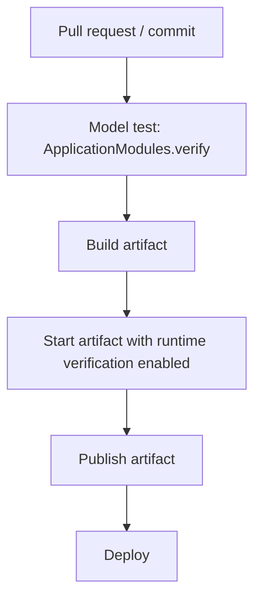

# Bật `spring.modulith.runtime.verification-enabled`

Spring Modulith có thể xác minh cấu trúc application module ngay khi ứng dụng khởi động. Nhờ đó, một artifact có dependency sai, truy cập package nội bộ hoặc tạo chu trình giữa các module sẽ bị từ chối khi chạy, kể cả khi artifact được khởi động ngoài pipeline test thông thường.

Để bật cơ chế này, ứng dụng cần có artifact `spring-modulith-runtime` trên runtime classpath và cấu hình `spring.modulith.runtime.verification-enabled=true`. Property mặc định là `false`, vì vậy chỉ thêm thư viện runtime chưa tự động làm ứng dụng thất bại khi có vi phạm. Bài học này hướng dẫn cấu hình dependency, bật property, lựa chọn môi trường áp dụng và chẩn đoán khi ứng dụng không khởi động do module verification.

## Mục tiêu

Sau bài học, bạn có thể:

- Giải thích runtime verification kiểm tra điều gì khi Spring Boot khởi động.
- Thêm `spring-modulith-runtime` đúng runtime scope.
- Bật `spring.modulith.runtime.verification-enabled` bằng properties, YAML, profile hoặc environment variable.
- Hiểu giá trị mặc định và điều kiện để verifier được đăng ký.
- Phân biệt runtime verification với model test dùng `ApplicationModules.verify()`.
- Đảm bảo custom module detection được đưa vào production runtime.
- Chẩn đoán lỗi startup do dependency, module detection hoặc vi phạm kiến trúc.
- Tích hợp runtime verification với quy trình CI/CD và triển khai.

## Runtime verification là gì?

Trong quá trình phát triển, nhóm thường kiểm tra kiến trúc bằng một test như:

```java
@Test
void verifiesApplicationModuleStructure() {
    ApplicationModules.of(Application.class).verify();
}
```

Test này tạo mô hình module từ source và kiểm tra các quy tắc kiến trúc. Nó hữu ích trong CI, nhưng chỉ chạy khi test task được thực thi.

Runtime verification đưa cùng ý tưởng kiểm tra module arrangement vào quá trình khởi động ứng dụng. Khi được bật, Spring Modulith tạo `ApplicationModules` từ ứng dụng đang chạy và xác minh cấu trúc. Nếu phát hiện vi phạm, quá trình khởi động bị hủy.

Các quy tắc mặc định bao gồm:

- Dependency giữa application module phải tạo thành đồ thị có hướng không chu trình.
- Module chỉ được truy cập type trong package API được công bố của module khác; truy cập package nội bộ bị từ chối, trừ trường hợp module được cấu hình mở.
- Nếu khai báo `allowedDependencies`, dependency phải tuân theo danh sách module hoặc named interface được cho phép.
- Các verification bổ sung dựa trên classpath, chẳng hạn jMolecules DDD rules, có thể được thực hiện khi integration tương ứng hiện diện.

Runtime verification bảo vệ cấu trúc module tại thời điểm ứng dụng chạy. Nó không thay thế unit test, integration test hoặc kiểm thử nghiệp vụ; nó bổ sung một hàng rào kiến trúc ở startup.

## Hai điều kiện bắt buộc để bật verifier

Chỉ khai báo property là chưa đủ. Cần đồng thời có hai điều kiện:

1. Artifact `spring-modulith-runtime` phải có trên runtime classpath để Spring Boot đăng ký runtime support.
2. Property `spring.modulith.runtime.verification-enabled` phải có giá trị `true` để đăng ký `RuntimeApplicationModuleVerifier`.

| Runtime artifact | Property | Kết quả |
|---|---|---|
| Không có | `false` hoặc `true` | Không có runtime verifier của Spring Modulith |
| Có | `false` hoặc không khai báo | Runtime support được nạp, nhưng module verification không chạy |
| Có | `true` | Verifier được đăng ký và kiểm tra module arrangement khi startup |

Giá trị mặc định của `spring.modulith.runtime.verification-enabled` là `false`. Nhóm cần bật rõ ràng để tránh nhầm rằng chỉ thêm dependency đã kích hoạt kiểm tra.

## Thêm `spring-modulith-runtime`

Với Gradle, khai báo ở runtime scope:

```groovy
dependencies {
    runtimeOnly("org.springframework.modulith:spring-modulith-runtime")
}
```

Với Maven:

```xml
<dependency>
    <groupId>org.springframework.modulith</groupId>
    <artifactId>spring-modulith-runtime</artifactId>
    <scope>runtime</scope>
</dependency>
```

Nếu dự án dùng `spring-modulith-starter-core`, starter này đã kéo `spring-modulith-runtime` vào runtime classpath. Khi đó, không cần khai báo lại artifact runtime một cách dư thừa. Hãy kiểm tra dependency tree của đúng phiên bản Spring Modulith đang dùng.

Sử dụng BOM hoặc dependency management của Spring Modulith để các artifact cùng phiên bản. Runtime artifact cần có trong artifact được triển khai; một dependency chỉ xuất hiện ở test scope sẽ không bật được verifier trong ứng dụng production.

## Bật property trong `application.properties`

Thêm cấu hình sau vào `src/main/resources/application.properties`:

```properties
spring.modulith.runtime.verification-enabled=true
```

Khi ứng dụng khởi động với `spring-modulith-runtime` trên classpath, Spring Boot auto-configuration đăng ký runtime support và verifier. Nếu module arrangement vi phạm quy tắc, startup thất bại thay vì tiếp tục chạy với cấu trúc không hợp lệ.

## Bật property trong `application.yml`

Nếu dự án dùng YAML, cấu hình tương đương là:

```yaml
spring:
  modulith:
    runtime:
      verification-enabled: true
```

Chỉ cần một nguồn cấu hình có hiệu lực. Nếu cùng property được khai báo ở nhiều nơi, Spring Boot áp dụng quy tắc precedence của property source; hãy kiểm tra profile, environment variable và command-line argument khi giá trị thực tế khác dự kiến.

## Bật theo profile hoặc môi trường triển khai

Nhóm có thể bật runtime verification trong mọi môi trường hoặc chọn profile cụ thể. Ví dụ, cấu hình `application-verify.yml`:

```yaml
spring:
  modulith:
    runtime:
      verification-enabled: true
```

Khởi động ứng dụng với profile:

```bash
java -jar application.jar --spring.profiles.active=verify
```

Một lựa chọn khác là bật trong profile production hoặc staging. Quyết định phụ thuộc vào cách nhóm muốn kiểm soát rủi ro:

- **Local development:** bật để phát hiện sớm dependency sai ngay khi chạy ứng dụng.
- **CI hoặc môi trường kiểm thử triển khai:** bật để xác nhận artifact khởi động được với cấu hình runtime thực tế.
- **Staging/production:** bật nếu nhóm muốn mọi instance đều từ chối khởi động khi module arrangement vi phạm.

Nếu chỉ bật trong profile riêng, cần bảo đảm pipeline thực sự khởi động ứng dụng với profile đó. Một profile không được sử dụng sẽ không tạo ra runtime gate.

## Bật bằng environment variable

Spring Boot hỗ trợ relaxed binding cho environment variable. Property:

```text
spring.modulith.runtime.verification-enabled
```

Theo quy tắc chuyển đổi tên biến môi trường của Spring Boot, dấu gạch nối trong `verification-enabled` được loại bỏ, không được thay bằng một dấu gạch dưới. Vì vậy, tên biến đúng là:

```text
SPRING_MODULITH_RUNTIME_VERIFICATIONENABLED=true
```

Ví dụ chạy ứng dụng:

```bash
SPRING_MODULITH_RUNTIME_VERIFICATIONENABLED=true java -jar application.jar
```

Trong Docker hoặc Kubernetes, có thể khai báo biến môi trường này trong cấu hình container/deployment. Không cần sửa artifact chỉ để đổi trạng thái bật/tắt giữa các môi trường.

## Spring Modulith đăng ký runtime verifier như thế nào?

Khi `spring-modulith-runtime` có mặt, Spring Boot auto-configuration đăng ký một số thành phần runtime:

- `ApplicationModulesRuntime` cung cấp mô hình application module tại runtime.
- `SpringBootApplicationRuntime` hỗ trợ xác định lớp main application.
- `RuntimeApplicationModuleVerifier` xác minh module arrangement khi property được bật.
- Listener cho `ApplicationStartedEvent` gọi các bean triển khai `ApplicationModuleInitializer`, nếu ứng dụng có khai báo initializer.

Verifier chỉ được đăng ký khi property có giá trị `true`. Cơ chế này được điều kiện hóa bởi cấu hình boolean, với `matchIfMissing=false`; vì thế không khai báo property đồng nghĩa verifier không chạy.

Khi verifier tìm thấy vi phạm, Spring Modulith ném lỗi `Violations` và Spring Boot dừng quá trình khởi động. Failure analyzer của Spring Modulith có thể cung cấp phần phân tích nguyên nhân để log dễ đọc hơn. Hãy đọc danh sách module và dependency trong thông báo thay vì chỉ tăng log level hoặc tắt verifier.

## Runtime verification sử dụng module detection nào?

Runtime verifier cần tạo mô hình từ ứng dụng đã được đóng gói. Vì vậy, mọi tùy chỉnh ảnh hưởng đến việc phát hiện module phải hiện diện trong production sources hoặc cấu hình production.

Ví dụ, nếu dự án có custom `ApplicationModuleDetectionStrategy`, class strategy và cơ chế đăng ký của nó phải có trong artifact runtime. Một strategy chỉ được khai báo trong `src/test/java` có thể khiến model test nhìn thấy cấu trúc khác với ứng dụng thật.

Hãy kiểm tra:

- Package root và application class được runtime nhận diện đúng.
- `@ApplicationModule`, `@NamedInterface` và `allowedDependencies` nằm trong production bytecode.
- Custom detection strategy có trên runtime classpath và được đăng ký bằng cơ chế phù hợp phiên bản.
- Cấu hình package bổ sung hoặc module metadata không chỉ tồn tại trong test source set.
- Profile triển khai không ghi đè detection-related property theo cách làm thay đổi mô hình.

Nếu test model pass nhưng runtime verification fail, một nguyên nhân cần kiểm tra là hai môi trường đang dùng module detection hoặc classpath khác nhau.

## Ví dụ: ứng dụng bán hàng có dependency sai

Giả sử ứng dụng có hai module:

```text
com.acme
├── orders
│   ├── OrderManagement.java
│   └── internal
│       └── JpaOrderRepository.java
└── shipping
    └── ShippingService.java
```

`ShippingService` đang import trực tiếp `JpaOrderRepository` từ `orders.internal`. Module `orders` chưa công bố repository này như API, nên dependency vi phạm boundary.

Trong test, `ApplicationModules.of(Application.class).verify()` sẽ phát hiện vi phạm. Nếu runtime verification được bật, cùng cấu trúc đó cũng làm ứng dụng thất bại khi khởi động:

```properties
spring.modulith.runtime.verification-enabled=true
```

Hướng sửa là công bố một API nghiệp vụ như `OrderLookup` trong package gốc hoặc named interface của `orders`, sau đó để `ShippingService` phụ thuộc vào hợp đồng đó. Khi module arrangement hợp lệ, cả model test và runtime verifier đều có thể hoàn tất.

Runtime verification không sửa dependency và không tự động di chuyển class. Nó chỉ phát hiện và từ chối chạy ứng dụng khi cấu trúc hiện tại vi phạm quy tắc.

## Kết hợp runtime verification với CI

Không nên chờ ứng dụng production khởi động mới phát hiện lỗi kiến trúc. Một quy trình có thể sử dụng cả model test lẫn runtime verification:



Model test thường chạy sớm và nhanh trong test task. Sau khi đóng gói, CI có thể khởi động artifact với property bật để xác nhận runtime classpath, production configuration và module detection đều hoạt động như dự kiến. Chỉ khi bước startup verification thành công mới cho phép publish hoặc deploy tiếp tục.

Runtime verification cũng có thể chạy ở mỗi môi trường khi ứng dụng khởi động. CI gate và startup gate có vai trò khác nhau:

| Gate | Thời điểm | Giá trị |
|---|---|---|
| Model test | Trong test task | Phản hồi sớm về cấu trúc source và dependency |
| Runtime verification | Khi Spring Boot khởi động | Kiểm tra artifact, runtime classpath và cấu hình đang được triển khai |

Nếu chỉ dùng runtime verification, lỗi được phát hiện muộn hơn so với model test. Nếu chỉ dùng model test, nhóm chưa xác nhận runtime artifact thực tế có nạp đúng runtime support và cấu hình property.

## Chẩn đoán khi property không có tác dụng

Nếu ứng dụng vẫn khởi động dù nhóm kỳ vọng có vi phạm, kiểm tra lần lượt:

1. **Dependency:** `spring-modulith-runtime` có trong runtime dependency tree của artifact không?
2. **Property:** giá trị hiệu lực có thật sự là `true` không? Kiểm tra `application.yml`, profile, environment variable và command-line argument.
3. **Profile:** profile chứa property có được kích hoạt trong lệnh chạy thực tế không?
4. **Artifact:** image hoặc JAR được triển khai có chứa đúng dependency và cấu hình không?
5. **Module detection:** runtime có nhận diện cùng package root và custom strategy như model test không?
6. **Violation:** cấu trúc đang kiểm tra có thật sự chứa dependency vi phạm theo API và module metadata hiện hành không?

Nếu ứng dụng thất bại khi khởi động sau khi bật property, hãy đọc phần Failure Analysis. Phân loại lỗi thành dependency cycle, truy cập package nội bộ hoặc dependency không được cho phép, rồi sửa source hoặc metadata module tương ứng.

### Bảng lỗi thường gặp

| Hiện tượng | Nguyên nhân thường gặp | Cách xử lý |
|---|---|---|
| Property là `true` nhưng verifier không chạy | Thiếu `spring-modulith-runtime` trên runtime classpath | Thêm artifact ở runtime scope hoặc dùng starter-core phù hợp |
| Dependency có nhưng ứng dụng vẫn khởi động dù property không khai báo | Giá trị mặc định là `false` | Bật property tường minh |
| Local chạy được, staging không bật kiểm tra | Profile hoặc environment variable chưa được cấu hình | Kiểm tra cấu hình hiệu lực của môi trường staging |
| Model test pass nhưng runtime fail | Runtime dùng classpath hoặc module detection khác | Đưa metadata/strategy vào production sources và đồng bộ dependency |
| Startup thất bại với `Violations` | Có dependency cycle hoặc truy cập API không hợp lệ | Sửa boundary, named interface hoặc allowed dependencies |
| Test chạy verifier nhưng artifact không chạy | Runtime artifact chỉ có trong test scope hoặc không được đóng gói | Kiểm tra runtime dependency tree của artifact |
| Bật property nhưng không thấy thông báo gì | Cấu trúc hiện tại hợp lệ hoặc log không hiển thị chi tiết | Kiểm tra module model và cấu hình logging nếu cần |

## Có nên bật trong production không?

Runtime verification có chi phí phân tích cấu trúc khi khởi động và có thể làm ứng dụng không sẵn sàng nếu phát hiện vi phạm. Đó là hành vi có chủ đích: một instance không nên nhận traffic khi module arrangement không đáp ứng quy tắc kiến trúc đã đặt ra.

Nhóm có thể quyết định bật trong production nếu muốn bảo đảm mỗi instance tự xác minh trước khi phục vụ. Cần cân nhắc:

- Thời gian startup tăng thêm có phù hợp với yêu cầu scale và restart không.
- Runtime artifact có đầy đủ bytecode và metadata để phân tích không.
- Tất cả instance dùng cùng phiên bản artifact và cấu hình module detection không.
- Deployment platform có xử lý đúng trạng thái startup thất bại và không đưa instance chưa sẵn sàng vào service không.
- Model test và CI startup check đã bắt phần lớn vi phạm trước khi artifact đến production chưa.

Nếu nhóm chưa muốn bật trong production, có thể bật ở CI hoặc staging để xác minh artifact trước khi phát hành. Dù chọn môi trường nào, hãy ghi rõ property được quản lý ở đâu và tránh để các profile khác nhau tạo ra kỳ vọng mơ hồ.

## Checklist triển khai

Trước khi bật runtime verification, xác nhận:

- [ ] `spring-modulith-runtime` có trên runtime classpath.
- [ ] Phiên bản artifact được quản lý cùng BOM Spring Modulith.
- [ ] `spring.modulith.runtime.verification-enabled=true` được đặt trong property source có hiệu lực.
- [ ] Profile hoặc environment variable được truyền đúng khi chạy artifact.
- [ ] Custom detection strategy và metadata module nằm trong production sources.
- [ ] Model test `ApplicationModules.verify()` chạy trong CI.
- [ ] CI có thể khởi động artifact với runtime verification bật trước publish/deploy.
- [ ] Nhóm biết cách đọc Failure Analysis khi startup bị từ chối.

## Bài tập tự đánh giá

Một ứng dụng Spring Boot có model test `ApplicationModules.of(Application.class).verify()` đang pass. Khi triển khai image lên staging, nhóm muốn ứng dụng tự kiểm tra module arrangement trước khi nhận traffic. Sau khi cấu hình property, ứng dụng vẫn khởi động dù nhóm cố tình tạo một dependency vào package `internal` trong môi trường thử nghiệm.

Hãy trả lời:

1. Vì sao chỉ thêm `spring.modulith.runtime.verification-enabled=true` có thể chưa đủ?
2. Artifact nào phải có trong runtime classpath?
3. Giá trị mặc định của property là gì?
4. Nếu custom detection strategy chỉ nằm trong test source set, runtime verifier có sử dụng nó không?
5. Bạn sẽ kiểm tra những property source và dependency nào trong staging image?
6. Khi verifier phát hiện vi phạm, điều gì xảy ra với quá trình startup và deployment?

Một hướng xử lý là xác nhận image có `spring-modulith-runtime`, bật property trong profile hoặc environment variable thật sự được kích hoạt, và chuyển custom detection strategy vào production sources. Khi có vi phạm, runtime verifier sẽ ném `Violations` và Spring Boot dừng startup. CI nên chạy model test và khởi động thử artifact với cùng cấu hình staging trước khi cho phép deploy.

## Kết luận

Để bật runtime verification, cần có `spring-modulith-runtime` trên runtime classpath và đặt `spring.modulith.runtime.verification-enabled=true`; giá trị mặc định của property là `false`. Khi được kích hoạt, Spring Modulith xác minh module arrangement lúc startup và từ chối khởi động nếu phát hiện vi phạm. Hãy đồng bộ module detection và metadata giữa test với production, kết hợp model test trong CI cùng startup verification trên artifact để bảo vệ boundary từ lúc phát triển đến lúc triển khai.

## Tài liệu tham khảo

- [Spring Modulith Reference — Runtime Support](https://docs.spring.io/spring-modulith/reference/runtime.html)
- [Spring Modulith Reference — Configuration Properties](https://docs.spring.io/spring-modulith/reference/appendix.html)
- [Spring Modulith API — `SpringModulithRuntimeProperties`](https://docs.spring.io/spring-modulith/docs/current/api/org/springframework/modulith/runtime/autoconfigure/SpringModulithRuntimeProperties.html)
- [Spring Modulith API — `SpringModulithRuntimeAutoConfiguration`](https://docs.spring.io/spring-modulith/docs/current/api/org/springframework/modulith/runtime/autoconfigure/SpringModulithRuntimeAutoConfiguration.html)
- [Spring Boot Reference — Externalized Configuration and Environment Variables](https://docs.spring.io/spring-boot/reference/features/external-config.html)
