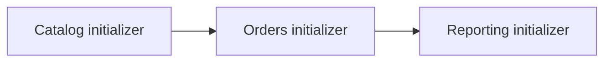
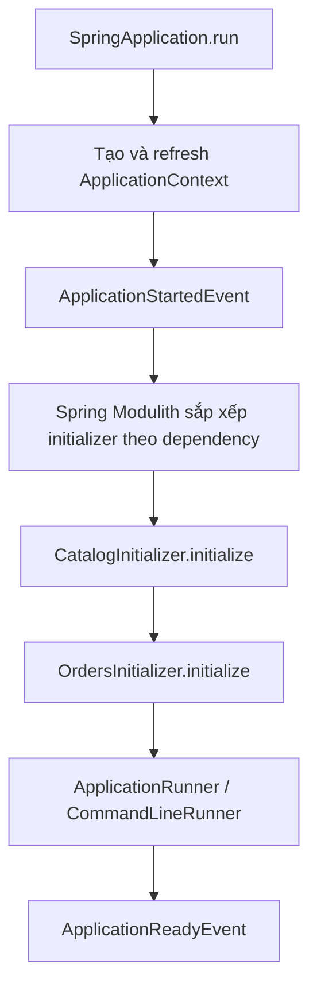

# Runtime verification

## ApplicationModuleInitializer và khởi tạo module

Trong một modular monolith, mỗi application module có thể cần thực hiện một số công việc khi ứng dụng khởi động: nạp dữ liệu mặc định, chuẩn bị cấu hình nghiệp vụ, kiểm tra trạng thái ban đầu hoặc làm ấm một bộ nhớ đệm. Vấn đề xuất hiện khi công việc của module này phụ thuộc vào kết quả khởi tạo của module khác.

Spring Modulith cung cấp `ApplicationModuleInitializer` để biểu diễn công việc khởi tạo ở cấp module. Khi có `spring-modulith-runtime`, Spring Modulith gọi các initializer sau khi ứng dụng đã bắt đầu và sắp xếp thứ tự gọi theo đồ thị phụ thuộc giữa các application module. Nếu module `orders` phụ thuộc `catalog`, initializer của `catalog` được thực thi trước initializer của `orders`, kể cả khi hai initializer không inject trực tiếp lẫn nhau.

### 1. Vì sao cần khởi tạo theo đồ thị module?

Giả sử ứng dụng có ba module:

```text
com.acme
├── catalog
│   ├── CatalogApi.java
│   └── internal
│       └── CatalogInitializer.java
├── orders
│   └── internal
│       └── OrdersInitializer.java
└── reporting
    └── internal
        └── ReportingInitializer.java
```

Module `orders` sử dụng API của `catalog`, còn `reporting` sử dụng API của `orders`. Trước khi hệ thống nhận yêu cầu nghiệp vụ, nhóm muốn dữ liệu mặc định của catalog được chuẩn bị trước, sau đó orders mới thiết lập cấu hình của nó và cuối cùng reporting mới nạp dữ liệu tổng hợp.

Đồ thị phụ thuộc có thể biểu diễn như sau:



Mũi tên trong sơ đồ biểu diễn thứ tự thực thi initializer. Quan hệ phụ thuộc ở cấp module đi theo chiều ngược lại: `orders` phụ thuộc `catalog`, còn `reporting` phụ thuộc `orders`. Spring Modulith dùng chính cấu trúc module đã phân tích để xác định thứ tự khởi tạo hợp lệ.

Nếu tự sắp xếp mọi initializer bằng một danh sách `@Order` toàn cục, thứ tự đó phải được duy trì thủ công khi module mới xuất hiện hoặc dependency thay đổi. `ApplicationModuleInitializer` gắn thứ tự thực thi với cấu trúc phụ thuộc vốn có của ứng dụng.

### 2. Bật runtime support

`ApplicationModuleInitializer` chỉ được gọi khi ứng dụng có thư viện `spring-modulith-runtime` trên runtime classpath. Với Gradle:

```kotlin
dependencies {
    runtimeOnly("org.springframework.modulith:spring-modulith-runtime")
}
```

Với Maven:

```xml
<dependency>
    <groupId>org.springframework.modulith</groupId>
    <artifactId>spring-modulith-runtime</artifactId>
    <scope>runtime</scope>
</dependency>
```

Hãy quản lý phiên bản bằng Spring Modulith BOM hoặc dependency management hiện có của dự án để các module Spring Modulith sử dụng cùng một phiên bản tương thích.

Spring Modulith cũng có bước kiểm tra cấu hình để phát hiện trường hợp ứng dụng khai báo bean triển khai `ApplicationModuleInitializer` nhưng thiếu `spring-modulith-runtime`. Nếu gặp thông báo thiếu runtime dependency, hãy kiểm tra runtime classpath và dependency management thay vì tự gọi `initialize()` bằng một listener khác.

Khi runtime support được kích hoạt, Spring Boot auto-configuration đăng ký các thành phần hỗ trợ như `ApplicationModulesRuntime` để truy cập mô hình application module, `SpringBootApplicationRuntime` để xác định lớp ứng dụng chính và event listener gọi các bean `ApplicationModuleInitializer`. Runtime support cũng có thể đăng ký kiểm tra cấu trúc module lúc khởi động nếu bật thuộc tính tương ứng.

### 3. Viết một initializer cho từng module

Initializer là một Spring bean triển khai interface `org.springframework.modulith.ApplicationModuleInitializer`. Interface có một phương thức `initialize()` để chạy logic khởi tạo module.

Ví dụ, module `catalog` cần bảo đảm các nhóm sản phẩm mặc định tồn tại:

```java
package com.acme.catalog.internal;

import org.springframework.modulith.ApplicationModuleInitializer;
import org.springframework.stereotype.Component;

@Component
class CatalogInitializer implements ApplicationModuleInitializer {

    private final CategoryRepository categories;

    CatalogInitializer(CategoryRepository categories) {
        this.categories = categories;
    }

    @Override
    public void initialize() {
        categories.createDefaultsIfMissing();
    }
}
```

`CategoryRepository` đại diện cho thành phần lưu trữ nội bộ của module `catalog`. Phương thức `createDefaultsIfMissing()` được thiết kế để có thể chạy lại mà không tạo bản ghi trùng lặp.

Module `orders` phụ thuộc `catalog` thông qua một hợp đồng công khai:

```java
package com.acme.catalog;

public interface CatalogApi {

    String defaultCurrency();
}
```

Initializer của `orders` dùng API đó để thiết lập cấu hình ban đầu:

```java
package com.acme.orders.internal;

import com.acme.catalog.CatalogApi;
import org.springframework.modulith.ApplicationModuleInitializer;
import org.springframework.stereotype.Component;

@Component
class OrdersInitializer implements ApplicationModuleInitializer {

    private final CatalogApi catalog;
    private final OrderSettingsRepository settings;

    OrdersInitializer(CatalogApi catalog, OrderSettingsRepository settings) {
        this.catalog = catalog;
        this.settings = settings;
    }

    @Override
    public void initialize() {
        settings.createDefaultsIfMissing(catalog.defaultCurrency());
    }
}
```

Do `orders` tham chiếu `CatalogApi`, Spring Modulith nhận diện dependency từ `orders` tới `catalog` theo mô hình module. Khi runtime support gọi initializer, `CatalogInitializer` được thực thi trước `OrdersInitializer`. Việc sắp xếp dựa trên dependency giữa module, không đòi hỏi hai initializer phải gọi trực tiếp nhau.

Đặt initializer trong package thuộc module mà nó khởi tạo. Dùng constructor injection cho repository và API cần thiết để dependency của initializer được thể hiện rõ trong mã nguồn.

### 4. Thời điểm initializer được gọi

Spring Modulith đăng ký event listener cho `ApplicationStartedEvent`. Sự kiện này được phát sau khi Spring `ApplicationContext` đã refresh và trước khi Spring Boot gọi các `ApplicationRunner` hoặc `CommandLineRunner`.

Luồng khởi động ở mức khái quát:



Điều này tạo ra một ranh giới rõ ràng giữa việc Spring tạo bean và việc initializer thực hiện công việc nghiệp vụ. Constructor của bean, `@PostConstruct` và các callback vòng đời bean vẫn chạy trong quá trình tạo hoặc khởi tạo bean; chúng không tự động được sắp xếp theo đồ thị application module.

Vì vậy, hãy đặt công việc cần thứ tự module vào `initialize()`. Đừng đặt thao tác cần chờ dữ liệu của module khác trong constructor hoặc `@PostConstruct` rồi kỳ vọng Spring Modulith sẽ điều phối chúng. Spring vẫn cần tạo các bean trước khi phát `ApplicationStartedEvent`; thứ tự initializer chỉ điều khiển lời gọi `initialize()`.

### 5. Thứ tự nào được bảo đảm?

Spring Modulith sắp xếp initializer dựa trên dependency graph của application module. Quy tắc quan trọng là module nền tảng được khởi tạo trước module phụ thuộc vào nó.

| Quan hệ giữa module | Thứ tự initializer |
|---|---|
| `orders` phụ thuộc `catalog` | `CatalogInitializer` chạy trước `OrdersInitializer` |
| `reporting` phụ thuộc `orders`, và `orders` phụ thuộc `catalog` | `Catalog`, rồi `Orders`, rồi `Reporting` |
| Hai module không phụ thuộc nhau | Không có thứ tự nghiệp vụ giữa hai initializer được bảo đảm bởi dependency graph |
| Hai initializer cùng một module | Đồ thị module không biểu diễn thứ tự giữa các initializer trong cùng module |

Nếu hai initializer trong cùng module cần một thứ tự cụ thể, nên gom các bước phụ thuộc nhau vào một initializer và gọi chúng theo trình tự tường minh. Nếu hai module độc lập cần một workflow có thứ tự, hãy mô hình hóa workflow đó bằng một thành phần điều phối có trách nhiệm rõ ràng. Không nên tạo dependency giả chỉ để ép thứ tự khởi động.

### 6. Kết hợp với runtime verification

Runtime support còn cung cấp tùy chọn xác minh cấu trúc application module khi ứng dụng khởi động. Có thể bật bằng cấu hình:

```yaml
spring:
  modulith:
    runtime:
      verification-enabled: true
```

Trong các phiên bản Spring Modulith có hỗ trợ runtime verification (từ 2.0), khi được bật, `RuntimeApplicationModuleVerifier` kiểm tra mô hình module và làm quá trình khởi động thất bại nếu phát hiện vi phạm. Điều này giúp phát hiện sớm các thay đổi làm xuất hiện dependency cycle hoặc truy cập API không hợp lệ khi triển khai ứng dụng.

Runtime verification và `ApplicationModuleInitializer` giải quyết hai vấn đề khác nhau:

- Runtime verification kiểm tra cấu trúc module có tuân thủ quy tắc kiến trúc hay không.
- Initializer thực thi logic khởi tạo theo thứ tự dependency của module.

Có thể sử dụng cả hai trong cùng một ứng dụng. Việc kiểm tra cấu trúc không thay thế logic khởi tạo, và initializer không làm cho một dependency sai quy tắc trở nên hợp lệ.

### 7. Thiết kế initializer an toàn khi ứng dụng khởi động

Initializer được gọi trong mỗi lần application context khởi động. Trong môi trường triển khai nhiều replica, mỗi instance ứng dụng có thể gọi initializer của nó. Do đó, logic khởi tạo cần được thiết kế theo đặc tính vận hành thực tế.

**Ưu tiên thao tác idempotent.** Dùng các phương thức kiểu `createIfMissing`, `putIfAbsent` hoặc upsert có khóa duy nhất. Nếu tiến trình khởi động lại sau khi initializer đã chạy một phần, lần chạy tiếp theo không nên tạo dữ liệu trùng hoặc làm hỏng trạng thái.

**Phân biệt công việc theo instance và công việc toàn cụm.** Làm ấm cache cục bộ cho từng instance có thể phù hợp với initializer. Công việc chỉ được phép chạy một lần trên toàn cụm, chẳng hạn tạo một tập dữ liệu dùng chung hoặc phát lệnh xử lý độc nhất, cần cơ chế điều phối như distributed lock, leader election hoặc ràng buộc duy nhất ở database. Không dựa vào `ApplicationModuleInitializer` để bảo đảm chỉ có một replica thực thi.

**Giữ phạm vi theo module.** Initializer nên chỉ chuẩn bị trạng thái thuộc trách nhiệm của module. Nếu `orders` cần dữ liệu từ `catalog`, hãy sử dụng API công khai của `catalog`; không truy cập repository hoặc bảng nội bộ của module đó.

**Giữ thời gian khởi động có thể kiểm soát.** Tránh tải dữ liệu lớn hoặc gọi nhiều dịch vụ mạng đồng bộ trong initializer nếu ứng dụng cần sẵn sàng nhanh. Với tác vụ dài, cân nhắc quy trình nền có trạng thái, retry và quan sát được thay vì kéo dài giai đoạn startup.

**Xác định cách xử lý lỗi.** Nếu dữ liệu nền tảng bắt buộc để phục vụ request, nên để lỗi khởi tạo được quan sát rõ và ngăn ứng dụng hoạt động với trạng thái sai. Với công việc tùy chọn hoặc phụ thuộc dịch vụ có thể tạm thời unavailable, cần có retry hoặc cơ chế phục hồi được thiết kế rõ ràng; không âm thầm bỏ qua mọi exception.

### 8. Những điều initializer không thay thế

| Cơ chế | Trách nhiệm chính | Khi nào dùng |
|---|---|---|
| Constructor injection | Cung cấp dependency cho bean | Khai báo collaborator cần thiết của initializer hoặc service |
| `@PostConstruct` | Callback khởi tạo một bean sau khi dependency của bean được inject | Kiểm tra hoặc chuẩn bị trạng thái riêng của bean, không cần thứ tự theo module |
| `ApplicationRunner` / `CommandLineRunner` | Chạy logic sau khi application context đã khởi tạo | Công việc bootstrap ở cấp ứng dụng, không yêu cầu thứ tự theo dependency graph module |
| `ApplicationModuleInitializer` | Chạy logic khởi tạo theo thứ tự dependency của application module | Bootstrap dữ liệu hoặc trạng thái thuộc một module |
| Flyway hoặc Liquibase | Quản lý và áp dụng schema/database migration | Thay đổi cấu trúc hoặc phiên bản schema có kiểm soát |

Không dùng initializer như một cơ chế thay thế migration. Nếu cần thay đổi schema, hãy dùng công cụ migration để quản lý phiên bản và thứ tự migration. Initializer phù hợp hơn với việc chuẩn bị dữ liệu hoặc trạng thái ứng dụng sau khi context đã được tạo.

### 9. Checklist triển khai

- [ ] Đã thêm `spring-modulith-runtime` vào runtime classpath và quản lý phiên bản nhất quán.
- [ ] Mỗi initializer là Spring bean triển khai `ApplicationModuleInitializer`.
- [ ] Logic khởi tạo được đặt trong `initialize()`, không dựa vào thứ tự constructor hoặc `@PostConstruct`.
- [ ] Dependency giữa các module được thể hiện qua API và cấu trúc module thực tế.
- [ ] Không dựa vào thứ tự giữa các module độc lập hoặc giữa các initializer cùng module.
- [ ] Các thao tác có thể chạy lại an toàn khi ứng dụng restart.
- [ ] Công việc chỉ được chạy một lần toàn cụm có cơ chế điều phối riêng.
- [ ] Runtime verification được bật nếu muốn kiểm tra cấu trúc module khi startup.

`ApplicationModuleInitializer` giúp đưa logic bootstrap vào đúng module sở hữu nó và để Spring Modulith điều phối thứ tự theo dependency graph. Khi kết hợp với thao tác idempotent, API module rõ ràng và kiểm tra runtime phù hợp, quá trình khởi động của modular monolith trở nên dễ dự đoán và dễ vận hành hơn.

### Tài liệu tham khảo

- [Spring Modulith — Runtime Support](https://docs.spring.io/spring-modulith/reference/runtime.html)
- [Spring Modulith API — `ApplicationModuleInitializer`](https://docs.spring.io/spring-modulith/docs/current/api/org/springframework/modulith/ApplicationModuleInitializer.html)
- [Spring Modulith API — Runtime Verification](https://docs.spring.io/spring-modulith/docs/current/api/org/springframework/modulith/runtime/autoconfigure/SpringModulithRuntimeAutoConfiguration.RuntimeApplicationModuleVerifier.html)
- [Spring Boot — Application Events and Listeners](https://docs.spring.io/spring-boot/reference/features/spring-application.html)
