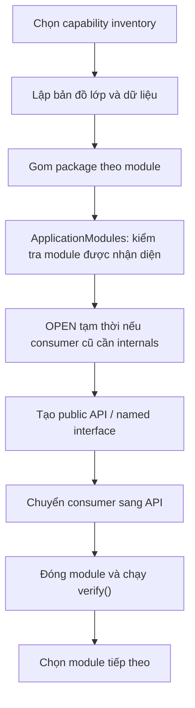

# Nhận diện module trong ứng dụng legacy

Khi đưa Spring Modulith vào một ứng dụng legacy, việc đầu tiên là tìm ra các phần nghiệp vụ có thể trở thành application module. Mã nguồn cũ thường được tổ chức theo tầng kỹ thuật như `controller`, `service`, `repository`, hoặc đã phát triển qua nhiều năm với package không nhất quán. Nếu áp dụng quy tắc phát hiện mặc định ngay mà chưa xem lại cấu trúc, Spring Modulith có thể nhận diện các package kỹ thuật thành module, dù chúng không đại diện cho ranh giới nghiệp vụ.

Hãy bắt đầu bằng cách nhận diện capability, dữ liệu và quy tắc nghiệp vụ mà từng nhóm code sở hữu. Sau đó, lập bản đồ từ package hiện tại sang các module đích, dùng `ApplicationModules` để quan sát mô hình và chuyển đổi từng phần. Spring Modulith hỗ trợ module `OPEN` như một bước chuyển tiếp cho codebase hiện có, cho phép giữ khả năng truy cập package con trong khi nhóm dần thiết lập API và ranh giới rõ ràng.

Sau bài học, bạn có thể:

- Phân biệt package theo tầng kỹ thuật với application module theo nghiệp vụ.
- Nhận diện capability, trách nhiệm và quyền sở hữu dữ liệu trong codebase legacy.
- Đánh giá package structure hiện tại bằng `ApplicationModules`.
- Thiết kế package đích theo module nghiệp vụ.
- Dùng `@ApplicationModule(type = OPEN)` có kiểm soát trong giai đoạn chuyển đổi.
- Chuyển đổi từng module và siết chặt ranh giới bằng verification.

## 1. Vì sao cần nhận diện module trước khi refactor?

Một ứng dụng legacy thường chứa nhiều loại cấu trúc cùng lúc:

- Package được chia theo kỹ thuật: `web`, `service`, `repository`, `entity`.
- Package được chia theo màn hình hoặc use case: `order-entry`, `customer-search`, `stock-report`.
- Các lớp được gom theo lịch sử phát triển, tên người viết hoặc framework cũ.
- Một nghiệp vụ trải qua nhiều package, trong khi một package lại chứa code của nhiều nghiệp vụ.

Spring Modulith nhận diện module dựa trên package arrangement và metadata. Vì thế, cấu trúc package phải phản ánh ranh giới mà nhóm muốn kiểm soát. Nếu package cấp cao nhất là tầng kỹ thuật, mô hình module được tạo ra có thể không có ý nghĩa nghiệp vụ.

Ví dụ, cấu trúc hiện tại:

```text
com.acme.shop
├── ShopApplication.java
├── controller
│   ├── OrderController.java
│   ├── CustomerController.java
│   └── InventoryController.java
├── service
│   ├── OrderService.java
│   ├── CustomerService.java
│   └── InventoryService.java
├── repository
│   ├── OrderRepository.java
│   ├── CustomerRepository.java
│   └── InventoryRepository.java
└── entity
    ├── OrderEntity.java
    ├── CustomerEntity.java
    └── InventoryEntity.java
```

Với detection strategy mặc định `directSubpackages`, các package trực tiếp dưới `com.acme.shop` có thể được nhận diện thành các module `controller`, `service`, `repository` và `entity`. Đây là kết quả đúng theo cấu trúc package, nhưng thường không phải ranh giới nghiệp vụ mà nhóm muốn có.

Mục tiêu của bước nhận diện là tìm được các nhóm có trách nhiệm nghiệp vụ tương đối độc lập, ví dụ `order`, `customer` và `inventory`, rồi tổ chức code để package cấp module phản ánh các nhóm đó.

## 2. Tìm capability và ranh giới nghiệp vụ trong codebase

Đừng bắt đầu bằng cách di chuyển từng lớp theo tên. Trước tiên, hãy tìm các capability mà ứng dụng thực sự cung cấp và xác định ai chịu trách nhiệm cho từng quy tắc nghiệp vụ.

Một số câu hỏi hữu ích:

1. Những chức năng nào thường được thay đổi cùng nhau?
2. Nhóm code nào thực hiện một quy trình nghiệp vụ hoàn chỉnh?
3. Dữ liệu nào có một chủ sở hữu rõ ràng, chịu trách nhiệm tạo, cập nhật và bảo vệ invariant?
4. Những thuật ngữ nào được dùng nhất quán trong yêu cầu, giao diện và mã nguồn?
5. Một thay đổi ở nhóm code này thường buộc nhóm code nào khác phải sửa?
6. Module nào có thể cung cấp một hợp đồng nhỏ để module khác sử dụng mà không cần biết cách triển khai?

Ví dụ trong hệ thống bán hàng:

| Capability | Trách nhiệm điển hình | Dữ liệu có thể sở hữu |
|---|---|---|
| `order` | Tạo đơn, xác nhận, hủy và theo dõi trạng thái đơn | Order, OrderLine, OrderStatus |
| `customer` | Quản lý hồ sơ và thông tin khách hàng | Customer, CustomerAddress |
| `inventory` | Theo dõi tồn kho và giữ hàng | StockItem, Reservation |
| `catalog` | Quản lý sản phẩm và thông tin bán hàng | Product, ProductCategory |
| `payment` | Khởi tạo và theo dõi giao dịch thanh toán | Payment, PaymentAttempt |

Đây là giả thuyết ban đầu, không phải kết luận chỉ dựa vào tên entity. Hãy kiểm tra luồng nghiệp vụ, transaction, quyền ghi dữ liệu và những invariant được bảo vệ. Một bảng `OrderEntity` có thể được dùng bởi nhiều màn hình, nhưng điều đó không có nghĩa mọi màn hình đó thuộc module `order`; ngược lại, một entity có thể chỉ là mô hình persistence của một capability khác.

## 3. Phân biệt module nghiệp vụ với tầng kỹ thuật

Một module nghiệp vụ thường chứa nhiều tầng kỹ thuật phục vụ cùng capability. Thay vì đặt tất cả controller vào một package toàn cục, hãy đặt adapter web bên trong module sở hữu use case đó.

Ví dụ, cấu trúc đích có thể là:

```text
com.acme.shop
├── ShopApplication.java
├── order
│   ├── OrderController.java
│   ├── OrderService.java
│   ├── Order.java
│   └── internal
│       └── OrderRepository.java
├── customer
│   ├── CustomerController.java
│   ├── CustomerService.java
│   └── Customer.java
└── inventory
    ├── InventoryController.java
    ├── InventoryService.java
    └── internal
        └── InventoryRepository.java
```

Các module cấp cao nhất là `order`, `customer` và `inventory`. Package con như `internal`, `web`, `application`, `domain` hoặc `persistence` là các cách tổ chức bên trong module. Chúng không tự trở thành application module riêng nếu không được khai báo hoặc chọn bằng detection strategy phù hợp.

Không bắt buộc mọi module phải có cùng một cây package con. Một module nhỏ có thể giữ các lớp trong package gốc; module lớn hơn có thể tách `domain`, `application`, `web` và `persistence`. Hãy chọn cấu trúc giúp nhóm hiểu được trách nhiệm và API của module, không tạo package rỗng chỉ để làm cho mọi module trông giống nhau.

## 4. Dùng `ApplicationModules` để quan sát cấu trúc hiện tại

Trước khi di chuyển package, hãy tạo module model từ lớp Spring Boot chính:

```java
import org.springframework.modulith.core.ApplicationModules;

class LegacyModuleInspection {

    void inspect() {
        var modules = ApplicationModules.of(ShopApplication.class);

        modules.forEach(System.out::println);
    }
}
```

`ApplicationModules` tạo một biểu diễn trong bộ nhớ về module arrangement được suy ra từ package và metadata. In từng module giúp quan sát:

- Logical name của module.
- Base package được chọn.
- Các Spring bean được phát hiện trong module.
- Một số thông tin visibility và package structure.

Nếu output hiển thị `controller`, `service`, `repository` là các module riêng, điều đó cho thấy package gốc đang phản ánh tầng kỹ thuật. Hãy ghi nhận kết quả này như một bản chụp cấu trúc hiện tại và so sánh với bản đồ capability mong muốn.

Có thể dùng `ApplicationModules.of(ShopApplication.class).verify()` để kiểm tra các quy tắc module. Trong codebase legacy, lần xác minh đầu tiên có thể phát hiện nhiều vi phạm vì các package và tham chiếu đã tồn tại trước khi có ranh giới module. Hãy dùng thông tin đó để lập danh sách việc cần xử lý; đừng vội bỏ qua toàn bộ kết quả hoặc mở tất cả module chỉ để làm test xanh.

## 5. Lập bản đồ từ package cũ sang module đích

Sau khi xác định capability, lập bảng ánh xạ các lớp hiện tại vào module sở hữu chúng. Bảng này giúp phát hiện lớp dùng chung, lớp đặt sai vị trí và quan hệ phụ thuộc khó xử lý.

Ví dụ:

| Package/lớp hiện tại | Module đích | Lý do |
|---|---|---|
| `controller.OrderController` | `order` | Tiếp nhận request cho use case đặt hàng |
| `service.OrderService` | `order` | Điều phối quy tắc tạo và xác nhận đơn |
| `repository.OrderRepository` | `order` | Truy xuất dữ liệu do order sở hữu |
| `entity.OrderEntity` | `order` | Biểu diễn trạng thái đơn hàng |
| `controller.InventoryController` | `inventory` | Tiếp nhận thao tác tồn kho |
| `service.InventoryService` | `inventory` | Giữ hàng và điều chỉnh tồn kho |
| `repository.InventoryRepository` | `inventory` | Truy xuất dữ liệu tồn kho |
| `service.PricingService` | `pricing` hoặc `catalog` | Cần xem quyền sở hữu quy tắc giá trước khi quyết định |
| `util.DateHelper` | Chưa quyết định | Có thể là tiện ích kỹ thuật hoặc logic nghiệp vụ đang bị đặt sai chỗ |

Đừng tự động đưa mọi lớp `util`, `common`, `shared` vào một shared module. Hãy xác định lớp đó có khái niệm nghiệp vụ độc lập hay chỉ là hàm tiện ích kỹ thuật. Nếu một lớp được dùng bởi nhiều module nhưng chứa quy tắc nghiệp vụ, cần xác định module sở hữu quy tắc đó thay vì di chuyển nó sang package chung để tránh dependency.

## 6. Chọn cách để Spring Modulith phát hiện module legacy

Có ba hướng thường dùng, tùy mức độ phù hợp của package structure.

### Dùng package con trực tiếp khi đã có feature package

Nếu codebase đã có package theo capability bên dưới package của lớp ứng dụng, detection mặc định thường là đủ:

```text
com.acme.shop
├── ShopApplication.java
├── order
├── customer
└── inventory
```

Spring Modulith nhận diện mỗi package con trực tiếp thành một module. Không cần thêm `@ApplicationModule` chỉ để package được phát hiện.

### Dùng `additionalPackages` khi có nhiều root package

Một legacy application có thể chứa các namespace độc lập, ví dụ module nghiệp vụ ở `com.acme.shop` và một nhóm capability dùng chung ở `com.acme.shared`. `@Modulithic(additionalPackages = ...)` cho phép đưa root bổ sung vào module model:

```java
package com.acme.shop;

import org.springframework.boot.autoconfigure.SpringBootApplication;
import org.springframework.modulith.Modulithic;

@Modulithic(additionalPackages = "com.acme.shared")
@SpringBootApplication
public class ShopApplication {
}
```

Spring Modulith chạy module detection cho cả package của lớp ứng dụng và root bổ sung. Hãy kiểm tra logical identifier nếu hai root có package con cùng tên; khi cần phân biệt, có thể cấu hình fully qualified module names.

### Dùng explicit hoặc custom detection khi package chưa theo quy ước

Nếu chỉ muốn công nhận các package được đánh dấu, cấu hình:

```properties
spring.modulith.detection-strategy=explicitly-annotated
```

Khi đó, package module cần được đánh dấu bằng `@ApplicationModule` hoặc jMolecules `@Module`. Đây là lựa chọn hữu ích khi codebase có nhiều package trực tiếp dưới root nhưng chỉ một số package là module nghiệp vụ.

Nếu package module tuân theo quy ước tên riêng hoặc nằm ở vị trí khác, triển khai `ApplicationModuleDetectionStrategy` để chọn package phù hợp. Strategy nhận root package và trả về các package được xem là module base package. Hãy dùng custom strategy khi quy ước package hiện tại có thể được mô tả rõ ràng và ổn định; nếu không, tái cấu trúc package thường dễ hiểu hơn một bộ lọc phức tạp.

## 7. Dùng `OPEN` như một bước chuyển tiếp có kiểm soát

Một ứng dụng legacy có thể có rất nhiều tham chiếu chéo đến các lớp nằm trong package con. Chuyển ngay tất cả module sang kiểu `CLOSED` có thể tạo ra hàng trăm lỗi access, dù nhóm mới chỉ muốn bắt đầu nhận diện ranh giới.

Spring Modulith cung cấp module kiểu `OPEN` dành chủ yếu cho codebase hiện có đang chuyển dần sang cách tổ chức package được khuyến nghị. Để khai báo module `inventory` là open, tạo `package-info.java` ở package gốc:

```java
@org.springframework.modulith.ApplicationModule(
        type = org.springframework.modulith.ApplicationModule.Type.OPEN
)
package com.acme.shop.inventory;
```

Với module `OPEN`:

- Truy cập từ module khác đến các kiểu nội bộ được cho phép rộng hơn.
- Các kiểu trong package gốc và package con được đưa vào unnamed named interface, trừ các kiểu được gán rõ ràng vào named interface khác.
- Ranh giới API không còn chặt như module `CLOSED`.

Điều này giúp nhóm đưa module legacy vào module model mà chưa phải di chuyển hoặc công khai tường minh từng package con. Tuy nhiên, nếu để module mở vô thời hạn, các module khác có thể tiếp tục phụ thuộc vào repository, entity hoặc implementation nội bộ. Vì vậy, hãy ghi nhận lý do mở module, các package đang bị sử dụng và mục tiêu chuyển về `CLOSED`.

Không nên mở toàn bộ module chỉ để làm cho verification không còn báo lỗi. Hãy mở đúng module cần chuyển đổi và vẫn kiểm soát dependency graph, các hợp đồng công khai cùng những phụ thuộc mới.

## 8. Chuyển một module theo từng lát cắt

Không cần di chuyển toàn bộ ứng dụng trong một lần. Chọn module có ranh giới tương đối rõ, ít phụ thuộc ngược và có test nghiệp vụ đủ tốt để làm trước.

Một lộ trình thực tế:

1. Chọn capability, ví dụ `inventory`, và liệt kê controller, service, repository, entity cùng các lớp hỗ trợ liên quan.
2. Di chuyển các lớp đó vào package `com.acme.shop.inventory` và các package con của nó. Giữ nguyên hành vi trong bước đầu nếu có thể.
3. Chạy test hiện có để xác nhận refactor package không làm thay đổi chức năng.
4. Tạo module model bằng `ApplicationModules.of(ShopApplication.class)` và kiểm tra `inventory` đã được nhận diện đúng.
5. Nếu cần, tạm khai báo `inventory` là `OPEN` để hỗ trợ các consumer cũ đang tham chiếu package con.
6. Xác định những type mà module khác thực sự cần dùng; đưa chúng vào package gốc hoặc named interface.
7. Chuyển consumer sang API được công khai, thay vì import implementation nội bộ.
8. Đóng module bằng cách bỏ `type = OPEN`, rồi chạy `verify()` để tìm tham chiếu nội bộ còn sót.
9. Lặp lại với module tiếp theo.



Mỗi bước nên tạo ra một thay đổi nhỏ, có thể review và rollback độc lập. Điều đó giúp nhóm xác định được thay đổi package nào gây lỗi nếu một test hoặc luồng nghiệp vụ thất bại.

## 9. Xử lý dependency chéo khi di chuyển package

Khi các lớp được gom vào module nghiệp vụ, những tham chiếu trước đây nằm trong cùng một package kỹ thuật có thể trở thành dependency giữa module. Hãy đọc từng dependency theo quyền sở hữu nghiệp vụ.

Ví dụ, `OrderService` gọi `InventoryRepository` trực tiếp. Sau khi package được tổ chức theo module, đây là dấu hiệu `order` đang truy cập dữ liệu nội bộ của `inventory`:

```java
package com.acme.shop.order;

import com.acme.shop.inventory.internal.InventoryRepository;

class OrderService {

    private final InventoryRepository inventoryRepository;
}
```

Thay vì công khai repository, module `inventory` nên cung cấp một hợp đồng nghiệp vụ:

```java
package com.acme.shop.inventory;

public interface InventoryManagement {

    boolean reserve(String sku, int quantity);
}
```

Module `order` chỉ tham chiếu hợp đồng đó:

```java
package com.acme.shop.order;

import com.acme.shop.inventory.InventoryManagement;

class OrderService {

    private final InventoryManagement inventory;

    OrderService(InventoryManagement inventory) {
        this.inventory = inventory;
    }
}
```

Nếu module cần công khai nhiều nhóm API, hãy đặt chúng trong named interface riêng và khai báo `allowedDependencies` để giới hạn consumer. Đừng biến package `internal` thành API chỉ vì một consumer legacy đang cần một lớp cụ thể.

## 10. Kiểm tra tiến độ modularization bằng verification

Sau khi gom package hoặc thay đổi API, hãy tạo architecture test:

```java
package com.acme.shop.architecture;

import com.acme.shop.ShopApplication;
import org.junit.jupiter.api.Test;
import org.springframework.modulith.core.ApplicationModules;

class ModuleStructureTests {

    @Test
    void verifiesApplicationModuleStructure() {
        ApplicationModules.of(ShopApplication.class).verify();
    }
}
```

`verify()` kiểm tra các quy tắc chính:

- Dependency graph ở cấp module không có chu trình.
- Module đóng chỉ được tham chiếu API package được công khai của module khác.
- Các dependency phải tuân thủ `allowedDependencies` nếu đã khai báo.

Trong giai đoạn đầu, test có thể thất bại do các tham chiếu legacy đã tồn tại. Hãy dùng thông báo để xác định cạnh nào cần xử lý trước. Có thể gọi `detectViolations()` để lấy danh sách vi phạm phục vụ báo cáo hoặc xử lý có kiểm soát, nhưng không nên bỏ qua toàn bộ vi phạm như một trạng thái mặc định.

Sau khi một module được đóng, giữ architecture test trong CI để các tham chiếu nội bộ mới không xuất hiện trở lại. Nếu có custom detection strategy, `additionalPackages` hoặc fully qualified module naming, bảo đảm test và runtime dùng cùng cấu hình.

## 11. Những dấu hiệu cho thấy ranh giới module cần xem lại

| Dấu hiệu trong codebase | Câu hỏi cần đặt ra |
|---|---|
| Nhiều module import trực tiếp repository của nhau | Module nào thực sự sở hữu dữ liệu và thao tác ghi? |
| Một package `common` chứa nhiều service nghiệp vụ | Các capability này có chủ sở hữu riêng không? |
| Hai module phụ thuộc lẫn nhau | Có thể chuyển một hợp đồng hoặc event về module sở hữu khái niệm không? |
| Một module có rất nhiều lớp từ nhiều lĩnh vực | Module có đang gom quá nhiều capability không? |
| Module `OPEN` được giữ lâu dài | Những consumer nào còn dùng internals và API nào cần được công khai? |
| Một module chỉ chứa controller hoặc repository | Package đang phản ánh tầng kỹ thuật thay vì capability phải không? |
| Cùng một entity được nhiều module cập nhật | Quyền sở hữu invariant và transaction có rõ ràng không? |

Một ranh giới tốt không nhất thiết là một module nhỏ nhất. Hãy giữ những phần thường thay đổi cùng nhau và cùng bảo vệ một nhóm invariant trong cùng module. Chỉ tách module khi có lý do về quyền sở hữu, thay đổi, API hoặc vòng đời nghiệp vụ.

## 12. Checklist nhận diện module legacy

- [ ] Đã xác định package gốc của lớp `@SpringBootApplication`.
- [ ] Đã phân biệt package theo tầng kỹ thuật và package theo capability.
- [ ] Đã lập danh sách capability và dữ liệu mà từng capability sở hữu.
- [ ] Đã ánh xạ các lớp cũ sang module đích.
- [ ] Đã quan sát kết quả `ApplicationModules.of(...).forEach(System.out::println)`.
- [ ] Đã chọn detection strategy phù hợp với package structure.
- [ ] Đã xác định module nào cần `OPEN` tạm thời và lý do cụ thể.
- [ ] Đã xác định API mà consumer cần dùng thay cho package nội bộ.
- [ ] Đã chuyển đổi theo từng module và kiểm thử hành vi sau mỗi bước.
- [ ] Đã chạy `ApplicationModules.verify()` và đưa architecture test vào CI.
- [ ] Đã có kế hoạch đóng các module `OPEN` khi consumer không còn truy cập internals.

## 13. Ghi nhớ

Để nhận diện module trong ứng dụng legacy, hãy tìm capability, quy tắc nghiệp vụ và quyền sở hữu dữ liệu trước khi thay đổi package. Package cấp module nên phản ánh nghiệp vụ, còn controller, service, repository và domain model là các thành phần bên trong module. Dùng `ApplicationModules` để quan sát cấu trúc hiện tại, điều chỉnh root package hoặc detection strategy khi cần, rồi di chuyển từng capability. `OPEN` có thể giúp chuyển đổi codebase cũ theo từng bước vì nó cho phép truy cập package con, nhưng cần có kế hoạch công khai API và đóng module. Duy trì `verify()` trong CI để ranh giới mới tiếp tục được bảo vệ.

## Tài liệu tham khảo

- [Spring Modulith Fundamentals – Application Modules](https://docs.spring.io/spring-modulith/reference/fundamentals.html)
- [Spring Modulith Fundamentals – Open Application Modules](https://docs.spring.io/spring-modulith/reference/fundamentals.html#modules.advanced.open)
- [Spring Modulith – Verifying Application Module Structure](https://docs.spring.io/spring-modulith/reference/verification.html)
- [Spring Modulith API – `ApplicationModules`](https://docs.spring.io/spring-modulith/docs/current/api/org/springframework/modulith/core/ApplicationModules.html)
- [Spring Modulith – Quickstart](https://spring.io/projects/spring-modulith/)
