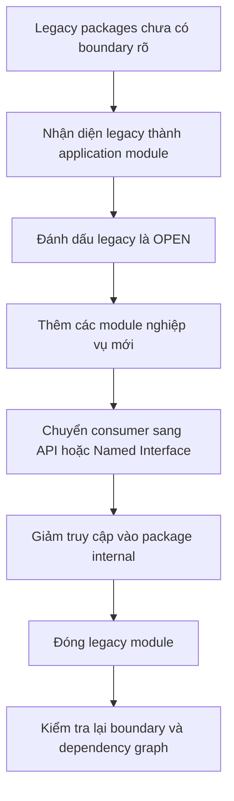

# Khi nào dùng open module để bắt đầu di chuyển?

Khi đưa Spring Modulith vào một ứng dụng Spring Boot đã tồn tại lâu năm, mã nguồn thường chưa có ranh giới package rõ ràng. Một mô-đun nghiệp vụ có thể chứa nhiều package con, và các mô-đun khác có thể đang tham chiếu trực tiếp service, repository, entity hoặc helper nằm sâu bên trong các package đó. Nếu áp dụng ngay quy tắc đóng của Spring Modulith, quá nhiều dependency cũ có thể bị báo vi phạm cùng lúc.

Trong giai đoạn đầu của quá trình chuyển đổi, có thể đánh dấu một mô-đun hiện hữu là `OPEN`. Cách này cho phép các mô-đun khác tiếp tục truy cập các kiểu nội bộ của mô-đun đó trong khi nhóm từng bước thiết kế API công khai và di chuyển các consumer. Open module là một cơ chế chuyển tiếp để đưa kiến trúc cũ vào mô hình có thể kiểm tra; nó không phải đích đến của một modular monolith đã hoàn thiện.

## 1. Khi nào một legacy module cần được mở?

Giả sử ứng dụng `com.acme.shop` đã có package `legacy` chứa nhiều chức năng được phát triển qua nhiều năm:

```text
com.acme.shop
├── ShopApplication.java
├── legacy
│   ├── billing
│   │   ├── BillingService.java
│   │   └── internal
│   │       └── LegacyTaxCalculator.java
│   ├── customer
│   │   └── CustomerRepository.java
│   └── persistence
│       └── LegacyEntityManager.java
├── orders
│   └── OrderService.java
└── inventory
    └── InventoryService.java
```

Các mô-đun `orders` và `inventory` có thể đang sử dụng trực tiếp các lớp nằm trong `legacy.billing.internal`, `legacy.customer` hoặc `legacy.persistence`. Nhóm chưa thể di chuyển tất cả consumer trong một lần vì những kiểu đó đã được dùng ở nhiều luồng nghiệp vụ.

Một open module phù hợp khi có đủ các điều kiện sau:

- Package legacy đã có thể được nhận diện như một mô-đun riêng trong module model.
- Nhiều consumer hiện hữu đang phụ thuộc vào các package con của mô-đun đó.
- Việc thiết kế và chuyển toàn bộ các hợp đồng sang API công khai cần nhiều bước hoặc nhiều nhóm cùng phối hợp.
- Nhóm muốn bắt đầu kiểm tra cấu trúc mô-đun và di chuyển các phần khác trong khi vẫn duy trì hoạt động của phần legacy.
- Có kế hoạch rõ ràng để giảm các truy cập nội bộ và đóng mô-đun sau khi chuyển đổi.

Nếu chỉ có một hoặc hai dependency chưa được công khai, hãy cân nhắc đưa hợp đồng cần thiết vào package gốc hoặc tạo Named Interface. Mở toàn bộ mô-đun trong trường hợp nhỏ như vậy sẽ làm phạm vi truy cập rộng hơn nhu cầu thực tế.

## 2. Open module thay đổi điều gì?

Mặc định, một application module có kiểu `CLOSED`. Mô-đun đóng chỉ cho phép mô-đun khác truy cập package API mặc định và những package con được công khai bằng Named Interface. Các package con còn lại được xem là nội bộ.

Khi khai báo `type = Type.OPEN`, Spring Modulith thay đổi cách xác minh quyền truy cập:

1. Các mô-đun khác được phép truy cập những kiểu nội bộ của open module.
2. Các kiểu trong package gốc và package con được đưa vào unnamed named interface, trừ các kiểu/package đã được gán rõ ràng vào Named Interface.
3. Open module vẫn được nhận diện trong application module model, nhưng theo API hiện hành, nó bị loại khỏi thuật toán phát hiện dependency cycle.

Điểm thứ ba rất quan trọng khi đánh giá rủi ro. Nếu một chu trình phụ thuộc đi qua open module, kiểm tra cycle của Spring Modulith có thể không phát hiện chu trình đó. Vì vậy, không được xem việc `ApplicationModules.verify()` chạy qua trong lúc có open module là bằng chứng rằng toàn bộ dependency graph đã không còn chu trình.

| Thuộc tính | Module `CLOSED` | Module `OPEN` |
|---|---|---|
| Truy cập package nội bộ từ mô-đun khác | Bị kiểm tra và không được phép theo mặc định | Được phép theo quy tắc open module |
| Các kiểu trong package con | Nội bộ, trừ khi được công khai | Được đưa vào unnamed interface, trừ kiểu đã gán Named Interface |
| Kiểm tra dependency cycle | Có tham gia | Bị loại khỏi thuật toán phát hiện cycle |
| Vai trò phù hợp | Trạng thái mục tiêu khi boundary đã rõ | Giai đoạn chuyển đổi legacy có kiểm soát |

Open module không thay đổi modifier Java, không biến lớp package-private thành `public`, không di chuyển package và không thay đổi component scan của Spring. Nó điều chỉnh cách Spring Modulith mô hình hóa và xác minh quyền truy cập giữa các mô-đun.

## 3. Đánh dấu package legacy là OPEN

Đặt `package-info.java` tại package gốc của mô-đun cần mở. Ví dụ, file `src/main/java/com/acme/shop/legacy/package-info.java`:

```java
@org.springframework.modulith.ApplicationModule(
    type = org.springframework.modulith.ApplicationModule.Type.OPEN
)
package com.acme.shop.legacy;
```

Sau khai báo này, `legacy` trở thành một open application module. Các package con như `legacy.billing`, `legacy.billing.internal`, `legacy.customer` và `legacy.persistence` được xem là một phần của mô-đun `legacy`, trừ khi package được khai báo thành nested application module riêng.

Không đặt annotation này tại package gốc toàn ứng dụng `com.acme.shop`, vì điều đó sẽ mở phạm vi của toàn bộ ứng dụng thay vì chỉ mô-đun legacy cần chuyển đổi. Hãy đặt annotation ở đúng module base package.

Nếu dự án dùng Kotlin và không có `package-info.java`, có thể khai báo `@ApplicationModule(type = ApplicationModule.Type.OPEN)` trên một kiểu metadata ở package gốc và đánh dấu kiểu đó bằng `@PackageInfo` theo cách Spring Modulith hỗ trợ.

## 4. Consumer có thể tiếp tục sử dụng kiểu nội bộ

Giả sử `LegacyTaxCalculator` nằm trong package nội bộ:

```java
package com.acme.shop.legacy.billing.internal;

import java.math.BigDecimal;

public class LegacyTaxCalculator {

    public BigDecimal calculate(BigDecimal netAmount) {
        return netAmount.multiply(new BigDecimal("0.10"));
    }
}
```

Mô-đun `orders` hiện đang phụ thuộc trực tiếp vào lớp đó:

```java
package com.acme.shop.orders;

import java.math.BigDecimal;

import com.acme.shop.legacy.billing.internal.LegacyTaxCalculator;
import org.springframework.stereotype.Service;

@Service
public class OrderService {

    private final LegacyTaxCalculator taxCalculator;

    public OrderService(LegacyTaxCalculator taxCalculator) {
        this.taxCalculator = taxCalculator;
    }

    public BigDecimal calculateTax(BigDecimal netAmount) {
        return taxCalculator.calculate(netAmount);
    }
}
```

Trong một mô-đun đóng, dependency tới `legacy.billing.internal` sẽ vi phạm boundary. Khi `legacy` được mở, Spring Modulith cho phép truy cập kiểu nội bộ đó trong quá trình chuyển đổi.

Nếu `orders` khai báo allow-list bằng `allowedDependencies`, vẫn phải cho phép dependency tới mô-đun `legacy`. Open module mở rộng các kiểu có thể truy cập bên trong mô-đun đích; nó không xóa quy tắc allow-list mà mô-đun nguồn đã khai báo.

Ví dụ, `src/main/java/com/acme/shop/orders/package-info.java` có thể chứa:

```java
@org.springframework.modulith.ApplicationModule(
    allowedDependencies = "legacy"
)
package com.acme.shop.orders;
```

Trong ví dụ này, `orders` được phép phụ thuộc vào `legacy`; do `legacy` là open module, consumer có thể tiếp tục tham chiếu kiểu trong package con của nó. Hãy giới hạn allow-list theo đúng mô-đun cần thiết thay vì thêm tất cả mô-đun vào danh sách.

## 5. Open module là bước đệm cho quá trình chia tách

Một lộ trình thực tế có thể bắt đầu bằng cách nhận diện một vùng legacy lớn, sau đó tách dần các hợp đồng và consumer:



**Giai đoạn 1 — Đưa legacy vào module model.** Chọn package base có trách nhiệm đủ rõ, khai báo nó thành application module và ghi nhận các consumer đang phụ thuộc vào các package con. Không cần di chuyển tất cả lớp ngay từ đầu.

**Giai đoạn 2 — Mở mô-đun có chủ đích.** Dùng `type = Type.OPEN` để những dependency cũ chưa thể di chuyển không chặn bước thiết lập module model. Ghi lại các module nguồn đang sử dụng `legacy` và các package nội bộ được tham chiếu.

**Giai đoạn 3 — Tạo API ổn định.** Với mỗi nhóm hành vi cần chia sẻ, thiết kế facade, interface, DTO hoặc event contract trong package gốc hoặc Named Interface. API nên phản ánh nghiệp vụ mà consumer cần, không phơi bày repository, entity hoặc helper nội bộ chỉ vì chúng đang tồn tại.

**Giai đoạn 4 — Chuyển từng consumer.** Thay import nội bộ bằng API mới. Di chuyển theo luồng nghiệp vụ hoặc theo nhóm consumer để mỗi thay đổi có thể review và kiểm thử độc lập. Giữ adapter hoặc facade trong `legacy` để tương thích trong thời gian chuyển đổi nếu cần.

**Giai đoạn 5 — Thu hẹp quyền truy cập.** Khi một package nội bộ không còn được mô-đun khác sử dụng, giữ nó trong phần triển khai của `legacy`. Nếu một hợp đồng cần chia sẻ lâu dài, công khai chính xác package đó bằng `@NamedInterface`.

**Giai đoạn 6 — Đóng mô-đun.** Khi các consumer đã chuyển sang hợp đồng được công khai, bỏ `type = Type.OPEN` hoặc đặt kiểu mô-đun thành `CLOSED`. Chạy lại verification để tìm các truy cập nội bộ còn sót và sửa chúng trước khi hoàn tất.

## 6. Tách hợp đồng khỏi implementation trong khi module đang OPEN

Giả sử nhiều consumer đang dùng `LegacyTaxCalculator`. Nhóm quyết định tạo một hợp đồng ổn định trong Named Interface `legacy::api`:

```java
@org.springframework.modulith.NamedInterface("api")
package com.acme.shop.legacy.api;
```

```java
package com.acme.shop.legacy.api;

import java.math.BigDecimal;

public interface TaxCalculator {

    BigDecimal calculate(BigDecimal netAmount);
}
```

Implementation cũ có thể được điều chỉnh để triển khai interface:

```java
package com.acme.shop.legacy.billing.internal;

import java.math.BigDecimal;

import com.acme.shop.legacy.api.TaxCalculator;
import org.springframework.stereotype.Component;

@Component
class LegacyTaxCalculator implements TaxCalculator {

    @Override
    public BigDecimal calculate(BigDecimal netAmount) {
        return netAmount.multiply(new BigDecimal("0.10"));
    }
}
```

Consumer chuyển sang phụ thuộc vào interface:

```java
package com.acme.shop.orders;

import java.math.BigDecimal;

import com.acme.shop.legacy.api.TaxCalculator;
import org.springframework.stereotype.Service;

@Service
public class OrderService {

    private final TaxCalculator taxCalculator;

    public OrderService(TaxCalculator taxCalculator) {
        this.taxCalculator = taxCalculator;
    }

    public BigDecimal calculateTax(BigDecimal netAmount) {
        return taxCalculator.calculate(netAmount);
    }
}
```

Sau khi consumer đã dùng API mới, có thể giới hạn dependency trong `orders/package-info.java`:

```java
@org.springframework.modulith.ApplicationModule(
    allowedDependencies = "legacy::api"
)
package com.acme.shop.orders;
```

Việc công khai `legacy::api` không bắt buộc phải đóng toàn bộ `legacy` ngay lập tức. Nhóm có thể chuyển từng consumer, theo dõi các truy cập nội bộ còn lại, rồi đóng mô-đun khi đã sẵn sàng. Khi `legacy` vẫn là open module, các kiểu khác chưa được gán Named Interface vẫn được đưa vào unnamed interface; vì vậy, allow-list cần được duy trì đúng theo hợp đồng consumer đang sử dụng.

## 7. Những giới hạn và rủi ro phải quản lý

Open module làm giảm mức bảo vệ kiến trúc đối với chính mô-đun đó. Các rủi ro chính gồm:

**Dependency nội bộ có thể tiếp tục tăng.** Vì consumer có thể truy cập các package con, code mới có thể tạo thêm import tới repository, entity hoặc helper nội bộ. Nếu không theo dõi, việc mở tạm thời sẽ trở thành trạng thái vĩnh viễn.

**Hợp đồng triển khai dễ bị coi là API.** Khi nhiều consumer dùng cùng một lớp internal, nhóm có thể khó thay đổi chữ ký hoặc cấu trúc lớp. Việc tạo facade và DTO ổn định cần được ưu tiên trong quá trình chuyển đổi.

**Kiểm tra chu trình có điểm mù.** Open module bị loại khỏi thuật toán phát hiện dependency cycle theo API hiện hành. Chu trình có liên quan tới mô-đun đang mở có thể không được báo bởi kiểm tra cycle của Spring Modulith. Hãy theo dõi dependency bằng các rule bổ sung hoặc công cụ phân tích phù hợp trong thời gian mô-đun còn mở.

**Verification pass không đồng nghĩa đã đóng boundary.** Khi một open module cho phép truy cập internal, `ApplicationModules.verify()` có thể không báo các truy cập mà nhóm vẫn muốn loại bỏ về lâu dài. Cần có tiêu chí migration riêng, chẳng hạn danh sách package internal được consumer tham chiếu phải giảm về không trước khi đóng module.

**Nhiều open module làm mất giá trị kiểm tra.** Nếu đánh dấu phần lớn ứng dụng là open, Spring Modulith khó bảo vệ các boundary mà nhóm đang muốn thiết lập. Chỉ mở những mô-đun legacy cụ thể có nhu cầu chuyển đổi thực tế.

Open module cũng không tự động cho phép mọi dependency bất kể cấu hình. Nếu mô-đun consumer đã khai báo `allowedDependencies`, dependency tới mô-đun nguồn vẫn phải nằm trong allow-list. Hãy xem riêng hai câu hỏi: mô-đun nguồn có được phép phụ thuộc vào mô-đun đích không, và kiểu được tham chiếu có thuộc phần API mà mô-đun đích công khai không?

## 8. Đo tiến độ trước khi đóng module

Đừng chỉ dựa vào việc build thành công để quyết định đã có thể chuyển open module về closed. Hãy theo dõi các chỉ số cụ thể:

| Chỉ số | Mục tiêu trước khi đóng |
|---|---|
| Consumer import package `internal` của legacy | Không còn consumer ngoài mô-đun |
| Dependency tới mô-đun legacy | Chỉ còn các consumer đã được phê duyệt |
| Hợp đồng cần dùng lâu dài | Được chuyển sang package gốc hoặc Named Interface rõ ràng |
| API trả về entity hoặc persistence projection | Được thay bằng DTO hoặc hợp đồng nghiệp vụ phù hợp |
| Dependency cycle liên quan tới legacy | Được kiểm tra riêng vì open module bị loại khỏi cycle detection |
| Architecture test | Chạy qua sau khi legacy được đóng |

Có thể dùng tìm kiếm mã nguồn hoặc custom ArchUnit rule trong dự án để thống kê consumer đang tham chiếu các package như `..legacy..internal..`. Giữ thống kê này trong quá trình migration để biết mỗi lần thay đổi đã loại bỏ được bao nhiêu dependency nội bộ.

Khi không còn truy cập nội bộ từ bên ngoài, chuyển `legacy` về trạng thái đóng và chạy lại `ApplicationModules.of(ShopApplication.class).verify()`. Những lỗi còn lại là danh sách cụ thể các dependency chưa tuân thủ boundary hoặc các hợp đồng chưa được công khai đúng cách.

## 9. Ví dụ kiểm tra module sau khi đóng

Architecture test vẫn có thể dùng cùng một lời gọi verification:

```java
package com.acme.shop;

import org.junit.jupiter.api.Test;
import org.springframework.modulith.core.ApplicationModules;

class ModularityTests {

    @Test
    void verifiesModuleBoundaries() {
        ApplicationModules.of(ShopApplication.class).verify();
    }
}
```

Khi `legacy` được đóng, truy cập từ `orders` tới `legacy.billing.internal.LegacyTaxCalculator` sẽ bị kiểm tra như một truy cập package nội bộ. Consumer phải dùng `legacy.api.TaxCalculator` đã công khai. Nếu một consumer cần một hợp đồng khác, hãy bổ sung Named Interface tương ứng thay vì mở lại toàn bộ mô-đun.

Nếu test vẫn pass sau khi đóng module, hãy kiểm tra cả các dependency cycle và các rule bổ sung của dự án. Điều đó giúp bảo đảm quá trình chuyển đổi không chỉ làm giảm lỗi package access mà còn duy trì dependency graph dễ hiểu.

## 10. Bài tập tự kiểm tra

Với ứng dụng `com.acme.shop`, mô-đun `legacy` chứa các package `billing`, `customer` và `persistence`; `orders` đang import `legacy.billing.internal.LegacyTaxCalculator`.

| Tình huống | Cách xử lý phù hợp | Lý do |
|---|---|---|
| Nhiều mô-đun đang dùng nhiều package con của legacy và chưa thể chuyển ngay | Đánh dấu riêng `legacy` là `OPEN` | Cho phép đưa vùng legacy vào module model mà không phải sửa tất cả consumer cùng lúc |
| Chỉ một consumer cần một interface từ package con | Tạo Named Interface và khai báo dependency tương ứng | Phạm vi công khai nhỏ hơn mở toàn bộ mô-đun |
| `orders` đã chuyển sang `legacy::api` | Thu hẹp `allowedDependencies` của `orders` về `legacy::api` | Consumer chỉ cần hợp đồng đã được công khai |
| Không còn consumer truy cập package internal | Chuyển `legacy` về `CLOSED` và chạy verification | Khôi phục kiểm tra boundary và cycle cho mô-đun |
| Verification pass trong khi `legacy` vẫn OPEN | Tiếp tục kiểm tra danh sách internal access và cycle riêng | Open module làm giảm một phần bảo vệ của verification |

Hãy thực hiện một lộ trình nhỏ trong nhánh thử nghiệm:

1. Đánh dấu `legacy` là open bằng `@ApplicationModule(type = ApplicationModule.Type.OPEN)`.
2. Tạo một API hoặc Named Interface cho một nghiệp vụ mà `orders` đang sử dụng.
3. Chuyển `OrderService` từ lớp internal sang hợp đồng công khai.
4. Thu hẹp `allowedDependencies` của `orders` nếu mô-đun đang dùng allow-list.
5. Xác nhận consumer không còn tham chiếu package internal của `legacy`.
6. Đóng `legacy`, chạy `ApplicationModules.verify()` và xử lý các vi phạm còn lại.

Sau bài tập, bạn cần giải thích được vì sao open module hữu ích khi bắt đầu modular hóa một codebase legacy, những quy tắc nào bị nới lỏng, vì sao cycle detection có điểm mù và các điều kiện cần đạt trước khi chuyển mô-đun về trạng thái closed.

## Tài liệu tham khảo

- [Spring Modulith — Fundamentals: Open Application Modules](https://docs.spring.io/spring-modulith/reference/fundamentals.html#modules.advanced.open)
- [API — ApplicationModule.Type](https://docs.spring.io/spring-modulith/docs/current/api/org/springframework/modulith/ApplicationModule.Type.html)
- [API — ApplicationModule](https://docs.spring.io/spring-modulith/docs/current/api/org/springframework/modulith/ApplicationModule.html)
- [Spring Modulith — Verifying Application Module Structure](https://docs.spring.io/spring-modulith/reference/verification.html)
