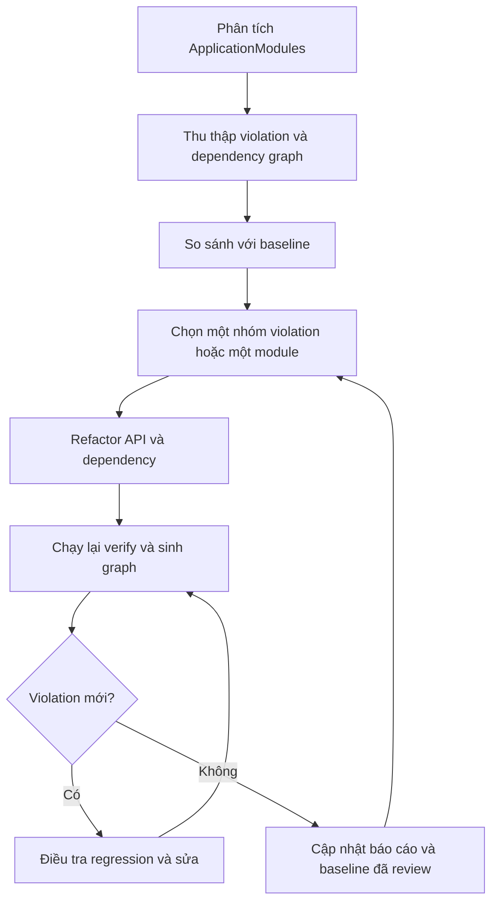

# Legacy modularization

## Đo tiến bộ bằng số violation và độ rõ graph

Khi đưa Spring Modulith vào một ứng dụng đã tồn tại lâu năm, nhóm thường phát hiện nhiều dependency vượt ranh giới package, truy cập implementation nội bộ hoặc chu trình giữa các module. Nếu chỉ nhìn vào một lần chạy `verify()`, nhóm biết kiến trúc đang có vấn đề nhưng khó trả lời ba câu hỏi: tình trạng hiện tại là bao nhiêu, thay đổi gần đây có cải thiện không, và graph có dễ hiểu hơn không?

Để theo dõi quá trình modularization, hãy kết hợp hai nhóm bằng chứng: **số lượng và loại violation** do Spring Modulith phát hiện, cùng **độ rõ của dependency graph** được sinh từ mô hình application module. Các con số cần được gắn với một commit và một cấu hình phân tích cố định để có thể so sánh qua thời gian.

### 1. Tạo baseline trước khi refactor

Baseline là ảnh chụp ban đầu của kiến trúc trước khi nhóm bắt đầu thay đổi. Nó giúp phân biệt vấn đề đã tồn tại với regression do pull request mới tạo ra.

Ví dụ, ứng dụng legacy có các module `orders`, `inventory`, `customers` và `billing`. Trước khi di chuyển class hoặc tách package, hãy tạo mô hình bằng `ApplicationModules` và ghi lại violation:

```java
import org.springframework.modulith.core.ApplicationModules;
import org.springframework.modulith.core.Violations;

class ArchitectureInventory {

    void inspect() {
        var modules = ApplicationModules.of(Application.class);
        Violations violations = modules.detectViolations();

        System.out.println(violations);
    }
}
```

`detectViolations()` thu thập các vi phạm phát hiện được mà không yêu cầu nhóm phải coi toàn bộ trạng thái legacy là đạt. Có thể dùng kết quả này để lập danh sách ban đầu, phân loại từng vi phạm và lên kế hoạch xử lý. Khi kiến trúc đã đạt yêu cầu, `verify()` là assertion phù hợp để làm test thất bại nếu có vi phạm.

Baseline nên ghi lại ít nhất:

- Commit hoặc tag nguồn được phân tích.
- Phiên bản Spring Modulith, JDK và cấu hình module detection.
- Số module được phát hiện và tên các module.
- Tổng số violation và số violation theo từng nhóm.
- Danh sách dependency giữa các module và các chu trình đã biết.
- Sơ đồ PlantUML được sinh ở cùng commit.

Không so sánh hai lần đo nếu package gốc, detection strategy, dependency version hoặc phạm vi source code đã thay đổi mà không ghi nhận. Chẳng hạn, đổi từ package-based detection sang `explicitly-annotated` có thể làm số module được nhận diện thay đổi; đó là thay đổi cách đo, chưa chắc là cải thiện kiến trúc.

### 2. Đếm violation theo cách có ích

Một tổng số duy nhất thường không đủ để điều phối công việc. Hãy phân loại vi phạm theo nguyên nhân và theo cặp module liên quan. Với mô hình Spring Modulith, các nhóm thường gặp gồm:

| Nhóm violation | Ý nghĩa | Hướng xử lý thường gặp |
|---|---|---|
| Dependency cycle | Các module phụ thuộc vòng tròn | Xác định chiều phụ thuộc nghiệp vụ, tách hợp đồng hoặc chuyển giao tiếp sang event khi phù hợp |
| Access to internal package | Module truy cập package không được công khai của module khác | Đưa API cần dùng vào package công khai hoặc named interface |
| Disallowed dependency | Module phụ thuộc vào module hoặc named interface không nằm trong `allowedDependencies` | Xác nhận lại hợp đồng và khai báo dependency được phép nếu đó là chủ đích kiến trúc |
| Dependency phát sinh qua event listener | Module lắng nghe event của module khác, tạo quan hệ phụ thuộc dù không có lời gọi service trực tiếp | Đánh giá quyền sở hữu event, chiều phụ thuộc và hợp đồng sự kiện |

Số violation nên được nhìn ở ít nhất hai mức:

1. **Occurrence count**: số occurrence mà công cụ báo cáo. Một cặp module có thể có nhiều vị trí truy cập vi phạm.
2. **Unique violation count**: số vấn đề đã chuẩn hóa theo module nguồn, module đích, loại dependency và thành phần bị truy cập. Chỉ số này giúp tránh đếm một nguyên nhân nhiều lần do có nhiều call site tương tự.

Khi chuẩn hóa, giữ lại vị trí mã nguồn để lập ticket và review, nhưng dùng một fingerprint ổn định để so sánh qua commit. Ví dụ, fingerprint có thể dựa trên module nguồn, module đích, loại dependency và tên package hoặc kiểu bị truy cập. Không dùng số dòng làm thành phần duy nhất vì di chuyển code sẽ làm fingerprint thay đổi dù vấn đề kiến trúc vẫn còn.

Với baseline legacy, phân biệt:

- **Existing**: violation đã có trong baseline và vẫn còn.
- **New**: violation chưa có trong baseline.
- **Resolved**: violation có trong baseline nhưng không còn ở lần đo hiện tại.
- **Reintroduced**: violation từng được xử lý nhưng xuất hiện lại.

Nhờ vậy, một pull request có thể được đánh giá là không tạo regression ngay cả khi toàn ứng dụng chưa đạt zero violation. Mục tiêu dài hạn vẫn là giảm và loại bỏ các vi phạm đã chấp nhận tạm thời, thay vì giữ baseline như một danh sách miễn trừ vĩnh viễn.

### 3. Dùng `verify()` làm cổng chất lượng

Khi bắt đầu modularization, nhóm có thể dùng `detectViolations()` để khảo sát và phân loại hiện trạng. Khi đã xác định quy tắc phải tuân thủ, đưa `verify()` vào test suite:

```java
import org.junit.jupiter.api.Test;
import org.springframework.modulith.core.ApplicationModules;

class ModularityTests {

    @Test
    void verifiesModuleBoundaries() {
        ApplicationModules.of(Application.class).verify();
    }
}
```

`verify()` làm test thất bại nếu mô hình có violation. Với codebase legacy còn nhiều vấn đề đã biết, nhóm có thể triển khai theo giai đoạn:

- Giai đoạn khảo sát: tạo baseline và thống nhất cách phân loại violation.
- Giai đoạn không regression: CI so sánh violation hiện tại với baseline, chặn violation mới và yêu cầu mọi thay đổi baseline được review.
- Giai đoạn giảm nợ kiến trúc: xử lý từng nhóm violation, cập nhật baseline sau khi vấn đề được giải quyết.
- Giai đoạn enforcement: khi các vi phạm đã xử lý hết, dùng `verify()` như cổng bắt buộc cho mọi thay đổi.

Nếu dùng cơ chế so sánh baseline riêng, hãy để nó làm rõ danh sách violation mới và đã được xử lý. Không bắt exception của `verify()` rồi trả về test xanh, vì cách đó che mất regression. Cũng không tự động cập nhật baseline mỗi khi CI thất bại; baseline chỉ được cập nhật cùng một thay đổi kiến trúc đã được review.

### 4. Đo graph thay vì chỉ đếm lỗi

Dependency graph thể hiện các module như node và quan hệ phụ thuộc như directed edge. Spring Modulith có thể sinh sơ đồ PlantUML từ cùng một mô hình:

```java
import org.springframework.modulith.core.ApplicationModules;
import org.springframework.modulith.docs.Documenter;

class ModuleDocumentation {

    void generate() {
        var modules = ApplicationModules.of(Application.class);

        new Documenter(modules)
            .writeModulesAsPlantUml();
    }
}
```

Đưa file `.puml` được sinh vào artifact của CI hoặc lưu ảnh render cùng báo cáo. Sơ đồ giúp reviewer nhìn ra module nào phụ thuộc nhiều nơi, module nào đang trở thành trung tâm và quan hệ nào cần được giải thích.

Có thể theo dõi một số chỉ số graph cơ bản:

| Chỉ số | Cách hiểu | Câu hỏi kiến trúc |
|---|---|---|
| `N` — số node | Số application module được phát hiện | Ranh giới module có được xác định rõ và ổn định không? |
| `E` — số edge | Số quan hệ dependency có hướng giữa các module | Có bao nhiêu quan hệ liên module cần duy trì? |
| In-degree / out-degree | Số module phụ thuộc vào một module hoặc số module mà nó phụ thuộc, theo quy ước mũi tên đã chọn | Module nào là dependency dùng chung? Module nào phụ thuộc quá nhiều nơi? |
| Cycle count | Số chu trình hoặc nhóm strongly connected có nhiều module | Các module có thể được sắp xếp theo thứ tự phụ thuộc rõ ràng không? |
| Edge density | Mức độ dày của graph so với số edge tối đa | Dependency graph có đang trở nên quá dày không? |
| Named-interface usage | Các edge đi qua named interface được công khai | Hợp đồng giữa module có được biểu đạt tường minh không? |

Với graph có hướng, không có self-edge và tối đa một edge cho mỗi cặp module, mật độ có thể tính như sau:

\[
Density = \frac{E}{N(N-1)} \quad (N > 1)
\]

Nếu một cặp module có nhiều loại dependency hoặc nhiều quan hệ khác nhau, hãy thống nhất trước khi đếm edge là graph đơn (một edge cho mỗi cặp) hay multigraph (nhiều edge). Dùng cùng một quy ước trong mọi lần đo.

**Không xem density thấp là mục tiêu tuyệt đối.** Một ứng dụng có nhiều module độc lập có thể có density thấp nhưng vẫn khó hiểu vì tên module mơ hồ hoặc ranh giới nghiệp vụ bị chia nhỏ quá mức. Ngược lại, một module nền tảng có nhiều module phụ thuộc vào nó chưa chắc là thiết kế sai nếu nó thực sự cung cấp capability dùng chung ổn định.

### 5. Đánh giá độ rõ của graph

Độ rõ không thể được biểu diễn đầy đủ bằng một con số. Hãy kết hợp chỉ số định lượng với review sơ đồ và khả năng giải thích của nhóm.

Một graph dễ hiểu thường có các dấu hiệu:

- Tên module phản ánh capability hoặc ngôn ngữ nghiệp vụ, chẳng hạn `orders`, `inventory`, `billing`.
- Mỗi edge có thể giải thích bằng một nhu cầu nghiệp vụ hoặc một hợp đồng kỹ thuật có chủ đích.
- Hướng phụ thuộc tương đối nhất quán; các module nghiệp vụ không tùy tiện gọi ngược vào implementation của nhau.
- Không có chu trình khiến nhóm khó xác định module nào sở hữu capability hoặc dữ liệu.
- Các API công khai và named interface có tên dễ hiểu, không phơi bày package nội bộ.
- Module có nhiều incoming dependency được nhận diện là capability dùng chung và có owner rõ ràng.

Trong buổi review, yêu cầu người đọc chọn một module bất kỳ và trả lời được: module này cung cấp gì, phụ thuộc vào ai, module nào đang phụ thuộc vào nó, và các edge quan trọng đi qua API nào. Nếu sơ đồ có nhiều đường cắt nhau hoặc một node có quá nhiều edge khó giải thích, hãy cân nhắc chia sơ đồ theo bounded context, nhóm module hoặc tạo canvas riêng cho module cần xem xét.

### 6. Ví dụ theo dõi tiến bộ qua hai lần đo

Giả sử baseline của ứng dụng có 8 module, 17 edge và 6 unique violation. Sau một số thay đổi, nhóm tách thêm module `pricing`, loại bỏ dependency trực tiếp vào package nội bộ và giảm chu trình. Lần đo mới có 9 module, 13 edge và 2 unique violation.

| Chỉ số | Baseline | Lần đo mới | Thay đổi |
|---|---:|---:|---:|
| Số module (`N`) | 8 | 9 | +1 |
| Số edge (`E`) | 17 | 13 | -4 |
| Edge density | 0,304 | 0,181 | Giảm |
| Unique violation | 6 | 2 | -4 |
| Dependency cycle | 1 | 0 | Đã loại bỏ |
| Edge truy cập package nội bộ | 5 | 1 | -4 |

Các số liệu cho thấy dependency graph ít dày hơn, số violation giảm và chu trình đã được loại bỏ. Tuy vậy, edge truy cập package nội bộ vẫn còn một trường hợp; nhóm cần giữ nó trong backlog và xác định API phù hợp. Việc số module tăng từ 8 lên 9 không phải regression tự thân: module mới có thể giúp tách một capability vốn bị trộn trong module cũ.

Mỗi báo cáo nên có thêm phần giải thích thay đổi: module nào được tách, edge nào được loại bỏ, named interface nào được tạo, violation nào được giải quyết và rủi ro nào còn lại. Con số giúp định hướng; giải thích kiến trúc giúp reviewer đánh giá liệu thay đổi có làm hệ thống dễ bảo trì hơn hay chỉ làm graph trông thưa hơn.

### 7. Tổ chức báo cáo trong CI

Với mỗi commit hoặc pull request, lưu cùng nhau:

1. Kết quả test `ApplicationModules.verify()` hoặc danh sách violation từ bước khảo sát.
2. Báo cáo số violation theo nhóm, bao gồm new, existing và resolved.
3. File PlantUML và ảnh sơ đồ đã render nếu pipeline hỗ trợ.
4. Số node, edge, density và cycle theo quy ước đếm đã thống nhất.
5. Commit SHA, phiên bản công cụ và cấu hình detection strategy.

Một bảng theo dõi theo thời gian có thể có dạng:

| Commit | Modules | Edges | Unique violations | New | Resolved | Cycles |
|---|---:|---:|---:|---:|---:|---:|
| `baseline` | 8 | 17 | 6 | 6 | 0 | 1 |
| `feature-a` | 8 | 15 | 4 | 0 | 2 | 1 |
| `feature-b` | 9 | 13 | 2 | 0 | 2 | 0 |

Đối với pull request, ưu tiên báo cáo phần chênh lệch so với base branch để reviewer nhìn thấy tác động của thay đổi hiện tại. Báo cáo toàn bộ graph vẫn hữu ích như artifact để kiểm tra xu hướng dài hạn.

### 8. Những sai lệch cần tránh khi diễn giải metric

- **Giảm violation bằng cách bỏ phát hiện module:** nếu đổi detection strategy hoặc loại package khỏi phạm vi phân tích, số violation có thể giảm mà kiến trúc không tốt lên. Ghi lại mọi thay đổi cấu hình và xem đó là mốc đo mới.
- **Giảm edge bằng cách gom mọi thứ vào một module:** số edge liên module có thể giảm nhưng module trở nên quá lớn và mất ranh giới. Theo dõi cả số module, trách nhiệm nghiệp vụ và kích thước module.
- **Coi mọi dependency là xấu:** dependency qua API công khai là một phần bình thường của modular monolith. Mục tiêu là dependency có chủ đích, có hướng và tuân thủ hợp đồng.
- **Coi named interface coverage là điểm số tuyệt đối:** package API gốc cũng có thể là hợp đồng công khai hợp lệ. Named interface có ích khi module có nhiều nhóm API cần phân biệt.
- **Chỉ đo một lần:** một snapshot không cho thấy xu hướng. Cần lưu lịch sử để biết violation mới có được xử lý và graph có ổn định qua các lần thay đổi hay không.
- **Đếm không nhất quán:** nếu một lần tính edge theo cặp module và lần khác tính theo từng class dependency, số liệu không thể so sánh trực tiếp.

### 9. Quy trình cải thiện theo vòng lặp



Mỗi vòng nên có phạm vi nhỏ, chẳng hạn xử lý toàn bộ truy cập package nội bộ của `orders` tới `inventory`. Khi hoàn tất, cập nhật số liệu và sơ đồ để nhóm thấy kết quả. Cách làm này giúp quá trình chuyển đổi legacy có thể đo lường, review được và tránh những đợt refactor lớn không rõ tác động.

### Checklist đánh giá tiến bộ

- [ ] Baseline được gắn với commit, phiên bản công cụ và detection strategy.
- [ ] Violation được phân loại và có fingerprint ổn định.
- [ ] Báo cáo tách occurrence count khỏi unique violation count.
- [ ] Violation mới không bị che bởi baseline cũ.
- [ ] PlantUML được sinh từ cùng mô hình và lưu làm artifact.
- [ ] Quy ước đếm node, edge, cycle và density không đổi giữa các lần đo.
- [ ] Graph được review về ý nghĩa nghiệp vụ, API và chiều phụ thuộc.
- [ ] Mỗi lần đo có ghi chú về module được tách, dependency được loại bỏ và vấn đề còn tồn tại.

Đo tiến bộ bằng violation và graph giúp nhóm biến modularization từ một mục tiêu trừu tượng thành chuỗi thay đổi có bằng chứng. Số violation cho biết quy tắc nào còn bị phá vỡ; graph cho biết các module đang liên hệ với nhau ra sao. Khi giữ cách đo nhất quán và giải thích được từng thay đổi, nhóm có thể giảm nợ kiến trúc từng bước mà vẫn bảo toàn khả năng phát triển của hệ thống legacy.

### Tài liệu tham khảo

- [Spring Modulith — Verifying Application Module Structure](https://docs.spring.io/spring-modulith/reference/verification.html)
- [Spring Modulith — Documenting Application Modules](https://docs.spring.io/spring-modulith/reference/documentation.html)
- [Spring Modulith API — `ApplicationModules`](https://docs.spring.io/spring-modulith/docs/current/api/org/springframework/modulith/core/ApplicationModules.html)
- [Spring Modulith API — `Violations`](https://docs.spring.io/spring-modulith/docs/current/api/org/springframework/modulith/core/Violations.html)
