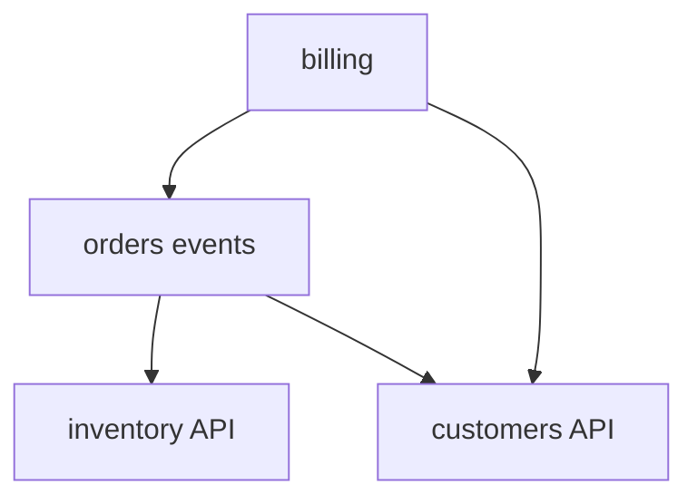

# Xác định điểm kết thúc migration

Migration một codebase cũ sang modular monolith có thể xem là hoàn tất khi các ranh giới module đã được xác định và bảo vệ bằng quy tắc có thể kiểm chứng, các dependency cần thiết đều có chủ sở hữu và API rõ ràng, các luồng nghiệp vụ quan trọng vẫn hoạt động, và nhóm có thể ngăn kiến trúc cũ quay trở lại qua quy trình phát triển hằng ngày. Điểm kết thúc không được xác định bằng số package đã đổi tên hoặc số annotation đã thêm.

Với Spring Modulith, một dấu mốc kỹ thuật quan trọng là `ApplicationModules.verify()` chạy ổn định trong CI và không còn vi phạm kiến trúc chưa được giải quyết. Tuy nhiên, một lần verification thành công chưa đủ để kết luận migration hoàn tất: nhóm còn phải xác nhận module ownership, integration behavior, event handling, tài liệu, trách nhiệm vận hành và các ngoại lệ legacy còn được chấp nhận.

Trong phạm vi **SPRING_MODULITH_MODULE_MODEL**, mục tiêu là đưa ứng dụng Spring Boot hiện hữu về cấu trúc modular monolith có thể hiểu, kiểm tra và phát triển lâu dài. Hoàn tất migration nghĩa là nhóm đã đạt được mức kiểm soát kiến trúc đã thống nhất; nó không đòi hỏi phải tách ứng dụng thành microservices hoặc loại bỏ mọi đoạn code cũ trong cùng một lần.

## 1. Định nghĩa finish line trước khi bắt đầu

Không có một con số chung áp dụng cho mọi codebase. Trước khi migration, hãy viết ra tiêu chí kết thúc dựa trên rủi ro và mục tiêu của hệ thống. Với một ứng dụng Spring Modulith, các tiêu chí thường chia thành sáu nhóm:

| Nhóm | Câu hỏi cần trả lời khi kết thúc |
|---|---|
| Module discovery | Các module nghiệp vụ đã được nhận diện ổn định và có owner chưa? |
| API và ownership | Consumer chỉ dùng hợp đồng được module sở hữu công khai chưa? |
| Dependency graph | Dependency trực tiếp có chủ đích, không có cycle chưa? |
| Behavior | Các use case, transaction và event flow quan trọng vẫn đúng chưa? |
| Verification và delivery | Quy tắc kiến trúc có chạy tự động trên mọi thay đổi liên quan chưa? |
| Documentation và ownership | Nhóm có thể giải thích, vận hành và duy trì các ranh giới này chưa? |

Định nghĩa finish line giúp tránh hai tình huống: dừng quá sớm khi mới có module model nhưng chưa bảo vệ được nó; hoặc kéo dài migration vô hạn vì luôn tìm thấy một refactor có thể làm tốt hơn.

## 2. Module discovery đã ổn định

Migration cần có danh sách module phản ánh các năng lực nghiệp vụ mà ứng dụng thực sự sở hữu. Mỗi module nên có:

- Một base package rõ ràng và một logical identifier duy nhất.
- Một trách nhiệm nghiệp vụ có thể giải thích bằng ngôn ngữ của sản phẩm.
- Một nhóm chịu trách nhiệm cho code và thay đổi của module.
- Các package con được phân chia theo API, internal implementation, events hoặc cấu trúc phù hợp với domain.
- Một quy tắc phát hiện module ổn định, không thay đổi bất ngờ khi thêm package thông thường.

Ví dụ sau khi phân rã một ứng dụng bán hàng:

```text
com.acme.shop
├── ShopApplication.java
├── orders
│   ├── package-info.java
│   ├── api
│   ├── events
│   └── internal
├── inventory
│   ├── package-info.java
│   ├── api
│   ├── events
│   └── internal
└── billing
    ├── package-info.java
    ├── api
    └── internal
```

Danh sách module không nhất thiết phải có cùng số lượng với team hoặc bounded context ở mức tổ chức. Điều quan trọng là ranh giới có ý nghĩa, có thể giải thích và không được tạo ra chỉ để chia nhỏ package cho đẹp.

Nếu dùng `@ApplicationModule(id = "...")`, identifier phải được dùng nhất quán trong `allowedDependencies`, `sharedModules`, module tests và tài liệu. Nếu dùng naming convention mặc định, nhóm cần biết package nào sẽ được phát hiện thành module khi có package con mới.

**Điều kiện đạt:** nhóm có thể liệt kê module, base package, identifier và owner của từng module; thêm một package thông thường không vô tình tạo ra module nghiệp vụ mới.

## 3. API và module ownership đã rõ

Một module chỉ thực sự có ranh giới khi nhóm biết module khác được phép sử dụng những hợp đồng nào. Đối với từng module, hãy xác định:

1. API mặc định ở package gốc hoặc các named interface được công khai.
2. Các package nội bộ chứa implementation, repository, entity, mapper và helper.
3. Event contract nào được module phát ra để consumer phản ứng.
4. Configuration properties hoặc bean type nào thực sự cần được chia sẻ.
5. Những kiểu dữ liệu nào không được phép rò rỉ qua API, chẳng hạn persistence entity hoặc repository nội bộ.

Ví dụ, module `inventory` công khai `InventoryOperations` qua named interface `api`:

```java
@org.springframework.modulith.NamedInterface("api")
package com.acme.shop.inventory.api;
```

Consumer khai báo dependency đúng vào hợp đồng đó:

```java
@org.springframework.modulith.ApplicationModule(
    allowedDependencies = "inventory::api"
)
package com.acme.shop.orders;
```

Implementation và repository tiếp tục nằm trong `inventory.internal`. Consumer inject interface được công khai thay vì import concrete implementation. Khi module cần thông báo một sự kiện đã xảy ra, event type được đặt trong package API/events được expose, và listener của module khác tham chiếu event contract đó.

**Điều kiện đạt:** mọi dependency xuyên module đều có lý do nghiệp vụ và đi qua API đã công khai; không còn consumer phụ thuộc vào internal type chỉ vì class đó đang `public` hoặc Spring có thể inject nó.

## 4. Dependency graph đã có thể giải thích

Sau khi module ownership và API rõ ràng, hãy kiểm tra toàn bộ dependency graph. Với mỗi cạnh trực tiếp, nhóm cần biết:

- Module nguồn là ai và module đích là ai.
- Dependency được tạo bởi type reference, Spring bean injection, event listener hay entity reference.
- Dependency có được phép theo `allowedDependencies` hay không.
- Dependency có đi qua API của module đích hay chạm vào internal package.
- Dependency có tạo đường đi khép kín với các module khác hay không.

Ví dụ graph hợp lệ có thể là:



Graph không cần phải đơn giản đến mức mọi module chỉ có một dependency. Nó cần có hướng rõ, không có cycle ngoài các ngoại lệ đã được hiểu rõ, và không tạo ra một module `common` phụ thuộc ngược vào tất cả module nghiệp vụ.

Dependency qua event cũng là dependency kiến trúc. Ví dụ, module listener phụ thuộc vào module công bố event contract. Chuyển một lời gọi bean trực tiếp thành event có thể giảm coupling component, nhưng không xóa mọi cạnh trong graph.

**Điều kiện đạt:** dependency graph không có cycle chưa được xử lý; mọi direct dependency đều được giải thích; không có module nào chỉ được thêm vào allowlist để làm verification pass mà không có lý do sử dụng.

## 5. Open module và ngoại lệ legacy đã có lộ trình

`ApplicationModule.Type.OPEN` có thể giúp đưa Spring Modulith vào codebase cũ khi các module khác đang truy cập nhiều package nội bộ. Tuy nhiên, nếu giữ module ở trạng thái open vô thời hạn, nhóm sẽ khó chứng minh rằng API boundary đã được khôi phục.

Hãy lập danh sách cho từng open module:

| Thông tin | Nội dung cần ghi |
|---|---|
| Module | Identifier và base package |
| Lý do mở | Consumer legacy nào đang dùng internal types và vì sao |
| Phạm vi cần đóng | Package hoặc type cần chuyển thành API, port hay event contract |
| Owner | Người/nhóm chịu trách nhiệm migration |
| Exit condition | Điều kiện cụ thể để chuyển module về `CLOSED` |
| Review point | Mốc xem xét lại ngoại lệ |

Không phải mọi hệ thống đều phải đóng tất cả module ngay. Một số module legacy có thể tiếp tục mở trong giai đoạn chuyển tiếp nếu nhóm chấp nhận rõ ràng rủi ro và có owner. Tuy nhiên, không nên coi migration hoàn tất nếu open module không có lý do, owner hoặc tiêu chí xem xét.

**Điều kiện đạt:** không còn open module không được giải thích; mọi ngoại lệ còn lại có owner, phạm vi, lý do và mốc review. Các module đã sẵn sàng được chuyển về `CLOSED` và verification xác nhận không còn consumer truy cập internal package.

## 6. ApplicationModules.verify() chạy tự động

Spring Modulith cung cấp `ApplicationModules.verify()` để kiểm tra cấu trúc application module. Đưa kiểm tra này vào architecture test:

```java
import org.junit.jupiter.api.Test;
import org.springframework.modulith.core.ApplicationModules;

class ModularityTests {

    @Test
    void verifiesApplicationModuleStructure() {
        ApplicationModules.of(ShopApplication.class).verify();
    }
}
```

Verification có thể phát hiện dependency cycle, truy cập API không hợp lệ và dependency không nằm trong `allowedDependencies`. Nếu dự án bổ sung các rule jMolecules hoặc `VerificationOptions`, hãy ghi rõ những rule nào đang được chạy để nhóm không nhầm kết quả kiểm tra module với kết quả kiểm tra Hexagonal/DDD.

Một finish line tốt không chỉ là test pass trên máy của một developer. Kiểm tra cần chạy tự động trên pull request hoặc pipeline tương đương, với đúng classpath và cấu hình như môi trường build chính. Khi có dependency mới, module mới hoặc thay đổi API, pipeline phải phát hiện regression trước khi merge.

**Điều kiện đạt:** architecture test chạy ổn định trong CI; lỗi verification làm pipeline thất bại; không có bước thủ công cần nhớ để chạy kiểm tra sau thay đổi module.

## 7. Kiểm thử hành vi của các module quan trọng

`ApplicationModules.verify()` kiểm tra cấu trúc, không chứng minh toàn bộ hành vi nghiệp vụ đúng. Trước khi kết thúc migration, hãy xác nhận các luồng quan trọng bằng test phù hợp:

- Unit test cho domain logic và application service.
- Module integration test cho bean wiring và hành vi trong phạm vi module.
- Integration test cho luồng phối hợp giữa các module qua API hoặc event.
- Test transaction và persistence cho các use case có ranh giới dữ liệu quan trọng.
- Test event listener, retry hoặc publication registry nếu ứng dụng dựa vào xử lý bất đồng bộ.

Ví dụ một module integration test:

```java
package com.acme.shop.orders;

import org.junit.jupiter.api.Test;
import org.springframework.modulith.test.ApplicationModuleTest;

@ApplicationModuleTest
class OrdersModuleTests {

    @Test
    void loadsTheOrdersModule() {
        // Kiểm tra hành vi trong phạm vi module orders.
    }
}
```

Không cần sao chép toàn bộ test suite thành một bộ test module mới. Hãy ưu tiên các use case có rủi ro cao, các dependency vừa được tách và các luồng event có tác động tới trạng thái nghiệp vụ.

**Điều kiện đạt:** các use case quan trọng có test bảo vệ; bean wiring và module integration test không phụ thuộc vào việc khởi tạo toàn bộ ứng dụng khi không cần thiết; event flow quan trọng được kiểm thử với transaction semantics phù hợp.

## 8. Tài liệu kiến trúc đủ để người khác tiếp tục

Migration không kết thúc nếu chỉ người trực tiếp thực hiện mới hiểu vì sao package được chia như hiện tại. Tài liệu cần giúp một developer mới trả lời được:

- Có những module nào và module nào sở hữu năng lực gì?
- API công khai và named interface của mỗi module ở đâu?
- Module nào được phép phụ thuộc vào module nào?
- Event nào được công bố và module nào lắng nghe?
- Module nào còn open hoặc có ngoại lệ kiến trúc?
- Cách chạy module verification và sinh lại tài liệu là gì?

Spring Modulith `Documenter` có thể sinh component diagram và Module Canvas từ cùng `ApplicationModules` model:

```java
import org.springframework.modulith.core.ApplicationModules;

var modules = ApplicationModules.of(ShopApplication.class);

modules.verify();

new org.springframework.modulith.docs.Documenter(modules)
    .writeDocumentation();
```

Sơ đồ component giúp nhìn dependency giữa các module; Module Canvas cho biết base package, Spring components, aggregate roots, published events, listeners và configuration properties được nhận diện. Tài liệu sinh tự động nên đi cùng mô tả nghiệp vụ và quyết định kiến trúc do nhóm viết.

**Điều kiện đạt:** sơ đồ và canvas phản ánh model hiện tại; hướng dẫn chạy verification có sẵn; các ngoại lệ và quyết định quan trọng có owner; developer mới có thể tìm API và dependency mà không phải lần theo toàn bộ source code.

## 9. Quy trình phát triển mới giữ được ranh giới

Một migration chỉ thực sự bền vững khi quy tắc mới được đưa vào quy trình làm việc. Trước khi tuyên bố hoàn tất, xác nhận nhóm đã có cách xử lý những thay đổi sau:

| Thay đổi | Kiểm soát cần có |
|---|---|
| Thêm module hoặc package mới | Module discovery và owner được xem xét |
| Thêm dependency xuyên module | API, `allowedDependencies` và verification được cập nhật có chủ đích |
| Thêm event hoặc listener | Event contract, listener behavior và dependency graph được xem xét |
| Đổi identifier hoặc named interface | Các tham chiếu và tài liệu liên quan được cập nhật |
| Đưa module từ OPEN về CLOSED | Consumer internal access được loại bỏ và verification pass |
| Thêm Spring bean hoặc configuration properties | Xác định bean/type có phải API công khai hay không |

Code review cần đặt câu hỏi về ownership và hướng dependency, không chỉ kiểm tra code có compile. Architecture test là hàng rào tự động; review là nơi đánh giá dependency mới có hợp lý về nghiệp vụ hay không.

## 10. Checklist nghiệm thu migration

Dùng checklist dưới đây trong buổi review cuối. Chỉ đánh dấu hoàn thành khi có bằng chứng cụ thể:

- [ ] Danh sách application module, base package, identifier và owner đã được thống nhất.
- [ ] Module detection ổn định và không tạo module ngoài dự kiến.
- [ ] API package và named interface của từng module được ghi nhận.
- [ ] Consumer dùng API công khai, không import internal implementation trái phép.
- [ ] `allowedDependencies` phản ánh các dependency trực tiếp được chấp nhận.
- [ ] Dependency graph không còn cycle chưa được xử lý.
- [ ] Mọi open module hoặc ngoại lệ legacy đều có lý do, owner và mốc review.
- [ ] `ApplicationModules.verify()` chạy thành công trong CI.
- [ ] Các use case quan trọng có unit/module/integration test phù hợp.
- [ ] Event contract, listener, transaction và retry behavior quan trọng được kiểm thử.
- [ ] Component diagram và Module Canvas được cập nhật.
- [ ] Hướng dẫn phát triển và xử lý vi phạm kiến trúc đã sẵn sàng.
- [ ] Team owner biết cách duy trì module boundaries sau khi migration kết thúc.

Không phải mọi mục đều cần một loại artifact riêng. Nhưng mỗi mục phải có cách xác nhận: test, cấu hình, tài liệu, review record hoặc quyết định được owner chấp nhận.

## 11. Khi nào nên dừng và khi nào cần tiếp tục?

Một số việc có thể tiếp tục sau migration mà không làm mất ý nghĩa của finish line:

| Việc còn lại | Có thể kết thúc migration? | Điều kiện |
|---|---|---|
| Refactor thuật toán nội bộ trong module | Có | Không làm rò rỉ implementation hoặc phá test |
| Tối ưu package naming nhỏ | Có | Ownership và module detection vẫn rõ |
| Đóng thêm một open module có lộ trình | Có thể | Ngoại lệ còn lại đã được chấp nhận và có owner/mốc review |
| Dependency cycle chưa giải thích | Không | Cần xử lý hoặc có quyết định kiến trúc rõ ràng theo chính sách dự án |
| Consumer truy cập internal package ngoài ý muốn | Không | Cần chuyển qua API hoặc chấp nhận ngoại lệ có kiểm soát |
| Verification chưa chạy trong CI | Không | Chưa có hàng rào chống regression |
| Thiếu test cho luồng nghiệp vụ rủi ro cao vừa thay đổi | Không | Chưa có bằng chứng hành vi sau migration |
| Chưa chuyển modular monolith thành microservices | Có | Tách deployment không phải mục tiêu bắt buộc của module modeling |

Đừng kéo dài migration chỉ vì vẫn còn việc refactor có thể làm. Hãy dừng khi các tiêu chí đã thống nhất đều đạt và chuyển phần cải tiến còn lại thành backlog có owner, priority và lý do rõ ràng.

## 12. Những ngộ nhận thường gặp

- **“Thêm `@ApplicationModule` vào mọi package là migration xong.”** Annotation chỉ là metadata; API, ownership, dependency graph, test và CI mới chứng minh ranh giới được bảo vệ.
- **“`ApplicationModules.verify()` pass nghĩa là toàn bộ hệ thống đúng.”** Nó xác nhận các quy tắc kiến trúc được cấu hình, không thay thế test nghiệp vụ, kiểm thử hiệu năng hoặc kiểm tra vận hành.
- **“Phải loại bỏ 100% legacy code mới được kết thúc.”** Legacy implementation có thể tiếp tục tồn tại bên trong module nếu ownership và API đã rõ.
- **“Mọi module phải đóng ngay lập tức.”** Open module có thể là bước chuyển tiếp, miễn là ngoại lệ có lý do và lộ trình đóng.
- **“Không còn import trực tiếp là không còn coupling.”** Event contract, configuration properties, shared types và dependency bắc cầu vẫn cần được quản lý.
- **“Chuyển sang event thì không còn dependency.”** Listener module vẫn phụ thuộc vào event contract của publisher và cạnh event vẫn tham gia dependency graph.
- **“Phải tách thành microservices để hoàn tất modularization.”** Modular monolith là một kiến trúc đích hợp lệ; deployment boundary là quyết định khác.
- **“Tài liệu sinh tự động đủ để bàn giao.”** Canvas và diagram cần được bổ sung ý nghĩa nghiệp vụ, owner và các quyết định không thể suy ra từ code.
- **“Sau migration không cần kiểm tra kiến trúc nữa.”** Verification trong CI và code review là cách giữ finish line không bị lùi lại.

## Kết luận

Migration legacy sang Spring Modulith kết thúc khi module discovery và ownership ổn định, API được công khai có chủ đích, dependency graph có thể giải thích và không còn vi phạm chưa được xử lý, các luồng nghiệp vụ quan trọng được kiểm thử, verification chạy tự động trong CI, và tài liệu đủ để nhóm tiếp tục duy trì kiến trúc. Các ngoại lệ legacy còn lại phải có lý do, owner và tiêu chí xem xét. `ApplicationModules.verify()` là hàng rào kỹ thuật quan trọng, nhưng finish line còn cần bằng chứng về hành vi, quy trình phát triển và khả năng bàn giao. Sau khi đạt các tiêu chí đã thống nhất, hãy kết thúc migration và quản lý phần cải tiến còn lại như backlog kiến trúc thông thường.

## Tài liệu tham khảo

- [Spring Modulith — Fundamentals: Application Modules](https://docs.spring.io/spring-modulith/reference/fundamentals.html)
- [Spring Modulith — Verifying Application Module Structure](https://docs.spring.io/spring-modulith/reference/verification.html)
- [Spring Modulith — Application Module Integration Tests](https://docs.spring.io/spring-modulith/reference/testing.html)
- [Spring Modulith — Documenting Application Modules](https://docs.spring.io/spring-modulith/reference/documentation.html)
