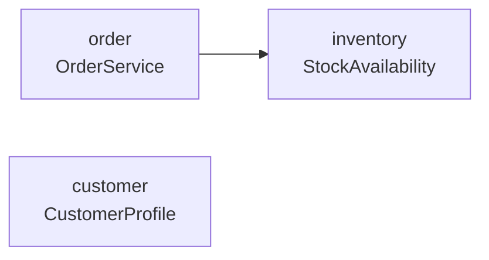

# Comparator sắp xếp type theo quan hệ phụ thuộc

Khi phân tích một ứng dụng Spring Modulith, thứ tự liệt kê các lớp theo tên thường không cho thấy cấu trúc phụ thuộc giữa chúng. Một lớp có thể sử dụng lớp của module khác, và quan hệ đó tạo thành một đồ thị phụ thuộc. `ApplicationModules` cung cấp `getComparator()` để lấy comparator sắp xếp các `JavaClass` theo quan hệ phụ thuộc mà mô hình module đã khám phá.

Comparator này hữu ích khi tạo báo cáo kiến trúc, trình bày type theo thứ tự phụ thuộc hoặc hỗ trợ công cụ phân tích mã nguồn. Bạn có thể dùng trực tiếp với `sorted(...)` của Java Stream API thay vì tự viết thuật toán so sánh package hoặc tên lớp.

## 1. Vì sao cần sắp xếp type theo phụ thuộc?

Giả sử ứng dụng bán hàng có ba module:

```text
com.acme.shop
├── order
│   ├── OrderService.java
│   └── OrderRepository.java
├── inventory
│   ├── StockAvailability.java
│   └── StockRepository.java
└── customer
    └── CustomerProfile.java
```

Trong đó, `OrderService` sử dụng `StockAvailability` để kiểm tra tồn kho. Mô hình phụ thuộc có thể biểu diễn như sau:



Nếu chỉ sắp xếp các type theo tên, kết quả phản ánh thứ tự từ điển. Nó không phản ánh quan hệ giữa `OrderService` và `StockAvailability`. Khi cần đọc cấu trúc phụ thuộc, hãy dùng comparator của `ApplicationModules` để thứ tự được xác định dựa trên mô hình kiến trúc.

## 2. Lấy comparator từ ApplicationModules

Đầu tiên, tạo mô hình từ lớp ứng dụng Spring Boot:

```java
package com.acme.shop;

import org.springframework.boot.autoconfigure.SpringBootApplication;

@SpringBootApplication
public class ShopApplication {
}
```

Sau đó lấy comparator từ `ApplicationModules`:

```java
import org.springframework.modulith.core.ApplicationModules;

ApplicationModules modules = ApplicationModules.of(ShopApplication.class);
var comparator = modules.getComparator();
```

`getComparator()` cung cấp `Comparator<JavaClass>`. Comparator này dùng thông tin phụ thuộc trong mô hình `ApplicationModules` để so sánh các type. Nó có thể được truyền cho các API sắp xếp của Java như `Stream.sorted(Comparator)` hoặc `List.sort(Comparator)`.

Điều quan trọng là comparator phải lấy từ cùng mô hình đã khám phá ứng dụng. Nhờ đó, thứ tự type được xét trong ngữ cảnh các application module và quan hệ phụ thuộc của chúng.

## 3. Sắp xếp type của toàn ứng dụng

Mỗi `ApplicationModule` cung cấp tập các type mà nó chứa. Có thể duyệt các module, gom các `JavaClass`, rồi sắp xếp chúng bằng comparator của mô hình:

```java
import com.tngtech.archunit.core.domain.JavaClass;
import java.util.List;
import java.util.stream.Collectors;
import org.springframework.modulith.core.ApplicationModules;

class DependencyOrderedTypes {

    List<JavaClass> findTypesInDependencyOrder() {
        ApplicationModules modules = ApplicationModules.of(ShopApplication.class);

        return modules.stream()
                .flatMap(module -> module.getClasses().stream())
                .sorted(modules.getComparator())
                .collect(Collectors.toList());
    }
}
```

Đoạn code thực hiện ba bước:

1. `modules.stream()` duyệt các application module đã được khám phá.
2. `module.getClasses().stream()` lấy các type thuộc từng module và chuyển thành một stream chung.
3. `sorted(modules.getComparator())` sắp xếp các type theo quan hệ phụ thuộc trong mô hình.

Kết quả là danh sách `JavaClass` đã được sắp xếp. Có thể duyệt danh sách để in tên đầy đủ:

```java
findTypesInDependencyOrder().forEach(type ->
        System.out.println(type.getName())
);
```

`JavaClass` là mô hình type do ArchUnit cung cấp, được Spring Modulith dùng để phân tích cấu trúc mã nguồn. Đây không phải đối tượng `java.lang.Class` của JVM.

## 4. Dùng comparator với danh sách type có sẵn

Nếu đã có một danh sách `JavaClass`, bạn có thể sắp xếp trực tiếp danh sách đó:

```java
import com.tngtech.archunit.core.domain.JavaClass;
import java.util.ArrayList;
import java.util.List;
import org.springframework.modulith.core.ApplicationModules;

ApplicationModules modules = ApplicationModules.of(ShopApplication.class);

List<JavaClass> types = new ArrayList<>(
        modules.getModuleByName("order").getClasses().stream().toList()
);

types.sort(modules.getComparator());
```

Ở ví dụ này, danh sách chỉ chứa type của module `order`. Comparator vẫn lấy từ mô hình toàn ứng dụng, vì các type trong `order` có thể tham chiếu đến API của module khác. Nếu muốn sắp xếp type thuộc nhiều module, hãy gom các tập type trước khi gọi `sort` như ví dụ ở phần trên.

Nếu dự án dùng Java trước phiên bản hỗ trợ `Stream.toList()`, hãy thay bằng `collect(Collectors.toList())`. Điều này chỉ thay cách tạo danh sách; comparator và mô hình phụ thuộc không thay đổi.

## 5. Comparator làm gì và không làm gì?

`Comparator` xác định cách so sánh hai phần tử để API sắp xếp có thể đặt chúng vào thứ tự phù hợp. Với comparator của `ApplicationModules`, căn cứ so sánh là quan hệ phụ thuộc giữa các type trong mô hình module.

| Thành phần | Vai trò |
|---|---|
| `ApplicationModules` | Khám phá module và xây dựng mô hình phụ thuộc |
| `ApplicationModules.getComparator()` | Cung cấp quy tắc so sánh `JavaClass` dựa trên mô hình phụ thuộc |
| `Stream.sorted(...)` hoặc `List.sort(...)` | Áp dụng comparator để tạo thứ tự |
| `ApplicationModules.verify()` | Kiểm tra các quy tắc và vi phạm kiến trúc |

Comparator chỉ quyết định thứ tự khi sắp xếp. Nó không sửa code, không tạo quan hệ phụ thuộc, không thay đổi module và không tự xác nhận kiến trúc hợp lệ. Việc xác minh vẫn cần được thực hiện bằng `verify()`.

Đối với các type không có quan hệ phụ thuộc trực tiếp hoặc gián tiếp, không nên xem vị trí tương đối của chúng trong kết quả như một thứ tự nghiệp vụ. Nếu báo cáo cần tiêu chí phụ như tên lớp, hãy áp dụng quy tắc phụ sau khi đã xác định rõ yêu cầu và không làm mất ý nghĩa của comparator kiến trúc.

## 6. Phân biệt thứ tự phụ thuộc với thứ tự từ điển

Hai cách sắp xếp trả lời hai câu hỏi khác nhau:

```java
// Sắp xếp theo tên đầy đủ của type.
types.sort((left, right) -> left.getName().compareTo(right.getName()));

// Sắp xếp theo quan hệ phụ thuộc trong mô hình Spring Modulith.
types.sort(modules.getComparator());
```

Sắp xếp theo tên giúp tìm kiếm hoặc tạo danh sách ổn định theo từ điển. Sắp xếp theo comparator của `ApplicationModules` giúp xem xét quan hệ kiến trúc. Không nên thay comparator phụ thuộc bằng `compareTo()` trên tên package khi mục tiêu là biểu diễn quan hệ phụ thuộc.

Nếu cần cả hai tiêu chí, hãy xác định tiêu chí nào là chính. Một comparator phụ kết hợp phải được thiết kế cẩn thận để không mâu thuẫn với thứ tự phụ thuộc do mô hình cung cấp.

## 7. Kiểm tra mô hình trước khi dùng kết quả

Comparator chỉ có ý nghĩa khi `ApplicationModules` đã khám phá đúng phạm vi ứng dụng. Hãy kiểm tra mô hình bằng `verify()` trong bài kiểm thử kiến trúc:

```java
package com.acme.shop;

import org.junit.jupiter.api.Test;
import org.springframework.modulith.core.ApplicationModules;

class ModularityTests {

    @Test
    void verifiesModuleStructure() {
        ApplicationModules modules = ApplicationModules.of(ShopApplication.class);

        modules.verify();
    }
}
```

Khi có vi phạm, hãy xem module nguồn, module đích và type liên quan. Kiểm tra xem type được tham chiếu có thuộc API công khai của module đích hay không, và liệu phụ thuộc đó có được cho phép theo metadata kiến trúc không.

Một số lưu ý khi sử dụng:

- Tạo comparator từ chính `ApplicationModules` dùng để lấy các type.
- Chỉ sắp xếp những type thuộc mô hình đã khám phá; type nằm ngoài phạm vi ứng dụng không có đủ ngữ cảnh trong comparator này.
- Dùng `JavaClass` khi thao tác với type trong mô hình ArchUnit.
- Không diễn giải thứ tự giữa các type độc lập thành một quan hệ phụ thuộc.
- Dùng `verify()` để kiểm tra quy tắc kiến trúc; sắp xếp không thay thế kiểm tra.

## 8. Bài tập thực hành

Với ứng dụng `com.acme.shop`, giả sử `order` phụ thuộc API `StockAvailability` của `inventory` và `customer` độc lập với hai module còn lại.

1. Tạo `ApplicationModules` từ `ShopApplication.class`.
2. Duyệt các module và gom type bằng `module.getClasses()`.
3. Sắp xếp danh sách type bằng `modules.getComparator()`.
4. In tên đầy đủ của các type theo thứ tự vừa thu được.
5. Tạo một bản sao danh sách và sắp xếp theo tên đầy đủ bằng `JavaClass.getName()` để so sánh hai kết quả.
6. Giải thích thông tin nào được thể hiện bởi comparator phụ thuộc và thông tin nào chỉ được thể hiện bởi thứ tự từ điển.
7. Chạy `modules.verify()` để kiểm tra các quy tắc kiến trúc của mô hình.

Sau bài tập, hãy trả lời: vì sao comparator cần lấy từ `ApplicationModules`, và vì sao việc sắp xếp type thành công không chứng minh rằng mọi phụ thuộc trong ứng dụng đều hợp lệ?

## 9. Ghi nhớ

- `ApplicationModules.getComparator()` cung cấp comparator để sắp xếp `JavaClass` theo quan hệ phụ thuộc của mô hình module.
- Có thể gom type từ `ApplicationModule.getClasses()` rồi dùng `Stream.sorted(...)` hoặc `List.sort(...)`.
- `JavaClass` là type model của ArchUnit, không phải `java.lang.Class`.
- Comparator phụ thuộc và sắp xếp từ điển có mục đích khác nhau.
- Thứ tự giữa các type độc lập không nên được diễn giải thành quan hệ phụ thuộc.
- Comparator chỉ sắp xếp; `ApplicationModules.verify()` mới thực hiện kiểm tra các quy tắc kiến trúc.

Khi dùng comparator do Spring Modulith cung cấp, bạn có thể trình bày các type theo quan hệ phụ thuộc mà mô hình đã khám phá, hỗ trợ việc đọc, báo cáo và phân tích kiến trúc modular monolith.
