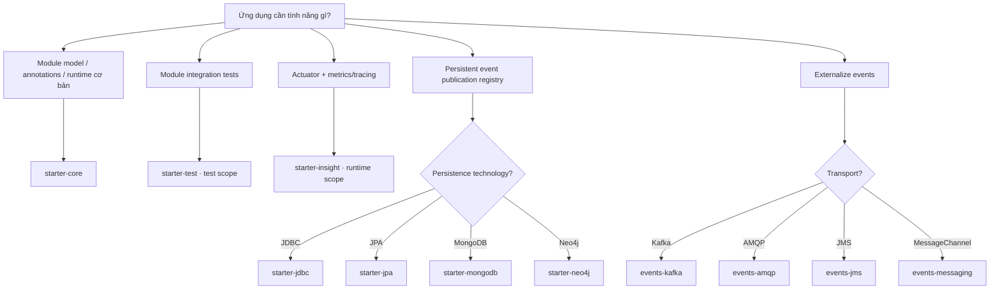

# Chọn artifact Modulith theo tính năng cần dùng

Spring Modulith được chia thành nhiều artifact độc lập để ứng dụng chỉ đưa vào những khả năng mình cần. Với một ứng dụng Spring Boot thông thường, điểm bắt đầu thuận tiện là `spring-modulith-starter-core`; sau đó chọn thêm starter hoặc JAR riêng cho event publication, lưu trữ publication registry, kiểm thử module, Actuator và observability.

Để các artifact tương thích với nhau, hãy import `spring-modulith-bom` và để BOM quản lý phiên bản cho toàn bộ dependency Modulith. Phạm vi dependency cũng cần phù hợp với vòng đời sử dụng: thư viện và annotation dùng trong production code thuộc compile scope; thành phần chỉ chạy lúc ứng dụng vận hành có thể thuộc runtime scope; test support thuộc test scope.

Sau bài học, bạn có thể:

- Chọn starter phù hợp với tính năng Spring Modulith cần triển khai.
- Phân biệt starter tổng hợp và JAR chuyên biệt.
- Quản lý phiên bản bằng Spring Modulith BOM.
- Chọn compile, runtime và test scope đúng mục đích.
- Chọn event publication registry theo JDBC, JPA, MongoDB hoặc Neo4j.
- Bổ sung externalization, Actuator và observability mà không kéo nhầm tính năng.
- Tránh trộn các phiên bản Modulith hoặc khai báo trùng những dependency đã được starter kéo vào.

## 1. Bắt đầu bằng tính năng, không bắt đầu bằng tên JAR

Trước khi thêm dependency, hãy xác định ứng dụng cần làm gì:

| Nhu cầu | Artifact thường dùng |
|---|---|
| Phân tích application module, khai báo metadata và sử dụng runtime support cơ bản | `spring-modulith-starter-core` |
| Kiểm thử từng module bằng `@ApplicationModuleTest`, `Scenario` | `spring-modulith-starter-test` trong test scope |
| Hiển thị module model qua Spring Boot Actuator và theo dõi tương tác module | `spring-modulith-starter-insight` trong runtime scope |
| Lưu trạng thái event publication bằng JDBC | `spring-modulith-starter-jdbc` |
| Lưu trạng thái event publication bằng JPA | `spring-modulith-starter-jpa` |
| Lưu trạng thái event publication bằng MongoDB | `spring-modulith-starter-mongodb` |
| Lưu trạng thái event publication bằng Neo4j | `spring-modulith-starter-neo4j` |
| Externalize event sang Kafka, AMQP, JMS hoặc Spring Messaging | JAR `spring-modulith-events-*` tương ứng |
| Tạo tài liệu module bằng `Documenter` hoặc tối ưu test theo thay đổi module | `spring-modulith-docs` hoặc `spring-modulith-junit` trong test scope |

Starter là tập dependency được chọn sẵn cho một nhóm tính năng. JAR riêng cho phép chọn hẹp hơn khi ứng dụng đã có một số thành phần hoặc muốn tự kiểm soát dependency graph.

## 2. Quản lý phiên bản bằng Spring Modulith BOM

Các artifact Modulith được phát hành cùng một version train. Nếu tự ghi version cho từng JAR, dự án có thể vô tình kết hợp các module khác phiên bản. BOM giải quyết vấn đề đó bằng cách quản lý version tập trung.

Ví dụ dưới đây dùng Spring Modulith `2.2.0`; hãy chọn version phù hợp với Spring Boot của dự án theo compatibility matrix chính thức.

### Maven

Import BOM trong `dependencyManagement`:

```xml
<dependencyManagement>
    <dependencies>
        <dependency>
            <groupId>org.springframework.modulith</groupId>
            <artifactId>spring-modulith-bom</artifactId>
            <version>2.2.0</version>
            <type>pom</type>
            <scope>import</scope>
        </dependency>
    </dependencies>
</dependencyManagement>
```

Sau đó khai báo dependency mà không cần lặp version:

```xml
<dependencies>
    <dependency>
        <groupId>org.springframework.modulith</groupId>
        <artifactId>spring-modulith-starter-core</artifactId>
    </dependency>

    <dependency>
        <groupId>org.springframework.modulith</groupId>
        <artifactId>spring-modulith-starter-test</artifactId>
        <scope>test</scope>
    </dependency>
</dependencies>
```

### Gradle

Có thể import BOM bằng native platform support của Gradle:

```groovy
dependencies {
    implementation platform("org.springframework.modulith:spring-modulith-bom:2.2.0")

    implementation "org.springframework.modulith:spring-modulith-starter-core"
    testImplementation "org.springframework.modulith:spring-modulith-starter-test"
}
```

Nếu dự án đã import Spring Modulith BOM ở một convention plugin hoặc version catalog, không cần import lại ở từng module Gradle. Hãy bảo đảm các dependency Modulith nhận cùng version được quản lý.

Không nên chỉ nâng riêng `spring-modulith-runtime` hoặc `spring-modulith-events-jdbc` trong khi các artifact Modulith khác vẫn ở version cũ. Khi nâng version train, hãy kiểm tra Spring Boot compatibility matrix và release notes tương ứng.

## 3. `spring-modulith-starter-core`: nền tảng module model

Starter core là điểm bắt đầu phổ biến cho ứng dụng muốn dùng các khái niệm cốt lõi của Spring Modulith. Theo module catalog của Spring Modulith 2.2.0, starter này bao gồm:

- `spring-modulith-api` ở compile scope: annotation và abstraction dùng trong production code để tùy chỉnh hành vi mặc định.
- `spring-modulith-apt` ở compile scope: annotation processor hỗ trợ trích xuất Javadoc cho Application Module Canvases.
- `spring-modulith-moments` ở compile scope: các sự kiện liên quan đến thời gian.
- `spring-modulith-core` ở runtime scope: module model và API phân tích cấu trúc ứng dụng.
- `spring-modulith-runtime` ở runtime scope: bootstrap module model và runtime support.

Với starter core, ứng dụng có thể khai báo `@ApplicationModule`, `@NamedInterface`, tạo module model, xác minh cấu trúc và sử dụng các tính năng runtime cơ bản được starter kéo vào. Runtime verification khi khởi động vẫn cần bật property tương ứng; việc có JAR trên classpath không đồng nghĩa mọi tính năng đều tự động được bật.

Nếu dự án chỉ muốn dùng một phần rất nhỏ và tự kiểm soát từng JAR, có thể khai báo các artifact riêng. Tuy nhiên, với đa số ứng dụng Spring Boot, starter core giảm công sức lựa chọn các dependency nền tảng tương thích.

## 4. `spring-modulith-starter-test`: kiểm thử module

Thêm starter test trong test scope khi muốn dùng:

- `@ApplicationModuleTest` để khởi tạo một module hoặc một nhóm dependency.
- `Scenario` để phát event, gọi bean, chờ event hoặc state change.
- Các tiện ích kiểm thử module của Spring Modulith.
- API tài liệu cần thiết cho một số test/documentation workflow.

Maven:

```xml
<dependency>
    <groupId>org.springframework.modulith</groupId>
    <artifactId>spring-modulith-starter-test</artifactId>
    <scope>test</scope>
</dependency>
```

Gradle:

```groovy
dependencies {
    testImplementation "org.springframework.modulith:spring-modulith-starter-test"
}
```

Starter test không nên được đưa vào production runtime. Test support thuộc test classpath để build có thể biên dịch và chạy các module integration test mà không đóng gói các tiện ích kiểm thử vào ứng dụng triển khai.

Nếu muốn tối ưu việc chọn test theo module bị thay đổi, có thể thêm `spring-modulith-junit` trong test scope. JUnit extension này dựa trên module arrangement và thay đổi của project để bỏ qua những test không bị ảnh hưởng trong các điều kiện được hỗ trợ. Đây là tối ưu hóa tùy chọn; nó không thay thế việc chạy toàn bộ test trong các tình huống mà extension chủ động tắt tối ưu hóa.

## 5. `spring-modulith-starter-insight`: Actuator và observability

Khi cần quan sát kiến trúc và tương tác module ở runtime, starter insight là lựa chọn tổng hợp. Nó bao gồm:

- `spring-modulith-actuator` để expose module arrangement qua Spring Boot Actuator.
- `spring-modulith-observability-api` để tùy chỉnh observability.
- `spring-modulith-observability-core` để tạo hạ tầng metrics và tracing cho tương tác module.
- `spring-boot-starter-actuator` để kích hoạt Actuator support của Spring Boot.

Khai báo trong runtime scope:

```groovy
dependencies {
    runtimeOnly "org.springframework.modulith:spring-modulith-starter-insight"
}
```

Khi endpoint được expose theo cấu hình Actuator, module structure có thể được truy cập qua `GET /actuator/modulith`. Observability support có thể tạo spans cho lời gọi Spring component thuộc module API và metrics cho event publication.

Starter insight không tự cung cấp backend thu thập trace. Nếu muốn gửi dữ liệu đến hệ thống như OpenTelemetry Collector, Zipkin hoặc nền tảng giám sát khác, ứng dụng vẫn cần các bridge/exporter và cấu hình tương ứng của Spring Boot Micrometer Tracing.

Nếu production code cần tham chiếu trực tiếp API để tùy chỉnh observability, chẳng hạn `ModulithEventMetricsCustomizer`, hãy khai báo `spring-modulith-observability-api` ở compile scope. Starter insight thường được khai báo ở runtime scope nên không nên giả định các API tùy chỉnh đã có sẵn trên compile classpath.

Nếu chỉ cần endpoint module structure mà không cần tracing/metrics, có thể dùng `spring-modulith-actuator` cùng `spring-boot-starter-actuator`. Nếu chỉ cần instrumentation mà không cần endpoint, có thể dùng `spring-modulith-observability-core` và các dependency quan sát phù hợp.

## 6. Chọn event publication registry theo persistence technology

Spring Modulith có thể ghi nhận event publication để theo dõi listener đã nhận và hoàn thành xử lý event hay chưa. Publication registry cần một backend lưu trữ. Chọn starter tương ứng với công nghệ persistence mà ứng dụng sử dụng:

| Starter | Backend publication registry | Thành phần được kéo vào ngoài core |
|---|---|---|
| `spring-modulith-starter-jdbc` | JDBC | `events-api`, `events-core`, `events-jdbc`, `events-jackson` |
| `spring-modulith-starter-jpa` | JPA | `events-api`, `events-core`, `events-jpa`, `events-jackson` |
| `spring-modulith-starter-mongodb` | MongoDB | `events-api`, `events-core`, `events-mongodb`, `events-jackson` |
| `spring-modulith-starter-neo4j` | Neo4j | `events-api`, `events-core`, `events-neo4j`, `events-jackson` |

Các starter persistence này cũng kéo `spring-modulith-starter-core`. Vì vậy, nếu ứng dụng đã dùng một trong các starter này, thường không cần khai báo thêm starter core lần nữa chỉ để có module model.

Ví dụ ứng dụng dùng JPA:

```xml
<dependency>
    <groupId>org.springframework.modulith</groupId>
    <artifactId>spring-modulith-starter-jpa</artifactId>
</dependency>
```

Ví dụ Gradle với JDBC:

```groovy
dependencies {
    implementation "org.springframework.modulith:spring-modulith-starter-jdbc"
}
```

Các starter này cung cấp tích hợp Spring Modulith cho publication registry; chúng không thay thế driver database, Spring Data, cấu hình datasource hoặc transaction manager mà ứng dụng cần. Hãy bảo đảm backend thực tế đã được cấu hình và tương thích với starter đã chọn.

Không chọn đồng thời JDBC và JPA chỉ vì ứng dụng vừa dùng `JdbcTemplate` vừa dùng Spring Data JPA. Hãy chọn một publication registry phù hợp với chiến lược transaction và persistence của ứng dụng. Chỉ phối hợp nhiều backend khi có yêu cầu kiến trúc rõ ràng và đã xác minh cách cấu hình registry.

## 7. Chọn JAR riêng cho event publication và externalization

Khi cần kiểm soát dependency chi tiết hơn, có thể chọn từng JAR:

| Artifact | Vai trò |
|---|---|
| `spring-modulith-events-api` | API để tùy chỉnh event features |
| `spring-modulith-events-core` | Event publication registry abstraction và implementation cốt lõi |
| `spring-modulith-events-jackson` | Serializer dựa trên Jackson cho event publication |
| `spring-modulith-events-jdbc` | Publication registry dùng JDBC |
| `spring-modulith-events-jpa` | Publication registry dùng JPA |
| `spring-modulith-events-mongodb` | Publication registry dùng MongoDB |
| `spring-modulith-events-neo4j` | Publication registry dùng Neo4j |
| `spring-modulith-events-kafka` | Externalize event sang Kafka |
| `spring-modulith-events-amqp` | Externalize event qua AMQP |
| `spring-modulith-events-jms` | Externalize event qua JMS |
| `spring-modulith-events-messaging` | Externalize event vào Spring Messaging `MessageChannel` |

Publication registry và externalization giải quyết hai việc khác nhau:

- Registry theo dõi trạng thái publication và xử lý của listener trong ứng dụng.
- Externalization gửi event ra hệ thống messaging bên ngoài.

Ví dụ, một ứng dụng có thể dùng `spring-modulith-starter-jpa` để lưu publication registry bằng JPA và thêm `spring-modulith-events-kafka` để externalize một số event sang Kafka. Hai artifact phục vụ hai vai trò khác nhau.

```groovy
dependencies {
    implementation "org.springframework.modulith:spring-modulith-starter-jpa"
    runtimeOnly "org.springframework.modulith:spring-modulith-events-kafka"
}
```

Các artifact externalization không thay thế Kafka client, broker hoặc cấu hình serializer/connection của ứng dụng. Hãy thêm các dependency và cấu hình Spring Kafka, AMQP hoặc JMS phù hợp với hạ tầng thực tế.

## 8. Các JAR hỗ trợ riêng

Ngoài các starter, một số JAR phục vụ use case hẹp:

| Artifact | Scope điển hình | Khi nào cần |
|---|---|---|
| `spring-modulith-api` | compile | Production code cần abstraction/annotation Modulith mà không muốn dùng toàn bộ starter core |
| `spring-modulith-core` | runtime | Cần module model và API phân tích cấu trúc |
| `spring-modulith-runtime` | runtime | Cần bootstrap module model trong runtime; thường đã được kéo gián tiếp bởi starter core, actuator hoặc observability |
| `spring-modulith-actuator` | runtime | Cần expose module structure qua Actuator mà không dùng starter insight |
| `spring-modulith-observability-api` | compile | Cần tùy chỉnh observability bằng API |
| `spring-modulith-observability-core` | runtime | Cần instrumentation cho module interactions và event publication |
| `spring-modulith-docs` | test | Cần `Documenter` để tạo tài liệu Asciidoctor hoặc PlantUML từ module model |
| `spring-modulith-junit` | test | Cần tối ưu test execution dựa trên module structure và thay đổi code |
| `spring-modulith-apt` | compile | Cần annotation processor trích Javadoc cho Application Module Canvases |
| `spring-modulith-moments` | compile | Dùng sự kiện về thời gian và `TimeMachine` |

Không cần khai báo lại JAR riêng nếu starter đã kéo đúng artifact đó. Ví dụ, starter insight đã bao gồm Actuator và observability support; starter test đã bao gồm module test support và docs API theo module catalog.

## 9. Quy tắc chọn dependency scope

Ba scope thường gặp cần được phân biệt:

| Scope | Maven | Gradle | Ví dụ |
|---|---|---|---|
| Compile/production | Mặc định `compile` | `implementation` | `spring-modulith-starter-core`, `spring-modulith-starter-jpa` |
| Runtime | `runtime` | `runtimeOnly` | `spring-modulith-starter-insight`, `spring-modulith-runtime`, externalization adapter |
| Test | `test` | `testImplementation` | `spring-modulith-starter-test`, `spring-modulith-junit`, `spring-modulith-docs` |

Scope ảnh hưởng đến classpath và artifact được đóng gói:

- Compile dependency có sẵn khi biên dịch production code và runtime.
- Runtime dependency có sẵn khi chạy ứng dụng nhưng không cần thiết để biên dịch source code thông thường.
- Test dependency chỉ có trong test compile/runtime classpath, không được đưa vào ứng dụng production.

Đừng khai báo `spring-modulith-starter-test` ở compile scope hoặc đưa test utilities vào production dependencies. Ngược lại, nếu production code dùng annotation hoặc abstraction từ `spring-modulith-api`, artifact chứa API đó phải có trên compile classpath; starter core cung cấp sẵn điều này.

## 10. Ví dụ chọn dependency theo ba cấu hình phổ biến

### Ứng dụng cần module model và module integration tests

Maven:

```xml
<dependencies>
    <dependency>
        <groupId>org.springframework.modulith</groupId>
        <artifactId>spring-modulith-starter-core</artifactId>
    </dependency>
    <dependency>
        <groupId>org.springframework.modulith</groupId>
        <artifactId>spring-modulith-starter-test</artifactId>
        <scope>test</scope>
    </dependency>
</dependencies>
```

### Ứng dụng dùng JPA, module tests và Actuator/observability

Gradle:

```groovy
dependencies {
    implementation platform("org.springframework.modulith:spring-modulith-bom:2.2.0")

    implementation "org.springframework.modulith:spring-modulith-starter-jpa"
    runtimeOnly "org.springframework.modulith:spring-modulith-starter-insight"
    testImplementation "org.springframework.modulith:spring-modulith-starter-test"
}
```

`starter-jpa` đã kéo `starter-core`, nên không cần thêm `starter-core` lần nữa. `starter-insight` bổ sung Actuator và observability; `starter-test` chỉ dùng trong test.

### Ứng dụng dùng JDBC registry và externalize event sang Kafka

```groovy
dependencies {
    implementation platform("org.springframework.modulith:spring-modulith-bom:2.2.0")

    implementation "org.springframework.modulith:spring-modulith-starter-jdbc"
    runtimeOnly "org.springframework.modulith:spring-modulith-events-kafka"
    testImplementation "org.springframework.modulith:spring-modulith-starter-test"
}
```

Ứng dụng cần thêm Spring Kafka, JDBC driver và cấu hình broker/database tương ứng. Các dependency đó không được thay thế chỉ bằng việc thêm Modulith starter.

## 11. Cây quyết định chọn artifact



Sau khi chọn artifact, import BOM để đồng bộ version và kiểm tra dependency tree để tránh kéo hai implementation registry không cần thiết hoặc khai báo trùng JAR đã có trong starter.

## 12. Kiểm tra dependency tree và nâng phiên bản

Khi ứng dụng khởi động lỗi do `NoSuchMethodError`, `ClassNotFoundException` hoặc auto-configuration không hoạt động như mong đợi, một nguyên nhân có thể là các artifact Modulith không cùng version train hoặc dependency bị override ngoài ý muốn.

Hãy kiểm tra:

1. BOM Spring Modulith đã được import đúng chưa.
2. Có dependency Modulith nào khai báo version trực tiếp và ghi đè BOM không.
3. Có starter nào đã kéo sẵn artifact mà dự án lại khai báo thêm một version khác không.
4. Scope có đúng với nơi sử dụng API không.
5. Spring Boot version có nằm trong compatibility matrix của Spring Modulith release đang dùng không.
6. Với externalization, dependency client và cấu hình broker đã được khai báo chưa.

Maven có thể xem dependency tree bằng:

```bash
mvn dependency:tree -Dincludes=org.springframework.modulith
```

Gradle có thể xem dependency insight hoặc dependency tree theo configuration:

```bash
./gradlew dependencies --configuration runtimeClasspath
```

Các lệnh trên chỉ là cách chẩn đoán dependency khi dự án gặp vấn đề. Hãy xem version được resolve thực tế thay vì chỉ nhìn các dòng khai báo trong build file.

## 13. Lỗi thường gặp

| Hiện tượng | Nguyên nhân | Cách xử lý |
|---|---|---|
| Các JAR Modulith resolve khác version | Ghi version riêng cho từng artifact hoặc BOM không được import | Dùng một `spring-modulith-bom` và bỏ version lặp ở dependency |
| Thiếu `@ApplicationModule` hoặc API annotation khi compile | Chỉ thêm runtime JAR nhưng production source cần API | Dùng `starter-core` hoặc khai báo `spring-modulith-api` ở compile scope |
| `@ApplicationModuleTest` không có trên test classpath | Thiếu test starter hoặc khai báo sai scope | Thêm `spring-modulith-starter-test` ở test scope |
| Không thấy `/actuator/modulith` | Chưa thêm Actuator support hoặc endpoint chưa được expose | Thêm `starter-insight` hoặc actuator JAR cùng Spring Boot Actuator và cấu hình exposure |
| Có module structure nhưng không có trace | Thiếu observability backend/exporter hoặc cấu hình tracing | Thêm bridge/exporter Micrometer phù hợp và cấu hình hệ thống thu thập |
| Event publication không được lưu bền vững | Chưa có registry implementation tương ứng với persistence | Chọn starter JDBC/JPA/MongoDB/Neo4j phù hợp và cấu hình database |
| Event không được gửi sang broker | Chỉ thêm registry persistence, chưa có externalization adapter | Thêm `events-kafka`, `events-amqp`, `events-jms` hoặc `events-messaging` theo transport |
| Đưa test library vào production artifact | Dùng compile/implementation thay vì test scope | Chuyển sang Maven `test` hoặc Gradle `testImplementation` |
| Khai báo trùng JAR | Starter đã kéo artifact nhưng build file thêm lại thủ công | Kiểm tra module catalog và dependency tree trước khi thêm |

## 14. Ghi nhớ

Chọn Spring Modulith artifact theo tính năng cần dùng. Dùng `spring-modulith-starter-core` cho nền tảng module model; `starter-test` cho module integration tests; `starter-insight` cho Actuator và observability; starter JDBC/JPA/MongoDB/Neo4j cho event publication registry theo persistence backend. Dùng JAR `events-kafka`, `events-amqp`, `events-jms` hoặc `events-messaging` khi cần externalize event. Import `spring-modulith-bom` để đồng bộ version, đặt dependency đúng compile/runtime/test scope và kiểm tra compatibility với Spring Boot. Trước khi thêm một JAR riêng, hãy xác nhận starter hiện tại chưa kéo nó vào.

## Tài liệu tham khảo

- [Spring Modulith 2.2.0 – Overview and BOM](https://docs.spring.io/spring-modulith/reference/)
- [Spring Modulith 2.2.0 – Appendix B: Configuration Properties and Appendix C: Modules](https://docs.spring.io/spring-modulith/reference/appendix.html)
- [Spring Modulith 2.2.0 – Production-ready Features](https://docs.spring.io/spring-modulith/reference/production-ready.html)
- [Spring Modulith 2.2.0 – Integration Testing Application Modules](https://docs.spring.io/spring-modulith/reference/testing.html)
- [Spring Modulith 2.2.0 – Runtime Support](https://docs.spring.io/spring-modulith/reference/runtime.html)
