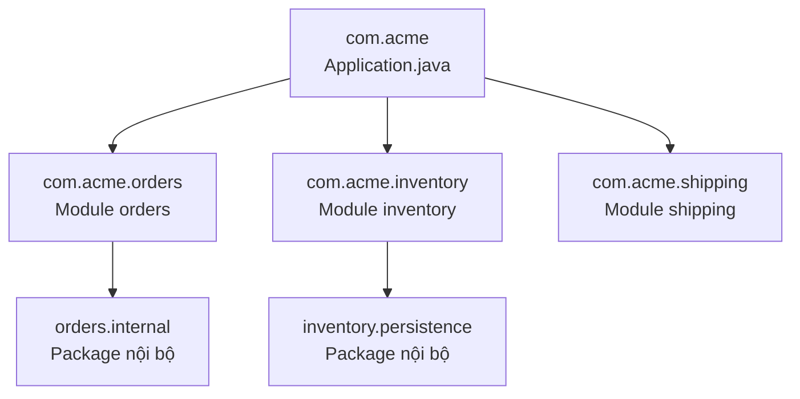

# `spring.modulith.detection-strategy`

Spring Modulith cần xác định package nào là application module trước khi có thể kiểm tra dependency, tạo tài liệu hoặc chạy integration test theo module. Mặc định, công cụ xem các package con trực tiếp của package chứa lớp `@SpringBootApplication` là module. Với codebase có cấu trúc khác, nhóm có thể thay đổi cách phát hiện bằng property `spring.modulith.detection-strategy`.

Property này hỗ trợ ba hướng cấu hình: giữ chiến lược mặc định, chỉ nhận các package được đánh dấu tường minh bằng annotation, hoặc chỉ định một class tự triển khai `ApplicationModuleDetectionStrategy`. Chọn đúng chiến lược giúp Spring Modulith tạo mô hình phù hợp với cấu trúc code, tránh bỏ sót module hoặc vô tình coi package kỹ thuật là module nghiệp vụ.

## Mục tiêu

Sau bài học, bạn có thể:

- Giải thích vai trò của `spring.modulith.detection-strategy` trong việc tạo application module model.
- Hiểu chiến lược mặc định dựa trên direct subpackages.
- Chuyển sang `explicitly-annotated` để chỉ phát hiện package có `@ApplicationModule` hoặc jMolecules `@Module`.
- Đăng ký custom `ApplicationModuleDetectionStrategy` bằng tên lớp đầy đủ.
- Viết chiến lược phát hiện module theo naming convention hoặc allowlist.
- Phân biệt module detection với `additionalPackages`, nested modules và named interface detection.
- Đảm bảo cùng một chiến lược được sử dụng trong model test, tài liệu và runtime.
- Chẩn đoán module bị thiếu, bị phát hiện thừa hoặc strategy không được nạp.

## Spring Modulith phát hiện module từ đâu?

Spring Modulith bắt đầu từ package chứa lớp ứng dụng Spring Boot, thường là lớp có `@SpringBootApplication`. Ví dụ:

```text
com.acme
├── Application.java
├── orders
│   ├── OrderManagement.java
│   └── internal
├── inventory
│   ├── InventoryManagement.java
│   └── persistence
└── shipping
    └── ShippingService.java
```

Với chiến lược mặc định, các module được phát hiện là:

- `com.acme.orders`
- `com.acme.inventory`
- `com.acme.shipping`

Các package sâu hơn như `orders.internal` hoặc `inventory.persistence` thuộc phạm vi module cha. Chúng không tự động trở thành application module riêng chỉ vì là package con.



Nếu muốn một package lồng bên trong module trở thành nested application module, cần đánh dấu package đó bằng `@ApplicationModule` theo quy tắc nested module. Việc thay đổi `detection-strategy` không đồng nghĩa mọi package con ở mọi độ sâu đều tự động trở thành module.

## Property có giá trị mặc định như thế nào?

Trong bảng cấu hình Spring Modulith, `spring.modulith.detection-strategy` có giá trị mặc định là không được thiết lập (`none`). Khi không có strategy tường minh hoặc strategy cũ được đăng ký, Spring Modulith dùng phương án cuối cùng là phát hiện các direct subpackages của application root.

Vì vậy, với cấu trúc package-by-feature thông thường, bạn không cần khai báo property này:

```properties
# Không cần khai báo spring.modulith.detection-strategy.
# Spring Modulith mặc định phát hiện các direct subpackages.
```

Không nên hiểu `none` là một strategy có nghĩa “không phát hiện module”, và không cần đặt `spring.modulith.detection-strategy=none`. Giá trị mặc định của property là không có giá trị cấu hình; bộ phân giải strategy vẫn có fallback về direct subpackages.

## Khi nào nên thay đổi detection strategy?

Giữ mặc định nếu ứng dụng đã tổ chức package theo capability nghiệp vụ:

```text
com.acme
├── Application.java
├── orders
├── inventory
├── billing
└── customers
```

Thay đổi strategy khi cấu trúc hiện tại không phù hợp với quy ước đó. Ví dụ:

- Ứng dụng có nhiều package kỹ thuật trực tiếp dưới application root, nhưng chỉ một số package là module nghiệp vụ.
- Nhóm muốn yêu cầu mọi module phải được khai báo rõ ràng bằng annotation.
- Module được xác định theo naming convention riêng, chẳng hạn package có tiền tố `feature`.
- Một codebase đang chuyển đổi dần và cần kiểm soát chính xác module nào được đưa vào mô hình.

Không nên đổi strategy chỉ để làm cho `verify()` hết lỗi. Strategy xác định phạm vi và ranh giới được kiểm tra; bỏ một package khỏi module model có thể làm mất luôn khả năng phát hiện dependency sai trong package đó.

## Cấu hình `explicitly-annotated`

`explicitly-annotated` chỉ chọn package được đánh dấu tường minh bằng Spring Modulith `@ApplicationModule` hoặc jMolecules `@Module`. Cách này phù hợp khi nhóm muốn mọi module phải có khai báo rõ ràng, thay vì tự động coi tất cả direct subpackages là module.

Trong `application.properties`:

```properties
spring.modulith.detection-strategy=explicitly-annotated
```

Hoặc trong `application.yml`:

```yaml
spring:
  modulith:
    detection-strategy: explicitly-annotated
```

Sau khi bật strategy này, hãy đánh dấu từng module. Với Java, annotation thường nằm trong `package-info.java` ở package gốc của module:

```java
@org.springframework.modulith.ApplicationModule
package com.acme.orders;
```

Một module khác:

```java
@org.springframework.modulith.ApplicationModule
package com.acme.inventory;
```

Với Kotlin hoặc trường hợp không dùng được `package-info.java`, đặt annotation trên một type metadata ở root package:

```kotlin
package com.acme.orders

import org.springframework.modulith.ApplicationModule
import org.springframework.modulith.PackageInfo

@PackageInfo
@ApplicationModule
class ModuleMetadata
```

`@PackageInfo` đánh dấu type metadata thay thế cho package-info; `@ApplicationModule` mới là annotation xác định package đó là application module.

### Ví dụ trước và sau khi bật explicitly-annotated

Trước khi bật strategy, ứng dụng có thể có:

```text
com.acme
├── Application.java
├── orders
├── inventory
├── configuration
├── shared
└── integration
```

Nếu dùng mặc định, cả năm package con trực tiếp đều có thể được phát hiện như module. Nếu `configuration` chỉ là nơi chứa cấu hình chung, còn `shared` và `integration` chưa được xác định là module, nhóm có thể chuyển sang `explicitly-annotated` và chỉ đánh dấu `orders`, `inventory` cùng những package thực sự là module.

```text
com.acme
├── Application.java
├── orders                  # @ApplicationModule
├── inventory               # @ApplicationModule
├── configuration           # Không được chọn làm module
├── shared                  # Không được chọn làm module
└── integration             # Không được chọn làm module
```

Các package không được chọn vẫn có thể nằm trong codebase và được các module sử dụng theo quy tắc tương ứng, nhưng chúng không được mô hình hóa như application module riêng. Hãy xác nhận điều đó đúng với ý định kiến trúc; đừng bỏ annotation khỏi một module chỉ vì muốn tránh một dependency violation.

## Đăng ký custom `ApplicationModuleDetectionStrategy`

Nếu hai chiến lược có sẵn không phù hợp, hãy triển khai `ApplicationModuleDetectionStrategy`. Interface này nhận package gốc dưới dạng `JavaPackage` và trả về `Stream<JavaPackage>` chứa các package được chọn làm module base package.

Ví dụ, ứng dụng có quy ước các module nghiệp vụ bắt đầu bằng `feature`:

```java
package com.acme.architecture;

import java.util.stream.Stream;

import org.springframework.modulith.core.ApplicationModuleDetectionStrategy;
import org.springframework.modulith.core.JavaPackage;

public class FeatureModuleDetectionStrategy
        implements ApplicationModuleDetectionStrategy {

    @Override
    public Stream<JavaPackage> getModuleBasePackages(JavaPackage rootPackage) {
        return rootPackage.getDirectSubPackages().stream()
            .filter(candidate -> candidate.getLocalName().startsWith("feature"));
    }
}
```

Với cấu trúc:

```text
com.acme
├── Application.java
├── featureOrders
├── featureInventory
├── configuration
└── shared
```

Chiến lược trên chỉ chọn `featureOrders` và `featureInventory`. `configuration` và `shared` không được chọn vì không khớp naming convention.

Đăng ký custom class bằng fully qualified class name:

```properties
spring.modulith.detection-strategy=com.acme.architecture.FeatureModuleDetectionStrategy
```

Hoặc YAML:

```yaml
spring:
  modulith:
    detection-strategy: com.acme.architecture.FeatureModuleDetectionStrategy
```

Khi giá trị không khớp strategy dựng sẵn, Spring Modulith diễn giải nó như tên lớp triển khai `ApplicationModuleDetectionStrategy`. Class phải có mặt trên classpath nơi mô hình được tạo và phải có thể được khởi tạo bởi cơ chế lookup của phiên bản đang dùng.

## Thiết kế custom strategy theo allowlist

Naming convention hữu ích khi quy ước package được áp dụng nhất quán. Nếu danh sách module nhỏ và thay đổi có kiểm soát, allowlist có thể dễ review hơn:

```java
package com.acme.architecture;

import java.util.Set;
import java.util.stream.Stream;

import org.springframework.modulith.core.ApplicationModuleDetectionStrategy;
import org.springframework.modulith.core.JavaPackage;

public class AllowlistedModuleDetectionStrategy
        implements ApplicationModuleDetectionStrategy {

    private static final Set<String> MODULES = Set.of(
        "orders",
        "inventory",
        "billing"
    );

    @Override
    public Stream<JavaPackage> getModuleBasePackages(JavaPackage rootPackage) {
        return rootPackage.getDirectSubPackages().stream()
            .filter(candidate -> MODULES.contains(candidate.getLocalName()));
    }
}
```

Ưu điểm của allowlist là việc thêm module mới cần thay đổi rõ ràng trong strategy. Nhược điểm là mỗi module mới phải cập nhật cả cấu trúc package lẫn danh sách. Nếu danh sách không được duy trì, module mới có thể bị bỏ sót khỏi verification.

Hãy chọn theo cách tổ chức codebase:

| Cách chọn module | Phù hợp khi | Rủi ro cần kiểm soát |
|---|---|---|
| Direct subpackages mặc định | Mọi package con trực tiếp đều là module nghiệp vụ | Package kỹ thuật trực tiếp có thể bị nhận diện nhầm |
| `explicitly-annotated` | Nhóm muốn khai báo module tường minh | Module mới có thể bị quên annotation |
| Custom naming convention | Tên package thể hiện ổn định quy ước module | Đổi tên package có thể làm thay đổi module model |
| Custom allowlist | Số module nhỏ và danh sách được quản lý tập trung | Allowlist cũ có thể bỏ sót module mới |

## Phân biệt detection strategy với `@Modulithic(additionalPackages)`

`spring.modulith.detection-strategy` quyết định cách chọn module bên trong một root package đã được xác định. Nó không tự thêm các root package khác vào phạm vi quét.

Nếu ứng dụng có module nằm ngoài package của lớp `@SpringBootApplication`, có thể dùng `@Modulithic(additionalPackages = …)`:

```java
package com.acme;

import org.springframework.boot.autoconfigure.SpringBootApplication;
import org.springframework.modulith.Modulithic;

@SpringBootApplication
@Modulithic(additionalPackages = "com.acme.sharedkernel")
class Application {}
```

Spring Modulith sẽ áp dụng module detection cho root package bổ sung đó. Hãy phân biệt hai quyết định:

- **Root package nào được quét?** Dùng package của application class, `additionalPackages` hoặc cơ chế đóng góp module phù hợp.
- **Package nào trong root được xem là module?** Dùng `spring.modulith.detection-strategy`.

Từ Spring Modulith 1.3, `ApplicationModuleSourceFactory` còn cho phép thư viện hoặc build unit khác đóng góp module từ package root bổ sung. Factory được đăng ký qua `META-INF/spring.factories` với key `org.springframework.modulith.core.ApplicationModuleSourceFactory`. Đây là cơ chế mở rộng nguồn module, không phải giá trị thay thế cho property detection strategy.

## Phân biệt module detection với named interface detection

`ApplicationModuleDetectionStrategy` có nhiệm vụ chọn module base package. Nó cũng cung cấp default method `detectNamedInterfaces(…)` để tùy chỉnh cách chọn các package API bổ sung bên trong một module.

Hai việc này có phạm vi khác nhau:

- `getModuleBasePackages(…)` chọn package nào trở thành application module.
- `detectNamedInterfaces(…)` chọn package con nào được công bố thành named interface của một module đã được chọn.

Ví dụ, strategy có thể chọn `orders` và `inventory` làm module. Một bước riêng có thể công bố các package `api` hoặc `events` bên trong mỗi module thành named interface. Nếu chỉ muốn đổi package nào là module, không cần tùy chỉnh named interface detection.

API tùy chỉnh `detectNamedInterfaces(…)` có từ Spring Modulith 1.4. Nếu dự án đang dùng phiên bản cũ hơn, hãy kiểm tra Javadoc tương ứng trước khi triển khai override này.

## Custom strategy cần nằm ở test hay production?

Vị trí source của strategy phụ thuộc nơi cần sử dụng mô hình:

| Nhu cầu | Vị trí strategy và cấu hình |
|---|---|
| Chỉ chạy model verification và sinh tài liệu trong test | Có thể đặt strategy và đăng ký tương ứng trong test sources/resources |
| Runtime verification hoặc `ApplicationModuleInitializer` | Strategy phải có trên production runtime classpath |
| Actuator hoặc observability dùng module model ở runtime | Đưa strategy vào production sources và bảo đảm `spring-modulith-core` là compile-time dependency |
| Cả test lẫn runtime cần cùng mô hình | Dùng chung implementation và cùng cấu hình, tránh hai bản strategy khác nhau |

Ví dụ, nếu strategy chỉ phục vụ model test, có thể đặt property trong `src/test/resources/application.properties`. Nếu ứng dụng dùng runtime support, đặt class strategy trong production source set và cấu hình production để runtime cũng dùng đúng class đó.

Spring Modulith Reference lưu ý rằng custom strategy phục vụ verification/documentation có thể nằm trong test sources. Khi dùng runtime components như initializer hoặc các tính năng production như Actuator và observability, cần khai báo `spring-modulith-core` ở compile-time và cung cấp custom strategy trong production.

## Kiểm tra mô hình sau khi đổi strategy

Sau khi cấu hình, dùng `ApplicationModules` để xem danh sách module mà Spring Modulith thực sự phát hiện:

```java
import org.springframework.modulith.core.ApplicationModules;

var modules = ApplicationModules.of(Application.class);
modules.forEach(System.out::println);
```

Output hiển thị logical name, base package và Spring beans của từng module. Hãy so sánh kết quả với package structure dự kiến trước khi chạy verification:

```java
import org.junit.jupiter.api.Test;
import org.springframework.modulith.core.ApplicationModules;

class ModularityTests {

    @Test
    void verifiesDetectedModules() {
        ApplicationModules.of(Application.class).verify();
    }
}
```

Model test giúp phát hiện dependency sai theo đúng mô hình đã tạo. Tuy nhiên, nếu strategy vô tình bỏ sót một package, test vẫn có thể pass vì package đó không nằm trong tập module đang kiểm tra. Vì vậy, hãy kiểm tra cả danh sách module được phát hiện, không chỉ kết quả `verify()`.

## Những lỗi thường gặp

| Lỗi | Hậu quả | Cách xử lý |
|---|---|---|
| Nghĩ property mặc định là không phát hiện module | Hiểu sai giá trị `none` trong bảng cấu hình | Nhớ rằng fallback mặc định vẫn là direct subpackages |
| Bật `explicitly-annotated` nhưng quên `@ApplicationModule` | Module không xuất hiện trong model | Đánh dấu từng package module hoặc dùng jMolecules `@Module` |
| Đặt `@ApplicationModule` ở package con không đúng ý định | Tạo nested module hoặc module boundary ngoài dự kiến | Kiểm tra base package và vị trí package-info |
| Custom class name sai hoặc class không có trên classpath | Strategy không được nạp | Dùng fully qualified class name và kiểm tra source set/runtime classpath |
| Custom strategy trả về cả package kỹ thuật | Package đó bị coi là module | Thu hẹp naming convention hoặc allowlist |
| Custom strategy bỏ sót module mới | Verification không kiểm tra package bị bỏ qua | Thêm test/assertion kiểm tra danh sách module được phát hiện |
| Chỉ cấu hình `additionalPackages` nhưng mong đổi cách phát hiện | Root package được thêm nhưng strategy không thay đổi như ý | Tách quyết định root scan và module detection |
| Test dùng strategy khác runtime | Model test pass nhưng runtime model khác | Dùng chung strategy/configuration trong source set phù hợp |
| Nhầm module detection với named interface detection | Công bố API không đúng hoặc tạo sai module | Tách `getModuleBasePackages` khỏi `detectNamedInterfaces` |

## Quy trình thay đổi detection strategy

Khi muốn thay đổi cách Spring Modulith phát hiện module, thực hiện theo thứ tự:

1. Xác định package gốc của ứng dụng và danh sách module nghiệp vụ mong đợi.
2. Kiểm tra package con trực tiếp có tuân theo quy ước mặc định không.
3. Nếu chỉ muốn chọn package được đánh dấu, bật `explicitly-annotated` và thêm annotation cho từng module.
4. Nếu cần quy tắc riêng, triển khai `ApplicationModuleDetectionStrategy` theo naming convention hoặc allowlist.
5. Đăng ký class bằng fully qualified class name trong `spring.modulith.detection-strategy`.
6. Đặt implementation trong test hoặc production source set tùy nơi cần sử dụng module model.
7. Xác nhận `additionalPackages` nếu ứng dụng có nhiều root package.
8. In danh sách `ApplicationModules` và so sánh với module inventory mong đợi.
9. Chạy `ApplicationModules.verify()` để kiểm tra dependency theo mô hình mới.
10. Giữ cùng strategy và cấu hình giữa test, documentation và runtime nếu các môi trường cần cùng một module arrangement.

## Bài tập tự đánh giá

Ứng dụng có application root `com.acme`. Các package trực tiếp gồm `orders`, `inventory`, `billing`, `configuration` và `shared`. Nhóm chỉ muốn ba package đầu là application module. Sau đó, nhóm dự định chuyển các module sang quy ước tên `featureOrders`, `featureInventory`, `featureBilling` và muốn tự động phát hiện các package có tiền tố `feature`.

Hãy trả lời:

1. Nếu giữ mặc định, Spring Modulith sẽ nhận diện những package nào?
2. Cấu hình nào giúp chỉ nhận module có annotation tường minh?
3. Annotation nào cần đặt ở root package để package được nhận diện bằng `explicitly-annotated`?
4. Custom strategy cần triển khai method nào và method đó nhận/trả về kiểu dữ liệu gì?
5. Cấu hình property bằng fully qualified class name ra sao?
6. Nếu runtime verification cũng cần strategy này, class nên nằm ở source set nào?

Một hướng giải quyết là bật `explicitly-annotated` rồi đánh dấu `orders`, `inventory`, `billing`. Nếu muốn theo naming convention `feature*`, triển khai custom strategy lọc `rootPackage.getDirectSubPackages()` theo `getLocalName().startsWith("feature")`, rồi đăng ký class bằng `spring.modulith.detection-strategy`. Nếu strategy cần dùng trong runtime, đưa implementation vào production source set và đồng bộ cấu hình runtime với test.

## Kết luận

`spring.modulith.detection-strategy` quyết định cách chọn package làm application module. Khi không cấu hình, Spring Modulith dùng fallback direct subpackages của application root. `explicitly-annotated` yêu cầu package được đánh dấu bằng `@ApplicationModule` hoặc jMolecules `@Module`; giá trị là tên lớp khác sẽ được diễn giải như custom `ApplicationModuleDetectionStrategy`. Hãy phân biệt việc chọn module với việc thêm root package hoặc công bố named interface, đồng thời giữ strategy nhất quán giữa test và runtime để mọi công cụ cùng kiểm tra một kiến trúc.

## Tài liệu tham khảo

- [Spring Modulith Reference — Fundamentals and Customizing Module Detection](https://docs.spring.io/spring-modulith/reference/fundamentals.html)
- [Spring Modulith Reference — Configuration Properties](https://docs.spring.io/spring-modulith/reference/appendix.html)
- [Spring Modulith API — `ApplicationModuleDetectionStrategy`](https://docs.spring.io/spring-modulith/docs/current/api/org/springframework/modulith/core/ApplicationModuleDetectionStrategy.html)
- [Spring Modulith API — `JavaPackage`](https://docs.spring.io/spring-modulith/docs/current/api/org/springframework/modulith/core/JavaPackage.html)
- [Spring Modulith API — `ApplicationModuleSourceFactory`](https://docs.spring.io/spring-modulith/docs/current/api/org/springframework/modulith/core/ApplicationModuleSourceFactory.html)
