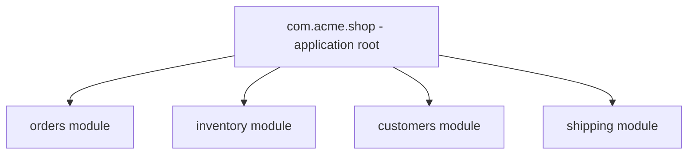

# Package gốc của lớp ứng dụng chính bị chọn sai

Spring Modulith suy ra cấu trúc application module từ package của lớp ứng dụng được truyền vào `ApplicationModules.of(…)`. Vì vậy, vị trí package của lớp `@SpringBootApplication` có ảnh hưởng trực tiếp tới việc nhận diện mô-đun. Nếu lớp này nằm quá cao hoặc quá sâu trong cây package, Spring Modulith có thể nhận diện sai module base package, gộp nhiều vùng nghiệp vụ vào một mô-đun hoặc bỏ sót các mô-đun dự kiến.

Vấn đề này thường xuất hiện khi một ứng dụng Spring Boot đã phát triển lâu năm, lớp main được đặt trong package tiện dụng như `com.acme`, hoặc lớp khởi động được chuyển vào package con `bootstrap` mà không xem xét lại module model. Cách xử lý đầu tiên là xác định package gốc mà ứng dụng thực sự cần, sau đó đặt lớp ứng dụng chính tại đúng package cha chung của các mô-đun.

## 1. Package của application class quyết định module root

Giả sử ứng dụng bán hàng có các package:

```text
com.acme.shop
├── ShopApplication.java
├── orders
├── inventory
├── customers
└── shipping
```

Với lớp main khai báo:

```java
package com.acme.shop;

import org.springframework.boot.SpringApplication;
import org.springframework.boot.autoconfigure.SpringBootApplication;

@SpringBootApplication
public class ShopApplication {

    public static void main(String[] args) {
        SpringApplication.run(ShopApplication.class, args);
    }
}
```

Khi tạo model bằng:

```java
ApplicationModules modules = ApplicationModules.of(ShopApplication.class);
```

Spring Modulith lấy `com.acme.shop` làm package gốc để phát hiện các mô-đun. Với quy tắc phát hiện mặc định, các package con trực tiếp như `orders`, `inventory`, `customers` và `shipping` có thể được nhận diện là các application module.

Có thể hình dung cấu trúc mong đợi như sau:



Package gốc cần là package cha chung thể hiện đúng ranh giới ứng dụng. Nó không phải tên thư mục trên ổ đĩa, cũng không phải package bất kỳ chỉ vì lớp main có thể compile ở đó. Khai báo `package` trong mã Java và vị trí lớp ứng dụng được dùng để xác định root.

## 2. Dấu hiệu package root quá cao

Giả sử lớp main được đặt tại `com.acme.Application`:

```java
package com.acme;

@SpringBootApplication
public class Application {
    // main method
}
```

Trong khi các mô-đun thực tế nằm dưới `com.acme.shop`, package root mà Spring Modulith nhận được là `com.acme`, rộng hơn ranh giới của ứng dụng shop.

```text
com.acme
├── Application.java
├── shop
│   ├── orders
│   ├── inventory
│   └── customers
└── reporting-tool
    ├── exports
    └── dashboards
```

Với detection mặc định, các package con trực tiếp của `com.acme` có thể được nhận diện như module base package. Khi đó `shop` có thể trở thành một mô-đun lớn, còn `orders`, `inventory` và `customers` nằm sâu bên trong nó thay vì được nhận diện là các mô-đun riêng. Package `reporting-tool` cũng có thể bị đưa vào cùng application model dù nó không thuộc ứng dụng shop.

Các triệu chứng thường gặp:

- `ApplicationModules.of(Application.class)` chỉ trả về một vài mô-đun cấp cao, không có các mô-đun nghiệp vụ mong đợi.
- Tên mô-đun được báo trong lỗi verification khác với tên nhóm dùng trong thiết kế.
- Dependency giữa `orders` và `inventory` không được biểu diễn như hai mô-đun riêng.
- Một package thuộc công cụ hoặc ứng dụng lân cận bị đưa vào module model.
- `@ApplicationModuleTest` hoặc architecture test hoạt động với phạm vi khác dự kiến do dùng một application class làm anchor quá rộng.

Hãy kiểm tra package của application class trước khi sửa `allowedDependencies` hoặc thêm Named Interface. Nếu root quá rộng, các thay đổi metadata ở từng mô-đun có thể chỉ che triệu chứng mà không sửa được gốc vấn đề.

## 3. Dấu hiệu package root quá sâu

Trường hợp ngược lại là lớp main được đặt trong package con, ví dụ `com.acme.shop.bootstrap`:

```java
package com.acme.shop.bootstrap;

@SpringBootApplication
public class ShopApplication {
    // main method
}
```

Trong khi các mô-đun nghiệp vụ là sibling package của `bootstrap`:

```text
com.acme.shop
├── bootstrap
│   └── ShopApplication.java
├── orders
├── inventory
└── customers
```

Package gốc được chọn là `com.acme.shop.bootstrap`. Các package `orders`, `inventory` và `customers` nằm bên ngoài cây package này, nên không được phát hiện như các module con của root đó. Spring Boot component scanning mặc định cũng bắt đầu từ package của lớp `@SpringBootApplication` và các package con, do đó các bean ở sibling package có thể không được quét.

Các triệu chứng có thể gồm:

- Module model không có các mô-đun nghiệp vụ hoặc chỉ phát hiện package bên dưới `bootstrap`.
- Một số bean không được Spring đăng ký và phát sinh lỗi `NoSuchBeanDefinitionException` khi khởi động.
- `@SpringBootTest` hoặc `@ApplicationModuleTest` không tìm được cấu hình ứng dụng như dự kiến.
- Test cần chỉ định thêm component scan hoặc configuration class để nhìn thấy bean nằm ngoài package root.

Trong tình huống này, chuyển lớp ứng dụng chính lên `com.acme.shop` thường giải quyết đồng thời cả module discovery và component scanning mặc định.

## 4. Đặt lại lớp ứng dụng ở package cha chung

Với cấu trúc ví dụ, vị trí phù hợp là `com.acme.shop.ShopApplication`, nằm trực tiếp trong package gốc của ứng dụng:

```text
src/main/java
└── com/acme/shop
    ├── ShopApplication.java
    ├── orders
    ├── inventory
    ├── customers
    └── shipping
```

Thực hiện các bước:

1. Xác định package cha chung nhỏ nhất bao phủ lớp ứng dụng và các mô-đun nghiệp vụ cần quản lý.
2. Chuyển file main class vào package đó.
3. Cập nhật dòng `package` và các import/reference tới fully qualified name mới.
4. Kiểm tra các cấu hình chạy, manifest hoặc launcher đang tham chiếu main class cũ.
5. Kiểm tra các test dùng `ShopApplication.class` hoặc cấu hình Spring Boot để cùng trỏ tới lớp ứng dụng mới.
6. Tạo lại module model bằng `ApplicationModules.of(ShopApplication.class)` và kiểm tra danh sách mô-đun.

Ví dụ lớp main sau khi chuyển:

```java
package com.acme.shop;

import org.springframework.boot.SpringApplication;
import org.springframework.boot.autoconfigure.SpringBootApplication;

@SpringBootApplication
public class ShopApplication {

    public static void main(String[] args) {
        SpringApplication.run(ShopApplication.class, args);
    }
}
```

Không cần thêm `scanBasePackages` nếu package mặc định đã bao phủ toàn bộ các package ứng dụng. Cấu hình component scan tường minh chỉ nên được thêm khi có lý do rõ ràng về phạm vi bean cần quét.

## 5. Phân biệt module root với component scan base package

Hai cơ chế thường cùng dựa trên package của lớp main, nhưng giải quyết hai câu hỏi khác nhau:

| Cơ chế | Câu hỏi | Cách xác định mặc định |
|---|---|---|
| Spring Modulith module discovery | Những package nào được xem là application module? | Package của application class được truyền vào `ApplicationModules.of(…)`, sau đó áp dụng detection strategy |
| Spring Boot component scanning | Những package nào được quét để tìm Spring component? | Package của lớp `@SpringBootApplication` và các package con |

Ví dụ, có thể cấu hình Spring Boot:

```java
@SpringBootApplication(scanBasePackages = "com.acme.shop")
public class Application {
    // main method
}
```

Điều này thay đổi phạm vi component scan. Nó không tự thay đổi package gốc mà `ApplicationModules.of(Application.class)` sử dụng. Nếu `Application` vẫn nằm trong `com.acme`, module discovery vẫn lấy `com.acme` làm root.

Vì vậy, `scanBasePackages` không phải cách sửa trực tiếp khi Spring Modulith chọn sai module root. Đặt application class tại package cha chung phù hợp là cách đơn giản và nhất quán hơn. Nếu có lý do không thể di chuyển lớp main, cần xử lý riêng module model và component scanning, đồng thời bảo đảm hai phạm vi được kiểm tra rõ ràng.

## 6. Xác minh root và danh sách mô-đun bằng test

Tạo một architecture test dùng đúng application class đang chạy trong production:

```java
package com.acme.shop;

import static org.assertj.core.api.Assertions.assertThat;

import org.junit.jupiter.api.Test;
import org.springframework.modulith.core.ApplicationModules;

class ModuleDiscoveryTests {

    @Test
    void discoversExpectedModulesFromApplicationPackage() {
        ApplicationModules modules = ApplicationModules.of(ShopApplication.class);

        assertThat(modules.getModuleByName("orders")).isPresent();
        assertThat(modules.getModuleByName("inventory")).isPresent();
        assertThat(modules.getModuleByName("customers")).isPresent();
    }
}
```

Khi cần quan sát toàn bộ kết quả discovery, có thể duyệt model:

```java
ApplicationModules.of(ShopApplication.class)
        .stream()
        .forEach(module -> System.out.printf(
                "%s -> %s%n",
                module.getName(),
                module.getBasePackage().getName()
        ));
```

Output giúp đối chiếu tên mô-đun và package base mà Spring Modulith thực sự chọn. Hãy so sánh với sơ đồ package mong muốn, đặc biệt là các mô-đun đang bị gộp hoặc không xuất hiện.

Sau khi xác nhận discovery, gọi `verify()` để kiểm tra dependency và boundary:

```java
@Test
void verifiesModuleBoundaries() {
    ApplicationModules.of(ShopApplication.class).verify();
}
```

Nếu discovery đã đúng nhưng verification thất bại, lúc đó mới xử lý các dependency, Named Interface hoặc `allowedDependencies` cụ thể. Đừng dùng lỗi verification để suy ra root sai nếu chưa kiểm tra danh sách module model.

## 7. Đảm bảo test dùng cùng application root

Một nguyên nhân khác là production và test sử dụng các lớp cấu hình ứng dụng khác nhau. Ví dụ, production gọi `ApplicationModules.of(ShopApplication.class)`, nhưng một architecture test cũ lại dùng `ApplicationModules.of(TestApplication.class)` với `TestApplication` nằm trong package khác.

Khi đó, hai nơi có thể tạo module model khác nhau dù cùng đọc một source tree. Hãy:

- Dùng cùng application class cho architecture test và runtime verification.
- Tránh tạo lớp `@SpringBootApplication` phụ trong package test chỉ để khởi động context nếu không cần thiết.
- Nếu cần test configuration riêng, dùng `@TestConfiguration` hoặc import cấu hình test mà vẫn giữ application class gốc làm anchor.
- Đặt lớp `@ApplicationModuleTest` bên trong package của mô-đun cần kiểm thử để Spring Modulith xác định đúng module under test.

Ví dụ module test cho `orders`:

```java
package com.acme.shop.orders;

import org.springframework.modulith.test.ApplicationModuleTest;

@ApplicationModuleTest
class OrderModuleTests {
    // Test tập trung vào module orders.
}
```

Package của lớp test giúp xác định mô-đun được kiểm thử; application root vẫn cần được xác định từ lớp ứng dụng phù hợp. Hãy tránh để một test anchor khác package làm kết quả discovery lệch khỏi production.

## 8. Khi nào cần custom module detection strategy?

Sau khi package root đã đúng, có thể phát hiện rằng cấu trúc package của dự án không theo quy ước mặc định. Ví dụ, các mô-đun được đặt dưới `com.acme.shop.contexts.orders` và `com.acme.shop.contexts.inventory` thay vì là package con trực tiếp của `com.acme.shop`.

Khi đó, custom `ApplicationModuleDetectionStrategy` có thể thay đổi cách chọn module base package bên dưới root đã xác định. Strategy phù hợp khi:

- Ứng dụng cố ý gom mô-đun dưới một package trung gian như `contexts`.
- Chỉ một số package con được xem là mô-đun.
- Dự án có quy ước module base package riêng cần được mã hóa rõ ràng.

Custom detection strategy không phải công cụ thay thế việc chọn đúng application root. Nếu root quá sâu, strategy không thể làm các package cha hoặc sibling bên ngoài root tự xuất hiện trong cây package được phân tích. Nếu root quá rộng, strategy có thể lọc bớt module được phát hiện, nhưng component scanning của Spring Boot vẫn có thể quét phạm vi rộng tương ứng với application class.

Vì vậy, thứ tự xử lý nên là: xác định đúng root trước, sau đó mới tùy chỉnh detection strategy nếu cấu trúc con cần quy tắc khác mặc định. Khi dùng strategy tùy chỉnh trong production, implementation và cấu hình đăng ký phải có trên runtime classpath; nếu chỉ đặt trong test sources, module model lúc test và lúc chạy có thể khác nhau.

## 9. Checklist chẩn đoán nhanh

Khi danh sách mô-đun không đúng kỳ vọng, kiểm tra theo thứ tự:

| Câu hỏi | Dấu hiệu lỗi | Hành động |
|---|---|---|
| Application class đang ở package nào? | Nằm ngoài package cha chung hoặc ở package con quá sâu | Chuyển lớp main về package root phù hợp |
| `ApplicationModules.of(…)` đang nhận class nào? | Test dùng class khác production | Dùng cùng application class làm anchor |
| Các mô-đun nghiệp vụ có phải package con của root không? | Một số package nằm ngoài cây root | Sửa vị trí root hoặc tổ chức package |
| Detection strategy có đang thay quy tắc mặc định không? | Module base package được chọn khác dự kiến | Kiểm tra strategy và đăng ký của nó |
| Component scan có bao phủ bean cần thiết không? | Thiếu bean từ sibling package | Sửa package main hoặc component scan có chủ đích |
| Có đang dùng `scanBasePackages` để mong đổi module root không? | Component scan đúng nhưng module model vẫn sai | Chọn đúng class cho `ApplicationModules.of(…)` |
| Architecture test có đặt đúng package không? | Module test nhận diện nhầm mô-đun | Đặt test trong package của mô-đun đích |

## 10. Bài tập tự kiểm tra

Cho cấu trúc sau:

```text
com.acme
├── Application.java
└── shop
    ├── orders
    ├── inventory
    └── customers
```

Lớp `Application` được chú thích `@SpringBootApplication`. Hãy trả lời:

1. Khi gọi `ApplicationModules.of(Application.class)`, package root được chọn là gì?
2. Với detection mặc định, package nào có thể được nhận diện là module base package trực tiếp?
3. Vì sao `orders`, `inventory` và `customers` có thể không xuất hiện như ba mô-đun riêng?
4. Nếu chỉ thêm `scanBasePackages = "com.acme.shop"`, module root có tự đổi thành `com.acme.shop` không?
5. Nên di chuyển lớp main tới package nào để module discovery và component scanning mặc định cùng bao phủ ứng dụng shop?

Kết quả mong đợi:

| Câu hỏi | Trả lời |
|---|---|
| Package root hiện tại | `com.acme` |
| Package con trực tiếp | `com.acme.shop` |
| Các mô-đun nghiệp vụ | Đang nằm sâu hơn một cấp so với root mặc định |
| `scanBasePackages` có đổi module root? | Không, nó chỉ thay phạm vi component scan |
| Vị trí main class phù hợp | `com.acme.shop.Application` hoặc `com.acme.shop.ShopApplication` |

Hãy thử chuyển application class trong một nhánh thử nghiệm, cập nhật các reference tới class đó và chạy lại test discovery. Xác nhận module model nhận diện đủ `orders`, `inventory` và `customers`, sau đó chạy `ApplicationModules.verify()` để kiểm tra các boundary. Nếu package root đã đúng nhưng module base package vẫn chưa phù hợp, lúc đó mới cân nhắc custom detection strategy.

## Tài liệu tham khảo

- [Spring Modulith — Fundamentals: Application Modules](https://docs.spring.io/spring-modulith/reference/fundamentals.html)
- [Spring Modulith — API: ApplicationModules](https://docs.spring.io/spring-modulith/docs/current/api/org/springframework/modulith/core/ApplicationModules.html)
- [Spring Boot — Structuring Your Code](https://docs.spring.io/spring-boot/reference/using/structuring-your-code.html)
- [Spring Boot — Auto-configuration and Component Scanning](https://docs.spring.io/spring-boot/reference/using/auto-configuration.html)
