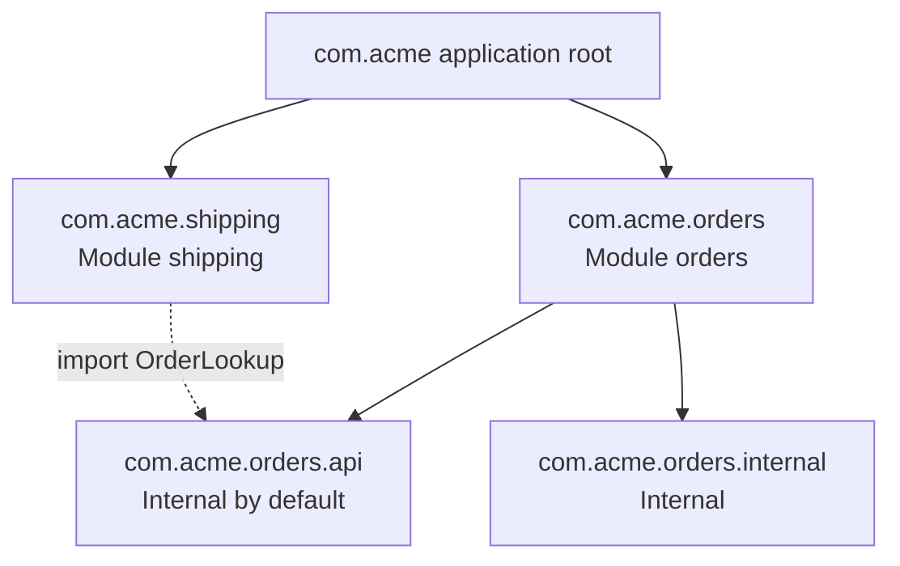
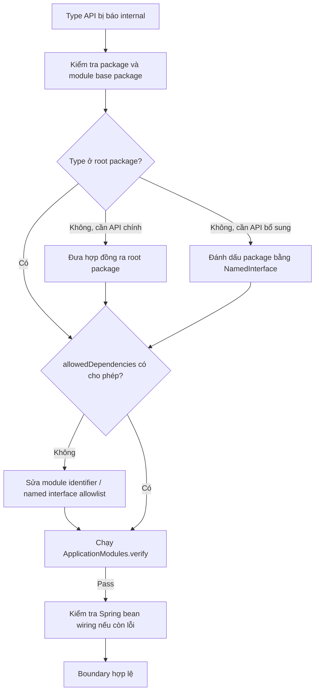

# Type API bị báo là internal

Một type có thể được khai báo `public` trong Java nhưng vẫn bị Spring Modulith xem là internal. Hai khái niệm này kiểm tra hai điều khác nhau: Java visibility quyết định code có thể tham chiếu type về mặt ngôn ngữ; module visibility quyết định application module khác có được phép phụ thuộc vào type đó hay không.

Theo quy ước mặc định, root package của application module là API package. Các package con như `internal`, `service`, `persistence` hoặc `api` đều được xem là internal cho đến khi được công bố rõ ràng bằng named interface. Vì vậy, một interface `public` nằm trong `com.acme.orders.api` vẫn có thể bị báo là internal nếu package đó chưa được đánh dấu `@NamedInterface`.

Bài học này hướng dẫn cách xác định đúng module base package, đọc kết quả `ApplicationModules`, phân biệt lỗi internal access với lỗi `allowedDependencies`, công bố API qua root package hoặc named interface và kiểm tra lại bằng verification.

## Mục tiêu

Sau bài học, bạn có thể:

- Phân biệt Java `public` với API visibility của Spring Modulith.
- Giải thích vì sao type ở subpackage vẫn internal dù được khai báo `public`.
- Xác định module base package thực tế từ application root và module detection.
- Phân biệt root package API, named interface, nested module và package nội bộ.
- Công bố package bổ sung bằng `@NamedInterface` hoặc type metadata `@PackageInfo`.
- Kiểm tra tác động của `allowedDependencies` và cú pháp `module :: interface`.
- Phân biệt vi phạm architecture verification với cảnh báo IDE hoặc lỗi Spring bean wiring.
- Sửa dependency bằng cách đưa hợp đồng ra đúng API boundary và xác minh lại.

## Java visibility và module visibility là hai lớp khác nhau

Trong Java, `public` cho phép type được tham chiếu từ package khác nếu module Java và classpath cho phép. Spring Modulith áp dụng thêm quy tắc ở cấp application module để xác định package nào được công bố cho module khác.

Ví dụ:

```text
com.acme
├── Application.java
├── orders
│   ├── OrderManagement.java
│   └── api
│       └── OrderLookup.java
└── shipping
    └── ShippingService.java
```

Giả sử `OrderLookup` được khai báo như sau:

```java
package com.acme.orders.api;

import java.util.UUID;

import com.acme.orders.OrderSummary;

public interface OrderLookup {
    OrderSummary findById(UUID orderId);
}
```

Type này là `public` theo Java. Tuy nhiên, `com.acme.orders.api` là package con của module `orders`, nên Spring Modulith mặc định xem nó là internal. Nếu `shipping` import `OrderLookup`, module verification có thể báo lỗi truy cập package nội bộ.

Trong cấu trúc này, API mặc định là package `com.acme.orders`, không phải mọi package có tên gợi ý như `api`, `public` hoặc `service`.



Java compiler có thể chấp nhận import đó vì interface là `public`. Spring Modulith mới là lớp kiểm tra module boundary và từ chối dependency vào package nội bộ.

## Xác định module base package trước khi sửa

Đừng bắt đầu bằng cách thêm `@NamedInterface` ngay. Trước hết, cần xác định Spring Modulith đang coi package nào là module base package.

Application root thường là package chứa lớp `@SpringBootApplication`. Mặc định, mỗi direct subpackage của root được xem là application module. Ví dụ, nếu `Application.java` nằm trong `com.acme`, module `orders` có base package `com.acme.orders`.

Tạo mô hình và in các module:

```java
import org.springframework.modulith.core.ApplicationModules;

var modules = ApplicationModules.of(Application.class);
modules.forEach(System.out::println);
```

Đầu ra cho biết logical name, base package và các Spring bean được phát hiện. Phần hiển thị cũng thể hiện bean nào được xem là API và bean nào là internal. Hãy xác nhận:

- Module có logical name đúng với dependency đang khai báo không.
- Base package có phải package mà bạn nghĩ là root API không.
- Type đang bị báo internal thực sự nằm ở package nào.
- Package đó là root package, named interface, nested module hay package con thông thường.

Nếu application class nằm trong `com.acme.platform` thì module có thể là `com.acme.platform.orders`, không phải `com.acme.orders`. Đưa interface vào nhầm package `com.acme.orders` sẽ không làm nó trở thành API của module được phát hiện ở `com.acme.platform.orders`.

Nếu dùng `@Modulithic(additionalPackages = …)`, custom `ApplicationModuleDetectionStrategy` hoặc `explicitly-annotated`, hãy kiểm tra cả cấu hình đó. Module detection quyết định phạm vi module trước khi Spring Modulith đánh giá visibility của từng type.

## Đọc đúng loại lỗi

Không phải mọi lỗi dependency đều có nghĩa type đang internal. Hãy đọc thông báo verification và xác định quy tắc nào bị vi phạm:

| Dấu hiệu trong lỗi | Ý nghĩa | Hướng kiểm tra |
|---|---|---|
| Access to an internal type/package | Consumer tham chiếu type trong package không được công bố | Kiểm tra base package và named interface |
| Dependency not allowed / not explicitly allowed | Module có `allowedDependencies`, nhưng dependency chưa được khai báo | Kiểm tra logical module name và named interface trong allowlist |
| Cyclic dependency | Module graph có chu trình | Kiểm tra dependency theo cả hai chiều và module `OPEN` |
| Cannot resolve bean / no qualifying bean | Spring không tìm được bean để inject | Kiểm tra component scan, bean registration và runtime wiring |
| Class/package không xuất hiện trong module model | Module detection hoặc package root không bao phủ type | Kiểm tra application root, strategy và additional packages |

`ApplicationModules.verify()` kiểm tra module graph, internal access và explicit allowed dependencies. Nó không thay thế Spring context startup để xác nhận mọi bean đều được đăng ký.

## Trường hợp 1: Type cần dùng thực ra thuộc API root package

Nếu type là hợp đồng chính mà module muốn cung cấp, cách đơn giản nhất là đặt type trong base package của module.

Trước khi sửa:

```text
com.acme.orders
├── service
│   └── OrderManagement.java
└── internal
    └── DefaultOrderManagement.java
```

Sau khi đưa hợp đồng ra root:

```text
com.acme.orders
├── OrderManagement.java
├── OrderSummary.java
└── internal
    └── DefaultOrderManagement.java
```

API:

```java
package com.acme.orders;

import java.util.UUID;

public interface OrderManagement {
    OrderSummary findOrder(UUID orderId);
}
```

Implementation tiếp tục nằm trong package con:

```java
package com.acme.orders.internal;

import java.util.UUID;

import com.acme.orders.OrderManagement;
import com.acme.orders.OrderSummary;
import org.springframework.stereotype.Service;

@Service
class DefaultOrderManagement implements OrderManagement {

    @Override
    public OrderSummary findOrder(UUID orderId) {
        // Truy cập repository và chuyển dữ liệu nội bộ thành API result.
        return null;
    }
}
```

Consumer chỉ phụ thuộc vào interface:

```java
package com.acme.shipping;

import com.acme.orders.OrderManagement;
import org.springframework.stereotype.Service;

@Service
class ShippingService {

    private final OrderManagement orders;

    ShippingService(OrderManagement orders) {
        this.orders = orders;
    }
}
```

Không inject `DefaultOrderManagement` từ package `internal`. Spring có thể tạo bean implementation và inject nó qua interface công khai. Consumer không cần biết class triển khai cụ thể.

## Trường hợp 2: Type thuộc một package API bổ sung

Nếu muốn giữ các type trong package con để tổ chức hợp đồng theo nhóm, hãy công bố package đó bằng named interface.

Ví dụ cấu trúc:

```text
com.acme.orders
├── OrderManagement.java
├── events
│   ├── package-info.java
│   └── OrderCompleted.java
└── internal
    └── DefaultOrderManagement.java
```

Trong `com.acme.orders.events/package-info.java`:

```java
@org.springframework.modulith.NamedInterface("events")
package com.acme.orders.events;
```

Type event:

```java
package com.acme.orders.events;

import java.time.Instant;
import java.util.UUID;

public record OrderCompleted(UUID orderId, Instant completedAt) {}
```

Package `events` giờ là named interface có tên `events`. Module khác có thể tham chiếu các type thuộc package đó.

### Dùng type metadata khi không có `package-info.java`

Trong Kotlin hoặc trường hợp dùng type thay thế package-info, đặt `@PackageInfo` và `@NamedInterface` trên một class trong package cần công bố:

```kotlin
package com.acme.orders.events

import org.springframework.modulith.NamedInterface
import org.springframework.modulith.PackageInfo

@PackageInfo
@NamedInterface("events")
class EventsMetadata
```

`@PackageInfo` đánh dấu type là nguồn package metadata thay thế. `@NamedInterface("events")` mới là annotation công bố package thành API. Không đặt `@PackageInfo` trực tiếp trước package declaration trong Java; annotation này có target `TYPE`.

### Khai báo dependency đến named interface

Nếu module consumer sử dụng `allowedDependencies`, khai báo đúng module identifier và tên named interface:

```java
@org.springframework.modulith.ApplicationModule(
    allowedDependencies = "orders :: events"
)
package com.acme.notifications;
```

Consumer giờ được phép tham chiếu `com.acme.orders.events`. Nó không tự động được phép tham chiếu root API `com.acme.orders` chỉ vì đã khai báo `orders :: events`.

## Trường hợp 3: Nhầm named interface với nested application module

Một package con được đánh dấu `@ApplicationModule` có thể trở thành nested application module. Đây là một ranh giới module mới, không phải cách công bố package bổ sung của module cha.

Phân biệt:

| Annotation | Ý nghĩa |
|---|---|
| `@NamedInterface("api")` | Công bố package con như một API package của module cha |
| `@ApplicationModule` trên package con | Tạo nested application module với boundary riêng |
| `@PackageInfo` | Đánh dấu type làm nguồn package metadata; tự nó không công bố API |
| `@ApplicationModule(type = OPEN)` trên module cha | Mở rộng quyền truy cập package con trong giai đoạn chuyển đổi legacy |

Nếu mục tiêu chỉ là cho module `shipping` dùng `OrderLookup` trong `orders.api`, hãy dùng `@NamedInterface("api")`. Chỉ tạo nested module khi package con thực sự có trách nhiệm và lifecycle module riêng.

## Trường hợp 4: `allowedDependencies` giới hạn API đang dùng

Một type có thể nằm đúng API package nhưng consumer vẫn bị từ chối vì `allowedDependencies` chưa cho phép module hoặc named interface đó.

Ví dụ, consumer chỉ cho phép `orders::events`:

```java
@ApplicationModule(
    allowedDependencies = "orders :: events"
)
package com.acme.shipping;
```

Nếu `ShippingService` lại import `com.acme.orders.OrderManagement` từ root package, lỗi là dependency chưa được cho phép theo khai báo hiện tại. Đây không phải lỗi type ở package internal.

Các dạng khai báo thường gặp:

| Khai báo | Phạm vi được phép |
|---|---|
| `"orders"` | Dependency đến module `orders` theo API được công bố của module |
| `"orders :: events"` | Chỉ named interface `events` |
| `"orders :: *"` | Tất cả named interface được khai báo, không bao gồm base package |
| `"orders :: **"` | Base package và tất cả named interface được khai báo |

Chọn phạm vi nhỏ nhất phù hợp với hợp đồng consumer cần dùng. Nếu consumer cần cả root API và các named interface, hãy khai báo `orders` hoặc `orders :: **` theo chính sách dependency mà nhóm muốn áp dụng.

## Trường hợp 5: Module đang OPEN hoặc CLOSED

Module `CLOSED` là chế độ mặc định. Chỉ base package và các named interface được công bố mới được module khác tham chiếu.

Module `OPEN` cho phép module khác truy cập các type nội bộ nói chung; các type ở subpackage được đưa vào unnamed interface, trừ type đã được gán vào named interface khác. Chế độ này hữu ích khi modularize codebase legacy từng bước.

```java
@org.springframework.modulith.ApplicationModule(
    type = org.springframework.modulith.ApplicationModule.Type.OPEN
)
package com.acme.orders;
```

Nếu module đã `OPEN` nhưng một type vẫn bị báo internal, hãy kiểm tra lại module model, package thực tế và loại dependency trong thông báo. Có thể type đang nằm ngoài module base package, thuộc một nested module riêng hoặc bị giới hạn bởi dependency declaration.

Không nên mở toàn bộ module chỉ để che một lỗi API. `OPEN` nới lỏng internal access và làm giảm hiệu lực một số kiểm tra kiến trúc; hãy dùng nó như trạng thái chuyển đổi có thời hạn.

## Kiểm tra bằng `ApplicationModules.verify()`

Sau khi sửa package hoặc metadata, chạy model verification:

```java
import org.junit.jupiter.api.Test;
import org.springframework.modulith.core.ApplicationModules;

class ModuleStructureTests {

    @Test
    void verifiesModuleApiAccess() {
        ApplicationModules.of(Application.class).verify();
    }
}
```

Nếu cần xem các vi phạm trước khi ném exception:

```java
var violations = ApplicationModules.of(Application.class)
    .detectViolations();

violations.getMessages().forEach(System.err::println);
violations.throwIfPresent();
```

Khi kiểm tra thủ công, in mô hình trước:

```java
var modules = ApplicationModules.of(Application.class);
modules.forEach(System.out::println);
```

Xác nhận module base package và API bean đã hiển thị đúng. Sau đó mới đọc violation để biết consumer đang truy cập package nào.

## Quy trình chẩn đoán từng bước

Khi một type API bị báo internal, thực hiện theo thứ tự sau:

1. **Đọc đầy đủ violation.** Ghi lại module consumer, module được tham chiếu và fully qualified class name bị báo.
2. **Kiểm tra Java package của type.** Xác định type nằm ở root package hay package con.
3. **In module model.** Dùng `ApplicationModules.of(Application.class)` để xác nhận base package và module logical name.
4. **Kiểm tra detection.** Xem application root, `additionalPackages`, `explicitly-annotated` hoặc custom strategy có nhận đúng module không.
5. **Chọn API boundary.** Nếu type là API chính, đưa nó về base package; nếu là API bổ sung, khai báo named interface.
6. **Kiểm tra annotation metadata.** Với Java, kiểm tra `package-info.java` ở đúng package; với Kotlin, dùng `@PackageInfo` trên type metadata cùng `@NamedInterface`.
7. **Kiểm tra dependency allowlist.** Đảm bảo `allowedDependencies` cho phép đúng module và interface mà consumer dùng.
8. **Kiểm tra nested/open module.** Xác nhận package không vô tình trở thành nested module và trạng thái `OPEN`/`CLOSED` đúng ý định.
9. **Chạy lại model verification.** Dùng `verify()` hoặc `detectViolations().throwIfPresent()`.
10. **Kiểm tra runtime wiring riêng.** Nếu interface đã hợp lệ nhưng Spring không inject được bean, dùng module integration test để kiểm tra bean registration và component scan.



## Ví dụ tổng hợp: công bố `OrderLookup`

Ban đầu, module `shipping` import trực tiếp:

```java
import com.acme.orders.persistence.OrderRepository;
```

Đây là dependency vào implementation persistence. Thay bằng một hợp đồng query:

```java
package com.acme.orders;

import java.util.Optional;
import java.util.UUID;

public interface OrderLookup {
    Optional<OrderSummary> findById(UUID orderId);
}
```

DTO trả về cũng nằm trong API package:

```java
package com.acme.orders;

import java.util.UUID;

public record OrderSummary(UUID id, String status) {}
```

Implementation trong module:

```java
package com.acme.orders.internal;

import java.util.Optional;
import java.util.UUID;

import com.acme.orders.OrderLookup;
import com.acme.orders.OrderSummary;
import org.springframework.stereotype.Service;

@Service
class DefaultOrderLookup implements OrderLookup {

    @Override
    public Optional<OrderSummary> findById(UUID orderId) {
        // Repository được truy cập nội bộ và ánh xạ sang DTO công khai.
        return Optional.empty();
    }
}
```

Consumer:

```java
package com.acme.shipping;

import com.acme.orders.OrderLookup;
import org.springframework.stereotype.Service;

@Service
class ShippingService {
    private final OrderLookup orders;

    ShippingService(OrderLookup orders) {
        this.orders = orders;
    }
}
```

Nếu `shipping` khai báo explicit dependency:

```java
@org.springframework.modulith.ApplicationModule(
    allowedDependencies = "orders"
)
package com.acme.shipping;
```

Giờ consumer chỉ phụ thuộc vào hợp đồng `OrderLookup` và `OrderSummary`. Repository cùng persistence entity vẫn được module `orders` sở hữu.

## Những lỗi thường gặp

| Lỗi | Vì sao xảy ra | Cách sửa |
|---|---|---|
| Đổi class thành `public` nhưng vẫn bị báo internal | Java visibility không công bố package cho module khác | Đưa type ra root hoặc dùng named interface |
| Đặt type trong package tên `api` nhưng không có `@NamedInterface` | Tên package không tự tạo API boundary | Đánh dấu package bằng `@NamedInterface` |
| Đặt `@NamedInterface` trên package khác với package của type | Metadata không áp dụng cho package chứa type | Đặt annotation trong đúng `package-info.java` hoặc type metadata của package đó |
| Dùng `@PackageInfo` trực tiếp trên package declaration | `@PackageInfo` có target `TYPE` | Dùng `@NamedInterface` trong `package-info.java`, hoặc `@PackageInfo` trên class metadata |
| Dùng `@ApplicationModule` cho package muốn công bố API | Package có thể trở thành nested module | Dùng `@NamedInterface` nếu chỉ muốn thêm API package |
| Consumer dùng implementation class thay interface | Dependency vẫn trỏ vào package nội bộ | Inject interface ở API package |
| `allowedDependencies` chỉ cho `orders :: events` nhưng consumer dùng root API | Allowlist chỉ mở named interface đã nêu | Cho phép `orders` hoặc `orders :: **` theo nhu cầu |
| API nằm ngoài module base package | Module detection đang chọn root khác | Kiểm tra application root và detection strategy |
| IDE báo internal nhưng model test pass | IDE có thể dùng model/cache/configuration khác hoặc cảnh báo khác loại | In module model và chạy verification bằng cùng application class/configuration |

## Checklist trước khi kết luận API đã được công bố

- [ ] Type nằm trong base package của module hoặc package được công bố bằng named interface.
- [ ] Module base package được xác nhận từ `ApplicationModules` output.
- [ ] Package metadata nằm đúng package chứa type.
- [ ] `@PackageInfo` chỉ được dùng trên type metadata, không đặt trực tiếp trên package declaration.
- [ ] Package con không bị đánh dấu nhầm thành nested application module.
- [ ] Consumer import interface/DTO công khai thay vì implementation, repository hoặc entity nội bộ.
- [ ] `allowedDependencies` cho phép đúng module và named interface.
- [ ] `ApplicationModules.verify()` chạy thành công.
- [ ] Nếu còn lỗi injection, Spring runtime test xác nhận bean implementation được đăng ký và implement đúng API.

## Bài tập tự đánh giá

Ứng dụng có module `orders` với cấu trúc:

```text
com.acme.orders
├── OrderManagement.java
├── api
│   └── OrderLookup.java
└── internal
    └── JpaOrderRepository.java
```

`OrderLookup` là `public`, nhưng module `shipping` import type này và `ApplicationModules.verify()` báo truy cập package nội bộ. `shipping` còn khai báo `allowedDependencies = "orders :: events"`.

Hãy trả lời:

1. Vì sao `public interface OrderLookup` vẫn bị coi là internal?
2. Có những cách nào để công bố `com.acme.orders.api`?
3. Nếu muốn giữ `OrderLookup` trong package `api`, cần thêm annotation nào và đặt ở đâu?
4. Vì sao `allowedDependencies = "orders :: events"` vẫn không cho phép consumer dùng `OrderLookup`?
5. Làm thế nào xác nhận module base package và named interface đã được phát hiện đúng?

Một hướng giải quyết là đánh dấu `com.acme.orders.api` bằng `@NamedInterface("api")`, rồi khai báo `allowedDependencies = "orders :: api"` ở `shipping`. Nếu `OrderLookup` là API chính, có thể chuyển nó lên `com.acme.orders` và cho phép dependency `orders`. Sau đó in `ApplicationModules`, kiểm tra named interface và chạy `verify()` để xác nhận boundary.

## Kết luận

Type `public` chưa chắc là API của application module. Spring Modulith coi base package là API mặc định; các package con là internal trừ khi được công bố bằng named interface. Khi gặp lỗi, hãy xác định module base package, kiểm tra package metadata, phân biệt internal access với `allowedDependencies`, rồi chọn đưa hợp đồng ra root hoặc công bố named interface. Dùng `ApplicationModules` để xem mô hình và `verify()` để xác nhận thay đổi. Giữ implementation, repository và entity trong module sở hữu để consumer chỉ phụ thuộc vào hợp đồng ổn định.

## Tài liệu tham khảo

- [Spring Modulith Reference — Fundamentals: Advanced Application Modules and Named Interfaces](https://docs.spring.io/spring-modulith/reference/fundamentals.html)
- [Spring Modulith Reference — Verifying Application Module Structure](https://docs.spring.io/spring-modulith/reference/verification.html)
- [Spring Modulith API — `NamedInterface`](https://docs.spring.io/spring-modulith/docs/current/api/org/springframework/modulith/NamedInterface.html)
- [Spring Modulith API — `PackageInfo`](https://docs.spring.io/spring-modulith/docs/current/api/org/springframework/modulith/PackageInfo.html)
- [Spring Modulith API — `ApplicationModules`](https://docs.spring.io/spring-modulith/docs/current/api/org/springframework/modulith/core/ApplicationModules.html)
