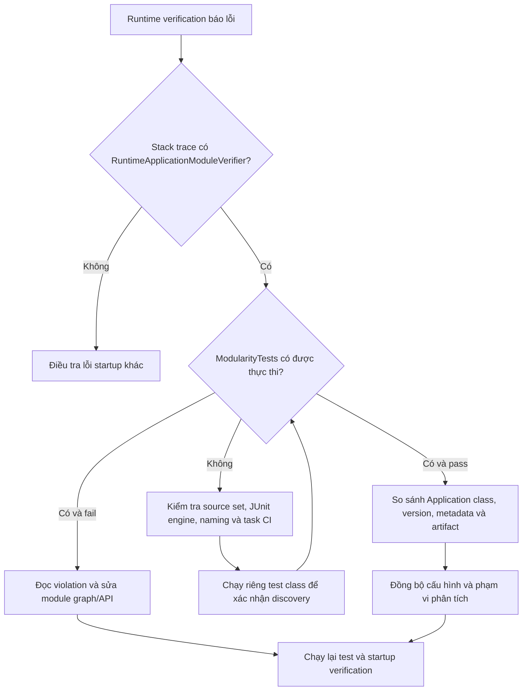

# Chẩn đoán sự cố

## Runtime verification lỗi nhưng test verification không chạy

Một ứng dụng Spring Boot có thể dừng khi khởi động vì Spring Modulith phát hiện vi phạm kiến trúc, trong khi nhóm lại không thấy bài kiểm tra `ApplicationModules.verify()` chạy trong kết quả CI. Hai hiện tượng này có thể xảy ra cùng lúc vì **runtime verification và test verification được kích hoạt ở hai thời điểm và bởi hai cơ chế khác nhau**.

Runtime verification được bật trong ứng dụng bằng runtime support và cấu hình tương ứng. Test verification chỉ chạy khi một test được build tool phát hiện và thực thi. Vì vậy, việc ứng dụng báo lỗi khi khởi động không chứng minh rằng JUnit test đã được chạy; ngược lại, việc không thấy test trong log cũng không có nghĩa runtime verification đã tắt.

### 1. Phân biệt hai cơ chế trước khi điều tra

Spring Modulith có thể kiểm tra mô hình application module theo hai cách:

| Cơ chế | Cách kích hoạt | Thời điểm | Mục tiêu |
|---|---|---|---|
| Runtime verification | Có `spring-modulith-runtime` và bật `spring.modulith.runtime.verification-enabled` | Trong quá trình ứng dụng khởi động | Ngăn ứng dụng khởi động với cấu trúc module vi phạm quy tắc |
| Test verification | Test gọi `ApplicationModules.of(Application.class).verify()` | Khi JUnit chạy test | Phát hiện vi phạm trong build và pull request |

Runtime verification không tự tạo một JUnit test. Test verification cũng không tự bật runtime verifier trong application context. Nếu nhóm chỉ cấu hình một trong hai cơ chế, kết quả của cơ chế còn lại có thể hoàn toàn không xuất hiện.

Ví dụ, runtime configuration:

```yaml
spring:
  modulith:
    runtime:
      verification-enabled: true
```

Để kích hoạt runtime verifier, ứng dụng cần có `spring-modulith-runtime` trên runtime classpath:

```kotlin
dependencies {
    runtimeOnly("org.springframework.modulith:spring-modulith-runtime")
}
```

Trong khi đó, test verification cần một test method thực sự được JUnit thực thi:

```java
package com.acme;

import org.junit.jupiter.api.Test;
import org.springframework.modulith.core.ApplicationModules;

class ModularityTests {

    @Test
    void verifiesApplicationModuleStructure() {
        ApplicationModules.of(Application.class).verify();
    }
}
```

Đây là hai điểm kích hoạt độc lập. Trong dự án có thể bật cả hai: CI phát hiện vi phạm trước khi merge, còn runtime verifier cung cấp thêm một lớp bảo vệ khi ứng dụng khởi động.

### 2. Xác nhận lỗi thực sự đến từ RuntimeApplicationModuleVerifier

Trước khi sửa cấu hình, hãy đọc log đầy đủ và xác định exception đầu tiên gây thất bại. Một dòng `Application run failed` không đủ để kết luận nguyên nhân là Spring Modulith.

Tìm các dấu hiệu như:

- Tên `RuntimeApplicationModuleVerifier` trong stack trace hoặc log.
- Thông báo liên quan đến verification, application module, dependency cycle hoặc access vào package nội bộ.
- Exception được ném trong giai đoạn Spring Boot khởi tạo application context.

Nếu stack trace chỉ ra lỗi database, thiếu bean, cấu hình sai hoặc migration thất bại, đó có thể là lỗi startup khác. Không nên tắt runtime verification để xử lý một lỗi không liên quan.

Khi đã xác nhận verifier là nguồn gây lỗi, ghi lại các thông tin sau trước khi thay đổi:

1. Commit SHA và profile Spring Boot đang chạy.
2. Phiên bản Spring Boot và Spring Modulith đã được resolve.
3. Runtime classpath có `spring-modulith-runtime` hay không.
4. Giá trị hiệu lực của `spring.modulith.runtime.verification-enabled`.
5. Danh sách module và dependency vi phạm được nêu trong exception.

Những dữ liệu này giúp phân biệt lỗi do cấu trúc thật, do cấu hình chỉ bật ở một profile, hay do môi trường chạy không giống CI.

### 3. Vì sao test verification có thể không chạy?

Nếu CI không hiển thị `ModularityTests`, kiểm tra lần lượt từ source set đến test engine.

| Nguyên nhân | Dấu hiệu | Cách xử lý |
|---|---|---|
| Test đặt sai thư mục | File không thuộc source set test | Đặt dưới `src/test/java` hoặc source set đã cấu hình |
| Tên class không được build tool nhận diện | Test class bị bỏ qua theo include/exclude pattern | Dùng tên thông dụng như `ModularityTests` hoặc cấu hình discovery rõ ràng |
| Thiếu JUnit 5 engine hoặc cấu hình JUnit Platform | Test compile được nhưng không có test engine thực thi | Kiểm tra JUnit dependency và cấu hình test task |
| Gradle không dùng JUnit Platform | JUnit Jupiter test không được chạy như mong đợi | Cấu hình `useJUnitPlatform()` |
| Maven Surefire cũ hoặc cấu hình plugin không phù hợp | Maven báo không tìm thấy test hoặc không chạy Jupiter | Kiểm tra phiên bản và cấu hình Surefire cùng JUnit provider |
| Test bị `@Disabled`, tag filter hoặc exclude | Test có trong source nhưng không xuất hiện trong lần chạy | Kiểm tra annotation, tag và tham số build |
| CI chỉ chạy một task hoặc module khác | Test có trong project nhưng task hiện tại không bao gồm nó | Xác nhận đúng module và task test được gọi |
| Test compile thất bại trước discovery | Build dừng ở compileTestJava hoặc testCompile | Sửa lỗi compile trước khi đánh giá kết quả discovery |

Với Gradle, cấu hình JUnit Platform thường có dạng:

```kotlin
tasks.test {
    useJUnitPlatform()
}
```

Với Maven, xác nhận project dùng JUnit Jupiter và phiên bản Surefire hỗ trợ JUnit Platform. Đừng thêm plugin hoặc dependency một cách máy móc trước khi xem dependency management hiện tại.

### 4. Chạy riêng test để kiểm tra discovery

Khi cần xác định test có được phát hiện hay không, chạy trực tiếp đúng class bằng build tool.

Gradle:

```bash
./gradlew test --tests "com.acme.ModularityTests" --info
```

Maven:

```bash
./mvnw -Dtest=ModularityTests test
```

Đọc kết quả để xác định:

- Test class có được compile không?
- Test engine có nhận class không?
- Có test method nào được thực thi không?
- Test bị skip hoặc exclude bởi filter nào?
- `verify()` có được gọi trước khi test kết thúc không?

Nếu build tool báo `No tests found` hoặc số test được thực thi bằng 0, hãy xử lý discovery trước. Nếu test chạy và thất bại, đã xác nhận test verification hoạt động; lúc đó cần điều tra violation hoặc khác biệt giữa mô hình được test và mô hình runtime.

### 5. Kiểm tra hai môi trường có phân tích cùng một ứng dụng

Một test verification chỉ có ý nghĩa khi phân tích đúng package gốc và cùng phạm vi source code với ứng dụng thực tế.

Ví dụ, nếu lớp `@SpringBootApplication` là `com.acme.Application`, test nên gọi:

```java
ApplicationModules.of(Application.class).verify();
```

Tránh chọn một lớp cấu hình nằm trong package con làm điểm bắt đầu chỉ vì nó tiện import. Điểm bắt đầu khác nhau có thể làm phạm vi package và module được phát hiện khác nhau.

Khi test chạy nhưng pass trong khi runtime verifier fail, so sánh:

| Yếu tố | Test | Runtime | Điều cần xác nhận |
|---|---|---|---|
| Application class | Lớp truyền vào `ApplicationModules.of(...)` | Lớp ứng dụng mà runtime support nhận diện | Cùng một package gốc và cùng ứng dụng |
| Dependency version | Test runtime classpath | Application runtime classpath | Không resolve hai phiên bản Spring Modulith khác nhau |
| Compiled classes | Output của source set test | Output được đóng gói để chạy | Cùng commit và không dùng artifact cũ |
| Module detection | Cấu hình và metadata trong test | Cấu hình và metadata khi chạy ứng dụng | Cùng detection strategy và package marker |
| Profile/configuration | Profile của test nếu có | Profile triển khai | Không nhầm static model với điều kiện tạo bean theo profile |

`ApplicationModules.verify()` kiểm tra cấu trúc mã nguồn. Nó không khởi động application context và không mô phỏng toàn bộ việc chọn bean theo profile. Nếu runtime failure liên quan đến cấu trúc module, hãy xác minh rằng test và runtime dùng cùng lớp ứng dụng, phiên bản thư viện, source artifact và metadata.

### 6. Kiểm tra property và runtime dependency

Một lỗi thường gặp là property đã có trong YAML nhưng `spring-modulith-runtime` không nằm trên runtime classpath. Khi đó, không có runtime auto-configuration tương ứng để thực hiện verification.

Lưu ý về phiên bản: runtime verification với property `spring.modulith.runtime.verification-enabled` được cung cấp trong các phiên bản Spring Modulith 2.x. Nếu ứng dụng vẫn dùng dòng 1.x, hãy mở tài liệu đúng phiên bản và kiểm tra khả năng hỗ trợ trước khi thêm property; không suy luận rằng một property không được nhận diện là đã bật verifier.

Kiểm tra hai điều kiện riêng:

**Dependency:** `spring-modulith-runtime` phải được đóng gói hoặc resolve vào runtime classpath của ứng dụng. Nếu khai báo `runtimeOnly`, nó sẽ không có trong compile classpath nhưng vẫn cần xuất hiện khi chạy ứng dụng.

**Property:** giá trị hiệu lực của `spring.modulith.runtime.verification-enabled` phải là `true` trong profile đang chạy. Một file `application-local.yml` có thể bật property trong local nhưng production không nạp profile đó; hoặc biến môi trường và tham số command line có thể ghi đè giá trị trong YAML.

Khi cần xác minh cấu hình, có thể xem condition evaluation report của Spring Boot bằng cách bật debug trong lần chạy chẩn đoán hoặc kiểm tra cấu hình đã bind trong application context. Không nên in toàn bộ Environment hoặc secret ra log CI; chỉ thu thập property và dependency liên quan.

### 7. Phân biệt test pass với test không chạy

Hai trạng thái này thường bị nhầm lẫn khi xem log build rút gọn:

| Kết quả | Ý nghĩa | Hành động tiếp theo |
|---|---|---|
| Test executed và passed | `verify()` đã chạy và không phát hiện violation trong mô hình được test | So sánh application class, version và metadata nếu runtime vẫn fail |
| Test executed và failed | Test verification hoạt động và đã phát hiện violation hoặc exception | Đọc chi tiết violation và sửa cấu trúc |
| Test skipped | Test được phát hiện nhưng bị bỏ qua | Tìm tag, condition, `@Disabled` hoặc cấu hình skip |
| Zero tests / no tests found | Test không được discovery hoặc task không bao gồm test đó | Sửa source set, naming, engine hoặc task selection |
| Test task không được gọi | Pipeline chưa chạy bước test | Thêm đúng task vào workflow và required status check |

Chỉ trạng thái đầu tiên mới chứng minh test verification đã thực thi thành công. Một build màu xanh nhưng không chạy test kiến trúc không tạo ra bằng chứng rằng module boundaries đang hợp lệ.

### 8. Cấu hình CI để không bỏ sót test kiến trúc

Đặt `ModularityTests` trong test suite mặc định và chạy nó trên mỗi pull request. Với Gradle, workflow nên gọi `./gradlew test` thay vì chỉ gọi một task compile. Nếu CI dùng task tùy chỉnh, kiểm tra task đó có phụ thuộc vào `test` hoặc test task tương ứng của module hay không.

Có thể bật log chi tiết khi chẩn đoán:

```bash
./gradlew test --tests "com.acme.ModularityTests" --info
```

Sau khi xác nhận discovery, giữ cấu hình log phù hợp trong pipeline thường ngày để log không quá lớn. Đặt test job thành required check để pull request không thể merge khi job chưa chạy hoặc thất bại.

Không dựa vào runtime verification như lớp kiểm tra duy nhất. Runtime verifier bảo vệ lúc ứng dụng khởi động, nhưng lỗi có thể chỉ xuất hiện sau khi deploy. Test verification đưa cùng quy tắc vào vòng phản hồi trước khi merge và giúp reviewer xem kết quả ngay trong pull request.

### 9. Cây quyết định chẩn đoán



### 10. Checklist trước khi đóng sự cố

- [ ] Đã xác nhận exception thực sự đến từ runtime verifier.
- [ ] Đã kiểm tra `spring-modulith-runtime` trên runtime classpath.
- [ ] Đã kiểm tra giá trị hiệu lực của `spring.modulith.runtime.verification-enabled`.
- [ ] Test `ModularityTests` nằm trong source set được build tool chạy.
- [ ] JUnit engine và Gradle/Maven test configuration được thiết lập đúng.
- [ ] Log chứng minh test method đã thực thi, không phải chỉ compile hoặc bị skip.
- [ ] Test và runtime dùng cùng application class, dependency version và detection strategy.
- [ ] Violation được sửa tại module, API hoặc dependency liên quan.
- [ ] CI chạy test kiến trúc trên pull request và lưu kết quả thành required check.

Khi runtime verification thất bại nhưng test verification không xuất hiện, hãy xác định trước test có thực sự được discovery và thực thi hay không. Sau đó mới so sánh mô hình giữa test và runtime. Việc tách rõ hai cơ chế giúp nhóm tránh sửa nhầm cấu hình, phát hiện test bị bỏ sót và bảo đảm quy tắc kiến trúc được kiểm tra cả trước khi merge lẫn khi ứng dụng khởi động.

### Tài liệu tham khảo

- [Spring Modulith — Runtime Support and Verification](https://docs.spring.io/spring-modulith/reference/runtime.html)
- [Spring Modulith — Verifying Application Module Structure](https://docs.spring.io/spring-modulith/reference/verification.html)
- [Spring Modulith — Testing Application Modules](https://docs.spring.io/spring-modulith/reference/testing.html)
- [Gradle — Testing in Java Projects](https://docs.gradle.org/current/userguide/java_testing.html)
- [JUnit 5 — User Guide](https://junit.org/junit5/docs/current/user-guide/)
