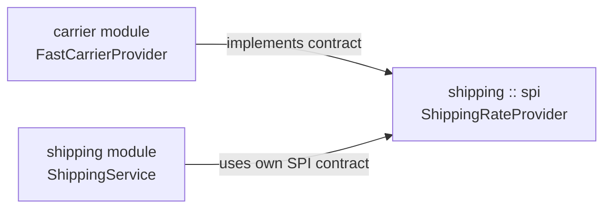
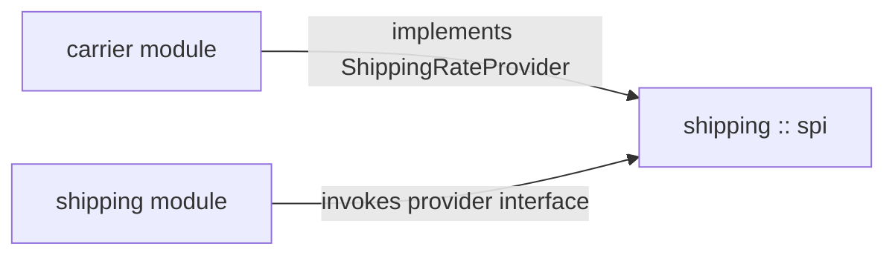

# Thêm `@NamedInterface` cho một SPI package

Trong modular monolith, một module đôi khi cần công bố một hợp đồng để module khác có thể cung cấp implementation. Đây là tình huống điển hình của Service Provider Interface (SPI): module sở hữu capability định nghĩa interface; module khác triển khai interface đó; Spring ghép implementation vào ứng dụng khi khởi động.

Trong bài thực hành này, module `shipping` định nghĩa SPI `ShippingRateProvider` trong package `com.acme.shipping.spi`. Module `carrier` cung cấp implementation cho hợp đồng đó. Ban đầu, package `spi` vẫn là package con nội bộ. Bạn sẽ đánh dấu nó bằng `@NamedInterface("spi")`, sau đó giới hạn dependency của module `carrier` bằng `allowedDependencies = "shipping :: spi"` và xác minh mô hình bằng Spring Modulith.

## Kết quả cần đạt

Sau bài thực hành, bạn có thể:

- Tạo package SPI thuộc module sở hữu hợp đồng.
- Công bố package đó bằng `@NamedInterface("spi")` trong `package-info.java`.
- Đặt interface và các kiểu dữ liệu hợp đồng trong đúng package được công bố.
- Viết implementation ở module provider mà không làm module sở hữu SPI phụ thuộc ngược lại provider.
- Khai báo `allowedDependencies` để chỉ cho phép module provider dùng named interface cần thiết.
- Đọc dependency graph và xác minh bằng `ApplicationModules.verify()`.
- Phân biệt lỗi package internal với lỗi dependency chưa được cho phép.
- Kiểm tra Spring runtime có tìm thấy provider implementation hay không.

## Bối cảnh bài tập

Một ứng dụng giao hàng có hai module:

- `shipping` chịu trách nhiệm chọn phương thức giao hàng và tính báo giá.
- `carrier` tích hợp với một nhà vận chuyển cụ thể để cung cấp báo giá.

Module `shipping` không nên phụ thuộc trực tiếp vào class triển khai của `carrier`. Nếu thêm nhà vận chuyển mới, module `shipping` không cần sửa mã nguồn. Thay vào đó, `shipping` sở hữu hợp đồng `ShippingRateProvider`; mỗi module provider phụ thuộc vào hợp đồng này và triển khai nó.



Dependency ở mức mã nguồn đi từ `carrier` đến `shipping::spi`, vì class implementation import interface do `shipping` sở hữu. Khi chạy, `ShippingService` gọi các bean triển khai thông qua interface. `shipping` không import package hoặc class của `carrier`.

## Cấu trúc project mục tiêu

Giả sử lớp Spring Boot application nằm tại `com.acme.Application` và các module là direct subpackages của `com.acme`:

```text
src/main/java
└── com/acme
    ├── Application.java
    ├── shipping
    │   ├── package-info.java
    │   ├── internal
    │   │   └── ShippingService.java
    │   └── spi
    │       ├── package-info.java
    │       ├── ShippingRateProvider.java
    │       ├── ShippingRequest.java
    │       └── ShippingQuote.java
    └── carrier
        ├── package-info.java
        └── internal
            └── FastCarrierProvider.java
```

Các file `package-info.java` có vai trò khác nhau:

| File | Vai trò |
|---|---|
| `shipping/package-info.java` | Định danh module sở hữu SPI |
| `shipping/spi/package-info.java` | Công bố named interface `spi` |
| `carrier/package-info.java` | Giới hạn dependency của provider vào `shipping :: spi` |

Nếu project của bạn dùng package root hoặc module identifier khác, thay các tên trong ví dụ cho khớp với cấu trúc thực tế. Giá trị trong `allowedDependencies` phải dùng logical module identifier, không phải tên class implementation.

## Phần 1: Khai báo module `shipping`

Tạo `src/main/java/com/acme/shipping/package-info.java`:

```java
@org.springframework.modulith.ApplicationModule(id = "shipping")
package com.acme.shipping;
```

`shipping` là module sở hữu hợp đồng SPI. Identifier `shipping` được khai báo tường minh để dependency rule ở module khác dễ đọc và ổn định khi package thay đổi theo quy ước của dự án.

Nếu project đã có `package-info.java` chứa `@ApplicationModule`, hãy bổ sung hoặc điều chỉnh thuộc tính trên annotation hiện tại. Mỗi package chỉ cần một package declaration; không tạo hai file `package-info.java` cho cùng package.

## Phần 2: Tạo SPI package

Tạo `src/main/java/com/acme/shipping/spi/package-info.java`:

```java
@org.springframework.modulith.NamedInterface("spi")
package com.acme.shipping.spi;
```

Annotation `@NamedInterface("spi")` công bố package `com.acme.shipping.spi` như một phần API có tên `spi` của module `shipping`.

Điểm cần nhớ:

- `spi` là tên logical của named interface.
- Tên package và tên named interface có thể giống nhau theo quy ước, nhưng ý nghĩa được xác định bởi annotation.
- Chỉ các type trong package được công bố mới thuộc named interface này.
- Package con sâu hơn không tự động trở thành một phần của named interface nếu không được cấu hình phù hợp.
- `@NamedInterface` không tạo application module mới.

Nếu bỏ annotation này, `com.acme.shipping.spi` vẫn là package con internal theo mặc định. Việc interface được khai báo `public` không đủ để module khác được phép phụ thuộc vào nó.

## Phần 3: Định nghĩa hợp đồng SPI

Tạo `ShippingRequest.java` trong package `com.acme.shipping.spi`:

```java
package com.acme.shipping.spi;

public record ShippingRequest(
    String destinationPostalCode,
    int weightInGrams
) {
    public ShippingRequest {
        if (destinationPostalCode == null || destinationPostalCode.isBlank()) {
            throw new IllegalArgumentException("Postal code is required");
        }
        if (weightInGrams <= 0) {
            throw new IllegalArgumentException("Weight must be positive");
        }
    }
}
```

Tạo `ShippingQuote.java`:

```java
package com.acme.shipping.spi;

import java.math.BigDecimal;

public record ShippingQuote(
    String providerCode,
    BigDecimal amount,
    int estimatedDeliveryDays
) {}
```

Tạo `ShippingRateProvider.java`:

```java
package com.acme.shipping.spi;

public interface ShippingRateProvider {

    ShippingQuote quote(ShippingRequest request);
}
```

Ba type này là một phần của cùng hợp đồng SPI. Module provider cần biết request, response và method phải triển khai. Đặt chúng trong cùng package giúp một named interface công bố đúng toàn bộ contract cần thiết.

Không đưa JPA entity, repository hoặc Spring bean vào SPI. Hợp đồng nên chứa các kiểu dữ liệu ổn định, độc lập với implementation của module sở hữu.

## Phần 4: Dùng SPI bên trong module `shipping`

Tạo `ShippingService.java` trong `com.acme.shipping.internal`:

```java
package com.acme.shipping.internal;

import java.util.Comparator;
import java.util.List;

import com.acme.shipping.spi.ShippingQuote;
import com.acme.shipping.spi.ShippingRateProvider;
import com.acme.shipping.spi.ShippingRequest;
import org.springframework.stereotype.Service;

@Service
public class ShippingService {

    private final List<ShippingRateProvider> providers;

    public ShippingService(List<ShippingRateProvider> providers) {
        this.providers = List.copyOf(providers);
    }

    public ShippingQuote quote(ShippingRequest request) {
        return providers.stream()
            .map(provider -> provider.quote(request))
            .min(Comparator.comparing(ShippingQuote::amount))
            .orElseThrow(() -> new IllegalStateException(
                "No shipping rate provider is available"
            ));
    }
}
```

`ShippingService` chỉ biết interface `ShippingRateProvider`. Nó không import `FastCarrierProvider`, không biết có bao nhiêu module provider và không cần thay đổi khi thêm provider mới.

Spring có thể inject danh sách bean triển khai interface. Nếu không có provider nào được đăng ký, danh sách rỗng và method `quote` ném lỗi rõ ràng. Trong ứng dụng thực tế, nhóm có thể bổ sung fallback, kiểm tra provider khả dụng hoặc chính sách chọn báo giá.

## Phần 5: Khai báo dependency của module `carrier`

Tạo `src/main/java/com/acme/carrier/package-info.java`:

```java
@org.springframework.modulith.ApplicationModule(
    id = "carrier",
    allowedDependencies = "shipping :: spi"
)
package com.acme.carrier;
```

Module `carrier` được phép phụ thuộc vào named interface `spi` của module `shipping`. Quy tắc này thể hiện rõ rằng provider chỉ cần contract để triển khai.

Nếu `carrier` cố import một type khác trong root package `shipping`, chẳng hạn một service hoặc class không thuộc named interface `spi`, dependency có thể bị từ chối vì allowlist chỉ cho phép `shipping :: spi`.

Không thêm `carrier` vào `allowedDependencies` của `shipping`. Làm như vậy sẽ đảo ngược dependency source code và khiến module sở hữu SPI biết về provider. Hợp đồng được định nghĩa ở phía module cần capability; provider phụ thuộc vào hợp đồng đó.

## Phần 6: Viết provider implementation

Tạo `FastCarrierProvider.java` trong `com.acme.carrier.internal`:

```java
package com.acme.carrier.internal;

import java.math.BigDecimal;

import com.acme.shipping.spi.ShippingQuote;
import com.acme.shipping.spi.ShippingRateProvider;
import com.acme.shipping.spi.ShippingRequest;
import org.springframework.stereotype.Component;

@Component
class FastCarrierProvider implements ShippingRateProvider {

    @Override
    public ShippingQuote quote(ShippingRequest request) {
        BigDecimal amount = request.weightInGrams() <= 1_000
            ? new BigDecimal("45000")
            : new BigDecimal("65000");

        return new ShippingQuote("FAST", amount, 2);
    }
}
```

Implementation nằm trong package nội bộ của `carrier`. Class không cần `public` vì không được module khác tham chiếu trực tiếp. Spring component scanning có thể đăng ký bean trong package này khi application root `com.acme` quét toàn bộ ứng dụng.

Khi thêm một nhà vận chuyển mới, tạo module provider khác, triển khai `ShippingRateProvider` và chỉ cho phép dependency `shipping :: spi`. Module `shipping` vẫn không cần import module provider.

## Phần 7: Kiểm tra dependency graph

Sau khi tạo package metadata và implementation, dependency graph ở mức mã nguồn phải có dạng:



Dependency compile-time liên module duy nhất trong ví dụ là:

```text
carrier -> shipping :: spi
```

`ShippingService` dùng SPI trong chính module `shipping`; đó không phải dependency giữa hai module. Khi runtime, Spring inject `FastCarrierProvider` vào `ShippingService` thông qua interface. Quan hệ gọi lúc runtime không làm phát sinh import ngược từ module `shipping` sang module `carrier`.

## Phần 8: Xác minh bằng Spring Modulith

Tạo model test, ví dụ `ApplicationModuleStructureTests.java` trong test source set:

```java
package com.acme;

import org.junit.jupiter.api.Test;
import org.springframework.modulith.core.ApplicationModules;

class ApplicationModuleStructureTests {

    @Test
    void verifiesModuleBoundaries() {
        ApplicationModules.of(Application.class).verify();
    }
}
```

Khi cấu hình đúng, verification phải chấp nhận dependency từ `carrier` đến `shipping :: spi`. Nó cũng tiếp tục kiểm tra các quy tắc module mặc định như dependency cycle và truy cập package nội bộ.

Trước khi kết luận, hãy in mô hình module nếu cần:

```java
var modules = ApplicationModules.of(Application.class);
modules.forEach(System.out::println);
```

Xác nhận:

- `shipping` được nhận diện là application module.
- `carrier` được nhận diện là application module.
- `com.acme.shipping.spi` xuất hiện dưới named interface `spi`.
- `carrier` chỉ phụ thuộc vào hợp đồng `shipping :: spi`.
- Không có module nào import `com.acme.carrier.internal`.

## Phần 9: Quan sát lỗi khi bỏ annotation

Để hiểu tác dụng của named interface, thực hiện một thử nghiệm có kiểm soát:

1. Giữ nguyên `carrier/package-info.java` với `allowedDependencies = "shipping :: spi"`.
2. Tạm thời bỏ `@NamedInterface("spi")` khỏi `shipping/spi/package-info.java`.
3. Chạy lại model verification trong môi trường phát triển.
4. Quan sát lỗi: package `com.acme.shipping.spi` không còn được công bố là named interface, nên provider không thể sử dụng nó như API hợp lệ.
5. Khôi phục `@NamedInterface("spi")` và chạy verification lại.

Một thử nghiệm khác là giữ `@NamedInterface` nhưng tạm xóa `allowedDependencies` hoặc thay bằng một tên interface sai. Khi module có explicit dependency rules, verification sẽ báo dependency không được cho phép. Hai trường hợp thể hiện hai lớp điều kiện khác nhau:

| Điều kiện | Câu hỏi |
|---|---|
| `@NamedInterface("spi")` | Package có được công bố thành API không? |
| `allowedDependencies = "shipping :: spi"` | Module consumer có được phép dùng API đó không? |

Chỉ cần một trong hai điều kiện sai là dependency có thể không hợp lệ.

## Phần 10: Kiểm tra Spring runtime tìm thấy provider

Model verification xác nhận dependency boundary. Nó không chứng minh Spring đã đăng ký bean provider. Để kiểm tra runtime wiring, tạo một integration test ở cấp application:

```java
package com.acme;

import static org.assertj.core.api.Assertions.assertThat;

import org.junit.jupiter.api.Test;
import org.springframework.beans.factory.annotation.Autowired;
import org.springframework.boot.test.context.SpringBootTest;

import com.acme.shipping.internal.ShippingService;
import com.acme.shipping.spi.ShippingRequest;

@SpringBootTest
class ShippingProviderIntegrationTests {

    @Autowired
    ShippingService shipping;

    @Test
    void usesRegisteredCarrierProvider() {
        var quote = shipping.quote(new ShippingRequest("700000", 800));

        assertThat(quote.providerCode()).isEqualTo("FAST");
        assertThat(quote.amount()).isEqualByComparingTo("45000");
    }
}
```

Test này giả định ứng dụng quét package `com.acme` và có dependency Spring Boot test trong test scope. Nó khởi động application context đầy đủ để kiểm tra `FastCarrierProvider` được đăng ký và được inject vào `ShippingService`.

Nếu model test pass nhưng runtime test thất bại vì không có provider, hãy kiểm tra component scan, profile, conditional bean hoặc cấu hình tạo bean. Đừng nới `allowedDependencies` để sửa lỗi Spring wiring; hai vấn đề thuộc hai lớp khác nhau.

## Tiêu chí hoàn thành

Bài thực hành hoàn tất khi tất cả điều kiện sau đúng:

- [ ] Module `shipping` được nhận diện và có logical identifier `shipping`.
- [ ] Package `com.acme.shipping.spi` có `package-info.java` với `@NamedInterface("spi")`.
- [ ] `ShippingRateProvider`, `ShippingRequest` và `ShippingQuote` nằm trong SPI package.
- [ ] `ShippingService` chỉ phụ thuộc vào interface SPI, không import implementation của provider.
- [ ] Module `carrier` có `allowedDependencies = "shipping :: spi"`.
- [ ] `FastCarrierProvider` nằm trong package nội bộ của module `carrier` và implement SPI.
- [ ] Không có dependency ngược từ `shipping` đến `carrier` trong mã nguồn.
- [ ] `ApplicationModules.of(Application.class).verify()` chấp nhận dependency graph.
- [ ] Integration test xác nhận Spring tìm thấy provider và trả về báo giá.
- [ ] Thử nghiệm bỏ annotation cho thấy verification phát hiện API package chưa được công bố.

## Lỗi thường gặp và cách xử lý

| Hiện tượng | Nguyên nhân | Cách xử lý |
|---|---|---|
| `carrier` bị báo truy cập package internal | Thiếu `@NamedInterface` hoặc annotation nằm sai package | Đặt annotation trong `shipping/spi/package-info.java` |
| Không tìm thấy dependency `shipping :: spi` | Module identifier hoặc named interface name không khớp | Kiểm tra `id` của module và giá trị annotation |
| Verification báo dependency không được cho phép | `allowedDependencies` thiếu hoặc viết sai | Khai báo chính xác `shipping :: spi` trong metadata module `carrier` |
| `shipping` phải import `FastCarrierProvider` | Đang đảo chiều dependency và bỏ qua abstraction | Chỉ inject `ShippingRateProvider` trong `shipping` |
| `ShippingService` không có provider | Component scan hoặc profile không đăng ký bean | Kiểm tra `@Component`, package scan và điều kiện bean |
| Consumer dùng `ShippingRequest` nhưng type nằm ngoài SPI | Contract chưa gom đủ kiểu dữ liệu cần thiết | Đưa request/response type vào named interface hoặc API package phù hợp |
| Đưa implementation vào `shipping.spi` | Package API bị trộn contract và implementation | Giữ SPI chỉ chứa interface và contract types; đặt implementation trong module provider |
| Thêm `@ApplicationModule` vào package `spi` | Vô tình tạo nested module | Dùng `@NamedInterface` để công bố API bổ sung |

## Mở rộng bài tập

Sau khi hoàn thành yêu cầu chính, hãy thử các thay đổi sau:

**Thêm provider thứ hai.** Tạo module `economy-carrier` triển khai `ShippingRateProvider`. Chỉ cho phép dependency `shipping :: spi`. `ShippingService` sẽ nhận hai bean provider mà không cần thay đổi code.

**Thêm SPI version hoặc capability khác.** Nếu module `shipping` cần một hợp đồng khác, chẳng hạn `DeliveryTrackingProvider`, cân nhắc package `tracking` và named interface riêng. Không gộp các hợp đồng không liên quan chỉ để giảm số package.

**Giới hạn dependency chặt hơn.** Thử cho `carrier` phụ thuộc `shipping :: *` hoặc `shipping :: **`, rồi so sánh với `shipping :: spi`. Chọn rule hẹp nhất đáp ứng nhu cầu thực tế.

**Kiểm tra hướng phụ thuộc.** Tạm thêm một import từ `shipping` sang class nội bộ của `carrier`, chạy verification và quan sát lỗi. Sau đó loại bỏ import và giữ dependency một chiều qua SPI.

**Tách adapter khỏi provider.** Nếu module `carrier` có nhiều tích hợp, tổ chức package con `internal.http`, `internal.mapping` hoặc adapter tương ứng, nhưng không công bố chúng thành named interface nếu consumer không cần truy cập.

## Câu hỏi tự đánh giá

1. Vì sao `ShippingRateProvider` được đặt trong module `shipping` dù implementation nằm trong `carrier`?
2. `@NamedInterface("spi")` giải quyết vấn đề nào mà modifier `public` không giải quyết được?
3. Vì sao `allowedDependencies` được khai báo ở module `carrier`?
4. Dependency compile-time giữa hai module có hướng nào?
5. Vì sao không nên inject `FastCarrierProvider` trực tiếp vào `ShippingService`?
6. Nếu model verification pass nhưng integration test không tìm thấy provider, cần kiểm tra lớp cấu hình nào?
7. Khi nào nên tạo named interface thứ hai thay vì thêm mọi type vào `spi`?

## Kết luận

Một SPI package là hợp đồng do module sở hữu capability định nghĩa và được module provider triển khai. `@NamedInterface("spi")` công bố package con thành API có tên; `allowedDependencies = "shipping :: spi"` giới hạn provider chỉ dùng hợp đồng đó. Dependency source code đi từ provider đến module sở hữu SPI, trong khi Spring runtime có thể inject implementation vào module sở hữu hợp đồng mà không cần import ngược. Kết hợp model verification với integration test giúp xác nhận cả module boundary lẫn bean wiring.

## Tài liệu tham khảo

- [Spring Modulith Reference — Fundamentals: Named Interfaces](https://docs.spring.io/spring-modulith/reference/fundamentals.html)
- [Spring Modulith Reference — Verifying Application Module Structure](https://docs.spring.io/spring-modulith/reference/verification.html)
- [Spring Modulith API — `NamedInterface`](https://docs.spring.io/spring-modulith/docs/current/api/org/springframework/modulith/NamedInterface.html)
- [Spring Modulith API — `ApplicationModule`](https://docs.spring.io/spring-modulith/docs/current/api/org/springframework/modulith/ApplicationModule.html)
- [Spring Modulith API — `ApplicationModules`](https://docs.spring.io/spring-modulith/docs/current/api/org/springframework/modulith/core/ApplicationModules.html)
