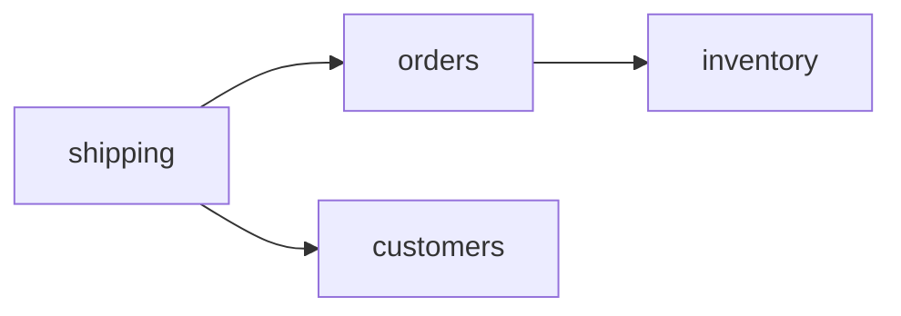

# Kiểm tra API, internal và named interface

Một thiết kế mô-đun tốt phải trả lời được ba câu hỏi: mô-đun khác được phép sử dụng hợp đồng nào, phần nào chỉ phục vụ triển khai nội bộ, và mỗi quan hệ phụ thuộc đã được khai báo có chủ đích hay chưa. Trong Spring Modulith, package là cơ sở để biểu diễn các ranh giới này. Vì vậy, design review cần xem xét cả package, chữ ký API, kiểu dữ liệu được chia sẻ và dependency giữa các mô-đun.

Bài học này hướng dẫn review một modular monolith theo ba vùng: API mặc định ở package gốc, package nội bộ và Named Interface. Bạn sẽ lập bản đồ các quan hệ phụ thuộc, phát hiện việc lộ kiểu nội bộ, đánh giá Named Interface và dùng `ApplicationModules.verify()` để kiểm chứng các quy tắc kiến trúc.

## 1. Bắt đầu bằng module map

Giả sử ứng dụng bán hàng có các mô-đun `orders`, `inventory`, `customers` và `shipping`:

```text
com.acme.shop
├── ShopApplication.java
├── orders
│   ├── OrderService.java
│   ├── api
│   │   └── OrderLookup.java
│   ├── events
│   │   └── OrderCompleted.java
│   └── internal
│       ├── OrderEntity.java
│       └── OrderRepository.java
├── inventory
│   ├── Inventory.java
│   ├── api
│   │   └── StockAvailability.java
│   └── internal
│       └── StockRepository.java
├── customers
│   ├── CustomerLookup.java
│   └── internal
│       └── CustomerEntity.java
└── shipping
    └── ShippingService.java
```

Với cấu trúc mặc định của Spring Modulith, package gốc của một mô-đun là API được công khai mặc định. Các package con là nội bộ, trừ những package được công khai có chủ đích bằng `@NamedInterface`. Ví dụ, `com.acme.shop.inventory.Inventory` nằm trong package gốc của `inventory`, còn `com.acme.shop.inventory.internal.StockRepository` thuộc phần triển khai nội bộ.

Trước khi review từng lớp, hãy vẽ module map ở cấp mô-đun. Một mũi tên `A → B` biểu thị mã nguồn của mô-đun `A` phụ thuộc vào API của mô-đun `B`:



Module map giúp nhóm review nhìn thấy dependency direction và phát hiện sớm các quan hệ hai chiều. Sau đó mới đi sâu vào package và kiểu Java tạo ra từng cạnh.

## 2. Phân loại package thành API và internal

Hãy xem từng package từ góc nhìn của consumer:

| Package | Phân loại mặc định | Câu hỏi review |
|---|---|---|
| `com.acme.shop.orders` | API công khai mặc định của `orders` | Các kiểu ở đây có phải hợp đồng ổn định mà mô-đun khác cần dùng không? |
| `com.acme.shop.orders.api` | Internal nếu chưa được đánh dấu | Có cần công khai riêng package này bằng Named Interface không? |
| `com.acme.shop.orders.events` | Internal nếu chưa được đánh dấu | Event contract có cần consumer ở mô-đun khác tham chiếu không? |
| `com.acme.shop.orders.internal` | Internal | Có consumer nào đang import entity hoặc repository ở đây không? |

Một lớp Java có modifier `public` không tự động trở thành API công khai của mô-đun. Ví dụ, `public class StockRepository` trong `inventory.internal` vẫn thuộc package nội bộ theo mô hình Spring Modulith. Modifier Java quyết định khả năng truy cập ở cấp ngôn ngữ; package boundary của Spring Modulith quyết định mô-đun khác được phép phụ thuộc vào phần nào.

Khi review, đừng chỉ nhìn modifier của lớp. Hãy kiểm tra package chứa lớp và package mà consumer thực sự import. Nếu một consumer truy cập `inventory.internal`, đó là dấu hiệu vượt boundary, dù mã nguồn vẫn biên dịch được trước khi chạy architecture test.

## 3. Đánh giá chất lượng của public API

API công khai nên mô tả khả năng nghiệp vụ mà consumer cần, đồng thời giữ chi tiết triển khai bên trong mô-đun sở hữu. Hãy review chữ ký đầy đủ của mỗi public type và method:

- Kiểu trả về và kiểu phần tử trong `List`, `Optional`, `Map` hoặc generic khác.
- Kiểu tham số và command mà consumer phải tạo.
- Exception được khai báo hoặc kiểu lỗi mà consumer phải xử lý.
- Interface cha, kiểu generic bound và các kiểu công khai được kế thừa.
- DTO có chứa dữ liệu cần thiết hay vô tình phơi bày entity/persistence model.

Ví dụ không tốt là API trả về entity nội bộ:

```java
package com.acme.shop.orders;

import java.util.Optional;
import java.util.UUID;

import com.acme.shop.orders.internal.OrderEntity;

public interface OrderLookup {

    Optional<OrderEntity> findById(UUID orderId);
}
```

Consumer phải biết `OrderEntity` để đọc kết quả. Nếu entity thay đổi vì mapping database, quan hệ JPA hoặc cách lưu trữ, consumer có thể bị ảnh hưởng dù nghiệp vụ tra cứu đơn hàng không đổi.

Thiết kế tốt hơn là trả về một DTO thuộc API công khai:

```java
package com.acme.shop.orders;

import java.util.UUID;

public record OrderSummary(
        UUID orderId,
        String status,
        String shippingAddress
) {}
```

```java
package com.acme.shop.orders;

import java.util.Optional;
import java.util.UUID;

public interface OrderLookup {

    Optional<OrderSummary> findById(UUID orderId);
}
```

Implementation trong mô-đun `orders` chịu trách nhiệm đọc entity và chuyển đổi thành `OrderSummary`. Consumer chỉ phụ thuộc vào hợp đồng nghiệp vụ, không cần biết repository hoặc cấu trúc persistence.

Một API tốt cũng không nên phơi bày quá nhiều thao tác chỉ vì implementation hiện có sẵn các method đó. Hãy giữ bề mặt API nhỏ, tập trung vào use case thực sự được consumer cần và có thể duy trì ổn định.

## 4. Khi nào nên tạo Named Interface?

Package gốc đã là API mặc định. Named Interface hữu ích khi một mô-đun có nhiều nhóm hợp đồng và muốn công khai từng nhóm với tên rõ ràng. Ví dụ, `orders` có thể cung cấp API đồng bộ và event contract riêng:

```java
@org.springframework.modulith.NamedInterface("api")
package com.acme.shop.orders.api;
```

```java
@org.springframework.modulith.NamedInterface("events")
package com.acme.shop.orders.events;
```

Mỗi khai báo đặt trong file `package-info.java` tương ứng. Package `orders.api` chứa các hợp đồng mà consumer gọi trực tiếp; `orders.events` chứa event type mà listener ở mô-đun khác cần tham chiếu.

Một mô-đun `inventory` có thể công khai API kiểm tra tồn kho:

```java
package com.acme.shop.inventory.api;

public interface StockAvailability {

    boolean isAvailable(String productId, int quantity);
}
```

Consumer `orders` có thể khai báo chỉ cho phép dependency tới named interface `inventory::api`:

```java
@org.springframework.modulith.ApplicationModule(
    allowedDependencies = "inventory::api"
)
package com.acme.shop.orders;
```

Tên `inventory::api` gồm tên mô-đun đích và tên Named Interface. Cách khai báo này làm rõ `orders` được phép dùng hợp đồng nào của `inventory`. Nó không cho phép `orders` truy cập `inventory.internal`.

### Chọn mức độ chia Named Interface

Không nên tạo Named Interface cho mọi package con. Chỉ tạo khi có nhóm hợp đồng có ý nghĩa và consumer rõ ràng:

| Nhóm hợp đồng | Ví dụ tên | Khi phù hợp |
|---|---|---|
| API đồng bộ | `api` | Consumer gọi service hoặc interface nghiệp vụ |
| Event contract | `events` | Mô-đun khác lắng nghe sự kiện do mô-đun sở hữu phát hành |
| Port/SPI tích hợp | `spi` hoặc `ports` | Adapter hoặc mô-đun khác triển khai abstraction được công khai |
| API quản trị riêng | Tên phản ánh chức năng | Chỉ khi có consumer và ranh giới trách nhiệm cụ thể |

Named Interface nên phản ánh mục đích của hợp đồng, không phải tên kỹ thuật chung chung như `common`, `misc` hoặc `utils`. Nếu nhiều nhóm consumer cần các hợp đồng khác nhau, tách interface theo nhu cầu thực tế để giới hạn dependency.

## 5. Review dependency của consumer

Sau khi xác định API, kiểm tra các mô-đun tiêu thụ. Ví dụ, `orders` dùng `inventory::api` và `customers` dùng package gốc công khai của `customers`:

```java
@org.springframework.modulith.ApplicationModule(
    allowedDependencies = {
        "inventory::api",
        "customers"
    }
)
package com.acme.shop.orders;
```

Khi mô-đun khai báo `allowedDependencies`, các dependency của nó phải nằm trong danh sách được phép. Review cần xác nhận từng entry có lý do nghiệp vụ và consumer chỉ sử dụng đúng phần API được công khai.

| Consumer | Dependency khai báo | Kiểu/package đang dùng | Đánh giá |
|---|---|---|---|
| `orders` | `inventory::api` | `inventory.api.StockAvailability` | Hợp lệ nếu package được đánh dấu Named Interface `api` |
| `orders` | `customers` | `customers.CustomerLookup` | Hợp lệ nếu kiểu nằm trong package gốc công khai |
| `shipping` | `orders::api` | `orders.api.OrderLookup` | Hợp lệ nếu Named Interface `api` được công khai |
| `shipping` | `orders::api` | `orders.internal.OrderEntity` | Vi phạm vì kiểu tham chiếu thuộc package internal |

Không thêm toàn bộ mô-đun vào allow-list chỉ để làm verification pass. Nếu consumer chỉ cần một Named Interface, hãy khai báo đúng interface đó. Điều này giúp reviewer thấy rõ bề mặt tích hợp mà mô-đun đang phụ thuộc.

## 6. Review event contract và chiều dependency

Event là hợp đồng công khai khi listener ở mô-đun khác cần tham chiếu event type. Giả sử `orders` sở hữu event `OrderCompleted` và `inventory` lắng nghe:

```java
package com.acme.shop.orders.events;

import java.time.Instant;
import java.util.UUID;

public record OrderCompleted(UUID orderId, Instant completedAt) {}
```

Listener trong `inventory` tham chiếu event:

```java
package com.acme.shop.inventory;

import com.acme.shop.orders.events.OrderCompleted;
import org.springframework.modulith.events.ApplicationModuleListener;
import org.springframework.stereotype.Component;

@Component
class InventoryOnOrderCompleted {

    @ApplicationModuleListener
    void on(OrderCompleted event) {
        // Cập nhật quy trình tồn kho theo orderId.
    }
}
```

Khi package event được đánh dấu `@NamedInterface("events")`, mô-đun `inventory` có thể giới hạn dependency:

```java
@org.springframework.modulith.ApplicationModule(
    allowedDependencies = "orders::events"
)
package com.acme.shop.inventory;
```

Luồng runtime là `orders` publish event và `inventory` xử lý event. Dependency kiến trúc là `inventory → orders::events`, vì listener import event type thuộc `orders`. Publisher không cần import listener hoặc service của `inventory`.

Trong review, hãy xác nhận event biểu diễn một sự việc nghiệp vụ đã xảy ra, payload chỉ chứa dữ liệu cần thiết và không mang theo entity hoặc object nội bộ. Nếu consumer cần truy vấn hoặc gọi một khả năng đồng bộ, event có thể không phải hợp đồng phù hợp; hãy cân nhắc API hoặc port.

## 7. Phát hiện các dấu hiệu rò rỉ internal

Các trường hợp sau cần được đánh dấu trong design review:

| Dấu hiệu | Rủi ro | Hướng xử lý |
|---|---|---|
| Consumer import `*.internal.*` | Vượt package boundary | Chuyển sang API hoặc Named Interface |
| API trả về JPA entity | Lộ persistence model | Chuyển đổi sang DTO nghiệp vụ |
| Public method nhận internal command | Consumer phải biết kiểu triển khai | Đưa command hợp đồng vào API công khai |
| Named Interface chứa repository hoặc adapter | Công khai chi tiết triển khai | Tách contract khỏi implementation |
| Named Interface tên `common` chứa nhiều loại hợp đồng không liên quan | Bề mặt API quá rộng, khó quản lý | Tách theo mục đích và consumer |
| Allow-list cho phép cả mô-đun dù chỉ cần một interface | Consumer được cấp quyền rộng hơn nhu cầu | Dùng `module::namedInterface` |
| Hai mô-đun công khai kiểu phụ thuộc lẫn nhau | Nguy cơ chu trình và coupling | Xem lại quyền sở hữu contract hoặc dùng event/port |

Một kiểu nằm trong package `internal` vẫn có thể được khai báo `public` để các lớp trong ứng dụng truy cập theo Java. Điều đó không phải lý do để công khai package ấy. Nếu consumer đang dùng kiểu đó, hãy tìm hợp đồng nghiệp vụ tối thiểu mà consumer cần và đưa hợp đồng về đúng mô-đun sở hữu.

## 8. Kiểm chứng design review bằng ApplicationModules

Sau khi review package và dependency, dùng `ApplicationModules` để kiểm tra mô hình thực tế:

```java
package com.acme.shop;

import org.junit.jupiter.api.Test;
import org.springframework.modulith.core.ApplicationModules;

class ModularityTests {

    @Test
    void verifiesModuleDesign() {
        ApplicationModules modules = ApplicationModules.of(ShopApplication.class);

        modules.forEach(System.out::println);
        modules.verify();
    }
}
```

`modules.forEach(System.out::println)` giúp reviewer quan sát mô-đun, base package, bean và visibility được phát hiện. `verify()` kiểm tra các quy tắc cốt lõi như dependency cycle, truy cập API và `allowedDependencies`.

Nếu verification thất bại, hãy đọc module nguồn, module đích và package/type liên quan. Một lỗi package access thường chỉ ra consumer đang dùng internal package; lỗi dependency allow-list chỉ ra quan hệ chưa được khai báo; lỗi cycle yêu cầu review toàn bộ đường đi dependency.

Verification không đánh giá thay con người chất lượng nghiệp vụ của API. Test có thể pass trong khi API vẫn quá rộng, DTO lộ dữ liệu không cần thiết hoặc tên Named Interface khó hiểu. Vì vậy, cần kết hợp kiểm tra tự động với review hợp đồng và consumer.

## 9. Checklist cho reviewer

Sử dụng checklist sau trong một buổi design review:

| Hạng mục | Câu hỏi | Kết quả cần ghi |
|---|---|---|
| Module ownership | Mỗi API và event contract có mô-đun sở hữu rõ ràng không? | Tên mô-đun sở hữu |
| Default API | Package gốc có chứa đúng các kiểu cần công khai không? | Danh sách public types |
| Internal packages | Repository, entity, adapter và helper có được giữ nội bộ không? | Các package cần đóng |
| API signatures | Return type, parameter, generic và exception có lộ internal type không? | Chữ ký cần sửa |
| Named Interfaces | Mỗi interface có mục đích và consumer cụ thể không? | Tên interface và consumer |
| Allowed dependencies | Allow-list có giới hạn đúng module/interface cần dùng không? | Dependency được chấp thuận |
| Event contracts | Event type có ổn định, đủ dữ liệu và thuộc đúng publisher không? | Event owner và listener |
| Dependency direction | Các cạnh có đi theo hướng hợp lý và không tạo chu trình không? | Module graph đã review |
| Automated verification | `ApplicationModules.verify()` có chạy trong CI không? | Kết quả verification |
| Migration impact | Có consumer cũ cần chuyển khỏi internal API không? | Owner và kế hoạch di chuyển |

## 10. Ghi kết quả review và quyết định

Mỗi phát hiện nên có vị trí cụ thể, mức độ ảnh hưởng và hành động tiếp theo. Có thể ghi kết quả theo mẫu:

| Finding | Mức độ | Bằng chứng | Quyết định |
|---|---|---|---|
| `shipping` import `orders.internal.OrderEntity` | Blocker | Import và kiểu trả về trong `ShippingService` | Thay bằng `orders::api.OrderSummary` |
| `orders` phụ thuộc toàn bộ `inventory` nhưng chỉ dùng stock contract | Improvement | `package-info.java` cho phép `inventory` | Tách `inventory::api` và thu hẹp allow-list |
| `inventory` lắng nghe `OrderCompleted` | Accepted | Listener chỉ tham chiếu `orders::events` | Giữ dependency một chiều `inventory → orders::events` |
| `customers` công khai DTO có field persistence-only | Change required | `CustomerDetails` chứa cột nội bộ | Tạo DTO chỉ gồm dữ liệu consumer cần |

Phân loại có thể dùng ba mức:

- **Blocker:** vi phạm boundary, lộ internal type hoặc dependency cycle cần sửa trước khi chấp nhận thiết kế.
- **Change required:** API hoặc Named Interface chưa rõ mục đích, cần chỉnh trước khi merge hoặc hoàn tất review.
- **Accepted:** dependency có chủ đích, contract rõ ràng và verification xác nhận hợp lệ.

Không đánh dấu một finding là accepted chỉ vì `ApplicationModules.verify()` pass. Reviewer vẫn phải xác nhận consumer cần đúng hợp đồng đó và package được công khai ở phạm vi tối thiểu.

## 11. Bài tập design review

Xét thiết kế sau:

```text
orders
  ├── public: OrderService
  └── internal: OrderEntity, OrderRepository

inventory
  ├── api: StockAvailability
  └── internal: StockRepository

shipping
  └── ShippingService
```

Các quan hệ được ghi nhận:

1. `orders` gọi `inventory.api.StockAvailability`.
2. `shipping` import `orders.internal.OrderEntity`.
3. `inventory` lắng nghe `orders.events.OrderCompleted`.
4. `orders` khai báo `allowedDependencies = "inventory"` dù chỉ dùng `inventory::api`.

Hãy review từng quan hệ:

| Quan hệ | Đánh giá | Hành động đề xuất |
|---|---|---|
| `orders` dùng `inventory::api` | Hợp lệ nếu package đã được đánh dấu Named Interface | Giữ API và thu hẹp allow-list về `inventory::api` |
| `shipping` dùng `orders.internal.OrderEntity` | Vi phạm boundary | Tạo DTO/API công khai trong `orders` và chuyển consumer |
| `inventory` nghe `orders::events` | Hợp lệ nếu event package được công khai và payload ổn định | Giữ dependency một chiều từ listener tới event owner |
| `orders` cho phép toàn bộ `inventory` | Rộng hơn nhu cầu hiện tại | Chuyển allow-list sang named interface cần thiết |

Sau đó thực hiện các bước:

1. Viết hoặc cập nhật `package-info.java` để đánh dấu `inventory.api` và `orders.events` bằng `@NamedInterface`.
2. Thay `OrderEntity` trong hợp đồng của `shipping` bằng DTO công khai thuộc `orders`.
3. Thu hẹp `allowedDependencies` của `orders` và `inventory` theo các named interface thực sự được dùng.
4. In module model và chạy `ApplicationModules.verify()`.
5. Ghi lại các finding còn lại, owner xử lý và điều kiện để review được chấp nhận.

## 12. Câu hỏi tự kiểm tra

| Câu hỏi | Câu trả lời cần đạt |
|---|---|
| Một lớp `public` trong package `internal` có tự trở thành API không? | Không. Visibility theo mô hình mô-đun phụ thuộc package và khai báo Named Interface. |
| Khi nào package gốc là đủ? | Khi mô-đun có một bề mặt API nhỏ, rõ ràng và không cần phân nhóm hợp đồng riêng. |
| Khi nào nên tạo Named Interface? | Khi có một nhóm hợp đồng có mục đích và consumer rõ ràng cần được công khai riêng. |
| `inventory::api` biểu diễn điều gì? | Named Interface `api` của mô-đun `inventory`. |
| Vì sao API không nên trả về JPA entity nội bộ? | Nó làm consumer phụ thuộc vào persistence detail và cản trở refactor. |
| `verify()` có thay thế design review không? | Không. Nó kiểm tra quy tắc tự động, còn reviewer đánh giá ý nghĩa và phạm vi hợp đồng. |

Sau bài học, bạn cần có thể phân loại package, nhận diện internal leakage, quyết định khi nào dùng Named Interface, review allow-list và ghi kết quả review có bằng chứng. Mục tiêu là để mỗi dependency giữa các mô-đun đều đi qua một hợp đồng có chủ sở hữu, phạm vi và lý do rõ ràng.

## Tài liệu tham khảo

- [Spring Modulith — Fundamentals: Application Modules](https://docs.spring.io/spring-modulith/reference/fundamentals.html)
- [Spring Modulith — Verifying Application Module Structure](https://docs.spring.io/spring-modulith/reference/verification.html)
- [Spring Modulith API — `NamedInterface`](https://docs.spring.io/spring-modulith/docs/current/api/org/springframework/modulith/NamedInterface.html)
- [Spring Modulith API — `ApplicationModule`](https://docs.spring.io/spring-modulith/docs/current/api/org/springframework/modulith/ApplicationModule.html)
