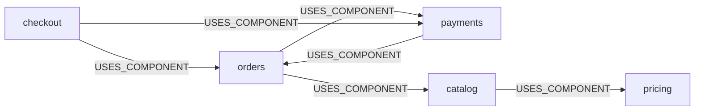
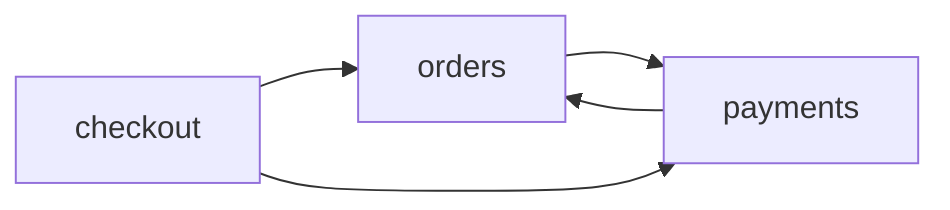
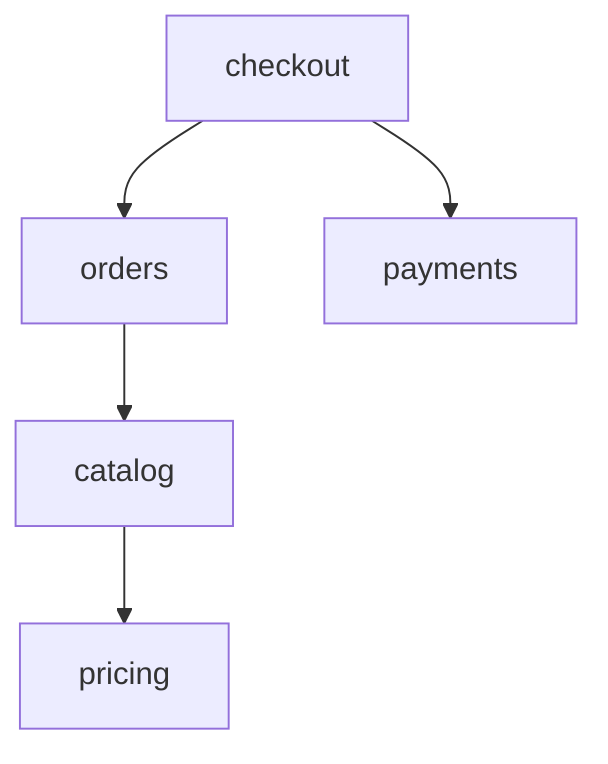

# Đánh giá graph có cycle hoặc dependency thừa

Module graph giúp nhóm nhìn thấy các application module đang phụ thuộc lẫn nhau. Trong design review, mục tiêu không chỉ là đếm số mũi tên mà là xác định quan hệ nào phục vụ một nhu cầu nghiệp vụ thật, quan hệ nào tạo vòng phụ thuộc và quyền phụ thuộc nào đã được khai báo nhưng không còn cần thiết.

Spring Modulith xây dựng graph từ package, type và metadata module. Mỗi cạnh cần được đọc cùng loại dependency và source/target type tạo ra nó. Một graph có cycle thường phản ánh trách nhiệm bị đan xen hoặc hai module đang gọi trực tiếp lẫn nhau. Một `allowedDependencies` entry không được sử dụng lại là quyền truy cập dư thừa; nó không tự tạo cạnh trong graph, nhưng làm rộng phạm vi phụ thuộc mà module có thể khai báo trong tương lai.

## 1. Mục tiêu của buổi design review

Trong bài review này, nhóm sẽ xem xét một modular monolith có các module `orders`, `payments`, `catalog`, `pricing` và `checkout`. Sau khi đọc graph, nhóm cần:

- Xác định module cycle và các cạnh tạo thành cycle.
- Phân biệt dependency đồng bộ với quan hệ event listener.
- Truy ngược từng cạnh về type và source code tạo dependency.
- Phân biệt dependency thực tế với mục `allowedDependencies` chỉ cấp quyền.
- Xác định dependency trực tiếp nào cần giữ dù đã có đường đi bắc cầu.
- Đề xuất refactoring để đưa orchestration về đúng nơi và giảm coupling.
- Kiểm chứng graph sau thay đổi bằng `ApplicationModules.verify()`.

Kết quả review nên là quyết định cụ thể cho từng cạnh: giữ, đổi hướng, thay hợp đồng, chuyển trách nhiệm hoặc xóa quyền phụ thuộc không còn dùng.

## 2. Quy ước đọc module graph

Trong module dependency graph, mũi tên đi từ module nguồn tới module đích mà module nguồn phụ thuộc. Ví dụ:

```text
orders ─────> catalog
```

nghĩa là code trong `orders` tham chiếu một type thuộc API được công khai bởi `catalog`. Mũi tên không biểu thị thứ tự gọi method trong một request và cũng không nhất thiết là chiều dữ liệu nghiệp vụ di chuyển.

Các loại dependency thường gặp:

| Loại | Ý nghĩa khi review |
|---|---|
| `USES_COMPONENT` | Module nguồn sử dụng component của module đích; thường là dependency cần module đích khi bootstrap |
| `EVENT_LISTENER` | Module nguồn lắng nghe event được module đích công khai; chiều dependency tĩnh đi từ listener về module sở hữu event contract |
| `ENTITY` | Module nguồn tham chiếu entity thuộc module đích |
| `DEFAULT` | Dependency được phát hiện nhưng không được phân loại thành một loại chuyên biệt hơn |

Đừng chỉ đọc tên module ở hai đầu. Cùng một cặp module có thể có nhiều dependency record với các type khác nhau. Hãy đọc `DependencyType`, source type và target type để biết chính xác cạnh đó được tạo bởi code nào.

## 3. Tình huống cần review

Giả sử ứng dụng bán hàng có graph production như sau:



Đây là graph đã rút gọn để tập trung vào quan hệ cần review. Có một cycle trực tiếp giữa `orders` và `payments`:

```text
orders ─────> payments
   ▲             │
   └─────────────┘
```

Giả sử source code đang có các trách nhiệm sau:

| Module | Trách nhiệm hiện tại |
|---|---|
| `orders` | Tạo đơn hàng; gọi `PaymentAuthorization` để yêu cầu thanh toán; cung cấp `OrderLookup` cho module khác |
| `payments` | Thực hiện authorization; gọi `OrderLookup` để đọc trạng thái đơn hàng trước khi xử lý |
| `catalog` | Cung cấp `ProductCatalog` cho module đặt hàng |
| `pricing` | Cung cấp quy tắc giá cho `catalog` |
| `checkout` | Điều phối use case checkout bằng cách gọi `orders` và `payments` |

Hai cạnh `orders -> payments` và `payments -> orders` đều là `USES_COMPONENT`. Mỗi module cần component của module kia để thực hiện trách nhiệm của mình. Đây là cycle thực sự trong dependency model, không chỉ là hai event flow ngược chiều.

Ngoài ra, giả sử package metadata của `orders` đang khai báo:

```java
@org.springframework.modulith.ApplicationModule(
        allowedDependencies = {
                "catalog :: catalog-api",
                "payments :: payment-api",
                "pricing",
                "customers"
        }
)
package com.acme.shop.orders;
```

Trong code hiện tại, `orders` chỉ sử dụng `catalog.api` và `payments.api`. Không có type nào từ `pricing` hoặc `customers` được tham chiếu trực tiếp. Hai entry cuối là quyền phụ thuộc còn sót lại từ thiết kế cũ. Chúng không tạo cạnh trong graph nếu không có source-level dependency, nhưng vẫn làm allowlist rộng hơn mức cần thiết.

## 4. Xác minh graph trước khi đề xuất thay đổi

Đầu tiên, tạo module model từ đúng application class:

```java
import org.springframework.modulith.core.ApplicationModules;

ApplicationModules modules = ApplicationModules.of(ShopApplication.class);
```

Để xem module mà Spring Modulith phát hiện:

```java
modules.forEach(System.out::println);
```

Danh sách này giúp xác nhận tên module và base package trước khi đọc graph. Nếu module thiếu hoặc bị nhận diện sai, cần xử lý discovery trước khi kết luận về dependency.

Sau khi xác nhận module model, chạy verification:

```java
modules.verify();
```

Nếu có cycle, `verify()` báo `Violations`. Đọc toàn bộ thông báo để tìm module và dependency liên quan. Không nên dừng ở dòng đầu tiên vì một thay đổi có thể làm lộ nhiều vi phạm cùng lúc.

## 5. Truy ngược từng cạnh về source code

Khi review một cạnh, cần biết type nào tạo ra dependency. Có thể truy vấn direct dependencies của một module:

```java
import org.springframework.modulith.core.ApplicationModule;
import org.springframework.modulith.core.ApplicationModules;

ApplicationModules modules = ApplicationModules.of(ShopApplication.class);

ApplicationModule orders = modules.getModuleByName("orders")
        .orElseThrow();

orders.getDirectDependencies(modules).forEach(dependency ->
        System.out.printf(
                "%s -> %s | %s | %s -> %s%n",
                orders.getDisplayName(),
                dependency.getTargetModule().getDisplayName(),
                dependency.getDependencyType(),
                dependency.getSourceType().getName(),
                dependency.getTargetType().getName()));
```

Thông tin quan trọng:

- `getTargetModule()` cho biết module đích.
- `getDependencyType()` cho biết loại dependency.
- `getSourceType()` cho biết type trong module nguồn tạo ra quan hệ.
- `getTargetType()` cho biết type được tham chiếu ở module đích.

Ví dụ, cạnh `orders -> payments` có thể được tạo bởi `OrderApplicationService` tham chiếu `PaymentAuthorization`. Cạnh ngược `payments -> orders` có thể được tạo bởi `PaymentService` tham chiếu `OrderLookup`. Khi đã biết hai type này, reviewer có thể mở đúng class và xác định liệu cả hai lời gọi có thực sự cần thiết hay một trách nhiệm đang đặt sai module.

Ưu tiên `getDirectDependencies(...)` khi phân tích một cạnh cụ thể. Dependency bắc cầu có thể giúp hiểu phạm vi ảnh hưởng, nhưng không cho biết module nguồn trực tiếp tham chiếu type nào.

## 6. Phân biệt cycle thật với event listener dependency

Một lỗi review phổ biến là nhìn thấy hai module trao đổi event rồi kết luận ngay rằng chúng có cycle giống hai module gọi component của nhau. Cần đọc loại dependency trước.

Ví dụ `payments` lắng nghe `OrderPlaced` do `orders` công khai:

```text
Dependency graph: payments ──EVENT_LISTENER──> orders

Runtime event flow: orders ──publish OrderPlaced──> payments listener
```

Mũi tên dependency tĩnh đi từ listener tới module sở hữu event contract. Runtime event flow đi từ publisher tới listener. Hai chiều có ý nghĩa khác nhau.

Trong review, hãy tách các câu hỏi:

1. Cạnh có phải `EVENT_LISTENER` hay là `USES_COMPONENT`?
2. Module listener có gọi thêm service hoặc component của publisher không?
3. Có dependency đồng bộ ngược chiều tạo ra một cycle trong bootstrap dependency không?
4. Event contract có nằm trong API được công khai của module publisher không?

Không gộp mọi cạnh thành một quan hệ chung. Hãy dùng loại dependency mà Spring Modulith báo để xác định chính xác vấn đề. Nếu cycle được tạo bởi hai `USES_COMPONENT` như tình huống `orders` và `payments`, việc đổi tên method hoặc đổi event listener không tự loại bỏ cycle; cần thay đổi dependency thực tế.

## 7. Đánh giá từng cạnh trong cycle

Với `orders -> payments`, reviewer cần hỏi:

- `orders` có cần kết quả authorization ngay để quyết định use case không?
- Có thể chuyển điều phối checkout sang module `checkout` không?
- `PaymentAuthorization` có phải hợp đồng công khai ổn định của `payments` không?
- `orders` đang tham chiếu API hay đang sử dụng implementation/payment entity nội bộ?

Với `payments -> orders`, cần hỏi:

- Vì sao `payments` phải gọi `OrderLookup`?
- Payment có thực sự cần toàn bộ order aggregate hay chỉ cần một snapshot gồm `orderId`, amount và currency?
- Dữ liệu đó có thể được truyền qua command/API từ module điều phối không?
- Module `payments` có đang đảm nhận một phần trách nhiệm của `orders` không?

Mục tiêu là đưa mỗi quyết định về đúng owner. `orders` sở hữu trạng thái và quy tắc đơn hàng; `payments` sở hữu authorization và trạng thái thanh toán; `checkout` có thể điều phối use case liên module.

## 8. Refactoring cycle bằng orchestration module

Trong tình huống này, `checkout` đã là nơi điều phối use case. Có thể chuyển hai lời gọi chéo từ `orders` và `payments` lên `checkout`:

**Trước refactoring:**



**Sau refactoring:**



`checkout` gọi các API công khai của `orders` và `payments`. Module `orders` không còn gọi `PaymentAuthorization`; module `payments` không còn gọi `OrderLookup`. Thay vào đó, orchestrator lấy dữ liệu đơn hàng từ API của `orders`, chuyển thông tin cần thiết sang API của `payments`, rồi điều phối kết quả theo use case.

Ví dụ facade của hai module:

```java
// orders.api
public interface OrderCommands {

    OrderCheckoutData prepareForCheckout(UUID orderId);

    void markPaymentAuthorized(UUID orderId, String authorizationId);
}
```

```java
// payments.api
public interface PaymentAuthorization {

    AuthorizationResult authorize(
            UUID orderId,
            BigDecimal amount,
            Currency currency);
}
```

Orchestrator phụ thuộc cả hai hợp đồng:

```java
@Service
class CheckoutService {

    private final OrderCommands orders;
    private final PaymentAuthorization payments;

    CheckoutService(
            OrderCommands orders,
            PaymentAuthorization payments) {
        this.orders = orders;
        this.payments = payments;
    }

    void checkout(UUID orderId) {
        OrderCheckoutData data = orders.prepareForCheckout(orderId);

        AuthorizationResult result = payments.authorize(
                orderId, data.amount(), data.currency());

        if (result.authorized()) {
            orders.markPaymentAuthorized(orderId, result.authorizationId());
        }
    }
}
```

Đây là ví dụ minh họa về hướng phụ thuộc và trách nhiệm điều phối. Trong ứng dụng thực tế, cần xác định transaction boundary, idempotency, timeout, retry và trạng thái checkout khi payment thất bại. Không nên giả định một transaction database duy nhất có thể bao phủ an toàn mọi module và mọi hệ thống thanh toán bên ngoài.

Sau refactoring, graph chỉ có các cạnh đi từ orchestrator tới module capability. Các module nghiệp vụ không gọi ngược lên orchestrator hoặc gọi trực tiếp nhau để hoàn tất cùng một quy trình.

## 9. Khi nào nên dùng event thay cho orchestration đồng bộ?

Không phải mọi quy trình đều cần một orchestrator gọi API đồng bộ. Nếu module khác chỉ cần phản ứng sau khi nghiệp vụ đã xảy ra, application event có thể diễn đạt quan hệ phù hợp hơn.

Ví dụ `orders` phát `OrderPlaced` và `inventory` lắng nghe để giữ hàng:

```java
// orders public event contract
public record OrderPlaced(
        UUID orderId,
        List<OrderLineData> lines) {
}
```

```java
// inventory listener
@ApplicationModuleListener
void on(OrderPlaced event) {
    inventory.reserve(event.orderId(), event.lines());
}
```

Trong trường hợp này, publisher không cần biết listener cụ thể. Event phù hợp khi listener phản ứng với một sự kiện đã xảy ra và publisher không cần nhận kết quả xử lý ngay trong cùng lời gọi.

Nếu quy trình cần kết quả authorization để quyết định bước tiếp theo trước khi trả kết quả cho người dùng, API đồng bộ hoặc orchestrator có thể phù hợp hơn. Nếu quy trình có thể tiếp tục bất đồng bộ, cần mô hình hóa trạng thái chờ, retry và xử lý trùng lặp.

Event không tự động xóa mọi dependency. Listener vẫn phụ thuộc event contract được công khai bởi publisher. Khi hai module công bố event qua lại, hãy xem xét toàn bộ graph và semantics bootstrap của dependency type, thay vì giả định event luôn loại bỏ mọi quan hệ kiến trúc.

## 10. Đánh giá dependency thừa và allowlist quá rộng

Quay lại metadata của `orders`:

```java
@ApplicationModule(
        allowedDependencies = {
                "catalog :: catalog-api",
                "payments :: payment-api",
                "pricing",
                "customers"
        }
)
package com.acme.shop.orders;
```

Nếu code chỉ tham chiếu `catalog.api` và `payments.api`, hai entry `pricing` và `customers` không đại diện cho source-level dependency hiện tại. Chúng là quyền được cấp nhưng chưa sử dụng.

Có thể thu hẹp allowlist:

```java
@ApplicationModule(
        allowedDependencies = {
                "catalog :: catalog-api",
                "payments :: payment-api"
        }
)
package com.acme.shop.orders;
```

Lợi ích của việc loại bỏ entry cũ:

- Giảm số module mà `orders` có thể vô tình phụ thuộc trong thay đổi tương lai.
- Làm rõ hợp đồng kiến trúc mà module thực sự cần.
- Giúp reviewer nhận ra dependency mới khi một module bắt đầu sử dụng API khác.
- Giảm khác biệt giữa dependency policy và source code thực tế.

`allowedDependencies` là allowlist, không phải lệnh tạo dependency. Thêm `"pricing"` vào allowlist không tự tạo cạnh `orders -> pricing`. Ngược lại, xóa entry khỏi allowlist trong khi source code vẫn tham chiếu `pricing` sẽ khiến verification báo dependency không được phép.

## 11. Không nhầm dependency bắc cầu với dependency thừa

Giả sử graph có:

```text
orders ─────> catalog ─────> pricing
```

Không có nghĩa `orders` được tự do import type từ `pricing`. Nếu `OrderApplicationService` trực tiếp tham chiếu `PricingPolicy` thuộc module `pricing`, `orders` có dependency trực tiếp tới `pricing` và cần một hợp đồng được phép. Không nên dựa vào việc `catalog` đã phụ thuộc `pricing` để che giấu coupling.

Phân biệt ba trường hợp:

| Trường hợp | Đánh giá |
|---|---|
| `orders` import trực tiếp type từ `pricing` | Dependency trực tiếp; cần xem xét và cho phép qua API phù hợp |
| `orders` chỉ gọi `catalog` và `catalog` gọi `pricing` | `orders -> pricing` là quan hệ bắc cầu, không cần thêm trực tiếp nếu source không tham chiếu `pricing` |
| `orders` có `allowedDependencies` cho `pricing` nhưng không dùng type nào từ đó | Quyền phụ thuộc dư thừa; cân nhắc xóa entry |

Một cạnh trực tiếp không trở thành thừa chỉ vì tồn tại một đường đi khác trong graph. Nếu source code trực tiếp sử dụng API của module đích, cạnh đó phản ánh coupling thật và cần được review như một hợp đồng độc lập.

## 12. Kiểm tra nhiều dependency record giữa cùng một cặp module

Một module có thể tham chiếu nhiều type của module đích. Ví dụ `orders` dùng `ProductCatalog`, `ProductView` và một event type của `catalog`. Khi đọc graph tổng quan, các quan hệ có thể được hiển thị gọn thành một đường giữa hai module; dependency record chi tiết mới cho biết từng source/target type và loại quan hệ.

Trong review, hãy nhóm các dependency record theo cặp module rồi đặt câu hỏi:

- Có type nào chỉ được dùng vì một API cũ chưa được loại bỏ không?
- Có nhiều type nội bộ bị tham chiếu thay vì một facade ổn định không?
- Các type có cùng phục vụ một use case và nên được gom vào một named interface không?
- Có dependency `ENTITY` cho thấy module tiêu thụ đang biết quá nhiều về persistence model của module sở hữu không?

Không xóa một type chỉ vì graph có nhiều record. Hãy kiểm tra từng caller và thay thế bằng hợp đồng nhỏ nhất đáp ứng nhu cầu thực tế.

## 13. Quy trình review graph có hệ thống

Thực hiện review theo trình tự:

1. **Xác nhận module model:** kiểm tra module được phát hiện đúng và không thiếu package gốc.
2. **Chạy verification:** ghi nhận cycle, dependency không được phép và truy cập internal.
3. **Đánh dấu cycle:** tìm đường đi quay lại module nguồn; ghi rõ từng cạnh và dependency type.
4. **Truy source/target:** dùng direct dependency record để xác định class tạo ra cạnh.
5. **Phân loại lý do:** use case đồng bộ, event listener, entity reference, shared contract hay dependency cũ.
6. **Đánh giá quyền:** so sánh source dependency thực tế với `allowedDependencies` của module nguồn.
7. **Chọn refactoring:** chuyển orchestration, thu hẹp API, dùng event khi phù hợp hoặc loại bỏ dependency không còn cần.
8. **Cập nhật metadata:** sửa allowlist đúng với hợp đồng thực sự được dùng.
9. **Sinh lại graph:** so sánh trước và sau, xác nhận cycle đã biến mất và các cạnh cần thiết vẫn còn.
10. **Chạy test liên quan:** architecture test, module integration test và test nghiệp vụ cho use case đã thay đổi.

## 14. Bảng quyết định cho từng dependency

| Câu hỏi review | Nếu câu trả lời là có | Hướng xử lý |
|---|---|---|
| Module nguồn trực tiếp tham chiếu API module đích? | Có dependency thực tế | Giữ cạnh và xác nhận API/allowlist đúng |
| Dependency chỉ còn trong allowlist, không có source reference? | Quyền phụ thuộc chưa dùng | Xóa entry nếu không có kế hoạch đã được chấp thuận |
| Hai module gọi component của nhau? | Có thể tạo cycle | Chuyển orchestration lên module điều phối hoặc thay đổi ownership |
| Module chỉ cần phản ứng sau một event? | Không cần kết quả đồng bộ từ publisher | Cân nhắc application event và handler idempotent |
| Module tiêu thụ truy cập entity/repository nội bộ? | Coupling vượt hợp đồng | Công khai facade/DTO phù hợp và giữ persistence internal |
| Cạnh trực tiếp trùng với đường đi bắc cầu? | Chưa đủ để kết luận thừa | Kiểm tra source code; nếu có direct type reference thì vẫn cần cạnh trực tiếp |
| Nhiều type tạo dependency giữa cùng hai module? | Có thể API đang quá rộng hoặc nhiều use case độc lập | Review từng type, gom hợp đồng khi có cùng ngữ nghĩa |

## 15. Checklist trước khi chấp nhận thiết kế

- [ ] Module graph được tạo từ đúng root package và strategy.
- [ ] Hướng mũi tên được hiểu là dependency từ source tới target.
- [ ] Mỗi cycle đã được xác định bằng danh sách cạnh cụ thể.
- [ ] Đã phân biệt `USES_COMPONENT`, `EVENT_LISTENER`, `ENTITY` và `DEFAULT`.
- [ ] Mỗi dependency quan trọng đã được truy về source type và target type.
- [ ] Không có hai module capability gọi component của nhau mà không có lý do kiến trúc rõ ràng.
- [ ] Orchestration liên module được đặt ở nơi sở hữu quy trình phù hợp.
- [ ] Event chỉ được dùng khi semantics bất đồng bộ phù hợp với use case.
- [ ] `allowedDependencies` chỉ chứa các quyền cần thiết và đã được chấp thuận.
- [ ] Không xóa dependency trực tiếp chỉ vì có đường đi bắc cầu khác.
- [ ] Module khác không tham chiếu repository, entity hoặc implementation nội bộ.
- [ ] `ApplicationModules.verify()` thành công sau refactoring.
- [ ] Graph sau thay đổi phản ánh đúng hợp đồng và trách nhiệm mới.
- [ ] Test nghiệp vụ xác nhận hành vi của quy trình không bị thay đổi ngoài dự kiến.

Một module graph tốt không nhất thiết có ít cạnh nhất. Nó cần thể hiện đúng các hợp đồng mà module thực sự sử dụng, không có cycle làm rối quyền sở hữu và không cấp những quyền phụ thuộc đã lỗi thời. Design review có chất lượng khi mỗi cạnh đều giải thích được bằng một nhu cầu nghiệp vụ và có một owner chịu trách nhiệm cho hợp đồng đó.

## Tài liệu tham khảo

- [Spring Modulith – Fundamentals](https://docs.spring.io/spring-modulith/reference/fundamentals.html)
- [Spring Modulith – Verifying Application Module Structure](https://docs.spring.io/spring-modulith/reference/verification.html)
- [Spring Modulith – Working with Application Events](https://docs.spring.io/spring-modulith/reference/events.html)
- [ApplicationModules API](https://docs.spring.io/spring-modulith/docs/current/api/org/springframework/modulith/core/ApplicationModules.html)
- [ApplicationModule API](https://docs.spring.io/spring-modulith/docs/current/api/org/springframework/modulith/core/ApplicationModule.html)
- [DependencyType API](https://docs.spring.io/spring-modulith/docs/current/api/org/springframework/modulith/core/DependencyType.html)
