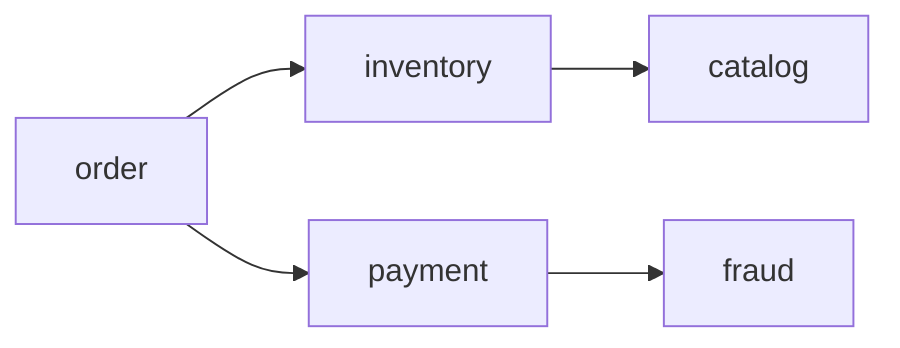
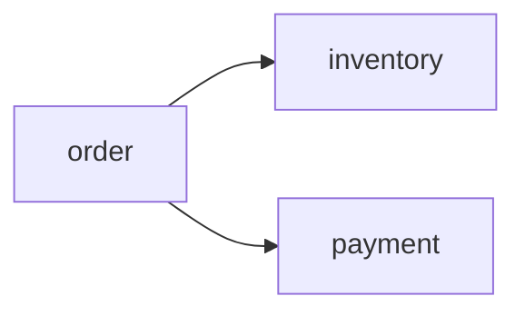
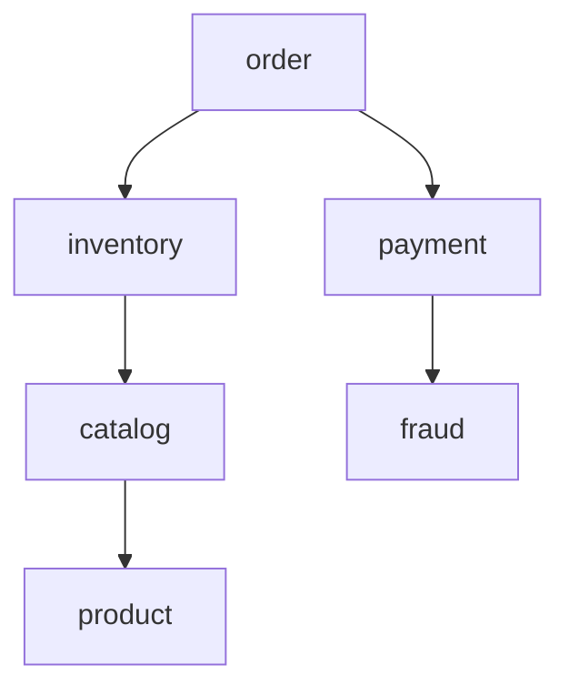

# Đọc direct dependencies và all dependencies

Khi thiết kế modular monolith, một module thường cần sử dụng API của một số module khác. Để hiểu mức độ liên kết giữa các phần của ứng dụng, cần biết module đang phụ thuộc trực tiếp vào đâu và còn phụ thuộc gián tiếp vào những module nào thông qua các module trung gian. Spring Modulith cung cấp hai góc nhìn này qua `getDirectDependencies()` và `getAllDependencies()` trên `ApplicationModule`.

Trong `SPRING_MODULITH_MODULE_MODEL`, việc đọc các quan hệ phụ thuộc giúp xác định ranh giới nghiệp vụ, API công khai và tác động lan truyền khi một module thay đổi. Bài học này tập trung vào cách đọc hai tập phụ thuộc, hiểu chúng trên đồ thị module và sử dụng kết quả khi rà soát kiến trúc.

## 1. Phụ thuộc giữa các application module

Một module phụ thuộc vào module khác khi mã của nó sử dụng một thành phần được module kia công bố, chẳng hạn một interface, lớp hoặc hợp đồng sự kiện. Ví dụ, `order` sử dụng API của `inventory` để kiểm tra tồn kho trước khi tạo đơn hàng. Khi đó, ta có quan hệ phụ thuộc trực tiếp từ `order` đến `inventory`.

Hãy hình dung các module như những đỉnh của một đồ thị có hướng. Mũi tên từ module A đến module B có nghĩa là A phụ thuộc vào B:



Trong đồ thị này, `order` sử dụng trực tiếp `inventory` và `payment`. Bản thân `inventory` lại sử dụng `catalog`, còn `payment` sử dụng `fraud`. Vì vậy, từ góc nhìn của `order`, có hai module phụ thuộc trực tiếp và bốn module có thể đi tới theo các đường phụ thuộc, tính cả hai module trực tiếp.

Đồ thị giúp phân biệt hai câu hỏi:

- **Direct dependencies:** Module này có quan hệ phụ thuộc trực tiếp với những module nào?
- **All dependencies:** Nếu lần theo các quan hệ phụ thuộc từ module này qua những module trung gian, có thể đi tới những module nào?

## 2. Direct dependencies là gì?

Direct dependencies là các phụ thuộc xuất phát trực tiếp từ module đang xét. Một quan hệ được xem là trực tiếp khi mã hoặc cấu trúc của module hiện tại tham chiếu đến thành phần thuộc một module khác và tạo ra một cạnh giữa hai module trong mô hình Spring Modulith.

Với đồ thị ở phần trước:



Các direct dependencies của `order` là `inventory` và `payment`. `catalog` không phải phụ thuộc trực tiếp của `order`, bởi trong ví dụ `order` không tham chiếu API của `catalog`; quan hệ được đi qua `inventory`. Tương tự, `fraud` được tiếp cận thông qua `payment`.

Direct dependencies rất hữu ích khi đánh giá mức độ kết nối trực tiếp của một module. Nếu `order` phụ thuộc trực tiếp vào quá nhiều module, nó có thể đang đảm nhiệm quá nhiều trách nhiệm hoặc đang biết quá nhiều chi tiết từ các phần khác của hệ thống.

## 3. All dependencies là gì?

All dependencies bao gồm các phụ thuộc trực tiếp và các phụ thuộc gián tiếp có thể tiếp cận bằng cách lần theo các module trung gian. Đây là góc nhìn về toàn bộ phạm vi phụ thuộc có thể đi tới từ module đang xét.

Trong đồ thị ví dụ:

- `order` phụ thuộc trực tiếp vào `inventory` và `payment`.
- `inventory` phụ thuộc vào `catalog`, nên `catalog` là phụ thuộc gián tiếp của `order`.
- `payment` phụ thuộc vào `fraud`, nên `fraud` cũng là phụ thuộc gián tiếp của `order`.

Do đó, tập all dependencies của `order` bao gồm `inventory`, `payment`, `catalog` và `fraud`. Tập này bao gồm các module trực tiếp cũng như các module nằm ở những bước tiếp theo của đồ thị.

All dependencies giúp hiểu phạm vi ảnh hưởng tiềm tàng. Ví dụ, nếu `catalog` thay đổi một hợp đồng mà `inventory` sử dụng, thay đổi đó có thể ảnh hưởng tới hoạt động của `order` thông qua `inventory`, dù `order` không gọi `catalog` trực tiếp.

Điều này không có nghĩa `order` được phép import API của `catalog`. Việc một module xuất hiện trong all dependencies chỉ cho biết có đường phụ thuộc gián tiếp tới nó. Quyền truy cập API vẫn phải tuân thủ ranh giới công khai và quy tắc phụ thuộc của Spring Modulith.

## 4. Đọc direct dependencies và all dependencies bằng API

Spring Modulith mô hình hóa một module bằng `ApplicationModule`. Bạn có thể lấy module từ `ApplicationModules`, sau đó gọi hai phương thức để đọc hai góc nhìn phụ thuộc.

Ví dụ, giả sử package gốc ứng dụng có lớp `ShopApplication` và module cần kiểm tra có tên `order`:

```java
import org.springframework.modulith.core.ApplicationModule;
import org.springframework.modulith.core.ApplicationModules;

class ModuleDependencyReport {

    void printDependencies() {
        ApplicationModules modules = ApplicationModules.of(ShopApplication.class);

        ApplicationModule order = modules.getModuleByName("order")
                .orElseThrow(() -> new IllegalArgumentException("Module order not found"));

        System.out.println("Direct dependencies of order:");
        order.getDirectDependencies().forEach(System.out::println);

        System.out.println("All dependencies of order:");
        order.getAllDependencies().forEach(System.out::println);
    }
}
```

`ApplicationModules.of(ShopApplication.class)` xây dựng mô hình module từ package của ứng dụng. `getModuleByName("order")` tìm module theo tên. Sau đó:

- `getDirectDependencies()` trả về các quan hệ phụ thuộc trực tiếp của module `order`.
- `getAllDependencies()` trả về các quan hệ phụ thuộc trực tiếp và gián tiếp có thể đi tới từ `order`.

Hai phương thức trả về mô hình phụ thuộc của Spring Modulith, không phải danh sách chuỗi tên được tự suy ra từ tên package. Có thể duyệt các phần tử để quan sát thông tin quan hệ mà mô hình ghi nhận. Ví dụ trên dùng `System.out::println` để minh họa cách duyệt; trong ứng dụng thực tế, bạn có thể chuyển kết quả sang định dạng báo cáo phù hợp.

### Đọc phụ thuộc của nhiều module

Bạn có thể áp dụng cùng cách đọc cho các module khác để so sánh mức độ liên kết:

```java
ApplicationModule inventory = modules.getModuleByName("inventory")
        .orElseThrow(() -> new IllegalArgumentException("Module inventory not found"));

System.out.println("Direct dependencies of inventory:");
inventory.getDirectDependencies().forEach(System.out::println);

System.out.println("All dependencies of inventory:");
inventory.getAllDependencies().forEach(System.out::println);
```

Trong ví dụ đồ thị trước, `inventory` có `catalog` là phụ thuộc trực tiếp. Nếu `catalog` không phụ thuộc module nào khác trong mô hình, all dependencies của `inventory` cũng chỉ chứa quan hệ tới `catalog`.

## 5. So sánh hai góc nhìn

| Tiêu chí | Direct dependencies | All dependencies |
|---|---|---|
| Phạm vi | Các quan hệ đi trực tiếp từ module hiện tại | Các quan hệ trực tiếp và gián tiếp có thể đi tới |
| Câu hỏi trả lời | Module này đang gọi hoặc tham chiếu module nào? | Từ module này có thể lần theo phụ thuộc tới những module nào? |
| Đồ thị | Các cạnh xuất phát từ đỉnh đang xét | Phần đồ thị có thể tiếp cận từ đỉnh đang xét |
| Mục đích | Đánh giá coupling trực tiếp và quy tắc phụ thuộc | Hiểu phạm vi ảnh hưởng và chuỗi phụ thuộc |
| Rủi ro khi đọc sai | Bỏ sót phụ thuộc gián tiếp trong đánh giá tác động | Nhầm module gián tiếp thành API mà module hiện tại được phép sử dụng |

Một cách nhớ đơn giản: direct dependencies trả lời “tôi phụ thuộc trực tiếp vào ai?”, còn all dependencies trả lời “nếu đi tiếp qua các module tôi phụ thuộc, tôi có thể chạm tới những module nào?”.

## 6. Ví dụ phân tích một thay đổi

Giả sử hệ thống có các quan hệ sau:



Từ góc nhìn `order`:

| Loại quan hệ | Module | Lý do |
|---|---|---|
| Trực tiếp | `inventory` | `order` sử dụng API tồn kho |
| Trực tiếp | `payment` | `order` sử dụng API thanh toán |
| Gián tiếp | `catalog` | `order` đi tới `catalog` qua `inventory` |
| Gián tiếp | `fraud` | `order` đi tới `fraud` qua `payment` |
| Gián tiếp | `product` | `order` đi tới `product` qua `inventory` rồi `catalog` |

Nếu `product` thay đổi, `order` có thể chịu ảnh hưởng qua chuỗi `order → inventory → catalog → product`. Đây là thông tin hữu ích khi đánh giá tác động của thay đổi, lập kế hoạch kiểm thử tích hợp hoặc tìm nguyên nhân của một lỗi xuất hiện ở luồng nghiệp vụ đầu cuối.

Tuy nhiên, `order` nên tiếp tục giao tiếp qua API của `inventory` và `payment`. Không nên tạo import trực tiếp từ `order` tới `catalog` hoặc `product` chỉ vì hai module đó xuất hiện trong all dependencies. Nếu `order` thực sự cần một khả năng thuộc `catalog`, hãy xem xét lại quyền sở hữu trách nhiệm và thiết kế một hợp đồng phụ thuộc trực tiếp có chủ đích.

## 7. Ứng dụng kết quả khi thiết kế kiến trúc

### Kiểm soát coupling trực tiếp

Đọc direct dependencies để xem một module có quá nhiều cạnh đi ra hay không. Một module phụ thuộc trực tiếp vào nhiều module khác có thể đang điều phối quá nhiều nghiệp vụ, hoặc API của các module khác chưa được thiết kế theo nhu cầu hợp lý.

Số lượng phụ thuộc không tự động chứng minh thiết kế sai. Một module điều phối quy trình nghiệp vụ có thể cần nhiều cộng tác viên. Hãy xem xét ý nghĩa của từng phụ thuộc, mức ổn định của hợp đồng và liệu quan hệ đó có đúng với trách nhiệm nghiệp vụ hay không.

### Đánh giá phạm vi ảnh hưởng

Đọc all dependencies để xác định những module có thể bị ảnh hưởng qua nhiều bước phụ thuộc. Khi một module nền tảng thay đổi, thông tin này giúp nhóm phát triển nhận diện các luồng cần xem xét và các vùng cần kiểm thử.

All dependencies là một góc nhìn về khả năng tiếp cận trong đồ thị, không phải kết luận rằng mọi module trong tập đều chắc chắn bị ảnh hưởng bởi mọi thay đổi. Mức độ ảnh hưởng thực tế còn phụ thuộc vào hợp đồng nào thay đổi và đường phụ thuộc có sử dụng hợp đồng đó hay không.

### Phát hiện chuỗi phụ thuộc quá sâu

Một chuỗi như `order → inventory → catalog → product` có thể hợp lý nếu phản ánh các ranh giới nghiệp vụ ổn định. Nhưng nếu module điều phối phải đi qua nhiều tầng để lấy dữ liệu hoặc gọi chức năng không thuộc trách nhiệm của nó, cần xem lại cách phân chia trách nhiệm và API.

### Giữ phụ thuộc có hướng rõ ràng

Direct dependencies giúp nhận ra cạnh nào được khai báo trực tiếp giữa hai module. All dependencies giúp nhìn thấy các đường đi dài hơn. Khi kết hợp hai góc nhìn, nhóm phát triển có thể phát hiện các quan hệ vòng, các tầng phụ thuộc khó hiểu và những module đang trở thành điểm tập trung của quá nhiều luồng.

## 8. Những điều cần lưu ý

- **All dependencies không phải toàn bộ module của ứng dụng.** Nó chỉ bao gồm những module có thể đi tới từ module đang xét theo các quan hệ phụ thuộc trong mô hình.
- **Phụ thuộc gián tiếp không tự tạo quyền truy cập.** Module A phụ thuộc B, B phụ thuộc C không có nghĩa A được phép sử dụng trực tiếp API của C.
- **Hai tập phụ thuộc phục vụ các câu hỏi khác nhau.** Dùng direct dependencies để đọc coupling trực tiếp; dùng all dependencies để xem phạm vi tiếp cận và tác động tiềm tàng.
- **Kết quả phụ thuộc vào mô hình được Spring Modulith phát hiện.** Các quan hệ phải được thể hiện trong mã và cấu trúc package để công cụ nhận diện; một sơ đồ kiến trúc tự viết không tự động trở thành dependency trong mô hình.
- **Không đánh giá chất lượng module chỉ bằng số lượng.** Cần kết hợp số lượng quan hệ với trách nhiệm nghiệp vụ, mức độ ổn định của API và hướng phụ thuộc.

## 9. Kiểm chứng mô hình module

Sau khi đọc các quan hệ, hãy kiểm tra mô hình kiến trúc bằng `ApplicationModules.verify()`:

```java
import org.junit.jupiter.api.Test;
import org.springframework.modulith.core.ApplicationModules;

class ModularityTests {

    @Test
    void verifiesModuleStructure() {
        ApplicationModules.of(ShopApplication.class).verify();
    }
}
```

Phương thức `verify()` kiểm tra các quy tắc module mà Spring Modulith hỗ trợ, bao gồm việc truy cập package nội bộ và các phụ thuộc không hợp lệ theo cấu hình. Việc đọc direct và all dependencies giúp hiểu mô hình; `verify()` giúp thực thi các quy tắc kiến trúc đã đặt ra.

Khi có lỗi, hãy xác định module nguồn, module đích và hợp đồng được tham chiếu. Sau đó quyết định nên công bố một API phù hợp, điều chỉnh hướng phụ thuộc hay thay đổi trách nhiệm nghiệp vụ. Tránh thêm phụ thuộc trực tiếp chỉ để vượt qua một lỗi kiểm tra mà chưa hiểu nguyên nhân.

## 10. Checklist đọc dependency

- [ ] Xác định đúng module cần phân tích bằng tên module.
- [ ] Đọc `getDirectDependencies()` để biết các module mà nó phụ thuộc trực tiếp.
- [ ] Đọc `getAllDependencies()` để thấy các module có thể đi tới qua nhiều bước.
- [ ] Phân biệt rõ cạnh trực tiếp với đường phụ thuộc gián tiếp.
- [ ] Không xem sự hiện diện trong all dependencies là quyền import API.
- [ ] Dùng direct dependencies để rà soát coupling và quy tắc phụ thuộc.
- [ ] Dùng all dependencies để xem xét phạm vi ảnh hưởng khi thay đổi.
- [ ] Chạy `ApplicationModules.verify()` để kiểm tra các quy tắc kiến trúc.

## 11. Kết luận

`getDirectDependencies()` cho biết các quan hệ phụ thuộc trực tiếp của một `ApplicationModule`. `getAllDependencies()` mở rộng góc nhìn tới các phụ thuộc gián tiếp có thể đi tới qua những module trung gian. Hai phương thức giúp nhìn cùng một mô hình ở hai mức: các cạnh ngay cạnh module hiện tại và toàn bộ phạm vi phụ thuộc có thể tiếp cận.

Khi sử dụng đúng hai góc nhìn, nhóm phát triển có thể đánh giá coupling trực tiếp, hiểu chuỗi phụ thuộc và ước lượng phạm vi ảnh hưởng của thay đổi. Kết quả cần được đọc cùng ranh giới API công khai và kiểm chứng bằng `ApplicationModules.verify()` để duy trì kiến trúc modular monolith rõ ràng.
