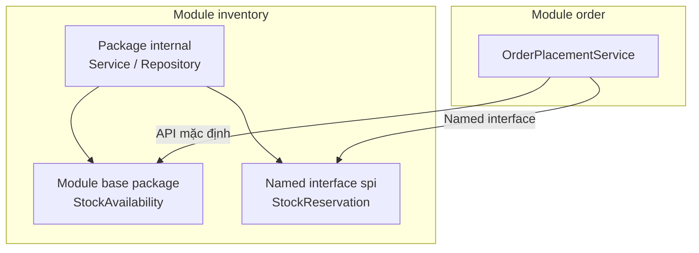

# Dependency qua API package so với named interface

Trong Spring Modulith, một module có thể công bố hợp đồng cho module khác sử dụng qua module base package hoặc qua một named interface. Cả hai cách đều tạo ra API ở cấp kiến trúc, nhưng chúng khác nhau ở cách nhóm và giới hạn phần API được công bố.

Module base package là API công khai mặc định. Named interface cho phép công bố thêm một package con cụ thể với tên rõ ràng. Khi kết hợp `@ApplicationModule(allowedDependencies = ...)`, bạn có thể khai báo module tiêu thụ được phép phụ thuộc vào module nào, hoặc vào một named interface cụ thể của module đó.

## 1. API package mặc định của module

Giả sử ứng dụng bán hàng có hai module `order` và `inventory`:

```text
com.acme.shop
├── order
│   └── internal
│       └── OrderPlacementService.java
└── inventory
    ├── StockAvailability.java
    └── internal
        └── StockAvailabilityService.java
```

Theo quy ước mặc định, `com.acme.shop.inventory` là module base package và là API công khai mặc định của module `inventory`. Các package con như `inventory.internal` thuộc cùng module nhưng được xem là phần triển khai nội bộ.

Đặt hợp đồng mà module khác cần dùng ở module base package:

```java
package com.acme.shop.inventory;

public interface StockAvailability {

    boolean isAvailable(String sku, int quantity);
}
```

Module `inventory` triển khai hợp đồng trong package nội bộ:

```java
package com.acme.shop.inventory.internal;

import com.acme.shop.inventory.StockAvailability;
import org.springframework.stereotype.Service;

@Service
public class StockAvailabilityService implements StockAvailability {

    @Override
    public boolean isAvailable(String sku, int quantity) {
        // Truy vấn dữ liệu kho và kiểm tra số lượng.
        return true;
    }
}
```

Module `order` có thể inject và sử dụng hợp đồng:

```java
package com.acme.shop.order.internal;

import com.acme.shop.inventory.StockAvailability;
import org.springframework.stereotype.Service;

@Service
public class OrderPlacementService {

    private final StockAvailability stockAvailability;

    public OrderPlacementService(StockAvailability stockAvailability) {
        this.stockAvailability = stockAvailability;
    }

    public void placeOrder(String sku, int quantity) {
        if (!stockAvailability.isAvailable(sku, quantity)) {
            throw new IllegalStateException("Không đủ hàng trong kho");
        }
        // Tiếp tục tạo đơn hàng.
    }
}
```

Module `order` chỉ biết `StockAvailability`. Nó không cần biết implementation dùng repository, cơ sở dữ liệu hay dịch vụ ngoài nào để kiểm tra tồn kho.

## 2. Khai báo phụ thuộc vào API package

Nếu module `order` được phép sử dụng API của module `inventory`, bạn có thể khai báo `allowedDependencies` trong `package-info.java` của module `order`:

```java
@org.springframework.modulith.ApplicationModule(
        displayName = "Quản lý đơn hàng",
        allowedDependencies = "inventory"
)
package com.acme.shop.order;
```

Khai báo này cho biết module `order` được phép phụ thuộc vào module `inventory`. Module tiêu thụ vẫn nên tham chiếu các type được công bố ở module base package. `allowedDependencies` kiểm soát module đích được phép phụ thuộc; nó không biến package nội bộ thành API.

Với cách này, API được công bố mặc định nằm ngay trong `com.acme.shop.inventory`. Cách tổ chức phù hợp khi module có một bề mặt API nhỏ, thống nhất và không cần chia thành nhiều nhóm hợp đồng riêng.

## 3. Named interface công bố một package con

Khi module có nhiều nhóm hợp đồng khác nhau, bạn có thể đặt chúng trong các package con và công bố từng nhóm bằng `@NamedInterface`.

Ví dụ, module `inventory` có một nhóm hợp đồng SPI cho các module cần đặt chỗ hàng:

```text
com.acme.shop.inventory
├── StockAvailability.java       # API ở module base package
├── spi
│   ├── package-info.java        # named interface: spi
│   └── StockReservation.java
└── internal
    └── StockReservationService.java
```

Đánh dấu package `spi` trong `package-info.java`:

```java
@org.springframework.modulith.NamedInterface("spi")
package com.acme.shop.inventory.spi;
```

Đặt hợp đồng trong package đã công bố:

```java
package com.acme.shop.inventory.spi;

public interface StockReservation {

    void reserve(String sku, int quantity);
}
```

Implementation tiếp tục nằm trong package nội bộ của module `inventory`:

```java
package com.acme.shop.inventory.internal;

import com.acme.shop.inventory.spi.StockReservation;
import org.springframework.stereotype.Service;

@Service
public class StockReservationService implements StockReservation {

    @Override
    public void reserve(String sku, int quantity) {
        // Ghi nhận việc giữ số lượng hàng trong kho.
    }
}
```

Named interface `spi` công bố `com.acme.shop.inventory.spi` như một phần API có tên của module `inventory`. Package này vẫn thuộc module `inventory`; nó không trở thành application module độc lập.

## 4. Giới hạn phụ thuộc theo named interface

Module `order` có thể khai báo chỉ phụ thuộc vào named interface `spi` của module `inventory`:

```java
@org.springframework.modulith.ApplicationModule(
        displayName = "Quản lý đơn hàng",
        allowedDependencies = "inventory :: spi"
)
package com.acme.shop.order;
```

Cú pháp `inventory :: spi` gồm tên module đích và tên named interface được công bố. Khi dùng khai báo này, ý định kiến trúc cụ thể hơn: `order` cần hợp đồng SPI của `inventory`.

Module tiêu thụ tham chiếu interface qua package đã công bố:

```java
package com.acme.shop.order.internal;

import com.acme.shop.inventory.spi.StockReservation;
import org.springframework.stereotype.Service;

@Service
public class OrderPlacementService {

    private final StockReservation stockReservation;

    public OrderPlacementService(StockReservation stockReservation) {
        this.stockReservation = stockReservation;
    }

    public void placeOrder(String sku, int quantity) {
        stockReservation.reserve(sku, quantity);
        // Tiếp tục xử lý đơn hàng.
    }
}
```

Khai báo theo named interface thể hiện rõ nhóm API mà module tiêu thụ cần. Nó giúp người đọc metadata hiểu phạm vi hợp đồng được sử dụng và hỗ trợ Spring Modulith kiểm tra phụ thuộc theo đúng ranh giới đã công bố.

## 5. So sánh API package và named interface

| Tiêu chí | API ở module base package | Named interface |
|---|---|---|
| Vị trí type | Package gốc của module, ví dụ `inventory` | Package con được đánh dấu, ví dụ `inventory.spi` |
| Cách công bố | Công khai mặc định theo quy ước module | Khai báo rõ bằng `@NamedInterface` |
| Cách khai báo phụ thuộc | `allowedDependencies = "inventory"` | `allowedDependencies = "inventory :: spi"` |
| Mục đích | Bề mặt API chính, thống nhất của module | Nhóm hợp đồng riêng hoặc điểm tích hợp có tên |
| Ranh giới module | Type thuộc module `inventory` | Vẫn thuộc module `inventory` |

Sơ đồ dưới đây thể hiện hai cách module `order` có thể sử dụng hợp đồng do `inventory` cung cấp:



Chọn API package khi module chỉ cần công bố một nhóm hợp đồng chính. Chọn named interface khi cần chia API thành các nhóm có tên và muốn khai báo phụ thuộc vào đúng nhóm đó.

## 6. Named interface không phải module mới

Một lỗi thiết kế thường gặp là xem package được công bố như một module riêng. Ví dụ `com.acme.shop.inventory.spi` vẫn thuộc module `inventory` vì nó là package con của module base package `com.acme.shop.inventory`.

Phân biệt ba cấp sau:

- **Application base package:** điểm bắt đầu khám phá module, ví dụ `com.acme.shop`.
- **Module base package:** package trực tiếp dưới application base package, ví dụ `com.acme.shop.inventory`.
- **Named interface package:** package con được công bố bên trong module, ví dụ `com.acme.shop.inventory.spi`.

`@NamedInterface` bổ sung một cổng API có tên cho module. Nó không tạo module mới, không thay đổi chủ sở hữu nghiệp vụ và không tạo Spring application context riêng.

## 7. Truy cập package nội bộ vẫn là vi phạm

Các lớp trong package con có thể là `public` theo Java và Spring vẫn có thể tạo bean cho chúng. Tuy nhiên, điều đó không làm chúng trở thành API công khai theo mô hình Spring Modulith.

Ví dụ, nếu module `order` import trực tiếp `StockReservationService` từ `inventory.internal`, phụ thuộc đó đi vào package nội bộ. Spring có thể tìm thấy bean khi component scanning phù hợp, nhưng kiểm tra kiến trúc có thể báo vi phạm ranh giới module.

Hãy giữ dependency hướng đến interface được công bố:

```java
// Phụ thuộc vào hợp đồng công khai.
import com.acme.shop.inventory.spi.StockReservation;

// Không tham chiếu implementation nội bộ từ module khác.
// import com.acme.shop.inventory.internal.StockReservationService;
```

Nếu một module cần một hợp đồng mới, hãy quyết định đó có phải API lâu dài hay không. Sau đó đặt hợp đồng ở module base package hoặc tạo named interface phù hợp, rồi cập nhật quy tắc phụ thuộc.

## 8. Kiểm chứng quy tắc phụ thuộc

Spring Modulith cung cấp `ApplicationModules.verify()` để kiểm tra mô hình module và các quy tắc phụ thuộc:

```java
package com.acme.shop;

import org.junit.jupiter.api.Test;
import org.springframework.modulith.core.ApplicationModules;

class ModularityTests {

    @Test
    void verifiesModuleBoundaries() {
        ApplicationModules.of(ShopApplication.class).verify();
    }
}
```

Hãy thử hai trường hợp:

1. `order` phụ thuộc `StockAvailability` ở module base package và khai báo `allowedDependencies = "inventory"`.
2. `order` phụ thuộc `StockReservation` trong named interface `spi` và khai báo `allowedDependencies = "inventory :: spi"`.

Sau đó thử import một implementation từ `inventory.internal` hoặc truy cập một named interface chưa được cho phép. Khi kiểm thử báo lỗi, đọc module nguồn, module đích và package/type bị truy cập để xác định phần hợp đồng cần điều chỉnh.

`verify()` kiểm tra cấu trúc và phụ thuộc kiến trúc. Nó không thay thế kiểm thử Spring cần thiết để xác nhận bean được đăng ký, inject và thực thi đúng trong application context.

## 9. Cách chọn giữa hai hình thức công bố

- Dùng **API package mặc định** khi module có một tập hợp đồng nhỏ, ổn định và không cần chia thành nhiều nhóm công khai.
- Dùng **named interface** khi module cung cấp nhiều nhóm hợp đồng khác nhau, chẳng hạn `spi`, `events` hoặc `reporting`, và các module tiêu thụ chỉ cần một nhóm cụ thể.
- Giữ implementation, repository, entity nội bộ và helper trong package triển khai; không công bố chúng chỉ để làm cho một phụ thuộc hiện tại hoạt động.
- Đặt tên named interface theo vai trò của hợp đồng, không theo tên lớp triển khai.
- Dùng `allowedDependencies` để thể hiện chính sách phụ thuộc của module tiêu thụ và chạy `verify()` trong kiểm thử kiến trúc.

## 10. Bài tập thực hành

Xây dựng hai module `order` và `inventory` cho ứng dụng `com.acme.shop`.

1. Tạo interface `StockAvailability` trong module base package `inventory`.
2. Tạo implementation `StockAvailabilityService` trong `inventory.internal`.
3. Khai báo `allowedDependencies = "inventory"` cho module `order` và inject `StockAvailability`.
4. Tạo package `inventory.spi`, đánh dấu bằng `@NamedInterface("spi")` và đặt interface `StockReservation` trong đó.
5. Chuyển module `order` sang phụ thuộc `inventory :: spi` và inject `StockReservation`.
6. Thử import `StockReservationService` từ `inventory.internal`; chạy `verify()` và quan sát vi phạm.
7. So sánh hai cách khai báo phụ thuộc và giải thích cách named interface giới hạn hợp đồng được sử dụng.

Sau bài tập, hãy tự trả lời: khi nào API ở module base package là đủ, khi nào nên tạo named interface, và vì sao named interface vẫn thuộc module gốc?

## 11. Ghi nhớ

- Module base package là API công khai mặc định của module theo quy ước Spring Modulith.
- `@NamedInterface` công bố một package con như một nhóm API có tên.
- `allowedDependencies = "inventory"` khai báo phụ thuộc được phép tới module `inventory`.
- `allowedDependencies = "inventory :: spi"` thể hiện phụ thuộc tới named interface `spi` của module `inventory`.
- Named interface không tạo application module mới; nó vẫn thuộc module sở hữu package cha.
- Package nội bộ vẫn là chi tiết triển khai dù type Java có thể khai báo `public` hoặc được Spring quản lý như bean.
- Dùng `ApplicationModules.verify()` để kiểm tra việc sử dụng API và các quy tắc phụ thuộc.

Khi chọn đúng giữa API package và named interface, mỗi module có thể công bố hợp đồng vừa đủ, thể hiện rõ mục đích tích hợp và giữ các phụ thuộc của modular monolith trong những ranh giới có thể kiểm chứng.
