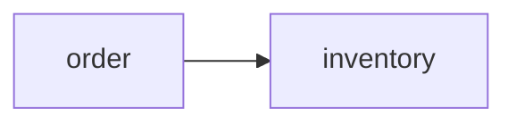
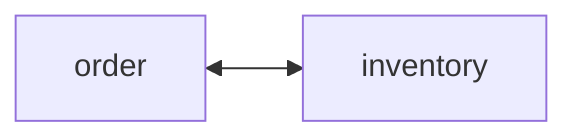

# Kiểm tra boundary bằng ví dụ hợp lệ và không hợp lệ

Một ứng dụng có thể được chia thành nhiều package nhưng vẫn chưa có ranh giới mô-đun rõ ràng. Ranh giới chỉ có ý nghĩa khi mã nguồn tuân thủ quy tắc về API công khai, package nội bộ và chiều phụ thuộc giữa các mô-đun. Spring Modulith giúp biến những quy tắc đó thành kiểm tra tự động để lỗi kiến trúc được phát hiện ngay trong quá trình build.

Trong bài này, chúng ta dùng một ứng dụng bán hàng có các mô-đun `order`, `inventory` và `customer`. Mục tiêu là phân biệt một phụ thuộc hợp lệ với các trường hợp truy cập nội bộ, khai báo phụ thuộc sai và tạo chu trình giữa các mô-đun.

## 1. Những gì cần được kiểm tra

Spring Modulith xác định mô-đun ứng dụng từ cấu trúc package bên dưới package gốc của ứng dụng. Với cấu trúc:

```text
com.acme.shop
├── ShopApplication.java
├── order
│   ├── package-info.java
│   ├── OrderService.java
│   └── internal
│       └── OrderRepository.java
├── inventory
│   ├── package-info.java
│   ├── Inventory.java
│   ├── spi
│   │   └── package-info.java
│   └── internal
│       └── StockRepository.java
└── customer
    ├── package-info.java
    └── Customer.java
```

`order`, `inventory` và `customer` là ba mô-đun. Trong một mô-đun, package gốc là API được công khai mặc định. Các package con như `internal` thuộc phần triển khai nội bộ; mô-đun khác không được phụ thuộc trực tiếp vào chúng. Khi cần công khai một package con có chủ đích, mô-đun có thể đánh dấu package đó bằng `@NamedInterface`.

Có ba nhóm quy tắc cần quan sát:

| Nhóm quy tắc | Câu hỏi cần trả lời | Ví dụ vi phạm |
|---|---|---|
| Quyền truy cập | Mô-đun đang dùng API công khai hay package nội bộ của mô-đun khác? | `order` import `inventory.internal.StockRepository` |
| Phụ thuộc được phép | Mô-đun có khai báo cho phép phụ thuộc này không? | `order` chỉ cho phép `customer` nhưng lại dùng `inventory` |
| Đồ thị phụ thuộc | Các mô-đun có tạo thành chu trình hay không? | `order` phụ thuộc `inventory` và `inventory` lại phụ thuộc `order` |

## 2. Tạo kiểm tra boundary tự động

Đặt một bài kiểm tra kiến trúc trong source set test của ứng dụng:

```java
package com.acme.shop;

import org.junit.jupiter.api.Test;
import org.springframework.modulith.core.ApplicationModules;

class ModularityTests {

    @Test
    void verifiesModuleBoundaries() {
        ApplicationModules.of(ShopApplication.class).verify();
    }
}
```

`ApplicationModules.of(ShopApplication.class)` đọc cấu trúc mô-đun bắt đầu từ package của lớp ứng dụng. Lệnh `verify()` kiểm tra các quy tắc kiến trúc mà Spring Modulith nhận diện, bao gồm quyền truy cập API mô-đun, các phụ thuộc được khai báo và chu trình phụ thuộc. Nếu phát hiện vi phạm, bài kiểm tra thất bại và báo các vi phạm để nhóm phát triển truy nguyên về package hoặc lớp liên quan.

Đặt kiểm tra này trong bộ test chạy ở CI. Nhờ đó, một thay đổi làm lộ package nội bộ hoặc tạo phụ thuộc vòng sẽ bị chặn trước khi được tích hợp vào nhánh chính.

## 3. Ví dụ hợp lệ: phụ thuộc qua API công khai

Giả sử `order` cần tra cứu tồn kho. Mô-đun `inventory` cung cấp lớp `Inventory` trong package gốc:

```java
package com.acme.shop.inventory;

public class Inventory {

    public boolean isAvailable(String productId, int quantity) {
        // Truy vấn trạng thái tồn kho.
        return true;
    }
}
```

Mô-đun `order` khai báo rõ phụ thuộc tới `inventory` trong `package-info.java`:

```java
@org.springframework.modulith.ApplicationModule(
    allowedDependencies = "inventory"
)
package com.acme.shop.order;
```

`OrderService` sử dụng API công khai đó:

```java
package com.acme.shop.order;

import com.acme.shop.inventory.Inventory;

public class OrderService {

    private final Inventory inventory;

    public OrderService(Inventory inventory) {
        this.inventory = inventory;
    }

    public boolean canPlaceOrder(String productId, int quantity) {
        return inventory.isAvailable(productId, quantity);
    }
}
```

Phụ thuộc này hợp lệ vì `order` sử dụng package gốc được công khai của `inventory`, đồng thời khai báo `inventory` trong `allowedDependencies`. Đồ thị phụ thuộc có hướng từ `order` tới `inventory`:



Khi chạy `ModularityTests`, Spring Modulith có thể xác nhận rằng đường phụ thuộc này tuân thủ boundary đã khai báo.

## 4. Ví dụ hợp lệ: công khai một Named Interface

Đôi khi mô-đun cần cung cấp một hợp đồng nằm trong package con, chẳng hạn một SPI để mô-đun khác tích hợp. Có thể công khai đúng package đó bằng `@NamedInterface`.

Trong `inventory`, đánh dấu package `spi`:

```java
@org.springframework.modulith.NamedInterface("spi")
package com.acme.shop.inventory.spi;
```

Đặt hợp đồng cần chia sẻ trong package này:

```java
package com.acme.shop.inventory.spi;

public interface StockReservation {

    boolean reserve(String productId, int quantity);
}
```

Nếu `order` chỉ cần phụ thuộc vào named interface này, khai báo đúng tên interface trong `allowedDependencies`:

```java
@org.springframework.modulith.ApplicationModule(
    allowedDependencies = "inventory::spi"
)
package com.acme.shop.order;
```

Sau đó `order` có thể tham chiếu `StockReservation`:

```java
package com.acme.shop.order;

import com.acme.shop.inventory.spi.StockReservation;

public class OrderService {

    private final StockReservation reservation;

    public OrderService(StockReservation reservation) {
        this.reservation = reservation;
    }
}
```

Cú pháp `inventory::spi` chỉ rõ mô-đun đích và named interface được phép sử dụng. Điều này giúp API tích hợp có chủ đích, đồng thời giữ các package triển khai khác của `inventory` ở trạng thái nội bộ. Nếu một lớp trong `order` truy cập `inventory.internal`, việc công khai `inventory::spi` không làm package `internal` trở thành API.

## 5. Ví dụ không hợp lệ: truy cập package nội bộ

Giả sử `order` bỏ qua API của `inventory` và import thẳng repository nội bộ:

```java
package com.acme.shop.order;

import com.acme.shop.inventory.internal.StockRepository;

public class OrderService {

    private final StockRepository repository;

    public OrderService(StockRepository repository) {
        this.repository = repository;
    }
}
```

Ngay cả khi `StockRepository` được khai báo `public`, package `inventory.internal` vẫn là phần triển khai của mô-đun `inventory`. Quyền truy cập ở mức Java không đồng nghĩa với quyền truy cập theo boundary của Spring Modulith. `verify()` sẽ phát hiện mô-đun `order` đang phụ thuộc vào một package không được công khai.

Để sửa, chuyển phần trao đổi qua API trong package gốc hoặc qua một named interface được thiết kế rõ ràng. Không nên đưa repository nội bộ ra API chỉ để làm cho bài kiểm tra qua được, vì khi đó chi tiết lưu trữ sẽ trở thành hợp đồng mà mô-đun khác phụ thuộc.

## 6. Ví dụ không hợp lệ: phụ thuộc không nằm trong allow-list

`allowedDependencies` có thể giới hạn các mô-đun mà một mô-đun được phép phụ thuộc. Ví dụ, nếu `order` chỉ được phép dùng `customer`:

```java
@org.springframework.modulith.ApplicationModule(
    allowedDependencies = "customer"
)
package com.acme.shop.order;
```

Nhưng mã nguồn lại import API của `inventory`:

```java
package com.acme.shop.order;

import com.acme.shop.inventory.Inventory;

public class OrderService {

    private final Inventory inventory;

    public OrderService(Inventory inventory) {
        this.inventory = inventory;
    }
}
```

Đây là phụ thuộc không được cho phép theo khai báo của mô-đun `order`. Package đích có thể là API công khai, nhưng điều đó chưa đủ: quan hệ giữa hai mô-đun vẫn phải nằm trong danh sách được phép. Kiểm tra boundary sẽ thất bại cho tới khi nhóm phát triển chọn một trong hai hướng phù hợp với thiết kế: bổ sung `inventory` vào danh sách cho phép nếu quan hệ đó là chủ đích, hoặc thay đổi luồng nghiệp vụ để `order` không phụ thuộc trực tiếp vào `inventory`.

## 7. Ví dụ không hợp lệ: chu trình phụ thuộc

Một đồ thị mô-đun dễ hiểu thường có các phụ thuộc một chiều. Nếu `order` gọi `inventory` để kiểm tra tồn kho, nhưng `inventory` lại gọi ngược `order` để lấy thông tin đơn hàng, hai mô-đun tạo thành chu trình:



Chu trình khiến hai mô-đun khó thay đổi độc lập: sửa hợp đồng của mô-đun này có thể buộc phải sửa mô-đun kia. Spring Modulith kiểm tra đồ thị phụ thuộc và báo chu trình như một vi phạm kiến trúc.

Hãy xem lại trách nhiệm nghiệp vụ để loại bỏ chiều phụ thuộc ngược. Chẳng hạn, `order` có thể phát một sự kiện nghiệp vụ sau khi đơn hàng được tạo; `inventory` lắng nghe sự kiện đó để cập nhật quy trình của mình. Khi dùng sự kiện, cần giữ hợp đồng sự kiện ở vị trí phù hợp và bảo đảm chiều phụ thuộc còn lại không tạo thành chu trình. Không nên chuyển sang sự kiện chỉ để làm cho test qua; quyết định này phải phù hợp với yêu cầu nhất quán và thời điểm xử lý của nghiệp vụ.

## 8. Đọc kết quả và xử lý vi phạm

Khi bài kiểm tra thất bại, hãy đọc thông tin vi phạm theo thứ tự sau:

1. **Mô-đun nguồn và mô-đun đích:** xác định package nào tạo ra quan hệ phụ thuộc.
2. **Loại vi phạm:** phân biệt truy cập package nội bộ, phụ thuộc ngoài `allowedDependencies` hay chu trình.
3. **Lớp hoặc package gây ra vi phạm:** lần theo import, kiểu tham số, kiểu trả về hoặc lời gọi làm phát sinh phụ thuộc.
4. **Ý định thiết kế:** xác định quan hệ đó có thực sự cần thiết và mô-đun nào nên sở hữu hợp đồng.
5. **Sửa tại boundary:** dùng API công khai, khai báo named interface, điều chỉnh allow-list hoặc tái cấu trúc chiều phụ thuộc.
6. **Chạy lại kiểm tra:** chạy bài test kiến trúc cùng các test liên quan để xác nhận thay đổi không tạo ra vi phạm mới.

Không nên xử lý mọi lỗi bằng cách mở rộng API hoặc thêm tất cả mô-đun vào `allowedDependencies`. Một khai báo rộng có thể làm test qua nhưng khiến ranh giới mất tác dụng. Mỗi phụ thuộc được thêm vào cần có lý do nghiệp vụ và hợp đồng ổn định.

## 9. Bài tập tự kiểm tra

Với ứng dụng `com.acme.shop`, hãy đánh giá từng thay đổi sau và dự đoán kết quả của `ApplicationModules.of(ShopApplication.class).verify()`:

| Thay đổi | Kết quả mong đợi | Lý do |
|---|---|---|
| `order` dùng `inventory.Inventory` và khai báo `allowedDependencies = "inventory"` | Hợp lệ | Dùng API package gốc và phụ thuộc được cho phép |
| `order` dùng `inventory.internal.StockRepository` | Không hợp lệ | Truy cập package nội bộ của mô-đun khác |
| `order` dùng `inventory.spi.StockReservation`, package được đánh dấu `@NamedInterface("spi")`, và khai báo `inventory::spi` | Hợp lệ | Dùng named interface được công khai và cho phép |
| `order` chỉ cho phép `customer` nhưng dùng `inventory.Inventory` | Không hợp lệ | Phụ thuộc không có trong allow-list |
| `order` phụ thuộc `inventory` và `inventory` phụ thuộc ngược `order` | Không hợp lệ | Đồ thị mô-đun có chu trình |

Hãy thử lần lượt từng trường hợp trong một nhánh làm việc riêng. Với mỗi trường hợp không hợp lệ, ghi lại thông tin Spring Modulith báo và chỉ ra package hoặc quan hệ cần sửa. Khi hoàn thành, giữ bài kiểm tra `ModularityTests` trong CI để các thay đổi sau này tiếp tục được kiểm tra tự động.
