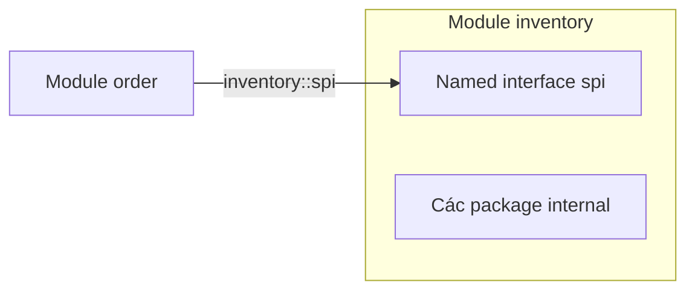

# `@NamedInterface` trên `package-info.java`

Trong Spring Modulith, một module có thể cần công khai một phần API nằm trong package con. Ví dụ, module `inventory` có các thành phần nội bộ để quản lý kho, đồng thời cung cấp một hợp đồng đặt giữ hàng để module `order` sử dụng. Nếu chỉ dựa vào cấu trúc package, hợp đồng này vẫn nằm bên trong module `inventory` và chưa được đánh dấu là một giao diện có tên mà module khác được phép phụ thuộc.

Spring Modulith cung cấp annotation `@NamedInterface` để khai báo phần API đó. Cách khai báo ở cấp package thường dùng là đặt annotation trong file `package-info.java`. Nhờ vậy, ranh giới công khai được ghi ngay tại package chứa các kiểu dữ liệu và hợp đồng được xuất ra.

Sau bài học, bạn có thể:

- Giải thích vai trò của named interface trong mô hình module của Spring Modulith.
- Đặt `@NamedInterface` đúng package bằng `package-info.java`.
- Khai báo module tiêu thụ được phép phụ thuộc vào named interface.
- Dùng `ApplicationModules.verify()` để kiểm chứng quy tắc phụ thuộc.

## 1. Vì sao cần `@NamedInterface`?

Spring Modulith xem một module ứng dụng là một vùng nghiệp vụ có ranh giới. Các module nên giao tiếp qua những phần API được công khai rõ ràng. Trong nhiều ứng dụng, API của module không chỉ nằm ở package gốc. Một module có thể tổ chức hợp đồng theo các nhóm riêng, chẳng hạn `spi`, `events` hoặc `api`, trong khi phần triển khai được giữ ở các package nội bộ.

Giả sử ứng dụng bán hàng có cấu trúc sau:

```text
com.acme.shop
├── inventory
│   ├── internal
│   │   ├── StockRepository.java
│   │   └── DefaultStockReservation.java
│   └── spi
│       ├── StockReservation.java
│       └── ReservationResult.java
└── order
    └── OrderService.java
```

Module `order` cần gọi chức năng giữ hàng của module `inventory`. Hợp đồng `StockReservation` và kiểu kết quả `ReservationResult` là phần mà `inventory` muốn công khai. Các lớp repository và triển khai cụ thể vẫn thuộc nội bộ của `inventory`.

`@NamedInterface` gắn một tên ổn định với package chứa hợp đồng được công khai. Trong ví dụ này, tên giao diện là `spi`. Khi đó, module khác có thể khai báo phụ thuộc đến `inventory::spi`.



Named interface mô tả ranh giới phụ thuộc trong mô hình module. Nó không tạo HTTP endpoint, không đăng ký một dịch vụ mạng và cũng không tự thay đổi quyền truy cập của Java. Các kiểu mà module khác cần sử dụng vẫn phải có mức truy cập Java phù hợp, thường là `public`.

## 2. Khai báo named interface trong `package-info.java`

`package-info.java` là file đặc biệt của Java dùng để khai báo metadata và tài liệu ở cấp package. Annotation đặt trước câu lệnh `package` trong file này sẽ gắn metadata với package tương ứng.

Tạo file tại đúng đường dẫn:

```text
src/main/java/com/acme/shop/inventory/spi/package-info.java
```

Nội dung:

```java
@org.springframework.modulith.NamedInterface("spi")
package com.acme.shop.inventory.spi;
```

Annotation `@NamedInterface("spi")` đánh dấu package `com.acme.shop.inventory.spi` là named interface có tên `spi` của module `inventory`.

Vì annotation package phải xuất hiện trước câu lệnh `package`, hãy dùng tên đầy đủ `org.springframework.modulith.NamedInterface` ngay tại vị trí này. Các câu lệnh `import` của Java nằm sau câu lệnh `package`, nên không thể dùng một import thông thường để rút gọn tên annotation ở đầu file `package-info.java`.

Các kiểu thuộc hợp đồng được công khai trong package đó, ví dụ:

```java
package com.acme.shop.inventory.spi;

public interface StockReservation {

    ReservationResult reserve(String sku, int quantity);
}
```

```java
package com.acme.shop.inventory.spi;

public record ReservationResult(
        boolean accepted,
        String reservationId
) {}
```

Module `order` có thể import các kiểu này bằng tên package Java thông thường. Spring Modulith đọc metadata `@NamedInterface` để hiểu rằng package `spi` là một phần giao diện được module `inventory` công khai.

### Những điểm cần chính xác khi khai báo

- File phải tên đúng `package-info.java` và nằm trong thư mục tương ứng với package được khai báo.
- Tên trong câu lệnh `package` phải khớp với package thực tế của các kiểu được công khai.
- Giá trị `"spi"` là tên logic của named interface; nó không phải tên đầy đủ của package Java.
- Annotation cần nằm ở cấp package. Đặt annotation trong một lớp thông thường không thay thế cho khai báo package-level đang thực hiện ở đây.
- Không đưa lớp triển khai, repository hoặc chi tiết lưu trữ vào package hợp đồng nếu module khác không cần phụ thuộc vào chúng.

Nếu package đã có `package-info.java` để chứa tài liệu hoặc annotation khác, hãy bổ sung `@NamedInterface` vào file hiện có và giữ nguyên câu lệnh package cùng các metadata hợp lệ.

## 3. Khai báo phụ thuộc từ module tiêu thụ

Sau khi `inventory` công khai named interface `spi`, module `order` có thể giới hạn phụ thuộc của mình vào giao diện đó. Đặt khai báo `@ApplicationModule` trong `package-info.java` của module `order`:

```java
@org.springframework.modulith.ApplicationModule(
        allowedDependencies = "inventory::spi"
)
package com.acme.shop.order;
```

Cú pháp `inventory::spi` gồm hai phần:

| Phần | Ý nghĩa |
|---|---|
| `inventory` | Tên module được phụ thuộc đến |
| `spi` | Tên named interface mà module đó công khai |

Đây là tên module và tên giao diện trong mô hình Spring Modulith, không phải tên package đầy đủ `com.acme.shop.inventory.spi`.

Một lớp trong module `order` có thể sử dụng hợp đồng như sau:

```java
package com.acme.shop.order;

import com.acme.shop.inventory.spi.ReservationResult;
import com.acme.shop.inventory.spi.StockReservation;
import org.springframework.stereotype.Service;

@Service
class OrderService {

    private final StockReservation stockReservation;

    OrderService(StockReservation stockReservation) {
        this.stockReservation = stockReservation;
    }

    ReservationResult reserveStock(String sku, int quantity) {
        return stockReservation.reserve(sku, quantity);
    }
}
```

`OrderService` phụ thuộc vào hợp đồng `StockReservation`. Nó không cần biết module `inventory` lưu dữ liệu bằng repository nào hoặc triển khai việc giữ hàng ra sao. Cách tổ chức này giúp module sở hữu quyền thay đổi phần nội bộ mà không buộc module tiêu thụ phải thay đổi theo.

Nếu module cần sử dụng nhiều named interface hoặc module khác, khai báo các giá trị tương ứng trong `allowedDependencies`, ví dụ:

```java
@org.springframework.modulith.ApplicationModule(
        allowedDependencies = {
                "inventory::spi",
                "customer"
        }
)
package com.acme.shop.order;
```

Chỉ thêm những phụ thuộc mà luồng nghiệp vụ thực sự cần. Khai báo này giúp ý định phụ thuộc của module được thể hiện rõ và có thể kiểm chứng tự động.

## 4. Kiểm chứng ranh giới module

Sau khi khai báo named interface và phụ thuộc, hãy dùng `ApplicationModules.verify()` để kiểm tra cấu trúc module. Ví dụ với JUnit:

```java
import org.junit.jupiter.api.Test;
import org.springframework.modulith.core.ApplicationModules;

class ModularityTests {

    @Test
    void verifiesApplicationModuleStructure() {
        ApplicationModules.of(ShopApplication.class).verify();
    }
}
```

`ShopApplication` là lớp ứng dụng Spring Boot nằm trong package gốc của ứng dụng. Khi chạy bài kiểm tra, Spring Modulith phân tích package, module, named interface và các phụ thuộc giữa chúng. Nếu một module truy cập package không được công khai hoặc vi phạm quy tắc phụ thuộc đã khai báo, bước xác minh sẽ báo lỗi để bạn xử lý.

Khi gặp lỗi, hãy kiểm tra theo thứ tự:

1. Package chứa hợp đồng có `package-info.java` với `@NamedInterface` hay chưa.
2. Giá trị tên giao diện trong `@NamedInterface` có khớp với phần sau `::` hay không.
3. Tên module trong `allowedDependencies` có đúng với tên module Spring Modulith nhận diện hay không.
4. Module tiêu thụ có đang import một package nội bộ khác ngoài named interface được cho phép hay không.
5. Các kiểu hợp đồng có mức truy cập Java phù hợp để module khác sử dụng hay không.

## 5. Lỗi thường gặp

| Lỗi | Nguyên nhân | Cách xử lý |
|---|---|---|
| Annotation không được nhận diện | File đặt sai thư mục hoặc câu lệnh `package` không khớp | Đặt `package-info.java` trong đúng thư mục package và kiểm tra tên package |
| Không tìm thấy named interface | Tên trong `allowedDependencies` khác giá trị của `@NamedInterface` | Đồng bộ tên, ví dụ dùng `spi` ở cả hai nơi |
| Khai báo `com.acme.shop.inventory.spi` sau dấu `::` | Nhầm tên package Java với định danh module và named interface | Dùng dạng `inventory::spi` |
| Module vẫn truy cập lớp nội bộ | Mã tiêu thụ import package khác nằm trong module được phụ thuộc | Chuyển hợp đồng cần chia sẻ vào named interface và giới hạn phụ thuộc theo hợp đồng đó |
| Không thể sử dụng kiểu từ module khác | Kiểu Java có mức truy cập không phù hợp, chẳng hạn lớp top-level package-private | Công khai các kiểu hợp đồng cần thiết bằng `public` |
| Named interface chứa quá nhiều chi tiết | Package công khai đang trộn hợp đồng với triển khai | Chỉ giữ kiểu và thao tác cần cho module tiêu thụ; chuyển chi tiết triển khai về package nội bộ |

Một điểm dễ nhầm là `@NamedInterface` không tự biến mọi lớp trong module thành API công khai. Annotation đánh dấu package trong mô hình Spring Modulith; quy tắc truy cập của ngôn ngữ Java vẫn có hiệu lực. Tương tự, việc một package được đánh dấu không có nghĩa mọi module đều nên phụ thuộc vào nó. Module tiêu thụ vẫn cần khai báo phụ thuộc phù hợp với thiết kế của ứng dụng.

## 6. Bài tập thực hành

Bạn có module `payment` với package `com.acme.shop.payment.contract`. Module `checkout` cần sử dụng `PaymentProcessor` và `PaymentResult`, trong khi phần triển khai thanh toán nằm trong `payment.internal`.

Hãy thực hiện các yêu cầu sau:

1. Tạo `package-info.java` trong package `com.acme.shop.payment.contract` và khai báo named interface tên `contract`.
2. Đảm bảo `PaymentProcessor` và `PaymentResult` là các kiểu công khai mà `checkout` cần sử dụng.
3. Khai báo module `checkout` chỉ phụ thuộc vào `payment::contract` cho hợp đồng thanh toán.
4. Chạy bài kiểm tra `ApplicationModules.of(ShopApplication.class).verify()`.
5. Thử import một kiểu thuộc `payment.internal` từ `checkout` và quan sát kết quả xác minh để hiểu ranh giới được bảo vệ như thế nào.

Khai báo package-level ở bước đầu có dạng:

```java
@org.springframework.modulith.NamedInterface("contract")
package com.acme.shop.payment.contract;
```

Và module `checkout` khai báo phụ thuộc:

```java
@org.springframework.modulith.ApplicationModule(
        allowedDependencies = "payment::contract"
)
package com.acme.shop.checkout;
```

Khi hoàn thành, `checkout` chỉ cần biết hợp đồng thanh toán. Module `payment` có thể thay đổi repository hoặc lớp triển khai nội bộ mà không làm lộ các chi tiết đó qua named interface.

## 7. Ghi nhớ

`@NamedInterface` đặt trong `package-info.java` giúp Spring Modulith nhận diện một package con là giao diện có tên được module sở hữu công khai. Tên này được module tiêu thụ tham chiếu qua cú pháp `moduleName::interfaceName` trong `allowedDependencies`. Kết hợp khai báo rõ ràng với `ApplicationModules.verify()`, bạn có thể giữ hợp đồng nghiệp vụ ổn định, giới hạn phụ thuộc vào API cần thiết và phát hiện sớm việc một module truy cập vào phần nội bộ của module khác.
