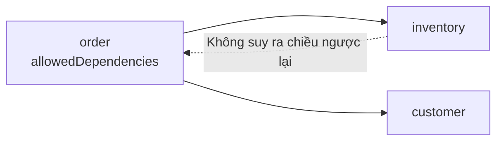

# Dependency tới module bằng identifier

Trong Spring Modulith, `@ApplicationModule(allowedDependencies = ...)` cho phép khai báo những module mà một application module được phép phụ thuộc. Mỗi giá trị có thể là identifier của module đích, thường được suy ra từ tên package module. Ví dụ, nếu module `order` được phép sử dụng API của module `inventory`, khai báo `allowedDependencies = "inventory"` trong metadata của `order`.

Identifier giúp quy tắc phụ thuộc ngắn gọn và dễ đọc. Nó thể hiện rõ module đích trong chính sách kiến trúc, đồng thời cho phép Spring Modulith kiểm tra các tham chiếu thực tế giữa module. Cần nhớ rằng khai báo cho phép phụ thuộc chỉ tạo ra quy tắc kiểm soát; nó không tự thêm dependency vào mã nguồn, không cấu hình Gradle/Maven và không tạo lời gọi nghiệp vụ.

## 1. Module identifier được xác định như thế nào?

Spring Modulith khám phá application module từ application base package. Theo quy ước mặc định, mỗi package con trực tiếp là một module. Ví dụ:

```text
com.acme.shop                         # application base package
├── ShopApplication.java
├── order                             # module identifier: order
├── inventory                         # module identifier: inventory
└── customer                          # module identifier: customer
```

Với cấu trúc này:

| Module base package | Identifier mặc định |
|---|---|
| `com.acme.shop.order` | `order` |
| `com.acme.shop.inventory` | `inventory` |
| `com.acme.shop.customer` | `customer` |

Identifier là tên module được dùng trong mô hình kiến trúc và trong khai báo `allowedDependencies`. Nó khác với `displayName`, vốn là tên thân thiện dành cho báo cáo và người đọc. Ví dụ, module `inventory` có thể đặt `displayName = "Quản lý kho"`, nhưng identifier dùng trong quy tắc vẫn là `inventory`.

Bạn có thể khai báo metadata của module trong `package-info.java` tại module base package. Ví dụ:

```java
@org.springframework.modulith.ApplicationModule(
        displayName = "Quản lý kho"
)
package com.acme.shop.inventory;
```

## 2. Khai báo module được phép phụ thuộc

Giả sử module `order` cần sử dụng khả năng kiểm tra tồn kho từ module `inventory`. Đặt quy tắc ở module tiêu thụ, tức module `order`:

```java
@org.springframework.modulith.ApplicationModule(
        displayName = "Quản lý đơn hàng",
        allowedDependencies = "inventory"
)
package com.acme.shop.order;
```

`allowedDependencies = "inventory"` cho biết module `order` được phép phụ thuộc vào module có identifier `inventory`. Annotation được đặt trong `package-info.java` của `order`, vì vậy quy tắc mô tả các module đích mà `order` có thể sử dụng.

Nếu một module được phép phụ thuộc vào nhiều module, khai báo nhiều identifier trong mảng `allowedDependencies`:

```java
@org.springframework.modulith.ApplicationModule(
        displayName = "Quản lý đơn hàng",
        allowedDependencies = { "inventory", "customer" }
)
package com.acme.shop.order;
```

Trong ví dụ này, `order` được phép phụ thuộc vào cả `inventory` và `customer`. Cú pháp một giá trị như `allowedDependencies = "inventory"` là cách viết rút gọn của annotation array có một phần tử.

## 3. Hiểu đúng chiều của quy tắc

`allowedDependencies` được khai báo trên module đang tạo dependency. Vì vậy, annotation trong `order` kiểm soát các dependency đi ra từ `order` tới những module đích được liệt kê.



Ví dụ, `order` được phép phụ thuộc `inventory` không có nghĩa `inventory` tự động được phép phụ thuộc `order`. Nếu module `inventory` cần sử dụng API của `order`, chính module `inventory` phải có quy tắc phù hợp trong metadata của nó.

Điều này giúp chính sách phụ thuộc được mô tả theo từng module và theo đúng chiều của quan hệ. Khi đọc `package-info.java`, hãy xem annotation thuộc package nào trước khi diễn giải danh sách identifier.

## 4. Identifier không phải compile dependency

Khai báo `allowedDependencies` không tự tạo ra tham chiếu type. Để có compile dependency, mã nguồn của module gọi vẫn phải sử dụng một type hoặc API từ module đích.

Ví dụ, module `inventory` công bố API trong module base package:

```java
package com.acme.shop.inventory;

public interface StockAvailability {

    boolean isAvailable(String sku, int quantity);
}
```

Module `order` sử dụng API đó:

```java
package com.acme.shop.order.internal;

import com.acme.shop.inventory.StockAvailability;
import org.springframework.stereotype.Service;

@Service
public class OrderPlacementService {

    private final StockAvailability stockAvailability;

    public OrderPlacementService(StockAvailability stockAvailability) {
        this.stockAvailability = stockAvailability;
    }

    public void placeOrder(String sku, int quantity) {
        if (!stockAvailability.isAvailable(sku, quantity)) {
            throw new IllegalStateException("Không đủ hàng trong kho");
        }
        // Tiếp tục xử lý đơn hàng.
    }
}
```

Ở đây có compile dependency từ `order` đến type `StockAvailability` thuộc module `inventory`. Metadata `allowedDependencies = "inventory"` cho phép quan hệ module đó theo chính sách kiến trúc.

Nếu chỉ khai báo `allowedDependencies = "inventory"` mà không có type nào trong `order` tham chiếu đến `inventory`, bạn mới chỉ thiết lập một quyền cho phép. Chưa có dependency thực tế phát sinh từ mã nguồn.

## 5. Identifier khác displayName và tên package đầy đủ

Khi làm việc với metadata, hãy phân biệt các giá trị sau:

| Giá trị | Ví dụ | Mục đích |
|---|---|---|
| Module identifier | `inventory` | Nhận diện module trong mô hình và khai báo dependency |
| Module base package | `com.acme.shop.inventory` | Package gốc chứa module |
| Display name | `Quản lý kho` | Tên hiển thị cho người đọc |
| Named interface identifier | `spi` | Nhận diện một nhóm API được công bố trong module |

Không dùng `displayName` trong `allowedDependencies` nếu quy tắc cần module identifier. Ví dụ, dù module có `displayName = "Quản lý kho"`, identifier vẫn là `inventory`.

Nếu muốn giới hạn dependency đến một named interface cụ thể, Spring Modulith hỗ trợ cú pháp `moduleIdentifier :: interfaceIdentifier`, chẳng hạn `inventory :: spi`. Đây là cách tham chiếu API có tên, khác với dependency tới module theo identifier đơn thuần trong bài học này.

## 6. Kiểm chứng allowedDependencies bằng ApplicationModules

Spring Modulith cung cấp `ApplicationModules.verify()` để kiểm tra mô hình và các quy tắc phụ thuộc. Tạo một bài kiểm thử kiến trúc:

```java
package com.acme.shop;

import org.junit.jupiter.api.Test;
import org.springframework.modulith.core.ApplicationModules;

class ModularityTests {

    @Test
    void verifiesAllowedModuleDependencies() {
        ApplicationModules.of(ShopApplication.class).verify();
    }
}
```

Nếu module `order` có tham chiếu tới type thuộc module `inventory` và `inventory` nằm trong `allowedDependencies`, quy tắc cho phép dependency đó. Nếu code của `order` tham chiếu một module khác không nằm trong danh sách cho phép, `verify()` có thể báo vi phạm.

Hãy đọc thông báo lỗi để xác định module nguồn, module đích và type gây ra dependency. Sau đó kiểm tra xem:

1. Module nguồn có thực sự cần cộng tác với module đích về mặt nghiệp vụ không?
2. Identifier trong `allowedDependencies` có đúng với tên module đã được khám phá không?
3. Module tiêu thụ có đang tham chiếu API công khai hoặc named interface phù hợp không?
4. Dependency có đang đi sai chiều hoặc tạo chu trình giữa các module không?

`verify()` kiểm tra các quy tắc kiến trúc mà mô hình module cung cấp. Nó không thay thế kiểm thử Spring để xác nhận bean được đăng ký và inject thành công, cũng không tự quyết định một dependency có hợp lý về mặt nghiệp vụ hay không.

## 7. Những lỗi thường gặp

**Dùng displayName thay cho identifier.** Nếu module có `displayName = "Quản lý kho"`, hãy dùng `inventory` trong `allowedDependencies`, vì đây là identifier của module.

**Khai báo ở sai module.** Nếu `order` cần phụ thuộc `inventory`, đặt quy tắc trong `package-info.java` của `order`. Đặt `allowedDependencies = "order"` trong `inventory` sẽ mô tả chiều phụ thuộc ngược lại.

**Cho rằng whitelist tạo ra dependency.** Danh sách cho phép chỉ xác định module đích được phép sử dụng. Mã nguồn vẫn phải tham chiếu API để hình thành compile dependency.

**Đưa mọi module vào danh sách.** Danh sách quá rộng làm giảm giá trị của quy tắc kiến trúc. Chỉ liệt kê module mà module nguồn thực sự cần sử dụng.

**Nhầm identifier với named interface.** `inventory` tham chiếu module; `inventory :: spi` tham chiếu named interface `spi` được công bố bởi module đó.

## 8. Bài tập thực hành

Với ứng dụng `com.acme.shop` có ba module `order`, `inventory` và `customer`, hãy thực hiện:

1. Xác định module identifier từ các module base package.
2. Đặt `@ApplicationModule(displayName = "Quản lý kho")` trong `inventory/package-info.java`.
3. Đặt `@ApplicationModule(displayName = "Quản lý đơn hàng", allowedDependencies = "inventory")` trong `order/package-info.java`.
4. Thêm API `StockAvailability` vào module base package `inventory`.
5. Inject `StockAvailability` vào `OrderPlacementService` trong module `order`.
6. Mở rộng `allowedDependencies` để `order` được phép phụ thuộc cả `inventory` và `customer`.
7. Thử tạo một tham chiếu từ `order` tới module `customer` khi identifier `customer` chưa được cho phép; chạy `ApplicationModules.verify()` và quan sát vi phạm.
8. Sửa danh sách identifier và chạy lại kiểm thử.
9. Giải thích vì sao khai báo trong `order` không tự cho phép `inventory` phụ thuộc ngược lại.

Sau bài tập, hãy tự trả lời: module identifier được lấy từ đâu, vì sao `displayName` không dùng làm dependency identifier, và `allowedDependencies` khác compile dependency ở điểm nào?

## 9. Ghi nhớ

- `allowedDependencies` khai báo các module đích mà module hiện tại được phép phụ thuộc.
- Module identifier mặc định thường được suy ra từ tên package module trực tiếp dưới application base package.
- Đặt quy tắc trong `package-info.java` của module nguồn, tức module thực hiện dependency.
- `allowedDependencies = "inventory"` cho phép module hiện tại phụ thuộc module có identifier `inventory`.
- `allowedDependencies` chỉ là chính sách cho phép; nó không tự tạo compile dependency hoặc cấu hình Gradle/Maven.
- `displayName` là tên hiển thị, khác với identifier dùng trong quy tắc.
- Dùng `ApplicationModules.verify()` để kiểm tra dependency thực tế có tuân thủ danh sách được phép hay không.

Khi dùng đúng module identifier, bạn có thể diễn đạt chính sách phụ thuộc theo từng module, giữ các quan hệ giữa application module rõ ràng và kiểm chứng chúng tự động trong quá trình phát triển.
