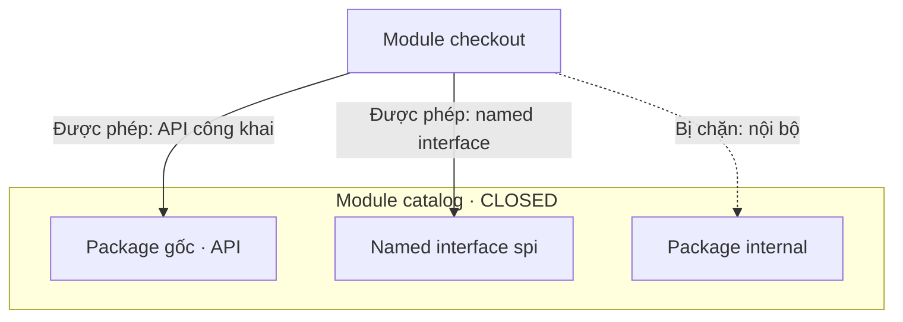
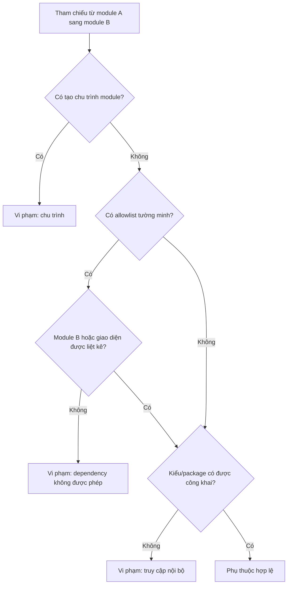

# Module không khai báo `allowedDependencies` có hành vi gì?

Khi một module Spring Modulith không khai báo `allowedDependencies`, module đó không bị giới hạn danh sách module mà nó được phép phụ thuộc. Mã bên trong module có thể tham chiếu API được công khai của các application module khác. Tuy nhiên, điều này không mở quyền truy cập vào package nội bộ: quy tắc đóng module vẫn được áp dụng, và `ApplicationModules.verify()` vẫn kiểm tra chu trình phụ thuộc.

Điểm quan trọng là phân biệt **không khai báo allowlist** với **khai báo allowlist rỗng**. Hai trường hợp này có hành vi khác nhau hoàn toàn.

Sau bài học, bạn có thể:

- Mô tả hành vi mặc định khi `allowedDependencies` không được khai báo.
- Phân biệt giá trị mặc định với `allowedDependencies = {}`.
- Xác định package nào của module khác có thể được tham chiếu.
- Kiểm chứng hành vi bằng `ApplicationModules.verify()`.

## 1. Hành vi mặc định: không giới hạn danh sách module phụ thuộc

Spring Modulith có thể nhận diện application module theo cấu trúc package. Ví dụ, với lớp ứng dụng ở package `com.acme.shop`, các package con trực tiếp như `com.acme.shop.catalog` và `com.acme.shop.checkout` có thể được nhận diện là hai module.

Nếu module `checkout` không khai báo `allowedDependencies`, Spring Modulith không áp dụng allowlist để giới hạn module đích. `checkout` có thể phụ thuộc vào API công khai của `catalog`, `payment` hoặc module ứng dụng khác mà không cần liệt kê từng tên trong `allowedDependencies`.

Điều này có thể biểu diễn bằng cấu trúc:

```text
com.acme.shop
├── ShopApplication.java
├── catalog
│   ├── ProductCatalog.java          # API ở package gốc
│   ├── spi
│   │   ├── package-info.java        # @NamedInterface("spi")
│   │   └── CatalogEvents.java
│   └── internal
│       └── ProductRepository.java   # Chi tiết nội bộ
└── checkout
    └── CheckoutService.java
```

Module `checkout` có thể sử dụng `ProductCatalog` trong package gốc của `catalog` và kiểu được công khai qua named interface `catalog.spi`. Nó vẫn không được truy cập `ProductRepository` trong package `catalog.internal` khi `catalog` là module đóng.



Vì vậy, không khai báo `allowedDependencies` có nghĩa là không giới hạn **module đích** bằng allowlist. Nó không có nghĩa mọi package và mọi lớp trong các module khác đều trở thành API công khai.

## 2. Hai cách không khai báo `allowedDependencies`

Có hai tình huống thường gặp.

**Không có `package-info.java` khai báo `@ApplicationModule`:** module được Spring Modulith nhận diện theo quy tắc phát hiện module đang cấu hình. Vì không có danh sách phụ thuộc tường minh, không có allowlist để giới hạn module đích.

**Có `@ApplicationModule`, nhưng bỏ thuộc tính `allowedDependencies`:** hành vi về danh sách phụ thuộc vẫn là không giới hạn. Ví dụ:

```java
@org.springframework.modulith.ApplicationModule
package com.acme.shop.checkout;
```

Trong trường hợp này, annotation đang khai báo metadata cho module `checkout`, nhưng không cung cấp allowlist. Thuộc tính `type` cũng không được chỉ định nên module giữ kiểu mặc định `CLOSED`.

Bạn có thể viết rõ kiểu module nếu muốn làm ý định đóng module dễ đọc hơn:

```java
@org.springframework.modulith.ApplicationModule(
        type = org.springframework.modulith.ApplicationModule.Type.CLOSED
)
package com.acme.shop.checkout;
```

Việc ghi rõ `type = CLOSED` không tạo ra allowlist và cũng không thay đổi hành vi của `allowedDependencies`. Hai thuộc tính này điều khiển hai khía cạnh khác nhau: `type` quy định khả năng truy cập package nội bộ của module; `allowedDependencies` quy định module nào được phép là đích của phụ thuộc.

## 3. Phân biệt với allowlist rỗng

Khi muốn giới hạn module không được phụ thuộc vào bất kỳ application module nào khác, hãy khai báo một mảng rỗng:

```java
@org.springframework.modulith.ApplicationModule(
        allowedDependencies = {}
)
package com.acme.shop.checkout;
```

Đây là một quy tắc tường minh: không cho phép `checkout` phụ thuộc vào application module khác, ngoại trừ các shared module được cấu hình ở cấp ứng dụng. Trong ví dụ, giả sử `catalog` không phải shared module; khi `ApplicationModules.verify()` phát hiện tham chiếu từ `checkout` sang API của `catalog`, vi phạm phụ thuộc sẽ được báo cáo.

Bảng sau đối chiếu ba cách cấu hình thường gặp:

| Cấu hình | Danh sách module đích | Truy cập package nội bộ của module đóng |
|---|---|---|
| Không khai báo `@ApplicationModule` hoặc không đặt `allowedDependencies` | Không giới hạn bằng allowlist | Không được phép |
| `allowedDependencies = {}` | Không cho phép module ứng dụng khác (ngoại trừ shared modules) | Không được phép |
| `allowedDependencies = "catalog"` | Cho phép module `catalog` (cùng shared modules) | Không được phép |

Ví dụ thứ ba cho phép `checkout` phụ thuộc vào module `catalog` theo API mà module đó công khai. Nếu chỉ cần một named interface, có thể khai báo chính xác hơn:

```java
@org.springframework.modulith.ApplicationModule(
        allowedDependencies = "catalog::spi"
)
package com.acme.shop.checkout;
```

Với khai báo này, module `checkout` được phép phụ thuộc vào named interface `spi` của `catalog`. Các module được cấu hình là shared modules ở cấp ứng dụng cũng được Spring Modulith cho phép theo cơ chế shared module.

Lưu ý: `allowedDependencies` là thuộc tính kiểu mảng `String[]`. Có thể dùng cú pháp một chuỗi khi chỉ có một phần tử, hoặc dùng `{ ... }` khi có nhiều phần tử. Bỏ thuộc tính hoàn toàn và truyền mảng rỗng là hai cấu hình khác nhau. Allowlist này điều khiển phụ thuộc đến các application module đã được nhận diện; mã nằm ngoài mọi application module không phải là một mục trong danh sách đó.

## 4. Những quy tắc vẫn có hiệu lực khi không có allowlist

Không khai báo `allowedDependencies` chỉ bỏ qua bước giới hạn module đích bằng allowlist. Những quy tắc kiến trúc cốt lõi khác vẫn được kiểm tra.

**Chỉ phụ thuộc qua API công khai.** Với module kiểu `CLOSED` mặc định, package gốc được xem là API của module. Các package con muốn công khai thêm phải được đánh dấu bằng `@NamedInterface`. Những package nội bộ không được module khác tham chiếu.

**Không tạo chu trình giữa các module.** Quan hệ phụ thuộc ở cấp application module phải tạo thành đồ thị có hướng không chu trình. Ví dụ, nếu `checkout` phụ thuộc `catalog`, thì `catalog` không nên đồng thời phụ thuộc ngược lại `checkout`.

**Kiểu module `OPEN` là một lựa chọn riêng.** Module được đánh dấu `type = OPEN` cho phép module khác truy cập các kiểu nội bộ theo quy tắc của open module. Đây là quyết định về đóng gói module, không phải hệ quả của việc bỏ `allowedDependencies`.

Sơ đồ sau thể hiện các lớp kiểm soát độc lập:



## 5. Ví dụ kiểm chứng bằng `ApplicationModules.verify()`

Giả sử `checkout` sử dụng API công khai của `catalog`:

```java
package com.acme.shop.catalog;

public record Product(String sku) {}

public interface ProductCatalog {

    Product findBySku(String sku);
}
```

```java
package com.acme.shop.checkout;

import com.acme.shop.catalog.ProductCatalog;
import org.springframework.stereotype.Service;

@Service
class CheckoutService {

    private final ProductCatalog productCatalog;

    CheckoutService(ProductCatalog productCatalog) {
        this.productCatalog = productCatalog;
    }

    void checkProduct(String sku) {
        productCatalog.findBySku(sku);
    }
}
```

Nếu `checkout` không khai báo `allowedDependencies`, phụ thuộc tới `ProductCatalog` là hợp lệ về mặt allowlist. Để kiểm chứng toàn bộ cấu trúc ứng dụng, tạo bài kiểm tra:

```java
import org.junit.jupiter.api.Test;
import org.springframework.modulith.core.ApplicationModules;

class ModularityTests {

    @Test
    void verifiesApplicationModuleStructure() {
        ApplicationModules.of(ShopApplication.class).verify();
    }
}
```

Khi đổi metadata của `checkout` thành `allowedDependencies = {}`, cùng phụ thuộc tới `ProductCatalog` sẽ vi phạm allowlist. Nếu `CheckoutService` tham chiếu một kiểu trong `catalog.internal`, tham chiếu đó vẫn vi phạm ranh giới module đóng ngay cả khi không có allowlist.

`verify()` là bước kiểm chứng kiến trúc khi chạy bài kiểm tra. Java compiler vẫn có thể biên dịch một số tham chiếu package công khai về mặt ngôn ngữ dù chúng vi phạm quy ước module; vì vậy, cần đưa kiểm chứng Spring Modulith vào bộ kiểm tra tự động của dự án để phát hiện vi phạm sớm.

## 6. Khi nào nên khai báo `allowedDependencies`?

Trong giai đoạn đầu của một dự án hoặc khi đang chuyển đổi một ứng dụng cũ sang modular monolith, việc chưa khai báo allowlist có thể giúp nhóm phát hiện và mô hình hóa các module hiện có trước. Các module vẫn cần giữ API rõ ràng và không truy cập package nội bộ của nhau.

Khi ranh giới nghiệp vụ đã ổn định, khai báo `allowedDependencies` giúp ghi lại ý định kiến trúc ngay tại module sở hữu phụ thuộc. Nhờ đó, một phụ thuộc mới ngoài danh sách sẽ được phát hiện trong bước xác minh thay vì âm thầm trở thành một phần của cấu trúc ứng dụng.

Bạn có thể áp dụng theo từng bước:

1. Xác định module và package API hiện có.
2. Đưa các hợp đồng cần chia sẻ vào package gốc hoặc named interface.
3. Chạy `ApplicationModules.verify()` để tìm các phụ thuộc và vi phạm hiện tại.
4. Chọn những module thực sự cần giao tiếp và khai báo allowlist tương ứng.
5. Giữ bài kiểm tra kiến trúc trong CI để phát hiện thay đổi làm sai lệch quy tắc.

Không nên thêm một allowlist quá rộng chỉ để làm cho bài kiểm tra vượt qua. Mỗi mục trong danh sách là một quan hệ phụ thuộc được chấp nhận và cần có lý do nghiệp vụ rõ ràng.

## 7. Ghi nhớ

Khi `allowedDependencies` không được khai báo, Spring Modulith không giới hạn module đích bằng allowlist; module có thể phụ thuộc vào API công khai của các module khác. Package nội bộ của module `CLOSED` vẫn được bảo vệ và chu trình phụ thuộc vẫn bị từ chối. `allowedDependencies = {}` mang ý nghĩa ngược lại: khai báo tường minh rằng module không được phụ thuộc vào application module nào khác, ngoại trừ shared modules được cấu hình. Hãy dùng `ApplicationModules.verify()` để biến những quy tắc này thành kiểm tra kiến trúc có thể chạy tự động.

## Tài liệu tham khảo

- [Spring Modulith Fundamentals – Explicit Application Module Dependencies và Named Interfaces](https://docs.spring.io/spring-modulith/reference/fundamentals.html)
- [Spring Modulith – Verifying Application Module Structure](https://docs.spring.io/spring-modulith/reference/verification.html)
- [ApplicationModule API – thuộc tính `allowedDependencies`](https://docs.spring.io/spring-modulith/docs/current/api/org/springframework/modulith/ApplicationModule.html)
