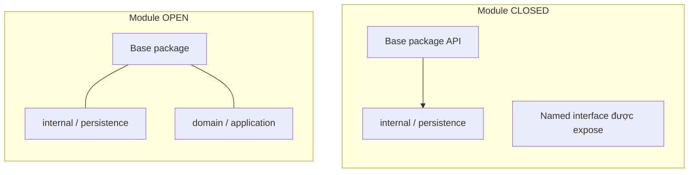

# Open module cho phép truy cập internal ở mức nào?

Spring Modulith mặc định giữ các package con của một application module ở trạng thái nội bộ. Module khác chỉ được tham chiếu package gốc và những named interface mà module chủ động công bố. Khi đánh dấu module là **open**, bạn nới lỏng ranh giới đó: các package thuộc module được xem là API và module khác có thể tham chiếu các kiểu trong những package con, kể cả package thường được đặt tên `internal`.

Open module vì vậy là một lựa chọn có phạm vi rộng. Nó hữu ích khi tích hợp với một module cũ, khi cần chuyển đổi kiến trúc theo từng bước hoặc khi các package con thực sự được thiết kế để chia sẻ. Nếu chỉ cần công bố một package cụ thể, named interface thường giúp giữ ranh giới rõ hơn.

Trong `SPRING_MODULITH_MODULE_MODEL`, hiểu chính xác mức truy cập của open module giúp xác định API công khai, kiểm soát phụ thuộc giữa các package và tránh nhầm lẫn giữa quy tắc kiến trúc của Spring Modulith với quyền truy cập của Java hoặc cơ chế component scan của Spring.

## 1. Mặc định module được đóng (closed)

Theo quy ước mặc định, một application module là closed. Các kiểu trong package gốc tạo thành API mặc định; package con được xem là nội bộ, trừ khi package đó được công bố bằng `@NamedInterface` hoặc được mô hình hóa theo một cấu trúc module khác.

Ví dụ module `inventory`:

```text
com.example.shop.inventory
├── InventoryManagement.java
├── spi
│   ├── package-info.java       // @NamedInterface("spi")
│   └── StockAvailability.java
└── internal
    ├── InventoryManagementImpl.java
    └── InventoryRepository.java
```

Trong module closed:

- Module khác được tham chiếu `InventoryManagement` ở package gốc.
- Module khác được tham chiếu `StockAvailability` trong package `spi` nếu named interface `spi` đã được công bố và dependency tương ứng được cho phép.
- Module khác không được tham chiếu `InventoryManagementImpl` hoặc `InventoryRepository` trong package `internal`.

Quy tắc này giúp module giữ quyền thay đổi cách triển khai. Ví dụ, `inventory` có thể đổi repository, chuyển sang cache hoặc thay thuật toán tính số lượng khả dụng mà không làm các module sử dụng phải cập nhật theo.

## 2. Đánh dấu module là open

Bạn khai báo kiểu module trong `package-info.java` của package gốc bằng `@ApplicationModule(type = ApplicationModule.Type.OPEN)`:

```java
@org.springframework.modulith.ApplicationModule(
    type = org.springframework.modulith.ApplicationModule.Type.OPEN
)
package com.example.shop.inventory;
```

Tệp metadata nằm tại:

```text
src/main/java/com/example/shop/inventory/package-info.java
```

Khi module `inventory` được đánh dấu `OPEN`, Spring Modulith xem tất cả package thuộc module đó là bề mặt API được expose. Module khác có thể tham chiếu các kiểu ở package gốc và các package con như `internal`, `persistence`, `application` hoặc `domain`.

Ví dụ, một module khác có thể import kiểu triển khai ở package con:

```java
package com.example.shop.order.internal;

import com.example.shop.inventory.internal.InventoryRepository;
import org.springframework.stereotype.Service;

@Service
class OrderStockCoordinator {

    private final InventoryRepository inventoryRepository;

    OrderStockCoordinator(InventoryRepository inventoryRepository) {
        this.inventoryRepository = inventoryRepository;
    }
}
```

Ví dụ này chỉ hợp lệ về ranh giới module khi `inventory` là open. Ngoài ra, `InventoryRepository` vẫn phải có mức truy cập Java phù hợp (thường là `public`) để mã trong package khác có thể import và sử dụng. Open module không thay đổi modifier của lớp hoặc phương thức.

## 3. Phạm vi truy cập mà open module mở ra

Open module nới lỏng encapsulation ở cấp package của Spring Modulith. Phạm vi đó bao gồm các package thuộc module, chứ không chỉ một package con được chọn.

| Thành phần của module `inventory` | Module closed | Module open |
|---|---|---|
| Package gốc `com.example.shop.inventory` | Được expose theo quy ước API mặc định | Được expose |
| Package con đã đánh dấu `@NamedInterface` | Được expose như named interface | Được expose |
| Package con chưa được expose | Nội bộ | Được expose |
| Package `internal` | Nội bộ | Được expose |
| Package `persistence` | Nội bộ | Được expose |

Có thể hình dung sự khác nhau như sau:



Trong module closed, module tiêu thụ phải đi qua API package gốc hoặc named interface. Trong module open, các package nội bộ cũng nằm trong bề mặt được expose. Vì vậy, module tiêu thụ có thể phụ thuộc trực tiếp vào nhiều chi tiết hơn của module cung cấp.

## 4. Open không bỏ qua quy tắc truy cập của Java

Spring Modulith kiểm tra ranh giới module ở cấp kiến trúc. Java vẫn kiểm tra quyền truy cập ở cấp ngôn ngữ. Hai lớp quy tắc này cùng có hiệu lực.

Ví dụ:

```java
package com.example.shop.inventory.internal;

public class InventoryRepository {
    // Các phương thức có thể được gọi từ package khác.
}
```

Vì module `inventory` là open, Spring Modulith cho phép module khác phụ thuộc vào kiểu này. Modifier `public` cho phép mã Java ở package khác sử dụng kiểu đó.

Nếu lớp được khai báo package-private:

```java
package com.example.shop.inventory.internal;

class InventoryRepository {
}
```

Spring Modulith có thể xem package này là API do module open, nhưng mã Java bên ngoài package vẫn không thể import lớp package-private. Open module không biến lớp package-private thành `public`, không bỏ qua `private` và cũng không mở quyền truy cập vào thành viên không được Java cho phép.

## 5. Dependency whitelist vẫn cần được tôn trọng

Open module quyết định phạm vi package mà module cung cấp expose. `allowedDependencies` ở module tiêu thụ quyết định những module nào nó được phép phụ thuộc khi dự án sử dụng whitelist.

Ví dụ, module `inventory` là open:

```java
@org.springframework.modulith.ApplicationModule(
    type = org.springframework.modulith.ApplicationModule.Type.OPEN
)
package com.example.shop.inventory;
```

Module `order` cho phép phụ thuộc vào `inventory`:

```java
@org.springframework.modulith.ApplicationModule(
    allowedDependencies = "inventory"
)
package com.example.shop.order;
```

Trong trường hợp này, `order` có thể tham chiếu các kiểu public trong các package thuộc `inventory`, bao gồm cả `inventory.internal`, vì provider là open và consumer đã cho phép dependency tới module `inventory`.

Nếu `order` không cho phép dependency tới `inventory` trong whitelist, việc `inventory` là open không tự thêm `inventory` vào danh sách module mà `order` được phép phụ thuộc. Open module không tạo ra dependency, không đổi hướng dependency và không vô hiệu hóa quy tắc `allowedDependencies` của module tiêu thụ.

## 6. Open module khác Named Interface như thế nào?

Named interface và open module đều có thể cho phép module khác sử dụng package con, nhưng phạm vi công bố rất khác nhau.

| Tiêu chí | Named Interface | Open module |
|---|---|---|
| Cách khai báo | `@NamedInterface("spi")` trên package cần expose | `@ApplicationModule(type = Type.OPEN)` trên package gốc module |
| Phạm vi | Một hoặc một số package được chọn | Tất cả package thuộc module |
| Encapsulation | Các package khác vẫn nội bộ | Không còn ranh giới package nội bộ trong module đó |
| Dependency | Có thể giới hạn bằng `module::named-interface` | Module tiêu thụ phụ thuộc vào module open; các package của module đều được expose |
| Trường hợp phù hợp | Chia sẻ một hợp đồng hoặc nhóm API cụ thể | Module cũ hoặc module có chủ đích công bố toàn bộ package |

Ví dụ, nếu chỉ muốn expose `inventory.spi`, hãy đánh dấu package đó:

```java
@org.springframework.modulith.NamedInterface("spi")
package com.example.shop.inventory.spi;
```

Module tiêu thụ có thể giới hạn dependency:

```java
@org.springframework.modulith.ApplicationModule(
    allowedDependencies = "inventory::spi"
)
package com.example.shop.order;
```

Nếu chuyển `inventory` thành open, module khác có thể truy cập cả `inventory.spi`, `inventory.internal`, `inventory.persistence` và các package khác thuộc module. Vì vậy, chỉ chọn open khi phạm vi công bố rộng đó là chủ đích thiết kế.

## 7. Open module không đồng nghĩa với component scan

Component scan của Spring tìm các lớp cấu hình và stereotype để đăng ký bean trong `ApplicationContext`. Open module của Spring Modulith xác định các package nào được xem là API và có thể được module khác tham chiếu.

Hai cơ chế không thay thế nhau:

- Đánh dấu module `OPEN` không tự đăng ký các lớp trong module thành Spring bean.
- Quét package bằng `@ComponentScan` không làm module trở thành open và không thay đổi quy tắc encapsulation của Spring Modulith.
- Một lớp trong package nội bộ có thể được Spring phát hiện làm bean nhưng vẫn bị coi là nội bộ khi module đóng.
- Một lớp public trong package của module open có thể được module khác tham chiếu về mặt kiến trúc, nhưng để inject như Spring bean thì nó vẫn phải được đăng ký trong context.

Ví dụ, `@Service` trong `inventory.internal` có thể được component scan đăng ký. Nếu `inventory` là closed, module khác vẫn không được tham chiếu kiểu triển khai đó theo quy tắc module. Nếu `inventory` là open, ranh giới module cho phép tham chiếu kiểu đó, còn việc inject bean phụ thuộc vào cách Spring đăng ký nó.

## 8. Khi nào nên dùng open module?

Open module có thể hợp lý trong một số tình huống:

1. **Tích hợp module cũ:** module legacy có nhiều package được các module khác sử dụng từ trước. Đánh dấu open có thể giúp đưa module đó vào mô hình Modulith trước khi tách API dần.
2. **Chuyển đổi theo từng bước:** nhóm phát triển muốn áp dụng Spring Modulith trước, sau đó từng bước gom các hợp đồng dùng chung vào package gốc hoặc named interface.
3. **Module có chủ đích công bố nhiều package:** nhiều package con là API ổn định, được thiết kế để các module khác sử dụng.
4. **Giữ tương thích trong giai đoạn tái cấu trúc:** mở module tạm thời trong khi các consumer đang được chuyển sang API chính thức.

Open module thường không phù hợp khi:

- Module có repository, entity, adapter và implementation thay đổi thường xuyên.
- Chỉ một package con cần được chia sẻ.
- Mục tiêu kiến trúc là kiểm soát chặt hướng phụ thuộc và che giấu chi tiết triển khai.
- Các module tiêu thụ đang phụ thuộc vào nhiều lớp nội bộ mà không có hợp đồng ổn định.

## 9. Rủi ro khi mở toàn bộ module

Khi module open, module tiêu thụ có thể bắt đầu phụ thuộc vào những chi tiết trước đây được giữ kín. Điều đó tạo ra một số rủi ro:

- **Coupling tăng:** consumer phụ thuộc trực tiếp vào repository, entity hoặc service nội bộ.
- **Refactor khó hơn:** thay đổi cấu trúc package hoặc implementation có thể buộc nhiều module khác cập nhật.
- **Hợp đồng không rõ ràng:** không còn dễ nhận ra package nào được thiết kế để chia sẻ và package nào chỉ phục vụ triển khai.
- **Dependency lan rộng:** module khác có thể sử dụng thêm các package mới được thêm vào module open mà không cần thay đổi cấu hình expose.
- **Kiểm soát kiến trúc suy yếu:** các vi phạm kiểu truy cập internal không còn được phát hiện vì module đã chủ động mở các package đó.

Ví dụ, nếu `order` gọi trực tiếp `inventory.internal.InventoryRepository`, sau này `inventory` chuyển từ JPA sang một hệ thống lưu trữ khác thì `order` cũng phải thay đổi. Nếu `order` gọi `InventoryAvailability` ở API package, module `inventory` có thể thay repository mà không ảnh hưởng consumer.

## 10. Chuyển một module open về closed

Một chiến lược hữu ích là dùng open như bước chuyển tiếp, sau đó thu hẹp API. Quy trình có thể thực hiện như sau:

1. **Liệt kê các package đang được sử dụng bên ngoài.** Dùng kết quả kiểm tra dependency và tìm các import từ module tiêu thụ.
2. **Phân loại hợp đồng.** Xác định kiểu nào thực sự là API nghiệp vụ, kiểu nào chỉ là chi tiết triển khai.
3. **Đưa hợp đồng về vị trí phù hợp.** Chuyển API chính vào package gốc hoặc gom các nhóm API phụ vào named interface.
4. **Cập nhật consumer.** Thay import tới repository hoặc implementation bằng interface được công bố.
5. **Giới hạn dependency.** Khai báo `allowedDependencies` theo module hoặc named interface mà consumer thực sự cần.
6. **Đóng module.** Bỏ `type = ApplicationModule.Type.OPEN` hoặc khai báo `CLOSED` một cách tường minh.
7. **Chạy kiểm tra kiến trúc và kiểm thử ứng dụng.** Xác nhận không còn module nào truy cập package nội bộ trái phép.

Ví dụ chuyển về closed tường minh:

```java
@org.springframework.modulith.ApplicationModule(
    type = org.springframework.modulith.ApplicationModule.Type.CLOSED
)
package com.example.shop.inventory;
```

`CLOSED` cũng là hành vi mặc định, vì vậy có thể bỏ annotation `type` hoặc bỏ toàn bộ `@ApplicationModule` nếu module không cần metadata khác. Khai báo tường minh có thể hữu ích để tài liệu hóa quyết định kiến trúc trong giai đoạn chuyển đổi.

## 11. Kiểm chứng mức truy cập bằng `ApplicationModules.verify()`

Spring Modulith có thể kiểm tra các dependency và ranh giới package bằng `ApplicationModules.verify()`:

```java
import org.junit.jupiter.api.Test;
import org.springframework.modulith.core.ApplicationModules;

class ModularityTests {

    @Test
    void verifiesModuleBoundaries() {
        ApplicationModules.of(ShopApplication.class).verify();
    }
}
```

Với module closed, tham chiếu từ module khác vào package con chưa expose sẽ vi phạm quy tắc encapsulation. Nếu provider được đánh dấu open, các tham chiếu tới package con thuộc module đó được chấp nhận về mặt ranh giới module, miễn là các quy tắc dependency khác cũng được thỏa mãn.

Khi đổi từ open sang closed, test này giúp phát hiện các consumer còn phụ thuộc vào package nội bộ. Hãy dùng danh sách lỗi để chuyển từng consumer sang API được công bố, sau đó chạy lại kiểm tra.

## 12. Những nhầm lẫn thường gặp

| Nhầm lẫn | Cách hiểu đúng |
|---|---|
| Open chỉ mở một package `internal` | Open expose tất cả package thuộc module, không chỉ package có tên `internal`. |
| Open module biến mọi lớp thành `public` | Quyền truy cập Java vẫn áp dụng; lớp package-private vẫn không thể được import từ package khác. |
| Open module tự tạo Spring bean | Bean vẫn cần được component scan hoặc khai báo bằng `@Bean`. |
| Open module cho phép phụ thuộc vào mọi module | Nó chỉ mở package của chính module đó; whitelist ở module tiêu thụ vẫn được áp dụng. |
| Named interface và open module tương đương | Named interface expose package được chọn; open expose toàn bộ package thuộc module. |
| Chỉ cần đánh dấu open để sửa mọi lỗi verify | Các quy tắc khác như dependency không được cho phép hoặc phụ thuộc vòng vẫn cần được kiểm tra. |
| Open là trạng thái nên dùng mặc định | Module closed giữ encapsulation tốt hơn; chỉ mở khi có chủ đích rõ ràng. |

## 13. Checklist quyết định mở module

- [ ] Xác định module có thực sự cần expose tất cả package con không.
- [ ] Kiểm tra liệu một hoặc vài named interfaces có đáp ứng nhu cầu không.
- [ ] Nếu chọn open, khai báo `@ApplicationModule(type = ApplicationModule.Type.OPEN)` trong `package-info.java` của package gốc.
- [ ] Xác nhận module tiêu thụ được phép phụ thuộc vào module open theo whitelist nếu dự án sử dụng `allowedDependencies`.
- [ ] Kiểm tra các kiểu được consumer tham chiếu có modifier Java phù hợp.
- [ ] Không nhầm module openness với component scan hoặc Java module system.
- [ ] Đánh giá tác động khi package nội bộ được xem là API.
- [ ] Có kế hoạch thu hẹp API nếu open chỉ là giải pháp chuyển tiếp.
- [ ] Chạy `ApplicationModules.verify()` và các kiểm thử liên quan.

## 14. Kết luận

Open module của Spring Modulith cho phép module khác truy cập tất cả package thuộc module, bao gồm các package con thường được giữ nội bộ như `internal` hoặc `persistence`. Nó mở rộng bề mặt API ở cấp kiến trúc package, nhưng không thay đổi modifier truy cập của Java, không tự đăng ký Spring bean và không vô hiệu hóa whitelist dependency ở module tiêu thụ.

Hãy dùng open khi toàn bộ package của module thực sự được thiết kế để chia sẻ hoặc khi cần một bước chuyển tiếp có kiểm soát cho module legacy. Nếu chỉ cần chia sẻ một phần, hãy dùng `@NamedInterface`. Kết hợp lựa chọn này với `allowedDependencies` và `ApplicationModules.verify()` để duy trì hướng phụ thuộc và giữ ranh giới nghiệp vụ dễ kiểm soát.

## Tài liệu tham khảo

- [Spring Modulith — Fundamentals: Application Modules and Module Types](https://docs.spring.io/spring-modulith/reference/fundamentals.html)
- [Spring Modulith — `ApplicationModule` API](https://docs.spring.io/spring-modulith/docs/current/api/org/springframework/modulith/ApplicationModule.html)
- [Spring Modulith — Verifying Application Module Structure](https://docs.spring.io/spring-modulith/reference/verification.html)
