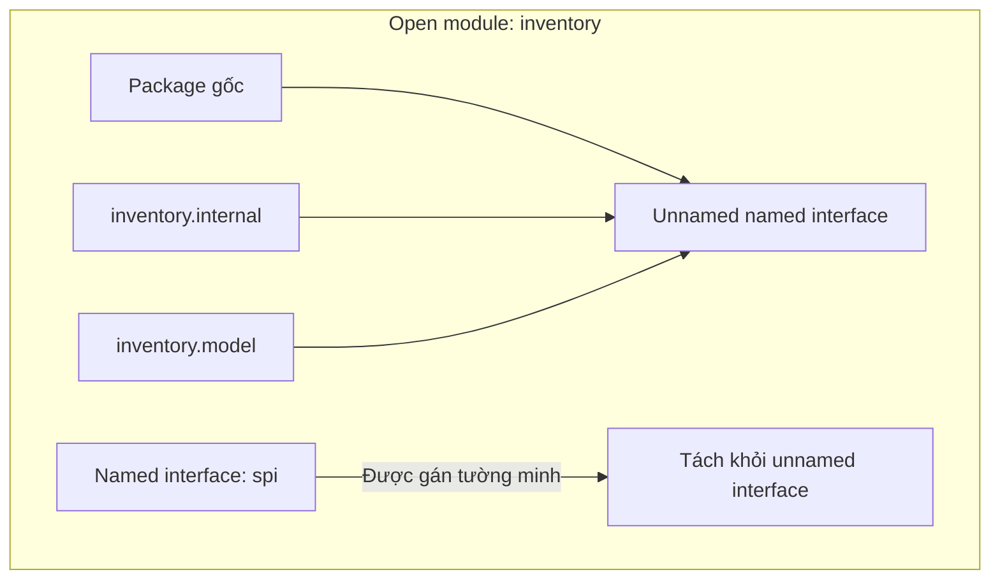

# Unnamed named interface trong open module

Khi một application module được khai báo kiểu `OPEN`, Spring Modulith tạo một **unnamed named interface** ngầm định cho module đó. Giao diện ngầm định này chứa các kiểu ở package gốc và tất cả package con của module, kể cả các package thường được đặt tên như `internal`. Những kiểu đã được gán rõ ràng vào một named interface riêng sẽ được tách khỏi giao diện ngầm định.

Tên gọi nghe có vẻ mâu thuẫn: một interface được gọi là *named interface* nhưng lại *unnamed*. Trong mô hình Spring Modulith, đây là tên gọi chung cho một nhóm kiểu được xem như API của module; “unnamed” có nghĩa nhóm đó không có tên riêng do lập trình viên đặt. Khi khai báo phụ thuộc, module tiêu thụ tham chiếu nhóm này bằng tên module đơn, chẳng hạn `inventory`, không cần phần `::interfaceName`.

Sau bài học, bạn có thể:

- Giải thích unnamed named interface được tạo ra như thế nào trong open module.
- Phân biệt kiểu thuộc giao diện ngầm định với kiểu được gán vào named interface tường minh.
- Đọc và viết `allowedDependencies` để tham chiếu đúng phần API của open module.
- Hiểu giới hạn và trường hợp sử dụng phù hợp của open module.

## 1. Open module tạo giao diện ngầm định như thế nào?

Trong module kiểu `CLOSED`, Spring Modulith mặc định xem package gốc là API. Các package con được xem là nội bộ, trừ khi package hoặc kiểu trong đó được công khai qua `@NamedInterface`.

Với module kiểu `OPEN`, cách gom kiểu thay đổi: Spring Modulith đưa tất cả kiểu trong package gốc và các package con vào unnamed named interface. Vì thế, những lớp nằm trong `internal`, `persistence`, `service` hoặc các package con khác cũng thuộc giao diện ngầm định nếu chúng chưa được gán vào named interface tường minh.

Ví dụ, module `inventory` có cấu trúc:

```text
com.acme.shop.inventory
├── InventoryManagement.java
├── internal
│   ├── StockRepository.java
│   └── DefaultInventoryService.java
├── model
│   └── StockItem.java
└── spi
    ├── package-info.java
    └── StockReservation.java
```

Nếu `inventory` là open module và `spi` được đánh dấu bằng `@NamedInterface("spi")`, các nhóm kiểu được mô hình hóa như sau:

| Package | Nơi Spring Modulith xếp kiểu | Có thể tham chiếu qua |
|---|---|---|
| `inventory` | Unnamed named interface | `inventory` |
| `inventory.internal` | Unnamed named interface | `inventory` |
| `inventory.model` | Unnamed named interface | `inventory` |
| `inventory.spi` | Named interface tường minh `spi` | `inventory::spi` |

Như vậy, package con không có annotation riêng sẽ được gom vào giao diện ngầm định của open module. Package hoặc kiểu được đánh dấu `@NamedInterface` sẽ thuộc giao diện có tên tương ứng, thay vì nằm trong unnamed interface.



## 2. Khai báo module kiểu `OPEN`

Đặt annotation `@ApplicationModule` trong `package-info.java` của package gốc module:

```java
@org.springframework.modulith.ApplicationModule(
        type = org.springframework.modulith.ApplicationModule.Type.OPEN
)
package com.acme.shop.inventory;
```

`type = OPEN` yêu cầu Spring Modulith áp dụng open module semantics khi xây dựng mô hình và xác minh phụ thuộc. Không cần khai báo một annotation riêng để tạo unnamed interface; giao diện này được Spring Modulith tạo ngầm định từ các kiểu thuộc module.

Đừng nhầm giao diện ngầm định này với việc viết `@NamedInterface` mà không truyền tên. Với annotation đặt trên package, nếu bỏ tên thì Spring Modulith dùng tên package cục bộ làm tên mặc định. Unnamed interface của open module là một phần của mô hình được tạo tự động từ các kiểu chưa được gán vào named interface tường minh.

Các kiểu trong package con không có `@NamedInterface` sẽ thuộc unnamed interface. Ví dụ, `StockRepository` trong `inventory.internal` được gom vào giao diện này dù package có tên `internal`.

Lưu ý rằng việc đưa kiểu vào unnamed interface là quy tắc của mô hình kiến trúc Spring Modulith. Nó không thay đổi access modifier của Java. Một lớp top-level có phạm vi package-private vẫn không thể được mã ở package khác import trực tiếp. Những kiểu cần được module khác sử dụng phải có mức truy cập Java thích hợp, thường là `public`.

## 3. Tách một phần API thành named interface tường minh

Open module không bắt buộc mọi kiểu phải nằm trong cùng một giao diện ngầm định. Bạn vẫn có thể tạo named interface cho nhóm hợp đồng cần có tên riêng.

Tại `src/main/java/com/acme/shop/inventory/spi/package-info.java`:

```java
@org.springframework.modulith.NamedInterface("spi")
package com.acme.shop.inventory.spi;
```

Ví dụ hợp đồng trong package này:

```java
package com.acme.shop.inventory.spi;

public interface StockReservation {

    ReservationResult reserve(String sku, int quantity);
}
```

Khi phân tích open module, Spring Modulith đưa các kiểu trong `inventory.spi` vào named interface `spi`. Những kiểu này không còn được tính vào unnamed named interface. Các package con khác chưa được gán named interface vẫn nằm trong giao diện ngầm định.

Bạn có thể đánh dấu một kiểu cụ thể thay vì cả package khi cần phân nhóm hợp đồng theo kiểu. Annotation `@NamedInterface` hỗ trợ cả target package và type. Với kiểu được đánh dấu trực tiếp, hãy đặt annotation trên kiểu công khai và dùng tên interface mong muốn:

```java
package com.acme.shop.inventory;

@org.springframework.modulith.NamedInterface("spi")
public interface StockReservation {

    ReservationResult reserve(String sku, int quantity);
}
```

Khi annotation được đặt trên một kiểu, chỉ kiểu đó và các kiểu liên quan được Spring Modulith đưa vào named interface theo quy tắc propagate của phiên bản đang dùng. Đánh dấu package bằng `package-info.java` thường dễ đọc hơn khi cả package là một hợp đồng.

## 4. Tham chiếu unnamed interface trong `allowedDependencies`

Khi module tiêu thụ khai báo phụ thuộc đến open module bằng tên module đơn, ví dụ `inventory`, Spring Modulith hiểu đó là phụ thuộc đến unnamed named interface của module đích.

```java
@org.springframework.modulith.ApplicationModule(
        allowedDependencies = "inventory"
)
package com.acme.shop.checkout;
```

Với cấu hình này, `checkout` được phép tham chiếu các kiểu thuộc unnamed interface của `inventory`. Vì `inventory` là open module, nhóm này bao gồm cả kiểu trong các package con chưa được gán vào named interface tường minh, ví dụ `inventory.internal` và `inventory.model`.

Nếu `checkout` cần sử dụng named interface `spi`, hãy khai báo riêng giao diện đó:

```java
@org.springframework.modulith.ApplicationModule(
        allowedDependencies = {
                "inventory",
                "inventory::spi"
        }
)
package com.acme.shop.checkout;
```

Hai phần tử cho phép hai nhóm kiểu khác nhau: `inventory` tham chiếu unnamed interface, còn `inventory::spi` tham chiếu named interface `spi`.

Spring Modulith còn hỗ trợ wildcard trong định danh phụ thuộc:

```java
@org.springframework.modulith.ApplicationModule(
        allowedDependencies = "inventory::**"
)
package com.acme.shop.checkout;
```

`inventory::**` cho phép phụ thuộc vào mọi phần API được công khai của module, bao gồm unnamed interface và các named interface tường minh. Trong khi đó, `inventory::*` chỉ chọn các named interface tường minh và không bao gồm package gốc/unnamed interface.

| Khai báo | Phần API của `inventory` được cho phép |
|---|---|
| `inventory` | Unnamed interface |
| `inventory::spi` | Named interface `spi` |
| `inventory::*` | Tất cả named interface tường minh |
| `inventory::**` | Unnamed interface và tất cả named interface tường minh |

Các quy tắc allowlist ở module tiêu thụ vẫn có hiệu lực. Việc module đích là `OPEN` không tự động bỏ qua `allowedDependencies` đã khai báo ở module gọi. Open module quyết định những kiểu nào thuộc các interface của chính nó; allowlist của module gọi quyết định interface nào nó được phép dùng.

## 5. Kiểm chứng mô hình interface

Bạn có thể dùng `ApplicationModules` để xem mô hình module được phát hiện và `verify()` để kiểm tra các phụ thuộc:

```java
import org.junit.jupiter.api.Test;
import org.springframework.modulith.core.ApplicationModules;

class ModularityTests {

    @Test
    void verifiesApplicationModuleStructure() {
        var modules = ApplicationModules.of(ShopApplication.class);

        modules.forEach(System.out::println);
        modules.verify();
    }
}
```

Khi đọc kết quả, hãy xác định module `inventory`, kiểu module là `OPEN`, và các kiểu nào thuộc unnamed interface hoặc named interface `spi`. Sau đó đối chiếu những interface được khai báo trong `allowedDependencies` của `checkout`.

Một số tình huống cần thử:

1. Để `checkout` khai báo `allowedDependencies = "inventory"`, sau đó tham chiếu một kiểu `public` ở `inventory.internal`. Phụ thuộc thuộc unnamed interface và được allowlist này chấp nhận.
2. Đánh dấu package `inventory.spi` bằng `@NamedInterface("spi")`, rồi chỉ khai báo `allowedDependencies = "inventory"`. Phụ thuộc tới `StockReservation` thuộc `inventory::spi` và không được bao phủ bởi phần tử `inventory`.
3. Thêm `inventory::spi` vào allowlist và xác minh phụ thuộc đến `StockReservation` được chấp nhận.
4. Thử `inventory::*` và `inventory::**` để quan sát sự khác nhau giữa tất cả named interface tường minh và toàn bộ API được công khai.

`verify()` kiểm tra mô hình module và các quan hệ phụ thuộc đã khai báo. Hãy giữ bài kiểm tra này trong bộ kiểm tra kiến trúc để thay đổi package hoặc allowlist được phát hiện trong quá trình phát triển.

## 6. Khi nào nên dùng open module?

Open module chủ yếu hữu ích khi đưa Spring Modulith vào một codebase cũ. Ứng dụng có thể đã có nhiều package con được các module khác sử dụng trực tiếp. Việc mở module giúp nhóm áp dụng kiểm chứng kiến trúc trước, sau đó dần tách các hợp đồng ổn định thành package API và named interface.

Trong một ứng dụng đã được modular hóa rõ ràng, open module thường là dấu hiệu ranh giới package chưa đủ chặt. Khi mọi package con đều được đưa vào unnamed interface, các module khác có thể phụ thuộc vào chi tiết triển khai. Điều này làm tăng phạm vi thay đổi có thể ảnh hưởng đến module tiêu thụ.

Một lộ trình chuyển đổi có thể gồm:

1. Khai báo module `OPEN` để bắt đầu kiểm chứng một ứng dụng cũ.
2. Thống kê các kiểu trong unnamed interface đang được module khác sử dụng.
3. Chọn hợp đồng nghiệp vụ ổn định và chuyển chúng vào package API hoặc named interface.
4. Cập nhật `allowedDependencies` để module tiêu thụ chỉ tham chiếu các hợp đồng cần thiết.
5. Chuyển module về `CLOSED` sau khi các phụ thuộc nội bộ đã được loại bỏ hoặc xử lý.

Khi module là `OPEN`, Spring Modulith không dùng module đó trong thuật toán phát hiện chu trình phụ thuộc. Vì vậy, open module cũng không đóng góp đầy đủ vào việc phát hiện vòng phụ thuộc như module `CLOSED`. Đây là một lý do khác để xem `OPEN` như bước chuyển tiếp thay vì trạng thái mặc định lâu dài cho module nghiệp vụ.

## 7. Ghi nhớ

Unnamed named interface là giao diện ngầm định không có tên riêng. Trong open module, Spring Modulith đưa kiểu ở package gốc và mọi package con vào giao diện này, trừ những kiểu đã được gán rõ ràng vào named interface tường minh. Module tiêu thụ tham chiếu giao diện ngầm định bằng tên module đơn, ví dụ `inventory`; tham chiếu một giao diện có tên bằng cú pháp `inventory::spi`. `inventory::**` bao phủ toàn bộ phần API được công khai. Hãy dùng open module chủ yếu để chuyển đổi codebase cũ, rồi thu hẹp dần các hợp đồng để khôi phục ranh giới module rõ ràng.

## Tài liệu tham khảo

- [Spring Modulith Fundamentals – Open Application Modules](https://docs.spring.io/spring-modulith/reference/fundamentals.html#modules.advanced.open)
- [Spring Modulith Fundamentals – Named Interfaces và Explicit Application Module Dependencies](https://docs.spring.io/spring-modulith/reference/fundamentals.html#modules.named-interfaces)
- [ApplicationModule.Type API](https://docs.spring.io/spring-modulith/docs/current/api/org/springframework/modulith/ApplicationModule.Type.html)
- [NamedInterface API](https://docs.spring.io/spring-modulith/docs/current/api/org/springframework/modulith/core/NamedInterface.html)
