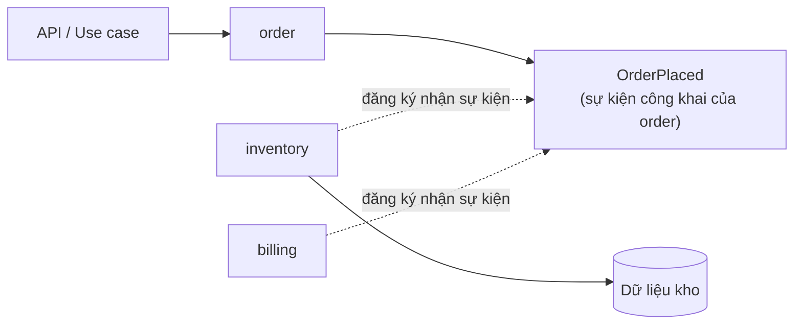
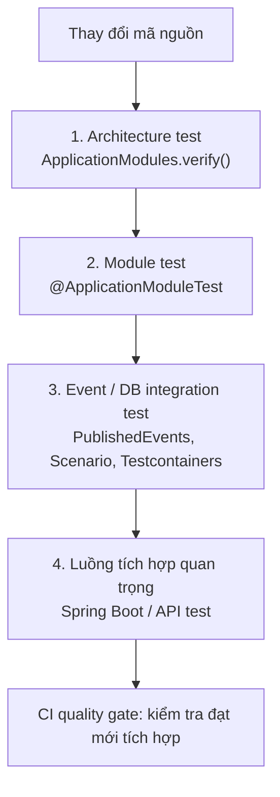

# Spring Modulith Verification Testing giải quyết bài toán nào?

Trong ứng dụng Spring Boot phát triển lâu năm, mã nguồn thường bắt đầu bằng vài package rõ ràng nhưng dần xuất hiện các lời gọi chéo giữa nghiệp vụ. Một thay đổi nhỏ trong phần đặt hàng có thể làm hỏng kho, thanh toán hoặc báo cáo. **Spring Modulith Verification Testing** cung cấp cách kiểm chứng cấu trúc module và kiểm thử hành vi của từng module để những phụ thuộc ngoài ý muốn được phát hiện sớm, trước khi mã được tích hợp.

Bài học thuộc chương **Nhập môn** của chủ đề **SPRING_MODULITH_VERIFICATION_TESTING**. Mục tiêu của toàn bộ chủ đề là rèn kỹ năng kiểm chứng ranh giới kiến trúc bằng `ApplicationModules`, các quy tắc phụ thuộc, `@ApplicationModuleTest`, kiểm thử sự kiện, cơ sở dữ liệu và tích hợp; từ đó đưa các kiểm tra quan trọng vào quality gate của CI để ngăn phụ thuộc sai và hồi quy.

## 1. Mục tiêu học tập

Sau bài này, bạn có thể:

- Giải thích vì sao **monolith có chia package** vẫn có thể trở thành một hệ thống liên kết chặt.
- Phân biệt **kiểm chứng kiến trúc** (module được phép phụ thuộc vào đâu) với **kiểm thử hành vi** (module xử lý yêu cầu đúng hay không).
- Dùng `ApplicationModules.of(...).verify()` để phát hiện các vi phạm ranh giới phổ biến.
- Nhận biết vai trò của `@ApplicationModuleTest`, `PublishedEvents` và `Scenario` khi kiểm thử nghiệp vụ và sự kiện.
- Xác định những phần phải kiểm tra thêm bằng kiểm thử tích hợp với cơ sở dữ liệu, và cách chạy tất cả trong CI.

## 2. Bài toán: package tách biệt nhưng phụ thuộc không còn tách biệt

Giả sử một ứng dụng bán hàng có ba phần nghiệp vụ: `order` (đặt hàng), `inventory` (kho) và `billing` (thanh toán). Ban đầu, mỗi nhóm chỉ làm việc trong package của mình. Sau vài lần phát triển, một lập trình viên thêm lời gọi từ `order` tới `inventory.internal.StockRepository` để kiểm tra tồn kho cho nhanh. Người khác lại cho `inventory` gọi ngược dịch vụ trong `order` để lấy trạng thái đơn.

Các vấn đề bắt đầu xuất hiện:

1. **Ranh giới bị xuyên thủng:** mã của một nghiệp vụ sử dụng trực tiếp chi tiết triển khai của nghiệp vụ khác; thay bảng dữ liệu hay repository có thể kéo theo sửa nhiều nơi.
2. **Phụ thuộc vòng:** `order` gọi `inventory`, `inventory` lại gọi `order`; việc tách, kiểm thử hoặc khởi tạo từng phần ngày càng khó.
3. **Kiểm thử khó khoanh vùng:** bài test đặt hàng phải dựng thêm hàng loạt bean của kho và thanh toán dù chỉ muốn kiểm tra một quy tắc đặt hàng.
4. **Hồi quy âm thầm:** code vẫn biên dịch, unit test của từng class vẫn xanh, nhưng thiết kế module đã không còn như nhóm dự định.

Bản thân việc tổ chức code thành các package không ngăn được bốn vấn đề trên. Java cho phép một package tham chiếu đến `public` type của package khác, kể cả type đó chỉ được nhóm phát triển coi là “nội bộ”.

Spring Modulith giúp mô tả ứng dụng Spring Boot như một tập **application module** và cung cấp công cụ kiểm tra những liên kết giữa chúng. Việc này đặc biệt có giá trị với **modular monolith**: ứng dụng triển khai như một đơn vị nhưng nghiệp vụ vẫn có ranh giới có thể kiểm chứng.

## 3. Spring Modulith nhìn ứng dụng thành module như thế nào?

Với cấu trúc mặc định, các package con trực tiếp dưới package chứa ứng dụng Spring Boot có thể được nhận diện làm application module. Ví dụ:

```text
com.acme.shop
├── ShopApplication.java
├── order
│   ├── OrderService.java
│   ├── OrderPlaced.java
│   └── internal
│       └── OrderRepository.java
├── inventory
│   ├── InventoryEventListener.java
│   └── internal
│       └── StockRepository.java
└── billing
    ├── BillingService.java
    └── internal
        └── InvoiceRepository.java
```

Theo quy ước mặc định, các type thuộc package gốc của module, chẳng hạn `com.acme.shop.order.OrderPlaced`, tạo nên phần giao diện có thể tiếp cận từ bên ngoài. Các type ở package con như `com.acme.shop.inventory.internal.StockRepository` được coi là **nội bộ** của module. Type `public` trong Java vì thế **không đương nhiên** là API hợp lệ đối với module khác.

Sơ đồ tương tác mong muốn có thể là:



Sự kiện thuộc API công khai của `order`. `inventory` và `billing` phụ thuộc vào hợp đồng sự kiện đó để xử lý nghiệp vụ của mình; `order` không cần gọi trực tiếp repository của hai module còn lại.

**Lưu ý về phạm vi:** Spring Modulith không tự tạo phân quyền bảo mật, tách process hoặc tách database cho mỗi module. Ranh giới package/module là ranh giới kiến trúc trong mã nguồn; các yêu cầu về bảo mật, tính nhất quán dữ liệu và vận hành vẫn cần biện pháp tương ứng.

## 4. ApplicationModules.verify() kiểm tra được điều gì?

Một bài kiểm tra kiến trúc có thể rất ngắn:

```java
package com.acme.shop;

import org.junit.jupiter.api.Test;
import org.springframework.modulith.core.ApplicationModules;

class ModularityTests {

    @Test
    void verifiesModuleBoundaries() {
        ApplicationModules.of(ShopApplication.class).verify();
    }
}
```

`ApplicationModules.of(ShopApplication.class)` xây dựng mô hình các module từ ứng dụng. Lệnh `verify()` kiểm chứng các quy tắc kiến trúc được Spring Modulith hỗ trợ. Theo cấu hình module và các quy tắc đang áp dụng, những lỗi tiêu biểu gồm:

| Lỗi | Ví dụ | Vì sao cần chặn |
|---|---|---|
| Phụ thuộc vòng giữa module | `order -> inventory -> order` | Hai nghiệp vụ không còn độc lập theo hướng phụ thuộc |
| Tham chiếu vào type nội bộ | `order` dùng `inventory.internal.StockRepository` | Bên ngoài bị ràng buộc vào chi tiết triển khai |
| Phụ thuộc ngoài danh sách cho phép | Module chỉ được phụ thuộc `order` nhưng lại gọi `billing` | Kiến trúc thực tế lệch khỏi hợp đồng đã khai báo |

Ví dụ sau là dấu hiệu vi phạm ranh giới:

```java
package com.acme.shop.order;

// KHÔNG NÊN: order phụ thuộc trực tiếp vào phần nội bộ của inventory.
import com.acme.shop.inventory.internal.StockRepository;
```

Nếu `StockRepository` được khai báo `public` để Java cho phép import, ứng dụng có thể biên dịch; tuy vậy phép kiểm chứng module vẫn có thể báo lỗi vì nó nằm trong package nội bộ của `inventory`.

Khi một module thực sự chỉ được dùng một số module khác, có thể khai báo quy tắc phụ thuộc qua `@ApplicationModule` tại `package-info.java`:

```java
@org.springframework.modulith.ApplicationModule(
    allowedDependencies = "order"
)
package com.acme.shop.inventory;
```

Trong ví dụ này, `inventory` được phép phụ thuộc vào `order`; việc dùng API của một module khác không nằm trong danh sách cho phép sẽ bị kiểm tra. Khi cần công bố một phần nhỏ ở package con như một hợp đồng liên module, Spring Modulith còn hỗ trợ **named interface**; không nên “sửa lỗi” bằng cách chuyển toàn bộ lớp nội bộ thành API công khai.

**Điểm mấu chốt:** `verify()` kiểm chứng quan hệ kiến trúc mà công cụ có thể nhận diện từ mã nguồn và khai báo module. Nó **không chứng minh** rằng tính tiền đúng, hàng được giữ kho đúng, database đã commit hoặc sự kiện đã được xử lý thành công. Đó là trách nhiệm của các bài kiểm thử hành vi và tích hợp.

## 5. Vì sao vẫn cần @ApplicationModuleTest?

Một ứng dụng có kiến trúc hợp lệ vẫn có thể chạy sai. Ví dụ `order` chỉ phát ra sự kiện công khai đúng ranh giới, nhưng lại phát hai lần; hoặc `inventory` nhận sự kiện đúng type nhưng không lưu kết quả đặt giữ hàng.

`@ApplicationModuleTest` phục vụ lớp kiểm chứng tiếp theo: khởi tạo ngữ cảnh Spring Boot với phạm vi module được chọn để kiểm tra cách các bean trong module phối hợp. Đặt test trong package của module, chẳng hạn `com.acme.shop.order`.

Những chế độ khởi tạo cần phân biệt:

| Chế độ | Phạm vi chính | Khi nên dùng |
|---|---|---|
| `STANDALONE` (mặc định) | Module đang kiểm thử | Kiểm tra nghiệp vụ bên trong một module và các sự kiện nó phát ra |
| `DIRECT_DEPENDENCIES` | Module đang kiểm thử cùng các module mà nó phụ thuộc trực tiếp | Kiểm thử điểm tích hợp gần nhất, nơi module cần cộng tác trực tiếp |
| `ALL_DEPENDENCIES` | Module đang kiểm thử cùng các module phụ thuộc bắc cầu | Kiểm tra luồng nghiệp vụ cần thêm các tầng phụ thuộc liên quan |

Số lượng module được nạp không phải là tiêu chí chất lượng: **chọn phạm vi nhỏ nhất có thể kiểm tra đúng hành vi mong muốn**. Ngữ cảnh nhỏ hơn thường giúp xác định lỗi rõ hơn, nhưng test cần database hay dịch vụ ngoài vẫn phải cấu hình các phụ thuộc đó.

Ví dụ tối giản: module `order` phát sự kiện khi tiếp nhận đơn hàng.

```java
package com.acme.shop.order;

import java.util.UUID;

public record OrderPlaced(UUID orderId) {}
```

```java
package com.acme.shop.order;

import java.util.UUID;
import org.springframework.context.ApplicationEventPublisher;
import org.springframework.stereotype.Service;

@Service
public class OrderService {

    private final ApplicationEventPublisher events;

    public OrderService(ApplicationEventPublisher events) {
        this.events = events;
    }

    public void placeOrder(UUID orderId) {
        // Ví dụ tập trung vào sự kiện. Ứng dụng thật cần kiểm tra
        // đầu vào, lưu đơn hàng và xác định ranh giới transaction.
        events.publishEvent(new OrderPlaced(orderId));
    }
}
```

Với Spring Modulith Test trên classpath, ta có thể kiểm tra sự kiện đã **được phát ra**:

```java
package com.acme.shop.order;

import static org.assertj.core.api.Assertions.assertThat;

import java.util.UUID;
import org.junit.jupiter.api.Test;
import org.springframework.beans.factory.annotation.Autowired;
import org.springframework.modulith.test.ApplicationModuleTest;
import org.springframework.modulith.test.PublishedEvents;

@ApplicationModuleTest
class OrderModuleTests {

    @Autowired OrderService orderService;

    @Test
    void publishesOrderPlaced(PublishedEvents events) {
        UUID orderId = UUID.randomUUID();

        orderService.placeOrder(orderId);

        assertThat(events.ofType(OrderPlaced.class)).hasSize(1);
    }
}
```

Test này kiểm chứng hợp đồng “đặt hàng phát một sự kiện `OrderPlaced`”. Trong ứng dụng thật, hãy kiểm tra thêm giá trị `orderId` trong payload và các trường hợp không hợp lệ để tránh test chỉ đếm sự kiện mà bỏ qua nội dung.

Cần phân biệt rõ:

- **Publisher test:** sự kiện `OrderPlaced` đã được phát đúng số lần, đúng dữ liệu.
- **Consumer test:** `inventory` nhận sự kiện và thực hiện đúng hành vi (ví dụ: giữ lượng hàng, cập nhật trạng thái, phát sự kiện tiếp theo).
- **End-to-end integration test:** luồng đặt hàng–kho–thanh toán hoạt động khi các thành phần và hạ tầng cần thiết được ghép lại.

Một bài publisher test xanh không tự bảo đảm listener đã chạy xong, đặc biệt khi listener bất đồng bộ.

## 6. Kiểm thử sự kiện bất đồng bộ: nhìn vào kết quả, không chờ tùy ý

Khi kết nối các module bằng sự kiện, khó khăn thường nằm ở **thời điểm**: publisher kết thúc trong khi listener vẫn đang xử lý. `@ApplicationModuleListener` thường được dùng cho listener có xử lý bất đồng bộ và transaction riêng. Vì vậy cách viết “gọi publisher, rồi lập tức đọc dữ liệu consumer” có thể thất bại ngẫu nhiên.

Spring Modulith Test cung cấp `Scenario` để mô tả kích thích (stimulus), chờ một điều kiện/sự kiện quan sát được và xác minh kết quả. Ý tưởng kiểm thử là:

```java
// Minh họa cách dùng Scenario trong một module integration test.
// Giả sử consumer inventory phát StockReserved sau khi xử lý OrderPlaced.

@Autowired Scenario scenario;
@Autowired ApplicationEventPublisher publisher;

@Test
void inventoryReactsToOrderPlaced() {
    UUID orderId = UUID.randomUUID();

    scenario.stimulate(() -> publisher.publishEvent(new OrderPlaced(orderId)))
        .andWaitForEventOfType(StockReserved.class)
        .matching(StockReserved::orderId, orderId)
        .toArriveAndVerify(event ->
            assertThat(event.orderId()).isEqualTo(orderId));
}
```

Đoạn này giả định ứng dụng đã có `StockReserved`, listener tương ứng, dữ liệu kho hợp lệ và các import cần thiết. Nó minh họa mẫu kiểm thử, chưa phải một test chạy độc lập. Trong trường hợp thực tế, nên xác minh **cả trạng thái dữ liệu sau xử lý** nếu yêu cầu nghiệp vụ liên quan đến lưu trữ.

Lưu ý rằng `Scenario` chỉ giải quyết cách đồng bộ việc quan sát kết quả trong test; nó không tự tạo cơ chế giao nhận tin cậy cho production. Nếu nghiệp vụ cần bảo đảm việc phát và xử lý sự kiện sau transaction, hãy xem xét cơ chế **event publication registry** của Spring Modulith, chính sách retry và khả năng xử lý idempotent của consumer. Từng cơ chế phải được kiểm thử theo cấu hình ứng dụng đang dùng.

## 7. Kiểm thử database và transaction tại ranh giới module

Ranh giới module không đồng nghĩa dữ liệu luôn độc lập hoàn toàn. Nhiều modular monolith dùng chung một database; nếu hai module cùng sửa bảng của nhau, phụ thuộc dữ liệu vẫn tồn tại dù mã nguồn ít import chéo.

Với một nghiệp vụ đặt hàng thực tế, bộ test cần trả lời ít nhất các câu hỏi sau:

| Tình huống | Điều cần khẳng định |
|---|---|
| Tạo đơn hợp lệ | Đơn được lưu đúng ID, trạng thái và số tiền theo quy tắc |
| Thất bại trong transaction | Không tồn tại dữ liệu nửa chừng trái quy tắc nhất quán |
| Consumer nhận sự kiện lặp | Không trừ tồn kho hai lần nếu nghiệp vụ yêu cầu idempotency |
| Listener lỗi sau khi publisher commit | Hệ thống ghi nhận lỗi/đảm bảo thử lại theo cơ chế đã chọn |
| Hai giao dịch tranh cùng lượng hàng | Không bán vượt tồn kho theo mức cô lập và chiến lược khóa đã thiết kế |

`@ApplicationModuleTest` có thể cùng dùng DataSource thật của môi trường test hoặc **Testcontainers** để chạy với cùng loại database như production. Đây là nơi kiểm tra mapping JPA, ràng buộc unique, khóa, transaction và câu lệnh SQL — những thứ kiểm tra package dependency không quan sát được.

Một quy trình kiểm thử tích hợp tiêu biểu:

1. Khởi tạo database test có schema/migration tương ứng ứng dụng.
2. Gieo fixture tối thiểu cho đúng module đang kiểm tra.
3. Gọi use case công khai của module.
4. Truy vấn kết quả đã lưu và sự kiện liên quan; kiểm tra cả trường hợp lỗi.
5. Dọn dữ liệu hoặc cách ly mỗi test để kết quả không phụ thuộc thứ tự chạy.

Đặc biệt, đừng mặc định `@Transactional` trên test sẽ chứng minh đường đi commit/rollback giống production. Một transaction bao quanh test có thể bị rollback khi test kết thúc, còn listener chạy trong transaction khác có thể có hành vi khác. Hãy chọn kiểu setup và xác minh theo chính ranh giới transaction của ứng dụng.

## 8. Bốn lớp kiểm chứng bổ trợ cho nhau



| Lớp kiểm chứng | Bắt tốt lỗi nào? | Không thay thế được |
|---|---|---|
| Kiến trúc | Phụ thuộc vòng, truy cập phần nội bộ, sai quy tắc phụ thuộc | Logic tính toán, dữ liệu và runtime |
| Module | Phối hợp bean, use case và hợp đồng của module | Toàn bộ tác động giữa mọi module |
| Sự kiện và dữ liệu | Nội dung sự kiện, thời điểm xử lý, lưu trữ/transaction | Quy tắc thiết kế package nếu không chạy architecture test |
| Tích hợp luồng | Hành vi xuyên nhiều module và adapter/hạ tầng | Chẩn đoán nhanh từng lỗi ranh giới nếu chỉ dùng test toàn hệ thống |

Các lớp test không nhất thiết phải chạy trong các job riêng. Giá trị nằm ở chỗ **mỗi câu hỏi có một phép kiểm chứng phù hợp**, giúp lỗi được phát hiện nhanh và có thông điệp dễ hành động.

## 9. Quality gate trong CI: từ quy ước thành cam kết được kiểm tra

Nếu kiểm tra kiến trúc chỉ chạy khi có người nhớ thực hiện, những phụ thuộc sai vẫn có thể lọt vào nhánh chính. Nên đưa `ModularityTests` vào tập test tự động và yêu cầu CI đạt trước khi merge.

Ví dụ lệnh chạy test theo công cụ build của dự án:

```bash
# Dự án Maven có Maven Wrapper:
./mvnw test

# Hoặc dự án Gradle có Gradle Wrapper:
./gradlew test
```

Với CI, một chuỗi kiểm tra hợp lý là:

1. **Compile và unit test:** mã hợp lệ, logic cục bộ không bị hồi quy.
2. **Architecture test:** chạy `ApplicationModules.verify()`; sai ranh giới làm job thất bại.
3. **Module/integration test:** kiểm tra use case, sự kiện, database; cung cấp hạ tầng test cần thiết.
4. **Báo cáo và chặn merge:** hiển thị test thất bại cùng nguyên nhân để sửa ngay trên pull request.

Những điều cần lưu ý khi thiết kế gate:

- Bài architecture test phải nằm trong tập test thực sự được CI chạy, không chỉ được viết rồi bỏ qua.
- Nếu test phụ thuộc database, runner cần có hạ tầng tương ứng (ví dụ Docker để chạy Testcontainers), migration và cấu hình ổn định.
- Đừng thay lỗi kiến trúc bằng cách mở rộng mọi package thành API công khai hoặc vô hiệu hóa test; trước hết hãy xem phụ thuộc đó có phù hợp trách nhiệm module hay không.
- Sử dụng phiên bản Spring Boot, Spring Modulith và các dependency test tương thích theo BOM hoặc cấu hình quản lý dependency của dự án. Tên API trong bài minh họa các cơ chế phổ biến; cần đối chiếu với phiên bản thực tế trước khi đưa nguyên xi vào codebase.

## 10. Một quy trình xử lý vi phạm điển hình

**Tình huống:** `OrderService` vừa thêm import từ `inventory.internal.StockRepository` vì cần kiểm tra khả năng bán hàng.

**Bước 1 — Chạy `ApplicationModules.verify()`.** Kiểm tra nhận ra type nội bộ của `inventory` đang được module `order` sử dụng. Lỗi mô tả một quyết định thiết kế cần xem xét, không chỉ là một dòng import cần đổi vị trí.

**Bước 2 — Xác định trách nhiệm nghiệp vụ.** Ai sở hữu quy tắc tồn kho? Nếu `inventory` sở hữu, `order` không nên tự truy cập repository và quyết định cập nhật tồn kho.

**Bước 3 — Chọn hợp đồng thích hợp.** Nếu cần kết quả đồng bộ, cân nhắc API công khai hẹp của module kho. Nếu quy trình cho phép xử lý sau khi tạo đơn, cân nhắc sự kiện nghiệp vụ. Việc chọn giữa lời gọi đồng bộ và sự kiện phụ thuộc yêu cầu nhất quán và trải nghiệm người dùng, không đơn thuần là sở thích công nghệ.

**Bước 4 — Bổ sung test theo hợp đồng mới.** Kiểm tra `order` phát yêu cầu/sự kiện đúng, `inventory` áp dụng quy tắc kho đúng, dữ liệu và cơ chế xử lý lỗi đáp ứng yêu cầu.

**Bước 5 — Chạy lại gate.** Architecture test phải xanh vì phụ thuộc đã hợp lệ; module/integration test phải xanh vì nghiệp vụ vẫn đúng. Cả hai điều kiện đều cần thiết.

## 11. Bài tập thực hành

**Bối cảnh:** Dùng ứng dụng Spring Boot có `order` và `inventory` với cấu trúc như mục 3. Không cần xây toàn bộ hệ thống bán hàng; chỉ cần tạo đủ use case và dữ liệu để kiểm tra một hợp đồng rõ ràng.

1. Viết `ModularityTests` dùng `ApplicationModules.of(ShopApplication.class).verify()`. Chạy ở dự án của bạn và ghi lại danh sách module được nhận diện.
2. Cố ý tạo một tham chiếu từ `order` đến type `public` trong `inventory.internal`. Dự đoán kết quả, chạy test kiến trúc và đọc thông báo vi phạm. Sau đó loại bỏ tham chiếu sai.
3. Tạo `OrderPlaced` và `OrderService` theo ví dụ. Viết `@ApplicationModuleTest` kiểm tra sự kiện được phát đúng một lần với mã đơn đúng.
4. Thêm listener của `inventory` và bài test kiểm tra kết quả tiêu thụ sự kiện. Nếu listener chạy bất đồng bộ, dùng cách chờ theo điều kiện hoặc `Scenario` thay cho `Thread.sleep(...)`.
5. Nếu có database, thêm một trường hợp ghi dữ liệu thành công và một trường hợp thất bại/rollback. Giải thích kết quả mong đợi theo transaction thực tế.
6. Thêm các test trên vào lệnh test của CI. Tạo một lỗi ranh giới có chủ đích và xác nhận gate báo đỏ; sửa lỗi và xác nhận gate xanh.

**Tiêu chí tự đánh giá:**

- Tôi chỉ ra được đâu là API công khai và đâu là nội bộ của từng module.
- Tôi giải thích được một vi phạm kiến trúc ngay cả khi code vẫn biên dịch.
- Tôi không nhầm sự kiện **đã phát** với sự kiện **đã được xử lý thành công**.
- Tôi biết test nào kiểm tra hành vi module, test nào kiểm tra transaction/database và test nào kiểm tra luồng tích hợp.
- Tôi có bằng chứng các kiểm tra được chạy tự động khi thay đổi mã nguồn.

## 12. Câu hỏi ôn tập và ghi nhớ

**1. Vì sao unit test của `OrderService` xanh mà ứng dụng vẫn có lỗi kiến trúc?** Vì unit test thường chỉ kiểm tra một hành vi hoặc một class; nó không nhất thiết xác minh module nào được phép phụ thuộc vào module nào.

**2. `ApplicationModules.verify()` có thay thế `@ApplicationModuleTest` không?** Không. Một bên kiểm tra ranh giới kiến trúc; bên kia kiểm tra hành vi của bean và use case trong phạm vi module.

**3. Đã dùng sự kiện thì có hết phụ thuộc giữa module chưa?** Chưa. Consumer vẫn phụ thuộc vào hợp đồng sự kiện; hệ thống còn có các yêu cầu về transaction, giao nhận, idempotency và xử lý lỗi.

**4. Khi nào cần kiểm thử với database thật hoặc Testcontainers?** Khi hành vi cần xác nhận phụ thuộc vào SQL, migration, constraint, locking, isolation hay commit/rollback mà fake/in-memory implementation không phản ánh đủ.

**5. Tại sao kiểm chứng module cần có mặt trong CI?** Vì nó biến nguyên tắc thiết kế thành điều kiện kiểm tra lặp lại cho mọi thay đổi; một import sai ranh giới sẽ bị phát hiện trước khi được tích hợp.

### Kết luận

Spring Modulith Verification Testing giải quyết một bài toán cốt lõi của modular monolith: **giữ cho cấu trúc module được thiết kế ban đầu không bị bào mòn trong quá trình phát triển, đồng thời chứng minh các module vẫn thực hiện đúng hành vi khi phối hợp qua API, sự kiện và dữ liệu**. Hãy bắt đầu bằng `ApplicationModules.verify()` cho ranh giới kiến trúc; tiếp tục với `@ApplicationModuleTest`, kiểm thử sự kiện và database cho hành vi; cuối cùng dùng CI để duy trì các cam kết đó qua từng lần thay đổi mã nguồn.
