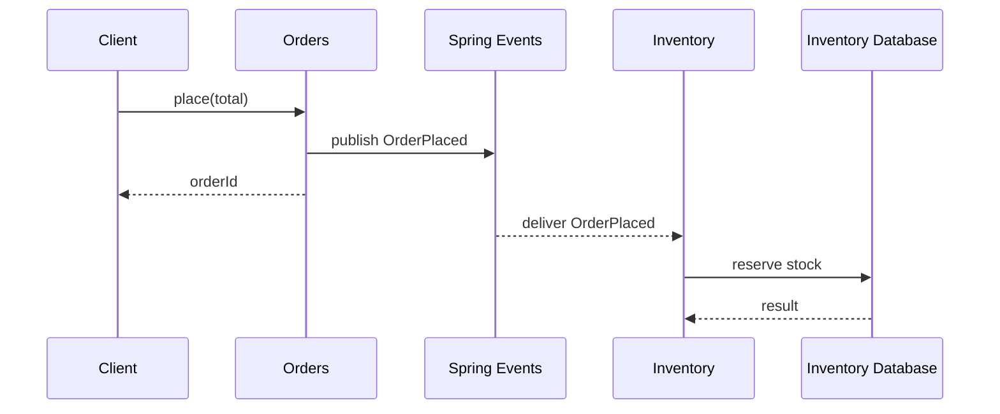
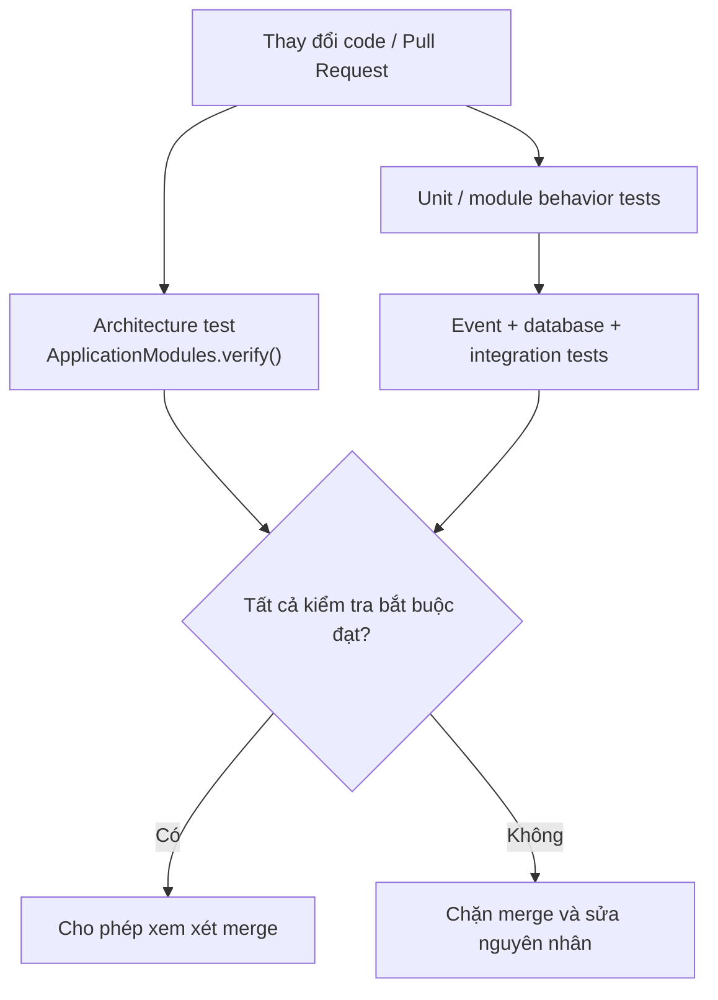

# Kiểm chứng kiến trúc module khác gì với chạy kiểm thử hành vi?

Một ứng dụng Spring Boot có thể **chạy đúng tính năng hôm nay** nhưng đang hình thành các phụ thuộc khiến việc sửa đổi ngày mai trở nên khó khăn. Ngược lại, một ứng dụng tuân thủ rất tốt ranh giới module vẫn có thể tính sai tiền, bỏ sót sự kiện hoặc lưu dữ liệu không nhất quán. Vì vậy, với Spring Modulith, **kiểm chứng kiến trúc module** và **kiểm thử hành vi** trả lời hai câu hỏi khác nhau và cần được thực hiện cùng nhau.

Đây là bài thuộc chương **Nhập môn** của **SPRING_MODULITH_VERIFICATION_TESTING**. Phạm vi học tập là kiểm chứng ranh giới kiến trúc bằng `ApplicationModules` và quy tắc phụ thuộc, thực hành `@ApplicationModuleTest`, kiểm thử sự kiện, cơ sở dữ liệu và tích hợp, rồi kết hợp các phép kiểm tra thành quality gate trong CI để ngăn phụ thuộc sai và hồi quy.

## 1. Hai câu hỏi, hai loại bằng chứng

Hãy xét hệ thống bán hàng có ba module: `orders` (đơn hàng), `inventory` (tồn kho) và `payments` (thanh toán).

- **Kiểm chứng kiến trúc:** “`orders` có đang truy cập repository nội bộ của `inventory` không? Có phụ thuộc vòng không? Module có tuân thủ các quy tắc phụ thuộc đã khai báo không?”
- **Kiểm thử hành vi:** “Đặt hàng 120.000 đồng có tạo đúng đơn hàng không? Sự kiện đặt hàng có được phát đúng nội dung không? Khi thiếu hàng, hệ thống có giữ nguyên dữ liệu và trả lỗi đúng không?”

| Tiêu chí | Kiểm chứng kiến trúc module | Kiểm thử hành vi |
|---|---|---|
| Đối tượng quan sát | Cấu trúc module, quan hệ phụ thuộc, API công khai/nội bộ | Đầu vào, đầu ra, trạng thái, sự kiện và tác dụng phụ khi thực thi |
| Câu hỏi chính | “Có được phép phụ thuộc như thế này không?” | “Với tình huống này, chương trình có làm đúng không?” |
| Ví dụ công cụ | `ApplicationModules.of(...).verify()` | JUnit, AssertJ, `@ApplicationModuleTest`, `PublishedEvents`, `Scenario`, kiểm thử DB |
| Dấu hiệu thất bại | Module gọi vào package nội bộ hoặc tạo phụ thuộc vòng | Tính sai số tiền, phát thiếu sự kiện, transaction không đáp ứng yêu cầu |
| Cần chạy nghiệp vụ thực tế? | Không cần thực hiện luồng đặt hàng để kiểm tra ranh giới | Có, ở mức unit, module hoặc tích hợp phù hợp |
| Điểm mạnh | Ngăn kiến trúc bị bào mòn dù chức năng hiện tại vẫn chạy | Phát hiện sai quy tắc nghiệp vụ và hồi quy có thể quan sát được |
| Giới hạn | Không kết luận logic, dữ liệu hoặc tích hợp runtime đúng | Không tự khẳng định cấu trúc phụ thuộc tuân thủ thiết kế |

**Mấu chốt:** có những lỗi làm code **vẫn compile, vẫn trả kết quả đúng**, nhưng kiến trúc đã sai; cũng có những lỗi **không vi phạm một ranh giới module nào**, nhưng gây kết quả nghiệp vụ sai.

## 2. Vì sao chức năng chạy đúng vẫn có thể sai kiến trúc?

Giả sử quy ước thiết kế của ứng dụng như sau:

- `orders` sở hữu vòng đời đơn hàng.
- `inventory` sở hữu dữ liệu tồn kho và logic đặt giữ hàng.
- `payments` sở hữu giao dịch thanh toán.
- Module khác chỉ sử dụng **giao diện công khai** đã chủ đích cung cấp, hoặc trao đổi qua hợp đồng sự kiện được công khai.

Mã nguồn có thể được bố trí theo cấu trúc:

```text
com.acme.shop
├── ShopApplication.java
├── orders
│   ├── OrderService.java
│   ├── OrderPlaced.java
│   └── internal
│       └── OrderRepository.java
├── inventory
│   ├── InventoryApi.java
│   └── internal
│       └── StockRepository.java
└── payments
    ├── PaymentApi.java
    └── internal
        └── PaymentRepository.java
```

Theo cách nhận diện module mặc định của Spring Modulith, các package `orders`, `inventory` và `payments` là các application module; các type thuộc package gốc của mỗi module là phần giao diện công khai theo quy ước, còn package con như `inventory.internal` là phần triển khai nội bộ. Cấu hình nhận diện module thực tế có thể được tùy chỉnh.

Một lập trình viên muốn kiểm tra nhanh tồn kho nên thêm phụ thuộc trực tiếp:

```java
package com.acme.shop.orders;

import com.acme.shop.inventory.internal.StockRepository;
import org.springframework.stereotype.Service;

@Service
class OrderAvailabilityService {

    private final StockRepository stockRepository;

    OrderAvailabilityService(StockRepository stockRepository) {
        this.stockRepository = stockRepository;
    }

    // Phần xử lý đơn hàng sử dụng trực tiếp repository của inventory.
}
```

Giả sử `StockRepository` là một type `public`. Java có thể cho phép code trên biên dịch; logic kiểm tra kho thậm chí có thể cho kết quả đúng trong các bài test. Tuy nhiên, `orders` đã gắn mình vào chi tiết lưu trữ của `inventory`. Khi nhóm kho đổi thiết kế repository hoặc cơ sở dữ liệu, nhóm đơn hàng có thể bị buộc phải sửa theo.

**Đây là lỗi kiến trúc:** module sử dụng phần nội bộ của module khác. Kiểm thử hành vi của chức năng kiểm tra tồn kho không nhất thiết phát hiện điều đó.

Một cách thiết kế rõ ràng hơn là định nghĩa hợp đồng hẹp, chẳng hạn `InventoryApi` trong package gốc của `inventory`, rồi để `orders` gọi API này nếu nghiệp vụ đòi hỏi trả lời đồng bộ. Nếu cần xử lý tách rời theo thời gian, các module có thể phối hợp qua sự kiện nghiệp vụ. Lựa chọn đồng bộ hay sự kiện phải dựa trên yêu cầu nhất quán và trải nghiệm người dùng.

## 3. ApplicationModules.verify(): kiểm tra luật phụ thuộc

Spring Modulith xây dựng mô hình các application module và cung cấp phép xác minh ranh giới kiến trúc. Bài test nền tảng có thể viết như sau:

```java
package com.acme.shop;

import org.junit.jupiter.api.Test;
import org.springframework.modulith.core.ApplicationModules;

class ModuleArchitectureTests {

    @Test
    void modulesMustRespectArchitecturalRules() {
        ApplicationModules.of(ShopApplication.class).verify();
    }
}
```

Bài test này cần JUnit và phần Spring Modulith cung cấp `ApplicationModules` trên test classpath. `ShopApplication` là lớp khởi động Spring Boot tại package gốc `com.acme.shop`.

`verify()` kiểm tra các quan hệ phụ thuộc trong mô hình module theo những quy tắc mà Spring Modulith hỗ trợ. Những ví dụ thường gặp là:

1. **Phụ thuộc vòng:** `orders -> inventory -> orders` khiến chiều phụ thuộc không còn rõ ràng.
2. **Truy cập phần nội bộ:** `orders` tham chiếu trực tiếp `inventory.internal.StockRepository`.
3. **Không tuân thủ danh sách phụ thuộc:** module dùng một module khác ngoài tập cho phép trong cấu hình `@ApplicationModule`.

Có thể khai báo phạm vi phụ thuộc được phép trong `package-info.java` của module. Ví dụ module `orders` chỉ được phụ thuộc vào `inventory`:

```java
@org.springframework.modulith.ApplicationModule(
    allowedDependencies = "inventory"
)
package com.acme.shop.orders;
```

Khai báo trên xác định **module đích được phép phụ thuộc**, nhưng không hợp thức hóa việc dùng mọi type nội bộ của `inventory`. Hợp đồng công khai và danh sách module được phép là hai điều kiện cần phân biệt. Khi cần công bố một phần package con, Spring Modulith có cơ chế named interface để thể hiện giao diện được mở có chủ đích.

Phép kiểm chứng này chạy như một bài test JVM để phân tích cấu trúc và khai báo module. Nó **không cần gọi luồng đặt hàng, thực hiện thanh toán hay truy vấn dữ liệu nghiệp vụ** để đưa ra kết luận về phụ thuộc giữa các module.

**Không nên kỳ vọng `verify()` phát hiện mọi lỗi thiết kế.** Nó không tự đánh giá tính đúng đắn của thuật toán, tình trạng dữ liệu production, cấu hình bảo mật, độ tin cậy của kết nối ngoài hoặc mọi kiểu liên kết động qua reflection. Kết quả phụ thuộc vào cách ứng dụng được mô hình hóa thành module và các quy tắc được cấu hình.

## 4. Kiểm thử hành vi: kết quả và tác dụng phụ có đúng không?

Kiểm thử hành vi bắt đầu từ một **hợp đồng có thể quan sát**, thay vì từ cấu trúc package. Với việc tạo đơn hàng, ta có thể quy định:

- Tổng tiền phải lớn hơn 0.
- Với đầu vào hợp lệ, trả mã đơn hàng.
- Phát một sự kiện `OrderPlaced` chứa đúng mã đơn và tổng tiền.
- Với đầu vào không hợp lệ, không tạo đơn hoặc phát sự kiện.

Dưới đây là một ví dụ tối giản, chỉ tập trung vào validation và sự kiện. Nó **chưa chứa phần lưu database**, vì phần lưu trữ cần được kiểm tra riêng nếu là yêu cầu của ứng dụng.

**Hợp đồng sự kiện trong API công khai của module `orders`:**

```java
package com.acme.shop.orders;

import java.math.BigDecimal;
import java.util.UUID;

public record OrderPlaced(UUID orderId, BigDecimal total) {}
```

**Use case nhận đơn hàng:**

```java
package com.acme.shop.orders;

import java.math.BigDecimal;
import java.util.UUID;
import org.springframework.context.ApplicationEventPublisher;
import org.springframework.stereotype.Service;

@Service
public class OrderService {

    private final ApplicationEventPublisher events;

    public OrderService(ApplicationEventPublisher events) {
        this.events = events;
    }

    public UUID place(BigDecimal total) {
        if (total == null || total.signum() <= 0) {
            throw new IllegalArgumentException("Total must be positive");
        }

        UUID orderId = UUID.randomUUID();
        events.publishEvent(new OrderPlaced(orderId, total));
        return orderId;
    }
}
```

Một bài kiểm thử hành vi có thể chạy trong phạm vi module nhờ `@ApplicationModuleTest`:

```java
package com.acme.shop.orders;

import static org.assertj.core.api.Assertions.assertThat;
import static org.assertj.core.api.Assertions.assertThatThrownBy;

import java.math.BigDecimal;
import java.util.UUID;
import org.junit.jupiter.api.Test;
import org.springframework.beans.factory.annotation.Autowired;
import org.springframework.modulith.test.ApplicationModuleTest;
import org.springframework.modulith.test.PublishedEvents;

@ApplicationModuleTest
class OrdersModuleTests {

    @Autowired OrderService orders;

    @Test
    void emitsOrderPlacedWithCorrectData(PublishedEvents events) {
        BigDecimal total = new BigDecimal("120000");
        UUID orderId = orders.place(total);

        assertThat(events.ofType(OrderPlaced.class)
                .matching(OrderPlaced::orderId, orderId)
                .matching(OrderPlaced::total, total))
            .hasSize(1);
    }

    @Test
    void rejectsNonPositiveTotal() {
        assertThatThrownBy(() -> orders.place(BigDecimal.ZERO))
            .isInstanceOf(IllegalArgumentException.class);
    }
}
```

Trong ví dụ trên:

- Bài test đầu kiểm tra **kết quả và hợp đồng sự kiện**: hành vi gọi dịch vụ có phát một `OrderPlaced` phù hợp hay không.
- Bài test thứ hai kiểm tra **quy tắc nghiệp vụ**: tổng tiền bằng 0 phải bị từ chối.
- Không bài test nào tự khẳng định `orders` chỉ phụ thuộc vào API hợp lệ của `inventory`. Để kết luận điều đó, cần kiểm chứng kiến trúc.

`PublishedEvents` hỗ trợ quan sát các sự kiện được phát trong quá trình thực thi test. **Sự kiện đã phát không đồng nghĩa consumer xử lý thành công**. Nếu listener bất đồng bộ hoặc dùng transaction riêng, phải kiểm tra kết quả của consumer bằng phép kiểm thử phù hợp.

## 5. Một hệ thống có thể “xanh” ở lớp này và “đỏ” ở lớp kia

Xét hai phép kiểm tra:

- `A`: kiểm chứng kiến trúc bằng `ApplicationModules.verify()`.
- `B`: kiểm thử hành vi, từ unit test đến module/integration test phù hợp với hợp đồng.

| Kiến trúc A | Hành vi B | Diễn giải | Hành động |
|---|---|---|---|
| Đạt | Đạt | Ranh giới được kiểm tra hợp lệ và các tình huống hành vi đã kiểm thử đúng | Duy trì hai lớp kiểm tra khi phát triển |
| **Không đạt** | Đạt | Chức năng có thể đang chạy đúng nhưng mã xuyên ranh giới hoặc phụ thuộc vòng | Sửa phụ thuộc, giữ nguyên hợp đồng nghiệp vụ và chạy lại cả hai |
| Đạt | **Không đạt** | Cấu trúc module ổn nhưng quy tắc, sự kiện, transaction hoặc dữ liệu sai | Sửa logic/tích hợp, bổ sung ca kiểm thử hồi quy |
| **Không đạt** | **Không đạt** | Cả thiết kế lẫn hành vi đều có vấn đề | Phân loại lỗi, sửa nguyên nhân tương ứng rồi chạy lại toàn bộ gate |

Bốn trạng thái này cho thấy **không thể lấy kết quả của một loại test để suy diễn kết quả loại còn lại**.

### Ví dụ A: kiến trúc đỏ, chức năng xanh

`orders` sử dụng `inventory.internal.StockRepository`; giá trị tồn kho vẫn được tính chính xác. Module behavior test có thể xanh vì đầu ra đúng, trong khi architecture test đỏ do vượt ranh giới.

### Ví dụ B: kiến trúc xanh, chức năng đỏ

`OrderService.place(...)` hoàn toàn không gọi nội bộ module khác, nhưng bị sửa điều kiện thành `total.signum() < 0`. Khi đó tổng tiền bằng 0 được chấp nhận. Kiến trúc vẫn hợp lệ, còn test `rejectsNonPositiveTotal` thất bại.

### Ví dụ C: hai lớp xanh, tích hợp vẫn thiếu bằng chứng

Test kiến trúc xác nhận ranh giới đúng; test module kiểm tra `OrderPlaced` đã phát. Tuy nhiên listener của `inventory` có thể xử lý trùng sự kiện và trừ tồn kho hai lần, hoặc commit của transaction không diễn ra như mong muốn. Cần thêm **kiểm thử tích hợp về dữ liệu, transaction và xử lý sự kiện**. “Xanh” chỉ có nghĩa là các yêu cầu đã được thể hiện bằng phép kiểm thử phù hợp hiện đang đạt.

## 6. @ApplicationModuleTest khác unit test và @SpringBootTest ra sao?

`@ApplicationModuleTest` của Spring Modulith được thiết kế để khởi tạo ngữ cảnh Spring tập trung vào một application module. Mục đích là kiểm thử bean, cấu hình và hành vi phối hợp trong phạm vi có chủ đích, giảm sự phụ thuộc vào toàn bộ ứng dụng.

| Cách kiểm thử | Phạm vi điển hình | Thích hợp khi |
|---|---|---|
| Unit test thuần Java/JUnit | Một class hoặc một hàm, fake/mock các collaborator | Logic tính toán hoặc validation độc lập với Spring |
| `@ApplicationModuleTest` | Một module và các dependency được chọn bằng chế độ bootstrap | Use case, bean, sự kiện và hợp đồng trong module |
| `@SpringBootTest` | Ngữ cảnh ứng dụng Spring Boot theo cấu hình test | Kiểm tra phối hợp rộng hơn giữa nhiều phần, adapter hoặc luồng tích hợp |
| Test API/E2E | Đi qua HTTP, message broker, database hoặc hệ thống ngoài theo cấu hình | Chứng minh hành vi nhìn từ bên sử dụng và các ràng buộc triển khai quan trọng |

Các chế độ bootstrap của `@ApplicationModuleTest` thường dùng:

- `STANDALONE` (mặc định): tập trung vào module được chọn.
- `DIRECT_DEPENDENCIES`: bao gồm cả các module mà module đang kiểm thử phụ thuộc trực tiếp.
- `ALL_DEPENDENCIES`: bao gồm cả các module nằm trong chuỗi phụ thuộc bắc cầu.

Ví dụ khai báo khi test thật sự cần module phụ thuộc trực tiếp:

```java
import org.springframework.modulith.test.ApplicationModuleTest;
import org.springframework.modulith.test.ApplicationModuleTest.BootstrapMode;

@ApplicationModuleTest(mode = BootstrapMode.DIRECT_DEPENDENCIES)
class OrdersWithDirectDependenciesTests {
    // Thêm các bài test tích hợp trực tiếp khi có hợp đồng cần kiểm tra.
}
```

Không nên mặc định tăng phạm vi bootstrap chỉ để “làm cho mọi bean được nạp”. Nếu module kiểm thử không thể khởi chạy do phụ thuộc vào một triển khai nội bộ của module khác, đó có thể là tín hiệu kiến trúc cần được xem xét.

**Chú ý:** chọn đúng phạm vi test không đồng nghĩa mọi bean hạ tầng đã sẵn sàng. Nếu code cần database, transaction manager hoặc hệ thống ngoài, test vẫn phải có cấu hình và tài nguyên tương ứng. Ngoài ra, sự khác biệt giữa unit test và integration test đến từ những thành phần thực sự được chạy, không chỉ từ tên annotation.

## 7. Kiểm thử sự kiện: tách “đã phát” khỏi “đã xử lý”

Giao tiếp bằng sự kiện giúp các module ít phải biết chi tiết triển khai của nhau, nhưng tạo ra thêm những hợp đồng cần quan sát.



Có ít nhất ba câu hỏi kiểm thử khác nhau:

1. **Publisher:** `orders` phát đúng type sự kiện và payload khi nghiệp vụ hợp lệ; không phát khi validation thất bại.
2. **Consumer:** `inventory` nhận sự kiện, áp dụng đúng quy tắc dự trữ hàng và xử lý trường hợp nhận lặp.
3. **Tích hợp:** khi publisher và consumer chạy cùng nhau, điều gì xảy ra nếu listener lỗi, transaction rollback hoặc có xử lý bất đồng bộ?

`PublishedEvents` phù hợp với kiểm tra sự kiện **đã được phát**. Khi cần chờ một sự kiện kết quả hoặc trạng thái được cập nhật từ listener bất đồng bộ, Spring Modulith Test cung cấp `Scenario` để thể hiện bước kích hoạt và điều kiện cần đợi. Cách này rõ ràng và ổn định hơn việc `Thread.sleep(...)` một khoảng thời gian tùy ý.

Nếu cần bảo đảm xử lý sự kiện sau commit và hỗ trợ retry, có thể xem xét event publication registry và cơ chế xử lý lỗi của Spring Modulith theo phiên bản, cấu hình thực tế. Dù có cơ chế lưu publication, bài test vẫn phải kiểm chứng yêu cầu của ứng dụng, đặc biệt tính **idempotent** của consumer để tránh tạo tác dụng phụ hai lần.

**Điểm cần nhớ:** kiến trúc có thể xác nhận sự phụ thuộc vào một hợp đồng sự kiện là hợp lệ, nhưng không thể thay cho bài test xác nhận sự kiện đúng nội dung, được xử lý đúng thời điểm và tạo trạng thái dữ liệu đúng.

## 8. Kiểm thử dữ liệu và transaction nằm ở đâu?

Giả sử mỗi đơn hàng cần giữ hàng trong kho. Dù hai module chỉ giao tiếp qua API công khai và hoàn toàn không có phụ thuộc vòng, các lỗi sau vẫn có thể tồn tại:

| Tình huống | Rủi ro hành vi | Kiểm thử phù hợp |
|---|---|---|
| Hai đơn tranh cùng sản phẩm còn 1 đơn vị | Bán vượt tồn kho | Integration test với database và chiến lược khóa/isolation thật |
| Đặt hàng bị lỗi giữa transaction | Dữ liệu được ghi dở dang | Test rollback/commit và ràng buộc dữ liệu |
| Listener nhận lại cùng sự kiện | Trừ tồn kho nhiều lần | Consumer integration test về idempotency |
| Migration thay đổi unique constraint | Dữ liệu trùng được chấp nhận hoặc ghi hợp lệ thất bại | Database integration test với schema/migration thật |
| Publisher commit nhưng consumer thất bại | Tồn tại publication chưa xử lý hoặc mất cập nhật | Test cơ chế retry, lưu publication và phục hồi lỗi theo cấu hình |

Với bài test liên quan SQL, khóa hoặc transaction, có thể sử dụng **Testcontainers** để chạy cùng loại database như môi trường thực tế. Đây là cách kiểm tra thêm các đặc tính mà mock repository hoặc cơ sở dữ liệu in-memory có thể không phản ánh đầy đủ.

Cũng cần cẩn thận với `@Transactional` trên chính phương thức test. Transaction bao quanh test thường được rollback lúc kết thúc, trong khi consumer có thể chạy ở transaction khác. Để chứng minh hành vi commit/rollback thực tế, hãy thiết kế setup, bước kích hoạt và điều kiện quan sát tương ứng với boundary transaction của ứng dụng.

`ApplicationModules.verify()` không đọc và đánh giá ý nghĩa nghiệp vụ của các transaction này. Một schema có foreign key xuyên ranh giới cũng không mặc nhiên được đánh giá chỉ bằng phép kiểm chứng type dependency của module. Nếu nhóm đặt quy tắc sở hữu dữ liệu, cần bổ sung các phép kiểm tra hay review kiến trúc phù hợp.

## 9. Vì sao cần cả hai: hình dung bằng một quality gate



Trong CI, chỉ cần một test kiến trúc JUnit hợp lệ bị thất bại thì job kiểm thử có thể báo đỏ, tương tự bài test hành vi. Điều quan trọng là **cả hai được thực thi và được coi là điều kiện bắt buộc** khi tích hợp mã.

Một workflow phổ biến:

1. **Build và unit test:** phát hiện lỗi biên dịch, logic đơn giản, validation.
2. **Architecture test:** chạy kiểm chứng `ApplicationModules.verify()` để tìm phụ thuộc sai ranh giới.
3. **Module tests:** kiểm tra use case và sự kiện với `@ApplicationModuleTest`.
4. **Database/event integration tests:** kiểm tra transaction, dữ liệu, idempotency và listener ở môi trường test được cấu hình.
5. **Quality gate:** công bố báo cáo test, yêu cầu các job bắt buộc đạt trước khi merge.

Các lệnh sau minh họa cách chạy bộ test khi dự án có wrapper tương ứng:

```bash
# Nếu dùng Maven Wrapper
./mvnw test

# Nếu dùng Gradle Wrapper
./gradlew test
```

Bài kiến trúc là JUnit test nên có thể chạy trong pha test thông thường; không bắt buộc xây một hệ thống kiểm tra riêng. Nếu nhóm tách integration test sang một pha khác, quality gate cũng phải thực thi pha đó. Đừng bỏ qua test cơ sở dữ liệu chỉ vì runner CI chưa được cung cấp Docker/Testcontainers; hãy cấu hình hạ tầng test phù hợp.

**Hai kiểu thất bại cần sửa khác nhau:**

- Khi architecture test đỏ, điều tra **chiều phụ thuộc**, vị trí API, phần nội bộ và các quy tắc module.
- Khi behavior test đỏ, điều tra **đầu vào, quy tắc nghiệp vụ, sự kiện, trạng thái database và transaction**.

Thay đổi tên package cho qua test kiến trúc, hoặc nạp toàn bộ ứng dụng để che một phụ thuộc bất hợp lý, thường không giải quyết được nguyên nhân gốc.

## 10. Chiến lược thiết kế test trong một module mới

Khi xây module mới, cách tiếp cận hiệu quả là bắt đầu từ hai hợp đồng:

**Hợp đồng cấu trúc** trả lời:

- Module sở hữu nghiệp vụ nào?
- API công khai của module là gì? Type nào phải ở package nội bộ?
- Module được phép phụ thuộc vào những module nào?
- Có nhu cầu sử dụng named interface để mở đúng một phần hợp đồng không?

**Hợp đồng hành vi** trả lời:

- Những trường hợp đầu vào hợp lệ và không hợp lệ là gì?
- Use case trả kết quả hoặc thay đổi dữ liệu như thế nào?
- Sự kiện nào phải được phát, khi nào và có những trường nào?
- Nếu quá trình xử lý thất bại hoặc sự kiện bị lặp, trạng thái cuối cùng phải thế nào?

Sau khi xác định hai hợp đồng, tạo test tương ứng trước khi mở rộng luồng tích hợp. Thường có thể dùng một architecture test chung cho toàn ứng dụng, trong khi mỗi module sở hữu các bài unit/module test theo nghiệp vụ của nó.

Ví dụ bộ kiểm tra cho `orders`:

| Test | Kỳ vọng cụ thể | Loại |
|---|---|---|
| `ModuleArchitectureTests` | Không tham chiếu phần nội bộ của module khác | Kiến trúc |
| `OrdersModuleTests.rejectsNonPositiveTotal` | Tổng tiền bằng 0 gây lỗi | Hành vi module |
| `OrdersModuleTests.emitsOrderPlacedWithCorrectData` | Sự kiện chứa đúng ID và tổng tiền | Hành vi module/sự kiện |
| `OrderPersistenceTests` | Ghi đơn thành công hoặc rollback đúng yêu cầu | Tích hợp database |
| `InventoryConsumptionTests` | Consumer không giữ hàng hai lần vì cùng sự kiện | Tích hợp sự kiện/database |
| `CheckoutFlowTests` | Luồng mua hàng hoàn tất qua các module và adapter quan trọng | Tích hợp hệ thống |

Nếu test hệ thống cuối cùng xanh nhưng `ModuleArchitectureTests` đỏ, vẫn cần xử lý lỗi kiến trúc. Nếu `ModuleArchitectureTests` xanh nhưng `OrderPersistenceTests` đỏ, vẫn cần xử lý lỗi hành vi. Chính tính độc lập của hai loại bằng chứng làm bộ test có giá trị.

## 11. Những hiểu lầm thường gặp

**“Có `@SpringBootTest` rồi nên không cần verify kiến trúc.”** Sai. Full-context test có thể chạy đúng với phụ thuộc vòng ở mức code hoặc với một tham chiếu không mong muốn vào package nội bộ. Nó kiểm tra một tập hành vi đã viết assert, không xác lập ranh giới module.

**“Architecture test chính là unit test.”** Không hoàn toàn. Nó thường được triển khai như một JUnit test nhanh, nhưng nội dung kiểm chứng là quan hệ kiến trúc giữa nhiều package/module, không phải đầu vào–đầu ra của một hàm.

**“Viết `@ApplicationModuleTest` thì Spring Modulith tự kiểm tra mọi quy tắc phụ thuộc.”** Không nên giả định như vậy. Hãy duy trì phép kiểm chứng `ApplicationModules.verify()` một cách tường minh, sau đó dùng module test cho các hợp đồng hành vi của module.

**“Sự kiện đã publish thì listener chắc chắn đã xử lý.”** Không. Đặc biệt với listener bất đồng bộ, listener có transaction riêng hoặc hệ thống có cơ chế retry, thời điểm xử lý thành công có thể khác thời điểm phát sự kiện.

**“Tất cả test xanh nghĩa là kiến trúc và nghiệp vụ hoàn toàn đúng.”** Không. Test chỉ chứng minh những thuộc tính được công cụ và các assert đã viết thực sự kiểm tra. Các kịch bản biên, lỗi tích hợp chưa mô hình hóa, vấn đề vận hành và phụ thuộc động vẫn cần đánh giá bổ sung.

**“Cần chạy toàn bộ hệ thống cho mọi hành vi.”** Không. Unit test và module test phù hợp cho nhiều quy tắc; chỉ mở rộng ngữ cảnh khi hợp đồng thực sự cần module khác, database hay adapter.

## 12. Bài tập thực hành có đối chiếu kết quả

**Bối cảnh:** Tạo một ứng dụng Spring Boot tối giản với package gốc `com.acme.shop` và hai module `orders`, `inventory`. Sử dụng các API và test Spring Modulith theo phiên bản tương thích của dự án.

**Phần A — Cố tình làm sai kiến trúc nhưng giữ chức năng đúng**

1. Tạo `inventory.internal.StockRepository` dưới dạng type `public` và để `orders` giữ một field hoặc gọi phương thức của type này.
2. Viết một unit/module test xác nhận logic lấy tồn kho trả kết quả dự kiến.
3. Viết `ModuleArchitectureTests` gọi `ApplicationModules.of(ShopApplication.class).verify()`.
4. Chạy hai loại test. Giải thích vì sao chức năng có thể đúng trong khi architecture test báo vi phạm.
5. Thay phụ thuộc nội bộ bằng hợp đồng `InventoryApi` công khai, rồi chạy lại cả hai test.

Khi thử tạo vi phạm, phải có **tham chiếu thực sự trong code đã biên dịch** (ví dụ field, constructor parameter hoặc lời gọi phương thức). Một import không sử dụng có thể bị trình biên dịch loại bỏ và không phản ánh phụ thuộc cần kiểm tra.

**Phần B — Giữ kiến trúc đúng nhưng cố tình làm sai hành vi**

1. Tạo `OrderService` và `OrderPlaced` như mục 4.
2. Viết test xác nhận `BigDecimal.ZERO` bị từ chối.
3. Cố tình sửa điều kiện validation để chấp nhận 0.
4. Chạy architecture test và behavior test. Dự đoán và giải thích kết quả.
5. Sửa validation, kiểm tra sự kiện đúng ID và số tiền, rồi chạy lại.

**Phần C — Mở rộng sang kiểm thử tích hợp**

1. Thêm repository lưu đơn hoặc listener của `inventory`.
2. Kiểm tra dữ liệu sau thao tác thành công và khi lỗi; cân nhắc dùng Testcontainers nếu cần đặc tính database thật.
3. Nếu listener bất đồng bộ, dùng cơ chế chờ theo sự kiện/trạng thái quan sát được thay vì `Thread.sleep(...)`.
4. Đặt cả architecture test và các bài behavior/integration test bắt buộc vào CI, tạo lỗi có chủ đích để xác minh gate thực sự chặn thay đổi.

**Tiêu chí hoàn thành:** bạn trình bày được bằng kết quả test một trường hợp **kiến trúc đỏ – hành vi xanh**, một trường hợp **kiến trúc xanh – hành vi đỏ**, rồi sửa để cả hai cùng xanh. Cuối cùng bạn biết lớp kiểm thử nào sẽ chứng minh trạng thái dữ liệu và việc xử lý sự kiện.

## 13. Tự kiểm tra kiến thức

**Câu 1.** Một class trong `orders` gọi trực tiếp `inventory.internal.StockRepository` nhưng phép tính tồn kho vẫn chính xác. Loại test nào có nhiệm vụ chỉ ra rủi ro thiết kế?

> **Đáp án:** Kiểm chứng kiến trúc module, chẳng hạn `ApplicationModules.verify()`; test nghiệp vụ chỉ đánh giá phép tính có thể vẫn xanh.

**Câu 2.** `ApplicationModules.verify()` đã xanh. Điều đó chứng minh thanh toán có được ghi thành công khi database commit không?

> **Đáp án:** Không. Cần kiểm thử hành vi và transaction với dữ liệu/hạ tầng tương ứng.

**Câu 3.** Vì sao `@ApplicationModuleTest` hữu ích hơn việc luôn mở toàn bộ context cho mọi bài test?

> **Đáp án:** Nó tập trung vào phạm vi module, giúp kiểm tra hợp đồng của module với tập bean phù hợp và thường giúp khoanh vùng lỗi rõ hơn. Khi cần phụ thuộc trực tiếp hoặc tích hợp rộng hơn, có thể chọn bootstrap mode hoặc kiểu test khác.

**Câu 4.** Hai module dùng sự kiện, publisher test xanh. Điều gì còn cần kiểm tra?

> **Đáp án:** Consumer nhận và xử lý đúng, idempotency, dữ liệu sau xử lý, lỗi/transaction và các tình huống bất đồng bộ nếu có.

**Câu 5.** Quality gate trong CI nên có những điều kiện nào?

> **Đáp án:** Cần chạy tự động các bài kiến trúc và những bài hành vi/tích hợp bắt buộc, rồi báo thất bại khi bất kỳ điều kiện quan trọng nào không đạt.

## Kết luận

**Kiểm chứng kiến trúc module** bảo vệ *cách các phần của ứng dụng được phép liên kết*; **kiểm thử hành vi** bảo vệ *những kết quả mà ứng dụng phải tạo ra khi chạy*. Spring Modulith hỗ trợ cả hai góc nhìn qua `ApplicationModules.verify()` và `@ApplicationModuleTest` cùng các công cụ kiểm thử sự kiện. Kết hợp thêm kiểm thử database, transaction và luồng tích hợp sẽ tạo bằng chứng đầy đủ hơn về tính đúng đắn của ứng dụng. Khi tất cả được chạy như một **quality gate trong CI**, nhóm có thể ngăn đồng thời phụ thuộc sai và hồi quy nghiệp vụ qua mỗi lần thay đổi.
