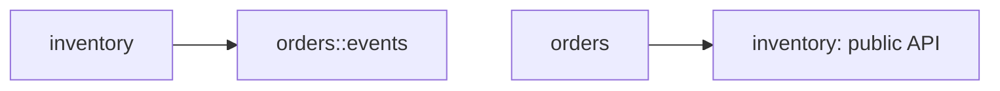
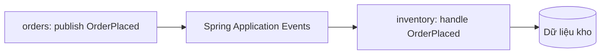
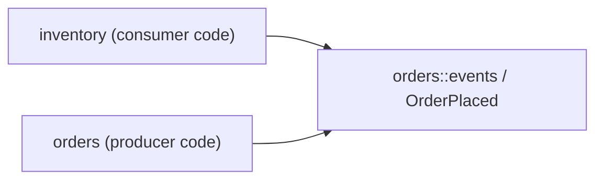
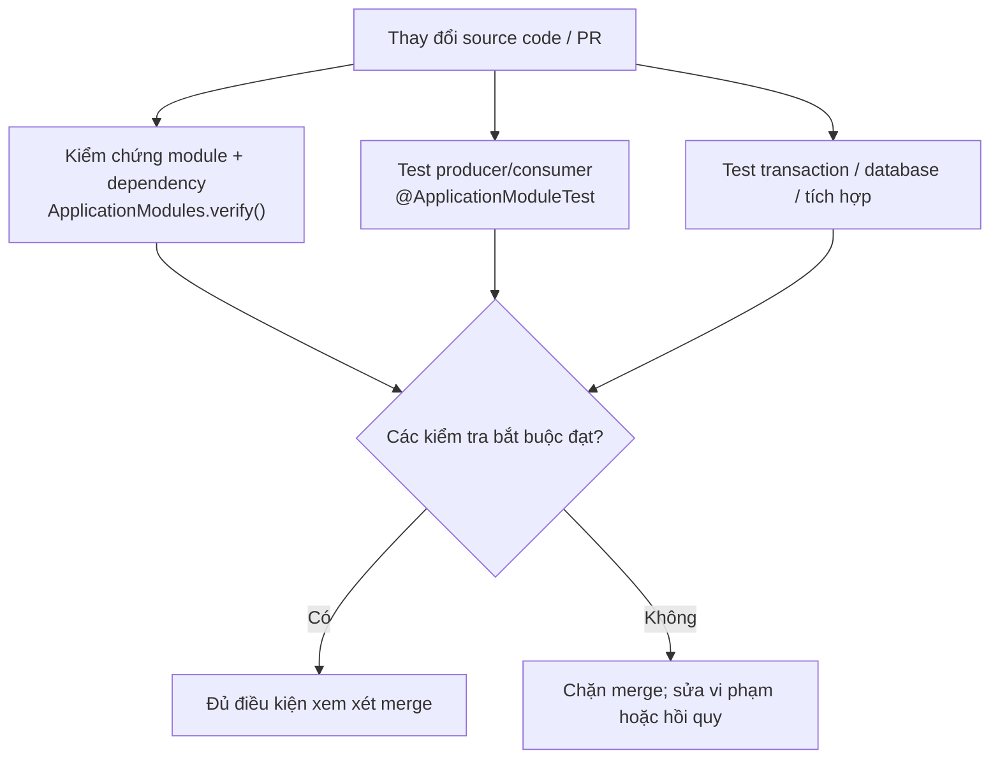

# Ranh giới module, dependency và event là những hợp đồng nào?

Trong một ứng dụng Spring Modulith, việc chia mã nguồn thành `orders`, `inventory` hay `payments` mới là bước khởi đầu. Để các phần nghiệp vụ có thể phát triển độc lập theo thời gian, nhóm cần trả lời rõ ba câu hỏi: **module công bố điều gì ra bên ngoài**, **module nào được phép phụ thuộc vào module nào**, và **khi phát một sự kiện nghiệp vụ thì các bên cam kết điều gì**.

Ba câu hỏi tương ứng với ba nhóm **hợp đồng kiến trúc và tích hợp**. Hợp đồng không nhất thiết là một file định nghĩa giao diện riêng: đó là tập quy tắc, API, dữ liệu và kỳ vọng hành vi mà các module cùng tuân thủ. Spring Modulith giúp mô hình hóa và kiểm chứng phần lớn hợp đồng cấu trúc; các bài kiểm thử module, sự kiện, database và tích hợp giúp kiểm tra hợp đồng khi chạy.

Bài học thuộc chương **Nhập môn** của **SPRING_MODULITH_VERIFICATION_TESTING**. Chủ đề hướng tới kỹ năng dùng `ApplicationModules` và quy tắc dependency để bảo vệ ranh giới kiến trúc, dùng `@ApplicationModuleTest` kiểm thử các hợp đồng hành vi, rồi đưa kiểm tra sự kiện, dữ liệu và tích hợp vào **quality gate trong CI** để hạn chế phụ thuộc sai và hồi quy.

## 1. Mục tiêu học tập

Sau bài này, bạn có thể:

1. Giải thích ranh giới module được tạo từ **quyền sở hữu nghiệp vụ**, **API công khai** và **chi tiết nội bộ** như thế nào.
2. Phân biệt một lời gọi hợp lệ về mặt Java với một **dependency hợp lệ về mặt kiến trúc**.
3. Sử dụng `@ApplicationModule`, `allowedDependencies` và `@NamedInterface` khi cần làm rõ quy tắc phụ thuộc trong Spring Modulith.
4. Giải thích tại sao **dòng sự kiện khi chạy** có thể đi từ `orders` sang `inventory`, trong khi **phụ thuộc mã nguồn** lại đi từ `inventory` tới hợp đồng sự kiện của `orders`.
5. Nêu được hợp đồng sự kiện gồm **schema/payload**, **ý nghĩa nghiệp vụ**, **thời điểm phát**, **cách xử lý lỗi** và **cam kết xử lý lặp**.
6. Chọn phép kiểm chứng thích hợp cho từng hợp đồng và đưa các kiểm tra đó vào CI.

## 2. Hợp đồng trong modular monolith là gì?

Giả sử ứng dụng bán hàng có ba module:

- `orders` sở hữu việc tạo và quản lý trạng thái đơn hàng;
- `inventory` sở hữu quy tắc tồn kho và đặt giữ hàng;
- `payments` sở hữu yêu cầu thanh toán và trạng thái giao dịch.

Mỗi module đều chạy trong một ứng dụng Spring Boot, có thể chia sẻ process và thậm chí cùng một database. Tuy vậy, nhóm muốn một thay đổi nội bộ của `inventory` không bắt `orders` phải sửa mã.

Ta có thể nhìn các hợp đồng qua ba lớp:

| Lớp hợp đồng | Câu hỏi phải trả lời | Ví dụ |
|---|---|---|
| **Ranh giới module** | Module sở hữu nghiệp vụ nào? Bên ngoài được dùng type/API nào? | `inventory` công bố `StockAvailability`, giữ `StockRepository` nội bộ |
| **Dependency** | Module nào được phép dùng hợp đồng của module khác, theo chiều nào? | `inventory` được phụ thuộc `orders::events` nhưng không được gọi `orders.internal` |
| **Event** | Điều gì đã xảy ra, được thông báo bằng dữ liệu nào, bên nhận phải xử lý ra sao? | `OrderPlaced(orderId, productId, quantity)` thể hiện một đơn đã được chấp nhận |

Hai lớp đầu chủ yếu mô tả **cấu trúc và hướng phụ thuộc**; lớp thứ ba mô tả **hợp đồng giao tiếp và hành vi**. Chúng liên quan chặt chẽ nhưng không thay thế được nhau.

> Ví dụ: dùng đúng API công khai của `inventory` có thể hợp lệ về ranh giới, nhưng nếu `orders` bị cấm phụ thuộc `inventory` thì lời gọi vẫn vi phạm hợp đồng dependency. Ngược lại, một sự kiện có type công khai và phụ thuộc hợp lệ vẫn có thể bị phát sai thời điểm hoặc mang dữ liệu sai.

## 3. Hợp đồng thứ nhất: ranh giới module và quyền sở hữu API

### 3.1. Package không tự tạo ranh giới đủ mạnh

Với cách nhận diện mặc định của Spring Modulith, các package con trực tiếp bên dưới package gốc của ứng dụng thường đại diện cho application module:

```text
com.example.shop
├── ShopApplication.java
├── orders
│   ├── OrderPlacement.java
│   ├── events
│   │   ├── package-info.java
│   │   └── OrderPlaced.java
│   └── internal
│       └── OrderRepository.java
├── inventory
│   ├── package-info.java
│   ├── StockAvailability.java
│   └── internal
│       ├── StockAvailabilityService.java
│       └── StockRepository.java
└── payments
    ├── PaymentFacade.java
    └── internal
        └── PaymentRepository.java
```

Khi dùng quy ước nhận diện mặc định, phần giao diện công khai của mỗi module bao gồm các type thích hợp ở **package gốc của module**. Các package con như `inventory.internal` được coi là nội bộ, trừ khi có cấu hình công bố giao diện cụ thể.

Đây là sự khác biệt quan trọng giữa hai cấp độ tiếp cận:

- **Java visibility:** type `public` có thể được mã trong package khác tham chiếu theo quy tắc Java.
- **Modulith API visibility:** cùng một type `public` vẫn có thể thuộc **phần nội bộ** của application module và không được module khác sử dụng.

Vì thế, đổi `StockRepository` thành `public` để `orders` import được **không làm dependency trở thành hợp lệ**. Code có thể biên dịch trong khi phép xác minh kiến trúc báo lỗi.

### 3.2. Hợp đồng API nên hẹp và ổn định

Ví dụ `inventory` muốn công bố khả năng truy vấn số lượng sẵn có nhưng không tiết lộ repository:

```java
package com.example.shop.inventory;

import java.util.UUID;

public interface StockAvailability {
    boolean hasAvailableQuantity(UUID productId, int quantity);
}
```

Một triển khai trong `inventory.internal` có thể dùng repository hoặc dịch vụ riêng của kho:

```java
package com.example.shop.inventory.internal;

import com.example.shop.inventory.StockAvailability;
import java.util.UUID;
import org.springframework.stereotype.Service;

@Service
class StockAvailabilityService implements StockAvailability {

    private final StockRepository repository;

    StockAvailabilityService(StockRepository repository) {
        this.repository = repository;
    }

    @Override
    public boolean hasAvailableQuantity(UUID productId, int quantity) {
        if (quantity <= 0) {
            return false;
        }
        return repository.availableFor(productId) >= quantity;
    }
}
```

Ở đây, `StockRepository` và phương thức `availableFor` là phần minh họa thuộc nội bộ kho; ví dụ giả định chúng đã được cài đặt trong module `inventory`. Bên ngoài chỉ nên biết `StockAvailability`.

Lợi ích của cách tổ chức này là module kho có thể thay repository, cache hoặc mô hình tồn kho mà vẫn giữ cùng hợp đồng công khai. Tuy nhiên, API hẹp chỉ mang lại lợi ích nếu **lời hứa về ý nghĩa** cũng rõ ràng: `hasAvailableQuantity(...)` là phép kiểm tra tại thời điểm đọc, không bảo đảm lượng hàng vẫn còn khi đơn được chốt. Nếu cần bảo đảm giữ hàng, nên định nghĩa một use case đặt giữ hàng có transaction và kết quả riêng.

### 3.3. Named interface: công bố có chủ đích một package con

Không phải mọi API đều phải nằm ngay trong package gốc. Ví dụ `orders` muốn công bố **sự kiện** từ `orders.events` nhưng không công bố các package con khác.

Trong `com/example/shop/orders/events/package-info.java`:

```java
@org.springframework.modulith.NamedInterface("events")
package com.example.shop.orders.events;
```

Đó là một **named interface** tên `events` của module `orders`. Các module khác có thể tham chiếu API thuộc giao diện được công bố này theo quy tắc đã cấu hình. Khai báo named interface **không biến toàn bộ module thành công khai** và cũng không tự động cho phép mọi module sử dụng nó nếu còn có hạn chế dependency.

Các hợp đồng quan trọng cần làm rõ khi công bố API:

| Điều phải quyết định | Câu hỏi kiểm tra |
|---|---|
| Quyền sở hữu | Module nào chịu trách nhiệm thay đổi API? |
| Phạm vi công khai | Chỉ type nào ở package gốc hoặc named interface được sử dụng? |
| Tính ổn định | Đổi tên/phương thức/kiểu dữ liệu sẽ tác động đến consumer nào? |
| Ý nghĩa nghiệp vụ | Kết quả và các điều kiện thất bại được hiểu ra sao? |
| Khả năng kiểm chứng | Có test mô tả được API và chặn tham chiếu nội bộ không? |

## 4. Hợp đồng thứ hai: dependency định nghĩa chiều phụ thuộc hợp lệ

Ranh giới trả lời **“bên ngoài được dùng gì?”**; hợp đồng dependency trả lời **“ai được phép dùng và theo chiều nào?”**.

### 4.1. Đọc đúng chiều mũi tên

Quy ước trong sơ đồ dưới đây: `A --> B` nghĩa là **mã của A tham chiếu type/API của B**.



Nếu `orders` gọi đồng bộ `StockAvailability` của `inventory`, sẽ có phụ thuộc `orders -> inventory`. Nếu `inventory` đồng thời dùng `OrderPlaced` của `orders`, sẽ có chiều `inventory -> orders`. Hai chiều kết hợp có thể tạo **phụ thuộc vòng giữa application module**, cần được phát hiện và xem xét.

Vì vậy, cần thiết kế cả hai mặt: **API nào được công bố** và **dependency theo chiều nào được cho phép**. Một API hợp lệ không bảo đảm quan hệ giữa hai module hợp lệ.

### 4.2. Chỉ cho phép những module thực sự cần thiết

Spring Modulith cho phép giới hạn dependency của module bằng annotation trên `package-info.java`.

Ví dụ `inventory` chỉ được tham chiếu giao diện sự kiện `orders::events`:

```java
@org.springframework.modulith.ApplicationModule(
    allowedDependencies = "orders::events"
)
package com.example.shop.inventory;
```

Khai báo này thể hiện rõ dụng ý thiết kế:

- `inventory` được tham chiếu các type thuộc named interface `events` do `orders` công bố.
- `inventory` không vì thế được gọi `orders.internal.OrderRepository`.
- `inventory` cũng không được tự ý gọi API của `payments` nếu dependency đó không nằm trong danh sách cho phép.

Một cấu hình chỉ dùng `allowedDependencies = "orders"` có ý nghĩa rộng hơn, cho phép phụ thuộc vào giao diện công khai của module `orders` theo luật module. Khi cần giới hạn chi tiết hơn, `orders::events` làm ý đồ rõ hơn.

**Lưu ý:** không nên hiểu một danh sách `allowedDependencies` rỗng theo trực giác là “cấm mọi dependency”. Hãy dùng đúng ngữ nghĩa cấu hình của phiên bản Spring Modulith mà dự án sử dụng. Điều cần duy trì là danh sách và phạm vi hợp đồng được khai báo có chủ đích, kiểm chứng bằng test.

### 4.3. Những gì có thể trở thành dependency

Dependency không chỉ xuất hiện khi code gọi một phương thức service. Một module có thể bị ràng buộc vào module khác qua:

- field, constructor parameter, return type hoặc method parameter;
- interface được kế thừa, annotation hoặc type được dùng trong generic;
- class của một sự kiện nghiệp vụ mà listener khai báo nhận;
- lời gọi tĩnh hoặc tham chiếu trực tiếp tới một type thuộc module khác.

Ví dụ:

```java
package com.example.shop.inventory.internal;

import com.example.shop.orders.events.OrderPlaced;

// Đây là dependency của inventory vào hợp đồng sự kiện orders::events.
class EventSignatureExample {
    void inspect(OrderPlaced event) {
        // Xử lý nghiệp vụ minh họa.
    }
}
```

Dù `inventory` không gọi `OrderPlacement`, việc khai báo `OrderPlaced` trong chữ ký vẫn thể hiện một **phụ thuộc mã nguồn** tới module `orders`.

Mặt khác, không nên giả định mọi phụ thuộc gián tiếp qua reflection, tên class trong chuỗi, SQL tự viết hoặc cấu hình hạ tầng đều được xác định đầy đủ bằng một phép quét type. Nhóm vẫn cần review và các test tương ứng cho những ranh giới khác ngoài tầm quan sát của công cụ.

## 5. Hợp đồng thứ ba: event là lời công bố nghiệp vụ

Một sự kiện thường diễn tả **điều đã xảy ra trong nghiệp vụ**, ví dụ `OrderPlaced`, `PaymentApproved` hoặc `StockReserved`. Event contract gồm **type**, **cấu trúc payload** và **ngữ nghĩa**; ngoài ra cần mô tả **khi nào producer phát**, **consumer chịu trách nhiệm gì** và **hệ thống xử lý lỗi/trùng lặp ra sao**.

### 5.1. Event không chỉ là một class Java

Xét event được công bố qua `orders::events`:

```java
package com.example.shop.orders.events;

import java.util.UUID;

public record OrderPlaced(
        UUID orderId,
        UUID productId,
        int quantity
) {}
```

Ba trường dữ liệu cần có ý nghĩa rõ:

| Thành phần | Cam kết cần giải thích |
|---|---|
| `orderId` | Định danh ổn định của đơn đã được tiếp nhận; có thể là khóa idempotency khi consumer xử lý |
| `productId` | Định danh sản phẩm theo hợp đồng dùng chung; không phải entity JPA của module `orders` |
| `quantity` | Số lượng yêu cầu hợp lệ, đơn vị đo đã được thống nhất |
| Tên `OrderPlaced` | Producer cam kết sự kiện đại diện cho một hành động đặt hàng đã thỏa điều kiện đã định nghĩa |
| Thời điểm phát | Event xuất hiện ở bước nào của giao dịch? Đã commit hay chưa? |
| Quy tắc nhận lại | Consumer làm gì nếu nhận cùng sự kiện nhiều lần? |

**Tên event phải khớp với sự thật nghiệp vụ.** Nếu lời gọi mới chỉ tiếp nhận yêu cầu và có thể bị từ chối sau đó, tên `OrderPlacementRequested` có thể chính xác hơn `OrderPlaced`. Nếu trạng thái đơn chưa được commit, đừng nói `OrderPlaced` chắc chắn biểu thị một đơn đã được lưu bền vững mà không có bảo đảm transaction tương ứng.

### 5.2. Chọn dữ liệu đủ dùng, tránh rò rỉ nội bộ

Một event nên chuyển thông tin mà consumer cần để hiểu sự kiện, thay vì mang toàn bộ aggregate hoặc entity JPA của producer. Truyền nguyên `OrderEntity` có thể làm consumer phụ thuộc cấu trúc bảng, lazy-loading và chi tiết domain nội bộ; sau này rất khó thay đổi.

Ưu tiên các định danh và giá trị nhỏ, bất biến, có ý nghĩa lâu dài. Ví dụ `OrderPlaced` chỉ cần `orderId`, `productId` và `quantity` nếu consumer kho dự trữ hàng theo ba dữ liệu đó. Nếu một đơn có nhiều dòng hàng, hợp đồng phải mô tả được danh sách dòng và hành vi xử lý một phần; mẫu record ba trường phía trên chỉ phù hợp với tình huống **đơn có một sản phẩm**.

Trong hệ thống có yêu cầu truy vết và khả năng phát triển phiên bản, có thể cân nhắc thêm `eventId`, `occurredAt`, `schemaVersion` hoặc `correlationId`. Các trường này chỉ nên được thêm khi có quy ước rõ về cách tạo, sử dụng và đảm bảo tính nhất quán. Không có một tập trường mặc định duy nhất cho mọi event.

### 5.3. Phân biệt cấu trúc phụ thuộc và chiều sự kiện khi chạy

Giả sử module `orders` phát `OrderPlaced`; module `inventory` đăng ký lắng nghe. Khi chạy, sự kiện đi từ producer đến consumer:



Nhưng ở **mã nguồn**, chỉ `inventory` cần biết type `OrderPlaced` do `orders.events` công bố. `orders` không cần biết có bao nhiêu listener và chúng nằm ở module nào:



Hai sơ đồ mô tả **hai quan hệ khác nhau**:

- **Luồng dữ liệu lúc chạy:** producer `orders` phát, consumer `inventory` nhận.
- **Phụ thuộc về type:** cả producer và consumer tham chiếu hợp đồng `OrderPlaced` thuộc `orders`; giữa các module, có dependency từ `inventory` tới `orders::events`.

Đây là lý do giao tiếp bằng event thường giúp producer không phải gọi trực tiếp consumer. Tuy vậy, **consumer vẫn có dependency vào schema và ý nghĩa của event**. Event không làm biến mất coupling; nó chuyển coupling sang một hợp đồng cần được bảo trì.

## 6. Ví dụ ghép ba hợp đồng trong một ứng dụng

### 6.1. Producer công bố sự kiện qua named interface

Cấu trúc API:

```text
orders/
  OrderPlacement.java             (use case)
  events/
    package-info.java             (@NamedInterface("events"))
    OrderPlaced.java              (hợp đồng sự kiện)
  internal/
    ...                           (dữ liệu và triển khai của orders)
```

`OrderPlacement` minh họa việc kiểm tra đầu vào và phát sự kiện:

```java
package com.example.shop.orders;

import com.example.shop.orders.events.OrderPlaced;
import java.util.UUID;
import org.springframework.context.ApplicationEventPublisher;
import org.springframework.stereotype.Service;

@Service
public class OrderPlacement {

    private final ApplicationEventPublisher events;

    public OrderPlacement(ApplicationEventPublisher events) {
        this.events = events;
    }

    public UUID place(UUID productId, int quantity) {
        if (productId == null || quantity <= 0) {
            throw new IllegalArgumentException("Invalid order item");
        }

        UUID orderId = UUID.randomUUID();
        events.publishEvent(new OrderPlaced(orderId, productId, quantity));

        return orderId;
    }
}
```

Ví dụ trên **cố ý chỉ minh họa hợp đồng event**: nó chưa lưu đơn vào database và chưa có transaction bao quanh. Vì vậy ở đây `OrderPlaced` nên được hiểu là “yêu cầu trong ví dụ được chấp nhận và sự kiện đã được phát”, chưa phải bằng chứng rằng đơn đã commit. Trong ứng dụng thực tế, producer cần xác định rõ trạng thái đơn, thời điểm phát và ranh giới transaction theo nghiệp vụ.

### 6.2. Consumer chỉ nhận giao diện sự kiện được phép

`inventory/package-info.java`:

```java
@org.springframework.modulith.ApplicationModule(
    allowedDependencies = "orders::events"
)
package com.example.shop.inventory;
```

Listener đồng bộ tối giản:

```java
package com.example.shop.inventory.internal;

import com.example.shop.orders.events.OrderPlaced;
import org.springframework.context.event.EventListener;
import org.springframework.stereotype.Component;

@Component
class ReserveStockOnOrderPlaced {

    private final StockReservationService reservations;

    ReserveStockOnOrderPlaced(StockReservationService reservations) {
        this.reservations = reservations;
    }

    @EventListener
    void on(OrderPlaced event) {
        reservations.reserve(
            event.orderId(),
            event.productId(),
            event.quantity()
        );
    }
}
```

`StockReservationService` trong đoạn trên là dịch vụ nội bộ giả định của `inventory`, có nhiệm vụ thực thi quy tắc giữ hàng. Cần cài đặt và kiểm thử nó trong ứng dụng thực tế.

Với `@EventListener` thông thường, listener xử lý đồng bộ theo cơ chế Spring Events mặc định; lỗi của listener có thể ảnh hưởng lời gọi producer. Mẫu đó hữu ích để hiểu luồng cơ bản nhưng chưa thể hiện nhu cầu xử lý sau commit, bất đồng bộ hoặc retry của nhiều hệ thống.

### 6.3. Nếu cần xử lý sau commit và tách transaction

Spring Modulith hỗ trợ `@ApplicationModuleListener` để thuận tiện khai báo listener theo mô hình xử lý sự kiện module có transaction và bất đồng bộ. Ví dụ thay `@EventListener` bằng:

```java
@org.springframework.modulith.events.ApplicationModuleListener
void on(OrderPlaced event) {
    reservations.reserve(
        event.orderId(),
        event.productId(),
        event.quantity()
    );
}
```

Đoạn thay thế này **chỉ minh họa hình thức annotation**. Khi dùng listener phụ thuộc transaction sau commit, producer phải phát sự kiện trong transaction phù hợp và ứng dụng phải có transaction manager. Mẫu `OrderPlacement.place(...)` ở trên không tạo transaction như vậy; do đó không thể tự ý thay annotation rồi kỳ vọng ví dụ sẽ chạy giống nhau.

Nếu publisher ghi đơn vào database, mô hình sản xuất thường cần làm rõ:

1. Đơn được lưu trong transaction của `orders`.
2. Event được publish trong transaction đó theo ngữ nghĩa đã chọn.
3. Consumer chỉ xử lý ở thời điểm được thiết kế, chẳng hạn sau commit.
4. Nếu consumer lỗi, hệ thống có chính sách ghi nhận publication chưa xử lý, retry, idempotency hoặc bù trừ phù hợp.

Spring Modulith có cơ chế quản lý publication sự kiện để hỗ trợ theo dõi và xử lý lại trong những cấu hình phù hợp; tuy nhiên **độ tin cậy cuối cùng** còn phụ thuộc vào event publication registry, kho lưu, cấu hình transaction, xử lý retry và consumer. Một annotation không tự tạo bảo đảm “exactly once”.

## 7. Các hợp đồng thay đổi theo thời gian như thế nào?

Hợp đồng dùng chung là một cam kết với các consumer. Thay đổi nội bộ module có thể tương đối tự do; thay đổi API công khai, dependency policy hoặc event schema cần cân nhắc khả năng tương thích.

| Thay đổi | Ai chịu ảnh hưởng? | Việc nên kiểm tra |
|---|---|---|
| Đổi cách cài đặt `StockRepository` nội bộ | Chủ yếu `inventory` | Test module và database; bên ngoài không nên phụ thuộc repository |
| Đổi tên hoặc xóa `StockAvailability` | Module dùng API của kho | Tìm consumer hợp lệ, cập nhật đồng bộ, chạy test và verify |
| Mở thêm dependency từ `inventory` sang `payments` | Kiến trúc và chiều phụ thuộc | Đánh giá trách nhiệm nghiệp vụ, `allowedDependencies` và nguy cơ vòng |
| Đổi `OrderPlaced.quantity` thành kiểu/ý nghĩa khác | Mọi consumer của `orders::events` | Contract test, migration, tương thích event cũ nếu có lưu/truyền lại |
| Đổi thời điểm publish trước commit thành sau commit | Consumer và tính nhất quán giao dịch | Test transaction, thứ tự xử lý, thất bại và retry |
| Chuyển listener đồng bộ sang bất đồng bộ | Use case, xử lý lỗi và mô hình quan sát kết quả | Test độ trễ, eventual consistency, concurrency và idempotency |

Một thay đổi như **thêm trường mới vào event** có thể hoặc không tương thích tùy công nghệ serialize, constructor/record, consumer và cách versioning. Đừng mặc định “thêm trường” luôn an toàn. Với event Java truyền trực tiếp trong cùng JVM, thay đổi chữ ký constructor có thể làm mã consumer không biên dịch; với event lưu bền vững hoặc gửi qua broker, còn phải xét schema và dữ liệu cũ.

**Nguyên tắc thực hành:** versioning phải bám vào nơi event thực sự được tiêu thụ. Event nội bộ JVM, event lưu vào registry và event gửi qua Kafka có yêu cầu tương thích khác nhau; không nên sao chép một quy tắc versioning cho tất cả.

## 8. Bốn kiểu vi phạm hợp đồng thường gặp

### Tình huống A — Dùng type nội bộ dù code biên dịch

`orders` import `inventory.internal.StockRepository`. Điều này xuyên qua ranh giới nội bộ của module `inventory`, kể cả khi repository là `public` trong Java.

**Cách sửa:** thêm một use case/API công khai có ngữ nghĩa phù hợp, hoặc thiết kế luồng event nếu giao tiếp bất đồng bộ đáp ứng yêu cầu; không mở cả repository ra bên ngoài chỉ để qua lỗi.

### Tình huống B — Dùng đúng API nhưng sai chiều dependency

`orders` gọi `StockAvailability` công khai của `inventory`; đồng thời `inventory` nhận `OrderPlaced` nên phụ thuộc `orders::events`. Việc dùng API công khai riêng lẻ có thể đúng, nhưng tổng thể tạo vòng `orders <-> inventory`.

**Cách sửa:** đánh giá lại luồng nghiệp vụ. Nếu `orders` cần xác nhận tồn kho đồng bộ, có thể tổ chức orchestration ở một module thích hợp hoặc định nghĩa các hợp đồng theo hướng không tạo vòng. Nếu chấp nhận xử lý không đồng bộ, `orders` có thể phát sự kiện và không gọi ngược `inventory`. Quyết định dựa trên nhất quán dữ liệu, trải nghiệm người dùng và trách nhiệm module.

### Tình huống C — Hợp đồng event không đúng ý nghĩa

Producer phát `OrderPlaced` trước khi biết lệnh ghi database thành công, trong khi consumer hiểu đó là đơn đã commit. Tên và schema hợp lệ về cấu trúc, nhưng **ngữ nghĩa của sự kiện** bị vi phạm.

**Cách sửa:** thống nhất sự kiện phản ánh trạng thái gì và được phát khi nào; thiết kế transaction hoặc dùng sự kiện mang ý nghĩa khác như `OrderPlacementRequested` nếu đó mới là trạng thái thực.

### Tình huống D — Event hợp lệ nhưng xử lý không idempotent

`inventory` nhận lại cùng một `OrderPlaced` hai lần và giảm tồn kho hai lần. Không có phụ thuộc kiến trúc sai; payload event cũng đúng, nhưng consumer vi phạm yêu cầu xử lý lặp.

**Cách sửa:** định nghĩa khóa idempotency (ví dụ `orderId` nếu một đơn tương ứng duy nhất với một lần đặt giữ hàng), ràng buộc lưu dữ liệu và kiểm thử case nhận lặp/concurrency. Cơ chế cụ thể phải khớp với nghiệp vụ nhiều dòng hàng, hủy đơn, retry và các thao tác đặt giữ kho.

## 9. Kiểm chứng từng hợp đồng bằng Spring Modulith

### 9.1. Kiểm chứng module và dependency

Một bài JUnit test tập trung vào cấu trúc:

```java
package com.example.shop;

import org.junit.jupiter.api.Test;
import org.springframework.modulith.core.ApplicationModules;

class ArchitectureVerificationTests {

    @Test
    void respectsModuleBoundaries() {
        ApplicationModules.of(ShopApplication.class).verify();
    }
}
```

Bài test dùng mô hình application module của Spring Modulith để phát hiện những vi phạm như dependency vòng, tham chiếu phần nội bộ hoặc dependency không nằm trong quy tắc cho phép.

**Phạm vi kết luận:** `verify()` kiểm tra luật kiến trúc trong mô hình code/module. Nó không tự chứng minh publisher phát sự kiện chính xác, consumer đã xử lý thành công, database đã commit hoặc payload có ý nghĩa nghiệp vụ đúng. Những hợp đồng đó cần test hành vi.

### 9.2. Kiểm thử hợp đồng producer bằng @ApplicationModuleTest

Một test cho module `orders` có thể kiểm tra rằng `OrderPlacement` phát sự kiện đúng điều kiện:

```java
package com.example.shop.orders;

import static org.assertj.core.api.Assertions.assertThat;
import static org.assertj.core.api.Assertions.assertThatThrownBy;

import com.example.shop.orders.events.OrderPlaced;
import java.util.UUID;
import org.junit.jupiter.api.Test;
import org.springframework.beans.factory.annotation.Autowired;
import org.springframework.modulith.test.ApplicationModuleTest;
import org.springframework.modulith.test.PublishedEvents;

@ApplicationModuleTest
class OrderEventContractTests {

    @Autowired OrderPlacement placement;

    @Test
    void publishesOrderPlacedWithExpectedPayload(PublishedEvents events) {
        UUID productId = UUID.randomUUID();

        UUID orderId = placement.place(productId, 2);

        assertThat(events.ofType(OrderPlaced.class))
            .singleElement()
            .satisfies(event -> {
                assertThat(event.orderId()).isEqualTo(orderId);
                assertThat(event.productId()).isEqualTo(productId);
                assertThat(event.quantity()).isEqualTo(2);
            });
    }

    @Test
    void rejectsInvalidQuantity() {
        assertThatThrownBy(
            () -> placement.place(UUID.randomUUID(), 0)
        ).isInstanceOf(IllegalArgumentException.class);
    }
}
```

Đây là một test cho **producer** trong ví dụ chưa có persistence, sử dụng `PublishedEvents` để xác minh event được phát. Nó **không** bảo đảm event được consumer xử lý hoặc đơn được lưu trong database.

### 9.3. Kiểm thử hợp đồng consumer và transaction

Với `inventory`, test cần xác nhận **sự thay đổi nghiệp vụ** sau khi nhận event, thay vì chỉ xác nhận listener có method `on(OrderPlaced)`. Ví dụ cần kiểm tra:

- Event có `quantity = 2` khiến đúng hai đơn vị được giữ (nếu kho đủ).
- Nhận lại event cùng `orderId` không tạo lần giữ trùng.
- Không đủ tồn kho tạo kết quả từ chối/đợi xử lý theo hợp đồng đã thống nhất.
- Listener lỗi và được chạy lại không để dữ liệu ở trạng thái mâu thuẫn.

Nếu listener bất đồng bộ, có thể dùng `Scenario` của Spring Modulith Test để chờ **sự kiện kết quả hoặc trạng thái có thể quan sát**, tránh dùng `Thread.sleep(...)`. Nếu có JPA/SQL, hãy dùng database test có cấu hình phù hợp và cân nhắc Testcontainers để kiểm tra transaction, constraint và isolation thực tế.

Một publisher test xanh **không thay thế** được consumer test; một consumer test chạy với mock repository **không chứng minh** được hành vi transaction của database thật.

### 9.4. Ma trận hợp đồng và bằng chứng

| Hợp đồng cần bảo vệ | Phép kiểm tra nên có | Một lỗi tiêu biểu |
|---|---|---|
| Bên ngoài không dùng package nội bộ | `ApplicationModules.verify()` | Import `inventory.internal.*` |
| Dependency đúng hướng, không tạo vòng | `verify()` và khai báo `allowedDependencies` | `orders -> inventory -> orders` |
| Named interface chỉ công bố phần được phép | `verify()` cùng review API | Consumer truy cập ngoài `orders::events` |
| Producer phát event đúng payload | `@ApplicationModuleTest`, `PublishedEvents` | `OrderPlaced` sai `quantity` |
| Consumer xử lý event đúng | Module/integration test | Trừ tồn kho sai hoặc lặp |
| Transaction và dữ liệu đúng | Integration test với database phù hợp | Publish/commit sai thứ tự, ghi dở dang |
| Luồng xuyên module đúng | Integration/API test | Đặt hàng báo thành công dù kho không giữ được |
| Không tái phát sinh vi phạm | Test bắt buộc trong CI | Pull request thêm phụ thuộc sai vẫn được merge |

## 10. Đưa hợp đồng vào quality gate trong CI

Một hợp đồng chỉ được ghi bằng lời rất dễ bị quên khi dự án phát triển. Để duy trì lâu dài, hãy đặt kiểm chứng kiến trúc và kiểm thử hành vi vào quy trình tự động trước khi tích hợp mã.



Khi dự án có wrapper tương ứng, các lệnh sau có thể chạy các test được cấu hình trong pha test:

```bash
# Maven
./mvnw test

# Gradle
./gradlew test
```

Một số dự án tách integration test vào pha hoặc task riêng; trong trường hợp đó CI cần chạy thêm đúng pha/task đã cấu hình. Runner phải có cấu hình database, Docker/Testcontainers, biến môi trường và migration phù hợp với bài test. Không nên báo gate đạt khi nhóm test trọng yếu bị skip.

Khi CI thất bại, hướng xử lý phụ thuộc vào hợp đồng bị phá:

- **Architecture test đỏ:** xem lại API công khai, named interface, `allowedDependencies` và chiều phụ thuộc. Không làm test xanh bằng cách phơi bày toàn bộ package nội bộ.
- **Event contract test đỏ:** xem lại schema, dữ liệu, thời điểm publish và ý nghĩa sự kiện.
- **Database/consumer test đỏ:** xem lại transaction, tính idempotent, constraint, retry và trạng thái sau lỗi.

Để bảo vệ hợp đồng tốt hơn, một pull request đổi public API hoặc event schema nên được review từ góc nhìn consumer chịu tác động, kể cả khi mọi test hiện có vẫn xanh.

## 11. Bài thực hành: xác định và bảo vệ ba hợp đồng

**Đề bài:** xây ứng dụng Spring Boot tối giản có hai module `orders` và `inventory`, trong đó `orders` phát `OrderPlaced`, `inventory` nhận sự kiện và ghi nhận một lần giữ hàng.

**Bước 1 — Xác định ranh giới.** Liệt kê quyền sở hữu của từng module. Đặt `OrderPlaced` vào `orders.events` và công bố `@NamedInterface("events")`. Giữ repository và entity nội bộ dưới `internal`.

**Bước 2 — Khai báo dependency.** Trong `inventory/package-info.java`, giới hạn dependency theo `orders::events`. Vẽ mũi tên từ consumer `inventory` tới type event của `orders`; phân biệt nó với chiều truyền event khi chạy.

**Bước 3 — Cố ý vi phạm ranh giới.** Thêm tham chiếu type thật sự từ `inventory` tới `orders.internal.OrderRepository` (có thể cần cho type này khả năng truy cập ở mức Java để biên dịch). Dự đoán kết quả `verify()`, chạy test và sửa bằng cách xóa phụ thuộc sai. Đừng chỉ thêm một dòng import không dùng vì trình biên dịch có thể không giữ nó làm dependency.

**Bước 4 — Cố ý vi phạm dependency.** Cho `inventory` tham chiếu API của `payments` nếu có module đó, trong khi `allowedDependencies` vẫn chỉ cho phép `orders::events`. Kiểm tra thông báo lỗi và giải thích tại sao “API công khai” chưa đủ để cho phép phụ thuộc.

**Bước 5 — Kiểm thử producer.** Viết `@ApplicationModuleTest` cho `orders` dùng `PublishedEvents`, kiểm tra event mang `orderId`, `productId` và `quantity` đúng; xác nhận đầu vào không hợp lệ bị từ chối.

**Bước 6 — Kiểm thử consumer.** Viết test cho `inventory` để kiểm tra một lần xử lý tạo một lần giữ hàng. Phát cùng một event lần thứ hai và xác định kết quả đúng theo chính sách idempotency. Nếu có database, hãy kiểm tra trạng thái dữ liệu cuối cùng.

**Bước 7 — Kiểm tra transaction và CI.** Với listener sau commit, tạo transaction thực cho producer và quan sát kết quả consumer sau commit. Cho một bài architecture test hoặc event test thất bại có chủ đích, xác nhận CI báo đỏ; sửa lại và xác nhận CI đạt.

**Sản phẩm cần nộp:** sơ đồ module và dependency, một event contract rõ nghĩa, ít nhất một architecture test, một producer test, một consumer test và bằng chứng gate có thể phát hiện vi phạm.

## 12. Câu hỏi ôn tập

**1. Module boundary và dependency có phải cùng một hợp đồng?**

Không. Boundary xác định API nào là công khai hay nội bộ; dependency xác định module nào được phép sử dụng API đó và theo chiều nào. Một API có thể công khai nhưng module hiện tại không được phép phụ thuộc vào nó.

**2. Vì sao `public class StockRepository` vẫn có thể bị Spring Modulith coi là nội bộ?**

Vì Java visibility và ranh giới application module không đồng nhất. Type nằm ở package con nội bộ không tự trở thành API công khai của module chỉ nhờ modifier `public`.

**3. Nếu `orders` phát `OrderPlaced` và `inventory` lắng nghe, dependency giữa các module theo hướng nào?**

Khi `OrderPlaced` thuộc `orders::events`, mã của `inventory` tham chiếu hợp đồng trong `orders`, nên phụ thuộc về type là `inventory -> orders::events`. Luồng thông báo khi chạy lại đi từ `orders` đến `inventory`.

**4. `@NamedInterface` và `allowedDependencies` giải quyết việc gì khác nhau?**

Named interface công bố có chủ đích một phần API của module; `allowedDependencies` giới hạn module hiện tại có thể dùng module hoặc named interface nào. Cả hai cùng góp phần xây hợp đồng dependency rõ ràng.

**5. Một event có type đúng và được publish một lần thì có bảo đảm xử lý thành công không?**

Không. Còn phải xét thời điểm transaction, cấu hình listener, lỗi consumer, retry, khả năng xử lý lặp và trạng thái database. Test publisher và test consumer là hai bằng chứng khác nhau.

**6. Vì sao cần giữ hợp đồng event nhỏ và bất biến?**

Để giảm phụ thuộc vào chi tiết nội bộ của producer, dễ phát hiện thay đổi không tương thích và giúp consumer hiểu dữ liệu một cách ổn định. Chỉ dùng ID và dữ liệu cần thiết cũng giảm rủi ro truyền nhầm thông tin không cần thiết.

**7. Có thể bỏ kiến trúc test nếu tất cả module/integration test đang xanh không?**

Không nên. Test hành vi chỉ kiểm tra kết quả những trường hợp đã viết; chúng không tự thay thế được phép kiểm chứng ranh giới và chiều phụ thuộc bằng `ApplicationModules.verify()`.

## Kết luận

Trong Spring Modulith, **ranh giới module** là hợp đồng về quyền sở hữu và API được công bố; **dependency** là hợp đồng về module nào được phép tham chiếu hợp đồng của module khác; **event** là hợp đồng về sự kiện nghiệp vụ, dữ liệu, thời điểm và kỳ vọng xử lý giữa producer với consumer. Ba hợp đồng này phải được thiết kế cùng nhau: dùng `@NamedInterface` và `allowedDependencies` để diễn đạt ranh giới có chủ đích, dùng `ApplicationModules.verify()` để kiểm chứng cấu trúc, và dùng `@ApplicationModuleTest` cùng kiểm thử sự kiện, database và tích hợp để xác minh hành vi. Đưa các phép kiểm tra vào **CI quality gate** giúp phát hiện cả phụ thuộc sai lẫn hồi quy khi ứng dụng phát triển.
