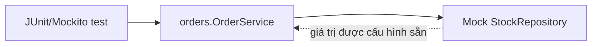
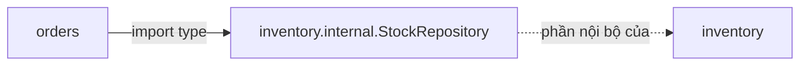
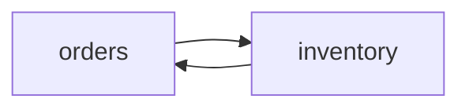
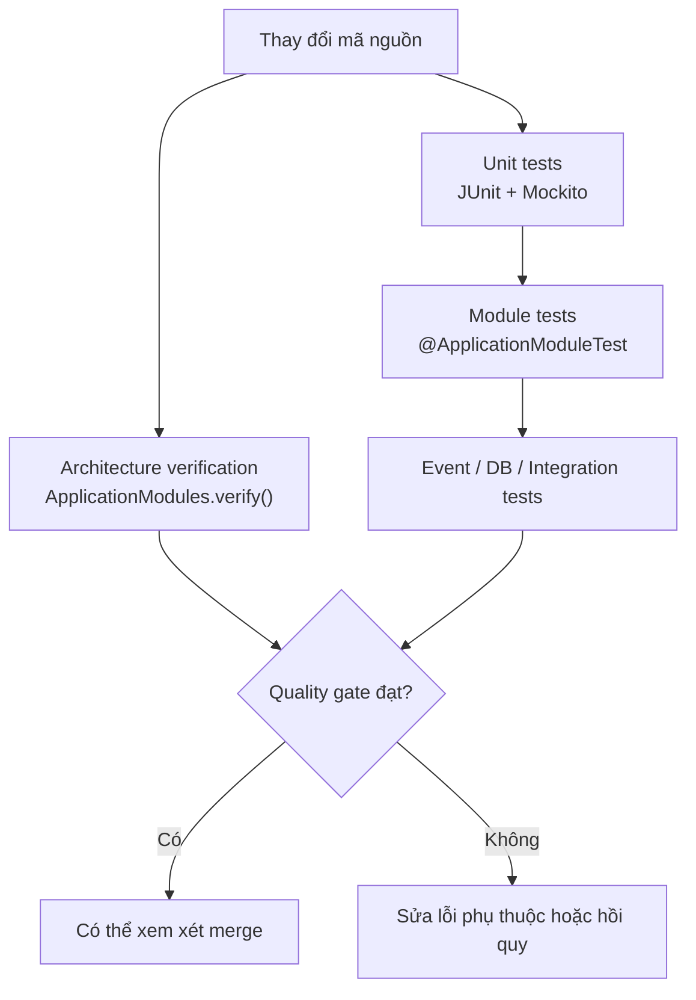

# Vì sao kiểm thử đơn vị không đủ để phát hiện vi phạm module?

Một **unit test** có thể chạy xanh, cho đúng kết quả và kiểm tra đủ các nhánh của một phương thức, trong khi kiến trúc ứng dụng đã bị xâm phạm: module đặt hàng gọi trực tiếp repository nội bộ của module kho; module thanh toán phụ thuộc ngược vào module đơn hàng; hoặc một module bắt đầu dùng API không nằm trong danh sách dependency được phép. Các lỗi này thường không làm thay đổi đầu ra của phương thức tại thời điểm viết test, nên unit test không có lý do để báo đỏ.

Với **SPRING_MODULITH_VERIFICATION_TESTING**, mục tiêu không dừng ở việc chạy đúng một hàm. Chúng ta còn phải kiểm chứng **ranh giới kiến trúc** bằng `ApplicationModules` và quy tắc dependency, kiểm tra hành vi module bằng `@ApplicationModuleTest`, kiểm thử sự kiện, dữ liệu và các luồng tích hợp, rồi đưa mọi phép kiểm tra cần thiết vào **quality gate trong CI** để ngăn phụ thuộc sai và hồi quy.

Bài thuộc chương **Nhập môn** và trả lời một câu hỏi trọng tâm: **vì sao bộ unit test tốt vẫn cần được bổ sung bằng kiểm chứng kiến trúc Spring Modulith?**

## 1. Mục tiêu học tập

Sau bài này, bạn có thể:

1. Giải thích được **unit test quan sát điều gì** và vì sao một bài test hành vi có thể bỏ sót vi phạm ranh giới giữa module.
2. Tạo tình huống một unit test dùng Mockito chạy xanh, nhưng dependency của code production lại trỏ tới **package nội bộ** của module khác.
3. Nhận diện thêm hai nhóm vi phạm mà unit test thường không bảo vệ: **phụ thuộc vòng** và **phụ thuộc ngoài danh sách được phép**.
4. Viết phép kiểm chứng cấu trúc bằng `ApplicationModules.of(...).verify()` và biết những gì phép kiểm chứng này không thể khẳng định.
5. Phân biệt vai trò của unit test, `@ApplicationModuleTest`, kiểm thử sự kiện, database và test tích hợp xuyên module.
6. Thiết kế một quality gate trong CI chạy **cả kiểm chứng kiến trúc lẫn kiểm thử hành vi**.

## 2. Unit test thường kiểm tra hành vi của một đơn vị mã

Trong JUnit, unit test thường gọi một class hoặc một phương thức với các đầu vào đã kiểm soát, rồi kiểm tra kết quả, ngoại lệ hoặc tương tác với collaborator.

Ví dụ, module `orders` có dịch vụ trả lời câu hỏi “có đủ hàng để tiếp nhận đơn không?”. Nếu muốn test nhanh, nhóm có thể mock truy vấn tồn kho và tập trung kiểm tra quy tắc `quantity <= 0` hoặc kết quả so sánh số lượng.

Một unit test như vậy có giá trị: nó chạy nhanh, xác định lỗi logic rõ ràng và ít phụ thuộc hạ tầng. Nhưng các assert của nó thường có dạng:

- Với kho còn 7 sản phẩm và nhu cầu 2 sản phẩm, kết quả phải là `true`.
- Với kho còn 1 sản phẩm và nhu cầu 2 sản phẩm, kết quả phải là `false`.
- Số lượng yêu cầu bằng 0 phải bị từ chối.
- Repository hoặc collaborator được gọi với đúng tham số.

Không assert nào ở trên trả lời câu hỏi: **“Class này có được phép tham chiếu type thuộc module kho không?”**. Một lời gọi cho kết quả đúng chưa chắc đã là lời gọi **hợp lệ về kiến trúc**.

Một điểm cần phân biệt: hoàn toàn *có thể* viết một bài JUnit test để kiểm tra dependency hoặc package. Nhưng khi đó ta đang viết **architecture test**, dù nó cũng chạy trên JUnit. Sự giới hạn nằm ở **đối tượng và điều kiện được kiểm chứng**, không phải ở tên framework hoặc việc dùng annotation `@Test`.

## 3. Ví dụ: unit test xanh nhưng ranh giới Spring Modulith đã sai

### 3.1. Cấu trúc module mong muốn

Giả sử ứng dụng Spring Boot có cấu trúc:

```text
com.acme.shop
├── ShopApplication.java
├── orders
│   ├── OrderService.java
│   └── internal
│       └── OrderRepository.java
├── inventory
│   ├── InventoryQueries.java
│   └── internal
│       └── StockRepository.java
└── billing
    ├── BillingFacade.java
    └── internal
        └── InvoiceRepository.java
```

Trong cấu hình nhận diện module mặc định, `orders`, `inventory` và `billing` là các application module nằm trực tiếp dưới package gốc. Loại API đặt trong package gốc như `inventory.InventoryQueries` là giao diện mà bên ngoài có thể sử dụng theo quy ước. Các type trong `inventory.internal` được xem là **chi tiết nội bộ**, trừ khi có cấu hình công bố giao diện một cách tường minh.

Quy tắc thiết kế là: **`orders` không được phụ thuộc trực tiếp vào repository nội bộ của `inventory`**. Module kho sở hữu logic truy vấn, lưu trữ và thay đổi thiết kế dữ liệu của nó.

### 3.2. Code production có dependency sai

Giả sử repository nội bộ có interface như sau:

```java
package com.acme.shop.inventory.internal;

import java.util.UUID;

// public theo Java để các package khác có thể biên dịch,
// nhưng vẫn là type nội bộ theo quy tắc application module.
public interface StockRepository {
    int availableFor(UUID productId);
}
```

Một lập trình viên đưa nó thẳng vào `OrderService`:

```java
package com.acme.shop.orders;

import com.acme.shop.inventory.internal.StockRepository;
import java.util.UUID;
import org.springframework.stereotype.Service;

@Service
public class OrderService {

    private final StockRepository stocks;

    public OrderService(StockRepository stocks) {
        this.stocks = stocks;
    }

    public boolean canAccept(UUID productId, int quantity) {
        if (quantity <= 0) {
            return false;
        }

        return stocks.availableFor(productId) >= quantity;
    }
}
```

Đoạn này có thể biên dịch vì `StockRepository` là `public`. Khi chạy thực tế, một Spring bean triển khai repository phù hợp cũng có thể được inject vào dịch vụ. Tuy nhiên, **import `inventory.internal.StockRepository` đã tạo dependency từ `orders` tới phần nội bộ của `inventory`**.

Hậu quả chưa chắc thấy ngay ở màn hình người dùng. Vấn đề sẽ bộc lộ khi nhóm kho muốn đổi repository, điều chỉnh cách caching hoặc thay mô hình dữ liệu: một chi tiết vốn chỉ thuộc trách nhiệm `inventory` giờ đang có consumer bên ngoài.

### 3.3. Unit test dùng Mockito vẫn có thể xanh

Một test tập trung vào logic của `OrderService`:

```java
package com.acme.shop.orders;

import static org.assertj.core.api.Assertions.assertThat;
import static org.mockito.Mockito.when;

import com.acme.shop.inventory.internal.StockRepository;
import java.util.UUID;
import org.junit.jupiter.api.Test;
import org.junit.jupiter.api.extension.ExtendWith;
import org.mockito.Mock;
import org.mockito.junit.jupiter.MockitoExtension;

@ExtendWith(MockitoExtension.class)
class OrderServiceTest {

    @Mock StockRepository stocks;

    @Test
    void acceptsOrderWhenStockIsEnough() {
        UUID productId = UUID.randomUUID();
        when(stocks.availableFor(productId)).thenReturn(7);

        OrderService service = new OrderService(stocks);

        assertThat(service.canAccept(productId, 2)).isTrue();
    }

    @Test
    void rejectsOrderWhenStockIsInsufficient() {
        UUID productId = UUID.randomUUID();
        when(stocks.availableFor(productId)).thenReturn(1);

        OrderService service = new OrderService(stocks);

        assertThat(service.canAccept(productId, 2)).isFalse();
    }

    @Test
    void rejectsNonPositiveQuantity() {
        OrderService service = new OrderService(stocks);

        assertThat(service.canAccept(UUID.randomUUID(), 0)).isFalse();
    }
}
```

Cả ba test đều có thể xanh vì:

1. Mock trả về số lượng tồn kho đúng theo kịch bản.
2. Logic so sánh trong `canAccept(...)` cho ra kết quả mong đợi.
3. Không khởi tạo toàn bộ Spring application context.
4. **Không có điều kiện nào kiểm tra giới hạn dependency của application module**.

Thậm chí test còn import chính type nội bộ của `inventory` để tạo mock. Điều đó không khiến test tự động phát hiện sự vi phạm. Nó chỉ cho thấy compiler có thể nhìn thấy type, còn Mockito có thể giả lập các phương thức của type đó.

**Đây là phản ví dụ quan trọng:** “Unit test xanh” chứng minh những **khẳng định hành vi đã viết** đang đúng với dữ liệu giả lập; nó không chứng minh “code production đang tôn trọng ranh giới module”.

## 4. Kiến trúc module là một loại hợp đồng khác

Trong modular monolith, có ít nhất hai nhóm điều cần bảo vệ:

| Nhóm hợp đồng | Câu hỏi điển hình | Test thích hợp |
|---|---|---|
| **Hành vi** | Với input này có trả đúng kết quả, phát đúng sự kiện, lưu đúng dữ liệu không? | Unit, module, integration test |
| **Kiến trúc** | Module nào được phép gọi module nào? Có được dùng type nội bộ không? Có phụ thuộc vòng không? | Architecture verification |

Unit test có thể xác nhận `OrderService.canAccept(...)` hoạt động đúng trong từng ca. Architecture test kiểm tra việc `OrderService` **được phép** sử dụng type `StockRepository` hay không.

Nhìn theo sơ đồ, unit test thường cô lập một đơn vị bằng mock:



Trong khi cấu trúc dependency thực tế chứa một mũi tên cần kiểm chứng:



Mock làm giảm phụ thuộc runtime trong bài test; nó **không xóa mối phụ thuộc ở mã nguồn**. Compiler vẫn thấy import và kiểu dữ liệu; architecture verification có thể phân tích quan hệ đó dù test hành vi không chạy qua repository thật.

## 5. Ngoài truy cập nội bộ, unit test còn dễ bỏ sót gì?

### 5.1. Phụ thuộc vòng giữa các module

Ví dụ:

- `orders` gọi API công khai của `inventory` để hỏi số lượng hàng.
- `inventory` dùng type của `orders` để biết trạng thái đơn hàng.
- Tạo thành vòng `orders -> inventory -> orders`.



Unit test của từng dịch vụ có thể mock module còn lại, nên cả hai phía đều chạy xanh. Tuy nhiên, ở cấp độ module, vòng dependency khiến hai phần khó thay đổi độc lập và có thể phát sinh vấn đề với cấu hình hoặc khởi tạo bean trong các tình huống cụ thể.

**Lưu ý:** không phải cứ có vòng dependency ở mã nguồn là Spring chắc chắn báo lỗi khởi tạo bean trong mọi trường hợp. Kiểm tra kiến trúc phát hiện **mối quan hệ thiết kế không mong muốn**, kể cả khi ứng dụng vẫn khởi động.

### 5.2. Phụ thuộc ngoài danh sách cho phép

Giả sử team quy định module `orders` chỉ được phụ thuộc vào `catalog`:

```java
// com/acme/shop/orders/package-info.java
@org.springframework.modulith.ApplicationModule(
    allowedDependencies = "catalog"
)
package com.acme.shop.orders;
```

Nếu `orders` gọi một API **công khai** của `inventory`, lời gọi có thể hợp lệ về Java visibility và không đụng type nội bộ. Nhưng nó vẫn trái với **danh sách dependency được phép** của `orders`.

Điều kiện “API của module khác là public” và “module hiện tại được phép phụ thuộc vào API đó” là **hai điều kiện riêng**. Test hành vi của lời gọi công khai vẫn có thể xanh vì nó không biết danh sách dependency của kiến trúc.

Ví dụ `allowedDependencies = "catalog"` giả định ứng dụng có module `catalog` tương ứng. Nếu chưa có, đó là một cấu hình minh họa và phải điều chỉnh theo cấu trúc thực tế trước khi chạy.

### 5.3. Đưa chi tiết triển khai ra API chỉ để code biên dịch

Một cách “sửa” thường gặp là chuyển repository, entity hoặc class triển khai sang package gốc của module, hoặc công khai toàn bộ package con. Việc đó có thể làm một tham chiếu không còn bị đánh dấu là nội bộ, nhưng có nguy cơ **phá hợp đồng API**: consumer bị gắn vào chi tiết mà module không muốn cam kết lâu dài.

Vì thế sau khi architecture test báo lỗi, câu hỏi đúng là “Ai sở hữu trách nhiệm nghiệp vụ này và API hẹp nào nên được công bố?”, thay vì “Phải di chuyển class đi đâu cho test xanh?”.

### 5.4. Tích hợp qua event có thể sai ngữ nghĩa

Giả sử `orders` phát `OrderPlaced`, `inventory` lắng nghe và giữ hàng.

Unit test của publisher có thể xác minh rằng `ApplicationEventPublisher.publishEvent(...)` được gọi với một object `OrderPlaced`. Dù vậy:

- Sự kiện có thể được phát **trước khi đơn hàng commit**, trái hợp đồng “đơn đã được lưu”.
- Consumer có thể xử lý cùng event hai lần và trừ tồn kho lặp.
- Listener có thể chạy bất đồng bộ và thất bại sau khi unit test kết thúc.
- Payload có thể thiếu thông tin hoặc dùng ý nghĩa `quantity` mà consumer hiểu sai.

Đây là **lỗ hổng kiểm thử hành vi và tích hợp**, không nhất thiết là vi phạm cấu trúc module. Nó nhắc rằng việc thêm architecture test vẫn chưa đủ để bảo vệ tính đúng đắn runtime.

## 6. ApplicationModules.verify() kiểm chứng được điều gì?

Spring Modulith cung cấp `ApplicationModules` để mô hình hóa các application module của ứng dụng. Một bài test kiến trúc có thể viết rất gọn:

```java
package com.acme.shop;

import org.junit.jupiter.api.Test;
import org.springframework.modulith.core.ApplicationModules;

class ModularityVerificationTests {

    @Test
    void verifiesArchitecture() {
        ApplicationModules.of(ShopApplication.class).verify();
    }
}
```

Bài test này có thể chạy trong bộ JUnit test của dự án. Nó xây dựng mô hình module từ package gốc ứng dụng rồi kiểm chứng những quy tắc kiến trúc mà Spring Modulith hỗ trợ. Trong cấu hình module mặc định, những vi phạm tiêu biểu gồm:

| Vi phạm | Dấu hiệu trong mã | Vì sao unit test dễ bỏ sót |
|---|---|---|
| Truy cập package nội bộ | `orders` dùng `inventory.internal.StockRepository` | Mock repository vẫn trả đúng giá trị |
| Phụ thuộc vòng | `orders -> inventory -> orders` | Hai lớp được test riêng với collaborator giả lập |
| Sai `allowedDependencies` | `orders` gọi API `inventory` dù chỉ cho phép `catalog` | Unit test không đánh giá quy tắc module |
| Tham chiếu vượt giao diện được công bố | Module dùng package con không thuộc API/named interface cho phép | Compiler thấy `public` type, còn test chỉ nhìn output |

Trong ví dụ mục 3, `verify()` có thể báo vi phạm do `OrderService` sử dụng `StockRepository` thuộc package nội bộ của `inventory`. Kết quả đó độc lập với việc phép so sánh số lượng có đúng hay không.

### 6.1. Phân biệt framework chạy test và mục đích của test

`ModularityVerificationTests` cũng là một class JUnit với `@Test`. Nhưng nội dung của nó là **phân tích kiến trúc giữa nhiều module**, không phải test một phương thức riêng lẻ. Bởi vậy, nói “unit test không đủ” không có nghĩa “JUnit không làm được”; nghĩa là **các unit test hành vi thông thường không có các assertion kiến trúc cần thiết**.

### 6.2. Kiểm chứng kiến trúc không chứng minh được điều gì?

`verify()` không tự chứng minh:

- Số lượng tồn kho, giá bán hay số tiền thanh toán được tính đúng.
- Một event đã được consumer xử lý thành công.
- Transaction database commit hoặc rollback theo đúng mong đợi.
- Hệ thống tránh được race condition khi nhiều request cập nhật cùng dữ liệu.
- Mọi phụ thuộc động qua reflection, cấu hình chuỗi hoặc SQL đều được phát hiện và đánh giá đầy đủ.

Kết quả của `verify()` còn phụ thuộc vào **cách Spring Modulith nhận diện module**, các named interface, phạm vi các rule đang dùng và dependency hiện diện trong mã. Nếu application module không được cấu hình như dự kiến, cần sửa mô hình rồi xác minh lại. Test kiến trúc là một phép kiểm chứng có phạm vi rõ ràng, không phải bằng chứng rằng toàn bộ thiết kế và mọi yêu cầu runtime đều đúng.

## 7. Sửa vi phạm thế nào để vẫn giữ nguyên hành vi?

Quay lại `OrderService` đang dùng `StockRepository` nội bộ.

Một cách sửa phù hợp với lời gọi đồng bộ là để `inventory` công bố một API hẹp ở package gốc:

```java
package com.acme.shop.inventory;

import java.util.UUID;

public interface StockAvailability {
    boolean hasEnough(UUID productId, int quantity);
}
```

`inventory` chịu trách nhiệm triển khai API bằng repository nội bộ:

```java
package com.acme.shop.inventory.internal;

import com.acme.shop.inventory.StockAvailability;
import java.util.UUID;
import org.springframework.stereotype.Service;

@Service
class StockAvailabilityService implements StockAvailability {

    private final StockRepository stocks;

    StockAvailabilityService(StockRepository stocks) {
        this.stocks = stocks;
    }

    @Override
    public boolean hasEnough(UUID productId, int quantity) {
        return quantity > 0
            && stocks.availableFor(productId) >= quantity;
    }
}
```

`orders` phụ thuộc vào **hợp đồng công khai**:

```java
package com.acme.shop.orders;

import com.acme.shop.inventory.StockAvailability;
import java.util.UUID;
import org.springframework.stereotype.Service;

@Service
public class OrderService {

    private final StockAvailability availability;

    public OrderService(StockAvailability availability) {
        this.availability = availability;
    }

    public boolean canAccept(UUID productId, int quantity) {
        return quantity > 0
            && availability.hasEnough(productId, quantity);
    }
}
```

Giờ có thể viết lại unit test để mock `StockAvailability` thay vì repository. Hành vi kỳ vọng được giữ nguyên, đồng thời chi tiết lưu trữ của module kho không còn bị module đơn hàng sử dụng trực tiếp.

**Có một điều kiện cần kiểm tra thêm:** nếu hợp đồng kiến trúc **không cho phép** `orders -> inventory` thì việc dùng `StockAvailability` công khai vẫn vi phạm danh sách dependency hoặc tạo vòng. Khi đó cần đánh giá lại luồng nghiệp vụ, chẳng hạn đặt orchestration ở module phù hợp hoặc sử dụng event nếu chấp nhận xử lý bất đồng bộ. Không thể giải quyết mọi vòng dependency chỉ bằng cách đổi tên interface.

Ngoài ra, `hasEnough(...)` là phép đọc tồn kho tại một thời điểm; nó **không tự bảo đảm** lượng hàng vẫn còn khi đặt hàng hoàn tất. Nếu nghiệp vụ cần đặt giữ kho, nên định nghĩa một use case đặt giữ hàng có quy tắc transaction rõ ràng và kiểm thử tính nhất quán riêng.

## 8. @ApplicationModuleTest bổ sung gì so với unit test?

`@ApplicationModuleTest` giúp kiểm thử hành vi bên trong **ngữ cảnh Spring của một application module**. Thay vì tạo một object thủ công và mock tất cả collaborator, test có thể chạy các bean được Spring quản lý trong phạm vi module đã chọn.

Các chế độ thường dùng:

| Bootstrap mode | Phạm vi chính | Giá trị |
|---|---|---|
| `STANDALONE` (mặc định) | Module đang kiểm thử | Kiểm tra phối hợp bean và use case nội bộ với phạm vi nhỏ |
| `DIRECT_DEPENDENCIES` | Module đang kiểm thử và các module phụ thuộc trực tiếp | Kiểm thử điểm tích hợp trực tiếp |
| `ALL_DEPENDENCIES` | Module đang kiểm thử và các module phụ thuộc bắc cầu | Kiểm thử luồng cần thêm tầng phụ thuộc |

Nếu `OrderService` bị buộc vào bean nội bộ từ module khác, `@ApplicationModuleTest` ở chế độ `STANDALONE` **có thể** không dựng được context khi collaborator đó vắng mặt. Đây là dấu hiệu hữu ích để điều tra, nhưng **không phải cách thay thế đầy đủ** cho `ApplicationModules.verify()`: test có thể dùng mock, thay đổi mode bootstrap hoặc cấu hình thêm bean để chạy xanh dù phụ thuộc kiến trúc sai.

### 8.1. Ví dụ kiểm tra hợp đồng sự kiện trong phạm vi module

Để thấy `@ApplicationModuleTest` kiểm tra điều gì, xét một ví dụ độc lập với repository ở mục 3.

```java
package com.acme.shop.orders;

import java.util.UUID;

public record OrderSubmitted(UUID orderId) {}
```

```java
package com.acme.shop.orders;

import java.util.UUID;
import org.springframework.context.ApplicationEventPublisher;
import org.springframework.stereotype.Service;

@Service
public class OrderCreator {

    private final ApplicationEventPublisher events;

    public OrderCreator(ApplicationEventPublisher events) {
        this.events = events;
    }

    public UUID submit() {
        UUID id = UUID.randomUUID();
        events.publishEvent(new OrderSubmitted(id));
        return id;
    }
}
```

Kiểm thử:

```java
package com.acme.shop.orders;

import static org.assertj.core.api.Assertions.assertThat;

import java.util.UUID;
import org.junit.jupiter.api.Test;
import org.springframework.beans.factory.annotation.Autowired;
import org.springframework.modulith.test.ApplicationModuleTest;
import org.springframework.modulith.test.PublishedEvents;

@ApplicationModuleTest
class OrdersModuleTests {

    @Autowired OrderCreator creator;

    @Test
    void publishesOrderSubmitted(PublishedEvents events) {
        UUID orderId = creator.submit();

        assertThat(events.ofType(OrderSubmitted.class)
                .matching(OrderSubmitted::orderId, orderId))
            .hasSize(1);
    }
}
```

Test kiểm tra **hợp đồng hành vi**: gọi use case sẽ phát một `OrderSubmitted` có mã đơn đúng. Trong ví dụ này chưa có bước lưu database; việc publish không chứng minh đơn hàng đã commit và cũng không chứng minh listener nhận event đã xử lý xong.

Một dự án thực tế nên kiểm tra thêm nội dung payload, tình huống không phát sự kiện khi input không hợp lệ, và tác động dữ liệu nếu nghiệp vụ có lưu trữ.

## 9. Kiểm thử event, database và tích hợp bảo vệ phần nào?

Nếu unit test chỉ giả lập repository hoặc event publisher, nó chưa thể phản ánh chính xác những hành vi phụ thuộc Spring context, transaction, database và quá trình phối hợp giữa module.

| Câu hỏi thực tế | Test cần bổ sung | Ví dụ thất bại |
|---|---|---|
| Producer có phát event đúng type và payload không? | `@ApplicationModuleTest` kết hợp `PublishedEvents` | `OrderSubmitted` sai ID |
| Consumer có xử lý event đúng không? | Module test hoặc integration test của consumer | Đã nhận nhưng không cập nhật tồn kho |
| Listener bất đồng bộ đã hoàn thành chưa? | Scenario test chờ event/trạng thái quan sát được | Test đọc trạng thái quá sớm |
| Commit/rollback có đúng không? | Database integration test, có thể dùng Testcontainers | Thất bại giữa transaction để lại bản ghi sai |
| Xử lý cùng event hai lần có an toàn không? | Consumer integration test và ràng buộc dữ liệu | Trừ tồn kho hai lần |
| Luồng đặt hàng–kho–thanh toán có đúng không? | Kiểm thử tích hợp xuyên module/API | Đặt hàng báo thành công nhưng kho không giữ được |

Spring Modulith Test cung cấp `Scenario` để mô tả bước kích hoạt và chờ một kết quả **quan sát được** khi kiểm thử luồng sự kiện, phù hợp hơn với `Thread.sleep(...)` tùy ý trong các tình huống bất đồng bộ.

Ví dụ một hệ thống thật có listener chạy sau commit hoặc trong transaction khác phải được kiểm tra theo **ranh giới transaction thực tế**. Không nên mặc định `@Transactional` trên phương thức test chứng minh đường đi commit/rollback của production: transaction của test có thể rollback khi kết thúc, còn consumer có thể chạy ở transaction riêng.

Nếu cần đặc tính thực của SQL, constraint, locking hoặc isolation, hãy dùng database test phù hợp; Testcontainers là một lựa chọn để sử dụng cùng engine database như môi trường sản xuất. Đây là phần kiểm thử hành vi runtime, khác với kiểm chứng các cạnh dependency.

## 10. Một sơ đồ ngắn cho bốn lớp bảo vệ



Mỗi lớp có một câu hỏi riêng:

1. **Architecture test:** các module được kết nối hợp lệ không?
2. **Unit test:** một đơn vị xử lý dữ liệu theo quy tắc dự kiến không?
3. **Module test:** các bean và hợp đồng trong một module vận hành đúng không?
4. **Event/DB/integration test:** điều gì xảy ra khi có transaction, listener và dữ liệu thực tế?

Một ứng dụng có thể vượt qua ba lớp hành vi đang được kiểm tra mà vẫn sai kiến trúc. Ngược lại, `verify()` có thể xanh nhưng ứng dụng sai dữ liệu hoặc tính toán. Vì vậy **không có một lớp nào tự thay thế mọi lớp còn lại**.

## 11. Đưa kiểm chứng kiến trúc vào CI để ngăn lỗi lặp lại

Trong quy trình nhóm, chỉ dặn nhau “đừng import package `internal`” không đủ ổn định: lập trình viên mới không biết hết quy ước; code review có thể bỏ sót; refactor tạo quan hệ phụ thuộc mới mà người sửa không nhận ra.

Khi `ModularityVerificationTests` nằm trong tập test JUnit được CI chạy bắt buộc, việc vi phạm quy tắc module có thể khiến job báo đỏ cùng với các bài test hành vi.

Ví dụ với dự án có wrapper tương ứng:

```bash
# Maven Wrapper
./mvnw test

# Gradle Wrapper
./gradlew test
```

Một GitHub Actions workflow tối giản dành cho dự án Maven có thể là:

```yaml
name: Verify Java modules

on:
  push:
  pull_request:

jobs:
  test:
    runs-on: ubuntu-latest
    steps:
      - uses: actions/checkout@v4
      - uses: actions/setup-java@v4
        with:
          distribution: temurin
          java-version: '21'
      - name: Run JUnit tests including architecture verification
        run: ./mvnw -B test
```

Ví dụ giả định dự án dùng Maven Wrapper và Java 21; thay chúng bằng bản Java và công cụ build tương thích với codebase. Nếu integration test được tách sang phase/task riêng, workflow cần chạy **thêm đúng phase/task đó** và cấp database/Docker nếu cần. Một job chỉ chạy unit test nhưng skip architecture test hoặc integration test bắt buộc **không đạt mục tiêu quality gate**.

Khi có kết quả CI:

- **Architecture test đỏ, behavior test xanh:** kiểm tra type nội bộ bị tham chiếu, vòng dependency hoặc `allowedDependencies` trước khi kết luận tính năng đã an toàn để merge.
- **Architecture test xanh, behavior test đỏ:** kiểm tra logic, schema event, lưu trữ hoặc transaction; không sửa ranh giới module vô cớ.
- **Cả hai đỏ:** điều tra và sửa từng nguyên nhân, sau đó chạy lại bộ kiểm tra bắt buộc.

## 12. Quy trình xử lý một vi phạm module

Giả sử một pull request thêm tính năng “kiểm tra hàng trước khi tiếp nhận đơn”. Unit test có Mockito chạy xanh, còn `ModularityVerificationTests` thất bại do `orders` sử dụng `inventory.internal.StockRepository`.

**Bước 1 — Đọc dependency bị báo lỗi.** Xác định module nguồn (`orders`), module đích (`inventory`), type nội bộ (`StockRepository`) và mục đích nghiệp vụ của lời gọi.

**Bước 2 — Xác định trách nhiệm.** Nếu kho chịu trách nhiệm xác định khả năng cung ứng, `orders` không nên biết cấu trúc repository hoặc bảng tồn kho.

**Bước 3 — Thiết kế hợp đồng hợp lệ.** Nếu cần kết quả đồng bộ, cân nhắc API hẹp như `StockAvailability`. Nếu quy trình cho phép xử lý sau, cân nhắc event nghiệp vụ; lựa chọn này ảnh hưởng nhất quán dữ liệu và trải nghiệm người dùng nên cần quyết định rõ.

**Bước 4 — Kiểm tra chiều dependency tổng thể.** Đừng tạo vòng `orders <-> inventory` khi sửa. Dùng `@ApplicationModule(allowedDependencies = ...)` hoặc named interface khi chúng giúp mô tả ranh giới và dependency policy một cách chính xác.

**Bước 5 — Giữ test hành vi.** Unit test cho khả năng đủ hàng vẫn cần tồn tại, nhưng mock **API công khai** thay vì repository nội bộ. Thêm module/integration test nếu use case phụ thuộc dữ liệu và transaction.

**Bước 6 — Chạy lại tất cả kiểm tra.** `verify()` phải đạt vì quan hệ phụ thuộc hợp lệ, đồng thời test hành vi phải đạt vì quy tắc nghiệp vụ không bị phá trong quá trình refactor.

Cách xử lý này quan tâm cả **đúng hành vi** và **đúng thiết kế**, tránh việc di chuyển class hoặc mở modifier `public` chỉ để làm im thông báo lỗi.

## 13. Bài tập thực hành

**Bối cảnh:** tạo dự án Spring Boot có package gốc `com.acme.shop`, hai application module `orders` và `inventory`; dùng Spring Modulith và thư viện test tương ứng phiên bản dự án.

### Phần A — Quan sát giới hạn của unit test

1. Tạo `inventory.internal.StockRepository` và `orders.OrderService` như mục 3. Đảm bảo có **tham chiếu kiểu dữ liệu thực sự được biên dịch** qua field hoặc constructor, không chỉ một dòng import không dùng.
2. Viết các unit test với Mockito cho trường hợp đủ hàng, thiếu hàng, số lượng không hợp lệ.
3. Chạy unit test và giải thích vì sao những assertion này không nói gì về quyền truy cập package nội bộ.

### Phần B — Dùng Spring Modulith tìm vi phạm

1. Thêm `ModularityVerificationTests` gọi `ApplicationModules.of(ShopApplication.class).verify()`.
2. Chạy phép kiểm chứng, đọc thông tin vi phạm liên quan `orders -> inventory.internal`.
3. Thay repository nội bộ bằng API công khai của `inventory` nếu dependency đồng bộ đó phù hợp kiến trúc.
4. Chạy lại architecture test và unit test, xác nhận không đánh đổi hành vi để sửa cấu trúc.

### Phần C — Tự tạo và giải thích hai lỗi khác

1. Tạo một dependency ngược giữa `inventory` và `orders` để hình thành vòng; dùng phép kiểm chứng kiến trúc để phát hiện, sau đó tháo vòng.
2. Khai báo `allowedDependencies` có chủ đích trên một module; thử thêm lời gọi tới module không được phép và quan sát kết quả.
3. Giải thích vì sao việc chỉ mock các collaborator không tạo ra cảnh báo về hai loại vi phạm này.

### Phần D — Kiểm thử runtime và quality gate

1. Thêm `@ApplicationModuleTest` kiểm tra một use case của `orders` và sự kiện được phát bằng `PublishedEvents` nếu use case có publish event.
2. Thêm consumer test hoặc database integration test nếu có xử lý tồn kho trong transaction.
3. Đặt architecture test cùng các bài hành vi bắt buộc vào CI.
4. Gây một vi phạm ranh giới có chủ đích để xác nhận gate báo đỏ; sửa lại và xác nhận gate xanh.

**Tiêu chí hoàn thành:** bạn đưa ra được **bằng chứng unit test xanh nhưng `verify()` đỏ**, giải thích chính xác tại sao; sau khi sửa dependency, cả kiến trúc và hành vi cùng xanh; và phân biệt được phần nào phải kiểm tra bằng event/DB/integration test.

## 14. Những nhầm lẫn cần tránh

| Nhận định | Đánh giá | Giải thích |
|---|---|---|
| “Unit test đã đạt 100% coverage thì không thể sai ranh giới module.” | **Sai** | Coverage phản ánh mã đã được thực thi, không phản ánh tính hợp lệ của graph dependency. |
| “Chỉ cần thêm `public` là có thể dùng type từ module khác.” | **Sai** | `public` của Java không đồng nghĩa public API của application module. |
| “Mockito làm mất dependency giữa hai module.” | **Sai** | Mockito thay collaborator lúc chạy test; dependency qua type/import ở code production vẫn tồn tại. |
| “Unit test và architecture test đều dùng JUnit thì chúng giống nhau.” | **Sai** | Framework chạy test không quyết định thuộc tính nào được kiểm chứng. |
| “`@ApplicationModuleTest` có thể thay thế mọi `verify()`.” | **Sai** | Module test chủ yếu kiểm tra hành vi/ngữ cảnh module; cần kiểm chứng kiến trúc tường minh. |
| “`verify()` xanh nghĩa là event và database đều đúng.” | **Sai** | Cần test runtime, transaction, idempotency và tích hợp. |
| “Chỉ cần kiểm tra kiến trúc lúc bắt đầu dự án.” | **Sai** | Mọi pull request có thể tạo dependency mới; chạy gate thường xuyên giúp chặn hồi quy. |

## 15. Câu hỏi ôn tập và đáp án gợi ý

**1. Một `OrderService` gọi trực tiếp `inventory.internal.StockRepository` nhưng mọi unit test xanh. Vấn đề nằm ở đâu?**

Ở **hợp đồng kiến trúc giữa module**. Các unit test chỉ xác nhận các tình huống đầu vào–đầu ra đã viết, còn dependency của `orders` trỏ tới type nội bộ của `inventory`.

**2. Tại sao không thể chỉ dựa vào compiler để phát hiện vấn đề đó?**

Java compiler kiểm tra visibility và tính hợp lệ của kiểu dữ liệu. Nó không mặc định hiểu ranh giới application module của Spring Modulith. Type `public` trong package nội bộ vẫn có thể được tham chiếu về mặt Java.

**3. Có thể viết architecture test bằng JUnit không?**

Có. `ApplicationModules.of(ShopApplication.class).verify()` thường được gọi trong một phương thức JUnit test. Đó là architecture test vì nó kiểm chứng quan hệ module, dù dùng cùng JUnit với các unit test.

**4. Một dependency giữa hai module qua public API có luôn hợp lệ không?**

Không. Phải xem dependency policy như `allowedDependencies` và nguy cơ tạo vòng. API công khai chỉ giải quyết một phần hợp đồng.

**5. Khi nào cần `@ApplicationModuleTest` thay vì chỉ dùng unit test?**

Khi cần kiểm tra cách bean và use case trong module phối hợp qua Spring context, phát sự kiện hoặc sử dụng các thành phần Spring mà test thuần Java đã giả lập. Chọn phạm vi bootstrap phù hợp và hạ tầng test cần thiết.

**6. Một event đã được publish có bảo đảm consumer hoàn tất công việc không?**

Không. Publisher test cần được bổ sung bằng consumer test, kiểm thử listener bất đồng bộ/transaction và kiểm tra trạng thái dữ liệu theo yêu cầu.

**7. Quality gate tối thiểu cần giữ những loại bằng chứng nào?**

Một phép kiểm chứng kiến trúc thực sự chạy trong CI và các bài test hành vi bắt buộc; khi có event, database hay tích hợp quan trọng thì các bài test đó cũng phải được chạy theo cấu hình CI phù hợp.

## Kết luận

**Unit test là công cụ cần thiết để kiểm tra tính đúng đắn của một đơn vị xử lý, nhưng thông thường không kiểm tra ranh giới kiến trúc giữa các application module.** Mock có thể giúp `OrderService` cho kết quả chính xác trong test ngay cả khi nó đang phụ thuộc vào `inventory.internal.StockRepository`; các test tách rời cũng có thể bỏ qua phụ thuộc vòng hoặc sai `allowedDependencies`.

Với Spring Modulith, hãy bổ sung **`ApplicationModules.verify()`** để phát hiện các vi phạm module có thể nhận diện từ mã nguồn và khai báo kiến trúc. Tiếp tục dùng **`@ApplicationModuleTest`**, kiểm thử sự kiện, database và tích hợp để chứng minh hành vi khi chạy. Đưa cả hai nhóm kiểm tra vào **CI quality gate** để bảo vệ đồng thời ranh giới thiết kế và kết quả nghiệp vụ qua từng lần thay đổi.
