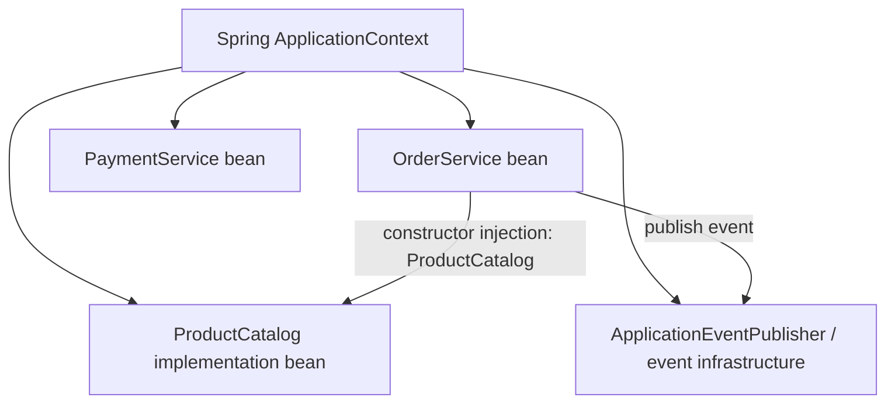
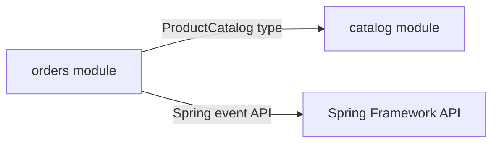
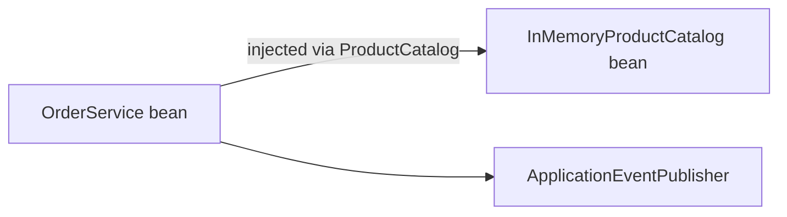
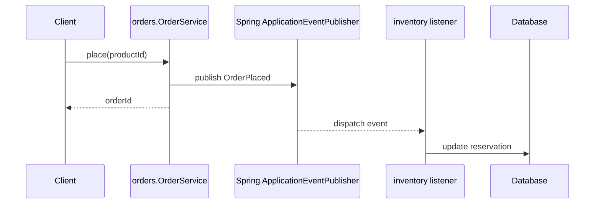
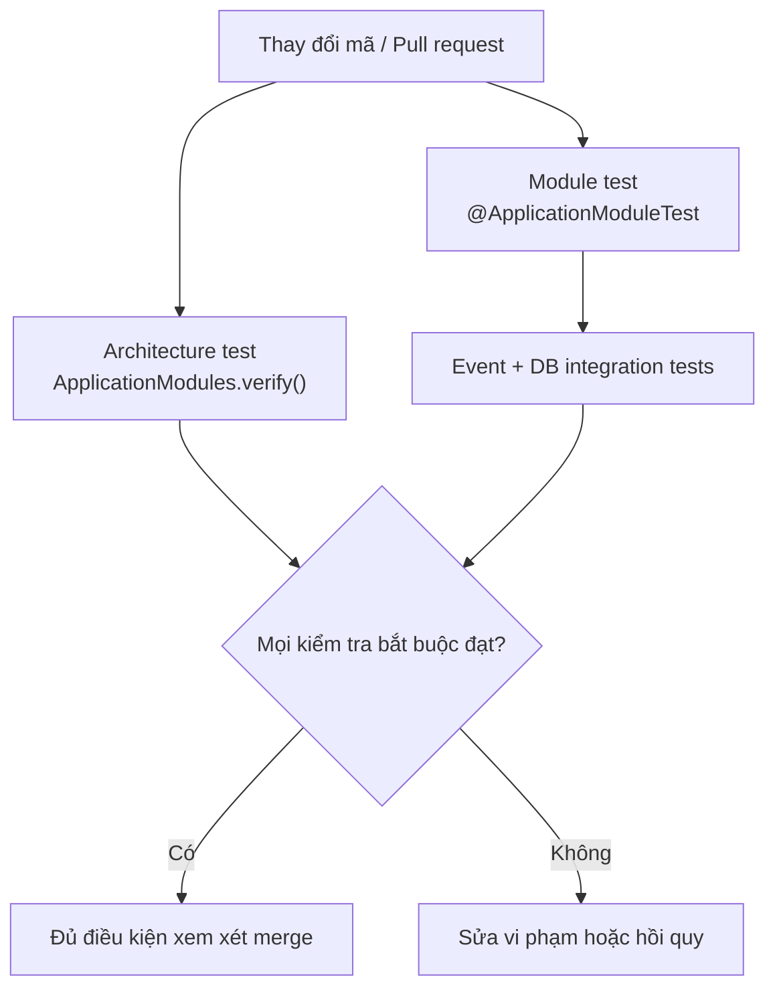

# Mối liên hệ giữa mô hình module và ApplicationContext

Một ứng dụng Spring Boot có thể có ba application module `orders`, `catalog` và `payments` nhưng khi triển khai production vẫn chỉ khởi chạy **một Spring `ApplicationContext`**. Ngược lại, trong kiểm thử bằng `@ApplicationModuleTest`, Spring Modulith có thể dựng một context chỉ bao gồm module được kiểm thử và những dependency được chọn. Hai góc nhìn này liên quan chặt chẽ nhưng không đồng nhất.

**Mô hình module** trả lời: *Ứng dụng được chia thành những phần nghiệp vụ nào, đâu là API công khai, và module nào được phép phụ thuộc vào module nào?* **`ApplicationContext`** trả lời: *Trong lần chạy này Spring đã đăng ký những bean nào, tạo chúng thế nào và nối những bean nào với nhau?*

Bài thuộc chương **Nhập môn** của **SPRING_MODULITH_VERIFICATION_TESTING**. Trong phạm vi chủ đề, chúng ta dùng `ApplicationModules` kiểm chứng ranh giới và quy tắc phụ thuộc, `@ApplicationModuleTest` kiểm thử từng phần qua Spring context, tiếp tục kiểm thử sự kiện, cơ sở dữ liệu và tích hợp, rồi kết hợp các bài kiểm tra thành **quality gate trong CI** để phát hiện phụ thuộc sai và hồi quy.

## 1. Mục tiêu học tập

Sau bài học, bạn có thể:

1. Phân biệt **application module** trong Spring Modulith với **Spring bean** và **Spring `ApplicationContext`**.
2. Giải thích tại sao ứng dụng có nhiều module nhưng thường sử dụng chung một context khi chạy production.
3. Dùng `ApplicationModules.of(ShopApplication.class).verify()` để kiểm chứng mô hình module mà không cần khởi động một luồng nghiệp vụ.
4. Hiểu cách `@ApplicationModuleTest` chọn phạm vi bean khi bootstrap, bao gồm `STANDALONE`, `DIRECT_DEPENDENCIES` và `ALL_DEPENDENCIES`.
5. Phân tích các tình huống **kiến trúc hợp lệ nhưng context không khởi động được**, hoặc **context khởi động thành công nhưng kiến trúc sai**.
6. Chọn cách kiểm thử cho hợp đồng module, sự kiện, database và CI.

## 2. Hai mô hình nhìn cùng một ứng dụng từ hai phía

Hãy tưởng tượng hệ thống bán hàng có ba miền nghiệp vụ:

- `orders` tiếp nhận và quản lý đơn hàng;
- `catalog` cung cấp thông tin sản phẩm;
- `payments` quản lý thanh toán.

Nếu nhìn theo kiến trúc, các module và quan hệ phụ thuộc có thể là:


Mũi tên trong hình biểu diễn **module nguồn sử dụng type hoặc hợp đồng của module đích**. Nó không có nghĩa là mỗi module được chạy bằng một Spring context riêng.

Nếu nhìn cùng ứng dụng qua dependency injection, hình sẽ là:



Ở đây, **`ApplicationContext` là nơi Spring đăng ký và quản lý bean**. Những bean thuộc các package nghiệp vụ khác nhau có thể cùng tồn tại trong context này. Spring Modulith không mặc định biến mỗi module thành một process, một classloader, một container dependency injection hay một database riêng.

| Khía cạnh | Mô hình `ApplicationModules` | Spring `ApplicationContext` |
|---|---|---|
| Đối tượng chính | Application module, package, type, interface, dependency | Bean definition, bean instance, wiring, lifecycle, configuration |
| Câu hỏi | “Các phần được tổ chức và phụ thuộc đúng thiết kế không?” | “Có tạo được bean và kết nối collaborator cần thiết không?” |
| Nguồn thông tin | Mã nguồn/bytecode và metadata module theo khả năng phân tích của Spring Modulith | Configuration, component scanning, auto-configuration, `@Bean` và các điều kiện runtime |
| Phép kiểm tra tiêu biểu | `ApplicationModules.of(...).verify()` | Khởi tạo Spring context, `@ApplicationModuleTest`, `@SpringBootTest` |
| Sai hỏng điển hình | Tham chiếu type nội bộ, phụ thuộc vòng, vi phạm `allowedDependencies` | Thiếu bean, nhiều bean không phân giải được, lỗi datasource hoặc cấu hình |
| Giới hạn | Không chứng minh nghiệp vụ, bean hoặc hạ tầng chạy đúng | Context khởi động được không có nghĩa dependency giữa module hợp lệ |

**Điểm quan trọng:** một type có thể thuộc module mà không là Spring bean, và một Spring bean có thể tham chiếu type thuộc module khác. Đừng đồng nhất “số module” với “số context”, hoặc “đã tạo được bean” với “đúng ranh giới kiến trúc”.

## 3. Spring Modulith tìm application module bằng cách nào?

### 3.1. Từ package gốc của ứng dụng

Với cấu hình nhận diện mặc định, các package con trực tiếp bên dưới package gốc ứng dụng Spring Boot thường là application module. Ví dụ:

```text
com.acme.shop
├── ShopApplication.java
├── orders
│   ├── package-info.java
│   ├── OrderService.java
│   ├── OrderPlaced.java
│   └── internal
│       └── OrderRules.java
├── catalog
│   ├── ProductCatalog.java
│   └── internal
│       └── InMemoryProductCatalog.java
└── payments
    ├── PaymentService.java
    └── internal
        └── PaymentRepository.java
```

Lớp ứng dụng nằm tại `com.acme.shop`:

```java
package com.acme.shop;

import org.springframework.boot.SpringApplication;
import org.springframework.boot.autoconfigure.SpringBootApplication;

@SpringBootApplication
public class ShopApplication {

    public static void main(String[] args) {
        SpringApplication.run(ShopApplication.class, args);
    }
}
```

Trong ví dụ này, `orders`, `catalog` và `payments` là ba module ứng viên. Theo quy ước module mặc định, type ở package gốc của module tạo nên phần giao diện công khai cơ bản; các package con như `catalog.internal` thuộc phần nội bộ, trừ khi được công bố có chủ đích bằng named interface hoặc cấu hình tương ứng.

Điều đó khác với Java visibility: một class `public` trong `catalog.internal` vẫn có thể là **nội bộ của application module**. Java compiler có thể cho phép import; phép kiểm chứng Spring Modulith có thể phát hiện rằng import ấy vi phạm ranh giới.

Spring Modulith còn hỗ trợ tùy chỉnh cách nhận diện và cấu hình module. Khi dùng quy ước khác, hãy dựa trên mô hình module thực tế của dự án, không mặc định mọi package con đều là module độc lập.

### 3.2. Phân tích mô hình không đòi hỏi chạy một ApplicationContext đầy đủ

Một bài JUnit kiểm chứng kiến trúc có thể là:

```java
package com.acme.shop;

import org.junit.jupiter.api.Test;
import org.springframework.modulith.core.ApplicationModules;

class ModuleArchitectureTests {

    @Test
    void verifyAllModuleBoundaries() {
        ApplicationModules.of(ShopApplication.class).verify();
    }
}
```

Ở đây, `ApplicationModules.of(ShopApplication.class)` xây dựng mô hình các module bằng cách phân tích cấu trúc ứng dụng. `verify()` áp dụng các quy tắc kiến trúc được hỗ trợ, chẳng hạn:

- Không có **phụ thuộc vòng** giữa các application module.
- Module không sử dụng type thuộc **phần nội bộ** của module khác.
- Quan hệ phụ thuộc tuân thủ danh sách `allowedDependencies`, nếu được khai báo.

**Đây không phải là lệnh khởi động application context của Spring Boot.** Bài test kiến trúc không cần gọi `SpringApplication.run(...)`, mở HTTP server, chạy tác vụ đặt hàng hoặc kết nối database để xem xét các quan hệ type/module.

Tuy nhiên, phép phân tích có phạm vi của nó: không nên giả định `verify()` hiểu mọi phụ thuộc động qua reflection, chuỗi cấu hình hay SQL. Các yêu cầu runtime và sở hữu dữ liệu vẫn cần kiểm thử hoặc kiểm tra bổ sung.

## 4. ApplicationContext tạo bean từ các module như thế nào?

### 4.1. Module phân nhóm trách nhiệm; context quản lý bean

Khi chạy ứng dụng, Spring Boot dựa trên `@SpringBootApplication`, component scanning, auto-configuration, bean factory methods và các điều kiện cấu hình để tạo Spring context.

Một bean `@Service` trong `orders` có thể khai báo constructor parameter kiểu `ProductCatalog` ở `catalog`. Nếu Spring tìm thấy một bean triển khai `ProductCatalog` phù hợp, dependency injection sẽ nối hai bean.

Điều cần phân biệt là hai quan hệ:

1. **Quan hệ về type/module:** `orders.OrderService` tham chiếu `catalog.ProductCatalog`; xét kiến trúc, `orders` phụ thuộc `catalog`.
2. **Quan hệ bean runtime:** một instance `OrderService` được Spring cung cấp một bean triển khai `ProductCatalog` cụ thể trong context đang chạy.

Một trong hai quan hệ có thể hợp lệ trong khi quan hệ còn lại gặp vấn đề. Ví dụ type dependency được phép, nhưng không có bean triển khai nên context không khởi động được. Hoặc context cung cấp bean đầy đủ nhưng type dependency đi vào package nội bộ nên vi phạm kiến trúc.

### 4.2. Không phải type nào trong module cũng là bean

Các thành phần này có vai trò khác nhau:

| Thành phần | Có thuộc application module? | Có phải Spring bean mặc định? |
|---|---|---|
| `OrderService` có `@Service` và được scan | Có | Thường có |
| `OrderPlaced` dạng Java `record` | Có | Không, chỉ là event payload thông thường |
| `OrderRules` là class thuần Java | Có | Không, trừ khi được đăng ký |
| `ProductCatalog` là interface | Có | Không có instance trực tiếp; cần bean triển khai |
| Bean tạo bằng method `@Bean` | Có thể gắn với cấu hình/phụ thuộc của module | Có, nếu cấu hình được nạp và điều kiện thỏa |
| `PaymentRepository` do hạ tầng Spring Data tạo | Thuộc phạm vi code/module tương ứng | Phụ thuộc cấu hình repository và auto-configuration |

Không có quy tắc “một module phải chứa một bean” hay “mọi class trong module đều được Spring khởi tạo”. Mô hình module và IoC container giải quyết các vấn đề khác nhau.

## 5. Ví dụ hoàn chỉnh: module orders dùng API của catalog

### 5.1. Công bố API nghiệp vụ hợp lệ

Tại `com/acme/shop/catalog/ProductCatalog.java`:

```java
package com.acme.shop.catalog;

import java.util.UUID;

public interface ProductCatalog {
    boolean exists(UUID productId);
}
```

Triển khai ví dụ nằm trong module `catalog`:

```java
package com.acme.shop.catalog.internal;

import com.acme.shop.catalog.ProductCatalog;
import java.util.UUID;
import org.springframework.stereotype.Component;

@Component
class InMemoryProductCatalog implements ProductCatalog {

    @Override
    public boolean exists(UUID productId) {
        // Bộ dữ liệu minh họa: một ID không null được xem là có sản phẩm.
        // Ứng dụng thật phải kiểm tra trên nguồn dữ liệu hợp lệ.
        return productId != null;
    }
}
```

Bên ngoài module chỉ cần biết interface `ProductCatalog`. Tên class triển khai, cấu trúc database hoặc cách lưu cache là chi tiết mà `catalog` có quyền thay đổi.

### 5.2. orders khai báo dependency cho phép

Để thể hiện rằng `orders` được phép phụ thuộc vào `catalog`, ta có thể tạo `com/acme/shop/orders/package-info.java`:

```java
@org.springframework.modulith.ApplicationModule(
    allowedDependencies = "catalog"
)
package com.acme.shop.orders;
```

`allowedDependencies` nói về **module được phép tham chiếu**, không tự động cho phép sử dụng các type nội bộ. `orders` có thể dùng `catalog.ProductCatalog`, nhưng không vì thế được import `catalog.internal.InMemoryProductCatalog`.

Ví dụ event của `orders`:

```java
package com.acme.shop.orders;

import java.util.UUID;

public record OrderPlaced(UUID orderId, UUID productId) {}
```

Use case dùng API công khai của `catalog` và phát sự kiện:

```java
package com.acme.shop.orders;

import com.acme.shop.catalog.ProductCatalog;
import java.util.UUID;
import org.springframework.context.ApplicationEventPublisher;
import org.springframework.stereotype.Service;

@Service
public class OrderService {

    private final ProductCatalog products;
    private final ApplicationEventPublisher events;

    public OrderService(
            ProductCatalog products,
            ApplicationEventPublisher events) {
        this.products = products;
        this.events = events;
    }

    public UUID place(UUID productId) {
        if (!products.exists(productId)) {
            throw new IllegalArgumentException("Unknown product");
        }

        UUID orderId = UUID.randomUUID();
        events.publishEvent(new OrderPlaced(orderId, productId));
        return orderId;
    }
}
```

Đoạn code minh họa **phụ thuộc bean và hợp đồng sự kiện**, chưa lưu đơn trong database hoặc bảo đảm đơn đã commit. Khi xây ứng dụng thật, cần làm rõ ý nghĩa `OrderPlaced`, thời điểm phát, transaction và xử lý lỗi.

### 5.3. Một codebase, hai đồ thị

**Đồ thị module** suy từ các type:



**Đồ thị bean** trong một `ApplicationContext` phù hợp:



Kiểm chứng kiến trúc quan tâm mũi tên `orders -> catalog` có được phép không và có đi vào phần nội bộ không. Việc khởi động context quan tâm có bean triển khai `ProductCatalog` để inject cho `OrderService` không.

## 6. Bốn trường hợp cho thấy hai mô hình độc lập về kết luận

| Kiến trúc module | ApplicationContext | Ý nghĩa | Hành động |
|---|---|---|---|
| Hợp lệ | Khởi động được | Phụ thuộc cấu trúc đã kiểm tra phù hợp; các bean cần thiết được nối trong cấu hình này | Tiếp tục kiểm thử hành vi và dữ liệu |
| **Vi phạm** | Khởi động được | Bean vẫn nối được dù module truy cập type nội bộ hoặc tạo quan hệ bị cấm | Sửa thiết kế dependency, chạy `verify()` |
| Hợp lệ | **Khởi động lỗi** | API được phép sử dụng nhưng bean thiếu hoặc cấu hình sai | Sửa bean/configuration, bootstrap mode hay hạ tầng |
| **Vi phạm** | **Khởi động lỗi** | Có cả vấn đề ranh giới và wiring/hạ tầng | Phân loại nguyên nhân, sửa cả hai và kiểm thử lại |

### 6.1. Context xanh nhưng kiến trúc đỏ

Giả sử `OrderService` inject thẳng class `catalog.internal.InMemoryProductCatalog`. Nếu class được cho phép truy cập ở cấp Java và Spring đã tạo bean, ứng dụng có thể chạy bình thường. Nhưng `orders` đã gắn vào phần triển khai nội bộ của `catalog`.

Spring không mặc định từ chối bean injection chỉ vì một type nằm trong package `internal` theo quy ước Modulith. Vì vậy **`ApplicationContext` khởi động thành công không phải bằng chứng rằng ranh giới module hợp lệ**.

### 6.2. Kiến trúc xanh nhưng context đỏ

`OrderService` phụ thuộc `catalog.ProductCatalog` là API công khai; `allowedDependencies = "catalog"` cho phép hướng phụ thuộc này. Tuy nhiên, nếu không có bean triển khai `ProductCatalog` trong test context hoặc configuration thiếu điều kiện khởi tạo, Spring có thể báo `UnsatisfiedDependencyException`.

Đây là lỗi **wiring hoặc bootstrap scope**, không nhất thiết là một vi phạm kiến trúc. Phải nhìn vào log tạo bean và ngữ cảnh test đang sử dụng trước khi quyết định sửa gì.

### 6.3. Cả hai xanh vẫn chưa chứng minh nghiệp vụ đúng

Dù dependency hợp lệ và context dựng thành công, `OrderService` vẫn có thể phát `OrderPlaced` sai payload hoặc không lưu dữ liệu đúng transaction. Kiểm chứng kiến trúc và kiểm tra context mới tạo bằng chứng về **cấu trúc và khả năng khởi tạo**, chưa thay thế được test hành vi.

## 7. @ApplicationModuleTest liên kết mô hình module với Spring TestContext

`@ApplicationModuleTest` của Spring Modulith cho phép tạo một Spring Boot test context **tập trung vào một application module**. Đây là cầu nối thực tế giữa:

- ranh giới application module được xác định từ package và dependency;
- cách Spring bootstrap các bean và auto-configuration cần thiết cho test;
- các assertion hành vi của module.

Thông thường, test được đặt dưới package của module cần kiểm thử, chẳng hạn `com.acme.shop.orders`. Spring Modulith dựa vào vị trí test và cấu hình module để chọn module trọng tâm.

### 7.1. Ba chế độ bootstrap

| Bootstrap mode | Những application module được xem là thuộc phạm vi test | Trường hợp sử dụng |
|---|---|---|
| `STANDALONE` (mặc định) | Module đang kiểm thử | Logic và bean nội bộ có thể chạy mà không cần module nghiệp vụ khác; mock hợp đồng ngoài nếu phù hợp |
| `DIRECT_DEPENDENCIES` | Module đang kiểm thử cùng các module mà nó phụ thuộc trực tiếp | Kiểm tra giao tiếp với module liên quan gần nhất |
| `ALL_DEPENDENCIES` | Module đang kiểm thử cùng tập module phụ thuộc bắc cầu | Kiểm tra khi luồng cần nhiều tầng phụ thuộc |

Các chế độ này điều khiển **phạm vi application module trong context kiểm thử**, không tách process hoặc tạo bảo đảm cô lập database theo module. Cấu hình Spring Boot, hạ tầng và các dependency không thuộc domain module vẫn có thể phải được cung cấp cho test.

### 7.2. Chọn DIRECT_DEPENDENCIES cho ví dụ orders–catalog

Ở ví dụ mục 5, `OrderService` yêu cầu một bean `ProductCatalog` từ module `catalog`. Nếu test muốn dùng triển khai thực của `catalog`, chọn:

```java
package com.acme.shop.orders;

import static org.assertj.core.api.Assertions.assertThat;

import java.util.UUID;
import org.junit.jupiter.api.Test;
import org.springframework.beans.factory.annotation.Autowired;
import org.springframework.modulith.test.ApplicationModuleTest;
import org.springframework.modulith.test.ApplicationModuleTest.BootstrapMode;
import org.springframework.modulith.test.PublishedEvents;

@ApplicationModuleTest(mode = BootstrapMode.DIRECT_DEPENDENCIES)
class OrderModuleTests {

    @Autowired OrderService orders;

    @Test
    void publishesOrderPlacedForKnownProduct(PublishedEvents events) {
        UUID productId = UUID.randomUUID();

        UUID orderId = orders.place(productId);

        assertThat(events.ofType(OrderPlaced.class)
                .matching(OrderPlaced::orderId, orderId)
                .matching(OrderPlaced::productId, productId))
            .hasSize(1);
    }
}
```

Để chạy ví dụ, dự án cần Spring Boot, Spring Modulith, JUnit và các dependency test tương thích; `ShopApplication` phải nằm trong package gốc như minh họa. `InMemoryProductCatalog` trả `true` cho ID không null nên test không cần database. Trong hệ thống thật, phải thay stub này bằng nguồn dữ liệu và thiết kế fixture phù hợp.

Ở test này:

1. Mô hình module xác định `orders` phụ thuộc trực tiếp vào `catalog`.
2. `DIRECT_DEPENDENCIES` cho phép module `catalog` tham gia context kiểm thử cùng `orders`.
3. Spring có thể tạo bean `InMemoryProductCatalog` và inject nó thông qua interface `ProductCatalog`.
4. Test gọi hành vi thực của `OrderService` và dùng `PublishedEvents` để kiểm tra event đã được phát.

Cần phân biệt: `PublishedEvents` kiểm tra **sự kiện đã phát** trong test; nó không khẳng định một consumer bất đồng bộ ở module khác đã xử lý thành công.

### 7.3. Nếu dùng STANDALONE thì sao?

Vẫn với `OrderService` cần `ProductCatalog`, chế độ `STANDALONE` không tự đưa module `catalog` vào phạm vi nghiệp vụ của test. Nếu không có bean hoặc test double được cung cấp cho dependency đó, Spring có thể không dựng được context.

Có hai lựa chọn hợp lý tùy mục đích:

- **Để kiểm tra phối hợp thật với catalog:** dùng `DIRECT_DEPENDENCIES` và cấu hình fixture/hạ tầng cho module `catalog`.
- **Để cô lập logic orders:** cung cấp một test double cho `ProductCatalog` bằng cơ chế mock bean tương thích phiên bản Spring Boot/Spring Test đang dùng, rồi xác minh behavior của `orders`.

Đừng tự động đổi mọi test sang `ALL_DEPENDENCIES` chỉ để context khởi động. Phạm vi quá rộng có thể che một vấn đề thiết kế và khiến test phụ thuộc vào các bean ngoài yêu cầu nghiệp vụ đang kiểm tra.

**Quan trọng:** một module test thiếu bean từ module hợp lệ không đồng nghĩa vi phạm dependency. Ngược lại, một module test đã cấu hình mock để khởi động được cũng không chứng minh mọi dependency trong mã đều hợp lệ.

## 8. @ApplicationModuleTest khác @SpringBootTest ở điểm nào?

`@SpringBootTest` thường dùng cấu hình Spring Boot để tạo context cho một phạm vi ứng dụng rộng, tùy thuộc vào các lớp và profile test. Nó hữu ích khi cần đánh giá tích hợp nhiều phần, nhưng nếu mục tiêu chỉ là một use case của `orders`, việc khởi động toàn bộ context có thể đưa thêm bean, database, broker hoặc cấu hình không liên quan vào bài test.

`@ApplicationModuleTest` giúp diễn đạt rõ module đang được kiểm tra và các module phụ thuộc cần tham gia. Nhờ đó:

- Lỗi thiếu dependency của một module thường dễ khoanh vùng hơn.
- Có thể kiểm tra hành vi của module với mức tích hợp phù hợp.
- Test có khả năng ít chịu tác động từ các module không liên quan.
- Team dễ duy trì ý tưởng “module có thể kiểm tra như một đơn vị nghiệp vụ” trong modular monolith.

Tuy nhiên, không nên hiểu module test là **unit test thuần Java**. Nó vẫn dùng Spring TestContext và cần khởi tạo những bean được chọn. Một bài unit test có thể chỉ gọi `new OrderService(fakeCatalog, fakePublisher)`; một module test cho Spring thực sự tạo, inject bean và quản lý những cơ chế test liên quan.

| Kiểu test | Có khởi động Spring context? | Đối tượng kiểm tra |
|---|---|---|
| Unit test thuần JUnit/Mockito | Thông thường không | Logic của class/hàm |
| `ApplicationModules.verify()` trong JUnit | Không cần Spring Boot application context | Cấu trúc module và quy tắc phụ thuộc |
| `@ApplicationModuleTest` | Có, với phạm vi module được chọn | Bean và hành vi trong context tập trung theo module |
| `@SpringBootTest` | Có, thường phạm vi rộng hơn | Tích hợp ứng dụng theo cấu hình Spring Boot |
| API/E2E test | Tùy thiết kế test | Luồng ngoài thực tế qua HTTP, message và hạ tầng |

## 9. Khi gặp lỗi khởi tạo context: đọc lỗi theo đúng tầng

Giả sử test `@ApplicationModuleTest` thất bại. Đừng lập tức kết luận kiến trúc module sai; hãy phân loại dấu hiệu:

| Dấu hiệu | Khả năng chính | Điều nên kiểm tra |
|---|---|---|
| `NoSuchBeanDefinitionException` hoặc `UnsatisfiedDependencyException` | Thiếu bean trong bootstrap scope | Module chứa bean, bootstrap mode, mock/test configuration, điều kiện component scanning |
| `NoUniqueBeanDefinitionException` | Có nhiều bean cùng type mà không phân giải được | `@Qualifier`, `@Primary` và cấu hình đăng ký bean |
| Lỗi kết nối database/schema | Hạ tầng test chưa sẵn sàng hoặc cấu hình sai | DataSource, migration, Testcontainers, profile và fixture |
| `ApplicationModules.verify()` báo vi phạm | Quan hệ type/module không hợp lệ | Tham chiếu internal, vòng module, `allowedDependencies` |
| Test sự kiện không quan sát được kết quả | Listener chưa chạy, sai transaction hoặc xử lý bất đồng bộ | Thời điểm publish, cấu hình listener, điều kiện chờ và trạng thái dữ liệu |
| Full context chạy nhưng module test lỗi | Có dependency ngoài phạm vi module test hoặc thiết lập test khác nhau | Sự phụ thuộc có hợp lệ không; cần mock hay thêm direct dependency? |

Một workflow chẩn đoán thường hiệu quả là:

1. Chạy riêng architecture test để nắm tình trạng ranh giới module.
2. Đọc **nguyên nhân gốc trong stack trace** của context test, xác định bean hoặc cấu hình thiếu.
3. Xác định bean thuộc module nào và hợp đồng type nào đang được dùng.
4. Chọn bootstrap mode hoặc test double theo mục tiêu test, sau khi xác nhận dependency đó hợp lệ.
5. Chạy lại test hành vi; nếu có database hoặc listener, kiểm tra thêm transaction và trạng thái cuối cùng.

Cần giữ riêng hai câu hỏi: **“module có được phép phụ thuộc không?”** và **“test context đã cung cấp được bean chưa?”**. Cùng một class `OrderService` có thể cho ra câu trả lời khác nhau đối với hai câu hỏi này.

## 10. Event và ApplicationContext: cùng event bus, khác phạm vi module

Trong một Spring Boot application context, các bean có thể trao đổi qua `ApplicationEventPublisher` và listener. Nếu `orders` phát `OrderPlaced`, listener của `payments` hoặc `inventory` có thể nhận event khi các listener đó tồn tại trong context và cơ chế sự kiện phù hợp.



Sơ đồ thể hiện luồng thường gặp, chưa nói event được dispatch đồng bộ, bất đồng bộ, trước hay sau commit. Các thuộc tính đó phụ thuộc vào loại listener và cấu hình transaction.

### 10.1. Runtime dispatch không đồng nghĩa module dependency

Nếu listener của `inventory` khai báo method nhận `OrderPlaced` nằm trong API công khai của `orders`, dependency về type sẽ đi theo hướng **`inventory -> orders`**. Nhưng luồng event trong lúc chạy đi từ producer `orders` tới consumer `inventory`.

`orders` không bắt buộc biết listener cụ thể thuộc module nào. Đây là một lý do event giúp giảm kết nối trực tiếp giữa các module. Tuy vậy, consumer vẫn phải phụ thuộc vào **schema và ngữ nghĩa** của event.

### 10.2. Test context nhỏ có thể không chứa consumer

Nếu bạn chạy `@ApplicationModuleTest` cho `orders` ở `STANDALONE`, context có thể chỉ có producer cùng những bean liên quan trong phạm vi đã chọn. Listener thuộc `inventory` có thể không được nạp. Khi ấy test `PublishedEvents` xác minh event được phát vẫn có thể xanh, dù không có consumer nào xử lý.

Điều này **phù hợp với mục tiêu publisher test**, nhưng không phải bằng chứng của luồng đặt hàng–kho hoàn chỉnh. Muốn kiểm tra consumer, hãy chọn module test của consumer hoặc bài integration test chứa đủ producer, listener và hạ tầng cần thiết.

### 10.3. Transaction và xử lý bất đồng bộ

Với `@ApplicationModuleListener`, ứng dụng có thể xử lý sự kiện sau commit trong transaction khác và bất đồng bộ theo cơ chế Spring Modulith. Để kiểm tra hành vi này cần:

- Producer thực sự chạy trong transaction có ý nghĩa.
- Consumer được đưa vào phạm vi test và có hạ tầng cần thiết.
- Test chờ một kết quả quan sát được; `Scenario` của Spring Modulith Test là một công cụ cho mục đích này.
- Trạng thái database được kiểm tra sau khi xử lý nếu nghiệp vụ yêu cầu lưu dữ liệu.
- Trường hợp lỗi, retry và event trùng được kiểm tra theo chính sách ứng dụng.

Một module test không tự tạo bảo đảm “event đã được consumer hoàn tất” hay “xử lý đúng một lần”. Kể cả khi framework có cơ chế event publication registry, idempotency và chính sách xử lý lỗi vẫn là những hợp đồng cần thiết kế và test.

## 11. Database và ApplicationContext không tự tách theo module

Spring Modulith thường được áp dụng cho **modular monolith**: nhiều module trong cùng ứng dụng triển khai. Việc tách package/module **không đồng nghĩa mỗi module có schema hay database độc lập**.

Một `ApplicationContext` có thể chứa cùng một `DataSource` và transaction manager được nhiều module sử dụng. Ngay cả khi test context chỉ bootstrap một module, database mà test kết nối vẫn có thể chứa tất cả bảng hoặc migration của ứng dụng.

Điều này tạo ra ba nhóm kiểm chứng:

| Câu hỏi | Kiểm chứng phù hợp |
|---|---|
| `orders` có import `catalog.internal.*` không? | Architecture test bằng `ApplicationModules.verify()` |
| `OrderService` có nhận được bean `ProductCatalog` khi boot test không? | `@ApplicationModuleTest` và kiểm tra wiring |
| Khi lưu đơn và phát event, transaction, constraint, locking và rollback có đúng không? | Database/event integration test trên hạ tầng phù hợp |

Với JPA và SQL, Testcontainers có thể cung cấp một database test cùng loại engine như production. Đừng chỉ dựa vào mock repository để kết luận transaction an toàn: mock không phản ánh isolation, deadlock, constraint hay thứ tự commit thực tế.

Cũng cần cẩn trọng khi đặt `@Transactional` trên chính bài test: transaction của test thường được rollback sau khi kết thúc, còn một listener chạy trong transaction khác có thể quan sát kết quả khác. Mô hình transaction phải được nêu rõ khi diễn giải kết quả kiểm thử.

## 12. Quality gate trong CI: kiểm tra cả kiến trúc lẫn runtime

Hai loại kiểm chứng hỗ trợ nhau:



Để ngăn phụ thuộc sai và hồi quy, nên duy trì ít nhất:

1. **Architecture test** xác nhận module graph và dependency policy.
2. **Unit/module test** kiểm tra use case, bean wiring, sự kiện được phát.
3. **Integration test** cho transaction, database, consumer và luồng xuyên module quan trọng.
4. **CI quality gate** chạy các test bắt buộc trước merge và công bố nguyên nhân thất bại.

Nếu dự án có Maven hoặc Gradle Wrapper, có thể chạy:

```bash
# Với Maven Wrapper
./mvnw test

# Với Gradle Wrapper
./gradlew test
```

Các lệnh trên chỉ chạy những test được cấu hình trong task/phase tương ứng. Nếu team tách integration test sang phase riêng, CI phải chạy thêm phase đó. Test cần database phải được cung cấp dịch vụ hoặc Testcontainers, migration và cấu hình chính xác.

**Một tình huống cần chặn:** sửa `OrderService` để inject `catalog.internal.InMemoryProductCatalog`. Full `ApplicationContext` có thể tạo được bean, behavior test vẫn xanh, nhưng architecture test cần thất bại do tham chiếu type nội bộ. Nếu CI chỉ kiểm tra context khởi động và behavior hiện tại, vi phạm thiết kế có thể lọt vào nhánh chính.

## 13. Những hiểu lầm thường gặp

**“Ba application module nghĩa là ba ApplicationContext.”** Không. Phần lớn ứng dụng Spring Modulith chạy các module trong cùng một Spring Boot context. Module test chỉ chọn một phạm vi bean để kiểm thử.

**“Spring tạo được bean nghĩa là dependency module hợp lệ.”** Không. Java và Spring DI có thể cho phép một type nội bộ bị sử dụng từ module khác. `ApplicationModules.verify()` kiểm tra quy tắc kiến trúc riêng.

**“`ApplicationModules.of(...)` sẽ khởi tạo mọi bean trong ứng dụng.”** Không nên hiểu như vậy. Nó xây dựng mô hình module từ cấu trúc code/metadata, không phải lệnh chạy production application context.

**“`@ApplicationModuleTest` luôn phải chạy STANDALONE.”** Không. Dùng `DIRECT_DEPENDENCIES` hoặc `ALL_DEPENDENCIES` khi mục tiêu test thực sự cần các module phụ thuộc; hoặc cung cấp test double nếu muốn cô lập.

**“Nếu STANDALONE không nạp được bean thì kiến trúc chắc chắn sai.”** Không. Module có thể phụ thuộc hợp lệ vào API của module khác nhưng test scope không bao gồm module đó. Hãy kiểm tra dependency policy và bootstrap mode.

**“Test publisher nhận `PublishedEvents` là đã test hết consumer.”** Không. Khi consumer không nằm trong context, nó chưa chạy; ngay cả khi nằm trong context, còn phải kiểm tra ngữ nghĩa, transaction và kết quả xử lý.

**“Chỉ cần `@SpringBootTest`, không cần test ranh giới.”** Không. Full-context test phát hiện nhiều vấn đề wiring và tích hợp, nhưng không tự thay thế architecture verification.

## 14. Bài tập thực hành

**Bối cảnh:** tạo ứng dụng Spring Boot có `orders`, `catalog` và `payments` như mục 3. Áp dụng Spring Modulith theo phiên bản tương thích của dự án. Các bài tập sau kiểm tra ba câu hỏi khác nhau: mô hình module có hợp lệ không, context có đủ bean không, và hành vi có đúng không.

### Phần A — Khám phá hai mô hình

1. Tạo các package và class `ShopApplication`, `ProductCatalog`, `InMemoryProductCatalog`, `OrderService`, `OrderPlaced` theo ví dụ.
2. Viết `ModuleArchitectureTests` gọi `ApplicationModules.of(ShopApplication.class).verify()`.
3. Khởi chạy ứng dụng hoặc viết `@SpringBootTest` để xem `ApplicationContext` có tạo được `OrderService` và bean triển khai `ProductCatalog` không.
4. Vẽ **hai sơ đồ riêng**: đồ thị module dependency `orders -> catalog` và đồ thị injection `OrderService -> ProductCatalog bean`.

### Phần B — Tạo lỗi chỉ thuộc kiến trúc

1. Cho `InMemoryProductCatalog` khả năng truy cập từ package khác ở cấp Java; sửa `OrderService` để tham chiếu trực tiếp type trong `catalog.internal`.
2. Đảm bảo context vẫn có thể nối bean đó bằng cấu hình phù hợp.
3. Chạy `ApplicationModules.verify()` và giải thích vì sao vi phạm package nội bộ vẫn bị phát hiện.
4. Quay lại inject `ProductCatalog` công khai và xác nhận architecture test đạt.

### Phần C — Tạo lỗi chỉ thuộc context

1. Giữ `OrderService` phụ thuộc interface công khai `ProductCatalog`.
2. Thử chạy `@ApplicationModuleTest` ở `STANDALONE` mà không cung cấp bean/test double `ProductCatalog`.
3. Quan sát lỗi bean thiếu, rồi đổi sang `DIRECT_DEPENDENCIES` để module `catalog` có mặt trong context. Nếu dùng configuration đặc biệt, kiểm tra điều kiện đăng ký bean.
4. Giải thích vì sao lỗi context này không tự chứng minh module dependency sai.

### Phần D — Chứng minh hợp đồng hành vi và CI

1. Viết test `@ApplicationModuleTest(mode = DIRECT_DEPENDENCIES)` kiểm tra `OrderPlaced` qua `PublishedEvents`.
2. Thêm consumer ở module khác và bài test riêng xác nhận trạng thái sau nhận event; nếu xử lý bất đồng bộ, dùng `Scenario` hoặc điều kiện chờ phù hợp.
3. Nếu có database, kiểm tra lưu dữ liệu và rollback/commit với setup thực tế.
4. Đưa architecture test, module test và integration test bắt buộc vào CI. Tạo lỗi package nội bộ có chủ đích để xác nhận gate báo đỏ.

**Tiêu chí hoàn thành:** bạn giải thích được vì sao application module không tương ứng một context riêng, phân biệt lỗi module graph với lỗi wiring, chọn bootstrap mode đúng mục tiêu và có bằng chứng rằng CI bắt được cả vi phạm ranh giới lẫn hồi quy hành vi.

## 15. Câu hỏi ôn tập và đáp án

**1. Spring Modulith tạo một `ApplicationContext` cho mỗi application module trong production có đúng không?**

Không. Theo mô hình modular monolith thông thường, các module cùng chạy trong một ứng dụng Spring Boot và chia sẻ context. Việc bootstrap context theo từng module chủ yếu phục vụ kiểm thử có phạm vi xác định.

**2. `ApplicationModules.of(ShopApplication.class).verify()` có cần chạy bean `OrderService` không?**

Không. Phép kiểm chứng cấu trúc dựa trên mô hình application module; nó không cần gọi use case hoặc chạy production context để tìm dependency sai.

**3. Vì sao một `@SpringBootTest` xanh không đủ chứng minh kiến trúc module đúng?**

Vì Spring DI có thể nối được bean dù class sử dụng type nội bộ của module khác hoặc có dependency trái quy tắc thiết kế. Cần kiểm chứng kiến trúc tường minh.

**4. Khi nào chọn `DIRECT_DEPENDENCIES` thay vì `STANDALONE`?**

Khi bài test muốn đưa vào context các application module mà module đang kiểm thử phụ thuộc trực tiếp, chẳng hạn `orders` cần bean thực thi `ProductCatalog` của `catalog`.

**5. Unit test giả lập `ProductCatalog` có thay thế được module test không?**

Không hoàn toàn. Unit test kiểm tra logic của class với collaborator giả lập; module test còn kiểm tra bean wiring, cấu hình Spring và hành vi trong context đã chọn.

**6. Test `PublishedEvents` xanh có chứng minh `inventory` đã cập nhật kho thành công không?**

Không. Test publisher chỉ khẳng định sự kiện được phát trong phạm vi đang quan sát. Consumer, transaction và dữ liệu cần được kiểm chứng riêng.

**7. Nếu `ApplicationModules.verify()` xanh nhưng test context thiếu bean, nên sửa quy tắc dependency không?**

Chưa có căn cứ. Trước hết xác định bean thiếu, module sở hữu bean, bootstrap mode và cấu hình Spring. Chỉ thay đổi dependency policy nếu chứng minh được thiết kế module thực sự cần đổi.

## Kết luận

**Mô hình module của Spring Modulith và `ApplicationContext` là hai lớp biểu diễn bổ trợ nhau của cùng ứng dụng.** `ApplicationModules` mô tả cấu trúc, API và các mối quan hệ phụ thuộc giữa module; `ApplicationContext` tạo và nối bean trong lần chạy cụ thể. `@ApplicationModuleTest` kết nối hai thế giới bằng cách sử dụng ranh giới module để chọn phạm vi Spring context cho bài test, nhưng việc context khởi động được không thay thế cho kiểm chứng kiến trúc.

Hãy dùng `ApplicationModules.verify()` để bảo vệ module graph, `@ApplicationModuleTest` để kiểm tra hành vi và wiring trong phạm vi phù hợp, cùng kiểm thử sự kiện, cơ sở dữ liệu và tích hợp để chứng minh kết quả runtime. Đặt các phép kiểm tra vào **CI quality gate** sẽ giúp phát hiện sớm cả phụ thuộc sai, lỗi khởi tạo bean và hồi quy nghiệp vụ.
