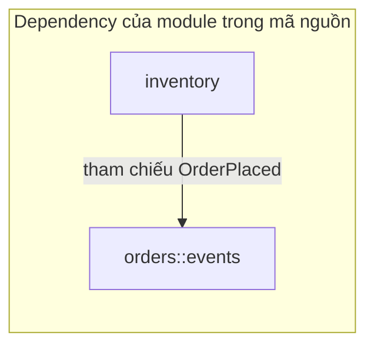
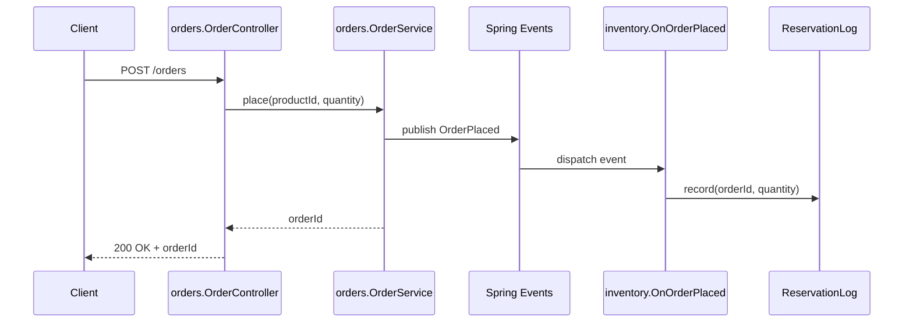
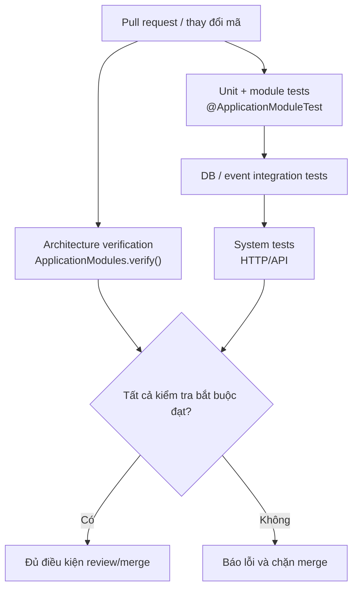

# Kiểm thử cấu trúc, kiểm thử module và kiểm thử hệ thống

Một ứng dụng Spring Modulith có thể vượt qua toàn bộ unit test nhưng vẫn vi phạm ranh giới module. Nó cũng có thể vượt qua kiểm chứng kiến trúc nhưng không phát sự kiện đúng, hoặc chạy đúng từng module nhưng thất bại khi người dùng thực hiện một luồng nghiệp vụ xuyên nhiều module. **Kiểm thử cấu trúc, kiểm thử module và kiểm thử hệ thống** được thiết kế để bắt những nhóm lỗi khác nhau. Chúng bổ trợ nhau trong một modular monolith.

Bài học thuộc chương **Nhập môn** của **SPRING_MODULITH_VERIFICATION_TESTING**. Trong toàn bộ chủ đề này, chúng ta rèn kỹ năng kiểm chứng ranh giới kiến trúc bằng `ApplicationModules` và các quy tắc dependency, thực hành `@ApplicationModuleTest`, kiểm thử sự kiện, cơ sở dữ liệu và tích hợp, rồi đưa các kiểm tra bắt buộc vào **quality gate trong CI** để ngăn phụ thuộc sai và hồi quy.

## 1. Mục tiêu học tập

Sau bài học, bạn có thể:

1. Phân biệt ba cấp kiểm tra dựa trên **đối tượng được kiểm chứng**, thay vì dựa vào tên annotation hoặc tốc độ chạy test.
2. Viết một bài kiểm chứng kiến trúc dùng `ApplicationModules.of(...).verify()`.
3. Dùng `@ApplicationModuleTest` để kiểm tra hợp đồng của một module, bao gồm sự kiện đã phát và phản ứng với sự kiện.
4. Thiết kế system test đi qua điểm vào HTTP và xác minh tác động xuyên module.
5. Biết khi nào phải bổ sung test database, transaction, bất đồng bộ và xử lý lại sự kiện.
6. Sắp xếp các cấp test trong CI để phát hiện lỗi nhanh, nhưng vẫn chặn được hồi quy ở ranh giới tích hợp.

## 2. Ba cấp kiểm thử trả lời ba câu hỏi khác nhau

Giả sử ứng dụng bán hàng có module `orders` và `inventory`. Khi khách đặt hàng, `orders` tạo một mã đơn và phát `OrderPlaced`; `inventory` nhận sự kiện để ghi nhận yêu cầu đặt giữ hàng.

Ba câu hỏi cần trả lời là:

- **Kiểm thử cấu trúc (architecture/structure verification):** `inventory` có được phép tham chiếu hợp đồng sự kiện của `orders` không? Nó có truy cập lớp `orders.internal` không? Có dependency vòng không?
- **Kiểm thử module (module test):** khi gọi use case trong `orders`, sự kiện `OrderPlaced` có đúng không? Khi `inventory` nhận sự kiện, nó có ghi nhận yêu cầu giữ hàng đúng, kể cả khi nhận lặp không?
- **Kiểm thử hệ thống (system test):** khi client gọi HTTP API đặt hàng, các thành phần Spring được nối đúng và kết quả xuyên `orders`–`inventory` có được quan sát như yêu cầu không?

| Tiêu chí | Kiểm thử cấu trúc | Kiểm thử module | Kiểm thử hệ thống |
|---|---|---|---|
| Trọng tâm | Cấu trúc và quy tắc phụ thuộc | Hành vi của một application module | Luồng từ điểm vào hệ thống qua nhiều thành phần |
| Đơn vị quan sát | Package, type, module, dependency | Bean, use case, event, trạng thái trong phạm vi module | HTTP/API, sự kiện, lưu trữ và kết quả tích hợp |
| Công cụ trong Spring Modulith | `ApplicationModules.verify()` | `@ApplicationModuleTest`, `PublishedEvents`, `Scenario` | `@SpringBootTest`, MockMvc hoặc test qua HTTP thật; các assertion tích hợp |
| Có cần Spring context? | Không cần khởi động context ứng dụng | Có, Spring TestContext theo phạm vi module | Thường có context toàn ứng dụng hoặc môi trường chạy thật |
| Điểm mạnh | Phát hiện dependency sai dù chức năng vẫn chạy | Cô lập trách nhiệm nghiệp vụ, xác định lỗi gần nơi phát sinh | Phát hiện vấn đề wiring, phối hợp, hạ tầng và luồng người dùng |
| Không tự bảo đảm | Kết quả nghiệp vụ/transaction đúng | Toàn bộ luồng xuyên mọi module đúng | Mọi quy tắc dependency kiến trúc đều được giữ |

Tên “system test” có thể được dùng rộng hoặc hẹp tùy đội ngũ. Trong bài này, system test nghĩa là **kiểm tra một luồng hoàn chỉnh ở ranh giới sử dụng của ứng dụng**, có các thành phần cần thiết chạy cùng nhau. Test với `MockMvc` kiểm tra toàn bộ chuỗi xử lý Spring MVC trong JVM nhưng chưa thử mạng hay container triển khai thật. Test end-to-end qua HTTP thật có phạm vi rộng hơn.

> **Nhớ:** Một cấp test đạt chỉ tạo bằng chứng cho những điều kiện nó đã kiểm tra. Architecture test xanh không khẳng định dữ liệu được commit. Module test xanh không chứng minh API ngoài hoạt động đúng. System test xanh không tự động khẳng định code không tham chiếu package nội bộ.

## 3. Bối cảnh xuyên suốt: đặt hàng và ghi nhận giữ kho

Chúng ta dùng một ví dụ nhỏ để có thể đối chiếu cả ba cấp test mà không phải cài cả hệ thống bán hàng. Ứng dụng Spring Boot có hai application module theo cách nhận diện mặc định:

```text
com.acme.shop
├── ShopApplication.java
├── orders
│   ├── OrderController.java
│   ├── OrderService.java
│   └── events
│       ├── package-info.java
│       └── OrderPlaced.java
└── inventory
    ├── package-info.java
    ├── ReservationStatus.java
    └── internal
        ├── ReservationLog.java
        └── OnOrderPlaced.java
```

Quy tắc thiết kế:

1. `orders` sở hữu use case tiếp nhận đơn và phát sự kiện.
2. `orders.events` là **named interface** công bố hợp đồng `OrderPlaced`.
3. `inventory` chỉ phụ thuộc vào `orders::events`, không đọc các class nội bộ của `orders`.
4. Trong ví dụ, `inventory` lưu số lượng cần đặt giữ theo `orderId` trong bộ nhớ để minh họa xử lý sự kiện. **Nó chưa quản lý số lượng tồn kho thực tế, transaction hay cạnh tranh đồng thời trên database**.
5. API HTTP trong `orders` cho phép system test đi từ phía client đến phản ứng của consumer.

Hai góc nhìn cần phân biệt:





Sơ đồ thứ nhất mô tả **dependency về type**: consumer phụ thuộc vào hợp đồng sự kiện của producer. Sơ đồ thứ hai mô tả **thông điệp khi chạy**: sự kiện đi từ producer tới consumer. Không nên nhầm chiều mũi tên giữa hai sơ đồ.

## 4. Chuẩn bị mã ứng dụng tối thiểu

Các ví dụ sau giả định dự án dùng Java 17 trở lên, Spring Boot, Spring Modulith, Spring Web, JUnit 5, AssertJ và các thư viện test Spring Modulith tương thích với phiên bản Spring Boot thực tế. Mỗi public type được đặt trong file Java đúng tên của nó. Phần lưu giữ trong bộ nhớ chỉ dành cho minh họa; không sử dụng làm cơ chế lưu đơn và kho của production.

### 4.1. Application class

```java
package com.acme.shop;

import org.springframework.boot.SpringApplication;
import org.springframework.boot.autoconfigure.SpringBootApplication;

@SpringBootApplication
public class ShopApplication {

    public static void main(String[] args) {
        SpringApplication.run(ShopApplication.class, args);
    }
}
```

### 4.2. Công bố một named interface cho sự kiện của orders

File `com/acme/shop/orders/events/package-info.java`:

```java
@org.springframework.modulith.NamedInterface("events")
package com.acme.shop.orders.events;
```

File `com/acme/shop/orders/events/OrderPlaced.java`:

```java
package com.acme.shop.orders.events;

import java.util.UUID;

public record OrderPlaced(
    UUID orderId,
    UUID productId,
    int quantity
) {}
```

`OrderPlaced` là contract **đã phát sinh việc đặt hàng theo điều kiện của ví dụ**. Vì ví dụ chưa lưu đơn, không nên diễn giải nó là bằng chứng một bản ghi đã commit. Với ứng dụng thực tế, tên sự kiện và thời điểm phát phải khớp với trạng thái nghiệp vụ; nếu mới chỉ nhận yêu cầu và còn có thể từ chối, một tên như `OrderPlacementRequested` có thể phù hợp hơn.

### 4.3. Producer: orders

File `com/acme/shop/orders/OrderService.java`:

```java
package com.acme.shop.orders;

import com.acme.shop.orders.events.OrderPlaced;
import java.util.UUID;
import org.springframework.context.ApplicationEventPublisher;
import org.springframework.stereotype.Service;

@Service
public class OrderService {

    private final ApplicationEventPublisher events;

    public OrderService(ApplicationEventPublisher events) {
        this.events = events;
    }

    public UUID place(UUID productId, int quantity) {
        if (productId == null || quantity <= 0) {
            throw new IllegalArgumentException("Invalid order item");
        }

        UUID orderId = UUID.randomUUID();
        events.publishEvent(new OrderPlaced(orderId, productId, quantity));
        return orderId;
    }
}
```

Một điểm vào HTTP tối giản, file `com/acme/shop/orders/OrderController.java`:

```java
package com.acme.shop.orders;

import java.util.UUID;
import org.springframework.web.bind.annotation.PostMapping;
import org.springframework.web.bind.annotation.RequestParam;
import org.springframework.web.bind.annotation.RestController;

@RestController
public class OrderController {

    private final OrderService orders;

    public OrderController(OrderService orders) {
        this.orders = orders;
    }

    @PostMapping("/orders")
    public UUID place(
            @RequestParam UUID productId,
            @RequestParam int quantity) {
        return orders.place(productId, quantity);
    }
}
```

Endpoint nhận tham số query/form và trả mã đơn ở dạng JSON theo cấu hình Spring Web mặc định. Chúng ta chưa thêm security, xử lý lỗi HTTP chi tiết hoặc database vì các tính năng đó cần được kiểm thử thêm theo thiết kế sản phẩm.

### 4.4. Consumer: inventory

File `com/acme/shop/inventory/package-info.java` giới hạn dependency:

```java
@org.springframework.modulith.ApplicationModule(
    allowedDependencies = "orders::events"
)
package com.acme.shop.inventory;
```

Định nghĩa API đọc kết quả trong chính module `inventory`, file `ReservationStatus.java`:

```java
package com.acme.shop.inventory;

import java.util.UUID;

public interface ReservationStatus {
    int quantityRecordedFor(UUID orderId);
}
```

Một bộ lưu đơn giản, file `inventory/internal/ReservationLog.java`:

```java
package com.acme.shop.inventory.internal;

import com.acme.shop.inventory.ReservationStatus;
import java.util.UUID;
import java.util.concurrent.ConcurrentHashMap;
import org.springframework.stereotype.Component;

@Component
class ReservationLog implements ReservationStatus {

    private final ConcurrentHashMap<UUID, Integer> reservations =
        new ConcurrentHashMap<>();

    void recordOnce(UUID orderId, int quantity) {
        reservations.putIfAbsent(orderId, quantity);
    }

    @Override
    public int quantityRecordedFor(UUID orderId) {
        return reservations.getOrDefault(orderId, 0);
    }
}
```

Listener đồng bộ, file `inventory/internal/OnOrderPlaced.java`:

```java
package com.acme.shop.inventory.internal;

import com.acme.shop.orders.events.OrderPlaced;
import org.springframework.context.event.EventListener;
import org.springframework.stereotype.Component;

@Component
class OnOrderPlaced {

    private final ReservationLog reservations;

    OnOrderPlaced(ReservationLog reservations) {
        this.reservations = reservations;
    }

    @EventListener
    void on(OrderPlaced event) {
        reservations.recordOnce(event.orderId(), event.quantity());
    }
}
```

Điểm đáng chú ý:

- `inventory` chỉ biết type `OrderPlaced` thuộc named interface `orders::events`.
- `orders` không tham chiếu bất kỳ class nào của `inventory`, nên không tạo phụ thuộc ngược giữa hai module.
- Listener `@EventListener` trong ví dụ dùng cách dispatch đồng bộ mặc định của Spring. Vì vậy, trong cùng context, phản ứng của listener thường hoàn thành trước khi `publishEvent(...)` trả về, trừ khi có cấu hình event multicaster khác.
- `putIfAbsent` là cách minh họa **không ghi đè cùng `orderId`**. Nó không chứng minh đặt giữ kho thực tế, không trừ tồn theo `productId` và không kiểm chứng tính idempotent bền vững sau restart. Các yêu cầu đó cần thiết kế và test riêng.

## 5. Cấp một: kiểm thử cấu trúc

### 5.1. Câu hỏi cần kiểm chứng

Kiểm thử cấu trúc xét **quan hệ phụ thuộc trong mã nguồn** và những quy tắc kiến trúc mà ứng dụng đã chọn. Đây là lớp ngăn kiến trúc bị bào mòn dần khi tính năng mới xuất hiện.

Với ví dụ này, các điều cần giữ gồm:

- `inventory` không import `orders.internal.*`.
- `inventory` chỉ tham chiếu phần được công bố như `orders::events` theo `allowedDependencies`.
- Không xuất hiện vòng module `orders -> inventory -> orders`.
- Một type `public` về Java visibility nhưng nằm trong package nội bộ của module khác không tự trở thành API hợp lệ.

### 5.2. Viết architecture test với ApplicationModules

Tạo file test dưới package gốc, ví dụ `com.acme.shop.ModuleArchitectureTests`:

```java
package com.acme.shop;

import org.junit.jupiter.api.Test;
import org.springframework.modulith.core.ApplicationModules;

class ModuleArchitectureTests {

    @Test
    void respectsModuleBoundaries() {
        ApplicationModules.of(ShopApplication.class).verify();
    }
}
```

`ApplicationModules.of(ShopApplication.class)` xây dựng mô hình module từ ứng dụng; `verify()` áp dụng các quy tắc kiến trúc mà Spring Modulith hỗ trợ. Đây là **architecture verification chạy bằng JUnit**, không phải test use case đặt hàng và cũng không đòi hỏi gọi `SpringApplication.run(...)`.

Ví dụ tạo vi phạm: một lớp bên trong `inventory` dùng type `orders.internal.OrderRepository`. Nếu type ấy được khai báo `public`, mã có thể biên dịch nhưng Spring Modulith sẽ coi tham chiếu đó là đi vào **nội bộ** của module `orders`. Một unit test của class đó vẫn có thể xanh vì dữ liệu giả lập hợp lệ.

**Cần một dependency thực sự trong mã đã biên dịch**, chẳng hạn field, constructor parameter hoặc lời gọi phương thức. Chỉ thêm import không sử dụng có thể không tạo ra quan hệ type đủ để phép phân tích nhận diện.

### 5.3. Một bài architecture test không đoán được mọi thứ

`verify()` không kết luận:

- HTTP endpoint có trả mã 200 và dữ liệu đúng không;
- event có đúng payload và được consumer xử lý thành công không;
- database commit, rollback, khóa hay constraint có đúng không;
- các dependency động qua reflection, chuỗi cấu hình hoặc SQL có được thiết kế an toàn không.

Ngoài ra, kết quả dựa trên **mô hình module được nhận diện**. Nếu dự án tùy chỉnh cách nhận diện module hoặc named interface, phải bảo đảm phép kiểm chứng sử dụng đúng cấu hình đó.

## 6. Cấp hai: kiểm thử module với @ApplicationModuleTest

### 6.1. Module test khác unit test thế nào?

Unit test thuần Java thường tự tạo object và dùng fake/mock collaborator. `@ApplicationModuleTest` khởi tạo một **Spring TestContext tập trung vào application module**, để kiểm tra bean, configuration và hành vi phối hợp trong phạm vi đó.

Kiểu test này đứng giữa unit test và test toàn hệ thống: nó có tích hợp Spring thực sự nhưng lựa chọn module trọng tâm một cách có chủ đích.

Các chế độ bootstrap thường dùng:

| Mode | Phạm vi application module trong test | Ví dụ phù hợp |
|---|---|---|
| `STANDALONE` (mặc định) | Module đang kiểm thử | Kiểm tra publisher `orders` độc lập với consumer `inventory` |
| `DIRECT_DEPENDENCIES` | Module đang kiểm thử và các module phụ thuộc trực tiếp | Khi module cần bean thật từ một module khác mà nó được phép dùng |
| `ALL_DEPENDENCIES` | Module đang kiểm thử và các module phụ thuộc bắc cầu | Luồng module test cần thêm các dependency liên quan qua nhiều tầng |

Bootstrap mode là cách chọn phạm vi module để **dựng context test**; nó không bảo đảm database, broker hay mọi bean hạ tầng đã sẵn sàng. Cần cấu hình test double hoặc hạ tầng đúng với mục tiêu kiểm tra.

### 6.2. Kiểm thử producer orders: sự kiện đã được phát đúng

Đặt test trong package `com.acme.shop.orders`:

```java
package com.acme.shop.orders;

import static org.assertj.core.api.Assertions.assertThat;
import static org.assertj.core.api.Assertions.assertThatThrownBy;

import com.acme.shop.orders.events.OrderPlaced;
import java.util.UUID;
import org.junit.jupiter.api.Test;
import org.springframework.beans.factory.annotation.Autowired;
import org.springframework.modulith.test.ApplicationModuleTest;
import org.springframework.modulith.test.PublishedEvents;

@ApplicationModuleTest
class OrdersModuleTests {

    @Autowired OrderService orders;

    @Test
    void publishesExpectedOrderEvent(PublishedEvents events) {
        UUID productId = UUID.randomUUID();

        UUID orderId = orders.place(productId, 2);

        assertThat(events.ofType(OrderPlaced.class))
            .singleElement()
            .satisfies(event -> {
                assertThat(event.orderId()).isEqualTo(orderId);
                assertThat(event.productId()).isEqualTo(productId);
                assertThat(event.quantity()).isEqualTo(2);
            });
    }

    @Test
    void rejectsInvalidQuantity() {
        assertThatThrownBy(
            () -> orders.place(UUID.randomUUID(), 0)
        ).isInstanceOf(IllegalArgumentException.class);
    }
}
```

Ở đây, `PublishedEvents` quan sát **sự kiện được phát** trong phạm vi bài test. `@ApplicationModuleTest` mặc định tập trung vào `orders`, nên consumer thuộc `inventory` không nhất thiết có trong context. Đó là điều phù hợp khi mục tiêu chỉ là kiểm tra hợp đồng publisher.

Câu hỏi test này trả lời: “`orders` phát đúng một `OrderPlaced` cho input hợp lệ và từ chối input sai không?”. Câu hỏi nó **chưa** trả lời: “`inventory` có ghi nhận đặt giữ hàng thành công không?”.

### 6.3. Kiểm thử consumer inventory: sự kiện tạo trạng thái mong đợi

Test của consumer cần kiểm tra **tác dụng thực**. Đặt test trong package `com.acme.shop.inventory`:

```java
package com.acme.shop.inventory;

import static org.assertj.core.api.Assertions.assertThat;

import com.acme.shop.orders.events.OrderPlaced;
import java.util.UUID;
import org.junit.jupiter.api.Test;
import org.springframework.beans.factory.annotation.Autowired;
import org.springframework.context.ApplicationEventPublisher;
import org.springframework.modulith.test.ApplicationModuleTest;

@ApplicationModuleTest
class InventoryModuleTests {

    @Autowired ApplicationEventPublisher publisher;
    @Autowired ReservationStatus reservations;

    @Test
    void recordsEventOnceForTheSameOrder() {
        UUID orderId = UUID.randomUUID();
        OrderPlaced placed =
            new OrderPlaced(orderId, UUID.randomUUID(), 2);

        publisher.publishEvent(placed);
        publisher.publishEvent(placed);

        assertThat(reservations.quantityRecordedFor(orderId))
            .isEqualTo(2);
    }
}
```

Với ví dụ listener `@EventListener` đồng bộ và `ReservationLog` lưu in-memory, assertion có thể kiểm tra ngay sau khi `publishEvent(...)` kết thúc. Test minh họa rằng **cùng một `orderId` không bị ghi đè** trong log.

Tuy nhiên, để chứng minh chỉ có **một tác động** khi nhận lặp, một giá trị cuối cùng bằng 2 chưa đủ cho mọi implementation: nếu consumer cộng 2 hai lần vào một dữ liệu khác rồi bị ghi đè, assertion này có thể bỏ sót. Trong ứng dụng thật cần kiểm tra số bản ghi giữ hàng, kho trước/sau và ràng buộc uniqueness/idempotency phù hợp.

Bài test consumer cũng không cần khởi chạy use case của `orders`: nó phát trực tiếp event đầu vào. Đây là một điểm mạnh của module test — **mỗi module có thể kiểm chứng hợp đồng mà nó tiêu thụ**, không cần toàn bộ producer hoạt động.

### 6.4. Module test không tự thay thế architecture test

Ngay cả khi hai module test `orders` và `inventory` đều xanh, mã nguồn vẫn có thể có dependency khác đi vào package nội bộ mà bài test không thực thi. Ngược lại, `ApplicationModules.verify()` có thể xanh nhưng producer phát sự kiện sai số lượng.

Vì vậy cần duy trì cả hai lớp như những bài test độc lập:

- **Cấu trúc:** “Liên kết này có được phép tồn tại không?”
- **Module:** “Bên trong ranh giới đã chọn, nghiệp vụ và hợp đồng có hoạt động đúng không?”

## 7. Cấp ba: kiểm thử hệ thống qua điểm vào HTTP

### 7.1. Đặc trưng của system test

System test bắt đầu từ một hành động bên ngoài, chẳng hạn `POST /orders`, và quan sát kết quả khi nhiều module cùng chạy. Với ví dụ, một request hợp lệ phải:

1. Được Spring MVC ánh xạ đến `OrderController`.
2. Gọi `OrderService.place(...)` để tạo mã đơn và phát event.
3. Được Spring Events dispatch tới listener của `inventory`.
4. Tạo một bản ghi giữ hàng trong `ReservationLog`.
5. Trả về mã đơn cho client.

### 7.2. Ví dụ @SpringBootTest + MockMvc

Đặt test ở package `com.acme.shop`:

```java
package com.acme.shop;

import static org.assertj.core.api.Assertions.assertThat;
import static org.springframework.test.web.servlet.request.MockMvcRequestBuilders.post;
import static org.springframework.test.web.servlet.result.MockMvcResultMatchers.status;

import com.acme.shop.inventory.ReservationStatus;
import java.util.UUID;
import org.junit.jupiter.api.Test;
import org.springframework.beans.factory.annotation.Autowired;
import org.springframework.boot.test.autoconfigure.web.servlet.AutoConfigureMockMvc;
import org.springframework.boot.test.context.SpringBootTest;
import org.springframework.http.MediaType;
import org.springframework.test.web.servlet.MockMvc;

@SpringBootTest
@AutoConfigureMockMvc
class CheckoutSystemTests {

    @Autowired MockMvc mvc;
    @Autowired ReservationStatus reservations;

    @Test
    void httpOrderRequestReachesInventoryModule() throws Exception {
        UUID productId = UUID.randomUUID();

        String response = mvc.perform(
                post("/orders")
                    .param("productId", productId.toString())
                    .param("quantity", "2"))
            .andExpect(status().isOk())
            .andReturn()
            .getResponse()
            .getContentAsString();

        UUID orderId = UUID.fromString(
            response.replace("\"", "").trim()
        );

        assertThat(reservations.quantityRecordedFor(orderId))
            .isEqualTo(2);
    }
}
```

Đoạn test dùng **mock servlet environment** của Spring Boot để kiểm tra tuyến Spring MVC, bean của cả `orders` và `inventory`, cùng listener đồng bộ trong một context. Nó giả định ứng dụng chưa bật cơ chế bảo mật chặn endpoint và không tùy biến bộ chuyển đổi HTTP trong ví dụ. Response được xử lý như một giá trị UUID dạng chuỗi; định dạng JSON và HTTP contract thực tế nên được assert rõ ràng hơn khi xây API production.

**Hạn chế phạm vi:** kết quả system test này chứng minh một luồng HTTP **trong JVM** với lưu trữ bộ nhớ. Nó không chứng minh database, transaction hay network production. Nếu ứng dụng dùng listener bất đồng bộ, assert ngay lập tức có thể gây test không ổn định; cần chờ trạng thái/event bằng cơ chế phù hợp.

### 7.3. Khi nào nên dùng HTTP thật?

`MockMvc` thuận tiện khi mục tiêu là kiểm thử Spring MVC, serialization, validation và luồng service trong context. Nếu cần thử cổng mạng, filter, cookie, proxy, TLS, serialization thực tế với client hoặc container triển khai, hãy dùng `@SpringBootTest(webEnvironment = RANDOM_PORT)` cùng HTTP client phù hợp.

Mỗi lựa chọn tăng phạm vi quan sát và có chi phí. Không cần biến tất cả các trường hợp validation đơn giản thành system test nếu unit/module test đã kiểm tra đủ.

## 8. Phân biệt integration test với system test

Trong thực tế, “integration test” là tên gọi cho bài test kiểm tra sự phối hợp giữa **từ hai thành phần trở lên**: JPA với database, producer với consumer, HTTP adapter với service... System test thường là một loại kiểm thử có phạm vi rộng hơn, quan sát một **luồng chức năng từ phía sử dụng ứng dụng**.

Ví dụ:

| Tình huống | Phạm vi phù hợp | Lý do |
|---|---|---|
| `OrderService.place(...)` từ chối quantity bằng 0 | Unit hoặc module test | Logic cục bộ |
| `orders` phát đúng `OrderPlaced` | Module test | Hợp đồng producer |
| `inventory` ghi idempotency key vào PostgreSQL | Database integration test của module inventory | SQL/constraint/transaction là trọng tâm |
| `orders` phát event và listener `inventory` cập nhật dữ liệu | Module integration hoặc multi-module integration test | Hợp đồng phối hợp module |
| HTTP `POST /orders` dẫn đến trạng thái kho đúng | System test | Hành vi xuyên endpoint và module |
| Client bên ngoài gọi dịch vụ đã triển khai qua mạng, broker và database | End-to-end/system test ở môi trường gần production | Cần chứng minh kết nối hạ tầng/triển khai |

Tên thư mục `integration-test` hay annotation `@SpringBootTest` không tự quyết định cấp test. Hãy nhìn vào **điểm kích hoạt, thành phần thực sự chạy và điều kiện được assert**.

## 9. Kiểm thử sự kiện: lúc nào PublishedEvents và Scenario hữu ích?

Trong giao tiếp event giữa module, có ít nhất ba kết quả khác nhau:

1. **Published:** producer đã phát một object event đúng type và payload.
2. **Delivered/handled:** listener đã nhận và thực hiện logic xử lý.
3. **Persisted/committed:** kết quả cần lưu đã được commit và có thể quan sát sau transaction.

`PublishedEvents` phù hợp cho lớp thứ nhất. Test consumer hoặc integration test kiểm tra lớp thứ hai. Để khẳng định lớp thứ ba, thường cần database và transaction test.

### 9.1. Với listener đồng bộ

`@EventListener` thông thường được dispatch đồng bộ trong cấu hình event multicaster mặc định. Bài `InventoryModuleTests` ở mục 6 có thể assert trạng thái ngay sau publish vì `OnOrderPlaced` cập nhật `ReservationLog` trong cùng luồng gọi.

Nhưng nếu event multicaster được cấu hình bất đồng bộ, hoặc listener dùng annotation khác, kết luận thời điểm xử lý phải được đánh giá lại. Test không nên dựa vào giả định mơ hồ rằng “publish xong là xử lý xong”.

### 9.2. Với listener sau commit hoặc bất đồng bộ

Khi dùng `@ApplicationModuleListener` của Spring Modulith, listener có thể chạy sau commit ở transaction riêng và bất đồng bộ. Khi ấy:

- Producer cần có transaction phù hợp để sự kiện có điểm commit rõ ràng.
- Consumer cần được đưa vào phạm vi context test.
- Test cần chờ **một kết quả quan sát được**, không dùng `Thread.sleep(...)` với khoảng thời gian đoán trước.
- Nếu dùng database, phải kiểm tra dữ liệu sau khi consumer hoàn tất.

`Scenario` của Spring Modulith Test có thể biểu diễn việc kích hoạt và chờ một event kết quả hoặc trạng thái. Dưới đây là **mã định hướng** (chưa là một test độc lập vì giả định tồn tại các domain type và listener tương ứng):

```java
// Giả định: đã có OrderAccepted, StockReserved và các bean cần thiết.
// Test phải được cấu hình để bao gồm producer lẫn consumer.
@Autowired Scenario scenario;
@Autowired ApplicationEventPublisher publisher;

@Test
void waitsForReservationResult() {
    UUID orderId = UUID.randomUUID();

    scenario
        .stimulate(() -> publisher.publishEvent(new OrderAccepted(orderId)))
        .andWaitForEventOfType(StockReserved.class)
        .matching(StockReserved::orderId, orderId)
        .toArriveAndVerify(event ->
            assertThat(event.orderId()).isEqualTo(orderId));
}
```

Ví dụ minh họa cách **chờ điều kiện** của luồng bất đồng bộ; nó không tự bật cơ chế retry hay bảo đảm event sẽ luôn được xử lý trong production. Phải đối chiếu các API và cấu hình với phiên bản Spring Modulith thực tế của dự án.

### 9.3. Xử lý lỗi, retry và idempotency

Khi một listener lỗi giữa chừng, hệ thống có thể gặp trạng thái producer đã commit còn consumer chưa hoàn tất. Spring Modulith có cơ chế **event publication registry** phục vụ theo dõi và xử lý lại publication trong những cấu hình tương ứng, nhưng điều đó không thay thế chính sách nghiệp vụ của consumer.

Nếu event có thể được giao lại, một consumer cần đủ thông tin để xác định bản ghi đã xử lý, ví dụ `eventId` hoặc khóa nghiệp vụ thích hợp. Test nên kiểm tra:

- Nhận lại cùng sự kiện không tạo tác dụng phụ lặp ngoài yêu cầu.
- Consumer lỗi trước commit thì dữ liệu không bị ghi dở dang trái với quy tắc.
- Cơ chế retry đưa hệ thống tới trạng thái mong muốn mà không làm dữ liệu sai.

Lớp test cần dùng phụ thuộc vào thuộc tính được kiểm chứng: đơn vị logic idempotency có thể test riêng; tính duy nhất bền vững cần integration test với DB; xử lý cả luồng retry cần test tích hợp rộng hơn.

## 10. Database và transaction không nên chỉ kiểm tra bằng mock

Ví dụ `ReservationLog` hiện sử dụng `ConcurrentHashMap`. Cách này minh họa tốt hợp đồng event, nhưng không chứng minh được hành vi mà một ứng dụng bán hàng thực tế phải giữ:

- Tránh hai giao dịch cùng bán vượt tồn kho.
- Không tạo hai bản ghi giữ hàng cho cùng một khóa idempotency.
- Rollback chính xác khi nghiệp vụ thất bại.
- Dữ liệu đã commit vẫn tồn tại qua restart.
- Migration, unique constraint, foreign key và isolation thực sự phù hợp.

Khi thay log bằng JPA repository, nên có **database integration test** với schema và engine phù hợp. Testcontainers là một lựa chọn để dùng PostgreSQL/MySQL... gần với production hơn hệ thống mock/in-memory.

Một bảng chiến lược:

| Quy tắc cần chứng minh | Test gợi ý | Khẳng định đáng quan sát |
|---|---|---|
| Không lưu yêu cầu quantity âm | Module test hoặc repository integration test | Validation và ràng buộc dữ liệu |
| Cùng event không tạo hai reservation | Database integration test | Một bản ghi duy nhất theo khóa idempotency |
| Hai request cạnh tranh cùng hàng còn một đơn vị | Concurrency test với database thật | Không bán vượt số lượng cho phép |
| Publisher commit, consumer lỗi | Event/transaction integration test | Publication được theo dõi hoặc xử lý lỗi theo thiết kế |
| HTTP thành công phản ánh trạng thái đúng | System test có DB thật | Trạng thái có thể đọc lại sau luồng hoàn tất |

Đặc biệt, `@Transactional` gắn trên **phương thức test** có thể khiến transaction đó rollback khi test kết thúc. Listener chạy trong transaction riêng có thể quan sát dữ liệu theo cách khác so với giả định của test. Nếu mục tiêu là chứng minh các cam kết commit/rollback, hãy thiết kế setup và thời điểm đọc dữ liệu theo transaction thực tế.

## 11. Chọn cấp test theo rủi ro, không theo sở thích annotation

Khi có một yêu cầu mới, hãy bắt đầu từ **thuộc tính cần bảo vệ**. Cùng một tính năng đặt hàng có thể cần nhiều bài test nhưng mỗi bài trả lời một câu hỏi nhỏ và rõ.

| Thuộc tính hoặc rủi ro | Cấp nên ưu tiên | Vì sao |
|---|---|---|
| Không import package `internal` của module khác | Cấu trúc | Không cần dựng bean để kiểm tra type dependency |
| Phép tính tổng tiền với bảng giá và số lượng | Unit | Nhanh, nhiều ca biên, không phụ thuộc Spring |
| Producer phát đúng event và validation | Module | Kiểm tra use case và Spring event publisher trong module |
| Consumer map event sang hành vi đúng | Module | Giữ phạm vi gần consumer, lỗi dễ chẩn đoán |
| Hibernate mapping, constraint và transaction | Database integration | Cần database engine, không thể thay bằng fake |
| Endpoint/controller phối hợp nhiều module | System | Quan sát từ phía client, kiểm tra routing và wiring |
| Phụ thuộc vòng hoặc sai `allowedDependencies` | Cấu trúc | Hành vi chạy đúng cũng có thể che lỗi thiết kế |

Không có yêu cầu mọi dòng code phải được chạy ở mọi cấp. **Phân bổ test theo rủi ro** giúp bộ kiểm tra đủ mạnh mà vẫn dễ duy trì. Ví dụ cần hàng chục unit test cho phép tính phức tạp nhưng chỉ vài system test đại diện cho các luồng nghiệp vụ quan trọng.

## 12. Những tình huống “test xanh” nhưng vẫn còn rủi ro

### Tình huống A — Module và system test xanh, cấu trúc đỏ

Một developer thêm lời gọi từ `orders` vào `inventory.internal.StockRepository` để truy vấn kho. Bean vẫn có thể nối, HTTP test vẫn trả kết quả đúng. Tuy nhiên dependency đã đi vào phần nội bộ của module khác; `ApplicationModules.verify()` cần phát hiện lỗi đó.

**Điều học được:** test hành vi không tự xác nhận quyền phụ thuộc giữa module.

### Tình huống B — Cấu trúc và module test xanh, system test đỏ

`orders` phát sự kiện chính xác trong module test; `inventory` phản ứng đúng khi test trực tiếp. Nhưng `OrderController` map sai tham số `quantity` hoặc Spring security chặn request.

**Điều học được:** cần thử điểm vào thật của hệ thống nếu hợp đồng sản phẩm đi qua HTTP.

### Tình huống C — Cấu trúc và system test in-memory xanh, DB test đỏ

Luồng HTTP thành công với `ConcurrentHashMap`, nhưng khi chạy PostgreSQL thật, unique constraint hoặc transaction khiến insert thất bại. Hoặc hai request cạnh tranh làm tồn kho bị âm.

**Điều học được:** system test dùng fake storage không thay thế database integration test.

### Tình huống D — PublishedEvents xanh, consumer chưa xử lý

Publisher test kiểm tra một event đã được phát nhưng consumer nằm ngoài `STANDALONE` context, hoặc listener bất đồng bộ chưa chạy xong. Kết quả publisher test vẫn đúng theo mục tiêu nhưng không cung cấp bằng chứng về consumer.

**Điều học được:** phải kiểm tra đúng **điểm kết thúc của hợp đồng** mà mình muốn chứng minh.

## 13. Tổ chức test và dữ liệu để tránh phụ thuộc thứ tự

Một bộ test tốt cần chạy độc lập, dù tất cả các test cùng sử dụng Spring context caching hoặc cùng một database test.

Với ví dụ ở trên:

- Mỗi test dùng một `UUID` mới làm mã đơn để tránh đụng dữ liệu.
- Nếu test thay đổi cấu hình bean hoặc state toàn cục, cần cô lập hoặc dọn dữ liệu đúng cách.
- Khi dùng database, nên tạo fixture tối thiểu cho case cần kiểm tra và có chiến lược rollback/cleanup rõ.
- Không dựa vào thứ tự các method JUnit; một test thất bại không được làm những test khác thất bại theo.
- Nếu listener bất đồng bộ, dùng cơ chế chờ điều kiện có timeout hợp lý; không dựa vào sleep cố định.
- Test cấu trúc nên độc lập với hạ tầng mạng và database để vẫn đưa ra tín hiệu nhanh khi chúng không sẵn sàng.

Một lưu ý riêng cho `ReservationLog` in-memory: bean `@Component` có scope singleton mặc định trong context. Nếu nhiều test cùng kiểm tra **số lượng bản ghi tổng**, dữ liệu còn lại từ test trước có thể gây sai kết quả. Ví dụ đã tra cứu theo `orderId` mới cho mỗi test, nhưng khi mở rộng test bạn vẫn cần cơ chế reset hoặc khởi tạo fixture phù hợp.

## 14. Quality gate trong CI: kiểm tra ở nhiều cấp để chặn hồi quy

Đưa cả ba cấp test vào CI là cách biến kiến trúc và hợp đồng nghiệp vụ thành điều kiện kiểm tra lặp lại.



Một cách tổ chức hợp lý:

1. **Kiểm tra nhanh:** compile, unit test và `ApplicationModules.verify()` để phát hiện sai cấu trúc từ sớm.
2. **Kiểm tra module:** `@ApplicationModuleTest` cho hợp đồng nghiệp vụ và event của từng module.
3. **Kiểm tra tích hợp:** database, transaction, consumer, retry và cơ chế giao tiếp quan trọng.
4. **Kiểm tra hệ thống:** một tập nhỏ luồng HTTP/API xuyên module mang giá trị nghiệp vụ cao.
5. **Chặn merge:** yêu cầu các job cần thiết đạt trước khi chấp nhận thay đổi.

Nếu dùng project wrapper:

```bash
# Maven Wrapper
./mvnw test

# Gradle Wrapper
./gradlew test
```

Các lệnh trên chạy tập test được cấu hình trong pha/task tương ứng, **không tự bảo đảm mọi integration hoặc system test đều được chạy**. Một số dự án tách chúng sang `verify`, `integrationTest` hoặc task khác. Khi đó CI phải gọi đúng những pha/task này.

Ví dụ chiến lược quality gate:

| Giai đoạn | Điều kiện | Chặn merge khi |
|---|---|---|
| Compile/unit | Java compile, unit test xanh | Lỗi code hoặc logic cơ bản |
| Architecture | `ApplicationModules.verify()` xanh | Truy cập nội bộ, vòng module, sai dependency |
| Module | Producer/consumer test xanh | Sự kiện hoặc use case không đúng |
| DB/event integration | Transaction và dữ liệu đúng | Constraint, concurrency hoặc retry sai |
| System | Luồng quan trọng qua API đúng | Sai routing, wiring, phối hợp module |

Nếu runner CI cần Docker để chạy Testcontainers, phải cấu hình môi trường tương ứng. Test đang bị skip, profile sai hoặc không tìm thấy database không thể được báo cáo như một gate đã kiểm chứng đầy đủ.

## 15. Một quy trình chẩn đoán khi test thất bại

### Bước 1 — Xác định cấp test thất bại

**Architecture test thất bại:** kiểm tra module nguồn và đích, type bị tham chiếu, `@NamedInterface` và `allowedDependencies`. Đừng cố sửa bằng cách chuyển mọi class nội bộ thành public API.

**Module test thất bại:** kiểm tra input, bean đã nạp, hợp đồng producer/consumer và bootstrap mode. `STANDALONE` thiếu bean của module dependency không tự động chứng minh kiến trúc sai; có thể cần mock hợp lệ hoặc `DIRECT_DEPENDENCIES`.

**System test thất bại:** kiểm tra HTTP mapping, serialization, security, context wiring, sự kiện, hạ tầng và trạng thái có thể quan sát. Hãy thêm test ở cấp nhỏ hơn khi cần khoanh vùng lỗi.

### Bước 2 — So sánh bằng chứng giữa các cấp

| Kết quả | Cách diễn giải |
|---|---|
| Architecture đỏ, module xanh | Chức năng ở phạm vi test chạy đúng nhưng có vi phạm thiết kế |
| Architecture xanh, module đỏ | Thiết kế dependency hợp lệ nhưng logic hoặc context module có lỗi |
| Module xanh, system đỏ | Lỗi có thể nằm ở adapter, phối hợp module, môi trường hoặc trường hợp chưa được module test kiểm tra |
| System xanh, DB integration đỏ | Luồng đã test chưa chứng minh constraint/transaction của DB thật |
| Cả ba xanh | Những hợp đồng đã mô hình hóa được kiểm chứng đạt; vẫn cần đánh giá những rủi ro chưa có test |

### Bước 3 — Sửa nguyên nhân ở đúng cấp

Không tăng phạm vi test lên toàn ứng dụng chỉ để che một dependency nội bộ bị thiết kế sai. Không bỏ architecture test vì endpoint đang trả 200. Không chỉ sửa event publisher test nếu lỗi thực tế nằm ở consumer hoặc transaction.

Sau khi sửa, chạy lại test ở cấp có lỗi cùng những test liên quan đến thay đổi; CI tiếp tục chạy toàn bộ gate bắt buộc trước merge.

## 16. Bài tập thực hành theo ba vòng

### Vòng A — Kiểm chứng cấu trúc

1. Tạo `orders`, `inventory` và named interface `orders::events` như mục 4.
2. Thêm `ModuleArchitectureTests` dùng `ApplicationModules.of(ShopApplication.class).verify()`.
3. Cố tình tạo một tham chiếu thật từ `inventory` tới type nằm trong `orders.internal`, bảo đảm type có thể được Java compile.
4. Chạy test kiến trúc, đọc thông báo vi phạm; xóa dependency trái quy tắc và chạy lại.
5. Thử khai báo một dependency không có trong `allowedDependencies`. Giải thích vì sao type public chưa chắc đã là dependency hợp lệ.

### Vòng B — Kiểm thử module

1. Viết `OrdersModuleTests` với `@ApplicationModuleTest` và `PublishedEvents`.
2. Assert `OrderPlaced` đúng `orderId`, `productId`, `quantity`. Thử quantity bằng 0 và kiểm tra ngoại lệ.
3. Viết `InventoryModuleTests`, phát trực tiếp event và xác minh số lượng được ghi nhận.
4. Gửi lặp cùng `orderId` và quan sát cơ chế `recordOnce`. Bổ sung một assertion thực sự phát hiện duplicate effect nếu bạn chuyển sang lưu database.
5. Giải thích tại sao producer test xanh không chứng minh consumer đã xử lý.

### Vòng C — Kiểm thử hệ thống và dữ liệu

1. Viết `CheckoutSystemTests` dùng `@SpringBootTest` và `MockMvc`.
2. Gửi `POST /orders` với quantity hợp lệ; assert status, parse `orderId` trả về và kiểm tra trạng thái ở `ReservationStatus`.
3. Thử input sai và kiểm tra HTTP behavior theo hợp đồng API mà bạn chọn. Ví dụ hiện tại chưa có exception handler tùy chỉnh, vì thế cần xác định rõ HTTP status mong muốn trước khi viết assert.
4. Thay log in-memory bằng database nếu muốn kiểm tra commit, rollback, idempotency và concurrent reservation. Dùng Testcontainers nếu cần loại DB giống production.
5. Đưa cả ba nhóm test vào CI; cố tình làm hỏng một dependency kiến trúc và một HTTP behavior để xác nhận gate có thể chặn cả hai kiểu hồi quy.

**Tiêu chí đạt:** bạn có bằng chứng cho một quy tắc dependency, một hợp đồng producer/consumer, một luồng HTTP xuyên module; bạn mô tả rõ những rủi ro DB/transaction chưa được ví dụ in-memory chứng minh.

## 17. Câu hỏi tự kiểm tra

**1. Kiểm thử cấu trúc có phải là kiểm thử không cần JUnit không?**

Không. Kiểm thử cấu trúc thường được viết bằng JUnit, nhưng nó kiểm tra quan hệ giữa module/type thay vì kết quả một use case. `ApplicationModules.verify()` là ví dụ.

**2. `@ApplicationModuleTest` có tự chạy một hệ thống hoàn chỉnh không?**

Không. Nó bootstrap Spring context với module trọng tâm và phạm vi phụ thuộc được chọn. Những module ngoài phạm vi test có thể không được nạp.

**3. Vì sao `PublishedEvents` xanh nhưng `inventory` vẫn có thể chưa xử lý gì?**

Vì `PublishedEvents` quan sát sự kiện đã phát. Consumer có thể không nằm trong context hoặc đang xử lý bất đồng bộ; cần consumer/integration test để chứng minh kết quả.

**4. Khi nào system test dùng `MockMvc` có ích?**

Khi cần xác minh Spring MVC mapping, validation, HTTP response, wiring và luồng nghiệp vụ giữa các module cùng context. Nó không thử socket/network thật.

**5. Khi nào phải bổ sung database integration test?**

Khi kết luận phụ thuộc vào SQL, transaction, constraint, locking, concurrency, migration hoặc tính bền vững dữ liệu mà mock và in-memory storage không phản ánh đủ.

**6. Nếu `ApplicationModules.verify()` báo lỗi còn system test xanh, có nên merge?**

Không nên bỏ qua vi phạm nếu quality gate yêu cầu kiến trúc phải hợp lệ. Hành vi hiện tại đúng không bảo đảm ranh giới module đúng, và dependency sai làm tăng rủi ro thay đổi sau này.

**7. Vì sao nhiều system test chưa chắc thay thế được module test?**

System test thường bao phủ một số luồng đại diện và chẩn đoán lỗi rộng hơn. Module test kiểm tra các case biên và hợp đồng của từng module ở phạm vi hẹp, giúp tìm lỗi nhanh hơn.

## Kết luận

**Kiểm thử cấu trúc** giữ cho các application module tôn trọng ranh giới và quy tắc dependency; **kiểm thử module** chứng minh một module xử lý use case và hợp đồng sự kiện của mình đúng; **kiểm thử hệ thống** quan sát luồng chức năng từ điểm vào của ứng dụng qua những thành phần cần thiết. Với Spring Modulith, kết hợp `ApplicationModules.verify()`, `@ApplicationModuleTest`, `PublishedEvents`/`Scenario` và các bài kiểm thử tích hợp sẽ tạo các lớp bằng chứng bổ trợ lẫn nhau.

Khi ứng dụng dùng database, transaction hoặc listener bất đồng bộ, hãy thêm những phép kiểm chứng phù hợp thay vì suy diễn từ test in-memory. Đưa tất cả nhóm test bắt buộc vào **quality gate trong CI** để ngăn dependency sai, phát hiện hồi quy nghiệp vụ và duy trì khả năng thay đổi của modular monolith theo thời gian.
