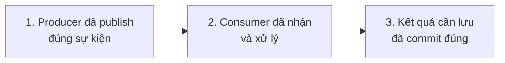
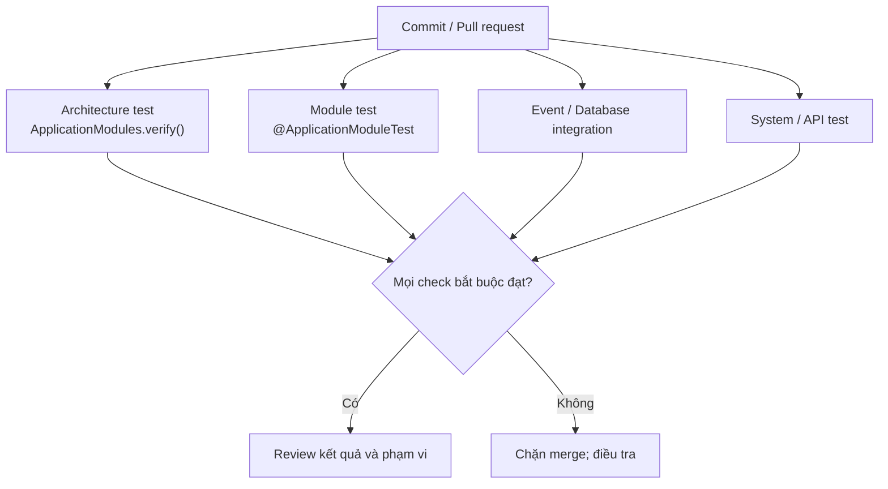

# Bằng chứng cần có để nói một module được kiểm chứng

Trong một ứng dụng Spring Modulith, câu “module `orders` đã được kiểm chứng” nghe có vẻ rõ ràng nhưng thực chất **chưa đủ thông tin**. Kiểm chứng theo tiêu chí nào? Trên phiên bản mã nào? Những bài test nào đã chạy? Chúng có kiểm tra cả ranh giới phụ thuộc, hành vi và tích hợp hay chỉ xác nhận Spring context khởi động thành công?

Một kết luận có giá trị cần đi cùng **bằng chứng có thể kiểm tra lại**: tiêu chí rõ ràng, phép kiểm chứng tương ứng, kết quả chạy trên một phiên bản mã xác định, phạm vi môi trường và những rủi ro chưa được bao phủ. Bài học này tập trung vào cách thu thập, đọc và đánh giá bằng chứng đó.

Bài thuộc chương **Nhập môn** của **SPRING_MODULITH_VERIFICATION_TESTING**. Trong chủ đề này, chúng ta rèn kỹ năng kiểm chứng ranh giới kiến trúc bằng `ApplicationModules` và các quy tắc phụ thuộc, kiểm thử hành vi module bằng `@ApplicationModuleTest`, kiểm thử sự kiện, cơ sở dữ liệu và tích hợp, rồi kết hợp các kết quả vào **quality gate trong CI** để ngăn phụ thuộc sai và hồi quy.

## 1. Mục tiêu học tập

Sau bài này, bạn có thể:

1. Phân biệt **bằng chứng kiểm chứng cấu trúc** với **bằng chứng kiểm thử hành vi và tích hợp**.
2. Giải thích tại sao một test xanh, một con số coverage cao hoặc một lần chạy ứng dụng thành công **chưa đủ** để kết luận toàn bộ module đã đúng.
3. Thiết kế bảng liên kết **yêu cầu → rủi ro → phép kiểm chứng → kết quả → giới hạn** cho một application module.
4. Thu thập bằng chứng từ `ApplicationModules.of(...).verify()`, `@ApplicationModuleTest`, `PublishedEvents` và các integration test liên quan.
5. Xác định khi nào cần thêm test cho transaction, database, consumer, idempotency hoặc luồng xuyên module.
6. Đặt các kiểm tra bắt buộc vào CI và đọc đúng kết quả: test nào chạy, test nào bị skip, phiên bản mã nào được kiểm tra, môi trường nào được sử dụng.

## 2. “Đã được kiểm chứng” là một phát biểu có phạm vi

Không tồn tại một phép kiểm tra đơn lẻ có thể chứng minh mọi thuộc tính của một module. Có thể phát biểu chính xác hơn:

> Ở commit **X**, trên cấu hình kiểm thử **Y**, các quy tắc kiến trúc **A** và các tình huống hành vi/tích hợp **B** đã chạy và đạt; các phạm vi **C** chưa được kiểm chứng.

Ví dụ:

- “Ở commit hiện tại, `ApplicationModules.verify()` xác nhận không có phụ thuộc vòng, tham chiếu vào API nội bộ hoặc vi phạm `allowedDependencies` theo mô hình module được nhận diện.”
- “`orders` phát đúng một `OrderPlaced` cho đơn hợp lệ, không phát sự kiện cho số lượng không hợp lệ, theo các ca `@ApplicationModuleTest` đã chạy.”
- “Consumer `inventory` xử lý lại cùng event mà không tạo reservation trùng, đã được xác minh với PostgreSQL test và unique constraint.”
- “Luồng HTTP đặt hàng–kho đã chạy thành công trong test context; tính sẵn sàng của broker production chưa nằm trong phạm vi kiểm chứng.”

Những phát biểu trên có **đối tượng, điều kiện, bằng chứng và giới hạn**. Ngược lại, “đã test kỹ”, “coverage 95%” hoặc “pipeline xanh” không tự cho biết thuộc tính nào của module đã được chứng minh.

### 2.1. Ba trạng thái không nên đánh đồng

| Trạng thái | Điều có thể khẳng định | Điều chưa thể suy ra |
|---|---|---|
| **Có test** | Có mã test hoặc mô tả kịch bản test | Test đã chạy, chạy được hoặc kiểm tra đúng yêu cầu |
| **Test đã chạy và đạt** | Các assertion được thực thi trong lần chạy đã báo đạt | Test bao phủ mọi trường hợp quan trọng hay kết luận đúng ngoài môi trường đó |
| **Hợp đồng đã có bằng chứng phù hợp** | Có liên kết từ yêu cầu đến test và kết quả tương ứng, phạm vi rõ | Toàn bộ lỗi hoặc rủi ro tương lai đã bị loại trừ |

Một test rỗng như sau cũng có thể báo xanh:

```java
@Test
void orderModuleIsCorrect() {
    // Không có assertion hoặc hành động kiểm chứng.
}
```

Vì vậy, **màu xanh chỉ có ý nghĩa khi biết rõ điều gì đã được kiểm tra**.

## 3. Năm nhóm bằng chứng cần xem xét

Một module điển hình trong modular monolith có nhiều hợp đồng cùng tồn tại:

| Nhóm bằng chứng | Câu hỏi chính | Ví dụ kết quả |
|---|---|---|
| **1. Kiến trúc module** | Module có tuân thủ ranh giới API và quy tắc dependency không? | `ApplicationModules.verify()` đạt trên đúng package gốc |
| **2. Hành vi nội bộ** | Use case có đúng với input hợp lệ, không hợp lệ và các trường hợp biên không? | Unit test và `@ApplicationModuleTest` có assertion cụ thể |
| **3. Sự kiện và hợp đồng tích hợp** | Event đúng payload, producer/consumer xử lý đúng và lỗi được ứng xử ra sao? | `PublishedEvents`, consumer test, `Scenario` hoặc integration test |
| **4. Dữ liệu và hạ tầng** | Lưu trữ, transaction, constraint, concurrency có đúng theo yêu cầu không? | Integration test với database, migration và cấu hình tương ứng |
| **5. Tự động hóa và truy xuất** | Bằng chứng gắn với mã đã kiểm tra và được chạy bắt buộc ở CI không? | Pipeline status, test report, commit SHA, danh sách test đã chạy và skipped |

Không phải module nào cũng cần cùng số lượng test. Module chỉ tính toán dữ liệu có thể không dùng database hoặc sự kiện. Module điều phối giao dịch tài chính có thể cần thêm thử nghiệm transaction, timeout và retry. Điều quan trọng là **lý do chọn hoặc không chọn một phép kiểm chứng được ghi rõ theo trách nhiệm và rủi ro của module**.

## 4. Bằng chứng thứ nhất: mô hình module và ranh giới phụ thuộc hợp lệ

### 4.1. Phải xác định được module đang kiểm chứng là gì

Giả sử ứng dụng Spring Boot có cấu trúc:

```text
com.acme.shop
├── ShopApplication.java
├── orders
│   ├── OrderService.java
│   ├── events
│   │   ├── package-info.java
│   │   └── OrderPlaced.java
│   └── internal
│       └── OrderRepository.java
├── inventory
│   ├── package-info.java
│   ├── InventoryStatus.java
│   └── internal
│       └── ReservationRepository.java
└── payments
    ├── PaymentService.java
    └── internal
        └── PaymentRepository.java
```

Với cách nhận diện mặc định, các package con trực tiếp dưới `com.acme.shop` là các ứng viên application module. Các type ở package gốc module tạo nên phần API công khai theo quy ước; type thuộc package con như `orders.internal` là nội bộ, trừ khi được công bố qua named interface hoặc cấu hình tương ứng.

Một **bằng chứng kiến trúc đáng tin** cần xác nhận:

- Package gốc ứng dụng được chỉ định đúng và các module mong đợi thực sự được nhận diện.
- Những type/API được công khai có chủ đích; phần triển khai nội bộ không bị consumer dùng trực tiếp.
- Quy tắc dependency mong muốn được mô hình hóa, ví dụ thông qua `allowedDependencies`.
- Bài kiểm chứng chạy trên code hiện tại và trả về kết quả có thể truy vết.

Không nên chỉ nhìn một kết quả `verify()` xanh rồi giả định mọi package mong đợi đều đã được nhận diện thành module. Nếu mô hình bị cấu hình sai, một phần mã có thể nằm ngoài phạm vi kiểm chứng mà nhóm tưởng rằng đã được bảo vệ.

### 4.2. Bài test bắt buộc nên có

Trong package `com.acme.shop`:

```java
package com.acme.shop;

import org.junit.jupiter.api.Test;
import org.springframework.modulith.core.ApplicationModules;

class ModuleArchitectureTests {

    @Test
    void verifiesDeclaredModuleBoundaries() {
        ApplicationModules.of(ShopApplication.class).verify();
    }
}
```

`ApplicationModules.of(ShopApplication.class)` xây dựng mô hình module của ứng dụng; `verify()` áp dụng các quy tắc kiến trúc được Spring Modulith hỗ trợ. Những vi phạm thường cần phát hiện là phụ thuộc vòng, tham chiếu vào type nội bộ và phụ thuộc trái `allowedDependencies`.

Ví dụ một khai báo về chiều dependency trong `inventory/package-info.java`:

```java
@org.springframework.modulith.ApplicationModule(
    allowedDependencies = "orders::events"
)
package com.acme.shop.inventory;
```

Và công bố named interface `events` của `orders`, tại `orders/events/package-info.java`:

```java
@org.springframework.modulith.NamedInterface("events")
package com.acme.shop.orders.events;
```

Như vậy `inventory` được thiết kế để tham chiếu hợp đồng thuộc `orders::events`; nó không được tùy tiện gọi `orders.internal.OrderRepository`.

### 4.3. Bằng chứng cần có sau khi chạy

Một ghi nhận ngắn, đủ để người review hiểu:

| Thuộc tính | Nội dung cần lưu |
|---|---|
| Đầu vào phép kiểm chứng | `ShopApplication.class`, cấu hình nhận diện module và dependency policy |
| Bài kiểm chứng | `ModuleArchitectureTests.verifiesDeclaredModuleBoundaries` |
| Phiên bản mã | Commit SHA hoặc revision của CI run |
| Kết quả | PASS/FAIL, thông báo chi tiết nếu phát hiện vi phạm |
| Phạm vi | Ranh giới và quan hệ type trong mô hình mà Spring Modulith phân tích được |
| Giới hạn | Không khẳng định bean chạy được, dữ liệu đã commit hoặc mọi phụ thuộc động được kiểm tra |

Trong quá trình thiết lập gate, có thể tạo một vi phạm có chủ đích để xác nhận cơ chế thực sự bắt lỗi: cho một lớp ở `inventory` tham chiếu type `public` thuộc `orders.internal` bằng field hoặc constructor parameter. Java vẫn có thể biên dịch, nhưng `verify()` phải báo lỗi ranh giới. Sau khi loại bỏ tham chiếu, gate phải trở lại trạng thái đạt.

**Không nên giữ vi phạm cố ý trong nhánh chính.** Mục đích là kiểm tra hiệu lực của phép kiểm chứng khi cấu hình lần đầu hoặc khi nghi ngờ test không được chạy.

### 4.4. Kết quả kiến trúc xanh chưa chứng minh hành vi

`verify()` có thể xanh dù `OrderService` tính tiền sai, `OrderPlaced` phát thiếu trường, hoặc listener cập nhật database lỗi. Phép kiểm chứng chỉ nói về **những thuộc tính cấu trúc** mà nó được thiết kế để đánh giá. Các hợp đồng nghiệp vụ cần bằng chứng khác.

## 5. Bằng chứng thứ hai: hành vi của use case trong module

### 5.1. Định nghĩa hợp đồng trước khi viết test

Đối với module `orders`, giả sử use case `place(productId, quantity)` có hợp đồng:

1. `productId` không được `null`.
2. `quantity` phải lớn hơn 0.
3. Khi đầu vào hợp lệ, trả một `orderId` và phát đúng một `OrderPlaced` chứa dữ liệu tương ứng.
4. Khi đầu vào không hợp lệ, ném ngoại lệ phù hợp và không phát `OrderPlaced`.

Đây là **hợp đồng minh họa ở mức xử lý yêu cầu**, chưa có bước lưu đơn hoặc transaction. Nếu nghiệp vụ thật định nghĩa “đặt hàng” là sau khi commit, cần bổ sung phần persistence và điều chỉnh ngữ nghĩa sự kiện.

Định nghĩa event công khai trong `orders.events`:

```java
package com.acme.shop.orders.events;

import java.util.UUID;

public record OrderPlaced(
    UUID orderId,
    UUID productId,
    int quantity
) {}
```

Use case minh họa:

```java
package com.acme.shop.orders;

import com.acme.shop.orders.events.OrderPlaced;
import java.util.UUID;
import org.springframework.context.ApplicationEventPublisher;
import org.springframework.stereotype.Service;

@Service
public class OrderService {

    private final ApplicationEventPublisher events;

    public OrderService(ApplicationEventPublisher events) {
        this.events = events;
    }

    public UUID place(UUID productId, int quantity) {
        if (productId == null || quantity <= 0) {
            throw new IllegalArgumentException("Invalid order item");
        }

        UUID orderId = UUID.randomUUID();
        events.publishEvent(
            new OrderPlaced(orderId, productId, quantity)
        );
        return orderId;
    }
}
```

### 5.2. Tạo bằng chứng bằng @ApplicationModuleTest

Đặt test trong package `com.acme.shop.orders`:

```java
package com.acme.shop.orders;

import static org.assertj.core.api.Assertions.assertThat;
import static org.assertj.core.api.Assertions.assertThatThrownBy;

import com.acme.shop.orders.events.OrderPlaced;
import java.util.UUID;
import org.junit.jupiter.api.Test;
import org.springframework.beans.factory.annotation.Autowired;
import org.springframework.modulith.test.ApplicationModuleTest;
import org.springframework.modulith.test.PublishedEvents;

@ApplicationModuleTest
class OrderModuleTests {

    @Autowired OrderService orders;

    @Test
    void publishesExpectedEvent(PublishedEvents events) {
        UUID productId = UUID.randomUUID();

        UUID orderId = orders.place(productId, 2);

        assertThat(events.ofType(OrderPlaced.class))
            .singleElement()
            .satisfies(event -> {
                assertThat(event.orderId()).isEqualTo(orderId);
                assertThat(event.productId()).isEqualTo(productId);
                assertThat(event.quantity()).isEqualTo(2);
            });
    }

    @Test
    void rejectsNonPositiveQuantity(PublishedEvents events) {
        assertThatThrownBy(
            () -> orders.place(UUID.randomUUID(), 0)
        ).isInstanceOf(IllegalArgumentException.class);

        assertThat(events.ofType(OrderPlaced.class)).isEmpty();
    }

    @Test
    void rejectsMissingProductId(PublishedEvents events) {
        assertThatThrownBy(() -> orders.place(null, 2))
            .isInstanceOf(IllegalArgumentException.class);

        assertThat(events.ofType(OrderPlaced.class)).isEmpty();
    }
}
```

Những bài test trên có các assertion **cụ thể**: đúng ID, đúng sản phẩm, đúng số lượng, không phát sự kiện với đầu vào không hợp lệ. `@ApplicationModuleTest` khởi tạo Spring TestContext tập trung vào `orders`, còn `PublishedEvents` cung cấp khả năng quan sát event được publish trong test.

Để đọc bằng chứng đúng, cần nói rõ:

- **Đã xác minh:** Spring có thể dựng các bean liên quan trong phạm vi test, các use case trên cho kết quả đã assert và producer phát event như mong đợi.
- **Chưa xác minh:** database của đơn hàng, transaction, sự kiện đã được consumer xử lý hay có được giao lại sau lỗi không.

### 5.3. Tiêu chí kiểm tra chất lượng của chính bài test

| Câu hỏi đánh giá | Bài test yếu | Bài test tạo bằng chứng tốt hơn |
|---|---|---|
| Có quan sát đầu ra không? | Chỉ gọi `orders.place(...)` mà không assert | Assert `orderId`, payload và số event |
| Có kiểm tra trường hợp lỗi không? | Chỉ có happy path | Có case `null`, số lượng không hợp lệ và không phát event |
| Có dùng dữ liệu ổn định không? | Phụ thuộc vào bản ghi từ lần chạy trước | Tạo ID/fixture riêng cho mỗi test |
| Có bảo đảm assertion thật sự chạy không? | Test `@Disabled` hoặc nhánh không tới assertion | Báo cáo test có kết quả thực thi và không bị skip |
| Có nhầm mục đích test không? | Suy ra consumer thành công từ publisher test | Gắn thêm consumer/integration test riêng |

Một test chỉ `@Autowired OrderService` và kiểm tra `assertThat(orders).isNotNull()` là bằng chứng **context có bean**, chưa phải bằng chứng use case làm đúng nghiệp vụ.

## 6. Bằng chứng thứ ba: hợp đồng sự kiện giữa producer và consumer

Trong Spring Modulith, event là cơ chế phối hợp phổ biến giữa các module. Nhưng phải phân biệt ba nấc kiểm chứng:



`PublishedEvents` là bằng chứng cho nấc **publish**. Nó không mặc định chứng minh nấc **xử lý** hoặc **commit**.

### 6.1. Bằng chứng từ producer

Cần xác nhận:

- Event đúng loại và mang ý nghĩa nghiệp vụ phù hợp.
- Payload đúng ID, các trường dữ liệu và giá trị biên.
- Số lần phát đúng với mỗi use case.
- Không phát event khi thao tác phải bị từ chối.
- Thời điểm phát đúng với ngữ nghĩa nghiệp vụ (trước hay sau commit, nếu liên quan).

Ví dụ `OrderPlaced` trong mục 5 chỉ thể hiện use case minh họa đã chấp nhận đầu vào và publish object. Đừng lấy test này làm bằng chứng một **đơn hàng đã được lưu bền vững** khi code mẫu chưa có transaction.

### 6.2. Bằng chứng từ consumer

Giả sử `inventory` nghe `OrderPlaced` và đặt giữ số lượng sản phẩm. Một consumer test cần kiểm tra **kết quả nghiệp vụ**, chẳng hạn:

1. Với kho có 10 sản phẩm, event yêu cầu 2 sản phẩm tạo một reservation tương ứng.
2. Với số lượng không đủ, hệ thống phản ứng theo quy tắc đã định nghĩa: từ chối, chờ xử lý hoặc phát sự kiện kết quả.
3. Khi nhận lại cùng `eventId` hoặc khóa idempotency, không tạo thêm một lần giữ hàng ngoài mong muốn.
4. Nếu lỗi ở giữa, trạng thái và cơ chế retry đạt yêu cầu về tính nhất quán.

Test chỉ kiểm tra “listener có method nhận `OrderPlaced`” không đủ. Test phải quan sát **số bản ghi**, **số lượng kho**, **event kết quả** hoặc trạng thái bên ngoài phù hợp.

### 6.3. Bất đồng bộ và thời gian quan sát

Khi listener xử lý bất đồng bộ hoặc sau commit, producer có thể kết thúc trước consumer. Test cần chờ trạng thái hoặc event kết quả có thể quan sát; `Scenario` trong Spring Modulith Test hỗ trợ mô tả luồng kích thích, chờ và xác minh kết quả.

Mã sau chỉ **minh họa mẫu kiểm thử** vì giả định ứng dụng đã có `OrderAccepted`, `StockReserved` và listener tương ứng:

```java
@Autowired Scenario scenario;
@Autowired ApplicationEventPublisher publisher;

@Test
void waitsForStockReservationResult() {
    UUID orderId = UUID.randomUUID();

    scenario
        .stimulate(() -> publisher.publishEvent(
            new OrderAccepted(orderId)
        ))
        .andWaitForEventOfType(StockReserved.class)
        .matching(StockReserved::orderId, orderId)
        .toArriveAndVerify(event ->
            assertThat(event.orderId()).isEqualTo(orderId));
}
```

Đây là bằng chứng cho **event kết quả đã tới** nếu test chạy đúng cấu hình và điều kiện quan sát. Nó vẫn cần được kết hợp với kiểm tra database nếu hợp đồng yêu cầu reservation đã commit.

Không thay thế việc chờ có điều kiện bằng `Thread.sleep(...)` tùy ý; test dùng sleep có thể ngẫu nhiên xanh hoặc đỏ theo tải của CI.

### 6.4. Chú ý độ tin cậy xử lý sự kiện

Nếu ứng dụng dùng `@ApplicationModuleListener` để xử lý sự kiện sau commit trong transaction riêng, cần có test mô tả rõ ranh giới transaction. Spring Modulith còn có cơ chế event publication registry theo cấu hình để hỗ trợ theo dõi publication và xử lý lại. Tuy nhiên, không nên diễn giải một annotation hoặc một registry là bảo đảm “exactly once” cho mọi tác dụng nghiệp vụ.

Một hợp đồng event đáng tin phải định nghĩa rõ **idempotency**, **retry**, **phản ứng khi consumer lỗi** và **trạng thái cuối cùng**. Bằng chứng cho các yêu cầu này thường nằm ở integration test, không chỉ ở producer unit test.

## 7. Bằng chứng thứ tư: database, transaction và tích hợp thực tế

Những ràng buộc về lưu trữ khó được chứng minh bằng mock repository. Ví dụ một consumer kho có thể gọi `repository.save(...)` đúng một lần trong unit test, nhưng production vẫn tạo hai reservation vì thiếu unique constraint, hoặc bán vượt tồn kho do race condition.

### 7.1. Những thuộc tính cần kiểm chứng khi module sở hữu dữ liệu

| Thuộc tính | Rủi ro nếu không kiểm tra | Bằng chứng phù hợp |
|---|---|---|
| Mapping và migration | Class JPA hợp lệ nhưng bảng/cột không đúng | Test khởi tạo schema, thực hiện CRUD với database test |
| Constraint | Dữ liệu trùng/không hợp lệ vẫn lưu được | Test vi phạm unique/check/foreign key tương ứng |
| Transaction | Lỗi giữa quy trình để lại dữ liệu nửa chừng | Test commit/rollback theo transaction boundary thật |
| Concurrency | Hai đơn tranh cùng tồn kho gây bán vượt | Integration test với nhiều transaction và locking/isolation phù hợp |
| Idempotency bền vững | Event gửi lại tạo hai bản ghi giữ hàng | Test xử lý lại trên DB, khóa idempotency và assertion trạng thái |
| Phục hồi sau lỗi | Publisher commit nhưng consumer thất bại | Test chính sách lưu publication/retry/bù trừ thực tế |

### 7.2. Tại sao Testcontainers có ích?

Testcontainers có thể khởi chạy PostgreSQL, MySQL hoặc một công nghệ hạ tầng phù hợp cho integration test, giúp kiểm tra SQL, transaction, constraint và isolation gần với môi trường thực tế hơn một fake repository.

Tuy vậy, **dùng Testcontainers tự nó chưa phải bằng chứng chất lượng**. Bài test vẫn cần:

- Chuẩn bị schema/migration đúng.
- Tạo dữ liệu kiểm thử độc lập.
- Kích hoạt hành vi qua hợp đồng mong muốn.
- Assert trạng thái **sau khi transaction cần quan sát đã kết thúc**.
- Thử ít nhất một trường hợp thất bại liên quan đến rủi ro quan trọng.

Ví dụ, nếu module kho cần ngăn hai lần đặt giữ hàng cho cùng `orderId`, bằng chứng mạnh hơn là test cố tạo hai reservation có cùng khóa, rồi xác nhận chỉ có một reservation hợp lệ được commit theo unique constraint hoặc cơ chế idempotency đã thiết kế.

### 7.3. Không nhầm transaction của test với transaction của production

Trong Spring Test, `@Transactional` trên phương thức test thường khiến test transaction được rollback khi test kết thúc. Một listener chạy trong transaction khác có thể không thấy dữ liệu chưa commit hoặc có thời điểm xử lý khác.

Vì vậy, kết quả “test xanh trong transaction bao quanh” chưa đủ để khẳng định một chuỗi **publish → commit → listener → commit** hoạt động đúng trong production. Khi ranh giới commit là một phần hợp đồng, phải sắp xếp transaction và thời điểm quan sát tương ứng.

## 8. Bằng chứng thứ năm: một luồng tích hợp có thể quan sát từ bên ngoài

Ngay cả khi architecture test và module test đều đạt, điểm vào HTTP hoặc thành phần tích hợp vẫn có thể lỗi:

- Controller ánh xạ sai request.
- Validation/serialization khác với hợp đồng API.
- Security filter chặn một luồng hợp lệ.
- Configuration thiếu bean hoặc có nhầm profile.
- Sự kiện được phát nhưng consumer cần thiết không có trong context.
- Một API trả “thành công” trước khi hệ thống đạt trạng thái mà sản phẩm đã cam kết.

Với ứng dụng Spring Boot, có thể tạo test `@SpringBootTest` kết hợp `MockMvc` để kiểm tra một luồng HTTP trong JVM, hoặc dùng `RANDOM_PORT` và HTTP client để kiểm tra qua network stack của server test.

Điều quan trọng là **quan sát đầu ra ngoài ranh giới module**: mã HTTP, nội dung response, trạng thái dữ liệu hoặc sự kiện kết quả của luồng đặt hàng.

| Ví dụ test | Điều thực sự được chứng minh | Giới hạn |
|---|---|---|
| `MockMvc` trả HTTP 200 | Spring MVC route/controller hoạt động với input đang test | Không bảo đảm consumer hoặc dữ liệu đã commit |
| `MockMvc` + đọc reservation sau request | Luồng HTTP và consumer trong cùng test context tạo trạng thái đã assert | Chưa thử socket/network thật; DB có thể là in-memory |
| `RANDOM_PORT` + DB test | Luồng HTTP qua server và persistence theo cấu hình test | Chưa bảo đảm broker, cloud hoặc hạ tầng production giống hệt |
| End-to-end trên môi trường staging | Hành vi xuyên các thành phần đã triển khai và được chọn | Chỉ phản ánh trạng thái và cấu hình của lần chạy cụ thể |

Từ “system test” hoặc “end-to-end test” trên tên file không tự làm bằng chứng mạnh hơn. Hãy kiểm tra **thành phần nào thật sự được chạy** và **điều kiện nào thật sự được assert**.

## 9. Bằng chứng chạy test: kết quả cần gắn với phiên bản mã

Để nói “ở phiên bản này module được kiểm chứng”, ít nhất cần biết:

- Commit hoặc revision đang kiểm tra.
- Build tool, JDK, phiên bản Spring Boot/Spring Modulith theo cấu hình dự án.
- Các lệnh hoặc task test đã được CI thực thi.
- Kết quả các bài kiến trúc, module và integration/system test bắt buộc.
- Số bài test thực sự chạy, số thất bại, số bị skip và lý do skip.
- Cấu hình hạ tầng test: database, profile, broker, migration nếu liên quan.
- Các báo cáo kiểm thử/log có thể xem lại từ lần CI đó.

Ví dụ các lệnh chạy thông thường khi dự án có wrapper:

```bash
# Maven Wrapper: chạy các test được cấu hình trong phase test
./mvnw test

# Maven verify: chạy các phase đến verify và plugin được cấu hình
./mvnw verify

# Gradle Wrapper: chạy task test đã cấu hình
./gradlew test
```

Không nên tự suy luận `./mvnw verify` hoặc `./gradlew test` luôn chạy mọi integration test: điều này phụ thuộc plugin, source set và task của dự án. Một quality gate chỉ có giá trị khi **những test cần thiết thực sự được chạy**.

### 9.1. CI xanh nhưng thiếu bằng chứng: bốn ví dụ

1. **Architecture test bị exclude:** pipeline xanh dù `ApplicationModules.verify()` không thực thi.
2. **Integration test bị skip:** database chưa được cung cấp, job chỉ chạy unit test.
3. **Test chỉ kiểm tra context load:** Spring boot được nhưng hợp đồng nghiệp vụ chưa được assert.
4. **Kết quả của commit cũ:** pipeline xanh cho revision trước, trong khi pull request hiện tại đã bổ sung dependency mới.

Vì vậy, status xanh phải được đối chiếu với danh sách test đã thực thi, revision và phạm vi môi trường.

### 9.2. Tổ chức bằng chứng CI tối thiểu



Với GitHub Actions, GitLab CI hoặc CI khác, nhóm có thể lưu JUnit XML/test report và build log để reviewer tra cứu. Các check bắt buộc cần được cấu hình theo branch protection hoặc quy tắc merge tương ứng; nếu chỉ hiển thị mà không chặn merge, đó mới là tín hiệu, chưa phải quality gate có hiệu lực.

## 10. Ma trận truy vết: từ hợp đồng đến bằng chứng

Một **ma trận truy vết** giúp tránh tình trạng viết nhiều test nhưng bỏ sót hợp đồng quan trọng. Dưới đây là mẫu cho `orders` và `inventory`.

| ID | Hợp đồng/rủi ro | Phép kiểm chứng | Bằng chứng đạt | Giới hạn cần ghi rõ |
|---|---|---|---|---|
| ARCH-01 | Không dùng package nội bộ của module khác | `ModuleArchitectureTests` | `verify()` PASS | Phụ thuộc động ngoài phạm vi phân tích |
| ARCH-02 | Không có vòng module, tuân thủ `allowedDependencies` | Cùng architecture test | PASS và mô hình module đúng | Cấu hình/module detector phải chính xác |
| ORD-01 | Không tiếp nhận quantity bằng 0 | `OrderModuleTests` | Có exception và không publish event | Chưa kiểm tra database |
| ORD-02 | Event có đúng orderId/productId/quantity | `OrderModuleTests` + `PublishedEvents` | Một event đúng payload | Consumer chưa được xác nhận |
| INV-01 | Nhận `OrderPlaced` tạo đúng reservation | Consumer module/integration test | Trạng thái kho/reservation đúng | Phụ thuộc loại storage trong test |
| INV-02 | Nhận lặp không tạo reservation trùng | Integration test với DB và khóa idempotency | Một tác động bền vững sau hai lần xử lý | Concurrent delivery cần ca riêng |
| TX-01 | Consumer lỗi không lưu dữ liệu dở dang | Transaction integration test | Commit/rollback đúng quy tắc | Thử trên DB và cấu hình được chỉ định |
| API-01 | HTTP đặt hàng dẫn đến trạng thái cần thiết | System/API test | Response và trạng thái được assert | Môi trường test có thể khác production |
| CI-01 | Mọi test bắt buộc chạy trên commit mới nhất | CI pipeline + report | Required checks đạt, không có skip ngoài kế hoạch | Cần duy trì branch protection và cấu hình job |

Bảng này là **mẫu kế hoạch kiểm chứng**, không phải lời xác nhận các bài test trên đã được chạy trong một dự án thực tế. Khi sử dụng, hãy thay tên test, báo cáo và kết quả bằng dữ liệu từ CI run thật.

Một bản ma trận tốt cho phép mỗi yêu cầu quan trọng có thể được tìm ngược tới mã test, test run và kết quả; đồng thời thể hiện những ca **chưa có bằng chứng** để quyết định mức ưu tiên.

## 11. Bằng chứng âm tính: có chứng minh được test sẽ bắt lỗi?

Bộ test có thể luôn xanh vì nó không được chạy hoặc vì assertion quá yếu. Ngoài việc xem đường đi thành công, hãy thử một số **thay đổi gây lỗi có chủ đích** trong môi trường phát triển:

| Thay đổi gây lỗi | Test mong đợi phải đỏ | Nếu test vẫn xanh, cần xem gì? |
|---|---|---|
| Cho `inventory` tham chiếu `orders.internal.OrderRepository` | Architecture test | Module detector, phạm vi type dependency, test có chạy không |
| Đổi validation để chấp nhận quantity bằng 0 | Module behavior test | Thiếu case input biên, test bị skip, assertion yếu |
| Phát `OrderPlaced` với quantity sai | Producer event test | Có assert payload hay chỉ assert type event? |
| Cho consumer xử lý lại event tạo reservation trùng | Idempotency integration test | Có assert dữ liệu cuối, unique constraint, count không? |
| Bỏ cấu hình listener cần thiết | Consumer/system test | Test có thật sự nạp consumer và quan sát kết quả không? |

Cách làm này gần với **mutation testing ở mức ý tưởng**: nếu lỗi được đưa vào mà bài test không báo, bằng chứng đang thiếu. Khi thực hành, chỉ tạo vi phạm tạm thời trên nhánh phát triển hoặc thay đổi dễ hoàn tác, rồi khôi phục trạng thái hợp lệ trước khi merge.

Không cần áp dụng mutation testing tự động cho mọi dòng code. Ưu tiên các quy tắc kiến trúc và kịch bản nghiệp vụ có rủi ro lớn, nơi một test “xanh giả” gây hậu quả đáng kể.

## 12. Chọn mức bằng chứng theo độ rủi ro của module

Các module có mức tác động khác nhau, nên cường độ kiểm chứng cũng khác nhau.

| Loại module | Bằng chứng nên ưu tiên | Lý do |
|---|---|---|
| Module chỉ biến đổi dữ liệu thuần | Architecture test + unit test nhiều ca biên | Rủi ro nằm ở quy tắc tính toán và chiều phụ thuộc |
| Module phát event | Architecture + `@ApplicationModuleTest` + payload/negative cases | Hợp đồng producer ảnh hưởng nhiều consumer |
| Module nhận event bất đồng bộ | Consumer/integration test, retry và idempotency | Hành vi có thể diễn ra sau publisher và nhận lặp |
| Module sở hữu dữ liệu quan trọng | Database transaction/constraint/concurrency test | Sai commit hoặc race có thể làm dữ liệu không nhất quán |
| Module điều phối nhiều nghiệp vụ | Module test + system test cho luồng chính và lỗi | Rủi ro phát sinh ở biên phối hợp |
| Module liên quan thanh toán | Hợp đồng với hệ thống ngoài, idempotency, rollback/bù trừ và audit theo yêu cầu | Tác động tài chính và xử lý lỗi phức tạp |

Cường độ kiểm thử nên xuất phát từ **hợp đồng nghiệp vụ và mức ảnh hưởng khi sai**. Ví dụ, module không dùng database không cần một database test chỉ để đủ “năm loại bằng chứng”; ngược lại, một module giữ tồn kho không thể chỉ dựa vào `PublishedEvents` để khẳng định dữ liệu nhất quán.

## 13. Checklist nghiệm thu một module

Đối với từng module quan trọng, người review có thể hỏi:

- **Ranh giới:** module được nhận diện đúng chưa; public API, phần nội bộ và dependency policy đã thể hiện rõ chưa?
- **Kiến trúc:** `ApplicationModules.verify()` có chạy trên commit cần xét và có báo PASS không?
- **Hành vi:** các use case quan trọng có ca hợp lệ, không hợp lệ và edge case được assert rõ không?
- **Sự kiện:** producer đã được kiểm tra về type, payload, số lần phát; consumer đã được kiểm tra về trạng thái xử lý chưa?
- **Dữ liệu:** những yêu cầu commit/rollback, constraint, idempotency, concurrency có được test trên hạ tầng tương ứng không?
- **Tích hợp:** các luồng xuyên module hoặc API quan trọng có test quan sát kết quả cuối không?
- **Tái lập:** có thể xác định revision, lệnh test, môi trường, kết quả, test bị skip và báo cáo CI không?
- **Giới hạn:** rủi ro chưa test có được ghi rõ và có quyết định chấp nhận/ưu tiên xử lý không?

Checklist chỉ là **khung đánh giá**, không phải quy định rằng mọi module đều phải có đủ mọi loại test. Nếu một mục không áp dụng, ghi rõ lý do. Nếu một mục áp dụng nhưng chưa có bằng chứng, không nên viết “module đã được kiểm chứng đầy đủ”.

## 14. Bài tập thực hành: lập hồ sơ bằng chứng cho orders

**Bối cảnh:** dùng ứng dụng Spring Boot với `orders`, `inventory`, named interface `orders::events` và các quy tắc dependency đã trình bày. Bạn được giao xác nhận một thay đổi ở `orders` đủ điều kiện đi qua quality gate.

### Phần A — Lập danh mục hợp đồng

1. Ghi ít nhất bốn hợp đồng: một quy tắc kiến trúc, hai hành vi đặt hàng và một hợp đồng sự kiện.
2. Xác định module sở hữu từng hợp đồng và mức rủi ro nếu hợp đồng bị phá.
3. Viết một câu khẳng định có thể kiểm chứng cho từng hợp đồng, tránh các câu chung chung như “module hoạt động tốt”.

### Phần B — Tạo bằng chứng cấu trúc và module

1. Viết `ModuleArchitectureTests` gọi `ApplicationModules.of(ShopApplication.class).verify()`.
2. Đảm bảo các module và named interface được nhận diện như dự kiến.
3. Viết `OrderModuleTests` với `@ApplicationModuleTest` kiểm tra payload sự kiện và đầu vào không hợp lệ.
4. Ghi lại kết quả test thật, tên test method và phiên bản mã đã kiểm tra.
5. Thử tạo dependency đi vào `orders.internal` để chứng minh architecture test có thể báo đỏ; sau đó khôi phục.

### Phần C — Tạo bằng chứng tích hợp

1. Viết consumer test cho `inventory` kiểm tra event tạo một reservation hợp lệ.
2. Thêm ca nhận lặp event và kiểm tra trạng thái cuối; nếu đã dùng database, xác minh unique constraint hoặc khóa idempotency.
3. Nếu consumer dùng listener bất đồng bộ, thiết kế test chờ event kết quả hoặc trạng thái quan sát được.
4. Ghi rõ ca nào dùng fake storage, ca nào chạy database thật/Testcontainers và kết luận tương ứng.

### Phần D — Đưa bằng chứng vào CI

1. Cho CI chạy architecture test, module test và những integration/system test được yêu cầu.
2. Kiểm tra test report để xác định các test thật sự được chạy, số test bị skip và lỗi nếu có.
3. Liên kết ma trận yêu cầu–test với kết quả CI của commit đang xét.
4. Viết một nhận định cuối dựa trên bằng chứng có phạm vi, ví dụ:

> Với revision đang kiểm tra, ranh giới `orders` và `inventory` đạt `ApplicationModules.verify()`; use case đặt hàng đã vượt qua các ca hợp lệ và không hợp lệ, đồng thời `OrderPlaced` đúng payload trong `@ApplicationModuleTest`. Xử lý lặp sự kiện của `inventory` đã được kiểm chứng trong môi trường [mô tả]. Các kịch bản [chưa kiểm tra] vẫn còn là giới hạn.

Các dấu ngoặc trong nhận định là **chỗ cần điền bằng kết quả thật**, không được tự coi là đã có bằng chứng.

**Tiêu chí hoàn thành:** người khác có thể mở test, mở kết quả CI, biết chính xác module nào và yêu cầu nào được kiểm tra, xem lại phạm vi môi trường và lặp lại phép kiểm chứng khi cần.

## 15. Những ngộ nhận thường gặp về bằng chứng

**“100% code coverage nghĩa là module đã được kiểm chứng đầy đủ.”** Không. Coverage chỉ cho biết phần mã nào được thực thi theo thước đo, không bảo đảm assertion đúng, không chứng minh ranh giới module hợp lệ hoặc các case về concurrency đã được thử.

**“Build xanh nghĩa là `ApplicationModules.verify()` đã chạy.”** Không. Bài test có thể bị skip, excluded hoặc nằm ngoài task/phase CI đang chạy.

**“Ứng dụng khởi động được thì module không vi phạm ranh giới.”** Không. Spring có thể nối các bean qua type `public` ở package nội bộ dù quan hệ đó trái quy tắc Spring Modulith.

**“Publisher test xanh chứng minh consumer đã xử lý.”** Không. `PublishedEvents` cho biết sự kiện đã được phát; consumer và dữ liệu cần có test riêng.

**“Một test với H2 xanh đủ chứng minh PostgreSQL production đúng.”** Không chắc. SQL dialect, migration, constraint, isolation hoặc locking có thể khác. Cần loại hạ tầng test đáp ứng rủi ro cần chứng minh.

**“Chỉ cần lưu ảnh chụp pipeline xanh.”** Không đủ nếu thiếu commit, tên test, lệnh chạy, báo cáo và phạm vi cấu hình. Ảnh chụp có thể cung cấp tín hiệu nhưng khó tái lập và truy vết.

**“Chưa test được mọi kịch bản thì không được nói bất kỳ phần nào đã được kiểm chứng.”** Không cần cực đoan như vậy. Có thể kết luận **đúng phạm vi đã có bằng chứng**, đồng thời minh bạch về những khoảng trống còn lại.

## 16. Câu hỏi ôn tập và đáp án gợi ý

**1. Một test `@ApplicationModuleTest` chạy xanh có chứng minh không có vòng dependency giữa các module không?**

Không. Hành vi đã assert có thể đúng, trong khi quan hệ module vẫn sai. Cần phép kiểm chứng kiến trúc như `ApplicationModules.verify()`.

**2. Muốn chứng minh `orders` phát đúng một `OrderPlaced`, cần gì ngoài tên test?**

Cần test được thực thi, kích hoạt use case, assert số event và payload, cùng một kết quả PASS gắn với revision được kiểm tra.

**3. Khi nào dùng `PublishedEvents` là chưa đủ?**

Khi muốn chứng minh consumer đã xử lý hoặc kết quả đã commit; phải kiểm tra tác dụng nghiệp vụ, dữ liệu và transaction theo cấu hình thực tế.

**4. Tại sao một integration test PostgreSQL vẫn cần ghi rõ cấu hình môi trường?**

Vì schema, migration, phiên bản database, isolation, transaction và dữ liệu test ảnh hưởng đến kết quả. Không có phạm vi môi trường, người khác khó tái lập kết luận.

**5. Nếu CI xanh nhưng có integration test quan trọng bị skip, có thể nói chất lượng gate đã đạt yêu cầu không?**

Chưa. Cần biết test đó có phải điều kiện bắt buộc không và vì sao bị skip. Một quality gate cần chạy và đánh giá những kiểm tra đã cam kết.

**6. Bằng chứng âm tính là gì?**

Là việc cố ý tạo lỗi kiểm soát được — ví dụ import type nội bộ — để chứng minh kiểm tra tương ứng thực sự phát hiện và báo thất bại, sau đó khôi phục mã hợp lệ.

**7. Có cần cùng một bộ kiểm tra cho mọi module?**

Không. Mức kiểm chứng phải bám theo trách nhiệm, hợp đồng và rủi ro. Một module không có database không cần giả tạo test database; một module xử lý transaction quan trọng lại cần bằng chứng phù hợp về commit/rollback.

## Kết luận

Để nói **“một module đã được kiểm chứng”**, cần nhiều hơn một dòng `BUILD SUCCESS`. Bằng chứng đáng tin phải chỉ rõ **module và hợp đồng đang xét**, **phép kiểm chứng đã thực thi**, **assertion và kết quả thực tế**, **revision và môi trường**, đồng thời ghi rõ **những giới hạn chưa được bao phủ**.

Trong Spring Modulith, `ApplicationModules.verify()` tạo bằng chứng về **ranh giới và dependency kiến trúc**; `@ApplicationModuleTest` và `PublishedEvents` tạo bằng chứng về **hành vi của module và việc phát sự kiện**; consumer, database và system integration test tạo bằng chứng về **phối hợp và trạng thái khi chạy**. Khi tất cả những kiểm tra cần thiết được liên kết với yêu cầu và được thực thi trong **CI quality gate**, nhóm có thể đưa ra kết luận có căn cứ về chất lượng module và phát hiện kịp thời phụ thuộc sai hoặc hồi quy.
