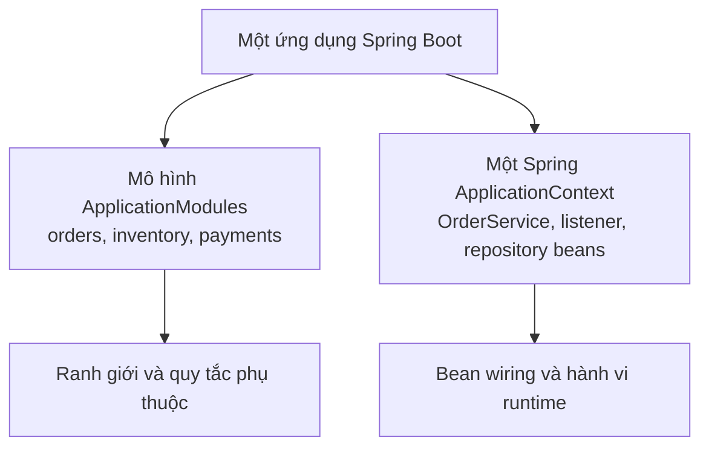
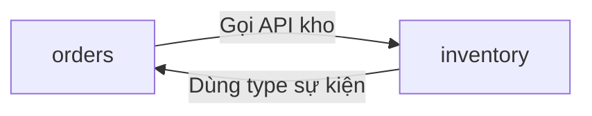
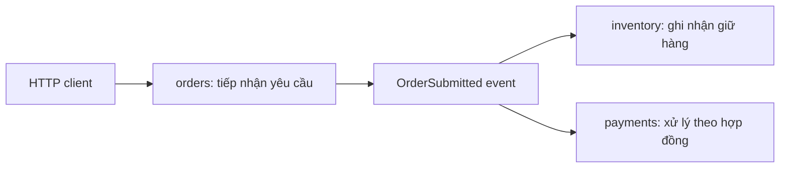
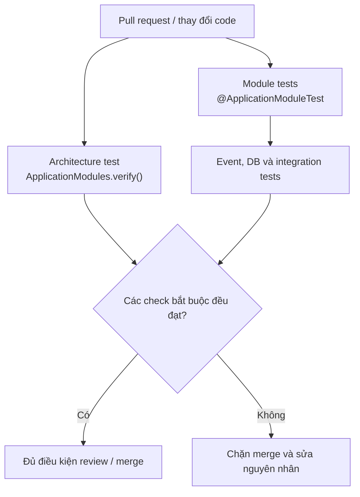

# Vai trò của Spring Modulith trong kiến trúc ứng dụng Spring Boot

Spring Boot giúp lập trình viên xây dựng và vận hành ứng dụng Java dựa trên Spring một cách thuận tiện: tự cấu hình nhiều thành phần, quản lý bean qua `ApplicationContext`, cung cấp nền tảng phát triển Web, dữ liệu, bảo mật và tích hợp. Nhưng khi ứng dụng lớn dần, **Spring Boot không tự quyết định ranh giới giữa các nghiệp vụ**. Những package nhìn có vẻ tách biệt vẫn có thể phụ thuộc chéo, truy cập repository của nhau hoặc hình thành vòng phụ thuộc mà hệ thống vẫn biên dịch và chạy được.

**Spring Modulith** bổ sung một cách nhìn và bộ công cụ dành cho **modular monolith**: vẫn triển khai một ứng dụng Spring Boot, nhưng chia mã nguồn thành các **application module** có ranh giới, API và quy tắc phụ thuộc có thể diễn đạt và kiểm chứng. Bên cạnh kiểm chứng kiến trúc, Spring Modulith hỗ trợ kiểm thử theo module, giao tiếp bằng sự kiện, quan sát sự kiện và tài liệu hóa cấu trúc để nhóm phát triển duy trì thiết kế khi ứng dụng thay đổi.

Bài thuộc chương **Nhập môn** của **SPRING_MODULITH_VERIFICATION_TESTING**. Phạm vi học tập nhấn mạnh kiểm chứng ranh giới bằng `ApplicationModules` và quy tắc dependency, thực hành `@ApplicationModuleTest`, kiểm thử sự kiện, cơ sở dữ liệu, tích hợp và tạo **quality gate trong CI** nhằm phát hiện phụ thuộc sai và hồi quy.

## 1. Mục tiêu học tập

Sau bài học, bạn có thể:

1. Giải thích vấn đề kiến trúc mà Spring Modulith giải quyết trong một ứng dụng Spring Boot phát triển lâu dài.
2. Phân biệt **Spring Boot**, **Spring Modulith**, **application module**, **Spring bean** và **Spring `ApplicationContext`**.
3. Mô tả cách phân chia ứng dụng theo năng lực nghiệp vụ, xác định API công khai và package nội bộ của module.
4. Dùng `@ApplicationModule`, `allowedDependencies` và `@NamedInterface` để diễn đạt các hợp đồng kiến trúc khi cần.
5. Nhận biết vai trò của `ApplicationModules.verify()`, `@ApplicationModuleTest`, `PublishedEvents` và các bài kiểm thử tích hợp.
6. Giải thích vì sao event giúp giảm kết nối trực tiếp giữa producer và consumer nhưng vẫn đòi hỏi hợp đồng, transaction và xử lý lỗi rõ ràng.
7. Chọn những phép kiểm tra phù hợp để đưa vào CI, đồng thời nêu được giới hạn của Spring Modulith.

## 2. Vấn đề của ứng dụng Spring Boot khi mở rộng

Một ứng dụng ban đầu có vài controller, service và repository thường dễ hiểu. Sau nhiều năm, số lượng nghiệp vụ và người tham gia phát triển tăng lên. Nếu chỉ tổ chức mã theo loại kỹ thuật, cấu trúc có thể như sau:

```text
com.example.shop
├── controller
│   ├── OrderController.java
│   ├── InventoryController.java
│   └── PaymentController.java
├── service
│   ├── OrderService.java
│   ├── InventoryService.java
│   └── PaymentService.java
├── repository
│   ├── OrderRepository.java
│   ├── StockRepository.java
│   └── PaymentRepository.java
└── model
    ├── Order.java
    ├── Stock.java
    └── Payment.java
```

Đây là **cách chia package theo lớp kỹ thuật**. Nó không luôn sai: với ứng dụng nhỏ, đơn giản, cấu trúc này có thể đủ. Vấn đề xuất hiện khi nghiệp vụ mở rộng nhưng không còn ranh giới rõ giữa các phần. Một thay đổi ở xử lý đơn hàng có thể gọi trực tiếp `StockRepository` rồi ghi `Payment` vì mọi type đều dễ truy cập.

Những dấu hiệu thường gặp:

- **Phụ thuộc lan rộng:** module đơn hàng biết quá nhiều về entity, repository và bảng dữ liệu của kho.
- **Chuỗi sửa đổi dài:** đổi một quy tắc thanh toán khiến nhiều phần không liên quan phải được cập nhật.
- **Phụ thuộc vòng:** đặt hàng gọi kho, kho lại gọi đặt hàng để lấy trạng thái.
- **Kiểm thử khó khoanh vùng:** muốn kiểm tra một use case phải dựng gần như toàn bộ ứng dụng.
- **Quy ước chỉ tồn tại trong đầu người:** nhóm nói “không gọi sang package nội bộ” nhưng CI không kiểm tra điều đó.
- **Hồi quy kiến trúc im lặng:** unit test vẫn xanh vì chúng chỉ xác nhận kết quả các hàm trong những tình huống được viết.

Spring Modulith tập trung vào việc khiến **ranh giới nghiệp vụ trở thành cấu trúc có thể kiểm chứng trong một ứng dụng Spring Boot**. Nó không bắt buộc ứng dụng phải chuyển thành nhiều microservice để có tính module.

## 3. Spring Modulith đứng ở đâu trong hệ sinh thái Spring?

| Thành phần | Vai trò chính | Không tự bảo đảm |
|---|---|---|
| **Spring Framework** | IoC container, dependency injection, transaction, event và nhiều cơ chế nền tảng | Một cách phân ranh nghiệp vụ duy nhất cho mọi ứng dụng |
| **Spring Boot** | Cấu hình và khởi chạy ứng dụng Spring, tích hợp Web, dữ liệu và hạ tầng | Module nào được phép phụ thuộc module nào |
| **Spring Modulith** | Mô hình application module, kiểm chứng dependency, hỗ trợ test, sự kiện và tài liệu hóa module | Tất cả quy tắc nghiệp vụ, giao dịch và vận hành đều đúng |
| **JUnit, Spring Test, Testcontainers và các công cụ kiểm thử** | Thực thi những phép kiểm tra có assertion và môi trường phù hợp | Tự suy ra mọi hợp đồng cần kiểm tra nếu nhóm chưa mô tả |

Cách hiểu thực dụng là: **Spring Boot chạy ứng dụng; Spring Modulith giúp giữ ứng dụng đó có cấu trúc module rõ ràng theo thời gian**.

Spring Modulith không mặc định:

- tạo một process hay một Spring `ApplicationContext` riêng cho mỗi application module;
- biến các module thành service có thể deploy độc lập;
- tạo database hay schema riêng cho mỗi module;
- tự ngăn mọi trường hợp module truy cập dữ liệu của nhau qua SQL;
- thay thế việc thiết kế domain, API, transaction hoặc chính sách xử lý lỗi;
- bảo đảm event được xử lý đúng một lần chỉ nhờ dùng một annotation.

Trong modular monolith thông thường, các application module **cùng chạy trong một ứng dụng Spring Boot và chia sẻ JVM, context**. Việc tổ chức module giúp trách nhiệm rõ hơn và có thể tạo thuận lợi nếu sau này cần tách một số phần; không nên coi chuyển sang microservices là mục tiêu bắt buộc.

## 4. Tổ chức ứng dụng theo module nghiệp vụ

Thay vì chỉ nhóm các file theo controller/service/repository ở cấp toàn hệ thống, ta có thể nhóm theo **năng lực nghiệp vụ**:

```text
com.example.shop
├── ShopApplication.java
├── orders
│   ├── OrderService.java
│   ├── OrderController.java
│   ├── events
│   │   ├── package-info.java
│   │   └── OrderSubmitted.java
│   └── internal
│       └── OrderRepository.java
├── inventory
│   ├── package-info.java
│   ├── InventoryAvailability.java
│   └── internal
│       ├── StockRepository.java
│       └── OnOrderSubmitted.java
└── payments
    ├── PaymentApi.java
    └── internal
        └── PaymentRepository.java
```

Ở mỗi module vẫn có thể tồn tại controller, service, repository và những lớp khác. Điều thay đổi là **địa điểm sở hữu**: repository của `inventory` nằm trong phần triển khai của nghiệp vụ kho, thay vì được xem như tài nguyên chung cho mọi service.

Với cách nhận diện **mặc định** của Spring Modulith, các package con trực tiếp dưới package gốc ứng dụng thường được nhận diện thành application module. Trong ví dụ này là `orders`, `inventory` và `payments`. Spring Modulith cũng hỗ trợ cấu hình cách xác định module khi cấu trúc dự án cần khác.

### 4.1. Ranh giới module gồm những gì?

Một module cần có câu trả lời cho các câu hỏi:

- Nghiệp vụ và dữ liệu nào thuộc trách nhiệm của module?
- API công khai nào module khác được dùng?
- Các chi tiết triển khai nào phải là nội bộ?
- Module được phép phụ thuộc vào những module hoặc giao diện nào?
- Khi giao tiếp bằng sự kiện, producer và consumer cam kết điều gì?

Theo mô hình mặc định, các type nằm ở package gốc của module có thể thuộc **API công khai của module**. Type trong package con như `inventory.internal.StockRepository` được coi là **nội bộ** nếu không được công bố có chủ đích.

Điều này khác với Java visibility. Một type `public` về mặt Java nhưng nằm trong package nội bộ vẫn có thể bị Spring Modulith coi là **không được phép dùng từ module khác**.

### 4.2. Mô hình module và Spring ApplicationContext

`ApplicationModules` mô hình hóa cấu trúc package, API và dependency. `ApplicationContext` của Spring quản lý bean, configuration, wiring và lifecycle khi chạy.



Hai mô hình bổ trợ nhau:

- Module dependency có thể **sai kiến trúc** dù Spring vẫn inject bean thành công.
- Dependency có thể **hợp lệ về kiến trúc** nhưng Spring context vẫn lỗi nếu thiếu bean hoặc cấu hình.
- Cả hai có thể đạt mà nghiệp vụ vẫn sai, ví dụ event chứa số lượng không đúng.

Vì vậy phải kiểm chứng **cấu trúc, khả năng khởi tạo và hành vi** theo mục tiêu tương ứng.

## 5. Spring Modulith giúp diễn đạt hợp đồng phụ thuộc như thế nào?

### 5.1. Công bố API hẹp, giữ implementation nội bộ

Một ví dụ hợp đồng công khai của `inventory`:

```java
package com.example.shop.inventory;

import java.util.UUID;

public interface InventoryAvailability {
    boolean hasEnough(UUID productId, int quantity);
}
```

Bên trong `inventory.internal`, module có thể triển khai interface đó bằng repository hoặc cơ chế dữ liệu tùy ý. Module khác chỉ nên phụ thuộc vào `InventoryAvailability` khi việc gọi API kho được thiết kế là hợp lệ.

Việc truy cập trực tiếp `inventory.internal.StockRepository` có thể biên dịch nếu type có modifier `public`, nhưng tạo ra phụ thuộc vào **chi tiết triển khai**. Một thay đổi persistence của kho khi đó sẽ buộc nghiệp vụ khác sửa mã.

### 5.2. Giới hạn module được phép phụ thuộc

Spring Modulith cung cấp `@ApplicationModule` với `allowedDependencies` để làm rõ hướng phụ thuộc. Ví dụ nếu module `inventory` chỉ được dùng hợp đồng sự kiện của `orders`, file `inventory/package-info.java` có thể là:

```java
@org.springframework.modulith.ApplicationModule(
    allowedDependencies = "orders::events"
)
package com.example.shop.inventory;
```

Ký hiệu `orders::events` nói rằng `inventory` được dùng **named interface** tên `events` do module `orders` công bố. Để công bố, đặt annotation trong file `orders/events/package-info.java`:

```java
@org.springframework.modulith.NamedInterface("events")
package com.example.shop.orders.events;
```

Nhờ đó, module kho có thể tham chiếu hợp đồng sự kiện trong package `orders.events`, nhưng không vì thế được truy cập `orders.internal.OrderRepository`.

Cần phân biệt hai điều kiện:

1. **Phạm vi API:** type được công bố như một phần interface hợp lệ của module đích hay không.
2. **Quyền phụ thuộc:** module nguồn có được phép sử dụng module hoặc named interface đích hay không.

Một public API chưa chắc được một module cụ thể phép sử dụng nếu `allowedDependencies` giới hạn tập dependency. Ngược lại, tên module đích trong `allowedDependencies` không tự làm toàn bộ implementation nội bộ của module đích trở nên công khai.

### 5.3. Phụ thuộc vòng làm hỏng ranh giới

Giả sử `orders` cần hỏi `inventory` số lượng tồn kho qua API đồng bộ, nên có dependency `orders -> inventory`. Đồng thời `inventory` tham chiếu `OrderSubmitted` do `orders` sở hữu nên có dependency `inventory -> orders`. Cả hai phía có thể dùng type công khai nhưng tổng thể lại tạo **vòng dependency giữa module**.



Những lựa chọn giải quyết có thể gồm thiết kế lại trách nhiệm orchestration, thay đổi luồng giao tiếp, hoặc tách một hợp đồng chung phù hợp. Không nên chỉ di chuyển class qua package khác để làm phép kiểm chứng xanh. Chọn quan hệ đồng bộ hay sự kiện dựa trên **nhu cầu nhất quán, trải nghiệm người dùng và trách nhiệm nghiệp vụ**.

## 6. ApplicationModules.verify(): biến nguyên tắc thiết kế thành bài test

Một trong những vai trò rõ nhất của Spring Modulith là đưa các quy tắc cấu trúc vào **kiểm tra tự động**, thay vì chỉ để chúng trong tài liệu hoặc dựa vào code review.

Bài JUnit test điển hình:

```java
package com.example.shop;

import org.junit.jupiter.api.Test;
import org.springframework.modulith.core.ApplicationModules;

class ModuleArchitectureTests {

    @Test
    void respectsModuleBoundaries() {
        ApplicationModules.of(ShopApplication.class).verify();
    }
}
```

`ApplicationModules.of(ShopApplication.class)` xây dựng mô hình ứng dụng từ cấu trúc package/metadata; `verify()` kiểm chứng các quy tắc mà Spring Modulith hỗ trợ, chẳng hạn:

| Quy tắc | Vi phạm ví dụ | Tác hại |
|---|---|---|
| Không có phụ thuộc vòng giữa module | `orders -> inventory -> orders` | Giảm khả năng thay đổi độc lập |
| Không dùng type nội bộ của module khác | `orders` tham chiếu `inventory.internal.StockRepository` | Ràng buộc vào implementation |
| Tuân thủ `allowedDependencies` | `inventory` chỉ được dùng `orders::events` nhưng gọi API `payments` | Kiến trúc thực tế lệch hợp đồng |

Bài architecture test chạy trong JUnit và **không cần gọi nghiệp vụ hay khởi động toàn bộ Spring Boot `ApplicationContext`** để kiểm tra dependency. Tuy nhiên, nó không thể thay thế tất cả kiểm thử:

- Không chứng minh số tiền được tính đúng.
- Không chứng minh listener đã xử lý event thành công.
- Không kiểm tra database có commit/rollback như ý muốn.
- Không kết luận mọi liên kết động qua reflection, chuỗi cấu hình hoặc SQL đều hợp lệ.
- Phụ thuộc vào cách application module được nhận diện và quy tắc thực tế được khai báo.

Một đơn vị test thuần JUnit cũng có thể kiểm tra tính toán; khác biệt là **assertion đang kiểm tra điều gì**. `ApplicationModules.verify()` là một phép kiểm chứng kiến trúc, còn unit test của `OrderService` thường chỉ kiểm tra kết quả nghiệp vụ.

## 7. Vai trò của sự kiện trong giao tiếp giữa module

Spring Modulith khuyến khích việc xem **sự kiện nghiệp vụ** là một lựa chọn giao tiếp giữa các module khi tính nhất quán và thứ tự xử lý cho phép. Điều này giúp producer không phải gọi trực tiếp các triển khai consumer.

Ví dụ người dùng gửi yêu cầu đặt hàng:



Sơ đồ là **chiều thông tin khi chạy**. Ở cấp type dependency, listener của `inventory` tham chiếu type `OrderSubmitted` từ `orders::events`; nghĩa là dependency mã nguồn đi từ `inventory` tới hợp đồng của `orders`. Producer không cần biết tên class của consumer.

### 7.1. Định nghĩa hợp đồng event rõ nghĩa

File `orders/events/OrderSubmitted.java`:

```java
package com.example.shop.orders.events;

import java.util.UUID;

public record OrderSubmitted(
    UUID orderId,
    UUID productId,
    int quantity
) {}
```

Tên `OrderSubmitted` cho biết yêu cầu đặt hàng đã được tiếp nhận theo ý nghĩa của ví dụ. Nó **chưa khẳng định đã lưu và commit đơn hàng vào database**. Nếu nghiệp vụ yêu cầu event thể hiện đơn đã đặt thành công bền vững, phải thiết kế bước lưu và ranh giới transaction tương ứng, đồng thời chọn tên event diễn tả đúng trạng thái.

Đối với event dùng chung, nên thống nhất:

- **Ý nghĩa:** sự kiện công bố điều gì đã xảy ra.
- **Payload:** ID, số lượng, đơn vị đo và dữ liệu nào consumer được quyền dựa vào.
- **Thời điểm:** publish trước/sau commit, có xử lý bất đồng bộ hay không.
- **Khi lỗi:** consumer được retry/bù trừ thế nào.
- **Khi nhận lặp:** dùng khóa idempotency nào để tránh tác dụng phụ trùng.
- **Thay đổi schema:** các consumer có thể chịu ảnh hưởng thế nào khi type hoặc ý nghĩa dữ liệu thay đổi.

Event không làm coupling biến mất. Nó chuyển một phần coupling từ lời gọi trực tiếp sang **hợp đồng dữ liệu và ngữ nghĩa** cần giữ ổn định.

### 7.2. Producer đơn giản trong Spring Boot

File `orders/OrderService.java`:

```java
package com.example.shop.orders;

import com.example.shop.orders.events.OrderSubmitted;
import java.util.UUID;
import org.springframework.context.ApplicationEventPublisher;
import org.springframework.stereotype.Service;

@Service
public class OrderService {

    private final ApplicationEventPublisher events;

    public OrderService(ApplicationEventPublisher events) {
        this.events = events;
    }

    public UUID submit(UUID productId, int quantity) {
        if (productId == null || quantity <= 0) {
            throw new IllegalArgumentException("Invalid order item");
        }

        UUID orderId = UUID.randomUUID();
        events.publishEvent(
            new OrderSubmitted(orderId, productId, quantity)
        );
        return orderId;
    }
}
```

Đoạn code cố ý không có repository; mục đích là minh họa cách Spring `ApplicationEventPublisher` công bố một hợp đồng nghiệp vụ. Nó chưa phải use case đặt hàng production hoàn chỉnh. Trong hệ thống thực tế, nếu consumer dựa vào dữ liệu đơn đã commit, producer cần áp dụng transaction và thời điểm phát phù hợp.

### 7.3. Consumer trong module khác

File `inventory/internal/OnOrderSubmitted.java`:

```java
package com.example.shop.inventory.internal;

import com.example.shop.orders.events.OrderSubmitted;
import org.springframework.context.event.EventListener;
import org.springframework.stereotype.Component;

@Component
class OnOrderSubmitted {

    private final ReservationService reservations;

    OnOrderSubmitted(ReservationService reservations) {
        this.reservations = reservations;
    }

    @EventListener
    void on(OrderSubmitted event) {
        reservations.recordRequest(
            event.orderId(), event.productId(), event.quantity()
        );
    }
}
```

`ReservationService` trong đoạn trên là **collaborator nội bộ giả định**; để chạy ví dụ cần cài đặt service và storage phù hợp. Với `@EventListener` mặc định, dispatch thường đồng bộ trong cùng lời gọi publish, trừ khi cấu hình event multicaster hoặc listener thay đổi.

Spring Modulith cung cấp thêm `@ApplicationModuleListener` cho các trường hợp listener xử lý theo mô hình giao dịch và bất đồng bộ/sau commit. Khi sử dụng, phải có producer transaction thích hợp, xác định ranh giới commit, khả năng lỗi/retry và thời điểm xác minh kết quả. Không nên chỉ đổi annotation rồi kỳ vọng mọi hành vi giữ nguyên.

### 7.4. Quản lý việc xử lý sự kiện không hoàn tất

Khi producer đã commit mà consumer chưa xử lý xong, ứng dụng cần một chính sách đáng tin cậy. Spring Modulith có các cơ chế quản lý **event publication** nhằm theo dõi publication và hỗ trợ xử lý lại theo phiên bản và cấu hình tương ứng. Nhưng kể cả khi có registry:

- Consumer vẫn phải có chính sách idempotency.
- Retry không thể thay thế quy tắc giao dịch và dữ liệu.
- Vấn đề thứ tự, timeout, lỗi phụ thuộc ngoài và bù trừ vẫn cần thiết kế.
- Cần test đúng môi trường lưu publication, transaction và listener được cấu hình.

Dùng event không tự biến in-process Spring Events thành message broker phân tán hay cung cấp bảo đảm “exactly once” cho mọi tác dụng nghiệp vụ.

## 8. Kiểm thử theo module với @ApplicationModuleTest

Một ứng dụng Spring Boot thông thường có thể dùng `@SpringBootTest` để khởi động context rộng. Nhưng nếu chỉ muốn kiểm tra một nghiệp vụ, việc nạp toàn bộ ứng dụng có thể làm test phụ thuộc nhiều module và hạ tầng không liên quan.

`@ApplicationModuleTest` giúp dựng Spring TestContext theo **phạm vi application module**. Kiểu test này cho phép kiểm tra bean và use case trong module được chọn, đồng thời lựa chọn các module phụ thuộc khi cần.

| Bootstrap mode | Phạm vi chính | Khi sử dụng |
|---|---|---|
| `STANDALONE` (mặc định) | Module đang kiểm thử | Hành vi nghiệp vụ và sự kiện producer trong module |
| `DIRECT_DEPENDENCIES` | Module đang kiểm thử cùng module phụ thuộc trực tiếp | Kiểm tra sự phối hợp gần nhất với các module được phép phụ thuộc |
| `ALL_DEPENDENCIES` | Module đang kiểm thử cùng các phụ thuộc bắc cầu | Luồng cần các tầng phụ thuộc liên quan |

Cần hiểu rằng mode chọn phạm vi **application module trong context test**. Nó không tự cấu hình một database hay dịch vụ ngoài. Nếu code cần DataSource, broker hoặc transaction manager, test vẫn phải cung cấp cấu hình và hạ tầng phù hợp.

### 8.1. Kiểm thử sự kiện được phát

Với `OrderService` ở mục 7, đặt bài test trong package `com.example.shop.orders`:

```java
package com.example.shop.orders;

import static org.assertj.core.api.Assertions.assertThat;
import static org.assertj.core.api.Assertions.assertThatThrownBy;

import com.example.shop.orders.events.OrderSubmitted;
import java.util.UUID;
import org.junit.jupiter.api.Test;
import org.springframework.beans.factory.annotation.Autowired;
import org.springframework.modulith.test.ApplicationModuleTest;
import org.springframework.modulith.test.PublishedEvents;

@ApplicationModuleTest
class OrdersModuleTests {

    @Autowired OrderService orders;

    @Test
    void emitsOrderSubmittedWithExpectedData(PublishedEvents events) {
        UUID productId = UUID.randomUUID();

        UUID orderId = orders.submit(productId, 2);

        assertThat(events.ofType(OrderSubmitted.class))
            .singleElement()
            .satisfies(event -> {
                assertThat(event.orderId()).isEqualTo(orderId);
                assertThat(event.productId()).isEqualTo(productId);
                assertThat(event.quantity()).isEqualTo(2);
            });
    }

    @Test
    void rejectsInvalidQuantity(PublishedEvents events) {
        assertThatThrownBy(
            () -> orders.submit(UUID.randomUUID(), 0)
        ).isInstanceOf(IllegalArgumentException.class);

        assertThat(events.ofType(OrderSubmitted.class)).isEmpty();
    }
}
```

`PublishedEvents` cho phép xác minh sự kiện **đã được publish trong bài test**. Đây là bằng chứng về hợp đồng producer. Nó không chứng minh `inventory` đã xử lý event, vì consumer có thể nằm ngoài context `STANDALONE` hoặc chạy bất đồng bộ.

### 8.2. Kiểm thử consumer và sự kiện bất đồng bộ

Đối với consumer, cần kiểm tra kết quả nghiệp vụ: reservation nào đã được ghi, lượng hàng thay đổi ra sao, trạng thái cuối thế nào khi event lặp hoặc lỗi.

Nếu listener chạy bất đồng bộ, Spring Modulith Test cung cấp `Scenario` để biểu diễn hành động kích hoạt và chờ một sự kiện/trạng thái có thể quan sát, thay cho `Thread.sleep(...)` đoán thời gian. Phép kiểm thử nên xác nhận **kết quả consumer**, không chỉ việc event đã được gửi.

Ví dụ một consumer quản lý tồn kho cần bài test phản ứng khi:

- kho có đủ số lượng;
- kho không đủ số lượng;
- cùng event được xử lý lại;
- transaction thất bại giữa chừng;
- consumer được retry sau lỗi.

Những yêu cầu liên quan commit hoặc dữ liệu bền vững cần thêm database integration test.

## 9. Kiểm thử dữ liệu và tích hợp: ranh giới module chưa phải ranh giới transaction

Spring Modulith **không mặc định** cung cấp một database riêng cho mỗi module. Trong modular monolith, các module có thể cùng sử dụng một DataSource/transaction manager và thậm chí cùng một schema.

Điều này không làm mất giá trị của việc tách module, nhưng đặt ra yêu cầu phải kiểm tra thêm **quyền sở hữu dữ liệu và hành vi transaction**.

| Rủi ro | Ví dụ | Phép kiểm tra phù hợp |
|---|---|---|
| Vi phạm ranh giới mã | `orders` import `inventory.internal.StockRepository` | `ApplicationModules.verify()` |
| Logic module sai | `orders` chấp nhận quantity bằng 0 | Unit hoặc `@ApplicationModuleTest` |
| Event sai | `OrderSubmitted` có quantity không đúng | `PublishedEvents` và assertion payload |
| Consumer sai | Cùng event tạo hai reservation | Consumer/integration test |
| Transaction sai | Producer commit nhưng dữ liệu consumer bị ghi dở dang | Test transaction với cấu hình thực tế |
| Concurrency sai | Hai đơn tranh sản phẩm còn một đơn vị | Database integration test, kiểm tra locking/isolation |
| HTTP/API sai | Request đặt hàng không kích hoạt đúng luồng | `@SpringBootTest`/MockMvc hoặc test qua HTTP thực |

Với dữ liệu quan trọng, Testcontainers có thể cung cấp PostgreSQL/MySQL hoặc loại hạ tầng tương ứng để kiểm tra migration, constraint, transaction và concurrency gần với production hơn mock repository.

Một bài test chỉ xác minh `repository.save(...)` đã được gọi trên Mockito **không chứng minh** database thật đã commit đúng hoặc ngăn duplicate được. Ngược lại, một database test xanh cũng không tự chứng minh module graph hợp lệ.

Khi test transaction, cần phân biệt transaction của test và transaction của nghiệp vụ. `@Transactional` trên phương thức test có thể khiến transaction bị rollback sau khi chạy; listener sau commit hoặc chạy transaction riêng có thể có thời điểm quan sát khác. Hãy thiết kế setup và assertion theo đúng ranh giới commit cần kiểm chứng.

## 10. Tài liệu kiến trúc và khả năng hiểu ứng dụng

Spring Modulith không chỉ hữu ích khi chạy test. Vì có mô hình application module, nó còn hỗ trợ **tài liệu hóa cấu trúc** và giao diện giữa các module theo những công cụ mà thư viện cung cấp.

Một sơ đồ module hoặc tài liệu về API được công bố giúp các thành viên mới trả lời:

- Ứng dụng có những module nào?
- Module nào sở hữu nghiệp vụ đặt hàng, kho, thanh toán?
- Module nào được phép phụ thuộc module nào?
- Type nào là API công khai, type nào thuộc phần nội bộ?
- Module nào phát hoặc tiêu thụ sự kiện nào?

Việc tài liệu được **dẫn xuất từ mô hình code** giúp giảm một số sai lệch so với sơ đồ vẽ thủ công, nhưng không có nghĩa mọi quyết định kiến trúc đều được suy ra tự động. Những lý do như “vì sao chọn đồng bộ thay vì event”, “ai sở hữu dữ liệu nào” hoặc “mức nhất quán cần đạt” vẫn cần được giải thích trong tài liệu nghiệp vụ và quyết định thiết kế.

Có thể dùng kết quả mô hình module làm đầu vào cho code review, thảo luận kiến trúc hoặc tài liệu onboarding. Thông điệp quan trọng là **tài liệu, cấu trúc mã và phép kiểm chứng phải nói cùng một ngôn ngữ**.

## 11. Spring Modulith khác microservices ở đâu?

| Khía cạnh | Spring Modulith trong modular monolith | Microservices |
|---|---|---|
| Triển khai | Thường một ứng dụng Spring Boot | Nhiều service triển khai độc lập |
| Giao tiếp giữa phần nghiệp vụ | API trong JVM và sự kiện, tùy thiết kế | Network API, broker và các giao thức phân tán |
| Transaction | Có thể dùng chung transaction manager/database | Thường cần xử lý giao dịch xuyên service rõ ràng |
| Độ trễ giao tiếp | Lời gọi nội bộ thường thấp | Có độ trễ, timeout và lỗi mạng |
| Ranh giới mã | Quy tắc module được xác minh trong một codebase | Có thể tách repository và package triển khai |
| Chi phí vận hành | Thường ít thành phần triển khai hơn | Cần quản lý nhiều service, quan sát và hạ tầng tích hợp |

Bảng so sánh mô tả các đặc điểm thường gặp, không phải quy tắc tuyệt đối. Một hệ thống microservices vẫn có thể chia code bên trong từng service bằng Spring Modulith; một modular monolith vẫn có thể giao tiếp với hệ thống ngoài qua HTTP hoặc broker.

Spring Modulith thường phù hợp khi:

- Ứng dụng hiện tại là Spring Boot monolith đang mở rộng nhưng chưa cần deploy từng nghiệp vụ riêng.
- Nhóm muốn có ranh giới domain rõ và quy tắc phụ thuộc tự động.
- Một số nghiệp vụ cần phối hợp trong cùng ứng dụng với chi phí vận hành vừa phải.
- Cần tăng tốc kiểm thử theo module và giảm rủi ro hồi quy kiến trúc.

Việc lựa chọn monolith hay microservices còn phụ thuộc vào quy mô tổ chức, tính sẵn sàng, yêu cầu mở rộng từng phần, độ độc lập triển khai, đặc điểm dữ liệu và chi phí vận hành. **Spring Modulith là công cụ hỗ trợ kiến trúc module, không phải công thức mặc định để chuyển mọi hệ thống thành microservices.**

## 12. Đưa kiểm chứng kiến trúc và kiểm thử vào CI

Nếu quy tắc module chỉ được kiểm tra thỉnh thoảng, một import mới vào package nội bộ có thể lọt vào nhánh chính. Spring Modulith giúp biến một số cam kết kiến trúc thành **bài kiểm tra có thể tự động chạy trong CI**.



Một chuỗi hợp lý gồm:

1. **Compile/unit test:** kiểm tra biên dịch, validation và logic đơn giản.
2. **Architecture verification:** chạy `ApplicationModules.verify()` trên cấu trúc module hiện tại.
3. **Module test:** kiểm tra use case, Spring bean trong phạm vi module và event producer/consumer.
4. **Database/event integration test:** kiểm tra transaction, idempotency, migration, constraint và các listener cần hạ tầng.
5. **System/API test:** kiểm tra những luồng xuyên module quan trọng từ điểm vào ứng dụng.
6. **Quality gate:** bảo đảm các test bắt buộc thực sự chạy ở revision được xét, báo đỏ khi vi phạm.

Khi dự án có wrapper tương ứng:

```bash
# Maven Wrapper
./mvnw test

# Gradle Wrapper
./gradlew test
```

Hai lệnh minh họa chạy những bài test được cấu hình trong task/phase `test`. Nếu các integration test nằm trong pha/task khác, CI phải chạy thêm những phần đó. Cũng cần cung cấp Docker cho Testcontainers hoặc hạ tầng test tương ứng nếu có sử dụng.

**Lưu ý về bằng chứng:** một dòng `BUILD SUCCESS` không tự chứng minh `ApplicationModules.verify()` đã chạy. Hãy kiểm tra báo cáo test, số bài bị skip, commit SHA và các job thực tế của CI. Với quality gate, “kiểm tra được định nghĩa” và “kiểm tra đã được thực thi bắt buộc” là hai điều khác nhau.

## 13. Những sai lầm khi áp dụng Spring Modulith

### 13.1. Chia module bằng package nhưng không xác định quyền sở hữu

Nếu `orders`, `inventory` và `payments` chỉ là tên folder nhưng mọi repository đều được dùng chéo, ranh giới không có nhiều giá trị. Hãy bắt đầu từ **trách nhiệm nghiệp vụ** và nêu API được phép sử dụng.

### 13.2. Đưa mọi class ra package gốc cho test kiến trúc xanh

Một vi phạm package nội bộ có thể khiến lập trình viên chuyển type sang package công khai. Nhưng làm vậy có thể biến implementation thành hợp đồng mà module phải duy trì lâu dài. Hãy hỏi **consumer thật sự cần use case nào**, rồi thiết kế API hẹp phù hợp.

### 13.3. Dùng event cho mọi tương tác

Event có ưu điểm về tách producer–consumer, nhưng không phải mọi luồng đều chấp nhận kết quả bất đồng bộ hoặc eventual consistency. Nếu quyết định nghiệp vụ cần trả lời tức thì, một API đồng bộ có thể phù hợp hơn. Điều quan trọng là **chọn hợp đồng theo yêu cầu**, kiểm tra dependency vòng và quy tắc module tổng thể.

### 13.4. Nhầm event đã phát với event đã xử lý

`PublishedEvents` cho biết event được publish trong bài test. Consumer có thể nằm ngoài `STANDALONE` context hoặc đang xử lý bất đồng bộ. Cần consumer test và kiểm tra trạng thái sau xử lý; không suy diễn từ publisher test.

### 13.5. Chỉ dùng full-context test

`@SpringBootTest` có giá trị kiểm thử tích hợp nhưng không tự thay thế ranh giới kiến trúc. Context có thể tạo được bean mặc dù code dùng type nội bộ của module khác. Kiểm chứng `ApplicationModules.verify()` giải quyết một câu hỏi khác.

### 13.6. Cho rằng module có dữ liệu hoàn toàn độc lập

Package và module boundary không tự phân tách database. Nếu có quy tắc sở hữu bảng, transaction hoặc schema, hãy bổ sung thiết kế và kiểm thử dữ liệu tương ứng.

## 14. Quy trình đưa Spring Modulith vào ứng dụng có sẵn

Một nhóm đã có ứng dụng Spring Boot có thể bắt đầu theo từng bước:

**Bước 1 — Vẽ trách nhiệm nghiệp vụ.** Xác định các phần như `orders`, `inventory` và `payments`. Ghi rõ data owner, use case và các tương tác thiết yếu.

**Bước 2 — Tổ chức package.** Đặt những thành phần liên quan vào cùng package module. Giữ repository và implementation trong phần nội bộ. Không chuyển quá nhiều class chỉ vì muốn đạt một sơ đồ lý tưởng.

**Bước 3 — Định nghĩa hợp đồng công khai.** Xác định API hoặc event mà các module thật sự cần tiêu thụ. Dùng named interface nếu cần công bố có chủ đích một package con.

**Bước 4 — Mô tả chiều phụ thuộc.** Khi hữu ích, khai báo `allowedDependencies`. Nhận diện và tháo các vòng phụ thuộc thay vì phơi bày toàn bộ implementation.

**Bước 5 — Bổ sung kiểm chứng kiến trúc.** Tạo JUnit test với `ApplicationModules.of(ShopApplication.class).verify()`, kiểm tra các module được nhận diện đúng và sửa những vi phạm đã xác định.

**Bước 6 — Viết module test.** Đặt test trong package module, dùng `@ApplicationModuleTest` và chọn bootstrap mode phù hợp. Kiểm tra đầu vào hợp lệ/không hợp lệ, event và các trạng thái quan trọng.

**Bước 7 — Bảo vệ dữ liệu và tích hợp.** Thêm database integration test, xử lý idempotency, transaction và consumer khi nghiệp vụ yêu cầu. Sử dụng Testcontainers nếu cần đặc tính engine thật.

**Bước 8 — Bật quality gate trong CI.** Đảm bảo architecture, module và integration test bắt buộc được chạy khi code thay đổi, lưu báo cáo có thể truy vết về revision.

Những bước này là một lộ trình thực hành, không bắt buộc phải refactor toàn bộ ứng dụng trong một lần. Có thể ưu tiên module có rủi ro phụ thuộc chéo cao hoặc tần suất thay đổi lớn.

## 15. Bài tập thực hành: từ Spring Boot đến modular monolith

**Bối cảnh:** xây một ứng dụng Spring Boot nhỏ có `orders` và `inventory`. Mục tiêu là chứng minh Spring Modulith giúp diễn đạt và duy trì ranh giới kiến trúc, đồng thời kiểm thử được hành vi giao tiếp giữa hai module.

### Phần A — Xây cấu trúc

1. Tạo `ShopApplication` tại `com.example.shop` và hai package module `orders`, `inventory`.
2. Định nghĩa `OrderSubmitted` trong `orders.events` và công bố `@NamedInterface("events")`.
3. Trong `inventory/package-info.java`, đặt `allowedDependencies = "orders::events"`.
4. Để repository của mỗi module trong package `internal`. Mô tả module nào sở hữu dữ liệu nào.

### Phần B — Kiểm chứng ranh giới

1. Viết `ModuleArchitectureTests` với `ApplicationModules.of(ShopApplication.class).verify()`.
2. Cố ý tạo một **tham chiếu type thực sự** từ `inventory` tới `orders.internal`, không chỉ thêm import không dùng. Bảo đảm code có thể biên dịch ở mức Java trước khi chạy `verify()`.
3. Đọc kết quả vi phạm và sửa bằng cách chỉ giữ dependency vào API công khai hoặc named interface phù hợp.
4. Nếu bổ sung chiều `orders -> inventory`, kiểm tra nguy cơ vòng dependency và giải thích cách giải quyết.

### Phần C — Kiểm thử hành vi

1. Viết `OrderService` phát `OrderSubmitted` cho đầu vào hợp lệ.
2. Dùng `@ApplicationModuleTest` và `PublishedEvents` xác minh type, payload, số lần phát và trường hợp input bị từ chối.
3. Viết consumer trong `inventory`, kiểm tra nó tạo trạng thái đúng khi nhận sự kiện.
4. Thử nhận event trùng và thiết kế khóa idempotency theo nghiệp vụ.
5. Nếu dùng database và transaction, thêm integration test với schema/engine phù hợp; ghi rõ kết luận mà test in-memory chưa chứng minh.

### Phần D — Tích hợp CI

1. Đưa architecture test và các bài module/integration test cần thiết vào job CI bắt buộc.
2. Tạo vi phạm dependency có chủ đích trên nhánh thử nghiệm, xác nhận job báo đỏ và mô tả thông báo.
3. Khôi phục dependency hợp lệ và xác nhận job đạt.
4. Lưu lại tên bài test, số bài chạy, bài bị skip và revision được kiểm tra.

**Tiêu chí hoàn thành:** bạn có mô hình module rõ ràng, ranh giới dependency được diễn đạt, phép `verify()` phát hiện được ít nhất một vi phạm có chủ đích, test module kiểm tra hành vi producer/consumer và CI thực thi các kiểm tra bắt buộc.

## 16. Câu hỏi ôn tập

**1. Spring Boot đã quản lý bean, vậy Spring Modulith bổ sung điều gì?**

Spring Modulith giúp mô hình hóa và kiểm chứng **ranh giới application module**, kiểm soát quan hệ phụ thuộc theo API và các quy tắc kiến trúc, đồng thời hỗ trợ kiểm thử và tài liệu hóa module. Spring DI tự nó không diễn đạt đầy đủ những ranh giới đó.

**2. Một ứng dụng có ba application module có cần ba `ApplicationContext` không?**

Không. Modular monolith thông thường chạy các module trong cùng một ứng dụng và context; `@ApplicationModuleTest` chọn phạm vi module khi kiểm thử.

**3. Vì sao class `public` trong `inventory.internal` vẫn có thể không được module khác dùng?**

Vì Java visibility khác với API visibility của application module. Spring Modulith có quy tắc nội bộ/công khai theo mô hình module.

**4. `ApplicationModules.verify()` có chứng minh nghiệp vụ đặt hàng đúng không?**

Không. Nó kiểm chứng các quy tắc kiến trúc mà thư viện hỗ trợ. Cần unit/module/integration test cho logic, sự kiện, dữ liệu và transaction.

**5. Dùng event có làm các module không còn phụ thuộc nhau?**

Không hoàn toàn. Consumer vẫn phụ thuộc vào hợp đồng type và ý nghĩa của event. Event giúp producer không phải gọi trực tiếp consumer trong những trường hợp phù hợp.

**6. Khi nào `@ApplicationModuleTest` hữu ích hơn việc luôn chạy `@SpringBootTest` toàn ứng dụng?**

Khi muốn kiểm tra bean và use case trong phạm vi một module hoặc tập phụ thuộc xác định, giúp khoanh vùng lỗi và giảm các thành phần không liên quan được nạp.

**7. Một publisher test đã xác nhận `OrderSubmitted` xuất hiện, vậy consumer có chắc được xử lý không?**

Không. Cần kiểm thử consumer hoặc integration test quan sát kết quả xử lý, đặc biệt với listener bất đồng bộ, transaction và retry.

**8. Vì sao cần quality gate trong CI?**

Vì mỗi lần sửa code đều có thể tạo phụ thuộc không hợp lệ hoặc hồi quy. CI biến các quy tắc kiến trúc và hợp đồng hành vi thành kiểm tra tự động trước khi tích hợp mã.

## Kết luận

Vai trò trung tâm của **Spring Modulith trong ứng dụng Spring Boot** là giúp một ứng dụng triển khai như một khối vẫn có **cấu trúc nghiệp vụ theo module rõ ràng và có thể kiểm chứng**. Spring Boot cung cấp runtime, dependency injection và hạ tầng ứng dụng; Spring Modulith mô hình hóa ranh giới và dependency của các application module, hỗ trợ giao tiếp bằng sự kiện, kiểm thử theo module và tài liệu hóa kiến trúc.

Trong **SPRING_MODULITH_VERIFICATION_TESTING**, giá trị đó trở thành quy trình kỹ thuật cụ thể: dùng `ApplicationModules.verify()` để ngăn phụ thuộc sai, `@ApplicationModuleTest` để kiểm tra hành vi module, bổ sung test sự kiện/database/tích hợp cho kết quả runtime và đặt tất cả phép kiểm tra cần thiết vào **CI quality gate**. Nhờ đó, kiến trúc modular monolith được bảo vệ qua từng thay đổi, chứ không chỉ tồn tại trên sơ đồ ban đầu.
