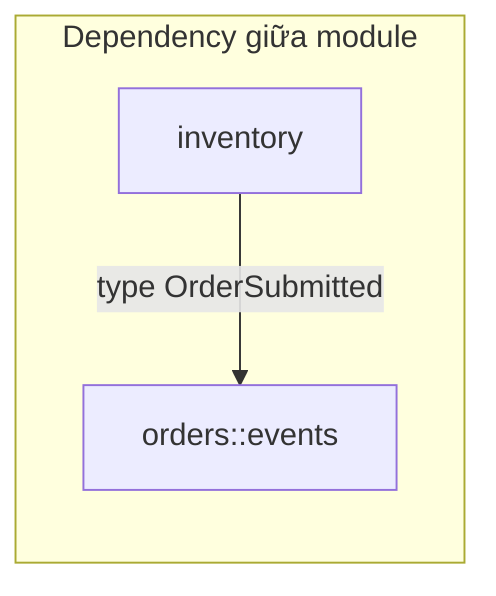
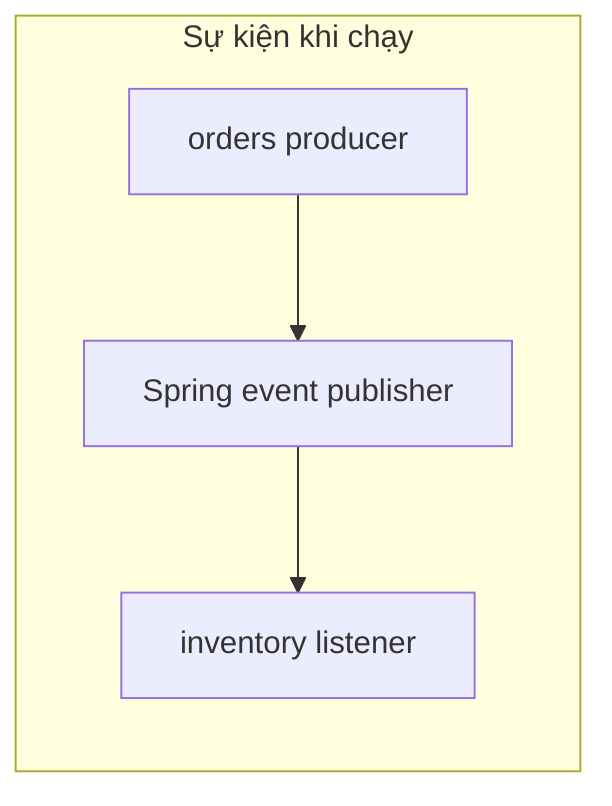
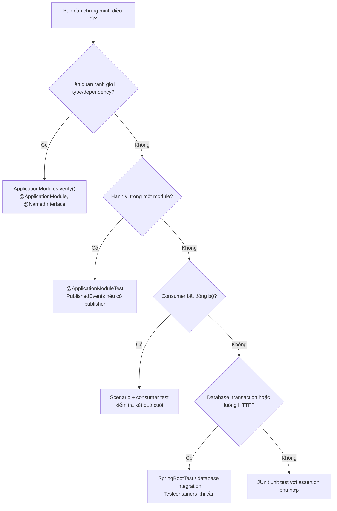
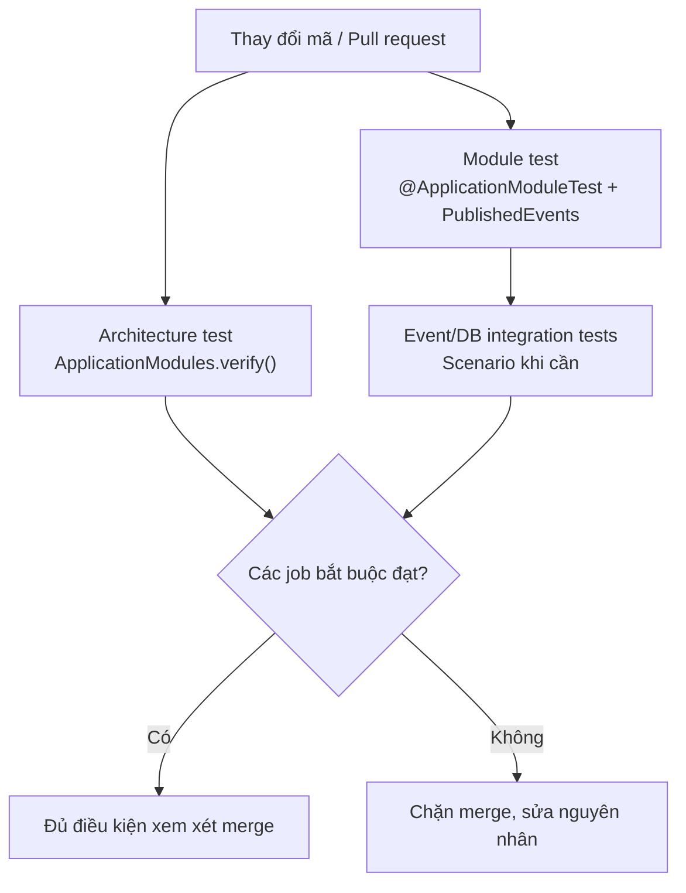

# Các lớp API và annotation sẽ gặp trong module

Spring Modulith không yêu cầu viết một kiểu Spring Boot hoàn toàn mới. Một ứng dụng vẫn sử dụng `@SpringBootApplication`, `@Service`, `@Component`, `ApplicationContext` và các cơ chế Spring quen thuộc. Spring Modulith bổ sung **các API và annotation ở cấp module** để trả lời câu hỏi: *module nào tồn tại, đâu là phần giao diện công khai, phụ thuộc nào được cho phép, và kiểm chứng điều đó như thế nào?*

Khi viết kiểm thử, bạn sẽ gặp những tên như `ApplicationModules`, `@ApplicationModuleTest`, `PublishedEvents` và `Scenario`. Khi thiết kế giao tiếp sự kiện, bạn sẽ thấy `@ApplicationModuleListener` đặt cạnh `@EventListener` hay `@TransactionalEventListener`. Những tên này dễ bị nhầm vì có cái thuộc **mô hình kiến trúc**, có cái thuộc **Spring TestContext**, có cái thuộc **luồng xử lý sự kiện khi chạy**.

Bài thuộc chương **Nhập môn** của **SPRING_MODULITH_VERIFICATION_TESTING**. Mục tiêu là cung cấp một bản đồ API/annotation tự chứa để bạn kiểm chứng ranh giới kiến trúc bằng `ApplicationModules` và quy tắc dependency, viết `@ApplicationModuleTest`, kiểm thử sự kiện, database và tích hợp, rồi kết hợp các phép kiểm tra thành **quality gate trong CI** để ngăn phụ thuộc sai và hồi quy.

## 1. Mục tiêu học tập

Sau bài này, bạn có thể:

1. Phân loại được một API hoặc annotation là công cụ **mô hình hóa module**, **xác minh cấu trúc**, **kiểm thử hành vi**, **giao tiếp sự kiện** hay **hạ tầng Spring**.
2. Nhớ được chức năng và vị trí package của `ApplicationModules`, `@ApplicationModule` và `@NamedInterface`.
3. Dùng `ApplicationModules.of(...).verify()` để kiểm tra quan hệ phụ thuộc giữa các application module.
4. Chọn chế độ bootstrap phù hợp cho `@ApplicationModuleTest` và sử dụng `PublishedEvents` để xác minh event đã được phát.
5. Giải thích sự khác nhau giữa `@EventListener`, `@TransactionalEventListener` và `@ApplicationModuleListener`.
6. Biết khi nào phải thêm `Scenario`, kiểm thử database/transaction và bài kiểm thử tích hợp, thay vì chỉ kiểm tra sự kiện đã publish.
7. Đọc một đoạn code có các annotation này và xác định **hợp đồng nào đang được kiểm chứng, hợp đồng nào chưa có bằng chứng**.

## 2. Bản đồ nhanh các tên cần nhớ

| Tên | Package thường gặp | Vai trò chính | Sử dụng ở đâu? |
|---|---|---|---|
| `ApplicationModules` | `org.springframework.modulith.core` | Tạo mô hình application module và kiểm chứng quy tắc kiến trúc | Bài JUnit architecture test hoặc công cụ phân tích |
| `@ApplicationModule` | `org.springframework.modulith` | Khai báo metadata của một application module, chẳng hạn `allowedDependencies` | Thường ở `package-info.java` của module |
| `@NamedInterface` | `org.springframework.modulith` | Công bố có chủ đích một giao diện từ package con của module | `package-info.java` tại package con cần công bố |
| `@ApplicationModuleTest` | `org.springframework.modulith.test` | Dựng Spring TestContext theo phạm vi module | Class kiểm thử trong package của module |
| `ApplicationModuleTest.BootstrapMode` | `org.springframework.modulith.test` (type lồng) | Chọn cách mở rộng phạm vi module khi test | Tham số `mode` của `@ApplicationModuleTest` |
| `PublishedEvents` | `org.springframework.modulith.test` | Quan sát và lọc các sự kiện được phát trong test | Tham số test method hoặc đối tượng được cung cấp bởi test support |
| `Scenario` | `org.springframework.modulith.test` | Diễn đạt kích hoạt và chờ kết quả trong test event/async | Bài kiểm thử cần đồng bộ theo event hoặc trạng thái |
| `@ApplicationModuleListener` | `org.springframework.modulith.events` | Listener kiểu module theo cơ chế giao dịch và bất đồng bộ | Phương thức consumer sự kiện |
| `@EventListener` | `org.springframework.context.event` | Lắng nghe Spring application event | Phương thức listener trong Spring bean |
| `@TransactionalEventListener` | `org.springframework.transaction.event` | Lắng nghe theo pha của transaction | Listener cần ranh giới transaction cụ thể |
| `ApplicationEventPublisher` | `org.springframework.context` | Phát Spring application event | Producer trong service |
| `@SpringBootTest` | `org.springframework.boot.test.context` | Tạo Spring Boot application test context | Kiểm thử tích hợp hoặc hệ thống |

**Cách đọc bảng:** Những tên bắt đầu bằng `org.springframework.modulith` thuộc Spring Modulith; `@EventListener`, `@TransactionalEventListener` và `ApplicationEventPublisher` là **API Spring Framework**, còn `@SpringBootTest` là API **Spring Boot Test**. Chúng phối hợp được với nhau nhưng không có cùng chức năng.

Bảng dùng những package phổ biến của Spring Modulith; phiên bản Spring Boot/Modulith có thể thay đổi API hoặc cách cấu hình. Khi triển khai thật, hãy để dependency management của dự án xác định bộ phiên bản tương thích và kiểm tra import theo phiên bản đó.

## 3. Nắm mô hình trước khi đọc annotation

Giả sử có ứng dụng bán hàng:

```text
com.acme.shop
├── ShopApplication.java
├── orders
│   ├── OrderService.java
│   ├── events
│   │   ├── package-info.java
│   │   └── OrderSubmitted.java
│   └── internal
│       └── OrderRepository.java
├── inventory
│   ├── package-info.java
│   ├── ReservationStatus.java
│   └── internal
│       └── ReservationRecorder.java
└── payments
    ├── PaymentApi.java
    └── internal
        └── PaymentRepository.java
```

Với cách nhận diện **mặc định**, các package `orders`, `inventory` và `payments` nằm trực tiếp dưới package gốc ứng dụng thường là ba application module. Type ở package gốc module thuộc giao diện công khai theo quy ước; package con như `orders.internal` là phần nội bộ nếu không được công bố có chủ đích.

Đây là điều quan trọng: **một application module không phải một Spring bean**. Module là ranh giới tổ chức mã và dependency; Spring `ApplicationContext` là container quản lý bean ở runtime. Trong modular monolith, nhiều module thường chạy cùng một JVM và một `ApplicationContext`.

Hai đồ thị cần phân biệt:





Trong đồ thị **dependency mã nguồn**, `inventory` tham chiếu type sự kiện do `orders` công bố. Trong đồ thị **runtime**, dữ liệu đi từ producer `orders` đến consumer `inventory`. Không nên lấy một chiều để suy ra chiều còn lại.

## 4. ApplicationModules: API kiểm chứng cấu trúc

### 4.1. Dùng để làm gì?

`ApplicationModules` là một API thuộc phần **core** của Spring Modulith. Nó xây dựng mô hình những application module được nhận diện trong ứng dụng. Phép `verify()` kiểm tra các quy tắc kiến trúc mà Spring Modulith hỗ trợ, điển hình như:

- Không có **phụ thuộc vòng** giữa các application module.
- Module không tham chiếu type thuộc **phần nội bộ** của module khác.
- Quan hệ phụ thuộc tuân thủ `allowedDependencies` hoặc các quy tắc tương ứng đã khai báo.

Ví dụ architecture test:

```java
package com.acme.shop;

import org.junit.jupiter.api.Test;
import org.springframework.modulith.core.ApplicationModules;

class ArchitectureVerificationTests {

    @Test
    void modulesFollowArchitecturalRules() {
        ApplicationModules.of(ShopApplication.class).verify();
    }
}
```

`ShopApplication` là lớp Spring Boot application đặt tại `com.acme.shop`.

### 4.2. Nó kiểm chứng điều gì, và không kiểm chứng điều gì?

| Có thể kiểm chứng theo mô hình module | Không tự chứng minh |
|---|---|
| Quan hệ phụ thuộc qua type/code được nhận diện | Giá tiền, số lượng, trạng thái nghiệp vụ được tính đúng |
| Truy cập API công khai hay package nội bộ | Một Spring bean sẽ được tạo trong mọi profile runtime |
| Module được phép phụ thuộc module khác hay không | Consumer đã xử lý sự kiện thành công |
| Phụ thuộc vòng theo quy tắc được hỗ trợ | SQL transaction commit, locking hay retry đúng |

Bài trên chạy bằng JUnit nhưng **không cần khởi động toàn bộ Spring Boot `ApplicationContext`** để gọi use case. Nó phân tích mô hình kiến trúc; không phải cách thay thế kiểm thử hành vi.

Nếu `verify()` xanh mà một module vẫn gọi sai use case, đó không phải mâu thuẫn: hai test hỏi hai câu khác nhau. Ngược lại, một `@SpringBootTest` xanh không chứng minh không có tham chiếu sai vào `internal`.

### 4.3. Cần chú ý đúng phạm vi nhận diện module

Khi dự án điều chỉnh cách nhận diện module, một phép kiểm chứng chỉ có ý nghĩa nếu **những module dự kiến thực sự nằm trong mô hình**. Đừng chỉ nhìn một dòng PASS rồi giả định mọi package mong đợi đều đã được kiểm tra.

Khi nghi ngờ rule bị bỏ sót, có thể tạo một vi phạm **tạm thời** trong nhánh thử nghiệm, chẳng hạn cho `inventory` có một field type `orders.internal.OrderRepository` (type đó cần biên dịch được ở mức Java). Nếu test không báo đỏ, hãy kiểm tra module detector, cấu hình và việc test thực sự được chạy trong pipeline.

Không để các vi phạm cố ý tồn tại trong nhánh chính.

## 5. @ApplicationModule: khai báo hợp đồng phụ thuộc

### 5.1. Vị trí và ý nghĩa

`@ApplicationModule` thường được đặt trong `package-info.java` của package gốc một application module. Một thuộc tính quan trọng cho kiểm chứng ranh giới là `allowedDependencies`.

Ví dụ file `com/acme/shop/inventory/package-info.java`:

```java
@org.springframework.modulith.ApplicationModule(
    allowedDependencies = "orders::events"
)
package com.acme.shop.inventory;
```

Ý nghĩa:

- `inventory` được thiết kế để tham chiếu giao diện `events` do `orders` công bố.
- `inventory` không được tự ý phụ thuộc API ngoài danh sách cho phép, ví dụ `payments`, nếu quy tắc này đang được áp dụng.
- Cho phép phụ thuộc `orders::events` **không mở quyền truy cập** vào `orders.internal.OrderRepository`.

Đây là **quy tắc cấp application module**, không phải luật visibility mới của Java compiler. Một tham chiếu trái quy tắc vẫn có thể biên dịch về mặt Java, nhưng bị kiến trúc test phát hiện.

### 5.2. Đừng nhầm public type với dependency hợp lệ

Giả sử `payments.PaymentApi` là public và `inventory` có thể import về mặt Java. Nếu `allowedDependencies` của `inventory` chỉ cho phép `orders::events`, import đó vẫn là một dependency ngoài danh sách được phép.

Ngược lại, nếu `inventory` được phép phụ thuộc `orders::events` thì không có nghĩa nó được truy cập mọi type `public` trong package con nội bộ của `orders`.

Vì thế cần đánh giá **hai điều kiện riêng**:

1. Type đích có thuộc API/named interface được công bố không?
2. Module nguồn có được phép phụ thuộc module/named interface đích không?

### 5.3. Không dùng cấu hình làm cách che vấn đề thiết kế

Nếu architecture test báo vòng `orders -> inventory -> orders`, thêm tên của cả hai module vào `allowedDependencies` không giải quyết được vòng. Nhóm phải xem lại trách nhiệm nghiệp vụ, luồng orchestration và dạng giao tiếp.

Tương tự, đẩy tất cả repository vào package gốc để chúng thành public API có thể làm mất một lớp bảo vệ kiến trúc. Hãy xác định **use case hoặc hợp đồng hẹp** mà consumer thực sự cần thay vì công bố chi tiết lưu trữ.

## 6. @NamedInterface: công bố một package con có chủ đích

### 6.1. Khi nào cần named interface?

Trong mô hình thông thường, package con như `orders.events` được xem là nội bộ nếu không được công bố. Nhưng module khác cần biết **hợp đồng sự kiện** mà không cần biết toàn bộ phần triển khai của `orders`.

Có thể công bố đúng package con đó bằng `@NamedInterface`.

Tạo file `com/acme/shop/orders/events/package-info.java`:

```java
@org.springframework.modulith.NamedInterface("events")
package com.acme.shop.orders.events;
```

Sau đó định nghĩa event:

```java
package com.acme.shop.orders.events;

import java.util.UUID;

public record OrderSubmitted(
    UUID orderId,
    UUID productId,
    int quantity
) {}
```

Giờ `orders::events` là một **named interface** có thể được module khác sử dụng nếu dependency policy cho phép.

### 6.2. Lợi ích và giới hạn

Lợi ích là nhóm có thể giữ các event contract trong một package riêng, đồng thời tiếp tục giấu `orders.internal`. Public interface lúc này thể hiện rõ phần nào của module được cam kết cho consumer.

Nhưng named interface chỉ giúp **diễn đạt ranh giới API**. Nó không tự quyết định:

- Event có mang đủ dữ liệu và ý nghĩa nghiệp vụ không.
- Event được publish đúng thời điểm transaction không.
- Listener có xử lý lặp an toàn không.
- Schema có tương thích với consumer cũ không.

Những điều đó thuộc **hợp đồng hành vi và tích hợp**, phải được kiểm thử phù hợp.

### 6.3. Quy tắc đặt tên

Tên `events` trong ví dụ là một nhãn giao diện do nhóm định nghĩa, không phải từ khóa bắt buộc. Cú pháp tham chiếu có dạng:

```text
<module-name>::<named-interface-name>

orders::events
```

Đặt tên theo hợp đồng thực sự được cung cấp, chẳng hạn `api` hoặc `events`, và tránh tạo quá nhiều giao diện chỉ để vượt qua một lỗi dependency mà không có lý do thiết kế.

## 7. @ApplicationModuleTest: tạo Spring context theo phạm vi module

### 7.1. Khác gì với JUnit unit test?

Unit test thông thường có thể gọi `new OrderService(fakePublisher)` mà không tạo Spring context. `@ApplicationModuleTest` dùng **Spring TestContext** để kiểm tra bean và hành vi trong phạm vi **một application module** hoặc phạm vi phụ thuộc được lựa chọn.

Ví dụ tối giản:

```java
package com.acme.shop.orders;

import org.junit.jupiter.api.Test;
import org.springframework.modulith.test.ApplicationModuleTest;

@ApplicationModuleTest
class OrdersModuleTests {

    @Test
    void moduleContextStarts() {
        // Context của module được bootstrap.
        // Thêm assertion nghiệp vụ trong các test khác.
    }
}
```

Bài test chỉ khởi tạo context là **bằng chứng về wiring trong phạm vi đã chọn**, chưa đủ để kết luận use case nghiệp vụ đúng. Test có ý nghĩa hơn khi kích hoạt hành vi và assert kết quả.

### 7.2. BootstrapMode: quyết định module nào có mặt trong test context

| Mode | Ý nghĩa thực hành | Dùng khi |
|---|---|---|
| `STANDALONE` | Tập trung vào module đang kiểm thử | Test các bean/use case bên trong module, có thể thay collaborator bên ngoài bằng test double |
| `DIRECT_DEPENDENCIES` | Bao gồm module đang kiểm thử và các module nó phụ thuộc trực tiếp | Muốn dùng bean thật từ module phụ thuộc gần nhất |
| `ALL_DEPENDENCIES` | Bao gồm chuỗi các module phụ thuộc bắc cầu | Test cần nhiều tầng dependency hợp lệ |

Ví dụ:

```java
import org.springframework.modulith.test.ApplicationModuleTest;
import org.springframework.modulith.test.ApplicationModuleTest.BootstrapMode;

@ApplicationModuleTest(
    mode = BootstrapMode.DIRECT_DEPENDENCIES
)
class OrdersWithDependenciesTests {
    // Các test khi cần bean thật của module phụ thuộc trực tiếp.
}
```

Không dùng `ALL_DEPENDENCIES` theo thói quen chỉ vì `STANDALONE` thiếu bean. Đầu tiên cần xác định dependency được phép hay không; sau đó chọn test double hoặc mở phạm vi dựa trên **mục tiêu test**.

### 7.3. Context chạy được không đồng nghĩa kiến trúc đúng

Một bean `OrderService` có thể inject một repository nội bộ từ module khác và vẫn hoạt động khi toàn bộ context được nạp. Nhưng architecture verification có thể báo dependency đó sai.

Ngược lại, một dependency qua API công khai có thể hợp lệ, trong khi `STANDALONE` context không có bean triển khai vì module sở hữu bean ấy không được đưa vào phạm vi test. Đó là một lỗi **bootstrap/wiring của bài test**, chưa đủ căn cứ để kết luận kiến trúc sai.

## 8. PublishedEvents: quan sát event được phát trong bài test

### 8.1. Producer minh họa

`ApplicationEventPublisher` là API của Spring Framework. Service có thể dùng nó để publish một event nghiệp vụ.

File `com/acme/shop/orders/OrderService.java`:

```java
package com.acme.shop.orders;

import com.acme.shop.orders.events.OrderSubmitted;
import java.util.UUID;
import org.springframework.context.ApplicationEventPublisher;
import org.springframework.stereotype.Service;

@Service
public class OrderService {

    private final ApplicationEventPublisher events;

    public OrderService(ApplicationEventPublisher events) {
        this.events = events;
    }

    public UUID submit(UUID productId, int quantity) {
        if (productId == null || quantity <= 0) {
            throw new IllegalArgumentException("Invalid order item");
        }

        UUID orderId = UUID.randomUUID();
        events.publishEvent(
            new OrderSubmitted(orderId, productId, quantity)
        );
        return orderId;
    }
}
```

Ví dụ **chỉ tiếp nhận yêu cầu và phát event**, chưa lưu đơn hàng; bởi vậy tên `OrderSubmitted` được dùng thay vì một tên mang hàm ý đơn đã commit. Trong ứng dụng thật, ý nghĩa event, thời điểm publish và transaction phải được xác định theo nghiệp vụ.

### 8.2. Test hợp đồng producer

File `com/acme/shop/orders/OrderEventTests.java`:

```java
package com.acme.shop.orders;

import static org.assertj.core.api.Assertions.assertThat;
import static org.assertj.core.api.Assertions.assertThatThrownBy;

import com.acme.shop.orders.events.OrderSubmitted;
import java.util.UUID;
import org.junit.jupiter.api.Test;
import org.springframework.beans.factory.annotation.Autowired;
import org.springframework.modulith.test.ApplicationModuleTest;
import org.springframework.modulith.test.PublishedEvents;

@ApplicationModuleTest
class OrderEventTests {

    @Autowired OrderService orders;

    @Test
    void publishesEventWithExpectedPayload(PublishedEvents events) {
        UUID productId = UUID.randomUUID();

        UUID orderId = orders.submit(productId, 3);

        assertThat(events.ofType(OrderSubmitted.class))
            .singleElement()
            .satisfies(event -> {
                assertThat(event.orderId()).isEqualTo(orderId);
                assertThat(event.productId()).isEqualTo(productId);
                assertThat(event.quantity()).isEqualTo(3);
            });
    }

    @Test
    void doesNotPublishForInvalidQuantity(PublishedEvents events) {
        assertThatThrownBy(
            () -> orders.submit(UUID.randomUUID(), 0)
        ).isInstanceOf(IllegalArgumentException.class);

        assertThat(events.ofType(OrderSubmitted.class)).isEmpty();
    }
}
```

Những assertion này cho biết producer đã:

- phát đúng loại `OrderSubmitted`;
- mang đúng ID, product và quantity;
- không phát sự kiện ở trường hợp quantity không hợp lệ.

**Chúng chưa chứng minh consumer đã nhận hoặc xử lý event.** Trong `STANDALONE` context, consumer thuộc module khác thậm chí có thể không được nạp. Cần thêm consumer test khi hợp đồng yêu cầu xử lý phía nhận.

### 8.3. Đọc đúng kết quả PublishedEvents

Một test chỉ assert `events.ofType(OrderSubmitted.class)` không rỗng có thể bỏ sót việc phát nhiều lần, sai payload hoặc phát trong tình huống không hợp lệ. Hãy kiểm tra chính xác thuộc tính cần bảo vệ: số lần phát, ID tương ứng, dữ liệu và trường hợp không phát.

Nếu nghiệp vụ dùng database, một event đã được publish trong JVM **không tự chứng minh dữ liệu đã commit**. Đó là giới hạn quan trọng của bằng chứng kiểu producer test.

## 9. EventListener, TransactionalEventListener và ApplicationModuleListener

Ba annotation đều có thể xuất hiện trên phương thức xử lý event, nhưng chúng khác nhau về **ngữ nghĩa thời điểm và transaction**.

| Annotation | Thuộc thư viện | Ý nghĩa chính | Điều phải kiểm tra thêm |
|---|---|---|---|
| `@EventListener` | Spring Framework | Đăng ký phương thức nhận application event | Đồng bộ hay async phụ thuộc cấu hình; listener lỗi có ảnh hưởng producer không |
| `@TransactionalEventListener` | Spring Framework | Gắn phản ứng event với pha transaction, thường là `AFTER_COMMIT` | Producer có transaction thực không; có fallback không; listener dùng transaction nào |
| `@ApplicationModuleListener` | Spring Modulith | Listener tiện ích cho giao tiếp module theo cơ chế giao dịch và bất đồng bộ | Transaction producer, xử lý sau commit, retry, idempotency, kết quả cuối |

### 9.1. @EventListener: ví dụ consumer đồng bộ

File `inventory/internal/ReservationRecorder.java`:

```java
package com.acme.shop.inventory.internal;

import com.acme.shop.orders.events.OrderSubmitted;
import java.util.UUID;
import java.util.concurrent.ConcurrentHashMap;
import org.springframework.context.event.EventListener;
import org.springframework.stereotype.Component;

@Component
class ReservationRecorder {

    private final ConcurrentHashMap<UUID, Integer> recorded =
        new ConcurrentHashMap<>();

    @EventListener
    void on(OrderSubmitted event) {
        recorded.putIfAbsent(event.orderId(), event.quantity());
    }

    int quantityFor(UUID orderId) {
        return recorded.getOrDefault(orderId, 0);
    }
}
```

Module `inventory` có thể khai báo `allowedDependencies = "orders::events"` như ở mục 5. Consumer chỉ tham chiếu hợp đồng sự kiện của `orders`, không cần biết implementation của producer.

Với event multicaster mặc định của Spring, `@EventListener` ở ví dụ này thường được gọi **đồng bộ**. Nhưng nếu cấu hình multicaster bất đồng bộ hoặc dùng cơ chế async khác, bạn phải thiết kế test theo cách dispatch thực tế.

`ConcurrentHashMap` ở đây chỉ là bộ nhớ minh họa. `putIfAbsent` tránh ghi đè cùng `orderId` trong một lần chạy JVM; nó **không phải bằng chứng** cho tính bền vững, tồn kho thật hoặc idempotency sau restart.

### 9.2. @TransactionalEventListener: ràng buộc vào pha transaction

`@TransactionalEventListener` của Spring Framework giúp xử lý sự kiện gắn với transaction, với pha mặc định là `AFTER_COMMIT`. Ví dụ minh họa một listener chỉ có ý nghĩa khi có transaction producer phù hợp:

```java
import org.springframework.transaction.event.TransactionPhase;
import org.springframework.transaction.event.TransactionalEventListener;

@TransactionalEventListener(phase = TransactionPhase.AFTER_COMMIT)
void afterOrderCommit(OrderSubmitted event) {
    // Làm việc sau khi transaction liên quan được commit.
}
```

Đây là **fragment minh họa**, không phải method tự hoạt động nếu đứng ngoài một Spring bean. Quan trọng hơn, ví dụ `OrderService.submit(...)` ở mục 8 **không tạo transaction**. Nếu chỉ đổi `@EventListener` thành `@TransactionalEventListener` mà không cung cấp transaction, bạn không được giả định listener sẽ chạy giống cũ.

Khi lựa chọn listener theo transaction, phải xác định:

- producer publish trong transaction nào;
- pha commit/rollback nào cho phép consumer xử lý;
- consumer đọc dữ liệu nào sau commit;
- nếu consumer ghi dữ liệu thì transaction của nó có được cấu hình riêng không.

### 9.3. @ApplicationModuleListener: tiện ích listener của Spring Modulith

`@ApplicationModuleListener` giúp khai báo một listener theo mô hình giao tiếp sự kiện giữa application module có transaction và xử lý bất đồng bộ. Mẫu cú pháp:

```java
import com.acme.shop.orders.events.OrderSubmitted;
import org.springframework.modulith.events.ApplicationModuleListener;

@ApplicationModuleListener
void onOrderSubmitted(OrderSubmitted event) {
    // Gọi một use case nội bộ của consumer.
    // Code production phải có transaction và xử lý lỗi phù hợp.
}
```

Đây cũng là **fragment minh họa**: cần đặt trong Spring bean, cung cấp collaborator cần thiết và có producer transaction đáp ứng ngữ nghĩa after-commit.

Không nên coi `@ApplicationModuleListener` là một phiên bản đổi tên của `@EventListener`. Nó có thể thay đổi thời điểm chạy, transaction và tính bất đồng bộ của consumer. Vì vậy test trước đây assert ngay sau `publishEvent(...)` có thể không còn phù hợp.

### 9.4. Event publication registry không thay thế consumer test

Spring Modulith có các cơ chế theo dõi event publication và hỗ trợ xử lý lại theo cấu hình. Tuy nhiên:

- một event được publish không đồng nghĩa được xử lý;
- một event được xử lý không tự chứng minh transaction commit đúng;
- event có thể được gửi lại, vì vậy consumer cần idempotency;
- retry không tự giải quyết thứ tự, consistency hay nghiệp vụ bù trừ.

Nếu producer commit thành công nhưng consumer lỗi, cần test hành vi phục hồi của hệ thống đúng theo cấu hình thực tế. Đừng hứa bảo đảm “exactly once” cho toàn bộ tác dụng nghiệp vụ chỉ dựa vào một annotation.

## 10. Scenario: kiểm thử kết quả bất đồng bộ có thể quan sát

`Scenario` thuộc Spring Modulith Test, hỗ trợ thể hiện một **hành động kích hoạt** và điều kiện **chờ một sự kiện hoặc trạng thái**. Nó hữu ích khi consumer xử lý bất đồng bộ hoặc sau commit, vì assertion ngay lập tức có thể đọc trạng thái quá sớm.

Một dạng test thường cần:

1. Chuẩn bị dữ liệu và bean cần thiết.
2. Kích hoạt một hành động, chẳng hạn publish event hoặc gọi use case.
3. Chờ điều kiện xác định, ví dụ sự kiện `StockReserved` có `orderId` mong muốn.
4. Xác minh payload hoặc trạng thái cuối.
5. Thất bại nếu không có kết quả trong giới hạn chờ được cấu hình.

Ví dụ **mẫu minh họa** (giả định ứng dụng đã định nghĩa `OrderAccepted`, `StockReserved` và các listener liên quan):

```java
@Autowired Scenario scenario;
@Autowired ApplicationEventPublisher events;

@Test
void waitsForInventoryResult() {
    UUID orderId = UUID.randomUUID();

    scenario
        .stimulate(() -> events.publishEvent(
            new OrderAccepted(orderId)
        ))
        .andWaitForEventOfType(StockReserved.class)
        .matching(StockReserved::orderId, orderId)
        .toArriveAndVerify(result ->
            assertThat(result.orderId()).isEqualTo(orderId));
}
```

Đây **không phải một bài test độc lập có thể copy chạy ngay**: các domain type, consumer và Spring test context cần được thiết lập trước, đồng thời API phải được đối chiếu với phiên bản Spring Modulith đang dùng.

**Không thay Scenario bằng `Thread.sleep(...)` tùy ý.** Một khoảng sleep cố định có thể vượt quá nhu cầu trên máy nhanh, không đủ trên runner CI chậm và tạo flaky test. Kiểm tra trạng thái hoặc event bằng điều kiện và thời hạn hợp lý sẽ có ý nghĩa hơn.

Sau khi `Scenario` quan sát sự kiện kết quả, nếu hợp đồng còn yêu cầu dữ liệu **đã commit**, test phải đọc trạng thái trong transaction phù hợp hoặc dùng database integration test để chứng minh.

## 11. Những annotation Spring Boot và Spring Test thường gặp cùng Modulith

Spring Modulith không thay thế hệ thống annotation Spring hiện có. Bạn sẽ thường kết hợp nó với các annotation dưới đây:

| Annotation/API | Vai trò | Điểm cần nhớ trong kiểm chứng module |
|---|---|---|
| `@SpringBootApplication` | Cấu hình điểm khởi động ứng dụng Spring Boot | Package gốc thường là nơi xác định cấu trúc ứng dụng/module |
| `@Service`, `@Component` | Đăng ký bean khi component scanning phù hợp | Một bean có thể hoạt động dù dependency type vượt ranh giới; cần verify kiến trúc |
| `@Configuration`, `@Bean` | Đăng ký bean bằng cấu hình | Module test có thể thiếu cấu hình, hoặc có bean không mong đợi |
| `@Autowired` | Lấy bean từ Spring context trong test hoặc application | Thiếu bean trong test không tự chứng minh dependency sai kiến trúc |
| `@SpringBootTest` | Khởi tạo Spring Boot test context, thường phạm vi rộng | Hữu ích cho tích hợp, không thay `ApplicationModules.verify()` |
| `@Transactional` | Quản lý transaction theo cơ chế Spring | Test transaction có thể rollback tự động, không tự chứng minh after-commit listener |
| `@EventListener` | Lắng nghe event của Spring | Phân biệt đã publish, đã xử lý và đã commit |
| `@TransactionalEventListener` | Xử lý event theo pha transaction | Cần producer transaction phù hợp |
| `@ApplicationModuleTest` | Spring Modulith test theo phạm vi module | Chọn bootstrap mode dựa trên mục đích test |

Đừng xem sự có mặt của `@SpringBootTest` hoặc `@ApplicationModuleTest` là bằng chứng đầy đủ. Bài test phải có **assertion đúng hợp đồng** và được chạy trong môi trường phù hợp.

## 12. Phân loại lỗi theo lớp API để chẩn đoán đúng

Đọc stack trace hoặc kết quả CI hiệu quả hơn nếu bạn biết lỗi đến từ tầng nào.

| Dấu hiệu | Nhóm API/hợp đồng cần xem | Hướng xử lý |
|---|---|---|
| `verify()` báo module tham chiếu `internal` | `ApplicationModules`, `@NamedInterface` | Thay phụ thuộc bằng API công khai phù hợp; không phơi repository tùy tiện |
| `verify()` báo dependency ngoài tập cho phép | `@ApplicationModule(allowedDependencies = ...)` | Xem lại hợp đồng phụ thuộc và trách nhiệm module |
| `verify()` báo dependency cycle | Mô hình module và chiều phụ thuộc | Thiết kế lại luồng điều phối/giao tiếp, không chỉ nới allowedDependencies |
| `@ApplicationModuleTest` thiếu bean | Bootstrap mode, Spring DI và test configuration | Xác định module sở hữu bean; chọn mock hoặc mode phù hợp |
| `PublishedEvents` không thấy event | Producer, Spring event publisher, điều kiện phát | Kiểm tra validation, nhánh publish và phạm vi test |
| Producer test xanh nhưng consumer không xử lý | `@EventListener`/`@ApplicationModuleListener`, context test | Bổ sung consumer test và xác định listener có trong context |
| Flaky test khi listener bất đồng bộ | `Scenario` và điều kiện chờ | Chờ kết quả quan sát được, không sleep cố định |
| Database sai sau event | Transaction, repository, constraint, idempotency | Tạo integration test trên database phù hợp |
| Context toàn ứng dụng khởi động dù module sai | Spring Boot wiring khác architecture verification | Duy trì `ApplicationModules.verify()` độc lập với `@SpringBootTest` |

**Nguyên tắc:** không giải quyết một lỗi kiến trúc chỉ bằng đổi bootstrap mode, cũng không giải quyết một lỗi transaction chỉ bằng thêm annotation module.

## 13. Những API không được hiểu như bằng chứng vượt phạm vi

### 13.1. verify() không thay thế kiểm thử nghiệp vụ

`ApplicationModules.verify()` kiểm chứng những quy tắc cấu trúc mà mô hình Spring Modulith hỗ trợ. Nó không biết nghiệp vụ “quantity phải lớn hơn 0”, “chỉ được thu tiền một lần” hay “phải rollback nếu kho không đủ”.

### 13.2. PublishedEvents không có nghĩa consumer thành công

`PublishedEvents` quan sát sự kiện **đã phát**. Consumer có thể:

- không được đưa vào `STANDALONE` context;
- chạy sau commit hoặc bất đồng bộ;
- thất bại và được retry;
- xử lý đúng event nhưng ghi database sai.

Muốn kết luận đã xử lý thành công phải kiểm tra **kết quả phía consumer**.

### 13.3. Testcontext khởi động được không đồng nghĩa module dependency hợp lệ

Spring có thể inject type `public` thuộc package nội bộ của module khác. Nếu architecture test không chạy, lỗi ranh giới có thể lọt qua các bài Spring Boot test.

### 13.4. Có database test không tự chứng minh consistency

Mock repository, H2 hoặc một PostgreSQL Testcontainers đều chỉ cho giá trị khi test có schema, dữ liệu, transaction và assertion phù hợp. Nếu quan tâm locking và isolation, phải thử trên engine và điều kiện cạnh tranh thực tế, không chỉ xác nhận `save(...)` được gọi.

### 13.5. Annotation không thay thế quyết định kiến trúc

`@NamedInterface`, `allowedDependencies` và `@ApplicationModuleListener` giúp diễn đạt thiết kế, nhưng không tự chọn được bounded context, khả năng nhất quán hay chính sách lỗi cho sản phẩm. Những quyết định này cần sự hiểu biết nghiệp vụ, tài liệu và test phù hợp.

## 14. Một sơ đồ chọn công cụ theo câu hỏi



Sơ đồ chỉ giúp **chọn điểm xuất phát**, không nói mỗi yêu cầu chỉ cần một loại test. Một luồng đặt hàng thường cần cả architecture verification, module test, database integration và một số system test.

## 15. Đưa toàn bộ phép kiểm chứng vào CI quality gate

Những API nêu trên phát huy giá trị lâu dài khi được đưa vào quy trình kiểm thử lặp lại.



Khi dự án có build wrapper tương ứng:

```bash
# Chạy test được cấu hình trong Maven
./mvnw test

# Hoặc Gradle
./gradlew test
```

Các lệnh trên không tự bảo đảm rằng mọi integration test được thực thi: dự án có thể tách chúng sang phase/task khác. CI cần cấu hình chạy đúng các bộ test bắt buộc, cung cấp Docker/Testcontainers hoặc hạ tầng cần thiết và hiển thị báo cáo về số test đã chạy, thất bại và bị skip.

Một quality gate hữu ích cần tối thiểu:

1. **Architecture test luôn chạy** để phát hiện quan hệ module sai.
2. **Module test luôn chạy** cho những use case và event contract quan trọng.
3. **Integration test chạy đúng hạ tầng** khi có database, transaction hoặc consumer bất đồng bộ cần chứng minh.
4. **Báo cáo gắn với commit** để reviewer xác định code nào được kiểm chứng.
5. **Chặn merge khi check bắt buộc thất bại**; không để test bị skip âm thầm nhưng vẫn coi toàn bộ đã đạt.

## 16. Bài tập thực hành: đặt mỗi API vào đúng vị trí

**Bối cảnh:** tạo ứng dụng Spring Boot tối giản có `orders`, `inventory` và package gốc `com.acme.shop`. Bạn cần chứng minh phụ thuộc hợp lệ và sự kiện hoạt động đúng.

### Phần A — Mô hình hóa ranh giới

1. Tạo `ShopApplication` tại `com.acme.shop`.
2. Tạo `orders.events.OrderSubmitted` và `orders/events/package-info.java` với `@NamedInterface("events")`.
3. Tạo `inventory/package-info.java` với `@ApplicationModule(allowedDependencies = "orders::events")`.
4. Đặt repository hoặc class triển khai riêng của từng module trong `internal`. Phân biệt Java `public` với API của application module.

### Phần B — Kiểm chứng kiến trúc

1. Tạo `ArchitectureVerificationTests` gọi `ApplicationModules.of(ShopApplication.class).verify()`.
2. Cố tình thêm một **tham chiếu type được biên dịch** từ `inventory` tới `orders.internal`, không chỉ một dòng import không dùng.
3. Chạy architecture test để xem vi phạm, rồi loại bỏ dependency.
4. Thêm phụ thuộc ngoài `allowedDependencies` (nếu có module thứ ba) và quan sát sự khác biệt giữa lỗi “dùng phần nội bộ” với lỗi “module không được phép phụ thuộc”.

### Phần C — Kiểm thử producer

1. Cài `OrderService.submit(...)` và publish `OrderSubmitted` như mục 8.
2. Viết `@ApplicationModuleTest` trong package `orders`.
3. Dùng `PublishedEvents` để assert đúng loại, `orderId`, `productId`, `quantity` và số lần phát.
4. Thêm ca đầu vào không hợp lệ, xác nhận service từ chối và không publish event.

### Phần D — Kiểm thử consumer và tích hợp

1. Tạo listener `@EventListener` ở `inventory` và một state/query API nhỏ để test quan sát kết quả.
2. Viết consumer module test phát trực tiếp một `OrderSubmitted` rồi assert trạng thái sau xử lý.
3. Nếu chuyển sang `@ApplicationModuleListener`, xác định producer transaction và dùng `Scenario` hoặc cơ chế chờ điều kiện phù hợp.
4. Khi lưu database, thêm test transaction, idempotency và retry trên hạ tầng phù hợp.
5. Đưa architecture/module/integration tests bắt buộc vào CI; tạo lỗi có chủ đích để xác nhận gate báo đỏ.

**Tiêu chí hoàn thành:** bạn có thể chỉ vào từng annotation/API, nói rõ nó làm việc ở tầng nào, đọc thông báo lỗi tương ứng và chứng minh bằng test rằng **ranh giới kiến trúc** cùng **hợp đồng hành vi** đều được bảo vệ.

## 17. Những câu hỏi phỏng vấn và ôn tập nhanh

**1. Sự khác nhau giữa `ApplicationModules` và `@ApplicationModule` là gì?**

`ApplicationModules` là API tạo/kiểm chứng mô hình module; `@ApplicationModule` là annotation khai báo metadata cho một module cụ thể, trong đó có quy tắc `allowedDependencies`.

**2. Vì sao `@NamedInterface` cần thiết khi đã có `public`?**

Vì `public` là quyền truy cập của Java; named interface công bố có chủ đích phần API thuộc package con của application module, để không buộc phải phơi bày các phần nội bộ khác.

**3. Khi nào nên chọn `@ApplicationModuleTest(mode = DIRECT_DEPENDENCIES)`?**

Khi test muốn đưa vào Spring context những application module mà module đang kiểm thử phụ thuộc trực tiếp, thay vì mock tất cả collaborator hoặc khởi động toàn ứng dụng.

**4. `PublishedEvents` có bảo đảm consumer xử lý xong không?**

Không. Nó quan sát các event được publish; consumer cần module/integration test riêng, đặc biệt với xử lý bất đồng bộ hoặc sau commit.

**5. `@EventListener` và `@ApplicationModuleListener` có giống hệt nhau không?**

Không. `@EventListener` là API lắng nghe sự kiện thông thường của Spring; `@ApplicationModuleListener` hỗ trợ mẫu listener theo giao dịch và bất đồng bộ của Spring Modulith. Thời điểm xử lý, transaction và test phải được xem xét lại.

**6. `Scenario` giải quyết vấn đề gì?**

Nó giúp test mô tả hành động kích hoạt và chờ một event hoặc trạng thái có thể quan sát, thay cho việc dùng thời gian sleep cố định khi kiểm tra luồng bất đồng bộ.

**7. Vì sao architecture test xanh mà database test vẫn có thể đỏ?**

Vì ranh giới module đúng không có nghĩa SQL, constraint, transaction, locking hoặc dữ liệu nghiệp vụ đúng. Cần nhiều lớp bằng chứng.

**8. Nhìn vào `@SpringBootTest` có thể kết luận toàn bộ module đã được kiểm chứng không?**

Không. Spring context có thể khởi động dù code dùng type nội bộ module khác. Test còn cần assertion hành vi cụ thể; kiểm chứng ranh giới cần `ApplicationModules.verify()`.

**9. Một build CI xanh có đồng nghĩa các phép kiểm chứng Modulith đã chạy không?**

Không chắc. Cần xác nhận architecture/module/integration test nằm trong task/phase được CI chạy, xem báo cáo test bị skip và kết quả gắn đúng commit.

## Kết luận

Trong Spring Modulith, nhóm **API mô hình kiến trúc** gồm `ApplicationModules`, `@ApplicationModule` và `@NamedInterface`; nhóm **API kiểm thử module** gồm `@ApplicationModuleTest`, `PublishedEvents` và `Scenario`; nhóm **API sự kiện** phối hợp Spring Modulith và Spring Framework như `@ApplicationModuleListener`, `@EventListener`, `@TransactionalEventListener` và `ApplicationEventPublisher`.

Nắm được chức năng, package và **giới hạn** của từng tên giúp bạn dùng đúng công cụ cho đúng câu hỏi: `ApplicationModules.verify()` bảo vệ dependency; `@ApplicationModuleTest` xác minh hành vi module; `PublishedEvents` chứng minh event đã phát; consumer/transaction/database test chứng minh kết quả xử lý; còn **CI quality gate** đảm bảo các phép kiểm chứng cần thiết được chạy lặp lại khi ứng dụng Spring Boot thay đổi.
