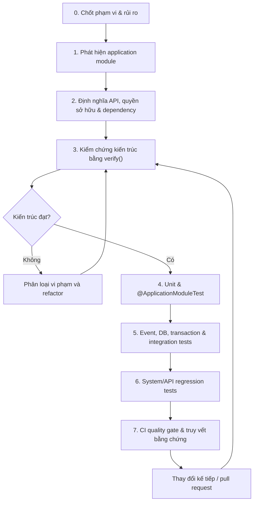
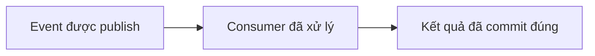
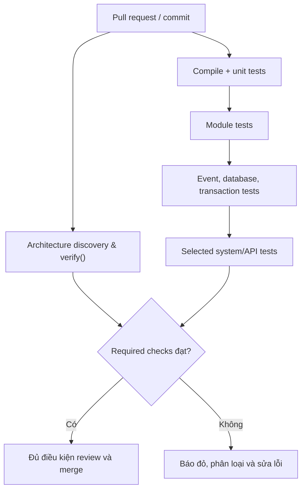

# Lộ trình từ phát hiện module đến kiểm thử hồi quy

Một ứng dụng Spring Boot có thể đã được tổ chức thành các package `orders`, `inventory` và `payments` nhưng chưa chắc những phần đó có ranh giới kiến trúc tốt. Tên package không bảo đảm module chỉ phụ thuộc API công khai, không tạo vòng dependency hoặc không đọc trực tiếp dữ liệu nội bộ của module khác. Ở chiều ngược lại, ngay cả khi `ApplicationModules.verify()` báo thành công, nghiệp vụ vẫn có thể phát sự kiện sai, cập nhật database sai transaction hoặc hồi quy sau một thay đổi nhỏ.

Vì vậy, triển khai **Spring Modulith Verification Testing** nên được xem như một **lộ trình kiểm chứng liên tục**, không phải thao tác thêm một annotation rồi kết thúc. Ta đi từ **phát hiện module**, **xác định và siết hợp đồng**, **kiểm chứng kiến trúc**, **kiểm thử hành vi của từng module**, **kiểm thử sự kiện/dữ liệu/tích hợp**, đến **đưa bằng chứng vào quality gate của CI**.

Bài thuộc chương **Nhập môn** của **SPRING_MODULITH_VERIFICATION_TESTING**. Mục tiêu là rèn kỹ năng bảo vệ ranh giới bằng `ApplicationModules` và quy tắc phụ thuộc, thực hành `@ApplicationModuleTest`, kiểm thử event, database và tích hợp, sau đó ngăn phụ thuộc sai và hồi quy bằng các kiểm tra lặp lại theo từng commit.

## 1. Sau bài này bạn làm được gì?

Bạn sẽ có thể:

1. Lập một bản đồ module xuất phát từ package gốc của ứng dụng Spring Boot, rồi **kiểm tra bản đồ đó có phản ánh đúng trách nhiệm nghiệp vụ không**.
2. Phân loại quan hệ dependency hợp lệ, dependency đi vào phần nội bộ và vòng phụ thuộc.
3. Khai báo API công khai, `@NamedInterface` và `@ApplicationModule(allowedDependencies = ...)` khi chúng diễn đạt đúng chủ đích thiết kế.
4. Viết kiến trúc test dùng `ApplicationModules.of(...).verify()` và đọc kết quả mà không nhầm với test nghiệp vụ.
5. Chọn `@ApplicationModuleTest`, `PublishedEvents` và chế độ bootstrap phù hợp để kiểm tra use case của từng module.
6. Lập các test riêng cho consumer, transaction, database, idempotency và luồng xuyên module.
7. Thiết kế **regression suite + CI quality gate** có khả năng báo đỏ khi một thay đổi tạo phụ thuộc sai hoặc làm hỏng hợp đồng đã ổn định.
8. Viết kết luận kiểm chứng dựa trên **bằng chứng thực tế và phạm vi cụ thể**, thay vì chỉ nói “mọi test đều xanh”.

## 2. Nhìn tổng thể: lộ trình gồm những chặng nào?



Đây là **thứ tự ưu tiên hợp lý**, không phải một waterfall cứng. Ví dụ ở bước kiểm thử consumer, bạn có thể phát hiện một dependency vòng và phải quay lại bước thiết kế. Sau khi có CI, mọi pull request đều lặp các kiểm tra cần thiết.

| Chặng | Đầu ra tối thiểu có thể kiểm tra | Một dấu hiệu chưa nên chuyển tiếp |
|---|---|---|
| 0. Xác định phạm vi | Danh sách module và rủi ro quan trọng cần bảo vệ | Không rõ use case nào là trọng tâm |
| 1. Phát hiện | Bản đồ module được nhận diện từ mã, đã đối chiếu thực tế | Package nghiệp vụ bị bỏ sót hoặc nhận diện sai |
| 2. Hợp đồng | Public API, internal package, dependency policy và event contract rõ | Hai module truy cập repository của nhau không có chủ đích |
| 3. Kiến trúc | `ApplicationModules.verify()` đạt cho cấu trúc dự kiến | Vòng dependency hoặc import internal chưa giải quyết |
| 4. Module behavior | Test module có assertion cụ thể cho happy path và lỗi | Chỉ kiểm tra context khởi động |
| 5. Tích hợp | Consumer, transaction và dữ liệu được kiểm chứng theo rủi ro | Chỉ có producer test nhưng lại khẳng định đã xử lý xong |
| 6. Hệ thống | Luồng API quan trọng cho kết quả quan sát được | Chưa test endpoint/mapping thực tế |
| 7. Hồi quy CI | Các kiểm tra bắt buộc chạy tại commit cần xét, không bị skip ngoài kế hoạch | Pipeline xanh do test trọng yếu không chạy |

## 3. Bối cảnh thực hành xuyên suốt

Giả sử hệ thống bán hàng được xây bằng Spring Boot với ba trách nhiệm:

- `orders`: tiếp nhận yêu cầu đặt hàng;
- `inventory`: nhận yêu cầu đặt giữ hàng;
- `payments`: phụ trách thanh toán, chưa tham gia luồng ví dụ ban đầu.

Ứng dụng mới có thể có cả service, controller và repository ở những package dùng chung. Đích đến của chặng đầu là tổ chức lại theo nghiệp vụ:

```text
com.acme.shop
├── ShopApplication.java
├── orders
│   ├── OrderSubmission.java
│   ├── OrderController.java
│   ├── events
│   │   ├── package-info.java
│   │   └── OrderSubmitted.java
│   └── internal
│       └── OrderRepository.java
├── inventory
│   ├── package-info.java
│   ├── ReservationStatus.java
│   └── internal
│       ├── ReservationRecorder.java
│       └── StockRepository.java
└── payments
    ├── PaymentFacade.java
    └── internal
        └── PaymentRepository.java
```

Ví dụ tập trung vào **tổ chức và kiểm chứng module**. Mã `OrderSubmission` ở phần sau chỉ phát sự kiện khi tiếp nhận input hợp lệ và **chưa lưu đơn vào database**. Vì vậy sự kiện được đặt tên `OrderSubmitted`, không phải bằng chứng rằng đơn hàng đã commit. Việc đặt giữ kho trong ví dụ in-memory cũng chỉ minh họa phản ứng của consumer, **không phải giải pháp quản lý kho sản xuất**.

Việc nói rõ giới hạn là một phần của kiểm chứng: test không nên chứng minh nhiều hơn hành vi mã thực sự thực hiện.

## 4. Chặng 0 — Chọn phạm vi và xác định rủi ro

Trước khi thêm thư viện hoặc annotation, hãy trả lời bốn câu hỏi:

1. **Module nào có ý nghĩa nghiệp vụ?** Ví dụ `orders`, `inventory`, `payments`.
2. **Module nào sở hữu dữ liệu và quy tắc nào?** Kho quyết định khả năng đặt giữ hàng; đơn hàng sở hữu trạng thái yêu cầu; thanh toán sở hữu giao dịch.
3. **Ranh giới nào dễ bị xâm phạm?** Chẳng hạn `orders` import `inventory.internal.StockRepository`.
4. **Hồi quy nào ảnh hưởng người dùng nhất?** Nhận hai lần một event làm trừ tồn kho hai lần, hoặc HTTP trả thành công trước khi đạt trạng thái đã cam kết.

Không cần kiểm thử mọi rủi ro ở cùng độ sâu. Module thuần tính toán không cần tạo database test cho có hình thức; module có transaction quan trọng thì phải có bằng chứng commit/rollback và concurrency phù hợp.

Ví dụ bảng ưu tiên ban đầu:

| ID | Rủi ro | Tác động | Bằng chứng dự kiến |
|---|---|---|---|
| R-01 | `orders` dùng repository nội bộ của `inventory` | Thay đổi kho gây vỡ đơn hàng | Architecture verification |
| R-02 | `inventory` phụ thuộc ngược `orders` qua API ngoài hợp đồng | Module graph tạo vòng hoặc vi phạm policy | `verify()` và review hướng dependency |
| R-03 | `OrderSubmitted` có quantity sai | Consumer đặt giữ sai số lượng | Producer module test |
| R-04 | Consumer xử lý event trùng | Reservation trùng hoặc bán vượt tồn | Consumer + DB integration test |
| R-05 | Commit/rollback không đúng | Dữ liệu đặt hàng không nhất quán | Transaction integration test |
| R-06 | Endpoint không đưa event tới consumer | Người dùng nhận phản hồi sai | System/API test |

**Điều kiện qua chặng:** mỗi rủi ro trọng yếu đã có một loại phép kiểm chứng dự kiến, không chỉ ghi “sẽ test sau”.

## 5. Chặng 1 — Phát hiện application module

### 5.1. Xác định package gốc

Với cách nhận diện **mặc định**, Spring Modulith thường xem các package con trực tiếp của package gốc ứng dụng là application module. Điểm khởi động ví dụ:

```java
package com.acme.shop;

import org.springframework.boot.SpringApplication;
import org.springframework.boot.autoconfigure.SpringBootApplication;

@SpringBootApplication
public class ShopApplication {

    public static void main(String[] args) {
        SpringApplication.run(ShopApplication.class, args);
    }
}
```

Ở cấu trúc mục 3, `orders`, `inventory` và `payments` là các module ứng viên. Spring Modulith có các cơ chế tùy biến nhận diện module; nếu dự án sử dụng chúng thì phải kiểm tra **mô hình thực tế**, không suy ra máy móc từ tên thư mục.

### 5.2. Lấy mô hình từ source thay vì chỉ nhìn package bằng mắt

API `ApplicationModules` thuộc `org.springframework.modulith.core`. Một phép kiểm tra ban đầu có thể:

```java
package com.acme.shop;

import static org.assertj.core.api.Assertions.assertThat;

import org.junit.jupiter.api.Test;
import org.springframework.modulith.core.ApplicationModules;

class ModuleDiscoveryTests {

    @Test
    void discoversExpectedModules() {
        ApplicationModules modules =
            ApplicationModules.of(ShopApplication.class);

        assertThat(modules.getModuleByName("orders")).isPresent();
        assertThat(modules.getModuleByName("inventory")).isPresent();
        assertThat(modules.getModuleByName("payments")).isPresent();
    }
}
```

`getModuleByName(...)` giúp kiểm tra rằng một module có tên dự kiến nằm trong mô hình đã tạo. Khi áp dụng, hãy đối chiếu API truy vấn module với phiên bản Spring Modulith mà dự án sử dụng; nếu nhóm đổi cách đặt tên module hoặc dùng cơ chế nhận diện khác, test phải phản ánh cấu hình đó.

**Không nên thay thế việc khám phá module bằng một ảnh chụp thư mục.** Sơ đồ package là đầu vào tốt, nhưng **mô hình mà công cụ thực sự nhận diện** mới là đối tượng `verify()` sẽ kiểm tra.

### 5.3. Đọc dependency như một đồ thị có hướng

Giả sử mã `orders.OrderSubmission` gọi một API công khai của `inventory`, ta có chiều **`orders -> inventory`**. Nếu listener `inventory` tham chiếu sự kiện do `orders` công bố, ta có chiều **`inventory -> orders`** trong mã nguồn. Hai cạnh kết hợp có thể tạo vòng.

Phụ thuộc **không đồng nghĩa** luồng dữ liệu lúc chạy: producer có thể phát sự kiện theo chiều `orders -> inventory`, trong khi type dependency ở consumer lại theo chiều `inventory -> orders::events`.

**Điều kiện qua chặng:** biết chính xác những module được công cụ nhận diện, chỉ ra các dependency quan trọng và đánh dấu những cạnh cần xem xét.

## 6. Chặng 2 — Thiết kế API và chính sách phụ thuộc

### 6.1. Giữ phần công khai nhỏ, phần nội bộ rõ

Trong cấu hình mặc định, các type ở package gốc của một application module thuộc phần API công khai cơ bản; các package con như `inventory.internal` là phần nội bộ nếu không có cấu hình công bố rõ ràng.

Ví dụ `inventory` muốn cho bên ngoài hỏi kết quả một reservation nhưng không công bố repository:

```java
package com.acme.shop.inventory;

import java.util.UUID;

public interface ReservationStatus {
    boolean recorded(UUID orderId);
}
```

Một implementation có thể nằm ở `inventory.internal` và thay đổi độc lập. Điều quan trọng là consumer dựa vào **ý nghĩa của API**, không biết class repository, schema database hoặc cơ chế cache.

Modifier `public` của Java và **public API của application module** không đồng nghĩa. Một type `public` trong `inventory.internal` vẫn có thể bị Spring Modulith coi là chi tiết nội bộ.

### 6.2. Công bố giao diện sự kiện bằng @NamedInterface

Để `inventory` có thể tiêu thụ event từ `orders.events` mà không truy cập phần nội bộ khác, tạo file `orders/events/package-info.java`:

```java
@org.springframework.modulith.NamedInterface("events")
package com.acme.shop.orders.events;
```

Định nghĩa event:

```java
package com.acme.shop.orders.events;

import java.util.UUID;

public record OrderSubmitted(
        UUID orderId,
        UUID productId,
        int quantity
) {}
```

Một event contract phải nói rõ ý nghĩa của dữ liệu:

| Trường hoặc thuộc tính | Cam kết cần biết |
|---|---|
| `orderId` | Định danh yêu cầu, có thể dùng làm khóa xử lý lặp trong mô hình một lần gửi trên mỗi đơn |
| `productId` | Định danh sản phẩm, không phải entity JPA nội bộ của producer |
| `quantity` | Số lượng yêu cầu; điều kiện hợp lệ và đơn vị đã thống nhất |
| Tên `OrderSubmitted` | Yêu cầu đặt hàng đã được tiếp nhận theo điều kiện của use case minh họa |
| Thời điểm publish | Producer phát trong/bên ngoài transaction nào? |
| Nhận trùng/lỗi | Consumer có thể nhận lại event không, sẽ xử lý ra sao? |

Nếu hệ thống có nhiều dòng hàng trên một đơn, hợp đồng ba trường ở ví dụ này chưa đủ. Cần phát triển schema phù hợp với nghiệp vụ, thay vì coi ví dụ tối giản là chuẩn dữ liệu cho mọi hệ thống.

### 6.3. Giới hạn dependency bằng @ApplicationModule

Trong `inventory/package-info.java`:

```java
@org.springframework.modulith.ApplicationModule(
    allowedDependencies = "orders::events"
)
package com.acme.shop.inventory;
```

Khai báo này mô tả ý định: `inventory` chỉ phụ thuộc vào named interface `events` của `orders` trong phạm vi các module do policy kiểm soát. Nó không cho phép `inventory` gọi `orders.internal.OrderRepository`, cũng không tự cho phép dependency tới `payments`.

Khi code đã dùng public API nhưng vẫn báo vi phạm `allowedDependencies`, đừng ngay lập tức nới danh sách để vượt lỗi. Hãy xác định:

- Module nguồn thực sự có trách nhiệm gọi API đó không?
- Có dependency vòng nào sẽ hình thành không?
- Có thể chuyển việc điều phối sang nơi thích hợp hơn không?
- Event có phù hợp nếu nghiệp vụ chấp nhận kết quả bất đồng bộ không?

**Điều kiện qua chặng:** mỗi module có trách nhiệm rõ, API cần công bố đủ hẹp, các dependency quan trọng có hướng và lý do hợp lệ.

## 7. Chặng 3 — Thiết lập architecture verification

### 7.1. Bài test ngắn nhưng cần chạy bắt buộc

Tạo architecture test trong package gốc:

```java
package com.acme.shop;

import org.junit.jupiter.api.Test;
import org.springframework.modulith.core.ApplicationModules;

class ArchitectureVerificationTests {

    @Test
    void enforcesModuleRules() {
        ApplicationModules.of(ShopApplication.class).verify();
    }
}
```

`ApplicationModules.of(ShopApplication.class)` xây dựng mô hình module từ ứng dụng; `verify()` kiểm chứng những quy tắc kiến trúc Spring Modulith hỗ trợ, điển hình là:

- module không có **phụ thuộc vòng**;
- không truy cập type thuộc **API nội bộ** của module khác;
- không vi phạm **danh sách dependency được phép**.

Bài test dùng JUnit nhưng không cần gọi một use case hay khởi chạy `SpringApplication.run(...)` để xác nhận quan hệ dependency. Đó là **architecture test**, khác với unit test chỉ kiểm tra kết quả của một phương thức.

### 7.2. Cách đọc lỗi theo nguyên nhân

| Tín hiệu từ kiểm chứng | Ý nghĩa | Hướng sửa ưu tiên |
|---|---|---|
| `inventory` tham chiếu `orders.internal.*` | Xuyên qua phần triển khai nội bộ | Thay bằng hợp đồng công khai/named interface phù hợp |
| `orders -> inventory -> orders` | Vòng module dependency | Xem lại trách nhiệm, điểm điều phối và dạng giao tiếp |
| `inventory` phụ thuộc `payments` khi chỉ cho phép `orders::events` | Dependency ngoài policy | Xác minh yêu cầu nghiệp vụ, sửa chiều hoặc hợp đồng |
| Không thấy module mong đợi | Phạm vi nhận diện chưa đúng | Kiểm tra package gốc và cấu hình nhận diện module |
| `verify()` xanh nhưng logic sai | Chưa có bằng chứng hành vi | Bổ sung module/integration test |

**Tránh cách sửa “mở hết package”:** chuyển toàn bộ repository ra package gốc để test xanh có thể làm yếu ranh giới. Kiến trúc test nên hướng nhóm tới API hợp lệ, không khuyến khích phơi bày chi tiết nội bộ.

### 7.3. Xác nhận gate thật sự phát hiện vi phạm

Trên một nhánh thử nghiệm, tạo dependency có chủ đích từ `inventory` vào một type `public` thuộc `orders.internal`, chẳng hạn dùng type đó trong constructor parameter. Điều này quan trọng: **một import không sử dụng có thể không tồn tại như dependency trong mã đã biên dịch**.

Kỳ vọng:

1. Code vẫn có thể biên dịch theo quy tắc Java.
2. Architecture test báo lỗi về ranh giới hoặc dependency policy.
3. Xóa dependency sai, thay bằng API hợp lệ.
4. Architecture test trở lại trạng thái đạt.

Thử nghiệm như vậy chứng minh **test thực sự nhạy với loại lỗi nó được giao phát hiện**, thay vì chỉ có tên trong project.

**Điều kiện qua chặng:** mô hình module được nhận diện đúng và architecture test không còn vi phạm chưa được giải quyết.

## 8. Chặng 4 — Kiểm thử hành vi trong phạm vi module

### 8.1. Vì sao verify() chưa đủ?

`verify()` không tự biết:

- input `quantity = 0` phải bị từ chối;
- event phải có `productId` và `quantity` đúng;
- một bean Spring được inject vào use case có tồn tại trong test context không;
- consumer sau khi nhận event có cập nhật dữ liệu đúng không.

Bởi vậy sau khi bảo vệ cấu trúc, ta chuyển sang **hợp đồng hành vi**.

### 8.2. Producer orders và sự kiện minh họa

Tạo `orders/OrderSubmission.java`:

```java
package com.acme.shop.orders;

import com.acme.shop.orders.events.OrderSubmitted;
import java.util.UUID;
import org.springframework.context.ApplicationEventPublisher;
import org.springframework.stereotype.Service;

@Service
public class OrderSubmission {

    private final ApplicationEventPublisher events;

    public OrderSubmission(ApplicationEventPublisher events) {
        this.events = events;
    }

    public UUID submit(UUID productId, int quantity) {
        if (productId == null || quantity <= 0) {
            throw new IllegalArgumentException("Invalid order item");
        }

        UUID orderId = UUID.randomUUID();
        events.publishEvent(
            new OrderSubmitted(orderId, productId, quantity)
        );
        return orderId;
    }
}
```

Đây là use case tối giản **không lưu đơn**. Do vậy test producer chỉ kết luận về input validation và việc phát `OrderSubmitted`, không về transaction hay database.

### 8.3. Test producer bằng @ApplicationModuleTest + PublishedEvents

Đặt test dưới package `com.acme.shop.orders`:

```java
package com.acme.shop.orders;

import static org.assertj.core.api.Assertions.assertThat;
import static org.assertj.core.api.Assertions.assertThatThrownBy;

import com.acme.shop.orders.events.OrderSubmitted;
import java.util.UUID;
import org.junit.jupiter.api.Test;
import org.springframework.beans.factory.annotation.Autowired;
import org.springframework.modulith.test.ApplicationModuleTest;
import org.springframework.modulith.test.PublishedEvents;

@ApplicationModuleTest
class OrderSubmissionModuleTests {

    @Autowired OrderSubmission orders;

    @Test
    void publishesCorrectOrderSubmitted(PublishedEvents events) {
        UUID productId = UUID.randomUUID();

        UUID orderId = orders.submit(productId, 3);

        assertThat(events.ofType(OrderSubmitted.class))
            .singleElement()
            .satisfies(event -> {
                assertThat(event.orderId()).isEqualTo(orderId);
                assertThat(event.productId()).isEqualTo(productId);
                assertThat(event.quantity()).isEqualTo(3);
            });
    }

    @Test
    void rejectsInvalidQuantityWithoutEvent(PublishedEvents events) {
        assertThatThrownBy(
            () -> orders.submit(UUID.randomUUID(), 0)
        ).isInstanceOf(IllegalArgumentException.class);

        assertThat(events.ofType(OrderSubmitted.class)).isEmpty();
    }
}
```

`@ApplicationModuleTest` dựng Spring TestContext tập trung vào module; `PublishedEvents` quan sát các event mà test phát hiện trong quá trình thực thi. Các assertion kiểm tra **số lượng event và payload**, không chỉ việc một event tồn tại.

### 8.4. Chọn bootstrap mode có chủ đích

| Bootstrap mode | Phạm vi module trong test | Chọn khi |
|---|---|---|
| `STANDALONE` (mặc định) | Module được kiểm thử | Test logic và producer, không cần bean từ module nghiệp vụ khác |
| `DIRECT_DEPENDENCIES` | Module cùng các module phụ thuộc trực tiếp | Muốn chạy collaborator thật thuộc module dependency được phép |
| `ALL_DEPENDENCIES` | Module cùng phụ thuộc bắc cầu | Test cần nhiều tầng dependency hợp lệ |

Ví dụ cú pháp:

```java
import org.springframework.modulith.test.ApplicationModuleTest;
import org.springframework.modulith.test.ApplicationModuleTest.BootstrapMode;

@ApplicationModuleTest(
    mode = BootstrapMode.DIRECT_DEPENDENCIES
)
class OrdersWithDependencyTests {
    // Bổ sung test phù hợp với hợp đồng cần kiểm tra.
}
```

Nếu `STANDALONE` thiếu bean, không nên suy ra ngay “kiến trúc sai”. Module có thể phụ thuộc hợp lệ vào một API bên ngoài nhưng test context không nạp module cung cấp bean. Có thể dùng test double hoặc chuyển sang mode phù hợp với mục tiêu. Ngược lại, context khởi động thành công **không chứng minh kiến trúc đúng**; vẫn cần `verify()`.

**Điều kiện qua chặng:** những use case quan trọng có cả ca hợp lệ và không hợp lệ, với assertion rõ ràng; report cho biết test thực sự chạy.

## 9. Chặng 5 — Kiểm thử consumer và hợp đồng sự kiện

### 9.1. Published khác handled và committed



Đây là ba trạng thái **không thể suy ra tự động từ nhau**:

1. `PublishedEvents` giúp kiểm tra **producer đã phát** event đúng type/payload.
2. Consumer test cần khẳng định **logic phía nhận** đã tạo kết quả đúng.
3. Database/transaction integration test chứng minh **kết quả lưu trữ** đạt yêu cầu sau commit.

Một module test cho `orders` ở `STANDALONE` có thể không có listener của `inventory`; việc producer test xanh không phải bằng chứng consumer đã hoàn tất.

### 9.2. Consumer tối giản để luyện tập

Để thấy rõ phạm vi kiểm thử, tạo API trong `inventory/ReservationStatus.java`:

```java
package com.acme.shop.inventory;

import java.util.UUID;

public interface ReservationStatus {
    int quantityFor(UUID orderId);
}
```

Tạo implementation in-memory và listener trong `inventory/internal/ReservationRecorder.java`:

```java
package com.acme.shop.inventory.internal;

import com.acme.shop.inventory.ReservationStatus;
import com.acme.shop.orders.events.OrderSubmitted;
import java.util.UUID;
import java.util.concurrent.ConcurrentHashMap;
import org.springframework.context.event.EventListener;
import org.springframework.stereotype.Component;

@Component
class ReservationRecorder implements ReservationStatus {

    private final ConcurrentHashMap<UUID, Integer> requests =
        new ConcurrentHashMap<>();

    @EventListener
    void on(OrderSubmitted event) {
        requests.putIfAbsent(event.orderId(), event.quantity());
    }

    @Override
    public int quantityFor(UUID orderId) {
        return requests.getOrDefault(orderId, 0);
    }
}
```

`ReservationRecorder` chỉ ghi nhận yêu cầu trên bộ nhớ JVM. `putIfAbsent` minh họa việc cùng một `orderId` không ghi đè giá trị đã tồn tại, **không chứng minh idempotency bền vững**, không cập nhật tồn kho thực tế và không có cơ chế transaction.

### 9.3. Module test cho consumer

Đặt test dưới package `com.acme.shop.inventory`:

```java
package com.acme.shop.inventory;

import static org.assertj.core.api.Assertions.assertThat;

import com.acme.shop.orders.events.OrderSubmitted;
import java.util.UUID;
import org.junit.jupiter.api.Test;
import org.springframework.beans.factory.annotation.Autowired;
import org.springframework.context.ApplicationEventPublisher;
import org.springframework.modulith.test.ApplicationModuleTest;

@ApplicationModuleTest
class InventoryModuleTests {

    @Autowired ApplicationEventPublisher publisher;
    @Autowired ReservationStatus status;

    @Test
    void recordsReceivedEvent() {
        UUID orderId = UUID.randomUUID();

        publisher.publishEvent(
            new OrderSubmitted(orderId, UUID.randomUUID(), 2)
        );

        assertThat(status.quantityFor(orderId)).isEqualTo(2);
    }
}
```

Ở ví dụ dùng `@EventListener` và Spring event multicaster đồng bộ mặc định, assertion ngay sau `publishEvent(...)` có thể quan sát thay đổi trong `ConcurrentHashMap`. Nếu producer chuyển sang listener bất đồng bộ hoặc cấu hình multicaster thay đổi, phải điều chỉnh cách chờ/quan sát.

Test này kiểm tra **consumer hoạt động khi nhận event cụ thể**, không cần tự gọi `orders.OrderSubmission`. Đó là điểm mạnh của kiểm thử ranh giới theo module: producer và consumer có thể có bằng chứng riêng cho hai phía hợp đồng.

### 9.4. Khi đổi sang @ApplicationModuleListener

Spring Modulith hỗ trợ `@ApplicationModuleListener` cho mẫu xử lý sự kiện module có transaction và bất đồng bộ. Khi dùng listener sau commit, producer cần có transaction phù hợp và test phải quan sát **kết quả cuối**, không assert ngay sau khi publish.

`Scenario` của Spring Modulith Test có thể diễn đạt bước kích hoạt và chờ event/trạng thái thay vì dùng `Thread.sleep(...)`. Ví dụ đoạn mã **định hướng**, giả định các domain type và listener đã tồn tại:

```java
@Autowired Scenario scenario;
@Autowired ApplicationEventPublisher publisher;

@Test
void awaitsReservationResult() {
    UUID orderId = UUID.randomUUID();

    scenario
        .stimulate(() -> publisher.publishEvent(
            new OrderAccepted(orderId)
        ))
        .andWaitForEventOfType(StockReserved.class)
        .matching(StockReserved::orderId, orderId)
        .toArriveAndVerify(result ->
            assertThat(result.orderId()).isEqualTo(orderId));
}
```

Đoạn trên **không phải test độc lập có thể copy chạy ngay**: `OrderAccepted`, `StockReserved`, listener và transaction setup phải được cài đặt; API cần phù hợp với phiên bản Spring Modulith dự án. Mục đích là minh họa **chờ bằng điều kiện**, không dựa vào thời gian sleep cố định.

**Điều kiện qua chặng:** producer test và consumer test cùng có assertion về hợp đồng; các kết luận liên quan xử lý bất đồng bộ hoặc sau commit được hỗ trợ bằng test phù hợp.

## 10. Chặng 5 (tiếp) — Database, transaction và tính nhất quán

### 10.1. Vì sao phải thêm một lớp kiểm chứng?

Spring Modulith tổ chức ranh giới module trong một modular monolith, nhưng **không tự phân tách database**. Các module có thể dùng chung `DataSource`, transaction manager hoặc schema. Mock repository và `ConcurrentHashMap` không phản ánh:

- database constraint và migration;
- rollback/commit khi consumer thất bại;
- concurrency khi hai đơn tranh cùng số lượng hàng;
- khả năng xử lý lại event sau restart;
- idempotency dựa trên unique constraint hoặc khóa nghiệp vụ bền vững.

Một test “producer gọi `repository.save(...)` đúng một lần” bằng Mockito chỉ chứng minh **lời gọi mock**, không chứng minh SQL thực sự đã commit đúng.

### 10.2. Ma trận test dữ liệu tối thiểu theo rủi ro

| Rủi ro | Test nên bổ sung | Điều cần quan sát |
|---|---|---|
| Lưu thiếu hoặc sai trường | Repository integration test | Bản ghi đọc lại khớp schema và dữ liệu |
| Duplicate reservation | Constraint/idempotency integration test | Hai lần cùng khóa chỉ tạo một tác dụng bền vững |
| Transaction thất bại giữa chừng | Transaction integration test | Rollback hoặc trạng thái bù trừ đúng như thiết kế |
| Hai đơn cập nhật cùng tồn kho | Concurrency integration test | Không bán vượt số lượng theo isolation/locking đã chọn |
| Producer commit nhưng consumer lỗi | Event/transaction integration test | Cơ chế theo dõi publication, retry/bù trừ đúng cấu hình |
| Migration sai | Database bootstrap test | Schema được tạo/nâng cấp đúng, test CRUD cơ bản đạt |

Testcontainers có thể cung cấp PostgreSQL/MySQL hoặc hạ tầng phù hợp cho test gần với production hơn so với mock/in-memory storage. Nhưng **có Testcontainers chưa đủ** nếu bài test không assert transaction, constraint và trạng thái cần chứng minh.

### 10.3. Cẩn trọng với transaction của test

Trong Spring Test, phương thức test gắn `@Transactional` thường có transaction bao ngoài và được rollback sau khi test kết thúc. Listener chạy sau commit hoặc trong transaction riêng có thể không nhìn thấy dữ liệu chưa commit như bạn nghĩ. Vì vậy:

1. Xác định transaction của producer bắt đầu và commit ở đâu.
2. Xác định consumer chạy ở pha nào và trong transaction nào.
3. Kích hoạt đúng đường đi nghiệp vụ.
4. Đọc lại trạng thái sau khi transaction liên quan kết thúc.
5. Kiểm tra ca lỗi và xử lý lặp với dữ liệu đã commit.

Bài test có kết luận “đã commit đúng” phải thực sự quan sát trạng thái phù hợp sau commit, không chỉ đọc entity còn nằm trong persistence context của một test transaction.

**Điều kiện qua chặng:** các rủi ro dữ liệu quan trọng có integration test trên hạ tầng và mô hình transaction đáp ứng mục tiêu; những giới hạn còn lại được ghi rõ.

## 11. Chặng 6 — Kiểm thử hệ thống qua API

Module test kiểm tra từng phần nhưng không tự xác minh controller, request mapping, security filter hoặc việc phối hợp tất cả module trong một context.

Nếu ứng dụng có endpoint đặt hàng, có thể thêm system test dùng `@SpringBootTest` và `MockMvc`. Ví dụ controller:

```java
package com.acme.shop.orders;

import java.util.UUID;
import org.springframework.web.bind.annotation.PostMapping;
import org.springframework.web.bind.annotation.RequestParam;
import org.springframework.web.bind.annotation.RestController;

@RestController
public class OrderController {

    private final OrderSubmission orders;

    public OrderController(OrderSubmission orders) {
        this.orders = orders;
    }

    @PostMapping("/orders")
    public UUID submit(
            @RequestParam UUID productId,
            @RequestParam int quantity) {
        return orders.submit(productId, quantity);
    }
}
```

Một system test theo luồng HTTP có thể như sau:

```java
package com.acme.shop;

import static org.assertj.core.api.Assertions.assertThat;
import static org.springframework.test.web.servlet.request.MockMvcRequestBuilders.post;
import static org.springframework.test.web.servlet.result.MockMvcResultMatchers.status;

import com.acme.shop.inventory.ReservationStatus;
import java.util.UUID;
import org.junit.jupiter.api.Test;
import org.springframework.beans.factory.annotation.Autowired;
import org.springframework.boot.test.autoconfigure.web.servlet.AutoConfigureMockMvc;
import org.springframework.boot.test.context.SpringBootTest;
import org.springframework.test.web.servlet.MockMvc;

@SpringBootTest
@AutoConfigureMockMvc
class OrderFlowSystemTests {

    @Autowired MockMvc mvc;
    @Autowired ReservationStatus reservations;

    @Test
    void requestReachesInventoryListener() throws Exception {
        UUID productId = UUID.randomUUID();

        String response = mvc.perform(
                post("/orders")
                    .param("productId", productId.toString())
                    .param("quantity", "2"))
            .andExpect(status().isOk())
            .andReturn()
            .getResponse()
            .getContentAsString();

        UUID orderId = UUID.fromString(
            response.replace("\"", "").trim()
        );

        assertThat(reservations.quantityFor(orderId))
            .isEqualTo(2);
    }
}
```

Ví dụ giả định cấu hình Spring MVC/JSON mặc định, chưa bật security chặn request, và listener xử lý đồng bộ. Nó kiểm tra luồng trong **Spring MockMvc servlet environment**, không mở kết nối mạng thực tế và không chứng minh database production đã được commit.

Nếu dùng Spring Boot phiên bản đã tổ chức lại các gói auto-config/test API, hãy đối chiếu các import phù hợp; ví dụ minh họa mục đích test, không khóa cứng một release cụ thể.

Khi sản phẩm yêu cầu bảo đảm qua HTTP thật hoặc hạ tầng được triển khai, cần system/end-to-end test ở phạm vi rộng hơn, ví dụ `@SpringBootTest(webEnvironment = RANDOM_PORT)` với HTTP client, database và broker cần thiết.

**Điều kiện qua chặng:** những luồng người dùng có rủi ro cao được kiểm tra từ điểm vào tới **trạng thái có thể quan sát**, không chỉ assert status 200.

## 12. Chặng 7 — Đưa toàn bộ kiểm tra vào CI quality gate

Một architecture test chỉ có giá trị bảo vệ lâu dài nếu nó được chạy lại **mỗi khi dependency có thể thay đổi**. Tương tự, một consumer test chỉ ngăn hồi quy nếu CI thực thi nó cùng các test nghiệp vụ liên quan.

### 12.1. Đề xuất phân lớp pipeline



Các job có thể chạy song song khi độc lập; thứ tự trên diễn đạt **phạm vi kiểm chứng tăng dần**, không bắt buộc phải triển khai thành pipeline tuyến tính.

| Nhóm CI | Những gì cần chạy | Cách phát hiện gate “xanh giả” |
|---|---|---|
| Compile/unit | Biên dịch, test logic có assertion | Kiểm tra report, test count và skip |
| Module discovery/architecture | `ApplicationModules.verify()` và phép xác nhận module dự kiến | Gây một vi phạm kiểm soát được trong nhánh thử nghiệm |
| Module behavior | `@ApplicationModuleTest` cho producer/consumer | Xem payload và trường hợp negative có được assert không |
| DB/event integration | Transaction, constraint, retry, idempotency | Kiểm tra đúng DB/container/config và các test không bị bỏ qua |
| System/API | Luồng HTTP quan trọng | Kiểm tra cả response lẫn trạng thái cuối |
| Merge gate | Required checks gắn với commit mới nhất | Đảm bảo job thất bại thực sự chặn merge |

### 12.2. Lệnh thực thi phụ thuộc cách cấu hình dự án

Ví dụ khi dự án có wrapper tương ứng:

```bash
# Maven: những test cấu hình trong phase test
./mvnw test

# Maven: các phase đến verify, gồm plugin test đã khai báo
./mvnw verify

# Gradle: task test được cấu hình
./gradlew test
```

Đừng mặc định `./mvnw verify` hay `./gradlew test` đã chạy mọi integration test. Maven có thể dùng Failsafe hoặc profile; Gradle có thể dùng `integrationTest` hoặc task chuyên biệt. CI cần chạy **đúng những phase/task đã được cấu hình** và cấp Docker/Testcontainers, database, migration, secret thử nghiệm khi cần.

Một pipeline xanh nhưng architecture test bị exclude hoặc database test bị skip **không đủ bằng chứng** cho quality gate mà nhóm đã cam kết.

### 12.3. Khi pull request phá ranh giới

Giả sử PR thêm:

```java
// Giả định: type này public ở mức Java nhưng thuộc API nội bộ.
import com.acme.shop.orders.internal.OrderRepository;
```

Nếu trong mã production của `inventory` có **tham chiếu type thực sự** tới `OrderRepository`, architecture verification phải phát hiện vi phạm ranh giới. Test nghiệp vụ có thể vẫn xanh, nhất là khi repository bị mock hoặc API chưa thay đổi.

Kỳ vọng vận hành:

1. CI báo đỏ ở architecture gate.
2. Người sửa xác định module nguồn, module đích và type bị tham chiếu.
3. Nhóm thay dependency nội bộ bằng API/named interface hợp lệ hoặc thiết kế lại trách nhiệm.
4. Architecture và module/system test liên quan đều đạt trở lại.
5. PR chỉ được xem xét merge khi các check bắt buộc đã chạy trên revision mới nhất.

Đây chính là cách **quy tắc kiến trúc trở thành kiểm thử hồi quy**: một sai lệch xuất hiện sau refactor được chặn trước khi nhập nhánh chính.

## 13. Thiết kế bộ kiểm thử hồi quy bền vững

Một regression suite không phải là số lượng test lớn nhất có thể, mà là tập bằng chứng **bảo vệ đúng những hợp đồng có nguy cơ bị phá qua thay đổi**.

### 13.1. Ma trận truy vết hợp đồng → test

| ID | Hợp đồng | Test nên duy trì | Kỳ vọng khi phá hợp đồng |
|---|---|---|---|
| ARCH-01 | Không có dependency vào phần internal của module khác | `ArchitectureVerificationTests` | Import/cạnh dependency sai khiến test đỏ |
| ARCH-02 | Không vòng và không vượt `allowedDependencies` | Cùng architecture test | Thêm cạnh không hợp lệ làm test đỏ |
| ORD-01 | `OrderSubmission` từ chối quantity không hợp lệ | `OrderSubmissionModuleTests` | Bỏ validation khiến test đỏ |
| ORD-02 | `OrderSubmitted` đúng payload/số lượng event | Producer module test + `PublishedEvents` | Sai ID/quantity hoặc phát lặp khiến test đỏ |
| INV-01 | Inventory ghi nhận yêu cầu đúng | Consumer module test | Bỏ listener hoặc xử lý sai khiến test đỏ |
| INV-02 | Xử lý lặp không gây tác động bền vững sai | Consumer DB integration test | Duplicate reservation làm test đỏ |
| TX-01 | Commit/rollback đúng hợp đồng | Transaction integration test | Ghi dở dang khiến test đỏ |
| API-01 | HTTP đặt hàng kích hoạt luồng cần thiết | System/API test | Mapping/wiring/consumer lỗi khiến test đỏ |
| CI-01 | Check bắt buộc chạy trên PR | CI report + branch protection | Fail/skip bất thường ngăn merge hoặc được đánh dấu rõ |

Đây là ma trận **đề xuất**, không phải báo cáo đã chạy các test ở một dự án thật. Khi triển khai cần thay bằng tên test, revision và kết quả từ CI.

### 13.2. Chọn test có giá trị hồi quy cao

Ưu tiên các test:

- bắt được vi phạm trước đây đã từng xảy ra;
- kiểm tra API/sự kiện được nhiều consumer sử dụng;
- bao phủ trạng thái lỗi và idempotency, không chỉ happy path;
- độc lập dữ liệu và không phụ thuộc thứ tự chạy;
- có tên, assertion và thông báo lỗi giúp chẩn đoán nhanh;
- chạy trong thời gian phù hợp với tần suất CI.

Không nhất thiết chạy hàng trăm system test cho từng phép so sánh số lượng. Unit test có thể đảm nhiệm các nhánh tính toán nhỏ, module test kiểm tra hợp đồng, còn system test tập trung một số luồng có giá trị cao.

### 13.3. Kiểm soát flaky test

Những nguồn không ổn định thường gặp:

- Test bất đồng bộ dùng `Thread.sleep(...)` với thời gian đoán trước.
- Nhiều test dùng chung database nhưng không cô lập fixture.
- State singleton in-memory giữ dữ liệu từ bài test trước.
- Test dựa vào thứ tự chạy method hoặc sử dụng ID cố định.
- CI không bảo đảm container/database đã sẵn sàng.
- Một test đọc dữ liệu khi transaction consumer chưa commit.

Giải pháp là dùng **điều kiện chờ rõ ràng**, dữ liệu riêng cho mỗi case, isolation/cleanup có chủ đích và test hạ tầng phù hợp. `Scenario` hữu ích khi cần chờ event hoặc trạng thái bất đồng bộ theo cách có điều kiện; nó không thay thế assertion về dữ liệu đã commit.

## 14. Cách triển khai lộ trình trên một monolith đã tồn tại

Đối với codebase nhiều năm tuổi, đòi hỏi tất cả module phải xanh ngay từ ngày đầu thường không thực tế. Có thể áp dụng theo từng đợt nhưng **không được gọi những phần chưa đạt là đã được kiểm chứng**.

### Đợt A — Khám phá và ghi nhận hiện trạng

Phát hiện module theo package; so sánh với trách nhiệm nghiệp vụ và xác định dependency vòng, import internal, các package dùng chung. Ghi những vi phạm đang tồn tại và mức rủi ro. Không vội mở `allowedDependencies` đến mức mọi chiều đều được chấp nhận chỉ để nhận kết quả xanh.

### Đợt B — Khoanh vùng một đường nghiệp vụ quan trọng

Chọn luồng `orders -> OrderSubmitted -> inventory`. Xác định API, event contract và dữ liệu mà mỗi module sở hữu. Sửa các dependency sai trực tiếp của luồng này trước, bảo đảm kiến trúc được kiểm chứng trong phạm vi mà nhóm thực sự kiểm soát.

### Đợt C — Tạo test quanh hợp đồng đã ổn định

Bổ sung producer module test, consumer module test và integration test với database nếu có. Tạo test âm tính cho input sai, xử lý lặp, rollback và tình huống thiếu dữ liệu. Mục đích là tạo bằng chứng cho từng rủi ro đã liệt kê.

### Đợt D — Đưa vào CI và mở rộng

Bật architecture gate cho những quy tắc đã cam kết; chạy module/integration test bắt buộc. Nếu còn legacy violations, cần kế hoạch xử lý rõ ràng và cơ chế kiểm soát được để **không phát sinh vi phạm mới**. Những ngoại lệ kỹ thuật tạm thời phải có chủ sở hữu, lý do và thời hạn xem lại, không phải “mở mọi phụ thuộc” vô thời hạn.

Sau khi luồng đầu có đủ bằng chứng, tiếp tục với `payments` hoặc các module quan trọng khác. Lộ trình tăng dần hiệu quả hơn một lần refactor toàn bộ mà không có kiểm thử bảo vệ.

## 15. Một số lỗi suy luận thường gặp

### “Đã nhận diện được module nên kiến trúc đã đúng”

Không. Nhận diện chỉ cho biết **các module mà công cụ thấy**. Tiếp theo phải xem quan hệ phụ thuộc, API công khai, phần nội bộ và các rule được kiểm chứng.

### “Ứng dụng khởi động được nghĩa là ranh giới module hợp lệ”

Không. Spring dependency injection có thể tạo bean ngay cả khi mã tham chiếu type `public` nằm trong package nội bộ của module khác. `ApplicationContext` boot thành công và `ApplicationModules.verify()` trả kết quả là hai bằng chứng khác nhau.

### “verify() xanh nghĩa là toàn bộ nghiệp vụ đã được kiểm thử”

Không. Phép kiểm chứng cấu trúc không thực thi các use case đặt hàng hoặc khẳng định dữ liệu transaction đúng. Phải có test hành vi và tích hợp.

### “PublishedEvents thấy một event thì consumer chắc chắn hoàn tất”

Không. Nó chứng minh producer phát sự kiện trong phạm vi đang quan sát. Consumer có thể không được nạp, chưa chạy hoặc đã thất bại. Hãy kiểm tra tác dụng của consumer và trạng thái commit khi cần.

### “Đổi listener sang bất đồng bộ không cần sửa test”

Sai. Khi listener chạy sau commit/bất đồng bộ, assertion ngay sau `publishEvent(...)` có thể đọc quá sớm; cần chờ điều kiện và kiểm tra transaction phù hợp.

### “Chỉ cần đưa tất cả test vào thư mục test là CI đã bảo vệ”

Không. CI có thể skip test, chỉ chạy unit test, bỏ phase integration hoặc lấy kết quả của revision cũ. Phải xem test report, required checks và commit.

### “Mọi module đều phải có cùng số lượng test”

Không. Mức độ kiểm chứng phụ thuộc vào rủi ro. Module xử lý tính toán thuần khác module quản lý tồn kho có concurrency và event retry; không nên chạy theo số lượng test hình thức.

## 16. Bài thực hành: xây một đường đi từ discovery đến regression gate

**Bối cảnh:** xây một ứng dụng Spring Boot nhỏ với `orders`, `inventory` và `payments`. Thực hiện bảy chặng sau, tạo bằng chứng ở từng chặng.

### Phần A — Phát hiện và mô tả module

1. Tạo `ShopApplication` trong `com.acme.shop`, các package theo mục 3.
2. Viết `ModuleDiscoveryTests` xác nhận ba module mong đợi được nhận diện.
3. Vẽ dependency graph; nêu rõ **mũi tên từ module dùng type đến module sở hữu type**.
4. Liệt kê một API công khai và một chi tiết nội bộ cho mỗi module.

### Phần B — Thiết kế hợp đồng

1. Công bố `orders::events` bằng `@NamedInterface("events")`.
2. Định nghĩa `OrderSubmitted` và ý nghĩa của ba trường.
3. Giới hạn `inventory` với `allowedDependencies = "orders::events"`.
4. Giải thích vì sao `inventory` không được gọi `orders.internal.OrderRepository` và tại sao hướng event runtime khác chiều type dependency.

### Phần C — Kiểm chứng kiến trúc

1. Thêm `ArchitectureVerificationTests` chạy `ApplicationModules.of(ShopApplication.class).verify()`.
2. Thử tạo một tham chiếu type internal có thể biên dịch rồi xem architecture test báo đỏ.
3. Gỡ dependency sai, chạy lại và xác nhận test đạt.
4. Tạo một vòng dependency có chủ đích nếu cấu trúc demo cho phép, quan sát và giải thích hướng sửa.

### Phần D — Kiểm thử producer và consumer

1. Cài `OrderSubmission.submit(...)` như mục 8.
2. Viết `@ApplicationModuleTest` cho `orders`, dùng `PublishedEvents` assert đúng `orderId`, `productId`, `quantity`.
3. Thử quantity bằng 0; assert lỗi và không publish event.
4. Viết test cho `inventory`, phát `OrderSubmitted` và xác minh state mà consumer ghi nhận.
5. Ghi rõ test chỉ dùng in-memory hay đã có database; không suy diễn idempotency bền vững từ `ConcurrentHashMap`.

### Phần E — Kiểm thử dữ liệu và tích hợp

1. Nếu thêm JPA/PostgreSQL, tạo database integration test với constraint, transaction và dữ liệu riêng.
2. Thử nhận lặp event; kiểm tra chỉ có tác dụng bền vững theo khóa idempotency.
3. Nếu listener chạy sau commit, dùng cơ chế chờ event/trạng thái và kiểm tra kết quả sau commit.
4. Bổ sung system test gọi HTTP endpoint và quan sát kết quả consumer; phân biệt `MockMvc` với HTTP qua server thật.

### Phần F — Tạo quality gate

1. Cho CI chạy architecture test và các module/integration/system test bắt buộc.
2. Xác nhận report nêu rõ số test chạy, số bị skip, kết quả và commit tương ứng.
3. Tạo một dependency internal sai trên nhánh thử nghiệm để kiểm tra architecture job báo đỏ.
4. Tạo một hồi quy payload `quantity` để kiểm tra producer test báo đỏ.
5. Khôi phục code, chạy lại bộ test cần thiết rồi xác nhận gate đạt.

### Phần G — Viết kết luận kiểm chứng

Viết một báo cáo ngắn theo cấu trúc:

```text
Revision: <commit đang được xét>
Modules: orders, inventory, payments
Discovery: <đã nhận diện những module nào>
Architecture: <verify PASS/FAIL; rule nào được kiểm tra>
Module behavior: <test producer/consumer và assertion chính>
Event/DB integration: <môi trường; trạng thái xử lý, commit, idempotency>
System/API: <luồng đã kiểm tra>
CI: <job, test count, skipped, required checks>
Giới hạn còn lại: <những điều chưa được chứng minh>
```

Đây là **mẫu cần điền bằng dữ liệu thực**, không phải kết quả test đã chạy sẵn.

**Tiêu chí đạt:** người khác có thể nhìn vào báo cáo, tìm được bài test và revision tương ứng, lặp lại kiểm chứng, thấy lỗi phụ thuộc sai làm gate đỏ và biết rõ những rủi ro nào còn ngoài phạm vi.

## 17. Câu hỏi tự kiểm tra

**1. Vì sao phải kiểm tra những module được nhận diện trước khi gọi kết quả `verify()` là đủ?**

Vì nếu package hoặc module mong đợi không nằm trong mô hình, các quy tắc có thể chưa được áp dụng vào đúng phần code cần bảo vệ. Kiểm chứng có ý nghĩa khi phạm vi nhận diện đúng.

**2. `@NamedInterface` và `allowedDependencies` có phải cùng làm một việc?**

Không. `@NamedInterface` công bố một phần API của module đích; `allowedDependencies` giới hạn hướng dependency mà module nguồn được phép tạo. Hai điều kiện bổ trợ nhau.

**3. Vì sao một architecture test cần được chạy sau mỗi PR, dù nó đã xanh ở bản phát hành trước?**

Vì mọi lần thêm import, constructor parameter hoặc type reference đều có thể tạo cạnh dependency mới. Bằng chứng kiến trúc phải gắn với revision hiện tại.

**4. `PublishedEvents` chứng minh gì và không chứng minh gì?**

Nó cho biết những event được phát trong bài test, có thể được assert type/payload/số lần. Nó không tự chứng minh consumer xử lý xong hoặc database đã commit.

**5. Nếu test `@ApplicationModuleTest` ở `STANDALONE` thiếu bean, có nhất thiết module sai kiến trúc không?**

Không. Có thể bean thuộc module dependency hợp lệ chưa có trong test context. Hãy chọn test double hoặc bootstrap mode phù hợp sau khi xác nhận hợp đồng phụ thuộc.

**6. Tại sao cần kiểm thử event trùng trên database thật nếu nghiệp vụ đòi hỏi không đặt giữ hàng hai lần?**

Vì cơ chế in-memory hoặc mock không chứng minh constraint, transaction, concurrency và dữ liệu còn tồn tại sau restart. Cần bằng chứng về tác dụng bền vững.

**7. Một system test `MockMvc` xanh có bảo đảm mọi thứ trên production đúng không?**

Không. Nó kiểm tra luồng Spring MVC trong JVM và các thành phần được nạp theo cấu hình test. Network, broker, database và hạ tầng production có thể cần kiểm thử khác.

**8. Một pipeline báo xanh nhưng các integration test quan trọng bị skip thì có thể kết luận gate đã bảo vệ hồi quy không?**

Chưa. Phải xác định các check bắt buộc đã thực thi đúng revision và môi trường; test bị skip ngoài kế hoạch là khoảng trống bằng chứng.

**9. Nếu lỗi module graph đã tồn tại trong hệ thống cũ, có thể triển khai lộ trình từng bước không?**

Có. Hãy ghi rõ hiện trạng, xử lý theo rủi ro, ngăn phát sinh vi phạm mới và xây test bảo vệ những ranh giới đã ổn định. Không gọi phần chưa đạt là đã được kiểm chứng đầy đủ.

## Kết luận

**Lộ trình từ phát hiện module đến kiểm thử hồi quy** của Spring Modulith gồm một chuỗi bằng chứng nối tiếp nhau: nhận diện đúng các application module, định nghĩa API và quy tắc dependency có chủ đích, bảo vệ cấu trúc bằng `ApplicationModules.verify()`, kiểm tra hợp đồng bên trong module bằng `@ApplicationModuleTest`, mở rộng sang event/consumer, database/transaction và system test, cuối cùng tự động chạy các phép kiểm chứng cần thiết trong **CI quality gate**.

Điểm mấu chốt là **mỗi chặng có câu hỏi và bằng chứng riêng**. Module được phát hiện chưa có nghĩa ranh giới đúng; `verify()` xanh chưa có nghĩa nghiệp vụ đúng; event đã phát chưa có nghĩa consumer đã commit; và pipeline xanh chưa có nghĩa các test trọng yếu đã thực thi. Khi tất cả những bằng chứng này được nối với cùng revision và lặp lại theo mỗi thay đổi, modular monolith mới có cơ chế thực tế để chống **phụ thuộc sai và hồi quy** theo thời gian.
