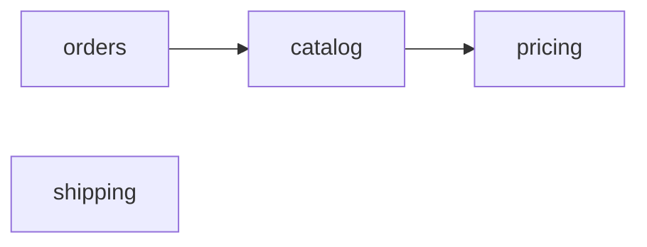

# ApplicationContext nào được tạo trong module test?

## 1. Câu trả lời cốt lõi

Trong Spring Modulith, một lớp kiểm thử gắn `@ApplicationModuleTest` khởi tạo **một `ApplicationContext` của Spring Boot dành cho phần ứng dụng được chọn theo ranh giới module**. Module chứa lớp kiểm thử là điểm xuất phát. Phạm vi các module ứng dụng được đưa vào context phụ thuộc vào `BootstrapMode`:

- **`STANDALONE` (mặc định):** chỉ module đang kiểm thử.
- **`DIRECT_DEPENDENCIES`:** module đang kiểm thử và các module mà nó phụ thuộc trực tiếp.
- **`ALL_DEPENDENCIES`:** module đang kiểm thử và toàn bộ các module phụ thuộc trực tiếp hoặc gián tiếp.

Nói “chỉ module đang kiểm thử” là nói về **phạm vi thành phần nghiệp vụ được chọn**. Context vẫn có thể chứa các bean hạ tầng, cấu hình tự động của Spring Boot, bean phục vụ kiểm thử và bean do chính bài kiểm thử cung cấp. Vì vậy, `@ApplicationModuleTest` không tạo một container chỉ có đúng các class trong một package, cũng không mặc nhiên chạy toàn bộ ứng dụng như bài kiểm thử tích hợp thông thường dùng `@SpringBootTest`.

Mục tiêu của bài học là xác định chính xác *context được bootstrap từ đâu, chứa module nào, vì sao một bean xuất hiện hoặc vắng mặt*, rồi dùng hiểu biết đó để kiểm thử module, sự kiện và tích hợp dữ liệu mà vẫn giữ ranh giới kiến trúc.

## 2. Spring Modulith xác định module được kiểm thử như thế nào?

Xét cấu trúc ứng dụng giả định:

```text
src/main/java/com/example/shop/
├── ShopApplication.java                 // @SpringBootApplication
├── orders/                              // module orders
│   ├── OrderService.java
│   └── OrderPolicy.java
├── catalog/                             // module catalog
│   └── CatalogApi.java
└── pricing/                             // module pricing
    └── PricePolicy.java

src/test/java/com/example/shop/
└── orders/
    └── OrdersModuleTest.java            // @ApplicationModuleTest
```

Với cách tổ chức module thông dụng, các package con trực tiếp của package ứng dụng gốc là các module. Lớp `OrdersModuleTest` nằm trong package `com.example.shop.orders`, nên Spring Modulith chọn `orders` làm **module đang kiểm thử**. Spring Boot vẫn cần tìm cấu hình khởi động ứng dụng phù hợp (ví dụ `ShopApplication` ở package gốc) để thiết lập context và auto-configuration.

Các bước có thể hình dung như sau:

1. Spring Test và Spring Boot chuẩn bị quá trình bootstrap context cho lớp kiểm thử.
2. Spring Modulith dùng mô hình các application module để xác định module chứa lớp test và những module được phép đưa vào theo `mode`.
3. Các thành phần ứng dụng thuộc phạm vi được chọn được đăng ký vào context; Spring Boot và cấu hình kiểm thử có thể đóng góp các bean hạ tầng tương ứng.
4. Spring tạo bean, tiêm phụ thuộc và chạy vòng đời khởi tạo. Nếu một bean cần cộng tác viên không tồn tại trong context, quá trình khởi động có thể thất bại *trước khi chạy phương thức `@Test`*.

Điều này không phải là việc khởi động một `ApplicationContext` con cho từng package. Mỗi cấu hình kiểm thử nhận **một context phù hợp với phạm vi bootstrap** và Spring Test có thể cache/reuse context giữa các lớp có cấu hình tương thích.

## 3. Ba chế độ bootstrap quyết định nội dung context

Giả sử đồ thị phụ thuộc được Spring Modulith nhận diện là:



Trong sơ đồ, `orders` gọi API do `catalog` công bố; `catalog` sử dụng `pricing`. `shipping` độc lập với nhánh đang kiểm thử. Mũi tên biểu thị hướng **module sử dụng module khác**, không phải luồng sự kiện theo thời gian.

| Chế độ | Module ứng dụng trong context khi test `orders` | Điều cần chú ý |
| --- | --- | --- |
| `STANDALONE` | `orders` | `catalog`, `pricing`, `shipping` không được đưa vào như các module nghiệp vụ. Nếu `OrderService` yêu cầu bean từ `catalog`, cần thay thế phụ thuộc đó hoặc chọn chế độ khác. |
| `DIRECT_DEPENDENCIES` | `orders`, `catalog` | Không tự động đưa `pricing` vào. Nếu bean trong `catalog` cần bean từ `pricing`, khởi động vẫn có thể lỗi. |
| `ALL_DEPENDENCIES` | `orders`, `catalog`, `pricing` | Bao gồm chuỗi phụ thuộc bắc cầu. `shipping` vẫn không được đưa vào chỉ vì nó tồn tại trong cùng ứng dụng. |

**Điểm phân biệt quan trọng:** `DIRECT_DEPENDENCIES` xét **đồ thị module**, không phải cơ chế Spring tự dò toàn bộ chuỗi constructor rồi bổ sung vô hạn các bean còn thiếu. Mặt khác, các quy tắc `allowedDependencies` dùng để ràng buộc kiến trúc; chúng không có nghĩa là chỉ cần khai báo một module được phép sử dụng thì mọi bean của module đó luôn xuất hiện trong `STANDALONE`.

### Cách chọn chế độ trong mã kiểm thử

```java
package com.example.shop.orders;

import org.junit.jupiter.api.Test;
import org.springframework.modulith.test.ApplicationModuleTest;
import org.springframework.modulith.test.ApplicationModuleTest.BootstrapMode;

@ApplicationModuleTest // tương đương mode = BootstrapMode.STANDALONE
class OrdersStandaloneTest {

    @Test
    void moduleBootstraps() {
        // Nếu context khởi động được, test có thể chạy đến đây.
    }
}

@ApplicationModuleTest(mode = BootstrapMode.DIRECT_DEPENDENCIES)
class OrdersWithDirectDependenciesTest {

    @Test
    void directDependenciesBootstrap() {
    }
}

@ApplicationModuleTest(mode = BootstrapMode.ALL_DEPENDENCIES)
class OrdersWithAllDependenciesTest {

    @Test
    void transitiveDependenciesBootstrap() {
    }
}
```

Ba lớp trên minh họa ba lựa chọn cấu hình; trong dự án thực tế, chọn một chế độ theo mục tiêu mỗi bài kiểm thử. Một test “context khởi động được” hữu ích như phép thử cấu hình ban đầu, nhưng cần thêm assertion nghiệp vụ để ngăn hồi quy hành vi.

## 4. Kiểm chứng trực tiếp những bean nào có trong context

Ta có một thành phần nội bộ không cần gọi module khác:

```java
package com.example.shop.orders;

import org.springframework.stereotype.Component;

@Component
class OrderPolicy {

    boolean accepts(int quantity) {
        return quantity > 0;
    }
}
```

Lớp test có thể nhận chính `ApplicationContext` để kiểm tra phạm vi thành phần:

```java
package com.example.shop.orders;

import org.junit.jupiter.api.Test;
import org.springframework.beans.factory.annotation.Autowired;
import org.springframework.context.ApplicationContext;
import org.springframework.modulith.test.ApplicationModuleTest;

import static org.assertj.core.api.Assertions.assertThat;

@ApplicationModuleTest
class OrdersContextTest {

    @Autowired
    ApplicationContext context;

    @Autowired
    OrderPolicy orderPolicy;

    @Test
    void loadsTheModuleBeanAndItsBehavior() {
        assertThat(context.getBeanNamesForType(OrderPolicy.class)).isNotEmpty();
        assertThat(orderPolicy.accepts(2)).isTrue();
        assertThat(orderPolicy.accepts(0)).isFalse();
    }
}
```

Với ứng dụng ví dụ **không khai báo thêm bean hoặc mock của `CatalogApi`**, có thể thêm assertion `assertThat(context.getBeanNamesForType(CatalogApi.class)).isEmpty()` để quan sát module `catalog` không được nạp ở chế độ `STANDALONE`. Tuy nhiên, không nên kết luận về ranh giới chỉ bằng tổng số bean trong context: các bean do auto-configuration hay `@TestConfiguration` thêm vào không được đếm như một “module nghiệp vụ” khác.

Ngoài cách inspect `ApplicationContext`, có thể xem log khởi động Spring Modulith Test để đối chiếu module đang được bootstrap và `mode` của bài kiểm thử. Khi cần truy nguyên, kiểm tra cả package của test, đồ thị phụ thuộc module và những bean được đăng ký qua cấu hình kiểm thử.

## 5. Vì sao `STANDALONE` có thể báo thiếu bean?

Giả sử `OrderService` nhận một API công khai của module `catalog` qua constructor:

```java
package com.example.shop.orders;

import com.example.shop.catalog.CatalogApi;
import org.springframework.stereotype.Service;

@Service
class OrderService {

    private final CatalogApi catalog;

    OrderService(CatalogApi catalog) {
        this.catalog = catalog;
    }

    // Các phương thức xử lý đơn hàng sử dụng catalog...
}
```

Khi chạy `@ApplicationModuleTest` mặc định, component `OrderService` của `orders` có thể được chọn nhưng implementation của `CatalogApi` thuộc `catalog` thì không. Spring có thể báo `UnsatisfiedDependencyException` với nguyên nhân thiếu bean `CatalogApi`. Đây là một tín hiệu hữu ích: **phần cần kiểm thử đang kết nối ra ngoài ranh giới context**.

Có ba hướng xử lý tùy mục tiêu:

| Mục tiêu kiểm thử | Hướng xử lý |
| --- | --- |
| Chỉ kiểm chứng logic của `orders` | Giữ `STANDALONE`; cung cấp test double/mock cho `CatalogApi` tại ranh giới module. Chẳng hạn dùng `@MockitoBean` ở các phiên bản Spring Test hỗ trợ; với stack cũ hơn có thể gặp `@MockBean` của Spring Boot. |
| Kiểm thử tương tác thật giữa `orders` và `catalog` | Chọn `DIRECT_DEPENDENCIES` khi đồ thị module và cấu hình các bean cần thiết cho phép. |
| Kiểm thử luồng cần cả phụ thuộc bắc cầu | Chọn `ALL_DEPENDENCIES`, rồi kiểm chứng rõ những hành vi tích hợp mong đợi. |

Không nên tự động chuyển mọi test lỗi khởi động thành `ALL_DEPENDENCIES`: context lớn hơn có thể che dấu sự phụ thuộc bất hợp lý và làm test chậm, khó khoanh vùng hơn. Ngược lại, mock mọi cộng tác viên ở mọi test sẽ bỏ sót lỗi cấu hình tích hợp thật. Chọn phạm vi dựa trên điều bài kiểm thử cần chứng minh.

Nếu lỗi xuất hiện từ một bean thuộc module vốn không mong đợi trong context, kiểm tra các cấu hình `@Import`, `@TestConfiguration`, bean đăng ký thủ công và thiết lập quét component. Những cấu hình đó có thể bổ sung bean ngoài phạm vi module đang chọn.

## 6. Context module test và các kiểm thử dữ liệu, sự kiện, tích hợp

**Cơ sở dữ liệu.** `@ApplicationModuleTest` vẫn tận dụng khả năng cấu hình của Spring Boot. Khi có Spring Data/JPA, DataSource hoặc cấu hình tương ứng, context có thể khởi tạo repository, entity manager và kết nối dữ liệu cần thiết cho phần được kiểm thử. Việc có database thực, database in-memory hay Testcontainers phụ thuộc vào dependency, profile, test configuration và hạ tầng mà dự án thiết lập; annotation `@ApplicationModuleTest` tự nó không bảo đảm có database độc lập hay tự cô lập dữ liệu giữa các test. Hãy kiểm tra transaction, schema/migration và chiến lược dọn dữ liệu theo mục tiêu tích hợp.

**Sự kiện.** Module test có thể kiểm chứng rằng logic của module *phát ra* domain event hoặc application event. Spring Modulith Test cung cấp các tiện ích như `PublishedEvents` và `Scenario` để hỗ trợ kiểm thử tương tác qua sự kiện. Nhưng một listener ở module ngoài phạm vi bootstrap không tự xuất hiện chỉ vì event của nó được phát ra. Khi cần quan sát việc một module khác *nhận và xử lý* event, phải chọn phạm vi bootstrap chứa listener đó hoặc có bài kiểm thử tích hợp riêng.

**Tích hợp qua module API.** Chế độ `DIRECT_DEPENDENCIES` hay `ALL_DEPENDENCIES` hữu ích khi cần thử wiring thật của các bean ở nhiều module. Tuy nhiên, phạm vi context là một quyết định của bài test; nó không thay thế việc xác minh chiều phụ thuộc module hợp lệ về mặt kiến trúc.

Ví dụ về hai tầng kiểm thử bổ trợ nhau:

```java
import com.example.shop.ShopApplication;
import org.junit.jupiter.api.Test;
import org.springframework.modulith.core.ApplicationModules;

class ArchitectureVerificationTest {

    @Test
    void moduleDependenciesRespectTheArchitecture() {
        ApplicationModules.of(ShopApplication.class).verify();
    }
}
```

Đoạn trên **phân tích mô hình module và xác minh quy tắc kiến trúc**; nó không chứng minh mọi bean thực sự tạo được trong Spring context. Ngược lại, `@ApplicationModuleTest` kiểm chứng việc bootstrap phần ứng dụng đã chọn và hành vi trong context đó; test khởi động thành công không đủ để khẳng định tất cả quy tắc phụ thuộc đều hợp lệ. Một quality gate CI vững nên chạy cả kiểm tra kiến trúc với `ApplicationModules` và các module test liên quan, cùng những bài kiểm thử dữ liệu/sự kiện cần thiết.

## 7. Quy trình chẩn đoán khi context không như kỳ vọng

Khi một module test thất bại lúc bootstrap hoặc có quá nhiều bean, hãy lần theo thứ tự:

1. **Xác định module đích:** lớp test ở package nào? Package đó có thuộc module cần kiểm thử không? Spring Boot tìm thấy lớp cấu hình ứng dụng gốc phù hợp chưa?
2. **Kiểm tra `BootstrapMode`:** đang ở mặc định `STANDALONE` hay đã mở rộng `DIRECT_DEPENDENCIES` / `ALL_DEPENDENCIES`?
3. **Đọc hướng phụ thuộc:** module dưới test phụ thuộc trực tiếp module nào; module phụ thuộc tiếp tới đâu? Chế độ `DIRECT_DEPENDENCIES` có bỏ sót phụ thuộc bắc cầu của bean đang khởi tạo không?
4. **Xem ngoại lệ gốc:** `NoSuchBeanDefinitionException` hoặc `UnsatisfiedDependencyException` thường cho thấy thiếu bean; lỗi DataSource, migration hoặc broker lại thường liên quan cấu hình hạ tầng test.
5. **Xem phần cấu hình bổ sung:** `@Import`, bean fake/mock, profile, auto-configuration và test configuration có đưa thêm hoặc thay thế bean nào không?
6. **Chốt assertion đúng cấp:** test đơn module chứng minh logic/ràng buộc nội bộ; test nhiều module chứng minh tích hợp; `ApplicationModules.verify()` kiểm chứng phụ thuộc kiến trúc.

### Các ngộ nhận dễ gặp

| Nhận định | Diễn giải chính xác |
| --- | --- |
| “`@ApplicationModuleTest` nạp toàn bộ ứng dụng.” | Chỉ phạm vi module ứng dụng được chọn theo `mode`, cộng các bean hạ tầng/cấu hình kiểm thử phù hợp. |
| “`STANDALONE` nghĩa là context không có bean nào ngoài package module.” | Vẫn có thể có auto-configuration, Spring infrastructure, cấu hình hoặc mock của test. |
| “`DIRECT_DEPENDENCIES` sẽ nạp mọi phụ thuộc của mọi bean.” | Chế độ này chỉ bao gồm các module phụ thuộc **trực tiếp** theo mô hình module. |
| “Test module chạy xanh thì ranh giới kiến trúc đã đúng.” | Cần kiểm tra kiến trúc bằng `ApplicationModules.verify()` và các quy tắc phụ thuộc đã thiết kế. |
| “Event phát ra thì listener ở mọi module đều chạy.” | Listener phải có mặt trong context hoặc được kiểm tra ở bài tích hợp khác. |

## 8. Bài tập tự kiểm tra

Với đồ thị `orders → catalog → pricing` và `shipping` độc lập, hãy trả lời trước khi chạy test:

1. Một test trong package `orders` dùng `@ApplicationModuleTest` không có `mode` sẽ chọn các module ứng dụng nào?
2. Test đó có thể tiêm bean implementation của `CatalogApi` từ module `catalog` mà không cần thêm cấu hình không?
3. Chuyển sang `DIRECT_DEPENDENCIES` có bảo đảm một bean `catalog` đang cần `PricePolicy` từ `pricing` sẽ tạo thành công không?
4. Chế độ nào bao gồm cả `pricing`, và chế độ đó có tự đưa `shipping` vào không?
5. Kiểm tra nào phát hiện một quan hệ phụ thuộc module trái quy tắc ngay cả khi tất cả Spring bean vẫn khởi tạo được?

**Đáp án đối chiếu:** (1) `orders`; (2) không theo cấu hình thông thường nếu bean chỉ được cung cấp ở module `catalog`, cần test double hoặc mở rộng phạm vi; (3) không; (4) `ALL_DEPENDENCIES` và không tự bao gồm `shipping`; (5) kiểm chứng kiến trúc qua `ApplicationModules.of(ShopApplication.class).verify()`.

**Ghi nhớ:** câu hỏi “`ApplicationContext` nào được tạo?” phải được trả lời bằng **module chứa test + `BootstrapMode` + cấu hình Spring Boot/test đang áp dụng**. Khi đã nhận diện ba yếu tố này, ta có thể chọn context nhỏ đủ để kiểm thử ranh giới, hoặc mở rộng có chủ đích để kiểm thử tích hợp mà không mất khả năng phát hiện hồi quy.
