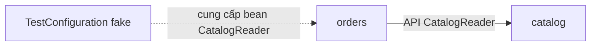

# Bean test configuration và vị trí khai báo

## 1. Vấn đề: bean phục vụ kiểm thử nên được khai báo ở đâu?

Khi chạy `@ApplicationModuleTest` trong Spring Modulith, một module nghiệp vụ thường cần các cộng tác viên như cổng truy vấn sản phẩm, bộ phát sinh thời gian, repository hoặc adapter tích hợp. Một số cộng tác viên nằm bên ngoài phạm vi module đang kiểm thử. Nếu Spring không tìm thấy bean tương ứng, `ApplicationContext` có thể khởi động thất bại trước khi một phương thức `@Test` được thực thi.

`@TestConfiguration` của Spring Boot cho phép **đăng ký những bean chỉ phục vụ kiểm thử**: ví dụ clock cố định, fake gateway, adapter in-memory hoặc cấu hình fixture. Điểm cần hiểu là **nơi đặt lớp cấu hình và cách nhập cấu hình quyết định bài test nào nhận bean đó**. Đặt một class trong `src/test/java` không tự bảo đảm Spring nạp class ấy; tương tự, đặt nó trong package của module cũng không bảo đảm phù hợp với ranh giới kiểm thử.

Trong module học `SPRING_MODULITH_VERIFICATION_TESTING`, ta dùng kiến thức này để kiểm thử hành vi bằng `@ApplicationModuleTest`, giữ ranh giới kiến trúc có thể kiểm chứng bằng `ApplicationModules`, và triển khai quality gate CI ngăn phụ thuộc không hợp lệ hoặc hồi quy tích hợp.

Sau bài này, bạn cần trả lời được bốn câu hỏi: bean test được tạo bởi lớp cấu hình nào, lớp đó được phát hiện bằng cách nào, phạm vi module test có bị mở rộng không, và bài test đang kiểm chứng hành vi thật hay hành vi của một test double?

## 2. Ba loại cấu hình và ý nghĩa của chúng

| Thành phần | Vai trò chính | Cách dùng điển hình |
| --- | --- | --- |
| `@Configuration` trong `src/main/java` | Cấu hình bean của ứng dụng ở runtime | Cấu hình service, adapter, repository hoặc infrastructure dùng thật |
| `@TestConfiguration` trong `src/test/java` | Cung cấp bean bổ sung dành riêng cho test | Fake gateway, clock cố định, cấu hình test-specific |
| `@MockitoBean` trên trường hoặc cấp lớp kiểm thử | Ghi đè hoặc tạo mock theo khả năng Spring Test hỗ trợ | Cô lập một dependency và định nghĩa hành vi qua Mockito |

`@TestConfiguration` là một biến thể chuyên dụng của `@Configuration`, nhưng khác ở cách Spring Boot xử lý trong bài kiểm thử. Nó được thiết kế để **bổ sung cấu hình test cùng cấu hình ứng dụng đang được bootstrap**. Lớp `@TestConfiguration` cấp cao nhất (*top-level*) thường không được Spring Boot tự động nhặt lên bằng component scan mặc định; muốn dùng phải nhập rõ, chẳng hạn qua `@Import`.

Ngược lại, một lớp `@TestConfiguration` **lồng tĩnh (*static nested*) trong lớp test** thường được Spring Boot nhận diện và bổ sung tự động cho test đó. Đây là lý do hai class cùng mang `@TestConfiguration` nhưng đặt ở hai vị trí lại cho kết quả khác nhau.

Một bean có kiểu Java thuộc module khác vẫn có thể là **test bean** nếu nó được tạo bởi `@TestConfiguration` của bài test. Ví dụ bean fake implement `CatalogReader` (API của `catalog`) được khai báo trong test `orders` không chứng minh rằng implementation thật của module `catalog` đã được nạp.

### Mô hình các lớp cấu hình

```mermaid
flowchart TD
    T[OrdersModuleTest\n@ApplicationModuleTest] --> B[Context module orders]
    T --> N[Nested @TestConfiguration]
    T -.->|@Import| S[Top-level @TestConfiguration]
    N --> X[Bean fake hoặc Clock]
    S --> Y[Bean fake dùng chung]
    B --> O[Bean nghiệp vụ orders]
    X --> B
    Y --> B
```

Trong sơ đồ, cấu hình lồng được liên kết với lớp test; cấu hình top-level cần nhập tường minh. Bean tạo ra được đăng ký vào **cùng `ApplicationContext` của bài test**, không phải một container con tách biệt cho từng fake.

## 3. Tình huống thực tế: test module `orders` phụ thuộc API của `catalog`

Giả sử cấu trúc ứng dụng như sau:

```text
src/main/java/com/example/shop/
├── ShopApplication.java                  // @SpringBootApplication
├── orders/
│   └── CheckoutService.java              // @Service, thuộc module orders
└── catalog/
    ├── CatalogReader.java                // public API của module catalog
    └── DatabaseCatalogReader.java        // implementation thật của catalog

src/test/java/com/example/shop/
├── orders/
│   └── CheckoutModuleTest.java
└── testsupport/
    └── CatalogStubConfiguration.java     // tùy chọn dùng chung nhiều bài test
```

Giả sử package con của `com.example.shop` là các application module. API được module `catalog` công bố:

```java
package com.example.shop.catalog;

public interface CatalogReader {
    boolean exists(String sku);
}
```

Bean nghiệp vụ của module `orders` dùng API ấy:

```java
package com.example.shop.orders;

import com.example.shop.catalog.CatalogReader;
import org.springframework.stereotype.Service;

@Service
public class CheckoutService {

    private final CatalogReader catalogReader;

    public CheckoutService(CatalogReader catalogReader) {
        this.catalogReader = catalogReader;
    }

    public String checkout(String sku) {
        if (!catalogReader.exists(sku)) {
            throw new IllegalArgumentException("Unknown SKU: " + sku);
        }
        return "ACCEPTED:" + sku;
    }
}
```

Ta muốn kiểm tra điều kiện chấp nhận đơn hàng **bên trong `orders`**, chưa muốn truy cập cơ sở dữ liệu của `catalog`. `@ApplicationModuleTest` có `BootstrapMode.STANDALONE` theo mặc định, nên module nghiệp vụ `catalog` không tự được nạp. Nếu không tạo một bean `CatalogReader` khác cho test, constructor của `CheckoutService` không có dependency để tiêm và việc bootstrap có thể thất bại với `UnsatisfiedDependencyException`.

Việc bổ sung một test bean vào context ở đây là có chủ đích: `CheckoutService` vẫn là bean thật của module mục tiêu, còn `CatalogReader` được thay thế bằng một implementation đơn giản chỉ dành cho kiểm thử.

## 4. Cách 1: `@TestConfiguration` lồng ngay trong lớp kiểm thử

Khi fake chỉ phục vụ **một lớp test**, cách dễ theo dõi nhất là đặt cấu hình `static` ngay bên trong lớp đó:

```java
package com.example.shop.orders;

import com.example.shop.catalog.CatalogReader;
import org.junit.jupiter.api.Test;
import org.springframework.beans.factory.annotation.Autowired;
import org.springframework.boot.test.context.TestConfiguration;
import org.springframework.context.annotation.Bean;
import org.springframework.modulith.test.ApplicationModuleTest;

import static org.assertj.core.api.Assertions.assertThat;
import static org.assertj.core.api.Assertions.assertThatThrownBy;

@ApplicationModuleTest // mode mặc định: STANDALONE
class CheckoutModuleTest {

    @Autowired
    CheckoutService checkoutService;

    @Test
    void acceptsAvailableProduct() {
        assertThat(checkoutService.checkout("SKU-001"))
            .isEqualTo("ACCEPTED:SKU-001");
    }

    @Test
    void rejectsUnavailableProduct() {
        assertThatThrownBy(() -> checkoutService.checkout("SKU-X"))
            .isInstanceOf(IllegalArgumentException.class)
            .hasMessageContaining("SKU-X");
    }

    @TestConfiguration(proxyBeanMethods = false)
    static class LocalCatalogConfiguration {

        @Bean
        CatalogReader catalogReader() {
            return sku -> "SKU-001".equals(sku);
        }
    }
}
```

Giải thích cách bootstrap:

1. `@ApplicationModuleTest` chọn `orders` làm module mục tiêu từ package chứa test.
2. Spring Boot nhận diện lớp **static nested** `LocalCatalogConfiguration` là cấu hình test bổ sung.
3. `@Bean` đăng ký một `CatalogReader` fake. Object lambda đáp ứng interface, không cần `@Component`.
4. Spring tạo `CheckoutService` thật và tiêm fake vào constructor. Hai assertion kiểm tra nhánh chấp nhận và từ chối.

`proxyBeanMethods = false` phù hợp với cấu hình chỉ cung cấp các bean độc lập, không gọi chéo các phương thức `@Bean` theo kiểu cần proxy. Nó giúp tránh hành vi proxy không cần thiết, nhưng không phải điều kiện bắt buộc để một `@TestConfiguration` hoạt động.

Chữ `static` quan trọng: lớp cấu hình lồng tĩnh không giữ một instance của lớp test bên ngoài. Điều này phù hợp cách Spring Boot tìm và tạo cấu hình cho `ApplicationContext`. Nếu cố khai báo nested configuration không tĩnh, bạn có thể gặp vấn đề tạo instance hoặc cấu hình không được nhận diện như dự kiến.

**Khi nào chọn?** Cấu hình nhỏ, có ý nghĩa riêng cho một lớp test, đọc test là thấy ngay mọi bean fake. Cách này giảm khả năng vô tình dùng lại fake không phù hợp ở bài kiểm thử khác.

## 5. Cách 2: Cấu hình top-level và `@Import`

Khi cùng một fake hữu ích cho nhiều bài test, có thể tách nó thành lớp top-level trong `src/test/java`:

```java
// src/test/java/com/example/shop/testsupport/CatalogStubConfiguration.java
package com.example.shop.testsupport;

import com.example.shop.catalog.CatalogReader;
import org.springframework.boot.test.context.TestConfiguration;
import org.springframework.context.annotation.Bean;

@TestConfiguration(proxyBeanMethods = false)
public class CatalogStubConfiguration {

    @Bean
    CatalogReader catalogReader() {
        return sku -> "SKU-001".equals(sku);
    }
}
```

Sau đó test nào cần fake thì nhập cấu hình bằng `@Import`:

```java
package com.example.shop.orders;

import com.example.shop.testsupport.CatalogStubConfiguration;
import org.junit.jupiter.api.Test;
import org.springframework.beans.factory.annotation.Autowired;
import org.springframework.context.annotation.Import;
import org.springframework.modulith.test.ApplicationModuleTest;

import static org.assertj.core.api.Assertions.assertThat;

@ApplicationModuleTest
@Import(CatalogStubConfiguration.class)
class CheckoutWithSharedStubTest {

    @Autowired
    CheckoutService checkoutService;

    @Test
    void checkoutUsesSharedStub() {
        assertThat(checkoutService.checkout("SKU-001"))
            .isEqualTo("ACCEPTED:SKU-001");
    }
}
```

Hai cách trên là **hai phương án thay thế nhau**, không nên cùng nhập cả `LocalCatalogConfiguration` và `CatalogStubConfiguration` vào một context chỉ để tạo cùng một `CatalogReader`: rất dễ sinh hai bean trùng kiểu hoặc trùng tên.

Đặt `CatalogStubConfiguration` trong `com.example.shop.testsupport` giúp người đọc hiểu đây là hỗ trợ kiểm thử dùng chung. Tuy nhiên, vị trí package **không tự tạo hiệu lực**. Với top-level `@TestConfiguration`, việc `@Import(CatalogStubConfiguration.class)` là tín hiệu rõ ràng cho Spring biết lớp test này cần các bean của cấu hình đó. Kể cả khi đặt lớp top-level ngay dưới package `com.example.shop.orders`, vẫn không nên trông chờ component scan thông thường tự phát hiện nó.

Trong hầu hết trường hợp, nên để cấu hình chỉ dành cho kiểm thử trong `src/test/java` để không vô tình đóng gói bean fake vào artifact sản xuất. Việc chuyển test configuration sang module dùng chung cần một cơ chế tái sử dụng test code phù hợp với tổ chức build của dự án; chỉ di chuyển file vào một package khác chưa bảo đảm mọi module build đều truy cập được.

## 6. Quy tắc chọn vị trí khai báo

| Vị trí | Cách được nạp trong test | Nên dùng khi | Điều cần tránh |
| --- | --- | --- | --- |
| `static` nested `@TestConfiguration` trong lớp test | Spring Boot nhận diện và thêm vào cấu hình của test đó | Fake/fixture dành riêng cho một test class | Nhầm với nested `@Configuration` thông thường hoặc quên `static` |
| Top-level `@TestConfiguration` cạnh lớp test trong `src/test/java` | Thường cần `@Import` rõ ràng | Tách cấu hình lớn cho dễ đọc | Tưởng cùng package thì tự được quét |
| Top-level `@TestConfiguration` ở `src/test/java/.../testsupport` | `@Import` tại từng test cần dùng | Nhiều test dùng chung fake ổn định | Chia sẻ mutable singleton làm test ảnh hưởng lẫn nhau |
| `@Configuration` trong `src/main/java` | Đi theo điều kiện/cơ chế cấu hình runtime | Bean sản xuất thực sự cần cho ứng dụng | Đưa fake kiểm thử vào đường chạy production |
| `@Bean` thông qua một `@TestConfiguration` đã được nạp | Spring đăng ký bean do phương thức trả về | Clock, fake gateway, adapter nhẹ | Đặt `@Bean` trong class không được nạp rồi kỳ vọng Spring tự thấy |

Một điểm dễ nhầm trong Spring Boot test: **nested `@Configuration` thông thường** không có cùng ý nghĩa với nested `@TestConfiguration`. Với cơ chế phát hiện cấu hình của `@SpringBootTest`, nested `@Configuration` có thể được dùng **thay** cấu hình chính mà Boot lẽ ra tìm được, còn nested `@TestConfiguration` được dùng **bổ sung** cho cấu hình ứng dụng. `@ApplicationModuleTest` xây dựng trên Spring Boot test, nên để thêm vài bean kiểm thử, ưu tiên `@TestConfiguration` theo ý định này.

Nếu bạn dùng `@ContextConfiguration(classes = ...)` hoặc chỉnh các `classes` bootstrap, hãy xem lại cấu hình nguồn được chọn: đây là cơ chế rộng hơn việc bổ sung một fake. Một thay đổi cấu hình nguồn có thể khiến phạm vi scan và các bean của context khác hẳn kỳ vọng của module test.

## 7. Test configuration có vượt qua ranh giới module không?

Đặt fake trong test module **không sửa đồ thị phụ thuộc production**. Tuy vậy, việc nhập một cấu hình test hoặc một class từ module ngoài vẫn có thể khiến `ApplicationContext` chứa bean ngoài tập module mà `BootstrapMode` vốn chọn. Đó là đặc điểm của **cấu hình test bổ sung**; cần dùng có chủ đích.

Giả sử `orders` có phụ thuộc trực tiếp lên API công khai của `catalog`, như `CatalogReader`:



Ở `STANDALONE`, Spring Modulith chỉ chọn module nghiệp vụ `orders`. Bean fake do test cung cấp giải quyết dependency của `CheckoutService`. Nó **không chứng minh** adapter `DatabaseCatalogReader` thật đã được tạo, cũng không kiểm chứng cơ sở dữ liệu của `catalog`.

Khi muốn kiểm thử tương tác thật với `catalog`, có thể chuyển sang:

```java
import org.springframework.modulith.test.ApplicationModuleTest;
import org.springframework.modulith.test.ApplicationModuleTest.BootstrapMode;

@ApplicationModuleTest(mode = BootstrapMode.DIRECT_DEPENDENCIES)
class CheckoutWithCatalogIntegrationTest {
    // Kiểm thử với adapter thật nếu catalog là dependency trực tiếp
    // và hạ tầng liên quan đã được cấu hình đầy đủ.
}
```

`DIRECT_DEPENDENCIES` chọn module mục tiêu cùng các module nó phụ thuộc **trực tiếp**; `ALL_DEPENDENCIES` còn bao gồm phụ thuộc **bắc cầu**. Cả hai khác với việc `@Import` một vài bean tùy ý. Nếu vô tình `@Import` cấu hình production quét rộng hoặc kéo hàng loạt service ngoài module, hãy xem lại ý định của bài test thay vì coi đó là cách thiết lập module test mặc định.

**Quy tắc thực hành:** `@TestConfiguration` là công cụ chủ động tạo dependency cho một bài test, còn `BootstrapMode` là công cụ chọn **phạm vi application module** để bootstrap. Hai cơ chế có thể kết hợp nhưng không thay thế ý nghĩa của nhau.

## 8. Khi nào dùng fake từ `@TestConfiguration`, khi nào dùng mock?

Một fake là implementation đơn giản có hành vi xác định, ví dụ catalog chỉ nhận `SKU-001`. Một mock do Mockito quản lý cho phép chỉ định kết quả và kiểm tra lời gọi. Cả hai đều tạo điều kiện cô lập module mục tiêu, nhưng phù hợp những nhu cầu khác nhau.

| Nhu cầu | Cách chọn hợp lý |
| --- | --- |
| Một dependency có thể mô phỏng bằng logic đơn giản, ít trạng thái | `@Bean` fake trong `@TestConfiguration` |
| Muốn quy định kết quả khác nhau ở mỗi test hoặc verify interaction | `@MockitoBean` và `given(...).willReturn(...)` / `verify(...)` |
| Cần Clock cố định, serializer, adapter test dùng chung | `@TestConfiguration` với các bean tương ứng |
| Muốn kiểm chứng wiring/transaction thật giữa các module | Nạp dependency thật bằng bootstrap mode phù hợp và chuẩn bị hạ tầng tích hợp |

Ví dụ thay thế fake bằng mock ở các phiên bản Spring Framework có `@MockitoBean` (Spring Framework 6.2 trở lên):

```java
package com.example.shop.orders;

import com.example.shop.catalog.CatalogReader;
import org.junit.jupiter.api.Test;
import org.springframework.beans.factory.annotation.Autowired;
import org.springframework.modulith.test.ApplicationModuleTest;
import org.springframework.test.context.bean.override.mockito.MockitoBean;

import static org.assertj.core.api.Assertions.assertThat;
import static org.mockito.BDDMockito.given;

@ApplicationModuleTest
class CheckoutWithMockTest {

    @MockitoBean
    CatalogReader catalogReader;

    @Autowired
    CheckoutService checkoutService;

    @Test
    void acceptsConfiguredSku() {
        given(catalogReader.exists("SKU-002")).willReturn(true);

        assertThat(checkoutService.checkout("SKU-002"))
            .isEqualTo("ACCEPTED:SKU-002");
    }
}
```

`@MockitoBean` có thể thay bean tương ứng trong context hoặc tạo mock khi không có bean phù hợp, tùy quy tắc override của Spring Test. Với phiên bản Spring Boot cũ hơn có thể gặp annotation `@MockBean`; cần dùng annotation tương thích với phiên bản stack của dự án. Một mock cũng là **bean trong test context**, nhưng không phải implementation production của module ngoài.

Không nên khai báo đồng thời `@MockitoBean CatalogReader` và fake `@Bean CatalogReader` khi không có lý do cụ thể: test dễ khó hiểu vì bean nào được thay thế, tên nào được chọn và assertion đang chạy trên mock hay fake.

## 9. Xử lý hai bean cùng kiểu hoặc cùng tên

Một lỗi thực tế thường gặp khi thêm `@TestConfiguration` là có nhiều ứng viên cho một dependency:

- **Trùng kiểu:** hai bean `Clock` tồn tại trong context; injection theo kiểu có thể báo `NoUniqueBeanDefinitionException` nếu không có cách chọn rõ ràng.
- **Trùng tên:** hai phương thức `@Bean` cùng tên `clock` có thể gây lỗi bean definition override; cấu hình Spring Boot thường không cho phép override ngầm định.
- **Sai điều kiện:** bean chỉ đăng ký khi profile/condition thỏa, khiến test ở máy hoặc CI nạp khác nhau.

Nếu bài test cần **ưu tiên một bean mới có kiểu giống bean production**, có thể đặt tên riêng và dùng `@Primary`:

```java
import org.springframework.boot.test.context.TestConfiguration;
import org.springframework.context.annotation.Bean;
import org.springframework.context.annotation.Primary;
import java.time.Clock;
import java.time.Instant;
import java.time.ZoneOffset;

@TestConfiguration(proxyBeanMethods = false)
static class FixedTimeConfiguration {

    @Bean("fixedTestClock")
    @Primary
    Clock fixedTestClock() {
        return Clock.fixed(
            Instant.parse("2026-01-01T00:00:00Z"),
            ZoneOffset.UTC);
    }
}
```

Đây là **lớp nested dùng bên trong một test class**, được rút gọn để tập trung vào phương thức bean. `@Primary` chỉ giúp ưu tiên khi có nhiều candidate tiêm theo kiểu; nó **không xử lý đụng tên bean**, và không có nghĩa production bean đã bị xóa. Nếu cần thay hẳn một bean cụ thể, dùng cơ chế mock override/test bean phù hợp hoặc cấu hình profile/condition minh bạch. Tránh bật cho phép bean definition overriding trên toàn dự án chỉ để che xung đột chưa được hiểu.

Khi fake giữ trạng thái có thể thay đổi, lưu ý Spring Test **cache `ApplicationContext`** giữa những test có cấu hình tương thích. Một singleton fake lưu trạng thái từ test trước có thể làm kết quả phụ thuộc thứ tự. Ưu tiên fake bất biến/stateless; nếu cần trạng thái, reset trong `@BeforeEach` hoặc dùng setup cô lập có chủ đích. Không nên dùng `@DirtiesContext` cho mọi bài test chỉ vì việc dọn trạng thái chưa rõ ràng.

## 10. Kiểm chứng đúng bean trong context

Có thể inject `ApplicationContext` để xem bean nào đã được đăng ký, nhưng cần diễn giải kết quả theo **nguồn đăng ký** chứ không chỉ theo package của kiểu Java:

```java
package com.example.shop.orders;

import com.example.shop.catalog.CatalogReader;
import org.junit.jupiter.api.Test;
import org.springframework.beans.factory.annotation.Autowired;
import org.springframework.boot.test.context.TestConfiguration;
import org.springframework.context.ApplicationContext;
import org.springframework.context.annotation.Bean;
import org.springframework.modulith.test.ApplicationModuleTest;

import static org.assertj.core.api.Assertions.assertThat;

@ApplicationModuleTest
class BeanVisibilityTest {

    @Autowired
    ApplicationContext context;

    @TestConfiguration(proxyBeanMethods = false)
    static class CatalogTestConfiguration {
        @Bean
        CatalogReader catalogReader() {
            return sku -> "SKU-001".equals(sku);
        }
    }

    @Test
    void usesBeanSuppliedByTestConfiguration() {
        assertThat(context.getBeanNamesForType(CatalogReader.class))
            .hasSize(1);
        assertThat(context.getBean(CatalogReader.class).exists("SKU-001"))
            .isTrue();
    }
}
```

Assertion `.hasSize(1)` giả định không có cấu hình bổ sung khác đăng ký `CatalogReader` trong context test này. Trong một dự án có nhiều test configurations, cần kiểm tra danh sách bean trước khi chốt kỳ vọng.

Một phép kiểm tra bean tồn tại không đủ để khẳng định hành vi bên ngoài: đối tượng trả về có thể là fake. Hãy kiểm tra class của bean, định nghĩa bean (`BeanFactory`/`BeanDefinition`) và cấu hình `@Import` khi cần truy nguyên. Những bean kiểu `DataSource`, `ApplicationContext` hay transaction manager thường là thành phần hạ tầng; chúng không có nghĩa tất cả module nghiệp vụ đã được nạp.

## 11. Kiểm thử sự kiện và cơ sở dữ liệu: không để test config che lỗi tích hợp

**Sự kiện:** Một fake listener trong `@TestConfiguration` có thể ghi lại các event mà module mục tiêu phát ra, phục vụ assertion nội bộ. Spring Modulith Test cũng hỗ trợ công cụ kiểm tra các event đã phát như `PublishedEvents`. Nhưng nếu `notifications` là module khác, fake listener không chứng minh listener **thật** của `notifications` hoạt động. Muốn xác nhận luồng nghiệp vụ liên module, phải có bài test chứa bean listener thật và điều kiện giao dịch/event phù hợp.

**Cơ sở dữ liệu:** Test configuration có thể cung cấp `Clock`, fake repository hoặc adapter in-memory để cô lập logic. Khi cần kiểm chứng JPA repository, migration, transaction và dữ liệu thật, bài test phải khởi tạo hạ tầng test phù hợp (profile test, database/container, schema, fixture, cleanup). `@TestConfiguration` không tự tạo database và cũng không tự làm một module test trở thành integration test có dữ liệu thực. Nếu vô tình cung cấp fake repository trong bài test được gọi là “database integration”, assertion có thể chạy xanh trong khi kết nối thực đã hỏng.

**Ranh giới:** Nếu một bài `@ApplicationModuleTest` ở `STANDALONE` cần quá nhiều fake phức tạp, đó là tín hiệu để xem lại mục tiêu test, mức độ kết dính của module và việc có cần thêm một bài kiểm thử tích hợp với `DIRECT_DEPENDENCIES` hoặc `ALL_DEPENDENCIES` hay không. Mở rộng context phải đi cùng assertion tích hợp có ý nghĩa.

## 12. Quality gate CI: xác minh kiến trúc và bootstrap độc lập

Một test chạy xanh nhờ fake vẫn có thể bỏ sót một phụ thuộc code không hợp lệ giữa các module. Vì vậy cần một test kiến trúc riêng:

```java
import com.example.shop.ShopApplication;
import org.junit.jupiter.api.Test;
import org.springframework.modulith.core.ApplicationModules;

class ModuleArchitectureTest {

    @Test
    void respectsModuleDependencies() {
        ApplicationModules.of(ShopApplication.class).verify();
    }
}
```

| Phép kiểm tra CI | Câu hỏi được trả lời | Điểm không thay thế được |
| --- | --- | --- |
| `ApplicationModules.verify()` | Những quan hệ phụ thuộc module có tuân thủ ranh giới kiến trúc không? | Không khởi động `ApplicationContext` để kiểm tra bean test/bean thật. |
| `@ApplicationModuleTest` với fake hoặc mock | Bean module mục tiêu có bootstrap được và logic nội bộ có đúng không? | Không xác nhận adapter bên ngoài và cơ sở dữ liệu thật. |
| Module test mở rộng/integration test | Các bean thật, dữ liệu và event tích hợp có vận hành theo assertion không? | Không tự quét tất cả quan hệ phụ thuộc code về mặt kiến trúc. |

Đặt các phép kiểm tra vào pipeline build phù hợp để mỗi lỗi được báo đúng tầng. Ví dụ: lỗi dependency kiến trúc cần sửa hướng sử dụng module, `UnsatisfiedDependencyException` cần xem bootstrap mode và test configuration, còn lỗi assertion tích hợp cần điều tra hạ tầng/dữ liệu/event. Không nên thêm fake vào test kiến trúc chỉ để làm cảnh báo biến mất: hai loại kiểm chứng có nhiệm vụ khác nhau.

## 13. Checklist chẩn đoán khi bean test không xuất hiện

Khi `@ApplicationModuleTest` không thấy bean từ test configuration, hãy thực hiện lần lượt:

1. **Xác định đúng loại class:** class được đánh dấu `@TestConfiguration`, `@Configuration` hay chỉ là class Java không có annotation?
2. **Xác nhận vị trí:** class `@TestConfiguration` là `static nested` trong test hay top-level ở file riêng? Với top-level, test đã khai báo `@Import` chưa?
3. **Xem scope module:** `@ApplicationModuleTest` đang chọn mode nào và bean cần thiết có phải của một module chưa được nạp không?
4. **Kiểm tra khai báo `@Bean`:** phương thức có được đăng ký không, có tên bean trùng, nhiều ứng viên cùng kiểu, profile hoặc condition ngăn bean xuất hiện không?
5. **Xem test override:** có `@MockitoBean`, cấu hình fake khác hoặc `@Primary` khiến bạn nhận nhầm bean không?
6. **Đọc nguyên nhân sâu nhất của lỗi khởi động:** thiếu bean nghiệp vụ, thiếu DataSource, lỗi migration hoặc thiếu thư viện test là các vấn đề khác nhau.
7. **Xác nhận mục tiêu của assertion:** đang kiểm chứng `CheckoutService` với fake, hay đang kiểm chứng adapter `DatabaseCatalogReader` thật? Chọn loại test cho đúng.

### Những ngộ nhận thường gặp

| Ngộ nhận | Cách hiểu đúng |
| --- | --- |
| “Đặt top-level `@TestConfiguration` cùng package test là đủ.” | Cấu hình top-level thường cần `@Import` tường minh; vị trí package không tự động nạp cấu hình. |
| “Cứ có class trong `src/test/java` thì Spring tạo bean.” | Phải có cơ chế đăng ký (`@Bean`, override, import, nested configuration được nhận diện...). |
| “Bean fake kiểu `CatalogReader` nghĩa là module `catalog` đã bootstrap.” | Test configuration có thể đăng ký fake dù implementation production của `catalog` không được nạp. |
| “`@Primary` thay thế và xóa bean cũ.” | `@Primary` chỉ ưu tiên một candidate khi injection; bean cũ vẫn có thể tồn tại. |
| “Cấu hình test có thể import mọi service mà không ảnh hưởng ranh giới.” | `@Import` có thể nạp thêm thành phần ngoài phạm vi dự định; cần kiểm tra lại mục tiêu kiểm thử. |
| “Một bài module test có mock chạy xanh là đủ cho CI.” | Còn cần `ApplicationModules.verify()` và integration test cho những luồng bên ngoài thiết yếu. |

## 14. Bài tập tự kiểm tra

Cho module `orders` gọi `CatalogReader` của `catalog`, và một bài `@ApplicationModuleTest` trong package `com.example.shop.orders` chạy mặc định `STANDALONE`:

1. Nếu tạo `src/test/java/com/example/shop/testsupport/CatalogStubConfiguration.java` với `@TestConfiguration`, cần thêm annotation nào trên test để chắc chắn cấu hình top-level được dùng?
2. Nếu chuyển cấu hình đó thành lớp `static nested` trong test, có cần `@Import` chỉ để nhận diện cấu hình lồng này không?
3. Khi `CheckoutService` tiêm `CatalogReader` fake, bài test có kiểm chứng `DatabaseCatalogReader` thật hay database của `catalog` không?
4. Nếu context chứa cả production `Clock` và `fixedTestClock`, `@Primary` có tác dụng gì và không giải quyết được lỗi nào?
5. Khi muốn kiểm chứng interaction giữa `orders` và `catalog` thật, nên xem xét thay đổi nào ngoài `@TestConfiguration`?
6. Kiểm tra nào phát hiện phụ thuộc code đi vào phần internal của một module khác, dù unit/module test dùng fake đều chạy xanh?

**Đáp án gợi ý:** (1) `@Import(CatalogStubConfiguration.class)`; (2) thông thường không, Spring Boot tự nhận diện nested `@TestConfiguration`; (3) không, đó là fake; (4) ưu tiên chọn clock khi injection theo kiểu, không xử lý xung đột **trùng tên bean**; (5) chuyển sang phạm vi module phụ thuộc phù hợp và chuẩn bị hạ tầng/dữ liệu tích hợp; (6) `ApplicationModules.of(ShopApplication.class).verify()` với các quy tắc module được thiết lập.

**Ghi nhớ:** vị trí khai báo `@TestConfiguration` quyết định **cách nạp** cấu hình test; `BootstrapMode` quyết định **các module ứng dụng được chọn**; `ApplicationModules.verify()` quyết định **quan hệ kiến trúc có hợp lệ**. Giữ ba quyết định này tường minh giúp xây dựng module test nhanh, dễ đọc và đủ tin cậy để đưa vào quality gate CI.
