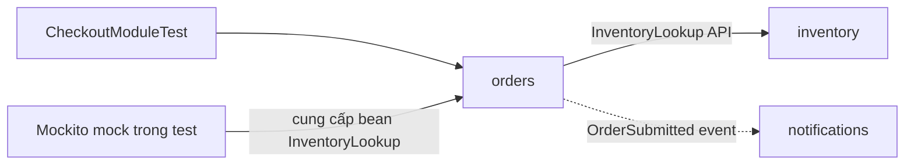

# @MockBean hoặc cơ chế thay thế collaborator

## 1. Khi nào module test cần thay collaborator?

Trong Spring Modulith, `@ApplicationModuleTest` cho phép kiểm thử một application module bằng Spring Boot test context được giới hạn theo ranh giới module. Theo mặc định (`BootstrapMode.STANDALONE`), các bean nghiệp vụ của module đang kiểm thử được chọn để bootstrap; bean nghiệp vụ của các module phụ thuộc không tự động đi theo. Tuy nhiên, constructor của một service trong module có thể cần một API được cung cấp bởi module khác, chẳng hạn `InventoryLookup` hoặc `PaymentGateway`.

Ví dụ: module `orders` xử lý yêu cầu đặt hàng, còn module `inventory` sở hữu logic kiểm tra tồn kho. `CheckoutService` của `orders` dùng interface công khai `InventoryLookup`. Khi module test chỉ nạp `orders`, không có implementation thật của `InventoryLookup`, Spring có thể báo `UnsatisfiedDependencyException` ngay trong quá trình tạo `CheckoutService`.

Đó là lúc cần **thay collaborator**: cung cấp một bean giả lập hoặc thay bean hiện có để chủ động điều khiển phản hồi từ ranh giới bên ngoài. Có nhiều lựa chọn như `@MockBean`, `@MockitoBean`, fake từ `@TestConfiguration`, bean được nhập bằng `@Import`, hoặc mở rộng phạm vi bootstrap để dùng bean thật. Từng lựa chọn kiểm chứng một điều khác nhau.

Trong học phần `SPRING_MODULITH_VERIFICATION_TESTING`, việc thay collaborator phải phục vụ mục tiêu lớn hơn: kiểm chứng ranh giới kiến trúc bằng `ApplicationModules` và quy tắc phụ thuộc, xây dựng module test có ý nghĩa, kiểm thử sự kiện/cơ sở dữ liệu/tích hợp và tạo quality gate CI ngăn phụ thuộc sai hoặc hồi quy.

**Kết quả cần đạt:** phân biệt mock và bean thật, chọn annotation tương thích phiên bản Spring, viết module test với assertion nghiệp vụ, tránh thay thế quá mức làm mất khả năng phát hiện lỗi tích hợp.

## 2. Collaborator là gì? Thay thế ở ranh giới nào?

Collaborator là thành phần mà đối tượng đang kiểm thử cần tương tác để hoàn thành một trách nhiệm. Trong kiến trúc modulith, collaborator có thể là:

- **Nội bộ module:** `OrderPolicy`, `OrderCalculator`, repository thuộc `orders`.
- **API của module khác:** `InventoryLookup` của `inventory`, `PaymentGateway` của `billing`.
- **Adapter của hạ tầng:** client HTTP, email sender, message publisher, clock hoặc external SDK.
- **Thành phần hạ tầng Spring:** `DataSource`, transaction manager, `ApplicationEventPublisher`; nhiều trường hợp cần giữ thật để kiểm chứng hành vi ứng dụng.

Không nên mock mọi dependency theo thói quen. Ví dụ, nếu `OrderPolicy` thuộc chính `orders` và chứa logic cần kiểm chứng, mock nó có thể khiến test bỏ qua phần quan trọng nhất của module. Ngược lại, một adapter gọi dịch vụ thanh toán thật có thể gây test chậm hoặc không ổn định; thay collaborator đó là lựa chọn hợp lý khi chỉ muốn kiểm chứng logic đặt đơn.

### Các mức thay thế thường gặp

| Cách | Đặc điểm | Giá trị kiểm thử | Giới hạn |
| --- | --- | --- | --- |
| Mockito mock | Đối tượng giả lập tạo bằng Mockito; test chỉ định phản hồi và xác minh lời gọi | Kiểm soát từng tình huống, xác nhận cách module sử dụng API | Không chạy code thật của collaborator |
| Fake/in-memory implementation | Một implementation đơn giản, có hành vi nhất quán | Kiểm tra luồng logic bằng đối tượng có trạng thái/quy tắc nhỏ | Không bảo đảm adapter production, database hoặc network đúng |
| Spy | Bọc bean thật, có thể stub một số lời gọi và quan sát tương tác | Hữu ích khi muốn giữ phần lớn hành vi thật | Có thể phát sinh side effect và phụ thuộc vào bean thực sự có mặt |
| Bean thật của module phụ thuộc | Chạy implementation production trong test context | Kiểm thử wiring và tích hợp giữa module | Cần cấu hình hạ tầng/dữ liệu, chạy tốn tài nguyên hơn |

Từ “thay” cần hiểu chính xác: trong `STANDALONE` có thể **chưa hề có bean production** để thay. Annotation mock của Spring Test có thể *tạo* mock mới nhằm thỏa constructor. Ở mode nạp thêm module, một mock có thể *ghi đè* một bean production. Hai trạng thái này khác nhau và ảnh hưởng trực tiếp tới nội dung mà test chứng minh được.

## 3. Phân biệt `@MockBean` và `@MockitoBean` theo phiên bản

Hai annotation thường xuất hiện trong dự án Spring:

| Annotation | Package | Ghi chú |
| --- | --- | --- |
| `@MockBean` | `org.springframework.boot.test.mock.mockito.MockBean` | Cơ chế của Spring Boot được sử dụng rộng rãi trong các dự án cũ. Bị đánh dấu deprecated từ Spring Boot 3.4; cần xem phiên bản dự án trước khi dùng tiếp. |
| `@MockitoBean` | `org.springframework.test.context.bean.override.mockito.MockitoBean` | Cơ chế bean override của Spring Framework, có từ Spring Framework 6.2; được ưu tiên với stack Spring Boot mới tương thích. |

Cả hai đều tích hợp Mockito vào **Spring test `ApplicationContext`**. Chúng khác với `Mockito.mock(InventoryLookup.class)` tạo trong một biến Java thông thường: biến mock thuần Mockito không tự trở thành Spring bean và sẽ không được tiêm vào `CheckoutService` nếu không có cấu hình đăng ký bean tương ứng.

Nếu một dự án sử dụng Spring Boot trước 3.4/Framework trước 6.2, `@MockitoBean` có thể chưa tồn tại trong dependency. Với stack mới, dùng API hiện hành phù hợp với tài liệu của phiên bản. Tránh trộn `@MockBean` và `@MockitoBean` cho cùng một dependency trong một bài test, vì chúng đi qua các cơ chế xử lý/override khác nhau.

Đặc biệt, `@MockitoBean` có thể **thay bean đã có hoặc tạo mock khi chưa có bean phù hợp** theo chiến lược mặc định. Nếu muốn test thất bại khi không tìm được bean để thay, có thể dùng `enforceOverride = true` trong các phiên bản hỗ trợ. Chọn chiến lược có chủ đích để một lỗi cấu hình không bị vô tình che giấu.

## 4. Ví dụ xuyên suốt: `orders` sử dụng API của `inventory`

Giả sử ứng dụng bán hàng có cấu trúc:

```text
src/main/java/com/example/shop/
├── ShopApplication.java              // @SpringBootApplication
├── orders/
│   ├── CheckoutService.java           // @Service
│   └── OrderSubmitted.java            // domain event
├── inventory/
│   ├── InventoryLookup.java           // public API
│   └── DatabaseInventoryLookup.java   // @Service, implementation thật
└── notifications/
    └── OrderNotificationListener.java

src/test/java/com/example/shop/orders/
└── CheckoutModuleTest.java            // @ApplicationModuleTest
```

Ở cách tổ chức module theo package con trực tiếp của package ứng dụng gốc, `orders`, `inventory` và `notifications` là các application module. Mã `orders` tham chiếu API của `inventory`; một listener ở `notifications` có thể nhận sự kiện đơn hàng nhưng không vì vậy tự xuất hiện trong context `STANDALONE` của `orders`.



Định nghĩa API do `inventory` công bố:

```java
// src/main/java/com/example/shop/inventory/InventoryLookup.java
package com.example.shop.inventory;

public interface InventoryLookup {
    boolean isAvailable(String sku, int quantity);
}
```

Record sự kiện thuộc `orders`:

```java
// src/main/java/com/example/shop/orders/OrderSubmitted.java
package com.example.shop.orders;

public record OrderSubmitted(
    String orderId,
    String sku,
    int quantity
) {}
```

Service thật trong module `orders` sử dụng API tồn kho và phát event:

```java
// src/main/java/com/example/shop/orders/CheckoutService.java
package com.example.shop.orders;

import com.example.shop.inventory.InventoryLookup;
import org.springframework.context.ApplicationEventPublisher;
import org.springframework.stereotype.Service;

@Service
public class CheckoutService {

    private final InventoryLookup inventory;
    private final ApplicationEventPublisher eventPublisher;

    public CheckoutService(
            InventoryLookup inventory,
            ApplicationEventPublisher eventPublisher) {
        this.inventory = inventory;
        this.eventPublisher = eventPublisher;
    }

    public String submit(String orderId, String sku, int quantity) {
        if (quantity <= 0) {
            throw new IllegalArgumentException("Quantity must be positive");
        }
        if (!inventory.isAvailable(sku, quantity)) {
            throw new IllegalStateException("Out of stock: " + sku);
        }

        eventPublisher.publishEvent(
            new OrderSubmitted(orderId, sku, quantity));
        return "SUBMITTED:" + orderId;
    }
}
```

`CheckoutService` và `OrderSubmitted` thuộc module mục tiêu; `InventoryLookup` là interface ở ranh giới một module khác. Spring có sẵn `ApplicationEventPublisher` trong context, nên collaborator cần thay trong tình huống này chủ yếu là `InventoryLookup`. `DatabaseInventoryLookup` ở `inventory` không cần nạp để kiểm thử quy tắc điều kiện đặt hàng của `orders`.

## 5. Thực hành `@MockitoBean` trong `@ApplicationModuleTest`

Ví dụ sau dành cho stack có Spring Framework 6.2+ và Spring Modulith Test tương thích:

```java
// src/test/java/com/example/shop/orders/CheckoutModuleTest.java
package com.example.shop.orders;

import com.example.shop.inventory.InventoryLookup;
import org.junit.jupiter.api.Test;
import org.springframework.beans.factory.annotation.Autowired;
import org.springframework.modulith.test.ApplicationModuleTest;
import org.springframework.test.context.bean.override.mockito.MockitoBean;

import static org.assertj.core.api.Assertions.assertThat;
import static org.assertj.core.api.Assertions.assertThatThrownBy;
import static org.mockito.BDDMockito.given;
import static org.mockito.Mockito.never;
import static org.mockito.Mockito.verify;

@ApplicationModuleTest // STANDALONE
class CheckoutModuleTest {

    @Autowired
    CheckoutService checkout;

    @MockitoBean
    InventoryLookup inventory;

    @Test
    void acceptsOrderWhenProductIsAvailable() {
        given(inventory.isAvailable("SKU-1", 2))
            .willReturn(true);

        String result = checkout.submit("ORDER-1", "SKU-1", 2);

        assertThat(result).isEqualTo("SUBMITTED:ORDER-1");
        verify(inventory).isAvailable("SKU-1", 2);
    }

    @Test
    void rejectsOrderWhenStockIsInsufficient() {
        given(inventory.isAvailable("SKU-X", 3))
            .willReturn(false);

        assertThatThrownBy(() ->
            checkout.submit("ORDER-2", "SKU-X", 3))
            .isInstanceOf(IllegalStateException.class)
            .hasMessageContaining("SKU-X");

        verify(inventory).isAvailable("SKU-X", 3);
    }

    @Test
    void validatesQuantityBeforeCallingInventory() {
        assertThatThrownBy(() ->
            checkout.submit("ORDER-3", "SKU-1", 0))
            .isInstanceOf(IllegalArgumentException.class);

        verify(inventory, never()).isAvailable("SKU-1", 0);
    }
}
```

### Giải thích cơ chế

1. Test nằm trong package `com.example.shop.orders`, nên Spring Modulith lấy `orders` làm module mục tiêu.
2. `@ApplicationModuleTest` mặc định bootstrap `STANDALONE`.
3. `@MockitoBean InventoryLookup inventory` cung cấp bean mock theo kiểu `InventoryLookup` trong test context. Spring có thể tiêm bean đó vào `CheckoutService` thật.
4. `given(...).willReturn(...)` điều khiển phản hồi của collaborator cho từng kịch bản.
5. `assertThat(...)` và `assertThatThrownBy(...)` kiểm chứng **kết quả nghiệp vụ**; `verify(...)` kiểm chứng lời gọi qua API.

Với các bean thiếu trong `STANDALONE`, mock có thể được **tạo mới**; không cần import implementation `DatabaseInventoryLookup`. Vì không gọi repository thật hoặc client thật, test này kiểm chứng logic của `CheckoutService` tại ranh giới, **chưa kiểm chứng truy vấn tồn kho thực tế**.

Mockito mock thường được Spring Test reset giữa các test method theo mặc định của cơ chế mock override. Dù vậy, vẫn nên cấu hình `given(...)` ngay trong test có yêu cầu cụ thể và tránh phụ thuộc vào thứ tự thực thi.

Đoạn `verify(inventory, never()).isAvailable("SKU-1", 0)` khẳng định một lời gọi cụ thể không xảy ra. Khi muốn bảo đảm không có *bất kỳ* tương tác nào với inventory, có thể dùng `verifyNoInteractions(inventory)`. Chọn assertion đúng độ chặt của yêu cầu.

### Đừng chỉ kiểm tra Mockito đã được gọi

Một test chỉ chứa `verify(inventory).isAvailable(...)` có thể chạy xanh dù `CheckoutService` trả về kết quả sai. Vì vậy hãy ưu tiên assertion nghiệp vụ (giá trị trả về, exception, event, trạng thái) rồi dùng `verify(...)` khi cách dùng collaborator cũng là một phần contract cần bảo vệ.

## 6. Biến thể dùng `@MockBean` của Spring Boot cũ

Nếu dự án chưa có `@MockitoBean` nhưng có Spring Boot Test hỗ trợ `@MockBean`, thay annotation và import bằng:

```java
import com.example.shop.inventory.InventoryLookup;
import org.springframework.boot.test.mock.mockito.MockBean;
import org.springframework.modulith.test.ApplicationModuleTest;

@ApplicationModuleTest
class CheckoutWithLegacyMockTest {

    @MockBean
    InventoryLookup inventory;

    // @Autowired CheckoutService checkout;
    // Các @Test với given(...), assertThat(...), verify(...)
    // tương tự phần trên.
}
```

`@MockBean` là lựa chọn tương thích trong các dự án Boot cũ; từ Boot 3.4 nó được đánh dấu deprecated theo hướng dùng cơ chế của Spring Framework. **Không chỉ đổi tên annotation rồi giả định mọi tùy chọn đều giống nhau**: hãy kiểm tra API, hành vi override và phiên bản dependency thực tế trước khi nâng cấp.

Cũng đừng dùng `@Mock` của Mockito thuần thay `@MockBean`/`@MockitoBean` trong một Spring integration test nếu mong muốn mock tự được inject vào bean do Spring tạo. `@Mock` tạo mock cho test class thông qua Mockito extension hoặc `openMocks`, nhưng không tự thay bean trong Spring `ApplicationContext`.

## 7. Thay collaborator bằng fake và `@TestConfiguration`

Mock phù hợp khi muốn điều khiển từng lời gọi. Với nhiều kịch bản cần hành vi ổn định và đơn giản, một fake có thể dễ đọc hơn.

Ví dụ lớp cấu hình nằm **lồng tĩnh** trong test:

```java
package com.example.shop.orders;

import com.example.shop.inventory.InventoryLookup;
import org.junit.jupiter.api.Test;
import org.springframework.beans.factory.annotation.Autowired;
import org.springframework.boot.test.context.TestConfiguration;
import org.springframework.context.annotation.Bean;
import org.springframework.modulith.test.ApplicationModuleTest;

import static org.assertj.core.api.Assertions.assertThat;

@ApplicationModuleTest
class CheckoutWithFakeTest {

    @Autowired
    CheckoutService checkout;

    @Test
    void acceptsKnownSku() {
        assertThat(checkout.submit("ORDER-4", "SKU-1", 2))
            .isEqualTo("SUBMITTED:ORDER-4");
    }

    @TestConfiguration(proxyBeanMethods = false)
    static class InventoryFakeConfiguration {

        @Bean
        InventoryLookup inventoryLookup() {
            return (sku, quantity) ->
                "SKU-1".equals(sku) && quantity <= 5;
        }
    }
}
```

Trong Spring Boot test, `static nested @TestConfiguration` thường được phát hiện và đưa vào context của lớp test chứa nó. Nếu muốn đặt `InventoryFakeConfiguration` thành top-level trong `src/test/java` để dùng chung, có thể nhập tường minh bằng `@Import(InventoryFakeConfiguration.class)` ở từng test cần sử dụng.

Một fake có thể giữ tập SKU, số lượng tồn hoặc trạng thái giao dịch để mô phỏng các kịch bản dài. Khi fake có trạng thái mutable, cần **reset rõ ràng giữa các test** vì Spring Test có thể cache `ApplicationContext` và tái sử dụng singleton bean. Với fake bất biến như ví dụ trên, nguy cơ nhiễm trạng thái thấp hơn.

Lưu ý nếu bạn cùng khai báo `@MockitoBean InventoryLookup` và `@Bean InventoryLookup` trong một context, kết quả có thể là mock ghi đè fake, hoặc xuất hiện vấn đề lựa chọn bean tùy tên và cơ chế override. Khi không có lý do rõ ràng, **chỉ chọn một cơ chế thay thế cho mỗi collaborator**.

## 8. Khi nào cần dùng bean thật và mở rộng `BootstrapMode`?

`@ApplicationModuleTest` có ba chế độ bootstrap module:

| Chế độ | Phạm vi ứng dụng khi test `orders` | Hệ quả cho `InventoryLookup` |
| --- | --- | --- |
| `STANDALONE` (mặc định) | Chỉ module `orders` | Implementation thật của `inventory` không tự được nạp; cần mock/fake nếu service yêu cầu |
| `DIRECT_DEPENDENCIES` | `orders` và các module `orders` phụ thuộc trực tiếp | Nếu `inventory` là dependency trực tiếp, có thể nạp bean thật từ module này |
| `ALL_DEPENDENCIES` | `orders` và toàn bộ phụ thuộc module trực tiếp/bắc cầu | Có thể nạp thêm các module hỗ trợ implementation thật ở những tầng sâu hơn |

Ví dụ một bài test kiểm tra việc `orders` sử dụng adapter tồn kho thực:

```java
import org.junit.jupiter.api.Test;
import org.springframework.modulith.test.ApplicationModuleTest;
import org.springframework.modulith.test.ApplicationModuleTest.BootstrapMode;

@ApplicationModuleTest(
    mode = BootstrapMode.DIRECT_DEPENDENCIES
)
class CheckoutInventoryIntegrationTest {

    @Test
    void submitsOrderAgainstRealInventory() {
        // Chuẩn bị dữ liệu kho qua fixture hoặc repository phù hợp.
        // Gọi CheckoutService thật, xác nhận kết quả và thay đổi liên quan.
    }
}
```

Đây là **khung định hướng**, chưa phải test tích hợp hoàn chỉnh vì thiếu setup/act/assert cụ thể. Khi bean `DatabaseInventoryLookup` dựa vào JPA repository hoặc `DataSource`, context có thể cần database test, schema/migration, transaction và dữ liệu phù hợp. `DIRECT_DEPENDENCIES` không tự tạo database.

Khi muốn xác minh repository thật, không nên mock chính repository đó vì như vậy đường truy cập dữ liệu không chạy. Ngược lại, nếu cần kiểm thử logic của `orders` độc lập với adapter SQL, giữ `STANDALONE` cùng mock `InventoryLookup` sẽ giúp lỗi tập trung vào module mục tiêu.

### Quan hệ giữa thay collaborator và quy tắc phụ thuộc

Một mock có thể giúp service khởi động nhưng **không làm cho phụ thuộc code sai trở nên hợp lệ**. Ví dụ `orders` gọi vào `com.example.shop.inventory.internal` thay vì API công khai: mock được lớp đó không sửa được lỗi kiến trúc. Cần ràng buộc và xác minh mô hình module riêng.

## 9. Chỉ rõ bean nào được mock khi có nhiều ứng viên

Giả sử context có hai bean cùng kiểu `InventoryLookup`, mỗi bean dành cho kho khác nhau. Việc khai báo mock theo kiểu mà không chỉ rõ đích có thể trở nên mơ hồ.

Ở các phiên bản Spring Framework hỗ trợ, `@MockitoBean` cho phép chọn bean theo tên:

```java
import com.example.shop.inventory.InventoryLookup;
import org.springframework.test.context.bean.override.mockito.MockitoBean;

class NamedInventoryMockExample {

    @MockitoBean(name = "primaryInventoryLookup")
    InventoryLookup primaryInventory;

    // Chỉ dùng khi cấu hình bean của ứng dụng/test phù hợp.
}
```

Ví dụ trên chỉ minh họa cách chọn tên bean; **bài test thực tế vẫn cần annotation bootstrap** như `@ApplicationModuleTest` và logic assertion. Nếu ứng dụng có nhiều bean cùng kiểu, ưu tiên xác định contract injection (tên, qualifier, `@Primary`) trong code production trước rồi chỉ định mock tương ứng.

Các khái niệm liên quan:

- **`@Qualifier`:** dùng khi bean cần tiêm có nhiều candidate, giúp xác định ý định của constructor/test.
- **`@Primary`:** ưu tiên một bean khi lựa chọn theo kiểu; không xóa bean khác và không giải quyết lỗi trùng tên bean definition.
- **`enforceOverride = true` (ở `@MockitoBean`):** yêu cầu phải có bean đích sẵn để thay, thay vì âm thầm tạo mock khi bean đích vắng mặt. Tùy mục tiêu, tính năng này rất hữu ích để phát hiện cấu hình thiếu, nhưng sẽ **không phù hợp** khi `STANDALONE` chủ ý không nạp collaborator production.
- **`@MockitoSpyBean`:** cơ chế spy của Spring Test, thường cần bean thật đã tồn tại để bọc. Không phải lựa chọn mặc định cho dependency bên ngoài module vốn vắng mặt ở `STANDALONE`.

Ví dụ mục đích của `enforceOverride`:

```java
import com.example.shop.inventory.InventoryLookup;
import org.springframework.test.context.bean.override.mockito.MockitoBean;

// Chỉ dùng trong bài test có bean InventoryLookup thật đã được nạp.
class ReplaceExistingInventoryExample {

    @MockitoBean(enforceOverride = true)
    InventoryLookup inventory;
}
```

Khi cấu hình bootstrap không chứa bean phù hợp, yêu cầu override bắt buộc sẽ làm khởi động test thất bại, giúp phát hiện việc bạn đang tưởng có một collaborator thật trong khi context không có nó.

## 10. Mock, fake và spy: tránh kiểm thử sai đối tượng

### 10.1. Mock dùng để thay phần mà module không cần kiểm chứng

Nếu điều cần biết là “`CheckoutService` xử lý sản phẩm hết hàng như thế nào?”, `InventoryLookup` mock là hợp lý. Bạn có thể stub `false` rồi assertion exception. Kết quả test chứng minh **quy tắc ứng xử của `orders` trước một phản hồi tồn kho**, không chứng minh database tồn kho thật phản hồi như vậy.

### 10.2. Fake mang hành vi nhất quán

Nếu nhiều testcase đều cần một kho hàng nhỏ trong bộ nhớ, fake giúp mô phỏng contract gần thực hơn và giảm nhiều câu lệnh `given(...)`. Tuy nhiên, fake cũng có thể khác code production, ví dụ bỏ qua khóa đồng thời, transaction hoặc SQL; cần test adapter thật ở cấp phù hợp.

### 10.3. Spy giữ một phần hành vi thật

Spy thường thực thi method thật nếu không được stub. Điều đó có thể gọi database, HTTP hoặc phát event. Với các method có side effect, hãy cân nhắc kỹ trước khi dùng spy; một mock toàn phần hoặc integration test rõ ràng thường dễ kiểm soát hơn.

### 10.4. Thay thế quá sâu làm mất giá trị kiểm thử

Ví dụ nếu mock luôn cả `CheckoutService` và `InventoryLookup` rồi chỉ stub `checkout.submit(...)` trả về `"SUBMITTED"`, bạn không kiểm chứng gì về logic đặt hàng. Đối tượng cần kiểm thử phải là **bean thật** và assertion phải phản ánh yêu cầu nghiệp vụ.

## 11. Kiểm thử sự kiện: thay collaborator nào, giữ thành phần nào?

`CheckoutService` ở ví dụ phát `OrderSubmitted` khi tồn kho hợp lệ. Với module test, bạn có thể:

1. Mock `InventoryLookup` để chủ động kích hoạt nhánh thành công.
2. Chạy `CheckoutService` thật.
3. Dùng `PublishedEvents` của Spring Modulith Test để quan sát domain event đã được phát.

Một ví dụ định hướng với `PublishedEvents`:

```java
package com.example.shop.orders;

import com.example.shop.inventory.InventoryLookup;
import org.junit.jupiter.api.Test;
import org.springframework.beans.factory.annotation.Autowired;
import org.springframework.modulith.test.ApplicationModuleTest;
import org.springframework.modulith.test.PublishedEvents;
import org.springframework.test.context.bean.override.mockito.MockitoBean;

import static org.assertj.core.api.Assertions.assertThat;
import static org.mockito.BDDMockito.given;

@ApplicationModuleTest
class CheckoutEventsTest {

    @Autowired
    CheckoutService checkout;

    @MockitoBean
    InventoryLookup inventory;

    @Test
    void publishesOrderEvent(PublishedEvents events) {
        given(inventory.isAvailable("SKU-1", 2))
            .willReturn(true);

        checkout.submit("ORDER-5", "SKU-1", 2);

        assertThat(events.ofType(OrderSubmitted.class))
            .anySatisfy(event -> {
                assertThat(event.orderId()).isEqualTo("ORDER-5");
                assertThat(event.sku()).isEqualTo("SKU-1");
                assertThat(event.quantity()).isEqualTo(2);
            });
    }
}
```

Ví dụ cho thấy fake/mock phụ thuộc ngoài **không đồng nghĩa** thay bean `ApplicationEventPublisher` hoặc code phát sự kiện của module mục tiêu. Các tiện ích `PublishedEvents` thuộc Spring Modulith Test cần phiên bản dependency tương thích; có thể điều chỉnh assertion theo API của phiên bản dự án.

Cần phân biệt **sự kiện đã phát** với **listener thuộc module khác đã xử lý**. Trong `STANDALONE`, listener thật của `notifications` thường không có mặt, vì thế bài trên chứng minh một event được công bố từ `orders` chứ không chứng minh email thông báo được gửi. Để kiểm thử xử lý sự kiện xuyên module, chọn context tích hợp có bean listener thật và chuẩn bị điều kiện giao dịch, event publication, retry cùng hạ tầng test tương ứng.

## 12. Cơ sở dữ liệu và các tích hợp khác: giới hạn của mock

| Mục tiêu | Collaborator nên thay? | Còn phải kiểm chứng gì? |
| --- | --- | --- |
| Logic quyết định đặt hàng khi tồn kho hết | Mock `InventoryLookup` | Result/exception và các nhánh nghiệp vụ |
| SQL truy vấn hàng tồn trong `inventory` | Không mock repository hoặc adapter SQL đang kiểm thử | Schema, JPA mapping, query, transaction và dữ liệu thật |
| Phát `OrderSubmitted` từ `orders` | Có thể mock API tồn kho; giữ service và publisher thật | Nội dung event, thời điểm phát |
| Xử lý sự kiện gửi email trong `notifications` | Có thể fake SMTP/external email provider, giữ listener thật | Listener có được kích hoạt và tương tác đúng contract? |
| Kết nối HTTP thực tới nhà cung cấp | Dùng test server/stub HTTP tùy mức độ | Serialization, error mapping, timeout, retry |
| Kiểm chứng wiring nhiều module | Giữ các bean liên module cần kiểm chứng là thật | Bootstrap mode, cấu hình database, fixture và assertion integration |

Có hai kiểu mock khác nhau cần phân biệt:

- **Mock interface module khác:** làm `orders` độc lập với `inventory`, phù hợp cho module test của `orders`.
- **Mock lớp cốt lõi của chính module đang kiểm thử:** thường làm mất phần logic cần xác minh. Chỉ dùng nếu bài test có mục tiêu hẹp hơn và hiểu rõ giới hạn.

`@MockitoBean` cũng không làm thay phần khởi tạo hạ tầng Spring Boot liên quan một cách tổng quát. Nếu test vẫn dùng JPA repository thật của module mục tiêu, database và transaction có thể tiếp tục được khởi tạo. Khi gặp lỗi DataSource, migration hoặc schema, đừng mặc định thêm mock vào mọi lớp để né lỗi; hãy xem lớp test có đúng là integration test dữ liệu hay không.

## 13. Kiểm chứng ranh giới kiến trúc song song với module test

Spring Modulith cung cấp mô hình `ApplicationModules` để kiểm tra các phụ thuộc giữa module:

```java
package com.example.shop;

import org.junit.jupiter.api.Test;
import org.springframework.modulith.core.ApplicationModules;

class ArchitectureVerificationTest {

    @Test
    void moduleDependenciesAreValid() {
        ApplicationModules.of(ShopApplication.class).verify();
    }
}
```

Ví dụ, nếu `orders` chỉ nên dùng API công khai của `inventory`, hãy thể hiện ranh giới qua cách tổ chức package và các quy tắc module phù hợp. `ApplicationModules.verify()` kiểm tra phụ thuộc kiến trúc dựa trên mô hình module, **không cần khởi động Spring Boot context đầy đủ** để chạy logic nghiệp vụ.

Trong khi đó:

- `@ApplicationModuleTest` + mock/fake kiểm chứng bean thật của module mục tiêu và hành vi trước các phản hồi từ ranh giới.
- Module test mở rộng hoặc integration test kiểm chứng wiring và hành vi của các collaborator thật ở những module cần thiết.
- `ApplicationModules.verify()` kiểm chứng hướng phụ thuộc và giới hạn truy cập giữa module.

Vì vậy, module test chạy xanh nhờ mock **không tự khẳng định ranh giới kiến trúc hợp lệ**; kiểm tra kiến trúc xanh cũng **không chứng minh database hoặc collaborator thật hoạt động**. Hai loại kiểm tra bổ trợ nhau.

Một quality gate CI cơ bản nên chạy phép kiểm tra kiến trúc cùng các module test có assertion nghiệp vụ, và bổ sung integration test cho những luồng database, event, messaging hoặc HTTP thật quan trọng.

## 14. Chẩn đoán lỗi khi thay collaborator

| Dấu hiệu | Nguyên nhân khả dĩ | Hướng kiểm tra |
| --- | --- | --- |
| `UnsatisfiedDependencyException` khi bootstrap `STANDALONE` | Không có bean cho một API từ module khác | Kiểm tra annotation mock/test configuration, package của test và constructor |
| `@MockitoBean` không có trong classpath | Stack Spring Test quá cũ | Dùng `@MockBean` tương thích hoặc nâng cấp dependency theo dự án |
| Mock có mặt nhưng test gọi bean thật | Mock nhầm bean khi có nhiều candidate, hoặc một bean không dùng collaborator đó | Xem bean name, `@Qualifier`, nguồn cấu hình và wiring |
| Có hai bean cùng kiểu | Fake và adapter thật cùng được đăng ký | Chọn một cách bootstrap hoặc đặt qualifier/primary có chủ đích |
| `enforceOverride = true` báo thiếu bean | Context không chứa bean production đích | Xác định mode đang cố ý cô lập hay cần nạp module phụ thuộc thật |
| Test chạy xanh nhưng không thấy event | Nhánh nghiệp vụ không phát event hoặc assertion sai phạm vi | Xác nhận stimulus, `PublishedEvents` và module listener nằm trong context |
| Test xanh ở local, lỗi trong CI | Bean/fixture khác profile, mock không phù hợp, cache context hoặc hạ tầng thiếu | Đối chiếu profile, datasource, test data, reset và logs |
| Mock trả mặc định khiến assertion sai | Chưa stub đúng tham số hoặc gọi nhánh khác | Dùng `given(...)`/`verify(...)` và kiểm tra giá trị đầu vào thực |

Quy trình điều tra nên đi từ lỗi gốc của context:

1. Xác định module đích và `BootstrapMode` hiện tại.
2. Xác định collaborator thuộc module nào, có phải API công khai không.
3. Kiểm tra nó đang được cung cấp bởi bean thật, Mockito mock, fake hay bean test import.
4. Đọc nguyên nhân gốc của lỗi tạo bean hoặc assertion trước khi thêm annotation mới.
5. Bổ sung assertion kiểm chứng hành vi thật của module mục tiêu.
6. Chạy lại `ApplicationModules.verify()` và integration test liên quan nếu đã thay đổi cách các module phụ thuộc nhau.

## 15. Bài tập thực hành và câu hỏi tự kiểm tra

Giả sử `orders` sử dụng `InventoryLookup` thuộc module `inventory`; `CheckoutService` nhận interface này qua constructor và phát `OrderSubmitted` sau khi đặt hàng thành công.

1. Tại sao `@ApplicationModuleTest` ở chế độ `STANDALONE` có thể báo thiếu `InventoryLookup` dù dự án có class `DatabaseInventoryLookup`?
2. Với Spring Framework 6.2+, nên khai báo annotation nào để tạo mock trong Spring test context? Còn ở Spring Boot cũ chưa hỗ trợ annotation đó?
3. Vì sao `@Mock InventoryLookup` thông thường khác với `@MockitoBean InventoryLookup`?
4. Khi `InventoryLookup` trả về `false`, test cần assertion gì để xác minh quy tắc nghiệp vụ? `verify(...)` đã đủ chưa?
5. Nếu muốn kiểm tra SQL của `DatabaseInventoryLookup`, có nên mock chính adapter này không? Cần chuẩn bị gì?
6. Nếu muốn đảm bảo một bean production phải tồn tại trước khi mock thay thế, `@MockitoBean` có lựa chọn nào?
7. Mock `InventoryLookup` có làm listener `OrderNotificationListener` thuộc `notifications` được nạp trong `STANDALONE` không?
8. Bộ kiểm tra nào phát hiện `orders` truy cập package internal của module `inventory` ngay cả khi module test sử dụng mock đều chạy xanh?

**Đáp án tham khảo:** (1) `STANDALONE` chỉ chọn module mục tiêu và không tự nạp implementation nghiệp vụ ngoài module; (2) `@MockitoBean`, còn dự án cũ có thể dùng `@MockBean`; (3) `@Mock` không tự đăng ký vào Spring context; (4) assertion exception/trạng thái nghiệp vụ là chính, `verify` chỉ xác nhận tương tác; (5) không, cần bean thật và database/schema/fixture/transaction; (6) `enforceOverride = true` trong phiên bản hỗ trợ; (7) không; (8) `ApplicationModules.of(ShopApplication.class).verify()` với các quy tắc module được khai báo.

**Ghi nhớ:** thay collaborator là cách **kiểm soát ranh giới kiểm thử**. Dùng `@MockitoBean`/`@MockBean` hoặc fake khi cần kiểm tra logic module độc lập; giữ bean thật khi cần kiểm tra integration; và luôn chạy `ApplicationModules.verify()` để kiểm tra các phụ thuộc kiến trúc. Một module test tốt phải cho biết rõ *đối tượng nào là thật, đối tượng nào được thay, và assertion đang chứng minh điều gì*.
