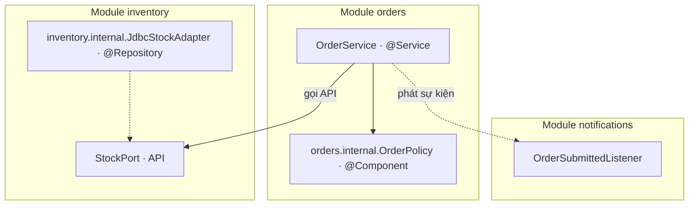

# Component scan và phạm vi package

## 1. Câu hỏi trọng tâm của bài học

Trong một ứng dụng Spring Modulith, vì sao một bean ở `orders.internal` được tạo khi kiểm thử `orders`, còn một `@Service` ở `inventory` lại không có mặt? Tại sao một bean hạ tầng ở package của Spring vẫn xuất hiện? Và làm thế nào để biết việc quét component có vô tình vượt ranh giới module hay không?

Để trả lời, cần phân biệt **ba phạm vi**:

1. **Phạm vi package của Spring Boot:** cơ chế component scan thông thường bắt đầu từ package gốc do cấu hình ứng dụng xác định.
2. **Phạm vi application module của Spring Modulith:** mô hình kiến trúc nhận diện các module, ranh giới API/internal và quan hệ phụ thuộc.
3. **Phạm vi thực tế của test `ApplicationContext`:** các bean được đăng ký bởi module test, cấu hình Boot, cơ chế import, repository infrastructure và những bean chỉ dành cho test.

Ba phạm vi liên quan với nhau nhưng **không phải một khái niệm**. Spring Modulith Test thu hẹp việc bootstrap thành phần nghiệp vụ theo module; điều đó không có nghĩa context chỉ tồn tại các class trong một thư mục, cũng không có nghĩa mọi class trong thư mục đều trở thành bean.

Bài học nằm trong chương **Bootstrap context** của `SPRING_MODULITH_VERIFICATION_TESTING`: mục tiêu là nắm rõ phạm vi package để viết `@ApplicationModuleTest` có khả năng phát hiện lỗi wiring, đồng thời sử dụng `ApplicationModules.verify()` và quality gate CI để ngăn vi phạm phụ thuộc kiến trúc lẫn hồi quy về sự kiện, dữ liệu, tích hợp.

## 2. Component scan của Spring hoạt động như thế nào?

### 2.1. Cơ chế thông thường trong Spring Boot

`@SpringBootApplication` bao gồm khả năng component scanning thông qua `@ComponentScan`. Theo cách tổ chức phổ biến, một lớp khởi động đặt tại package gốc:

```java
package com.example.shop;

import org.springframework.boot.SpringApplication;
import org.springframework.boot.autoconfigure.SpringBootApplication;

@SpringBootApplication
public class ShopApplication {

    public static void main(String[] args) {
        SpringApplication.run(ShopApplication.class, args);
    }
}
```

Ở **ứng dụng chạy bình thường**, component scan mặc định từ package `com.example.shop` có thể phát hiện các component nằm trong những package con như `com.example.shop.orders`, `com.example.shop.orders.internal` và `com.example.shop.inventory`. Mặc định, component scan tìm các lớp có `@Component` hoặc annotation được meta-annotate từ `@Component`, ví dụ:

- `@Service` cho service nghiệp vụ.
- `@Repository` cho thành phần truy cập dữ liệu do Spring quản lý.
- `@Controller`/`@RestController` cho lớp xử lý web.
- `@Configuration` để đăng ký cấu hình và các bean do `@Bean` tạo ra.
- Một annotation riêng của dự án được meta-annotate bằng `@Component`.

Tuy nhiên, **phát hiện được class** chưa đồng nghĩa **bean đã được tạo thành công**. Spring còn xét profile, điều kiện cấu hình, dependency injection, xung đột bean và các bước khởi tạo. Một record domain event hay một entity JPA thuần không tự thành Spring bean vì nằm dưới package được quét.

### 2.2. Package gốc quan trọng hơn thư mục trên ổ đĩa

Xét hai lựa chọn vị trí lớp `ShopApplication`:

```text
Đúng với cấu trúc module thông dụng:
com.example.shop.ShopApplication
com.example.shop.orders.OrderService
com.example.shop.inventory.InventoryService

Dễ gây lỗi quét mặc định:
com.example.shop.orders.ShopApplication
com.example.shop.orders.OrderService
com.example.shop.inventory.InventoryService
```

Ở ví dụ thứ hai, component scan mặc định bắt đầu từ `com.example.shop.orders`; bean của package anh em `com.example.shop.inventory` **không mặc nhiên được phát hiện** trong ứng dụng thường. Đặt lớp cấu hình Spring Boot ở package gốc hợp lý giúp việc quét ứng dụng, tìm entities/repositories và nhận diện application modules dễ dự đoán hơn.

Ngược lại, đặt class khởi động ở package quá cao, ví dụ `com.example`, có thể làm phạm vi component scan rộng hơn dự định. Trong dự án nhiều ứng dụng hoặc nhiều thư viện, điều này dễ đưa các bean không liên quan vào context.

## 3. Phân biệt package của Spring và application module của Spring Modulith

Với cấu hình mặc định thông dụng, Spring Modulith nhận diện các package con trực tiếp của package ứng dụng gốc thành những application module:

```text
com.example.shop
├── ShopApplication
├── orders/                      ← module orders
│   ├── OrderService
│   ├── OrderSubmitted
│   └── internal/
│       └── OrderPolicy
├── inventory/                   ← module inventory
│   ├── StockPort
│   └── internal/
│       └── JdbcStockAdapter
└── notifications/               ← module notifications
    └── OrderSubmittedListener
```

Ở đây `orders.internal` là **subpackage thuộc module `orders`** trong cấu trúc giả định. Nó không tự trở thành một application module riêng chỉ vì có tên `internal`. Spring Modulith có các cơ chế tùy biến cách nhận diện module và khai báo interface; nếu dự án dùng chúng, phải dựa trên mô hình module thực tế thay vì chỉ nhìn cây thư mục.

Điều rất quan trọng:

- **Ranh giới API/internal** là quy tắc truy cập giữa các module, không phải chỉ thị cho `@ComponentScan` bỏ qua toàn bộ bean trong package `internal`.
- Một class `@Component` bên trong `orders.internal` vẫn có thể là bean hợp lệ của module `orders`.
- Bean `inventory.internal.JdbcStockAdapter` thuộc module `inventory` và không được coi là bean của `orders` chỉ vì `orders` dùng một interface do `inventory` công bố.



Mũi tên `OrderService → StockPort` thể hiện **phụ thuộc code qua API module**, không có nghĩa module test `orders` tự động nạp `JdbcStockAdapter` thật. Mũi tên sự kiện minh họa trao đổi nghiệp vụ; nó không bảo đảm bean listener của `notifications` tồn tại trong một test context giới hạn ở `orders`.

## 4. `@ApplicationModuleTest` thay đổi phạm vi bootstrap như thế nào?

Lớp test đặt trong package của module mục tiêu:

```java
package com.example.shop.orders;

import org.springframework.modulith.test.ApplicationModuleTest;

@ApplicationModuleTest
class OrdersModuleTest {
    // Các phương thức @Test được khai báo ở đây.
}
```

Spring Modulith Test xác định module từ vị trí lớp test rồi cấu hình việc bootstrap theo `BootstrapMode`. Ba lựa chọn chính:

| Chế độ | Phạm vi module ứng dụng khi test `orders` | Hệ quả cho việc quét bean |
| --- | --- | --- |
| `STANDALONE` (mặc định) | `orders` | Bean nghiệp vụ của `orders`, kể cả những subpackage nội bộ phù hợp; không tự bootstrap `inventory` |
| `DIRECT_DEPENDENCIES` | `orders` và các module mà `orders` phụ thuộc trực tiếp | Có thể bao gồm `inventory` nếu đó là dependency trực tiếp được nhận diện |
| `ALL_DEPENDENCIES` | `orders` và các module phụ thuộc trực tiếp, gián tiếp | Mở rộng tới các module phụ thuộc bắc cầu; không tự bao gồm mọi module độc lập |

Ví dụ chọn rõ chế độ:

```java
import org.springframework.modulith.test.ApplicationModuleTest;
import org.springframework.modulith.test.ApplicationModuleTest.BootstrapMode;

@ApplicationModuleTest(mode = BootstrapMode.DIRECT_DEPENDENCIES)
class OrdersWithInventoryTest {
}
```

`DIRECT_DEPENDENCIES` dựa vào **đồ thị phụ thuộc giữa các application module**, không phải cơ chế Spring lần theo mọi constructor để tự bổ sung vô hạn các module còn thiếu. Phụ thuộc bị khai báo sai hoặc chưa được nhận diện có thể dẫn đến context không khởi động.

Một module test vẫn sử dụng Spring Boot `ApplicationContext`. Vì thế hạ tầng, auto-configuration, mock, fake hoặc bean do test tự thêm có thể nằm ngoài package ứng dụng đang chọn. Dùng tổng số bean để suy ra “đã bootstrap bao nhiêu module” là không chính xác.

## 5. Ví dụ đầy đủ: bean ở subpackage được nạp, bean module khác được thay thế

Giả sử `orders` cần policy nội bộ và API tồn kho của `inventory`. Ta viết code production tối giản để kiểm chứng phạm vi quét.

### 5.1. API do module `inventory` công bố

```java
// src/main/java/com/example/shop/inventory/StockPort.java
package com.example.shop.inventory;

public interface StockPort {
    boolean isAvailable(String sku, int quantity);
}
```

Đây chỉ là interface. Nó **không phải Spring bean** nếu chưa có implementation hoặc cơ chế đăng ký bean đáp ứng interface.

### 5.2. Bean nằm trong subpackage của module `orders`

```java
// src/main/java/com/example/shop/orders/internal/OrderPolicy.java
package com.example.shop.orders.internal;

import org.springframework.stereotype.Component;

@Component
public class OrderPolicy {

    public boolean isValidQuantity(int quantity) {
        return quantity > 0 && quantity <= 10;
    }
}
```

`OrderPolicy` được đặt ở package `orders.internal` để nhấn mạnh rằng “internal” vẫn là một phần của module `orders`. Trong ví dụ này class được khai báo `public` để lớp test có thể kiểm tra theo kiểu Java; việc public ở mức ngôn ngữ không biến class thành API module được phép dùng từ một module khác.

### 5.3. Service thật của module mục tiêu

```java
// src/main/java/com/example/shop/orders/CheckoutService.java
package com.example.shop.orders;

import com.example.shop.inventory.StockPort;
import com.example.shop.orders.internal.OrderPolicy;
import org.springframework.stereotype.Service;

@Service
public class CheckoutService {

    private final StockPort stockPort;
    private final OrderPolicy orderPolicy;

    public CheckoutService(
            StockPort stockPort,
            OrderPolicy orderPolicy) {
        this.stockPort = stockPort;
        this.orderPolicy = orderPolicy;
    }

    public String checkout(String sku, int quantity) {
        if (!orderPolicy.isValidQuantity(quantity)) {
            throw new IllegalArgumentException("Invalid quantity");
        }
        if (!stockPort.isAvailable(sku, quantity)) {
            throw new IllegalStateException("Out of stock: " + sku);
        }
        return "ACCEPTED:" + sku;
    }
}
```

Ở `STANDALONE`, Spring Modulith chọn các bean module `orders` cần cho bài test. `OrderPolicy` được phát hiện trong subpackage của module; nhưng implementation `StockPort` nằm ở `inventory` có thể vắng mặt. Không có test double, Spring sẽ báo lỗi thiếu bean khi tạo `CheckoutService`.

### 5.4. Module test kiểm chứng bean được đăng ký và hành vi

Ví dụ dùng `@MockitoBean` của Spring Framework 6.2 trở lên; dự án Spring Boot cũ hơn có thể dùng `@MockBean` tương ứng:

```java
// src/test/java/com/example/shop/orders/CheckoutModuleTest.java
package com.example.shop.orders;

import com.example.shop.inventory.StockPort;
import com.example.shop.orders.internal.OrderPolicy;
import org.junit.jupiter.api.Test;
import org.springframework.beans.factory.annotation.Autowired;
import org.springframework.context.ApplicationContext;
import org.springframework.modulith.test.ApplicationModuleTest;
import org.springframework.test.context.bean.override.mockito.MockitoBean;

import static org.assertj.core.api.Assertions.assertThat;
import static org.mockito.BDDMockito.given;
import static org.mockito.Mockito.mockingDetails;

@ApplicationModuleTest // STANDALONE
class CheckoutModuleTest {

    @Autowired
    ApplicationContext context;

    @Autowired
    CheckoutService checkout;

    @MockitoBean
    StockPort stockPort;

    @Test
    void findsBeansFromModuleAndItsSubpackages() {
        assertThat(context.getBeanNamesForType(CheckoutService.class))
            .hasSize(1);
        assertThat(context.getBeanNamesForType(OrderPolicy.class))
            .hasSize(1);
        assertThat(mockingDetails(context.getBean(StockPort.class)).isMock())
            .isTrue();
    }

    @Test
    void runsRealModuleLogicWithMockedBoundary() {
        given(stockPort.isAvailable("SKU-1", 2))
            .willReturn(true);

        assertThat(checkout.checkout("SKU-1", 2))
            .isEqualTo("ACCEPTED:SKU-1");
    }
}
```

Bài test chứng minh ba điều ở mức runtime:

1. `CheckoutService` thật được đăng ký trong module mục tiêu.
2. `OrderPolicy` ở `orders.internal` cũng được phát hiện và khởi tạo.
3. Spring Test tạo mock `StockPort` để thỏa constructor, nhưng **việc có bean kiểu `StockPort` không chứng minh module `inventory` đã được bootstrap**.

Assertion nghiệp vụ giúp xác minh code thật của `CheckoutService` và `OrderPolicy`. Assertion `mockingDetails(...).isMock()` giúp phân biệt bean thay thế với adapter thật.

Trong ứng dụng có nhiều bean `StockPort` do các test configuration khác thêm vào, `getBean(StockPort.class)` có thể không còn là phép tra cứu duy nhất. Khi đó cần xác định qualifier, bean name hoặc nguồn đăng ký thay vì cố giữ giả định “chỉ có một bean”.

## 6. Những class nào được scan và những class nào không?

| Thành phần | Có trở thành bean nhờ component scan mặc định? | Giải thích |
| --- | --- | --- |
| `@Component`/`@Service` dưới phạm vi package được quét | Thường có, nếu điều kiện khác thỏa | Là stereotype được component scan nhận diện |
| `@Configuration` dưới phạm vi được quét | Thường có | Cấu hình có thể khai báo thêm bean qua `@Bean` |
| POJO thường không annotation | Không | Cần cơ chế đăng ký bean khác |
| Interface `StockPort` thuần | Không | Interface chỉ là contract; phải có bean implementation/mock/fake |
| Record `OrderSubmitted` thuần | Không | Payload sự kiện không cần là singleton bean |
| Entity `@Entity` thuần | Không phải component bean vì `@Entity` | Entity được JPA quản lý theo cơ chế riêng, không đồng nghĩa Spring IoC bean |
| Spring Data repository interface | Không dựa riêng vào component scan | Repository proxy thường được đăng ký bởi cơ chế cấu hình Spring Data repository |
| Bean do phương thức `@Bean` tạo | Có thể được đăng ký dù class của đối tượng ngoài package | Tùy cấu hình chứa `@Bean` có được xử lý hay không |
| Bean do `@Import`/test override tạo | Có thể có | Được đăng ký qua cơ chế bổ sung, không cần stereotype trên class trả về |
| Bean auto-configuration của Spring Boot | Có thể có | Không nhất thiết đi qua component scan ứng dụng |

**Không đồng nhất package của kiểu Java với package của lớp cấu hình tạo bean.** Một `Clock` thuộc `java.time` vẫn có thể là bean do `@Bean` trong cấu hình của `orders` tạo ra. Ngược lại, một class ở `orders` không có annotation/cơ chế đăng ký thì không phải bean dù package của nó nằm trong phạm vi scan.

## 7. Những cách đăng ký bean ngoài component scan

Để chẩn đoán phạm vi context, cần biết bean có thể đến từ nhiều nơi.

### 7.1. Phương thức `@Bean` trong cấu hình module

```java
package com.example.shop.orders;

import java.time.Clock;
import org.springframework.context.annotation.Bean;
import org.springframework.context.annotation.Configuration;

@Configuration(proxyBeanMethods = false)
class OrderTimeConfiguration {

    @Bean
    Clock orderClock() {
        return Clock.systemUTC();
    }
}
```

Bean `Clock` được đăng ký vì cấu hình `OrderTimeConfiguration` được xử lý. Loại bean được trả về không cần thuộc package `orders`. Nếu trong test đã có một bean `Clock` khác, có thể xảy ra injection mơ hồ.

### 7.2. `@Import` và `@TestConfiguration`

Một test có thể bổ sung fake bằng cách import cấu hình top-level trong `src/test/java`:

```java
package com.example.shop.orders;

import com.example.shop.testsupport.StockFakeConfiguration;
import org.springframework.context.annotation.Import;
import org.springframework.modulith.test.ApplicationModuleTest;

@ApplicationModuleTest
@Import(StockFakeConfiguration.class)
class CheckoutWithFakeStockTest {
}
```

Ví dụ này giả định `StockFakeConfiguration` đã được định nghĩa ở test source. `@Import` có thể đưa các bean cấu hình vào test context dù package của lớp cấu hình nằm ngoài module mục tiêu. Với cấu hình `static nested @TestConfiguration` ngay trong test, Spring Boot Test thường tự nhận diện mà không cần `@Import` riêng.

**Lưu ý:** `@Import` một lớp cấu hình production có component scan rộng có thể bổ sung các service ngoài dự định. Vì vậy, hạn chế import thành các fake/test configuration nhỏ, dễ kiểm tra. Khi cần bean thật của module phụ thuộc, cân nhắc `BootstrapMode.DIRECT_DEPENDENCIES` hoặc `ALL_DEPENDENCIES` theo đúng nhu cầu kiểm thử.

### 7.3. Mockito mock từ Spring Test

`@MockitoBean StockPort` hoặc `@MockBean StockPort` cung cấp bean mock cho constructor injection. Đây là cơ chế **test bean override/registration**, không có nghĩa class mock được phát hiện bởi component scan. Cần phân biệt với `@Mock` của Mockito thuần, vốn không tự đăng ký vào Spring `ApplicationContext`.

### 7.4. Hạ tầng và auto-configuration

`ApplicationContext` có thể chứa `Environment`, `ApplicationEventPublisher`, transaction infrastructure và nhiều bean của framework. Spring Boot cũng có thể cấu hình `DataSource`, Jackson, validation hoặc repository hạ tầng tùy dependency và điều kiện. Những bean ấy không phải bằng chứng rằng mọi package ứng dụng đã được quét thành công.

## 8. Tác động của `@ComponentScan` tùy chỉnh và quét quá rộng

Một cấu hình tường minh như sau mở rộng ý định quét:

```java
package com.example.shop.orders;

import org.springframework.context.annotation.ComponentScan;
import org.springframework.context.annotation.Configuration;

@Configuration
@ComponentScan(basePackages = "com.example.shop")
class BroadScanConfiguration {
}
```

Trong **ứng dụng thông thường**, cấu hình trên có thể quét toàn bộ package gốc và đăng ký các component ở nhiều module. Trong **module test**, Spring Modulith có cơ chế giới hạn bootstrap; kết quả cuối cùng còn phụ thuộc cách cấu hình được đưa vào context và cơ chế lọc/đăng ký bean ở phiên bản đang sử dụng. Không nên kết luận tuyệt đối rằng mỗi `@ComponentScan` tùy chỉnh đều luôn vượt qua bộ lọc module.

Điều chắc chắn cần làm là **xác minh bean thực tế** khi có cấu hình scan rộng, `@Import` hoặc bean definition registrar. Cấu hình scan chung có thể:

- Làm nhiều bean module khác xuất hiện, hoặc tạo thêm ứng viên trùng kiểu.
- Kích hoạt repository, listener hay client cần hạ tầng ngoài.
- Gây lỗi dependency bắc cầu khó chẩn đoán.
- Làm test chậm và giảm khả năng khoanh vùng lỗi kiến trúc.

Phạm vi quét quá hẹp cũng gây lỗi. Ví dụ:

```java
@ComponentScan(basePackages = "com.example.shop.orders.api")
class NarrowScanConfiguration {
}
```

Trong context được cấu hình để dùng scan này, `OrderPolicy` ở `orders.internal` có thể không được phát hiện. Tuy nhiên, cần xét tổng hợp mọi `@ComponentScan` và các cấu hình/import đang tham gia; riêng một annotation không đủ để khẳng định context cuối cùng có hay thiếu bean nào.

**Thực hành nên ưu tiên:** để cấu hình bootstrap căn bản ở package gốc hợp lý, dùng `@ApplicationModuleTest` chọn phạm vi module, rồi chỉ bổ sung bean test thật cần thiết. Chỉ điều chỉnh component scan khi có lý do kiến trúc rõ ràng và có assertion xác minh.

## 9. `@Profile`, `@Conditional` và property có thể thay đổi kết quả quét

Một class được phát hiện trong phạm vi scan vẫn có thể không tạo bean do điều kiện cấu hình:

```java
import org.springframework.context.annotation.ComponentScan;
import org.springframework.context.annotation.Configuration;
import org.springframework.context.annotation.Profile;

@Configuration
@Profile("integration-test")
class IntegrationConfiguration {
    // Những bean của cấu hình này chỉ được đăng ký
    // khi điều kiện profile được thỏa.
}
```

Ví dụ là minh họa điều kiện profile; package và import thực tế tùy dự án. Trong module test, cần khai báo profile tương ứng nếu muốn cấu hình ấy hoạt động:

```java
import org.springframework.modulith.test.ApplicationModuleTest;
import org.springframework.test.context.ActiveProfiles;

@ApplicationModuleTest
@ActiveProfiles("integration-test")
class OrdersIntegrationTest {
}
```

Tương tự, `@ConditionalOnProperty` và các điều kiện auto-configuration có thể làm bean xuất hiện hoặc biến mất tùy `Environment`. Một phần thiếu bean không liên quan tới package scan, mà do profile/property sai hoặc bean dependency của condition không thỏa.

Bảng chẩn đoán:

| Triệu chứng | Có thể do | Kiểm tra |
| --- | --- | --- |
| `OrderPolicy` trong `orders.internal` không có bean | Scan filter, annotation, profile hoặc cấu hình test | Loại class và các điều kiện đăng ký |
| Implementation `inventory` không có trong `STANDALONE` | Module nằm ngoài phạm vi bootstrap | `BootstrapMode` và mô hình dependency |
| `@Bean Clock` có mặt dù kiểu thuộc `java.time` | Bean do `@Configuration` trong module tạo | Nguồn bean definition |
| Có bean fake `StockPort` | Mock/test configuration bổ sung | `@MockitoBean`/`@Import`, class thực tế của bean |
| Bean listener không hoạt động | Listener không có trong context hoặc bị condition loại | Module scope, profile, transaction/event setup |

## 10. Component scan khác với quét JPA entity và repository

Khi kiểm thử dữ liệu, cần tách ba việc:

1. **Component scanning** tìm các component Spring như `@Service` và `@Configuration`.
2. **Entity scanning** xác định những lớp JPA `@Entity` thuộc persistence unit.
3. **Repository scanning** đăng ký các proxy `JpaRepository`/Spring Data repository theo cơ chế của Spring Data.

Các annotation như `@EntityScan` hoặc `@EnableJpaRepositories` có thể chỉ ra các package khác với component scan. Chẳng hạn:

```java
import org.springframework.boot.autoconfigure.domain.EntityScan;
import org.springframework.context.annotation.Configuration;
import org.springframework.data.jpa.repository.config.EnableJpaRepositories;

@Configuration(proxyBeanMethods = false)
@EntityScan(basePackages = "com.example.shop.orders.persistence")
@EnableJpaRepositories(
    basePackages = "com.example.shop.orders.persistence")
class OrderJpaConfiguration {
}
```

Đây là ví dụ cú pháp cho dự án có Spring Data JPA. Cấu hình trên chọn package entity/repository cho thành phần persistence; nó **không tương đương** với `@ComponentScan` và không tự đăng ký mọi `@Service` ở package đó.

Khi test `orders` gặp lỗi JPA, ngoài việc hỏi module nào được bootstrap, cần kiểm tra:

- Entity có nằm trong phạm vi quét JPA không?
- Repository interface có được Spring Data nhận diện và tạo proxy không?
- `DataSource`, dialect, schema/migration và transaction đã sẵn sàng chưa?
- Cấu hình JPA có vô tình quét entity/repository của module khác không?
- Test đang dùng database thật, database in-memory hay fake repository?

**Có entity metadata hoặc repository proxy trong context không có nghĩa module nghiệp vụ tương ứng đã được chọn bởi `BootstrapMode`.** Các cơ chế quét và cấu hình được phối hợp ở tầng khác nhau.

## 11. Sự kiện cũng tuân theo phạm vi bean listener

Giả sử `orders` phát event `OrderSubmitted`, còn `notifications` có listener xử lý nó. Record event không cần là bean:

```java
package com.example.shop.orders;

public record OrderSubmitted(String orderId) {
}
```

Listener là một component và phải được đăng ký trong `ApplicationContext` để xử lý event:

```java
package com.example.shop.notifications;

import com.example.shop.orders.OrderSubmitted;
import org.springframework.context.event.EventListener;
import org.springframework.stereotype.Component;

@Component
class OrderSubmittedListener {

    @EventListener
    void on(OrderSubmitted event) {
        // Xử lý thông báo trong module notifications.
    }
}
```

Trong module test `orders` ở `STANDALONE`, `OrderSubmittedListener` thuộc module `notifications` thường không có mặt, dù `orders` có thể phát event thành công. Có thể dùng `PublishedEvents` của Spring Modulith Test để kiểm tra **sự kiện đã được phát**, nhưng điều đó không chứng minh listener production đã xử lý.

Muốn kiểm chứng tác động liên module, cần bài tích hợp có listener thật trong context cùng cấu hình transaction/event adapter và assertion phù hợp. Đừng thêm một `@ComponentScan` toàn bộ ứng dụng chỉ để “làm listener xuất hiện” mà không giải thích phạm vi và mục tiêu test.

## 12. Quan sát bean thực tế và truy nguyên nguồn đăng ký

Khi không chắc context đã quét những gì, có thể lấy thông tin trực tiếp từ Spring Test:

```java
package com.example.shop.orders;

import com.example.shop.orders.internal.OrderPolicy;
import org.junit.jupiter.api.Test;
import org.springframework.beans.factory.annotation.Autowired;
import org.springframework.context.ApplicationContext;
import org.springframework.modulith.test.ApplicationModuleTest;

import static org.assertj.core.api.Assertions.assertThat;

@ApplicationModuleTest
class OrderPolicyVisibilityTest {

    @Autowired
    ApplicationContext context;

    @Test
    void scansModuleInternalComponent() {
        assertThat(context.getBeanNamesForType(OrderPolicy.class))
            .isNotEmpty();
    }
}
```

**Lưu ý:** nếu module `orders` còn có `CheckoutService` cần `StockPort` và chưa được cung cấp fake/mock, context có thể thất bại trước khi test trên chạy. Khi đó cần thêm `@MockitoBean StockPort` hoặc test configuration cho ranh giới, hoặc chọn mode bootstrap phù hợp. Assertion không cứu được lỗi xảy ra trong quá trình khởi động.

Có thể dùng `ConfigurableApplicationContext` và `BeanFactory` để xem `BeanDefinition` khi cần truy nguyên:

```java
// Đoạn code minh họa bên trong phương thức test.
ConfigurableApplicationContext configurable =
    (ConfigurableApplicationContext) context;

String[] names = context.getBeanNamesForType(OrderPolicy.class);
for (String name : names) {
    var definition = configurable.getBeanFactory()
        .getBeanDefinition(name);

    System.out.println(
        name + " from " + definition.getResourceDescription());
}
```

Ví dụ giả định biến `context` đã được inject và có import `org.springframework.context.ConfigurableApplicationContext`. Nguồn mô tả trong `BeanDefinition` có thể `null` hoặc không đủ chi tiết đối với một số bean, proxy hay cơ chế đăng ký động. Đó là tín hiệu chẩn đoán, không phải “bộ kiểm định” duy nhất. Tránh log toàn bộ bean và secret trong CI; chỉ chọn kiểu bean hay package cần phân tích.

Các phương pháp kiểm tra nên kết hợp:

- Quan sát log khởi động để xác định module và `BootstrapMode` của `@ApplicationModuleTest`.
- Kiểm tra bean theo type/name và, nếu cần, nguồn `BeanDefinition`.
- Kiểm tra profile, property, `@Import` và các điều kiện bean.
- Chạy `ApplicationModules.verify()` để kiểm tra **quan hệ phụ thuộc code**, việc mà danh sách bean không thể thay thế.

## 13. Ranh giới package, API nội bộ và quy tắc phụ thuộc

Spring Modulith phân tích ranh giới application module, gồm những package được coi là API công khai và những package là nội bộ theo quy ước/cấu hình module. Một class `public` trong `inventory.internal` có thể được Java import từ `orders` về mặt cú pháp, nhưng quan hệ phụ thuộc ấy **có thể trái quy tắc Spring Modulith**.

Ví dụ phụ thuộc hợp lệ qua API:

```java
package com.example.shop.orders;

import com.example.shop.inventory.StockPort; // API của module inventory

class StockCheckingUseCase {
    private final StockPort stockPort;

    StockCheckingUseCase(StockPort stockPort) {
        this.stockPort = stockPort;
    }
}
```

Ví dụ nên tránh:

```java
package com.example.shop.orders;

import com.example.shop.inventory.internal.JdbcStockAdapter;
// Truy cập implementation nội bộ của module inventory
// từ module orders tạo phụ thuộc xuyên ranh giới.

class DirectAdapterUseCase {
    private final JdbcStockAdapter adapter;

    DirectAdapterUseCase(JdbcStockAdapter adapter) {
        this.adapter = adapter;
    }
}
```

`@ComponentScan` có thể tìm thấy những class có annotation, nhưng **không quyết định phụ thuộc ấy đúng kiến trúc hay không**. Việc một context khởi động thành công cũng không tự chứng minh các package internal được tôn trọng. Cần kiểm chứng bằng mô hình module:

```java
package com.example.shop;

import org.junit.jupiter.api.Test;
import org.springframework.modulith.core.ApplicationModules;

class ModuleArchitectureTest {

    @Test
    void verifiesModuleBoundaries() {
        ApplicationModules.of(ShopApplication.class).verify();
    }
}
```

Khi dự án có thêm quy tắc `allowedDependencies` hoặc named interfaces, hãy bảo đảm các quan hệ thực tế tuân thủ chúng. `ApplicationModules.verify()` phát hiện vi phạm phụ thuộc theo mô hình kiến trúc; đây không phải phép kiểm tra Spring tạo được từng bean.

## 14. Thiết kế quality gate CI cho phạm vi quét

Một quality gate có thể kết hợp ba tầng:

| Tầng | Bài kiểm tra tiêu biểu | Phát hiện |
| --- | --- | --- |
| Kiến trúc | `ApplicationModules.of(ShopApplication.class).verify()` | Vi phạm ranh giới module và các quy tắc phụ thuộc |
| Module bootstrap/hành vi | `@ApplicationModuleTest` với mode, mock/fake rõ ràng | Component thiếu, dependency không thỏa, assertion nghiệp vụ sai |
| Tích hợp dữ liệu/sự kiện | Test có repository/adapter/listener thật và môi trường test phù hợp | Wiring, persistence, transaction, event delivery và hồi quy liên module |

Chọn các test có mục tiêu cụ thể: test `orders` `STANDALONE` dùng fake `StockPort` để kiểm tra quy tắc số lượng; test tích hợp dùng adapter `inventory` thật để xác minh truy vấn; test kiến trúc kiểm tra `orders` không import package `inventory.internal`.

Khi CI thất bại, định vị lỗi theo lớp:

1. **Lỗi kiến trúc:** sửa mã import/quan hệ module và quy tắc truy cập.
2. **Lỗi bootstrap:** kiểm tra package scan, module scope, profile, property, test configuration và bean thiếu.
3. **Lỗi tích hợp:** kiểm tra database, dữ liệu, transaction, event listener và cấu hình dịch vụ test.

Đừng mở rộng `@ComponentScan` hoặc chuyển mọi test sang `ALL_DEPENDENCIES` chỉ để làm test xanh; những thay đổi đó có thể che dấu phụ thuộc đáng lẽ cần được nhận diện chính xác.

## 15. Checklist chẩn đoán khi component không xuất hiện

Khi một `@Service` hoặc `@Component` có trong mã nguồn nhưng không có bean trong module test:

1. **Kiểm tra vị trí lớp test:** package của test có nằm bên trong module mục tiêu không? Spring Boot tìm thấy cấu hình khởi động gốc phù hợp chưa?
2. **Kiểm tra stereotype:** class có `@Component`/`@Service` hoặc được đăng ký qua `@Bean`/`@Import` không?
3. **Kiểm tra package:** class thuộc module mục tiêu, subpackage nội bộ, module phụ thuộc hay module độc lập?
4. **Kiểm tra `BootstrapMode`:** `STANDALONE`, `DIRECT_DEPENDENCIES` hay `ALL_DEPENDENCIES` đang áp dụng?
5. **Kiểm tra scan tùy chỉnh:** `@ComponentScan`, exclude filters, cấu hình import hoặc registrar có ảnh hưởng kết quả không?
6. **Kiểm tra điều kiện:** `@Profile`, `@ConditionalOnProperty`, bean condition, property source có làm bean bị loại?
7. **Kiểm tra hạ tầng khác:** thành phần cần tìm có thực ra là entity hoặc repository do Spring Data quản lý?
8. **Kiểm tra dependency:** lỗi thiếu bean có đến từ constructor của component *đã* được chọn không?
9. **Kiểm tra bằng context:** dùng `getBeanNamesForType`/`BeanDefinition` khi cần.
10. **Kiểm tra kiến trúc riêng:** chạy `ApplicationModules.verify()` để không bỏ qua phụ thuộc sai ranh giới.

### Những ngộ nhận thường gặp

| Ngộ nhận | Diễn giải đúng |
| --- | --- |
| “`@SpringBootApplication` quét toàn bộ classpath.” | Component scan mặc định bắt đầu ở package cấu hình ứng dụng và các package con. |
| “`orders.internal` là internal nên không thể được scan.” | Nó có thể chứa bean thật của chính module `orders`; internal chủ yếu liên quan khả năng truy cập của module khác. |
| “Mọi class dưới package được quét đều thành bean.” | Cần cơ chế đăng ký và điều kiện bean phù hợp; record, POJO, entity thuần không tự là component bean. |
| “`@ApplicationModuleTest` nạp tất cả module giống `@SpringBootTest` thông thường.” | Module test chọn phạm vi ứng dụng theo `BootstrapMode`, cộng các bean hạ tầng/cấu hình test cần thiết. |
| “Có bean `StockPort` là đã nạp module `inventory`.” | Bean đó có thể là mock hoặc fake do test cung cấp. |
| “Entity scan và component scan là một.” | Entity/JPA repository được quản lý bằng cơ chế riêng, có thể dùng những package khác nhau. |
| “Context khởi động thì kiến trúc module chắc chắn hợp lệ.” | Cần phép kiểm tra kiến trúc bằng `ApplicationModules.verify()`. |

## 16. Bài tập tự kiểm tra

Ứng dụng ví dụ có `ShopApplication` tại `com.example.shop`; module `orders` chứa `CheckoutService` và `orders.internal.OrderPolicy`; module `inventory` có API `StockPort` cùng adapter `inventory.internal.JdbcStockAdapter`. Bài `CheckoutModuleTest` ở package `com.example.shop.orders` chạy `@ApplicationModuleTest` mặc định.

1. Vì sao `OrderPolicy` vẫn có thể là bean trong `STANDALONE` dù nằm trong package có tên `internal`?
2. Interface `StockPort` có tự thành bean chỉ vì nằm trong package của ứng dụng không?
3. Nếu `JdbcStockAdapter` thuộc `inventory`, test `orders` mặc định có nên trông đợi bean này được nạp không?
4. Nếu thêm `@MockitoBean StockPort`, điều đó thay đổi phạm vi module bootstrap hay chỉ bổ sung/thay bean trong test context?
5. Vì sao đặt `ShopApplication` tại `com.example.shop.orders` có thể khiến ứng dụng thường không quét package `com.example.shop.inventory`?
6. Vì sao một entity `@Entity` tồn tại trong context JPA không có nghĩa nó là Spring `@Component`?
7. Khi muốn kiểm thử adapter tồn kho thật với JPA, ngoài phạm vi module cần kiểm tra những cấu hình nào?
8. Kiểm tra nào phát hiện `orders` import trực tiếp `inventory.internal.JdbcStockAdapter` dù module test có fake vẫn chạy xanh?
9. Một bean `Clock` được tạo từ `@Bean` trong `orders` có phải nằm trong package `orders` theo kiểu Java của nó không?
10. Khi module test bị thiếu bean, ba nhóm nguyên nhân nào cần phân biệt trước khi sửa?

**Đáp án tham khảo:** (1) `internal` là subpackage của module mục tiêu, không phải lệnh loại bean khỏi scan; (2) không, interface cần implementation/mock/fake được đăng ký; (3) không ở `STANDALONE` nếu không có cấu hình bổ sung; (4) thay đổi bean test, không tự đổi mode; (5) package sibling nằm ngoài phạm vi component scan mặc định của lớp cấu hình; (6) entity do JPA quản lý theo cơ chế riêng; (7) entity/repository scan, `DataSource`, migration, transaction và dữ liệu test; (8) `ApplicationModules.verify()`; (9) không, source tạo bean quan trọng hơn package của class `java.time.Clock`; (10) module scope, cơ chế đăng ký/scan và điều kiện/hạ tầng cấu hình.

**Ghi nhớ:** phạm vi **component scan** quyết định những class/cấu hình nào được Spring xem xét đăng ký; **`@ApplicationModuleTest` và `BootstrapMode`** giới hạn phần ứng dụng theo mô hình module; còn **`ApplicationModules.verify()`** kiểm tra ranh giới phụ thuộc kiến trúc. Khi chẩn đoán một bean có mặt hoặc vắng mặt, hãy truy ngược đúng cơ chế tạo bean và kiểm tra hành vi thực tế trong test context, thay vì chỉ nhìn tên package.
