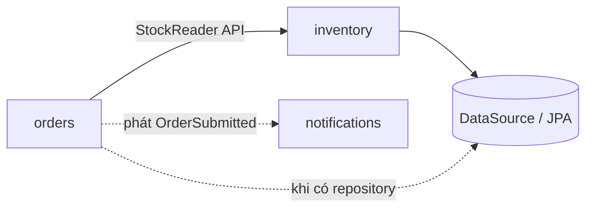

# Auto-configuration bị bật hoặc loại trừ

## 1. Câu hỏi cốt lõi trong module test

Khi viết `@ApplicationModuleTest`, một module có thể đang được kiểm thử độc lập nhưng `ApplicationContext` vẫn tạo `DataSource`, transaction manager, Jackson `ObjectMapper` hoặc nhiều bean hạ tầng khác. Ở dự án khác, cùng một bài test lại báo thiếu `DataSource`, không tìm thấy repository hoặc cố kết nối một cơ sở dữ liệu thật. Vì sao?

Nguyên nhân thường nằm ở **Spring Boot auto-configuration**: các lớp cấu hình tự động được Spring Boot xem xét theo classpath, property, profile, điều kiện bean và kiểu ứng dụng. `@ApplicationModuleTest` giới hạn phạm vi **application module** được bootstrap, nhưng không có nghĩa tất cả auto-configuration của Spring Boot đều bị tắt. Một số cấu hình vẫn hoạt động để hỗ trợ các bean trong module đang kiểm thử.

Bài học này thuộc chương **Bootstrap context** của `SPRING_MODULITH_VERIFICATION_TESTING`. Ta sẽ học cách xác định cấu hình tự động nào thực sự có hiệu lực, cách loại trừ có chủ đích trong module test và cách duy trì kiểm thử dữ liệu, sự kiện, tích hợp. Kết quả cần hỗ trợ quality gate CI: bắt lỗi phụ thuộc kiến trúc bằng `ApplicationModules.verify()`, đồng thời phát hiện hồi quy về cấu hình runtime bằng các bài `@ApplicationModuleTest` thích hợp.

**Nguyên tắc đầu tiên:** một auto-configuration **được xem xét** không đồng nghĩa mọi bean của nó **được tạo**. Một cấu hình có thể được nhập nhưng bị điều kiện loại, hoặc có hiệu lực một phần vì những bean cần thiết đã được đăng ký ở nơi khác.

## 2. Cơ chế Spring Boot tự kích hoạt cấu hình

`@SpringBootApplication` bao gồm khả năng kích hoạt auto-configuration. Ở Spring Boot 3.x, các thư viện thường khai báo auto-configuration ứng viên trong:

```text
META-INF/spring/org.springframework.boot.autoconfigure.AutoConfiguration.imports
```

Spring Boot đọc danh sách ứng viên, xử lý các chỉ dẫn loại trừ và đánh giá điều kiện. Đây **không phải** cách component scan thông thường đi tìm `@Component` trong mọi package của ứng dụng.

Các annotation điều kiện thường gặp:

| Điều kiện | Ý nghĩa | Tác động trong module test |
| --- | --- | --- |
| `@ConditionalOnClass` | Có một hoặc nhiều class trên classpath | Thêm `spring-boot-starter-jdbc` có thể khiến một cấu hình JDBC trở thành ứng viên phù hợp |
| `@ConditionalOnMissingBean` | Chưa có bean phù hợp trong context tại thời điểm đánh giá | Cấu hình tự động có thể nhường chỗ cho bean do ứng dụng hoặc test cung cấp |
| `@ConditionalOnBean` | Có bean liên quan | Bean tự động phụ thuộc vào thành phần đã tồn tại |
| `@ConditionalOnProperty` | Property có giá trị phù hợp | Test property hoặc profile có thể bật/tắt một tính năng |
| `@ConditionalOnWebApplication` | Context là kiểu web phù hợp | Không nên giả định module test nào cũng nạp đầy đủ web infrastructure |
| `@ConditionalOnResource` | Có resource cần thiết | Một resource trên classpath có thể làm kết quả cấu hình thay đổi |

Ví dụ, `DataSourceAutoConfiguration` chỉ có ý nghĩa khi môi trường thỏa các điều kiện của cấu hình này. Ngay cả khi thư viện JDBC có mặt, Spring Boot có thể không tạo `DataSource` do đã có bean do người dùng cung cấp, thiếu driver/URL hoặc cấu hình khác khiến một nhánh điều kiện không phù hợp.

```mermaid
flowchart TD
    A[@ApplicationModuleTest] --> B[Chọn phạm vi module]
    C[Spring Boot auto-configuration] --> D[Đọc ứng viên + loại trừ]
    E[Classpath + Environment + bean hiện có] --> F[Đánh giá điều kiện]
    D --> F
    F -->|Khớp| G[Đăng ký bean hạ tầng phù hợp]
    F -->|Không khớp| H[Không đăng ký bean của nhánh đó]
    B --> I[ApplicationContext kiểm thử]
    G --> I
    I --> J[Inject dependency, chạy test]
```

Sơ đồ biểu diễn các trách nhiệm. Trong thực tế, thứ tự đánh giá cấu hình và tạo bean phụ thuộc vòng đời Spring; không được hiểu là Spring hoàn tất mọi bean ứng dụng rồi mới xử lý tất cả auto-configuration.

## 3. Phân biệt ba nhóm cấu hình có thể xuất hiện

Hãy phân loại trước khi chẩn đoán:

| Nhóm | Nguồn | Ví dụ | Cách kiểm soát |
| --- | --- | --- | --- |
| **Bean/module nghiệp vụ** | Component, `@Bean` hoặc đăng ký của ứng dụng | `OrderService`, `OrderRepository` | Module scope, component scan, `@Profile`, điều kiện bean, test double |
| **Auto-configuration của Spring Boot/thư viện** | Auto-configuration được Boot nhập và đánh giá điều kiện | `DataSourceAutoConfiguration`, `JacksonAutoConfiguration`, `HibernateJpaAutoConfiguration` | Classpath, conditions, properties, cơ chế exclude |
| **Cấu hình bổ sung của test** | `@TestConfiguration`, `@Import`, mock override | Fake payment gateway, `Clock` cố định, `@MockitoBean` | Vị trí lớp test, annotation, import/override rõ ràng |

Một bean kiểu `DataSource` có thể được tạo bởi auto-configuration hoặc bởi cấu hình thủ công. Vì vậy, **loại trừ `DataSourceAutoConfiguration` không đồng nghĩa chắc chắn mọi `DataSource` biến mất**: một cấu hình khác vẫn có thể cung cấp bean cùng kiểu.

Tương tự, nếu một `@Configuration` của dự án tự khai báo bean `PaymentGateway` thì thêm tên của class đó vào `spring.autoconfigure.exclude` không phải cách đáng tin cậy để loại nó, vì property này được thiết kế cho **auto-configuration ứng viên**. Muốn xử lý cấu hình thủ công, cần xem component scan, `@Import`, profile, condition hoặc cách tổ chức bean của ứng dụng.

## 4. Ví dụ ứng dụng: module `orders` và các phụ thuộc

Giả sử có cấu trúc:

```text
src/main/java/com/example/shop/
├── ShopApplication.java                // @SpringBootApplication
├── orders/
│   ├── OrderPolicy.java                // @Component, logic thuần
│   ├── CheckoutService.java            // @Service
│   └── persistence/
│       └── OrderJpaRepository.java     // repository Spring Data trong bài tích hợp
├── inventory/
│   ├── StockReader.java                // public API
│   └── internal/
│       └── JdbcStockReader.java        // adapter dùng database
└── notifications/
    └── OrderSubmittedListener.java     // listener sự kiện

src/test/java/com/example/shop/orders/
└── OrdersModuleTest.java
```

Với quy tắc module thông dụng, `orders`, `inventory` và `notifications` là các application module. Một lớp test ở `com.example.shop.orders` dùng `@ApplicationModuleTest` sẽ chọn `orders` làm module mục tiêu.



Ba tình huống cần phân biệt:

1. **Chỉ kiểm thử `OrderPolicy`:** chưa cần truy cập database. Nếu hệ thống vẫn cố khởi tạo DataSource vì dependency và auto-configuration, cần hiểu lý do trước khi loại trừ.
2. **Kiểm thử `CheckoutService` với mock `StockReader`:** giữ bean nghiệp vụ `orders` thật, cung cấp mock ở ranh giới, không cần chạy adapter JDBC của `inventory`.
3. **Kiểm thử repository/JPA thật:** cần `DataSource`, schema, migration, transaction và dữ liệu chuẩn bị phù hợp. Việc loại trừ auto-configuration JDBC có thể làm bài tích hợp thất bại một cách hợp lý.

Nhiệm vụ là chọn context theo **mục tiêu kiểm thử**, không có một danh sách auto-configuration cần tắt áp dụng cho mọi bài.

## 5. `@ApplicationModuleTest` không tự tắt mọi auto-configuration

Ví dụ test mặc định:

```java
package com.example.shop.orders;

import org.junit.jupiter.api.Test;
import org.springframework.modulith.test.ApplicationModuleTest;

@ApplicationModuleTest
class OrdersModuleTest {

    @Test
    void startsModuleContext() {
        // Đến được đây nghĩa là context đã bootstrap thành công.
    }
}
```

Mode mặc định là `STANDALONE`: các application module bên ngoài phạm vi `orders` không tự được nạp như module nghiệp vụ. Tuy nhiên, ứng dụng vẫn được khởi động bằng cơ sở Spring Boot test. Auto-configuration liên quan được đánh giá theo dependency và điều kiện của `Environment`.

Điều này có hai hệ quả:

- **Không thể suy rằng có `DataSource` thì module `inventory` đã được bootstrap.** DataSource là bean hạ tầng có thể xuất hiện do Boot, kể cả khi bean nghiệp vụ của `inventory` vắng mặt.
- **Không thể suy rằng `STANDALONE` luôn khởi động dễ dàng.** Nếu một repository/service thực sự cần hạ tầng chưa được cấu hình, Spring có thể thất bại ngay khi bootstrap.

Mở rộng sang `DIRECT_DEPENDENCIES` hay `ALL_DEPENDENCIES` thay đổi tập **module ứng dụng** được bootstrap, không phải nút bật/tắt auto-configuration.

| `BootstrapMode` | Module được chọn | Auto-configuration |
| --- | --- | --- |
| `STANDALONE` | Module mục tiêu | Vẫn được Boot xem xét theo điều kiện |
| `DIRECT_DEPENDENCIES` | Module mục tiêu và các dependency trực tiếp | Có thể cần thêm hạ tầng do bean trong các module phụ thuộc |
| `ALL_DEPENDENCIES` | Module mục tiêu và các dependency bắc cầu | Context thường phức tạp hơn; auto-configuration vẫn phụ thuộc điều kiện |

## 6. Loại trừ một auto-configuration chỉ trong bài test

Spring Boot hỗ trợ property `spring.autoconfigure.exclude`, nhận danh sách tên đầy đủ của các lớp auto-configuration cần loại trừ.

Ví dụ một module `orders` chỉ có logic thuần và không yêu cầu JPA/JDBC trong bài test cụ thể:

```java
package com.example.shop.orders;

import org.junit.jupiter.api.Test;
import org.springframework.beans.factory.annotation.Autowired;
import org.springframework.context.ApplicationContext;
import org.springframework.modulith.test.ApplicationModuleTest;
import org.springframework.test.context.TestPropertySource;

import javax.sql.DataSource;

import static org.assertj.core.api.Assertions.assertThat;

@ApplicationModuleTest
@TestPropertySource(properties = {
    "spring.autoconfigure.exclude=" +
        "org.springframework.boot.autoconfigure.jdbc.DataSourceAutoConfiguration"
})
class OrdersWithoutAutoConfiguredDataSourceTest {

    @Autowired
    ApplicationContext context;

    @Test
    void doesNotGetAutoConfiguredDataSource() {
        assertThat(context.getBeansOfType(DataSource.class))
            .isEmpty();
    }
}
```

**Giả định của ví dụ:** ứng dụng mẫu không có `@Bean DataSource` thủ công hoặc cấu hình khác tự tạo DataSource, và những bean của module `orders` trong bài này không cần JDBC/JPA. Assertion xác nhận kết quả thực tế trong giả định đó. Nếu có bean `DataSource` thủ công, `spring.autoconfigure.exclude` không bảo đảm `getBeansOfType(DataSource.class)` rỗng.

Ví dụ cũng cho thấy việc **không đăng ký bean** là kết quả của một cấu hình test có chủ đích; không nên dùng annotation loại trừ chỉ để tránh sửa một module đang phụ thuộc database sai cách.

### Vì sao dùng `@TestPropertySource`?

`@TestPropertySource` cho phép định nghĩa property trên phạm vi một lớp test mà không sửa cấu hình toàn ứng dụng. Nó có thể ghi đè giá trị từ `application.yml` hoặc `application-<profile>.yml`. Nếu có nhiều bài cần cùng tập cấu hình, có thể dùng profile test hoặc tài nguyên test phù hợp để giảm lặp.

Lưu ý property `spring.autoconfigure.exclude` là danh sách tên class. Nếu đã có giá trị loại trừ khác và bạn **ghi đè toàn bộ** property này trong test, những loại trừ cũ có thể không còn được áp dụng. Khi ghép nhiều giá trị, hãy khai báo đầy đủ danh sách mong muốn và kiểm tra effective `Environment`.

Ví dụ YAML nếu muốn dùng profile riêng:

```yaml
# Ví dụ nội dung application-module-test.yml, không tạo file ở bài này.
spring:
  autoconfigure:
    exclude:
      - org.springframework.boot.autoconfigure.jdbc.DataSourceAutoConfiguration
```

Trong dự án thật, phải đảm bảo profile `module-test` được kích hoạt, tệp nằm trên classpath và không có property source ưu tiên cao hơn ghi đè cấu hình này.

## 7. Các cách loại trừ: chọn đúng phạm vi thay đổi

| Cách | Phạm vi | Khi nào thích hợp | Rủi ro |
| --- | --- | --- | --- |
| `spring.autoconfigure.exclude` qua `@TestPropertySource` | Một cấu hình test | Tắt một auto-configuration chỉ cho test đang xét | Có thể khiến bean/repository cần thiết thiếu hạ tầng |
| `spring.autoconfigure.exclude` trong tệp cấu hình profile test | Những test kích hoạt profile tương ứng | Nhiều module test dùng chung điều kiện hạ tầng | Profile khác dùng lại có thể vô tình mất auto-configuration |
| `@SpringBootApplication(exclude = ...)` | Cấu hình ứng dụng chính | Ứng dụng chủ động không dùng một auto-configuration ở mọi môi trường | Ảnh hưởng cả production và nhiều test |
| `@EnableAutoConfiguration(exclude = ...)` trên cấu hình Boot thích hợp | Cấu hình được áp dụng | Trường hợp cần điều khiển bootstrap ở cấp cấu hình | Dùng sai vị trí có thể làm context khác hẳn dự định |
| `@ImportAutoConfiguration` | Tập auto-configuration được nhập tường minh bởi annotation đó | Thường dùng trong các test slice/cấu hình chuyên biệt | Không phải công tắc loại trừ tổng quát cho mọi auto-configuration của ứng dụng |

Ví dụ loại trừ ở cấp ứng dụng:

```java
package com.example.shop;

import org.springframework.boot.SpringApplication;
import org.springframework.boot.autoconfigure.SpringBootApplication;
import org.springframework.boot.autoconfigure.jdbc.DataSourceAutoConfiguration;

@SpringBootApplication(exclude = DataSourceAutoConfiguration.class)
public class ShopApplication {

    public static void main(String[] args) {
        SpringApplication.run(ShopApplication.class, args);
    }
}
```

Cấu hình này **ảnh hưởng mọi lần bootstrap dùng `ShopApplication`**, không phù hợp nếu chỉ một module test không cần JDBC nhưng production vẫn sử dụng database. Trong tình huống ấy, ưu tiên loại trừ test-specific hoặc tách cấu hình/hành vi kiểm thử thích hợp.

`@ImportAutoConfiguration` hỗ trợ nhập có chọn lọc những auto-configuration nhất định trong các hoàn cảnh chuyên biệt, nhưng không nên coi `@ImportAutoConfiguration(exclude = ...)` là sự thay thế tương đương với `spring.autoconfigure.exclude` cho toàn bộ nguồn auto-configuration của `@SpringBootApplication`.

## 8. Cách xác nhận một auto-configuration đã khớp điều kiện hay bị loại

Không nên suy từ tên dependency hoặc số bean. Spring Boot cung cấp **Conditions Evaluation Report**, mô tả những điều kiện auto-configuration đã khớp hoặc không khớp.

### 8.1. Bật log điều kiện

Có thể bật debug cho một bài module test:

```java
import org.springframework.modulith.test.ApplicationModuleTest;
import org.springframework.test.context.TestPropertySource;

@ApplicationModuleTest
@TestPropertySource(properties = "debug=true")
class OrdersAutoConfigurationDiagnosticsTest {
    // Thêm @Test để thực thi bài kiểm thử cần chẩn đoán.
}
```

Khi Spring Boot xuất báo cáo điều kiện ở mức debug, log có thể cho biết các auto-configuration nào khớp/không khớp, và vì sao. `debug=true` là công cụ chẩn đoán, không nên bật mặc định cho toàn bộ CI nếu gây log lớn; cũng cần tránh ghi ra dữ liệu cấu hình nhạy cảm.

Ngoài ra có thể cấu hình logging liên quan auto-configuration theo phiên bản Spring Boot đang sử dụng. Điều cần quan sát là **điều kiện nào làm cấu hình có hiệu lực hoặc bị bỏ qua**, chứ không chỉ câu “Spring không có bean”.

### 8.2. Truy vấn `ConditionEvaluationReport` từ test context

Với Spring Boot test có thể inject `ConfigurableApplicationContext` và lấy report:

```java
package com.example.shop.orders;

import org.junit.jupiter.api.Test;
import org.springframework.beans.factory.annotation.Autowired;
import org.springframework.boot.autoconfigure.condition.ConditionEvaluationReport;
import org.springframework.context.ConfigurableApplicationContext;
import org.springframework.modulith.test.ApplicationModuleTest;

import static org.assertj.core.api.Assertions.assertThat;

@ApplicationModuleTest
class OrdersConditionReportTest {

    @Autowired
    ConfigurableApplicationContext context;

    @Test
    void canInspectAutoConfigurationConditions() {
        var report = ConditionEvaluationReport.get(
            context.getBeanFactory());

        var matchingSources = report
            .getConditionAndOutcomesBySource()
            .keySet().stream()
            .filter(source -> source.contains("DataSourceAutoConfiguration"))
            .toList();

        // Dùng matchingSources để chẩn đoán trong môi trường test.
        // Không suy rằng có tên nguồn thì toàn bộ bean đã được tạo.
        assertThat(report).isNotNull();
    }
}
```

`getConditionAndOutcomesBySource()` cung cấp dữ liệu những điều kiện đã được đánh giá. Danh sách có thể thay đổi theo phiên bản Boot, classpath và cấu hình; vì vậy ví dụ chỉ minh họa **cách truy xuất report**, không cố định số lượng hoặc tên mọi nhánh cấu hình. Khi điều tra, xem từng source cùng kết quả match/negative và đối chiếu bean thực tế.

Nếu cần assertion ổn định của bài test, hãy ưu tiên kiểm tra **hành vi hoặc sự hiện diện/vắng mặt của bean yêu cầu** thay vì khóa test vào chuỗi text của report. Tên cấu hình và điều kiện có thể thay đổi khi nâng phiên bản Spring Boot.

## 9. Tự động cấu hình JPA và nguy cơ loại trừ sai

Giả sử module `orders` có repository Spring Data JPA:

```java
package com.example.shop.orders.persistence;

import org.springframework.data.jpa.repository.JpaRepository;

public interface OrderJpaRepository
        extends JpaRepository<OrderEntity, Long> {
}
```

`OrderEntity` ở ví dụ là entity JPA giả định đã có `@Entity` và khóa `Long`. Một integration test dùng repository thật thường cần:

- JPA entity được nhận diện trong phạm vi entity scanning.
- Repository interface được Spring Data đăng ký.
- `DataSource` truy cập được database test.
- Hibernate/JPA configuration, schema/migration và transaction phù hợp.
- Fixture dữ liệu và chiến lược rollback/cleanup ổn định.

Trong bối cảnh này, loại trừ `DataSourceAutoConfiguration` có thể làm một số auto-configuration phụ thuộc không còn khớp điều kiện, hoặc khiến bean/repository không thể tạo. Lỗi bootstrap là một tín hiệu **bài test còn yêu cầu persistence thật**.

Nếu chỉ kiểm thử logic tính toán nội bộ, có thể cấu trúc service tách phần domain khỏi persistence adapter, dùng mock ở ranh giới repository/port khi phù hợp. Nếu cần kiểm chứng SQL/JPA thật, **giữ cấu hình database hợp lệ** và dùng hạ tầng thử nghiệm như Testcontainers thay vì vô hiệu hóa DataSource để làm test xanh.

| Mục tiêu | Có nên loại trừ auto-configuration JDBC/JPA? | Tại sao? |
| --- | --- | --- |
| Chỉ kiểm thử quy tắc trong một `@Component` độc lập persistence | Có thể cân nhắc, nếu context không cần bean dữ liệu | Giảm hạ tầng không cần thiết; phải xác minh không còn bean phụ thuộc |
| Kiểm thử service dùng mock port repository bên ngoài | Có thể cân nhắc theo thực tế context | Mock API không tự loại bỏ repository khác trong module |
| Kiểm thử `JpaRepository`/transaction thực tế | Thông thường không | Cần `DataSource` và JPA infrastructure |
| Kiểm thử migration/schema/SQL với PostgreSQL | Không | Muốn chạy đúng database thực trong test |
| Kiểm thử event publication registry lưu vào database | Không nếu sử dụng registry lưu trữ JDBC/JPA thật | Cần đúng persistence backend và transaction |

## 10. Auto-configuration không giống cơ chế scan bean của module

Một lỗi hay gặp là cho rằng “bean không xuất hiện vì Modulith chặn component scan”, trong khi thực tế auto-configuration có điều kiện không thỏa.

Ví dụ:

```java
import org.springframework.boot.autoconfigure.condition.ConditionalOnProperty;
import org.springframework.context.annotation.Bean;
import org.springframework.context.annotation.Configuration;

@Configuration(proxyBeanMethods = false)
class ExternalNotificationConfiguration {

    @Bean
    @ConditionalOnProperty(
        prefix = "notifications",
        name = "remote-enabled",
        havingValue = "true")
    NotificationClient notificationClient() {
        return new NotificationClient();
    }
}
```

Đây là **cấu hình ứng dụng có điều kiện**, chưa phải một Boot auto-configuration ứng viên chỉ vì sử dụng `@ConditionalOnProperty`. `NotificationClient` là kiểu giả định. Nếu class cấu hình không được quét hoặc import, đặt `notifications.remote-enabled=true` cũng không tự nạp nó. Nếu class được xử lý nhưng property không khớp, bean không được tạo.

Phân biệt ba lớp câu hỏi:

1. **Cấu hình có được đưa vào context để đánh giá không?** Xem component scan, `@Import`, auto-configuration imports.
2. **Điều kiện có thỏa không?** Xem profile, property, classpath, bean đã tồn tại.
3. **Bean có tạo thành công không?** Xem constructor, bean definition, connection, migration.

Không nên sửa vấn đề ở lớp 1 bằng cách thay property của lớp 2, hoặc sửa vấn đề ở lớp 3 bằng cách quét thêm toàn bộ package ứng dụng.

## 11. `@TestConfiguration`, `@MockitoBean` và cơ chế back-off của auto-configuration

Một số auto-configuration có điều kiện `@ConditionalOnMissingBean`. Nếu bài test cung cấp bean phù hợp trước lúc điều kiện được đánh giá, cấu hình tự động có thể **back off** (không tạo thêm bean mặc định).

Ví dụ một test configuration tạo `Clock` cố định:

```java
package com.example.shop.orders;

import java.time.Clock;
import java.time.Instant;
import java.time.ZoneOffset;
import org.springframework.boot.test.context.TestConfiguration;
import org.springframework.context.annotation.Bean;
import org.springframework.modulith.test.ApplicationModuleTest;

@ApplicationModuleTest
class OrdersWithFixedClockTest {

    @TestConfiguration(proxyBeanMethods = false)
    static class FixedTimeConfiguration {

        @Bean
        Clock clock() {
            return Clock.fixed(
                Instant.parse("2026-01-01T00:00:00Z"),
                ZoneOffset.UTC);
        }
    }
}
```

`Clock` ở đây do test configuration tạo; ví dụ **không khẳng định Spring Boot mặc định có một `ClockAutoConfiguration`**. Ý nghĩa là bean test có thể được đăng ký mà không cần nằm trong một package module khác.

Với collaborator nghiệp vụ nằm ngoài `orders`, `@MockitoBean` (Spring Framework 6.2+) hoặc `@MockBean` ở stack Boot cũ cung cấp mock cho Spring context. Cần hiểu cơ chế mock/override **khác** với loại trừ auto-configuration. Nếu mock một `PaymentGateway`, bạn đã thay dependency của service, nhưng điều đó không tắt mọi auto-configuration liên quan JDBC, messaging hoặc web.

Ngược lại, thêm `@Primary` cho một fake chỉ ưu tiên bean khi injection theo type, không ngăn các bean khác được tạo và không tự giải quyết lỗi trùng tên bean definition.

## 12. Kiểm thử sự kiện: auto-configuration nào thực sự cần?

Spring Framework cung cấp `ApplicationEventPublisher` để công bố sự kiện trong context. Spring Modulith hỗ trợ những tính năng sự kiện nâng cao, chẳng hạn ghi nhận event publication và kiểm thử sự kiện qua `PublishedEvents`. Các khả năng persistence/registry và adapter tích hợp có thể phụ thuộc **module thư viện, auto-configuration và hạ tầng** đang có mặt trong dự án.

Cần phân biệt ba mục tiêu:

| Điều cần chứng minh | Phạm vi đề xuất | Lưu ý cấu hình |
| --- | --- | --- |
| `orders` phát đúng `OrderSubmitted` | `@ApplicationModuleTest` cho `orders` với `PublishedEvents` | Không cần giả định listener ngoài module đã chạy |
| Listener thật ở `notifications` xử lý event | Bài kiểm thử chứa bean listener thật | Xem module scope, profile, transaction, mock provider ngoài |
| Registry/adapter sự kiện lưu và xử lý qua database/broker | Integration test với infrastructure thật hoặc test container | Không loại trừ auto-configuration của chính hạ tầng đang cần kiểm chứng |

Một listener `@ApplicationModuleListener` nằm ở module ngoài phạm vi `STANDALONE` sẽ không tự được tạo chỉ vì event được phát. Đây là **vấn đề module scope**, chưa chắc liên quan auto-configuration. Ngược lại, listener đã nằm trong context nhưng cần transaction manager hoặc event publication repository mà hạ tầng này bị loại trừ thì lỗi có thể đến từ điều kiện cấu hình.

Đừng diễn giải một test phát sự kiện chạy xanh như bằng chứng email, message broker hoặc listener của module khác hoạt động.

## 13. Kiểm thử tích hợp với hạ tầng động thay vì tắt auto-configuration

Nếu mục tiêu là kiểm chứng persistence, cách tiếp cận phù hợp thường là cung cấp **property hạ tầng test thật**. Ví dụ đăng ký JDBC URL từ PostgreSQL Testcontainers:

```java
package com.example.shop.orders;

import org.junit.jupiter.api.Test;
import org.springframework.modulith.test.ApplicationModuleTest;
import org.springframework.modulith.test.ApplicationModuleTest.BootstrapMode;
import org.springframework.test.context.DynamicPropertyRegistry;
import org.springframework.test.context.DynamicPropertySource;
import org.testcontainers.containers.PostgreSQLContainer;
import org.testcontainers.junit.jupiter.Container;
import org.testcontainers.junit.jupiter.Testcontainers;

@Testcontainers
@ApplicationModuleTest(
    mode = BootstrapMode.DIRECT_DEPENDENCIES)
class OrdersJpaIntegrationTest {

    @Container
    static PostgreSQLContainer<?> postgres =
        new PostgreSQLContainer<>("postgres:16-alpine");

    @DynamicPropertySource
    static void databaseProperties(
            DynamicPropertyRegistry registry) {
        registry.add("spring.datasource.url", postgres::getJdbcUrl);
        registry.add("spring.datasource.username", postgres::getUsername);
        registry.add("spring.datasource.password", postgres::getPassword);
    }

    @Test
    void verifiesPersistenceWithRealRepository() {
        // Tạo fixture, gọi repository/service thật và assert kết quả.
        // Đây là khung minh họa: chưa phải test tích hợp hoàn chỉnh.
    }
}
```

Ví dụ cần dependency Testcontainers/JUnit/PostgreSQL và môi trường container phù hợp. Nó sử dụng `@DynamicPropertySource` để cung cấp property hạ tầng động, cho phép Boot auto-configuration xây dựng `DataSource` khi các điều kiện khác đáp ứng. Bài test thực tế cần entity, repository, migration và assertion đúng theo model của dự án.

**Đừng trộn hai mục tiêu:** nếu cần JDBC/JPA thật, giữ cấu hình tương ứng; nếu chỉ cần logic thuần, cân nhắc mock adapter và giảm những bean hạ tầng không cần thiết. Việc chuyển `BootstrapMode` không tự giải quyết URL, schema hoặc dữ liệu test.

## 14. Làm sao biết loại trừ thành công nhưng vẫn còn bean?

Giả sử đã cấu hình `spring.autoconfigure.exclude` cho `DataSourceAutoConfiguration` nhưng `ApplicationContext` vẫn có bean `DataSource`. Có thể là:

1. Một `@Configuration` do ứng dụng viết khai báo `@Bean DataSource`.
2. Một `@TestConfiguration` hoặc `@Import` đăng ký DataSource trong bài test.
3. Một cơ chế đăng ký bean khác của dự án cung cấp cùng kiểu.
4. Bạn đang kiểm tra một context khác với context mà property loại trừ có hiệu lực.
5. Property bị ghi đè bởi một nguồn có độ ưu tiên cao hơn.

Để chẩn đoán, inject `ApplicationContext` và xem danh sách bean theo type:

```java
package com.example.shop.orders;

import javax.sql.DataSource;
import org.junit.jupiter.api.Test;
import org.springframework.beans.factory.annotation.Autowired;
import org.springframework.context.ApplicationContext;
import org.springframework.core.env.Environment;
import org.springframework.modulith.test.ApplicationModuleTest;

import static org.assertj.core.api.Assertions.assertThat;

@ApplicationModuleTest
class DataSourceVisibilityTest {

    @Autowired
    ApplicationContext context;

    @Autowired
    Environment environment;

    @Test
    void inspectsEffectiveConfiguration() {
        String exclusions = environment.getProperty(
            "spring.autoconfigure.exclude", "");

        String[] beanNames =
            context.getBeanNamesForType(DataSource.class);

        // Khi chẩn đoán, xem exclusions và beanNames.
        // Không assert beanNames rỗng nếu ứng dụng có DataSource thủ công.
        assertThat(exclusions).isNotNull();
        assertThat(beanNames).isNotNull();
    }
}
```

Bài ví dụ cho thấy cách **quan sát**, không tự đưa ra kết luận về một dự án chưa rõ cấu hình. Với `ConfigurableApplicationContext`, có thể truy xuất `BeanDefinition` để xác định nguồn đăng ký khi cần. Nếu test fail trước khi khởi động context, đọc stack trace và condition report/log bootstrap vì phương thức `@Test` chưa thể chạy.

## 15. Nguyên tắc loại trừ an toàn để không che hồi quy

Một quyết định loại trừ hợp lý phải gắn với **rủi ro được phép bỏ qua ở cấp test đó**.

- Nếu module test chỉ kiểm tra thuật toán tính giá, có thể bỏ qua JDBC nếu mọi bean trong context không cần nó.
- Nếu module test kiểm tra transactional event publication lưu vào database, loại trừ JDBC làm mất chính thứ cần kiểm chứng.
- Nếu một `@Service` phụ thuộc repository thật không tạo được do thiếu DataSource, cách sửa có thể là chuẩn bị database test hoặc tách lớp nghiệp vụ khỏi adapter, tùy mục tiêu.
- Nếu một auto-configuration cố truy cập dịch vụ ngoài, nên kiểm tra bean nào khiến kết nối được khởi tạo, profile/property liên quan, và có thể mock gateway tại ranh giới thay vì loại trừ ngẫu nhiên nhiều cấu hình.
- Nếu bạn thay đổi dependency build, một auto-configuration mới có thể được kích hoạt do `@ConditionalOnClass`. Khi CI bất ngờ fail, đối chiếu classpath và condition report.

### Bảng lỗi thường gặp

| Triệu chứng | Nguyên nhân có thể | Cách xử lý |
| --- | --- | --- |
| Test tìm cách kết nối database không mong muốn | JDBC/JPA auto-configuration khớp điều kiện; bean yêu cầu DB | Xem mục tiêu test, DataSource bean và cấu hình profile/property |
| Sau khi loại trừ DataSource thì thiếu repository hoặc transaction manager | Test thực sự cần persistence | Khôi phục hạ tầng test hoặc thay dependency của service khi thích hợp |
| Property exclude không có tác dụng | Sai tên auto-configuration, nguồn property bị ghi đè hoặc bean được đăng ký thủ công | Xem Environment, condition report và BeanDefinition |
| Có nhiều bean cùng kiểu | Auto-configuration và test config/bean khác cùng tạo candidate | Kiểm tra điều kiện back-off, bean name, qualifier/primary |
| Test sự kiện phát thành công nhưng listener không chạy | Listener ngoài module scope hoặc bị condition/profile loại | Xem module đang bootstrap và bean listener thực |
| Cùng code nhưng local/CI khác kết quả | Profile, classpath, property, test DB/container khác | Ghi rõ test profile, test properties và dependencies |
| Module test chạy xanh nhưng phụ thuộc code sai | Mock/fake che việc dùng internal API | Thêm `ApplicationModules.verify()` vào CI |

## 16. Kiến trúc và auto-configuration là hai quality gate khác nhau

Kiểm tra kiến trúc bằng Spring Modulith:

```java
package com.example.shop;

import org.junit.jupiter.api.Test;
import org.springframework.modulith.core.ApplicationModules;

class ArchitectureVerificationTest {

    @Test
    void respectsModuleBoundaries() {
        ApplicationModules.of(ShopApplication.class).verify();
    }
}
```

Bài test này kiểm tra mô hình application module và các quy tắc phụ thuộc, **không cần khởi động Spring Boot test context** để tạo JDBC, JPA hoặc broker. Nó phát hiện, chẳng hạn, `orders` truy cập thẳng class nội bộ của `inventory` trái quy tắc thiết kế.

Trong khi đó, `@ApplicationModuleTest` cho biết module được chọn có bootstrap được với những điều kiện thực tế của `Environment` hay không, và hành vi có đúng theo assertion không. Nếu tắt auto-configuration cần thiết, module test có thể fail; nếu mock quá rộng, nó có thể xanh mà bỏ sót lỗi tích hợp.

Một quality gate CI nên kết hợp:

1. **Architecture verification:** `ApplicationModules.verify()` bảo vệ ranh giới và quy tắc dependency.
2. **Module behavior tests:** `@ApplicationModuleTest` với các test double và auto-configuration rõ ràng để kiểm chứng logic cốt lõi.
3. **Persistence/event integration tests:** bật hạ tầng cần thiết và xác minh transaction, repository, listener, event publication theo use case.
4. **Configuration checks:** khi thay dependency, profile hoặc property quan trọng, kiểm tra condition report/bean thực tế của những context nhạy cảm.

Nhờ chia trách nhiệm, một lỗi auto-configuration sẽ được điều tra như vấn đề runtime/configuration; một lỗi `ApplicationModules.verify()` là vấn đề phụ thuộc kiến trúc. Không cần mở rộng component scan hay loại trừ hàng loạt auto-configuration để che cả hai loại lỗi.

## 17. Quy trình chẩn đoán theo thứ tự

Khi một module test không bootstrap được hoặc nạp bean ngoài dự kiến:

1. **Định vị module:** test nằm trong package nào? `@ApplicationModuleTest` có `BootstrapMode` gì?
2. **Xác định bean lỗi:** là bean nghiệp vụ, repository, `DataSource`, transaction manager, listener hay adapter khác?
3. **Kiểm tra classpath:** dependency mới có khiến auto-configuration ứng viên được đánh giá không?
4. **Kiểm tra điều kiện:** profile, `@ConditionalOnClass`, `@ConditionalOnBean`, `@ConditionalOnMissingBean`, `@ConditionalOnProperty` đang cho kết quả nào?
5. **Đọc property hiệu lực:** `spring.autoconfigure.exclude`, JDBC URL, feature flags và các property source có đúng cho test không?
6. **Xem condition report:** cấu hình được loại trừ rõ ràng, không khớp điều kiện hay đã khớp nhưng bean vẫn thất bại lúc tạo?
7. **Truy nguồn bean:** bean do auto-configuration, component scan, `@Bean`, `@Import`, `@TestConfiguration` hay mock override cung cấp?
8. **Chọn cách sửa đúng cấp:** loại trừ riêng test nếu hạ tầng không thuộc mục tiêu; cấu hình hạ tầng thật nếu cần integration; thay collaborator ở ranh giới nếu chỉ test logic.
9. **Xác minh hành vi:** có assertion nghiệp vụ hoặc trạng thái hạ tầng phản ánh mục tiêu, không chỉ kiểm tra context đã khởi động.
10. **Chạy kiểm tra kiến trúc:** `ApplicationModules.verify()` để bảo đảm không có phụ thuộc sai bị che bởi cấu hình test.

### Những ngộ nhận dễ gặp

| Ngộ nhận | Cách hiểu đúng |
| --- | --- |
| “`STANDALONE` là tắt toàn bộ auto-configuration của Spring Boot.” | `STANDALONE` giới hạn module ứng dụng; Boot vẫn đánh giá những auto-configuration phù hợp. |
| “Có thư viện JDBC trên classpath thì chắc chắn có DataSource.” | Cần các điều kiện và cấu hình tạo bean thỏa mãn. |
| “Loại trừ `DataSourceAutoConfiguration` sẽ xóa mọi DataSource.” | Bean thủ công hoặc từ nguồn khác vẫn có thể xuất hiện. |
| “Đưa tên một `@Configuration` bất kỳ vào `spring.autoconfigure.exclude` sẽ tắt nó.” | Property này áp dụng cho các auto-configuration ứng viên, không thay cơ chế kiểm soát cấu hình thủ công. |
| “Bật một profile sẽ tự nạp module phụ thuộc.” | Profile điều khiển điều kiện/configuration, không tự đổi `BootstrapMode`. |
| “Tắt JDBC là đủ để test JPA chạy nhanh và xanh.” | JPA/repository thật cần hạ tầng persistence; loại trừ có thể làm bootstrap fail. |
| “Test module có mock chạy xanh thì kiến trúc đúng.” | Cần `ApplicationModules.verify()` độc lập để kiểm tra dependency module. |

## 18. Bài tập tự kiểm tra

Giả sử `orders` là module đích, dùng `@ApplicationModuleTest` ở `STANDALONE`. Dự án có Spring Data JPA trên classpath; `orders` có service thuần, còn module `inventory` có JDBC adapter và một test khác kiểm thử repository thật.

1. Vì sao context `orders` vẫn có thể khởi tạo bean hạ tầng từ Spring Boot dù chỉ chọn module `orders`?
2. Hai khác biệt giữa **auto-configuration được xem xét** và **bean được tạo** là gì?
3. Nếu chỉ muốn loại trừ `DataSourceAutoConfiguration` trong một lớp test, annotation/property nào có thể dùng?
4. Nếu đã exclude `DataSourceAutoConfiguration` nhưng vẫn tìm thấy một `@Bean DataSource` thủ công, điều đó có mâu thuẫn không?
5. Nếu test kiểm chứng query JPA thật, có nên loại trừ JDBC/JPA auto-configuration để khởi động nhanh hơn không? Vì sao?
6. Có thể xem lý do auto-configuration khớp hoặc không khớp bằng công cụ gì?
7. Khi test có bean `StockReader` mock, có thể kết luận module `inventory` thật đã được bootstrap không?
8. Một listener ở `notifications` không chạy trong `STANDALONE` của `orders`: nguyên nhân nào nên kiểm tra trước khi đổ lỗi auto-configuration?
9. Vì sao `spring.autoconfigure.exclude` không phải cách kiểm soát mọi class `@Configuration` tùy ý?
10. Hai nhóm test nào cần phối hợp để chặn cả phụ thuộc module sai và hồi quy runtime/persistence/event trong CI?

**Đáp án tham khảo:** (1) module scope và auto-configuration là hai cơ chế khác nhau; (2) Boot cần chọn ứng viên và các condition mới quyết định đăng ký bean, việc tạo bean còn có thể thất bại; (3) `@TestPropertySource(properties = "spring.autoconfigure.exclude=...")`; (4) không, loại trừ auto-configuration không xóa bean thủ công; (5) không nếu cần kiểm chứng persistence thật, phải chuẩn bị database/schema/fixture/transaction; (6) Conditions Evaluation Report hoặc `ConditionEvaluationReport`; (7) không, bean có thể là mock do test cung cấp; (8) phạm vi module và bean listener có được đăng ký không, sau đó kiểm tra profile/conditions và event setup; (9) vì exclude dành cho auto-configuration ứng viên; (10) `ApplicationModules.verify()` cùng `@ApplicationModuleTest` và integration test có assertion thực tế.

**Ghi nhớ:** khi hỏi “auto-configuration nào được bật hoặc bị loại trừ trong module test?”, cần kiểm tra **module scope, classpath, active profile, effective properties, điều kiện và nguồn đăng ký bean**. Chỉ loại trừ cấu hình khi đã xác định hạ tầng đó không thuộc mục tiêu kiểm thử; giữ hạ tầng thật cho test tích hợp; và chạy `ApplicationModules.verify()` để bảo vệ kiến trúc song song với các phép kiểm tra runtime.
