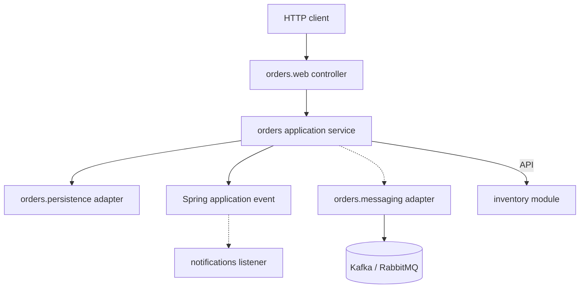
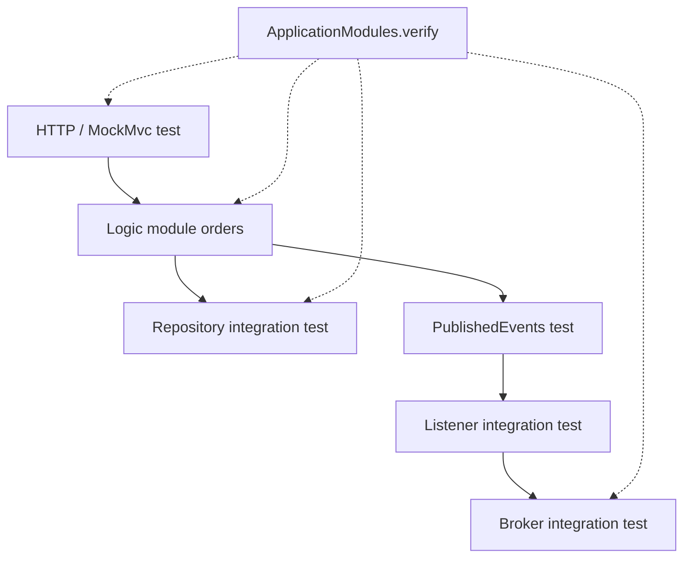

# Web layer, database và messaging adapter

## 1. Vì sao một module test vẫn có web, database và messaging?

Một ứng dụng Spring Modulith thường chia nghiệp vụ thành các application module, nhưng mỗi module có thể chứa nhiều loại thành phần: service nghiệp vụ, REST controller, Spring Data repository, listener sự kiện, adapter giao tiếp với Kafka/RabbitMQ và các cấu hình hạ tầng. Khi chạy `@ApplicationModuleTest`, ta không chỉ hỏi **module nào được bootstrap**, mà còn phải hỏi **những adapter nào thuộc module đó sẽ được tạo thành bean và cần hạ tầng gì**.

Ví dụ, module `orders` có service đặt hàng. Nếu trong cùng module tồn tại `@RestController`, `JpaRepository` và một `@KafkaListener`, việc bootstrap module có thể kéo theo MVC, database và messaging infrastructure. Ngược lại, nếu adapter nằm trong module khác hoặc bị `@Profile`/`@ConditionalOnProperty` loại trừ, nó có thể không có trong test context. Vì vậy, khái niệm “module test nhỏ” **không đồng nghĩa** “test không bao giờ cần database hoặc broker”.

Bài học thuộc chương **Bootstrap context** của học phần `SPRING_MODULITH_VERIFICATION_TESTING`. Trọng tâm là rèn kỹ năng kiểm chứng ranh giới kiến trúc bằng `ApplicationModules` và các quy tắc phụ thuộc; vận dụng `@ApplicationModuleTest` để kiểm thử sự kiện, dữ liệu, web và tích hợp; sau đó kết hợp các phép kiểm chứng thành quality gate CI ngăn phụ thuộc sai và hồi quy.

Sau bài học, bạn cần phân biệt được:

- Bean nghiệp vụ của module với adapter web/persistence/messaging và hạ tầng do Spring Boot auto-configure.
- Kiểm thử HTTP bằng `MockMvc` với kiểm thử server HTTP thật.
- Kiểm thử JPA/repository thật với việc dùng fake hoặc mock persistence.
- Spring application event nội bộ với thông điệp gửi qua message broker.
- Lỗi module boundary với lỗi cấu hình runtime của một adapter.

## 2. Ba tầng cần nhìn trong `ApplicationContext`

Hãy hình dung một module `orders` gồm ba phần:

```text
com.example.shop
├── ShopApplication.java
├── orders/
│   ├── OrderApplicationService.java
│   ├── OrderAccepted.java
│   ├── web/
│   │   └── OrderRestController.java
│   ├── persistence/
│   │   ├── OrderEntity.java
│   │   └── OrderJpaRepository.java
│   └── messaging/
│       └── OrderMessageAdapter.java
├── inventory/
│   └── StockAvailability.java
└── notifications/
    └── OrderAcceptedListener.java
```

Giả sử Spring Modulith nhận diện `orders`, `inventory` và `notifications` là các application module theo các package con trực tiếp của `com.example.shop`. Trong cấu trúc này, `orders.web`, `orders.persistence` và `orders.messaging` là **subpackage nằm trong module `orders`**, không mặc nhiên là ba application module độc lập.

Với `@ApplicationModuleTest` đặt trong package `com.example.shop.orders` và mặc định sử dụng `STANDALONE`, Spring Modulith chọn `orders` là module mục tiêu. Tuy nhiên, phạm vi adapter thực sự có mặt còn phụ thuộc các cơ chế đăng ký bean và điều kiện Spring:

| Tầng | Ví dụ | Do đâu được đưa vào context? |
| --- | --- | --- |
| **Module nghiệp vụ** | `OrderApplicationService`, `OrderPolicy` | Bean thuộc phạm vi module đã được Spring Modulith chọn; các điều kiện Spring phải thỏa |
| **Adapter thuộc module** | `OrderRestController`, `OrderJpaRepository`, `OrderMessageAdapter` | Các cơ chế quét/đăng ký tương ứng, profile, conditional và cấu hình module test |
| **Hạ tầng framework** | `DispatcherServlet`, `DataSource`, `EntityManagerFactory`, listener container | Spring Boot/Spring Framework auto-configuration, dependency, điều kiện và test configuration |

**Không suy từ classpath rằng một adapter đang hoạt động.** Có thư viện Kafka trên classpath không có nghĩa có listener container đã chạy; có JPA entity không có nghĩa repository tạo được; có `@RestController` không có nghĩa test đã khởi động HTTP server thật.

### Sơ đồ hai chiều trách nhiệm



Các mũi tên trên thể hiện khả năng tương tác trong **ứng dụng đầy đủ**. Trong một `@ApplicationModuleTest` ở `STANDALONE`, listener thuộc `notifications` và implementation của `inventory` không được tự động nạp như các bean nghiệp vụ của `orders`. Adapter `orders.web` hoặc `orders.persistence` thì có thể được đăng ký vì chúng nằm trong chính module mục tiêu, nếu cấu hình/điều kiện cho phép.

## 3. Ba chế độ bootstrap: điều gì thay đổi và điều gì không?

```java
import org.springframework.modulith.test.ApplicationModuleTest;
import org.springframework.modulith.test.ApplicationModuleTest.BootstrapMode;

// Mặc định: module orders.
@ApplicationModuleTest
class OrdersStandaloneTest {
}

// Module orders + các module orders phụ thuộc trực tiếp.
@ApplicationModuleTest(mode = BootstrapMode.DIRECT_DEPENDENCIES)
class OrdersDirectDependenciesTest {
}

// Module orders + các dependency trực tiếp và bắc cầu.
@ApplicationModuleTest(mode = BootstrapMode.ALL_DEPENDENCIES)
class OrdersAllDependenciesTest {
}
```

Các lớp trên minh họa phạm vi bootstrap, chưa chứa assertion. Khi đổi mode, tập **application module nghiệp vụ** thay đổi; Spring Boot vẫn đánh giá điều kiện về web, JDBC, JPA, Kafka, RabbitMQ theo các cấu hình thực tế.

| Chế độ | Các module ứng dụng được chọn | Có tự tạo HTTP server, database, broker không? |
| --- | --- | --- |
| `STANDALONE` | Module chứa test | **Không.** Phụ thuộc hạ tầng vẫn cần cấu hình phù hợp |
| `DIRECT_DEPENDENCIES` | Module mục tiêu và dependency trực tiếp | **Không.** Chỉ mở rộng module được bootstrap |
| `ALL_DEPENDENCIES` | Module mục tiêu và dependency bắc cầu | **Không.** Không tự cung cấp dịch vụ bên ngoài |

Trong ví dụ, nếu `orders` cần `StockAvailability` thuộc `inventory`, test `STANDALONE` thường cần mock/fake để thỏa constructor. Nhưng nếu `orders` có repository riêng dùng database, mock `StockAvailability` **không làm repository đó biến mất**. Tương tự, adapter gửi Kafka nằm trong `orders` có thể được đăng ký và cần Kafka infrastructure ngay cả khi `inventory` đã được mock.

Đây là lý do khi gặp `Failed to load ApplicationContext`, không nên mặc định “bật `ALL_DEPENDENCIES` sẽ sửa hết”. Cần xác định chính xác bean nào thiếu và nó thuộc **module khác** hay **hạ tầng của module hiện tại**.

## 4. Web layer: controller trong module test có được kiểm thử không?

### 4.1. Ba loại phép kiểm thử web

Một REST controller có thể được kiểm thử theo nhiều mức:

| Cách | Phạm vi | Phù hợp khi |
| --- | --- | --- |
| JUnit + Mockito thuần | Không có Spring `ApplicationContext` | Chỉ muốn kiểm tra mapping logic/HTTP response từ controller như một lớp Java |
| `@WebMvcTest` | Spring MVC slice, chủ yếu controller và web components được chọn | Kiểm tra binding, validation, HTTP status và serialization của web layer; **không tự thay thế kiểm chứng module của Spring Modulith** |
| `@ApplicationModuleTest` + `@AutoConfigureMockMvc` | Module test theo `BootstrapMode`, bổ sung `MockMvc` | Kiểm tra controller và service thật của module trong một context giới hạn có chủ đích |
| `@SpringBootTest(webEnvironment = RANDOM_PORT)` | Test chạy web server ở cổng ngẫu nhiên | Kiểm tra HTTP stack đầy đủ ở phạm vi tích hợp ứng dụng; cần chuẩn bị hạ tầng tương ứng |

`@SpringBootTest` thường có web environment mặc định là `MOCK` khi servlet stack khả dụng: có thể tạo mock servlet context nhưng **không mở một cổng HTTP thực**. `MockMvc` thực hiện request qua MVC infrastructure trong JVM; đây không phải kết nối socket thật từ một trình khách bên ngoài.

Vì `@ApplicationModuleTest` dựa trên Spring Boot test infrastructure, ta có thể phối hợp `@AutoConfigureMockMvc` trong dự án dùng Spring MVC. Tuy nhiên, controller của module phải được đăng ký và mọi dependency của nó phải tạo được; `MockMvc` không tự tạo lại những bean nghiệp vụ bị thiếu.

### 4.2. Ví dụ: controller và service thuộc cùng module `orders`

API công khai của module `inventory`:

```java
// com/example/shop/inventory/StockAvailability.java
package com.example.shop.inventory;

public interface StockAvailability {
    boolean isAvailable(String sku, int quantity);
}
```

Sự kiện thuộc module `orders`:

```java
// com/example/shop/orders/OrderAccepted.java
package com.example.shop.orders;

public record OrderAccepted(
    String orderId, String sku, int quantity) {
}
```

Service thật trong module mục tiêu:

```java
// com/example/shop/orders/OrderApplicationService.java
package com.example.shop.orders;

import com.example.shop.inventory.StockAvailability;
import org.springframework.context.ApplicationEventPublisher;
import org.springframework.stereotype.Service;

@Service
public class OrderApplicationService {

    private final StockAvailability stock;
    private final ApplicationEventPublisher events;

    public OrderApplicationService(
            StockAvailability stock,
            ApplicationEventPublisher events) {
        this.stock = stock;
        this.events = events;
    }

    public String place(String sku, int quantity) {
        if (quantity <= 0) {
            throw new IllegalArgumentException(
                "Quantity must be positive");
        }
        if (!stock.isAvailable(sku, quantity)) {
            throw new IllegalStateException(
                "Product not available");
        }

        // ID cố định theo SKU chỉ để bài học dễ kiểm chứng.
        String orderId = "ORD-" + sku;
        events.publishEvent(new OrderAccepted(
            orderId, sku, quantity));
        return orderId;
    }
}
```

Controller tại `orders.web`:

```java
// com/example/shop/orders/web/OrderRestController.java
package com.example.shop.orders.web;

import com.example.shop.orders.OrderApplicationService;
import java.util.Map;
import org.springframework.http.HttpStatus;
import org.springframework.http.ResponseEntity;
import org.springframework.web.bind.annotation.PostMapping;
import org.springframework.web.bind.annotation.RequestBody;
import org.springframework.web.bind.annotation.RequestMapping;
import org.springframework.web.bind.annotation.RestController;

@RestController
@RequestMapping("/orders")
public class OrderRestController {

    private final OrderApplicationService orders;

    public OrderRestController(OrderApplicationService orders) {
        this.orders = orders;
    }

    public record PlaceOrderRequest(
        String sku, int quantity) {
    }

    @PostMapping
    public ResponseEntity<Map<String, String>> place(
            @RequestBody PlaceOrderRequest request) {
        String id = orders.place(
            request.sku(), request.quantity());

        return ResponseEntity.status(HttpStatus.CREATED)
            .body(Map.of("orderId", id));
    }
}
```

Controller chỉ nhận request, gọi use case và ánh xạ kết quả sang HTTP. Logic tồn kho vẫn nằm trong service, qua API của `inventory`. Việc để controller ở `orders.web` không làm nó thành module mới; nó là adapter inbound của `orders`.

### 4.3. Module test kiểm thử HTTP bằng `MockMvc`

Ví dụ sau dùng Spring Framework 6.2+ cho `@MockitoBean`. Dự án Spring Boot cũ hơn có thể dùng `@MockBean` tương thích.

```java
// src/test/java/com/example/shop/orders/OrdersWebModuleTest.java
package com.example.shop.orders;

import com.example.shop.inventory.StockAvailability;
import org.junit.jupiter.api.Test;
import org.springframework.beans.factory.annotation.Autowired;
import org.springframework.boot.test.autoconfigure.web.servlet.AutoConfigureMockMvc;
import org.springframework.http.MediaType;
import org.springframework.modulith.test.ApplicationModuleTest;
import org.springframework.test.context.bean.override.mockito.MockitoBean;
import org.springframework.test.web.servlet.MockMvc;

import static org.mockito.BDDMockito.given;
import static org.springframework.test.web.servlet.request.MockMvcRequestBuilders.post;
import static org.springframework.test.web.servlet.result.MockMvcResultMatchers.jsonPath;
import static org.springframework.test.web.servlet.result.MockMvcResultMatchers.status;

@ApplicationModuleTest
@AutoConfigureMockMvc
class OrdersWebModuleTest {

    @Autowired
    MockMvc mvc;

    @MockitoBean
    StockAvailability stock;

    @Test
    void returns201ForAvailableProduct() throws Exception {
        given(stock.isAvailable("SKU-1", 2))
            .willReturn(true);

        mvc.perform(post("/orders")
            .contentType(MediaType.APPLICATION_JSON)
            .content("""
                {"sku":"SKU-1","quantity":2}
                """))
            .andExpect(status().isCreated())
            .andExpect(jsonPath("$.orderId")
                .value("ORD-SKU-1"));
    }
}
```

Ý nghĩa của bài test:

1. `orders` được chọn làm module mục tiêu; `OrderApplicationService` và controller `orders.web` là bean thật nếu được đăng ký đúng.
2. `@MockitoBean` cung cấp `StockAvailability` trong context mà không cần nạp `inventory` thật.
3. `@AutoConfigureMockMvc` thiết lập công cụ gọi MVC mà không cần khởi động HTTP server trên cổng thật.
4. Assertion kiểm chứng đường đi từ HTTP JSON qua controller tới logic `orders` và HTTP response.

**Giả định:** dự án có Spring MVC và cấu hình security không ngăn request minh họa. Nếu dùng Spring Security, `MockMvc` có thể chạy filter chain và trả `401`/`403` khi thiếu authentication hoặc CSRF token. Trong trường hợp đó nên cấu hình `spring-security-test`, `@WithMockUser` và `csrf()` theo chính sách ứng dụng; không nên vô hiệu hóa bảo mật một cách vô thức chỉ để lấy status `201`.

**Hạn chế:** test trên không chứng minh mạng HTTP thực, TLS, reverse proxy hoặc chính xác hành vi của database/message broker ở ngoài JVM. Nó cũng không kiểm tra rằng implementation thật của `inventory` hoạt động.

## 5. Lỗi thường gặp ở web layer khi bootstrap module

| Triệu chứng | Nguyên nhân khả dĩ | Hướng xử lý |
| --- | --- | --- |
| Không inject được `MockMvc` | Chưa cấu hình `@AutoConfigureMockMvc` hoặc thiếu MVC test support | Kiểm tra Spring MVC dependency và test annotation |
| Endpoint trả `404` | Controller không được đăng ký, package ngoài module hoặc path sai | Kiểm tra bean controller, `@RequestMapping` và module scope |
| Endpoint trả `401`/`403` | Spring Security filter chain đang hoạt động | Dùng test authentication/CSRF phù hợp |
| Endpoint trả `415` | `Content-Type` không khớp với endpoint | Gửi `application/json` hoặc media type yêu cầu |
| Endpoint trả `400` | JSON binding/validation không hợp lệ | Kiểm tra DTO, validation, message converter |
| Test fail trước khi request | Constructor của service/controller thiếu bean | Mock/fake collaborator ngoài module hoặc cấu hình dependency thật |
| Controller có mặt nhưng không render JSON | Thiếu hoặc không khớp message converter | Kiểm tra Jackson và MVC auto-configuration |
| Có `MockMvc` nhưng muốn kiểm tra mạng thật | Đã chọn sai mức test | Dùng integration test chạy server với `RANDOM_PORT` |

Một số test chỉ dùng `@WebMvcTest(OrderRestController.class)` có thể nhanh hơn, nhưng thường mock service và không kiểm chứng bootstrap của cả module `orders`. Muốn bảo vệ module boundary, cần chạy `ApplicationModules.verify()` và các module test tương ứng chứ không chỉ web slice.

## 6. Database layer: repository và entity không giống component thông thường

Trong Spring, các thành phần liên quan dữ liệu được đăng ký bằng nhiều cơ chế:

- `@Entity` là metadata JPA, **không tự biến entity thành singleton Spring bean**.
- `JpaRepository` là interface; Spring Data tạo repository proxy khi hạ tầng repository được bật và package được nhận diện.
- `@Repository` trên một adapter JDBC là Spring component nếu nó nằm trong phạm vi scan và điều kiện phù hợp.
- `DataSource`, `EntityManagerFactory` và transaction manager thường đến từ cấu hình Spring Boot hoặc cấu hình thủ công.
- Migration Flyway/Liquibase, schema, JDBC driver và database test nằm ngoài khái niệm module boundary của Spring Modulith.

Vì vậy, một test `STANDALONE` của `orders` có thể không nạp service của `inventory` nhưng **vẫn cần DataSource** do repository trong `orders.persistence` sử dụng.

### 6.1. Ví dụ entity và repository thuộc `orders`

```java
// com/example/shop/orders/persistence/OrderEntity.java
package com.example.shop.orders.persistence;

import jakarta.persistence.Entity;
import jakarta.persistence.GeneratedValue;
import jakarta.persistence.GenerationType;
import jakarta.persistence.Id;
import jakarta.persistence.Table;

@Entity
@Table(name = "orders")
public class OrderEntity {

    @Id
    @GeneratedValue(strategy = GenerationType.IDENTITY)
    private Long id;

    private String sku;
    private int quantity;

    protected OrderEntity() {
    }

    public OrderEntity(String sku, int quantity) {
        this.sku = sku;
        this.quantity = quantity;
    }

    public Long getId() {
        return id;
    }

    public String getSku() {
        return sku;
    }

    public int getQuantity() {
        return quantity;
    }
}
```

Repository:

```java
// com/example/shop/orders/persistence/OrderJpaRepository.java
package com.example.shop.orders.persistence;

import org.springframework.data.jpa.repository.JpaRepository;

public interface OrderJpaRepository
        extends JpaRepository<OrderEntity, Long> {
}
```

Hai file trên chỉ là phần dữ liệu của ví dụ. Một ứng dụng thật cần định nghĩa quan hệ entity, constraint, index, migration và quy tắc transactional phù hợp. Repository interface là **contract của Spring Data**, không được component scan đơn thuần biến thành bean nếu thiếu repository infrastructure.

### 6.2. Kiểm thử database thật với module test và Testcontainers

Để kiểm tra repository, thay vì mock chính `OrderJpaRepository`, có thể khởi động PostgreSQL test container và dùng giao dịch/fixture rõ ràng.

```java
// src/test/java/com/example/shop/orders/OrdersPersistenceModuleTest.java
package com.example.shop.orders;

import com.example.shop.orders.persistence.OrderEntity;
import com.example.shop.orders.persistence.OrderJpaRepository;
import jakarta.persistence.EntityManager;
import org.junit.jupiter.api.Test;
import org.springframework.beans.factory.annotation.Autowired;
import org.springframework.modulith.test.ApplicationModuleTest;
import org.springframework.test.context.DynamicPropertyRegistry;
import org.springframework.test.context.DynamicPropertySource;
import org.springframework.transaction.annotation.Transactional;
import org.testcontainers.containers.PostgreSQLContainer;
import org.testcontainers.junit.jupiter.Container;
import org.testcontainers.junit.jupiter.Testcontainers;

import static org.assertj.core.api.Assertions.assertThat;

@Testcontainers
@ApplicationModuleTest
@Transactional
class OrdersPersistenceModuleTest {

    @Container
    static PostgreSQLContainer<?> postgres =
        new PostgreSQLContainer<>("postgres:16-alpine");

    @DynamicPropertySource
    static void databaseProperties(
            DynamicPropertyRegistry registry) {
        registry.add("spring.datasource.url",
            postgres::getJdbcUrl);
        registry.add("spring.datasource.username",
            postgres::getUsername);
        registry.add("spring.datasource.password",
            postgres::getPassword);
    }

    @Autowired
    OrderJpaRepository repository;

    @Autowired
    EntityManager entityManager;

    @Test
    void persistsAndReadsOrder() {
        OrderEntity stored = repository.saveAndFlush(
            new OrderEntity("SKU-1", 2));

        Long id = stored.getId();
        entityManager.clear();

        OrderEntity found = repository.findById(id)
            .orElseThrow();

        assertThat(found.getSku()).isEqualTo("SKU-1");
        assertThat(found.getQuantity()).isEqualTo(2);
    }
}
```

**Điều kiện để ví dụ chạy:** dự án đã có các dependency Spring Data JPA, PostgreSQL driver, Testcontainers/JUnit và runtime container phù hợp; entity/repository của `orders` được Spring nhận diện; bảng `orders` đã được tạo bởi migration hoặc cấu hình schema dành riêng cho test. Đoạn code không tự sinh migration.

Ở đây:

1. `@ApplicationModuleTest` chọn module `orders`; không cần nạp toàn bộ `inventory` để kiểm tra repository `orders`.
2. `@DynamicPropertySource` cung cấp JDBC URL và credentials cấp động từ container.
3. `@Transactional` áp dụng giao dịch cho phương thức test và thường giúp rollback thay đổi của test khi Spring Test quản lý transaction; việc rollback không tự động áp dụng cho công việc chạy ngoài transaction/test thread.
4. `saveAndFlush(...)` đẩy thao tác ghi xuống JPA; `entityManager.clear()` tránh đọc lại cùng managed entity từ persistence context cấp một.
5. Assertion kiểm chứng một đường đọc/ghi qua JPA chứ không chỉ kiểm tra repository bean tồn tại.

Lưu ý: test đang minh họa **persistence của `orders`**. Nếu `OrderApplicationService` hoặc các bean khác trong cùng module cần `StockAvailability` mà không có implementation trong `STANDALONE`, bạn vẫn phải cung cấp một fake/mock hoặc chọn phạm vi bootstrap khác để context khởi động. `@DynamicPropertySource` không giải quyết thiếu bean từ module phụ thuộc.

### 6.3. Vì sao `@DataJpaTest` chưa đủ thay module test?

`@DataJpaTest` là một **test slice** dành cho JPA: có thể tập trung vào entity/repository và hạ tầng persistence cần thiết, thường không nạp tất cả service/controller của module. Nó rất hữu ích để kiểm tra query, mapping, constraint trong phạm vi hẹp.

Nhưng `@DataJpaTest` **không tự xác minh ranh giới application module**. Nếu cần biết module `orders` bootstrap được và use case hoạt động với repository thật, `@ApplicationModuleTest` là lựa chọn ở mức module; nếu chỉ cần kiểm tra một repository riêng, `@DataJpaTest` có thể đơn giản hơn.

Không nên kết hợp tùy tiện hai cơ chế bootstrap mạnh vào cùng một lớp test chỉ vì muốn vừa nhanh vừa đầy đủ. Tách test theo mục tiêu sẽ dễ bảo trì hơn.

## 7. Database adapter và giao dịch: những bẫy ít thấy

| Tình huống | Vì sao quan trọng? | Cách kiểm tra |
| --- | --- | --- |
| Entity được quét nhưng repository vắng mặt | Entity scan khác repository scanning | Xem cấu hình Spring Data và package của repository |
| Repository có bean nhưng schema không tồn tại | Khởi động Spring không bảo đảm migration/schema thành công theo mọi setup | Chạy câu lệnh ghi/đọc thật; kiểm tra Flyway/Liquibase |
| Transaction rollback mà event vẫn gây side effect | Async listener hoặc hệ thống ngoài không nhất thiết rollback cùng test | Phân biệt local transaction và side effect ngoài |
| Dùng H2 thay PostgreSQL production | SQL dialect/constraint có thể khác | Dùng Testcontainers khi cần độ tương đồng cao |
| Mock repository trong test “JPA integration” | Không chạy SQL thật | Giữ bean repository thật và chuẩn bị database |
| Test pass khi chỉ đọc entity vừa save | Có thể đang đọc từ first-level cache | `flush()`, `clear()` hoặc dùng giao dịch/đường đọc phù hợp |
| Dữ liệu rò giữa các test | Transaction không bao trùm tác vụ async hoặc setup khác | Fixture/cập nhật database tách biệt; cleanup xác định |

Tác động của `@Transactional` còn phụ thuộc ranh giới transaction. Một event handler bất đồng bộ hoặc logic dùng `REQUIRES_NEW` có thể commit độc lập với transaction của test. Vì vậy, không thể coi rollback của test là chiến lược dọn dẹp phổ quát cho mọi integration test.

Đối với module test về event publication lưu vào database, cần xét cả **transaction manager, event publication repository và backend lưu trữ**. Nếu cố loại trừ `DataSourceAutoConfiguration` để bỏ lỗi bootstrap, bài test có thể mất đúng phần hạ tầng mà nó cần kiểm chứng.

## 8. Messaging adapter: phân biệt event nội bộ và message broker

Trong Spring Modulith, một sự kiện domain được công bố bằng `ApplicationEventPublisher` khác về bản chất với message được gửi qua Kafka hoặc RabbitMQ.

| Khía cạnh | Spring application event | Message broker |
| --- | --- | --- |
| Cách phát | `ApplicationEventPublisher.publishEvent(...)` | `KafkaTemplate`, `RabbitTemplate` hoặc API của messaging adapter |
| Đường truyền cơ bản | Trong `ApplicationContext` hiện tại | Qua hệ thống broker bên ngoài JVM |
| Người nhận | `@EventListener`, `@ApplicationModuleListener` trong context | Consumer/listener container đã đăng ký và kết nối broker |
| Điều kiện chạy | Bean listener phải có trong context; chú ý transaction/async semantics | Broker, topic/queue, serialization, connection, consumer group, retries |
| Kiểm thử phù hợp | `PublishedEvents`, `Scenario`, listener integration test | Mock ở port khi test nội bộ; integration test với broker/test container khi kiểm tra adapter thật |

Spring Modulith hỗ trợ cơ chế xử lý event giữa module và các khả năng quản lý việc công bố sự kiện. Tuy nhiên, **không phải mọi event `ApplicationEventPublisher` tự động biến thành Kafka message**. Phải có adapter hoặc cơ chế externalization được cấu hình và đăng ký thích hợp.

### 8.1. Module test kiểm chứng event được phát

Từ ví dụ `OrderApplicationService.place(...)` ở phần web, ta có thể dùng `PublishedEvents` của Spring Modulith Test:

```java
// src/test/java/com/example/shop/orders/OrdersEventsModuleTest.java
package com.example.shop.orders;

import com.example.shop.inventory.StockAvailability;
import org.junit.jupiter.api.Test;
import org.springframework.beans.factory.annotation.Autowired;
import org.springframework.modulith.test.ApplicationModuleTest;
import org.springframework.modulith.test.PublishedEvents;
import org.springframework.test.context.bean.override.mockito.MockitoBean;

import static org.assertj.core.api.Assertions.assertThat;
import static org.mockito.BDDMockito.given;

@ApplicationModuleTest
class OrdersEventsModuleTest {

    @Autowired
    OrderApplicationService orders;

    @MockitoBean
    StockAvailability stock;

    @Test
    void publishesOrderAccepted(PublishedEvents events) {
        given(stock.isAvailable("SKU-7", 1))
            .willReturn(true);

        orders.place("SKU-7", 1);

        assertThat(events.ofType(OrderAccepted.class))
            .anySatisfy(event -> {
                assertThat(event.orderId())
                    .isEqualTo("ORD-SKU-7");
                assertThat(event.sku()).isEqualTo("SKU-7");
                assertThat(event.quantity()).isEqualTo(1);
            });
    }
}
```

Bài test kiểm chứng **bean thật của `orders` phát event đúng payload**. Nó không đòi hỏi bean listener `notifications` xuất hiện; cũng không cần Kafka hoặc RabbitMQ nếu ứng dụng không kéo theo adapter broker bắt buộc trong context. `PublishedEvents` quan sát việc phát sự kiện trong phạm vi test; nó không khẳng định người tiêu thụ ngoài JVM đã xử lý thành công.

### 8.2. Listener ở module khác

Giả sử `notifications` có listener:

```java
// com/example/shop/notifications/OrderAcceptedListener.java
package com.example.shop.notifications;

import com.example.shop.orders.OrderAccepted;
import org.springframework.modulith.events.ApplicationModuleListener;
import org.springframework.stereotype.Component;

@Component
class OrderAcceptedListener {

    private final NotificationPort notifications;

    OrderAcceptedListener(NotificationPort notifications) {
        this.notifications = notifications;
    }

    @ApplicationModuleListener
    void on(OrderAccepted event) {
        notifications.sendOrderAccepted(
            event.orderId(), event.sku());
    }
}
```

Ở đây `NotificationPort` là interface do module `notifications` sở hữu. `@ApplicationModuleListener` của Spring Modulith kết hợp các semantics của event listener giao dịch/bất đồng bộ; việc thực thi thật phụ thuộc cấu hình transaction, executor và event publication infrastructure tương thích.

Vì `OrderAcceptedListener` thuộc module `notifications`, một test `orders` ở `STANDALONE` **không nên trông đợi listener này đã được nạp**. Muốn kiểm chứng xử lý sự kiện liên module, hãy tạo bài module test tại `notifications` hoặc integration test có bean listener thật trong context. Dùng công cụ `Scenario` của Spring Modulith Test để chờ điều kiện/event khi cần, tránh `Thread.sleep(...)` tùy tiện đối với xử lý bất đồng bộ.

Nếu `notifications` phụ thuộc API event của `orders`, test `notifications` có thể chọn `DIRECT_DEPENDENCIES` để nạp các module phụ thuộc cần thiết; mode cụ thể vẫn phải theo đồ thị dependency thực tế. Việc listener có mặt chưa đủ: cần assertion kiểm tra `NotificationPort` được gọi hoặc trạng thái thông báo được cập nhật.

## 9. Kafka/Rabbit adapter: đưa infrastructure vào module test như thế nào?

Giả sử module `orders` còn gửi sự kiện ra Kafka. Một adapter có thể triển khai một port:

```java
// com/example/shop/orders/messaging/OrderMessages.java
package com.example.shop.orders.messaging;

import com.example.shop.orders.OrderAccepted;

public interface OrderMessages {
    void publish(OrderAccepted event);
}
```

Implementation dùng Spring Kafka:

```java
// com/example/shop/orders/messaging/KafkaOrderMessages.java
package com.example.shop.orders.messaging;

import com.example.shop.orders.OrderAccepted;
import org.springframework.beans.factory.annotation.Value;
import org.springframework.context.annotation.Profile;
import org.springframework.kafka.core.KafkaTemplate;
import org.springframework.stereotype.Component;

@Component
@Profile("kafka-integration")
class KafkaOrderMessages implements OrderMessages {

    private final KafkaTemplate<String, OrderAccepted> kafka;
    private final String topic;

    KafkaOrderMessages(
            KafkaTemplate<String, OrderAccepted> kafka,
            @Value("${orders.events.topic}") String topic) {
        this.kafka = kafka;
        this.topic = topic;
    }

    @Override
    public void publish(OrderAccepted event) {
        kafka.send(topic, event.orderId(), event);
    }
}
```

`@Profile("kafka-integration")` là một cách chủ động chỉ đăng ký adapter khi profile phù hợp được bật. Bean KafkaTemplate phụ thuộc cấu hình Kafka, serializer và các điều kiện tương ứng. **Mã trên là ví dụ adapter phát thông điệp**, không tự cung cấp Kafka broker, schema registry, delivery guarantee hoặc topic.

Nếu `OrderApplicationService` thật được thiết kế phụ thuộc `OrderMessages`, một bài `STANDALONE` không bật profile Kafka phải cung cấp fake/mock `OrderMessages` để khởi động. Nếu không cần port này trong use case đang kiểm thử, tốt hơn là không cưỡng ép khởi tạo adapter hạ tầng chỉ để test một quy tắc nội bộ.

### Ba cách kiểm thử adapter

**Cấp 1 — Kiểm thử nghiệp vụ với mock port:** test `orders` dùng `@MockitoBean OrderMessages` để kiểm tra service truyền đúng event tới port. Kafka thật không chạy. Lưu ý: nếu service chưa gọi `OrderMessages`, việc verify port không có ý nghĩa; phải kết nối port trong luồng production.

**Cấp 2 — Kiểm thử mapping/serialization của adapter:** test bean `KafkaOrderMessages` với `KafkaTemplate` mock hoặc môi trường test đặc thù. Kiểm tra topic, key, payload/serializer theo contract. Test này kiểm chứng code adapter nhưng chưa chứng minh broker nhận được message.

**Cấp 3 — Integration test với broker:** chạy Kafka/RabbitMQ bằng Testcontainers hoặc dịch vụ test được kiểm soát, bật profile adapter, cấp bootstrap servers/connection properties, kiểm tra producer và consumer thật, retry, transaction và serialization. Bài test phải có assertion quan sát được sau khi nhận message, không chỉ gọi `send(...)`.

Một consumer như `@KafkaListener` hoặc `@RabbitListener` chỉ hoạt động khi bean listener được nạp, listener infrastructure được bật và kết nối đúng broker. Nếu consumer ở module `notifications`, còn test `orders` là `STANDALONE`, không nên giả định consumer tự xuất hiện do đã thêm dependency Kafka vào build.

## 10. Profile và property giúp tách adapter khi bootstrap

Đối với cùng một module, có thể chia cấu hình như sau:

| Profile/điều kiện | Bean adapter mong muốn | Loại test |
| --- | --- | --- |
| `module-test` | Fake/mock port, service thật | Kiểm thử logic và ranh giới module |
| `db-integration` | Repository/DataSource thật, database test | Kiểm thử persistence |
| `kafka-integration` | Kafka producer/consumer adapter và broker test | Kiểm thử messaging integration |
| Profile production | Adapter thật theo cấu hình deploy | Chạy ứng dụng thực tế |

Tên profile là quy ước của ví dụ, không phải tên bắt buộc của Spring Modulith.

Ví dụ bật profile và cung cấp property từ test:

```java
import org.springframework.modulith.test.ApplicationModuleTest;
import org.springframework.test.context.ActiveProfiles;
import org.springframework.test.context.TestPropertySource;

@ApplicationModuleTest
@ActiveProfiles("kafka-integration")
@TestPropertySource(properties = {
    "orders.events.topic=orders-test"
})
class OrdersKafkaAdapterTest {
    // Cần thêm broker/container, adapter và assertion thực tế.
}
```

Ở đây `@ActiveProfiles` quyết định bean nào đáp ứng `@Profile`; `@TestPropertySource` cung cấp giá trị topic. Cả hai **không tự thay đổi `BootstrapMode`**, không tạo Kafka broker và không tự đảm bảo adapter đã có bean `KafkaTemplate` phù hợp.

Với Kafka/Rabbit test container, địa chỉ broker/port thay đổi giữa lần chạy có thể được cấp qua `@DynamicPropertySource` hoặc cơ chế `@ServiceConnection` tương ứng của Spring Boot và phiên bản Testcontainers. Đừng hardcode localhost/port cố định để rồi CI fail do địa chỉ broker không tồn tại.

## 11. Kết nối web → database → messaging: tránh một test cố chứng minh tất cả

Một request `POST /orders` có thể đi qua controller, service, repository, event publisher và adapter gửi message. Thông thường ta nên chia kiểm thử thành những tầng có trách nhiệm rõ:



Một chiến lược thường có giá trị là:

1. **Architecture test:** phát hiện phụ thuộc code sai chiều, sử dụng package internal trái quy tắc hoặc vi phạm ranh giới/named interface.
2. **Module behavior test:** dùng `STANDALONE` với fake/mock ở các cổng ngoài module; kiểm tra logic và event payload.
3. **Web adapter test:** dùng `@AutoConfigureMockMvc` với controller thật, kiểm tra routing, DTO, status, authentication/validation thích hợp.
4. **Database integration test:** có repository thật, migration và database test; kiểm tra SQL/JPA/transaction.
5. **Messaging integration test:** có adapter thật với broker test; kiểm tra producer/consumer và thời điểm hoàn tất.
6. **End-to-end test chọn lọc:** vài luồng nghiệp vụ xuyên nhiều adapter, không cần sao chép toàn bộ testcase ở mọi tầng.

**Không có một annotation nào tự biến module test thành toàn bộ các mức kiểm chứng.** `@ApplicationModuleTest` chọn ranh giới module; `@AutoConfigureMockMvc` bổ sung công cụ web; `@DynamicPropertySource` cấp property hạ tầng; `@TestConfiguration`/`@MockitoBean` bổ sung bean test. Kết quả cuối cùng phụ thuộc cách chúng được phối hợp.

## 12. Auto-configuration: không nên tắt ngẫu nhiên các adapter

Spring Boot có các auto-configuration liên quan MVC, JPA/JDBC, Kafka hoặc RabbitMQ. Chúng chỉ tạo bean khi điều kiện thích hợp thỏa. Một bài module test có thể bị ảnh hưởng nếu dependency trên classpath làm cấu hình bổ sung được kích hoạt.

Ví dụ các nhóm auto-configuration có thể liên quan:

| Hạ tầng | Điều kiện/cấu hình cần điều tra | Khi nào không nên loại trừ? |
| --- | --- | --- |
| MVC | Web stack, servlet context, security, message converter | Khi đang kiểm thử REST controller bằng `MockMvc` |
| JDBC/JPA | Driver, `spring.datasource.*`, entity/repository scan, transaction manager | Khi kiểm chứng repository, transaction, migration |
| Kafka | `spring.kafka.*`, producer/consumer factories, listener containers, serializers | Khi kiểm chứng Kafka producer/consumer thật |
| RabbitMQ | `spring.rabbitmq.*`, connection factory, listener containers, converter | Khi kiểm chứng Rabbit adapter thật |
| Event publication registry | Backend lưu trữ, transaction, cấu hình Modulith events | Khi kiểm chứng tính bền vững của event publication |

Với module test logic thuần, có thể loại trừ những auto-configuration không cần thiết **nếu đã hiểu dependency của các bean trong context**. Với integration test, việc loại trừ JPA hoặc messaging auto-configuration có thể phá hủy chính phần cần kiểm chứng.

Bật `debug=true` trong cấu hình test khi cần đọc Conditions Evaluation Report, hoặc xem `ConditionEvaluationReport` qua Spring Boot API để biết auto-configuration nào đã match. Điều này phân biệt được hai trường hợp:

- **Adapter không có bean:** có thể do profile, property, module scope hoặc auto-configuration condition.
- **Adapter có bean nhưng khởi tạo thất bại:** có thể do database chưa sẵn sàng, broker chưa chạy, serializer/driver thiếu hoặc dependency khác.

Một bean từ module khác không xuất hiện chỉ vì `BootstrapMode.STANDALONE` là vấn đề **phạm vi module**, không nên tìm cách khắc phục bằng cách bật hết auto-configuration.

## 13. Khi test vừa có web vừa có JPA và Kafka, lỗi xuất hiện ở đâu trước?

Khi `@ApplicationModuleTest` bootstrap, Spring cần dựng context trước khi chạy `@Test`. Nếu một adapter được chọn nhưng dependency thiếu, test có thể fail dù testcase không hề gọi adapter ấy.

Ví dụ:

- `OrderRestController` cần `OrderApplicationService`, nhưng service cần `StockAvailability` ở module `inventory`. Ở `STANDALONE`, thiếu mock/fake khiến toàn bộ test fail, kể cả test chỉ định kiểm tra URL.
- `OrderJpaRepository` cần database/schema, nhưng `spring.datasource.url` trỏ tới host không tồn tại. Context fail khi xây dựng JPA hoặc khi dùng repository; mock HTTP collaborator không xử lý được.
- `KafkaOrderMessages` được bật bởi profile nhưng thiếu `KafkaTemplate` hoặc cấu hình producer, làm bean không tạo được. Tắt profile Kafka có thể phù hợp cho module behavior test, nhưng không phù hợp cho Kafka integration test.
- Listener bất đồng bộ nhận event sau khi giao dịch commit; test kết thúc/rollback trước khi listener chạy. Assertion “listener chưa gọi” có thể sai do test transaction/timing chứ không do module dependency.

Do đó, lời giải đúng là **tách mục tiêu kiểm thử, kiểm soát bean nào được chọn và chuẩn bị hạ tầng đúng tầng**. Không nên giải quyết lỗi bằng cách quét cả ứng dụng hoặc chuyển tất cả test sang `ALL_DEPENDENCIES`.

### Bảng chẩn đoán nhanh

| Dấu hiệu | Vùng cần kiểm tra | Thao tác hữu ích |
| --- | --- | --- |
| `MockMvc` không có trong context | Web test setup | `@AutoConfigureMockMvc`, Spring MVC dependency |
| `404` dù code có controller | Component/module scope | Bean controller, package, mapping |
| `403` từ `MockMvc` | Security filters/CSRF | Authentication và CSRF test support |
| `NoSuchBeanDefinitionException` cho stock API | Module boundary | `STANDALONE`, mock/fake, dependency graph |
| `EntityManagerFactory` không tạo được | JPA/DB | Driver, URL, migration, entity scan |
| Repository chạy xanh với mock nhưng SQL thật lỗi | Mức test | Dùng repository thật và database integration |
| Kafka producer bean thiếu | Messaging auto-config | Profile, factories, serializer, classpath |
| Kafka listener không nhận message | Broker và listener infrastructure | Bean có mặt, topic/group, connection, polling và timeout |
| `PublishedEvents` có event nhưng email chưa gửi | Sự khác biệt giữa phát và xử lý event | Listener module, transaction, async, NotificationPort |
| CI fail nhưng local pass | Môi trường/fixture | Profile, property, container availability, timeouts, cleanup |

## 14. Ranh giới kiến trúc không tự được bảo vệ bằng runtime test

Một test MVC/JPA/Kafka có thể chạy xanh ngay cả khi `orders` truy cập trực tiếp một class implementation ở `inventory.internal` trái quy tắc. Spring có thể tạo bean hoặc một mock thỏa dependency, nhưng điều đó không biến phụ thuộc code thành đúng kiến trúc.

Spring Modulith cung cấp `ApplicationModules` để phát hiện các phụ thuộc vi phạm ranh giới:

```java
package com.example.shop;

import org.junit.jupiter.api.Test;
import org.springframework.modulith.core.ApplicationModules;

class ApplicationArchitectureTest {

    @Test
    void verifiesModuleBoundaries() {
        ApplicationModules.of(ShopApplication.class).verify();
    }
}
```

Phép kiểm tra này đánh giá mô hình module và quy tắc phụ thuộc, không cần tạo `MockMvc`, `DataSource` hay Kafka broker để chạy. Trái lại, `ApplicationModules.verify()` không xác nhận mapping của REST endpoint, câu SQL hay producer Kafka đã hoạt động.

Hãy phân biệt rõ:

| Câu hỏi | Kiểm thử thích hợp |
| --- | --- |
| `orders` có chỉ dùng API hợp lệ của `inventory` không? | `ApplicationModules.verify()` |
| `OrderApplicationService` xử lý phản hồi hết hàng đúng không? | `@ApplicationModuleTest` với mock `StockAvailability` |
| `POST /orders` trả JSON/status như contract không? | Module test + `@AutoConfigureMockMvc` hoặc MVC slice |
| Repository ghi/đọc đúng trên PostgreSQL không? | JPA integration test với database test |
| `OrderAccepted` được phát với đúng payload không? | `PublishedEvents` trong module test |
| Kafka/Rabbit consumer xử lý thông điệp thật không? | Messaging integration test với listener/broker thật |

## 15. Thiết kế quality gate CI cho ba loại adapter

Một pipeline CI hiệu quả nên có thứ tự và trách nhiệm rõ ràng. Ví dụ:

1. **Kiểm chứng kiến trúc chạy nhanh:** `ApplicationModules.of(ShopApplication.class).verify()` để chặn phụ thuộc sai ngay trước các bài tích hợp tốn tài nguyên.
2. **Module tests:** chạy `@ApplicationModuleTest` ở `STANDALONE` cho các use case quan trọng, mock/fake chỉ những API nằm ngoài mục tiêu; có assertion nghiệp vụ và event payload.
3. **Web tests:** kiểm tra mapping, validation, authentication, JSON của các endpoint quan trọng bằng `MockMvc`.
4. **Persistence tests:** chạy với schema/migration và database phù hợp; kiểm tra read/write/transaction và cleanup.
5. **Messaging tests:** chạy adapter thật với broker test, timeout có giới hạn và assertion producer/consumer; tránh phụ thuộc message còn sót từ test trước.
6. **Một số luồng tích hợp:** nối HTTP → service → database/event/broker theo rủi ro nghiệp vụ, không nhất thiết chạy mọi kết hợp trên từng commit nếu quá tốn thời gian.

Lưu ý khi đưa test vào CI:

- **Tính tái lập:** cấu hình profile, JDBC URL, Kafka bootstrap servers và secrets test phải tách khỏi production.
- **Tính cô lập:** dữ liệu database, topic/queue và consumer group của test không được vô tình dùng chung với môi trường khác.
- **Timeout hữu hạn:** với xử lý async/event, dùng công cụ chờ theo điều kiện như Spring Modulith `Scenario` hoặc thư viện chờ phù hợp; tránh `Thread.sleep` không ổn định.
- **Báo lỗi đúng tầng:** lỗi architecture không giải quyết bằng đổi profile; lỗi database không giải quyết bằng thêm mock vào mọi repository; lỗi listener cần xem transaction và broker setup.
- **Tốc độ:** giữ các test module logic nhanh, dành test container cho luồng persistence/messaging thực sự cần xác minh.
- **Quan sát:** khi fail, giữ log phần nguyên nhân gốc và điều kiện auto-configuration hữu ích mà không làm lộ credentials.

Quality gate đáng tin cậy không chỉ đếm test pass; nó giải thích **bài kiểm tra nào bảo vệ ranh giới, bài nào bảo vệ chức năng và bài nào bảo vệ tích hợp**.

## 16. Bài tập thực hành: quyết định adapter nào cần xuất hiện

Cho ứng dụng bán hàng có `orders`, `inventory`, `notifications`. Trong `orders` có `OrderApplicationService`, `OrderRestController` và `OrderJpaRepository`; trong `notifications` có `OrderAcceptedListener`; một adapter Kafka nằm ở `orders.messaging` và chỉ bật với profile `kafka-integration`.

Xét từng tình huống và lựa chọn cách cấu hình:

| Mục tiêu | Cách tổ chức test hợp lý |
| --- | --- |
| Kiểm tra `OrderApplicationService` từ chối số lượng âm | Test service/module, không cần request HTTP hoặc Kafka; bảo đảm dependency để context khởi động |
| Kiểm tra JSON và status của `POST /orders` | `@ApplicationModuleTest` + `@AutoConfigureMockMvc`, mock `StockAvailability`, xử lý security đúng |
| Kiểm tra SQL repository `orders` | `@ApplicationModuleTest` hoặc `@DataJpaTest` phù hợp, entity/repository thật, PostgreSQL test và migration |
| Kiểm tra `OrderAccepted` đã được phát | `PublishedEvents` trên service thật |
| Kiểm tra `notifications` xử lý `OrderAccepted` | Test tại `notifications` hoặc integration test nạp listener thật, có assertion state/port |
| Kiểm tra Kafka producer/consumer | Bật profile adapter tương ứng, cấu hình broker test và chờ kết quả có giới hạn |
| Ngăn `orders` gọi `inventory.internal` | `ApplicationModules.verify()` với quy tắc module được khai báo |

### Câu hỏi tự kiểm tra

1. `@ApplicationModuleTest` ở `STANDALONE` có tự động loại bỏ controller, repository và messaging adapter nằm trong chính `orders` không?
2. `@AutoConfigureMockMvc` có khiến ứng dụng mở cổng HTTP thật không?
3. Vì sao một endpoint có thể trả `403` trong `MockMvc` dù body JSON và controller đều đúng?
4. Một interface `JpaRepository` có được đăng ký bằng component scan thông thường như `@Service` không?
5. Nếu `OrderJpaRepository` được mock, kết quả test có chứng minh SQL trên PostgreSQL hoạt động không?
6. `@Transactional` trên test có bảo đảm mọi listener async hoặc message gửi ra broker đều rollback không?
7. `PublishedEvents` có đủ để kết luận listener `notifications` đã gửi email hay Kafka consumer đã đọc message không?
8. Vì sao có bean `KafkaTemplate` chưa đủ chứng minh một Kafka broker đang kết nối tốt và consumer hoạt động?
9. Khi muốn test `orders` với `inventory` thật, mode nào có thể phù hợp và còn phải chuẩn bị những gì?
10. Nếu cả HTTP, JPA và Kafka integration test đều xanh, vì sao vẫn cần `ApplicationModules.verify()`?

**Gợi ý đáp án:** (1) không tự động; các adapter thuộc module có thể được đăng ký khi điều kiện thích hợp; (2) không, `MockMvc` chạy trong JVM; (3) security/CSRF filter có thể chặn; (4) không, Spring Data đăng ký repository proxy bằng cơ chế riêng; (5) không; (6) không, tác vụ async/giao dịch ngoài có thể commit độc lập; (7) không, chỉ chứng minh event đã phát; (8) bean có thể tồn tại dù broker/listener chưa hoạt động đúng; (9) `DIRECT_DEPENDENCIES` nếu dependency là trực tiếp, kèm bean/hạ tầng/fixture thật; (10) các runtime test không tự kiểm chứng toàn bộ quan hệ phụ thuộc tĩnh giữa module.

## 17. Checklist trước khi hoàn thành một module test có adapter

- [ ] Đã xác định đúng **module mục tiêu** và `BootstrapMode`.
- [ ] Đã biết controller, repository, producer, consumer nào là **bean thật** được tạo trong context.
- [ ] Chỉ mock/fake những collaborator thật sự nằm ngoài mục tiêu test; tránh mock logic của chính module đang kiểm thử.
- [ ] Test web có assertion status, body, validation và security phù hợp; không nhầm `MockMvc` với HTTP server thật.
- [ ] Test persistence dùng repository thật, schema/fixture/transaction/cleanup rõ ràng khi mục tiêu là database.
- [ ] Test sự kiện phân biệt **event được phát** với **listener/broker đã xử lý**.
- [ ] Test messaging có broker/serializer/topic/consumer đúng khi mục tiêu là integration.
- [ ] Nếu context fail trước assertion, đã truy nguồn bean thiếu, profile, property và auto-configuration.
- [ ] Có `ApplicationModules.verify()` chạy độc lập để ngăn phụ thuộc sai ranh giới.
- [ ] CI chạy các tầng test với môi trường tái lập, timeout rõ ràng và không dùng hạ tầng production.

**Ghi nhớ:** **`@ApplicationModuleTest` chọn module**, **Spring Boot và cấu hình ứng dụng quyết định adapter/hạ tầng nào trở thành bean**, còn **test assertion quyết định điều gì thực sự được kiểm chứng**. Web, database và messaging nên được kiểm thử ở mức phù hợp với rủi ro từng adapter; `ApplicationModules.verify()` bổ sung lớp bảo vệ kiến trúc mà các runtime test không thể thay thế.
