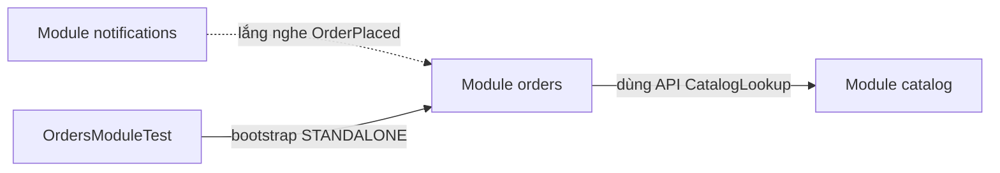

# Xử lý bean không thuộc module mục tiêu

## 1. Tình huống: test một module nhưng Spring báo thiếu bean ở module khác

Bạn viết `@ApplicationModuleTest` cho module `orders` và mong muốn kiểm chứng quy tắc đặt hàng. Tuy nhiên, `OrderService` cần một `CatalogLookup` do module `catalog` công bố. Khi Spring tạo `ApplicationContext`, test thất bại với lỗi tương tự:

```text
UnsatisfiedDependencyException:
  Error creating bean with name 'orderService' ...
  No qualifying bean of type
  'com.example.shop.catalog.CatalogLookup' available
```

Lỗi này là tín hiệu để **xác định nguồn gốc bean và mục tiêu kiểm thử**, chứ không tự động là lỗi của Spring Modulith hay bằng chứng kiến trúc sai. Trong `BootstrapMode.STANDALONE`, một module test chỉ chọn module nghiệp vụ mục tiêu; việc `catalog` có trên classpath hoặc `orders` được phép tham chiếu API của `catalog` không có nghĩa implementation thật của `catalog` được nạp.

Một câu hỏi ngược lại cũng quan trọng: nếu test đang `STANDALONE` nhưng vẫn thấy `DataSource`, `ObjectMapper`, một mock `CatalogLookup` hoặc bean từ `@Import`, liệu ranh giới module đã bị phá vỡ? **Không thể kết luận chỉ từ package của kiểu bean**. Cần phân loại bean và biết cơ chế nào đăng ký nó.

Bài học này thuộc chương **Bootstrap context** của học phần `SPRING_MODULITH_VERIFICATION_TESTING`. Mục tiêu là rèn kỹ năng thiết kế `@ApplicationModuleTest` theo đúng ranh giới, dùng `ApplicationModules.verify()` kiểm chứng quy tắc phụ thuộc, kiểm thử sự kiện/cơ sở dữ liệu/tích hợp và tổ chức quality gate CI để chặn vi phạm kiến trúc cùng hồi quy runtime.

### Sau bài học, bạn cần làm được

- Nhận diện **bean nghiệp vụ thuộc module khác**, **bean hạ tầng framework**, **bean do test bổ sung** và **bean bị import ngoài ý định**.
- Giải quyết bean thiếu bằng **mock, fake, test configuration** hoặc mở rộng `BootstrapMode` theo mục tiêu.
- Không nhầm bean hiện diện trong `ApplicationContext` với module được phép phụ thuộc về mặt kiến trúc.
- Đọc nguyên nhân gốc của lỗi context, tra bean theo type/name và xác minh nguồn đăng ký.
- Biết khi nào phải giữ adapter thật để kiểm thử database, event listener hoặc tích hợp.
- Phối hợp module test với `ApplicationModules.verify()` trong CI.

## 2. Phân loại “bean không thuộc module mục tiêu”

Nói “bean bên ngoài” mà không xác định *bên ngoài theo nghĩa nào* dễ dẫn đến xử lý sai.

| Nhóm | Ví dụ khi test `orders` | Nguồn đăng ký và cách hiểu |
| --- | --- | --- |
| **Bean nghiệp vụ của module phụ thuộc** | `DatabaseCatalogLookup` của `catalog` | Chỉ được nạp khi phạm vi bootstrap hoặc cấu hình bổ sung cho phép; `orders` có thể dùng API công khai của `catalog` nhưng không tự có implementation thật |
| **Bean nghiệp vụ của module không liên quan** | `NewsletterScheduler` của `marketing` | Không nên có mặt nếu bài test cô lập `orders`; cần kiểm tra cấu hình scan/import hoặc mode thực tế |
| **Bean hạ tầng Spring/Boot** | `ApplicationEventPublisher`, `Environment`, `DataSource`, `ObjectMapper` | Có thể do framework hoặc auto-configuration tạo; không nhất thiết thuộc application module nghiệp vụ |
| **Bean do test chủ động cung cấp** | `@MockitoBean CatalogLookup`, `@Bean Clock` từ `@TestConfiguration` | Thuộc `ApplicationContext` của test, nhưng không chứng minh module chứa kiểu dữ liệu/contract đã được bootstrap |
| **Bean có kiểu ngoài package đích nhưng do module đích sở hữu cấu hình** | `java.time.Clock` từ `orders.OrderConfiguration` | Nguồn đăng ký là cấu hình của `orders`, dù kiểu trả về thuộc thư viện Java |
| **Bean bị đưa vào ngoài ý định** | Service từ cấu hình `@Import` có `@ComponentScan` quá rộng | Có thể làm test nạp thêm dependency ngoài dự định, gây xung đột hoặc side effect |

Ví dụ, một `record OrderPlaced` là đối tượng sự kiện, **không tự trở thành Spring bean** chỉ vì record nằm trong package `orders`. Tương tự, một entity JPA không phải Spring singleton bean chỉ vì có `@Entity`.

**Quy tắc phân loại thực dụng:** hỏi “bean được **đăng ký bởi cơ chế nào**?” thay vì chỉ hỏi “class của bean nằm trong package nào?”.

## 3. Hiểu chiều phụ thuộc module trước khi xử lý context

Giả sử ứng dụng có cấu trúc:

```text
src/main/java/com/example/shop/
├── ShopApplication.java                 // @SpringBootApplication
├── orders/                              // module mục tiêu
│   ├── OrderService.java                // @Service
│   ├── OrderPlaced.java                 // record event
│   └── internal/
│       └── OrderPolicy.java             // @Component nội bộ
├── catalog/                             // module khác
│   ├── CatalogLookup.java               // API công khai
│   └── internal/
│       └── JpaCatalogLookup.java        // adapter thật
└── notifications/                       // module khác
    └── OrderPlacedListener.java         // nhận event

src/test/java/com/example/shop/orders/
└── OrdersModuleTest.java                // @ApplicationModuleTest
```

Với mô hình module mặc định thường gặp, các package con trực tiếp `orders`, `catalog`, `notifications` được nhận diện là những application module. Một cấu hình modulith tùy chỉnh có thể thay đổi cách nhận diện, nên cần dùng **mô hình module thực tế** khi đánh giá dự án.



Mũi tên `orders → catalog` thể hiện quan hệ phụ thuộc code từ module `orders` đến API của `catalog`. Nhưng **quan hệ thiết kế hợp lệ** và **sự có mặt của bean runtime** là hai điều khác nhau:

- `ApplicationModules.verify()` có thể xác nhận chiều phụ thuộc và ranh giới package được sử dụng hợp lệ.
- `@ApplicationModuleTest` ở `STANDALONE` vẫn có thể thất bại nếu `OrderService` cần một bean `CatalogLookup` mà context test chưa cung cấp.
- Việc `notifications` nhận event từ `orders` không tự động khiến `notifications` được nạp vào test `orders`; chiều phụ thuộc có thể ngược lại với điều bạn kỳ vọng.

Đừng sửa lỗi thiếu bean bằng cách cho `orders` gọi trực tiếp một implementation ở `catalog.internal`. Điều đó tạo phụ thuộc xuyên ranh giới đáng lẽ cần tránh, dù có thể khiến code được tạo bean trong một context nhất định.

## 4. Ví dụ xuyên suốt: service thật ở module đích

Module `catalog` công bố API:

```java
// src/main/java/com/example/shop/catalog/CatalogLookup.java
package com.example.shop.catalog;

public interface CatalogLookup {
    boolean contains(String sku);
}
```

Module `orders` sở hữu sự kiện:

```java
// src/main/java/com/example/shop/orders/OrderPlaced.java
package com.example.shop.orders;

public record OrderPlaced(String orderId, String sku) {
}
```

Và use case thực:

```java
// src/main/java/com/example/shop/orders/OrderService.java
package com.example.shop.orders;

import com.example.shop.catalog.CatalogLookup;
import org.springframework.context.ApplicationEventPublisher;
import org.springframework.stereotype.Service;

@Service
public class OrderService {

    private final CatalogLookup catalog;
    private final ApplicationEventPublisher events;

    public OrderService(
            CatalogLookup catalog,
            ApplicationEventPublisher events) {
        this.catalog = catalog;
        this.events = events;
    }

    public String placeOrder(String orderId, String sku) {
        if (!catalog.contains(sku)) {
            throw new IllegalArgumentException(
                "Unknown product: " + sku);
        }

        events.publishEvent(new OrderPlaced(orderId, sku));
        return "PLACED:" + orderId;
    }
}
```

Giả sử implementation thật `JpaCatalogLookup` của `catalog.internal` được đăng ký qua Spring và truy cập repository JPA. Khi test `orders` ở `STANDALONE`, Spring chọn `OrderService` vì service thuộc module mục tiêu, nhưng **không mặc nhiên chọn** `JpaCatalogLookup` vì nó thuộc module `catalog`.

Một lỗi `UnsatisfiedDependencyException` tại constructor `OrderService` cho biết hiện không có bean đáp ứng `CatalogLookup`. Nó chưa nói rằng:

- Mô hình phụ thuộc giữa `orders` và `catalog` sai.
- JPA của `catalog` bị hỏng.
- Phải chuyển ngay sang `ALL_DEPENDENCIES`.
- Có thể import tùy ý `catalog.internal.JpaCatalogLookup` từ bài test mà không cần xét tác động.

Trước khi chọn giải pháp, xác định **mức kiểm chứng mong muốn**: logic `orders`, contract của `catalog` hay tương tác thật giữa chúng.

## 5. Chiến lược A — Giữ `STANDALONE` và dùng mock ở ranh giới

Đối với test chỉ cần kiểm tra quy tắc đặt đơn khi catalog trả lời “có” hoặc “không”, mock thường là lựa chọn tối ưu.

Trong các phiên bản Spring Framework hỗ trợ `@MockitoBean` (từ 6.2), có thể viết:

```java
// src/test/java/com/example/shop/orders/OrdersModuleTest.java
package com.example.shop.orders;

import com.example.shop.catalog.CatalogLookup;
import org.junit.jupiter.api.Test;
import org.springframework.beans.factory.annotation.Autowired;
import org.springframework.modulith.test.ApplicationModuleTest;
import org.springframework.test.context.bean.override.mockito.MockitoBean;

import static org.assertj.core.api.Assertions.assertThat;
import static org.assertj.core.api.Assertions.assertThatThrownBy;
import static org.mockito.BDDMockito.given;
import static org.mockito.Mockito.verify;

@ApplicationModuleTest // STANDALONE
class OrdersModuleTest {

    @Autowired
    OrderService orders;

    @MockitoBean
    CatalogLookup catalog;

    @Test
    void acceptsKnownProduct() {
        given(catalog.contains("SKU-1")).willReturn(true);

        assertThat(orders.placeOrder("ORD-1", "SKU-1"))
            .isEqualTo("PLACED:ORD-1");

        verify(catalog).contains("SKU-1");
    }

    @Test
    void rejectsUnknownProduct() {
        given(catalog.contains("SKU-X")).willReturn(false);

        assertThatThrownBy(
            () -> orders.placeOrder("ORD-2", "SKU-X"))
            .isInstanceOf(IllegalArgumentException.class)
            .hasMessageContaining("SKU-X");
    }
}
```

### Ý nghĩa

1. `@ApplicationModuleTest` xác định `orders` là module mục tiêu.
2. `OrderService` là **bean production thật** được test khởi tạo.
3. `@MockitoBean` tạo hoặc thay một bean `CatalogLookup` trong test context theo cơ chế override của Spring Test.
4. Mockito chủ động cung cấp phản hồi cho API ngoài module.
5. Assertion kiểm chứng logic của `orders`; `verify(...)` xác nhận cách nó gọi contract.

Ở `STANDALONE`, implementation thật của `catalog` có thể chưa tồn tại trong context; mock lúc này là **bean mới** chứ không nhất thiết là sự thay thế một bean production đã được tạo.

Dự án dùng Spring Boot cũ hơn có thể sử dụng `@MockBean` từ `org.springframework.boot.test.mock.mockito.MockBean`. Annotation này bị đánh dấu deprecated từ Spring Boot 3.4 để chuyển sang cơ chế mock override của Spring Framework. Luôn chọn API tương thích với bộ phiên bản Spring Boot/Framework/Modulith của dự án; không dùng cả hai annotation cho cùng một collaborator một cách vô thức.

### Khi nào không nên mock?

Nếu mục tiêu là kiểm chứng truy vấn JPA của `catalog` hoặc cách `orders` giao tiếp với adapter thật, mock `CatalogLookup` sẽ bỏ qua toàn bộ đường chạy cần kiểm thử. Khi ấy nên thêm một bài tích hợp riêng, không biến mọi test logic thành integration test.

## 6. Chiến lược B — Cấp một fake bằng `@TestConfiguration`

Một fake thích hợp khi muốn mô phỏng contract bằng logic đơn giản, ổn định, không cần lập trình `given(...)` cho từng test.

Ví dụ cấu hình lồng tĩnh trong lớp module test:

```java
package com.example.shop.orders;

import com.example.shop.catalog.CatalogLookup;
import org.junit.jupiter.api.Test;
import org.springframework.beans.factory.annotation.Autowired;
import org.springframework.boot.test.context.TestConfiguration;
import org.springframework.context.annotation.Bean;
import org.springframework.modulith.test.ApplicationModuleTest;

import static org.assertj.core.api.Assertions.assertThat;
import static org.assertj.core.api.Assertions.assertThatThrownBy;

@ApplicationModuleTest
class OrdersWithFakeCatalogTest {

    @Autowired
    OrderService orders;

    @Test
    void acceptsCatalogItem() {
        assertThat(orders.placeOrder("ORD-3", "SKU-1"))
            .isEqualTo("PLACED:ORD-3");
    }

    @Test
    void rejectsOtherItem() {
        assertThatThrownBy(
            () -> orders.placeOrder("ORD-4", "SKU-9"))
            .isInstanceOf(IllegalArgumentException.class);
    }

    @TestConfiguration(proxyBeanMethods = false)
    static class CatalogFakeConfiguration {

        @Bean
        CatalogLookup catalogLookup() {
            return sku -> "SKU-1".equals(sku);
        }
    }
}
```

Spring Boot Test thường nhận diện cấu hình `static nested @TestConfiguration` và bổ sung các bean do nó tạo vào context của lớp test. `CatalogLookup` fake có thể là lambda, dù interface thuộc package `catalog`. **Nguồn đăng ký bean là cấu hình test**, không phải `JpaCatalogLookup` của module `catalog`.

Với fake dùng chung ở nhiều test class, có thể đặt top-level `@TestConfiguration` dưới `src/test/java/.../testsupport` và nhập tường minh:

```java
import com.example.shop.testsupport.CatalogFakeConfiguration;
import org.springframework.context.annotation.Import;
import org.springframework.modulith.test.ApplicationModuleTest;

@ApplicationModuleTest
@Import(CatalogFakeConfiguration.class)
class OrdersWithSharedFakeTest {
    // Test sử dụng fake từ cấu hình top-level được import.
}
```

Trong đoạn này, `CatalogFakeConfiguration` top-level là lớp giả định đã được tạo trong test source; các method test/bean thực tế cần được khai báo tương ứng. Khác với nested `@TestConfiguration`, cấu hình top-level không nên trông chờ được Spring Boot component scan tự động nhặt lên.

### Cẩn trọng với fake có trạng thái

Spring Test có thể cache `ApplicationContext` giữa các test có cấu hình tương thích. Singleton fake có danh sách mutable như `Set<String> availableSkus` có thể giữ dữ liệu từ bài trước, khiến test phụ thuộc thứ tự chạy. Nếu dùng fake có trạng thái:

- Reset trong `@BeforeEach` hoặc một setup cụ thể.
- Ưu tiên dữ liệu đầu vào bất biến cho những scenario nhỏ.
- Tránh chia sẻ fake mutable giữa nhiều test class.
- Không mặc định dùng `@DirtiesContext` cho mọi testcase chỉ vì chưa quản lý trạng thái fake.

## 7. Chiến lược C — Nạp module phụ thuộc thật bằng `BootstrapMode`

Nếu mục tiêu là kiểm thử wiring và hành vi giữa `orders` với `catalog` thật, mở rộng bootstrap mode có thể hợp lý hơn mock.

`@ApplicationModuleTest` hỗ trợ:

| Mode | Module nghiệp vụ khi test `orders` | Dùng khi |
| --- | --- | --- |
| `STANDALONE` | Chỉ `orders` | Kiểm thử hành vi module với dependency ngoài được mock/fake |
| `DIRECT_DEPENDENCIES` | `orders` và những module `orders` phụ thuộc trực tiếp | Kiểm thử cộng tác viên thật của module phụ thuộc gần nhất |
| `ALL_DEPENDENCIES` | `orders` và các module phụ thuộc trực tiếp/bắc cầu | Kiểm thử chuỗi phụ thuộc thật nhiều tầng có chủ đích |

Ví dụ:

```java
package com.example.shop.orders;

import org.junit.jupiter.api.Test;
import org.springframework.modulith.test.ApplicationModuleTest;
import org.springframework.modulith.test.ApplicationModuleTest.BootstrapMode;

@ApplicationModuleTest(
    mode = BootstrapMode.DIRECT_DEPENDENCIES)
class OrdersCatalogIntegrationTest {

    @Test
    void placesOrderUsingRealCatalogAdapter() {
        // Chuẩn bị dữ liệu cho catalog/repository thật.
        // Gọi OrderService và assert kết quả/tác động.
        // Đây mới là khung test: cần viết setup và assertion
        // theo entity/schema thực của dự án.
    }
}
```

Nếu `orders → catalog` là phụ thuộc **trực tiếp** được mô hình module nhận diện, `DIRECT_DEPENDENCIES` có thể chọn cả bean nghiệp vụ của `catalog`. Tuy vậy:

- `JpaCatalogLookup` thật có thể cần `DataSource`, entity, repository, migration và transaction phù hợp.
- Một module có thêm listener, scheduler hoặc client cần hạ tầng khác; bootstrap có thể kích hoạt những dependency ấy.
- Chế độ này không nạp các module chỉ **phụ thuộc ngược lại vào `orders`** (ví dụ một module `notifications` lắng nghe event) nếu chúng không thuộc tập dependency mà mode chọn.
- `ALL_DEPENDENCIES` không phải “nạp tất cả application module”. Nó chỉ mở rộng tập phụ thuộc theo đồ thị.

Không dùng chế độ rộng hơn như một cách mặc định để chữa mọi `UnsatisfiedDependencyException`. Context lớn hơn có thể làm test chậm, tạo side effect và khiến khó xác định module nào gây lỗi.

## 8. Chiến lược D — Thêm một bean hạ tầng cụ thể, không kéo cả module

Một số dependency không phải là service nghiệp vụ của module khác. Ví dụ `OrderService` cần `Clock` để sinh thời gian, hoặc cần một serializer do module `orders` sử dụng. Ta có thể cung cấp bean test đúng mục tiêu:

```java
package com.example.shop.orders;

import java.time.Clock;
import java.time.Instant;
import java.time.ZoneOffset;
import org.springframework.boot.test.context.TestConfiguration;
import org.springframework.context.annotation.Bean;

@TestConfiguration(proxyBeanMethods = false)
public class FixedClockConfiguration {

    @Bean
    Clock testClock() {
        return Clock.fixed(
            Instant.parse("2026-01-01T00:00:00Z"),
            ZoneOffset.UTC);
    }
}
```

Test muốn dùng top-level cấu hình này cần `@Import(FixedClockConfiguration.class)` hoặc cơ chế đăng ký tường minh phù hợp. Nếu production cũng tạo `Clock`, hai bean cùng type có thể khiến injection mơ hồ; cần kiểm tra bean name, `@Qualifier` hoặc cách thay thế có chủ đích.

Một bean framework như `ApplicationEventPublisher` hoặc transaction manager có thể do Spring cung cấp, không nhất thiết cần khai báo thủ công. Tránh mock/override các bean hạ tầng cốt lõi nếu bài test đang cần chính semantics của chúng, ví dụ transaction hoặc event publication.

## 9. Khi nào bean “ngoài module” là dấu hiệu phải điều tra?

Có hai hướng quan sát khác nhau:

### 9.1. Thiếu bean ngoài module

Ví dụ `orders` thiếu `CatalogLookup` trong `STANDALONE`. Hướng xử lý:

1. Xác nhận interface là API công khai của `catalog`, không phải class nội bộ bị dùng sai.
2. Xem mục tiêu test: logic `orders` hay adapter `catalog` thật?
3. Nếu chỉ cần logic `orders`: dùng mock/fake.
4. Nếu cần integration thật: mở rộng mode phù hợp, chuẩn bị hạ tầng và fixture.
5. Nếu bean thiếu là hạ tầng: xem auto-configuration, profile, property, `@Import` và các dependency tạo bean.

### 9.2. Có một bean ngoài module mà bạn không mong đợi

Ví dụ `STANDALONE` nhưng context chứa service `marketing.NewsletterScheduler`. Không nên mặc định đây là bug của `@ApplicationModuleTest`. Hãy kiểm tra:

- Có `@Import` một cấu hình production của `marketing` không?
- Một `@ComponentScan(basePackages = "com.example.shop")` tùy chỉnh có mở rộng đăng ký bean không?
- Class đó thực sự thuộc module nào trong mô hình Spring Modulith?
- Một `@TestConfiguration` có đăng ký bean kiểu đó không?
- Bean có phải proxy hạ tầng hoặc auto-configuration chứ không phải bean nghiệp vụ như tên gọi?
- Có dùng `DIRECT_DEPENDENCIES`/`ALL_DEPENDENCIES` khiến module đó được chọn theo đồ thị không?

Mục tiêu là truy nguyên **nguồn bean definition**, không xóa một bean chỉ vì class của nó ở package khác.

## 10. `@Import` không phải lựa chọn thay thế cho ranh giới module

Spring Framework cho phép `@Import` nhập một cấu hình hoặc class cụ thể vào context:

```java
import org.springframework.context.annotation.Import;
import org.springframework.modulith.test.ApplicationModuleTest;

@ApplicationModuleTest
@Import(CatalogTestConfiguration.class)
class OrdersImportTest {
    // CatalogTestConfiguration là cấu hình nhỏ
    // được tạo riêng cho kiểm thử.
}
```

Cách này phù hợp khi `CatalogTestConfiguration` là **test configuration nhỏ** tạo fake/stub hoặc bean hạ tầng cần thiết. Nhưng nếu import trực tiếp một production configuration quét toàn bộ package `catalog`, context có thể kéo thêm nhiều adapter, listener, repository, client và phụ thuộc bắc cầu. Khi ấy test `STANDALONE` không còn cô lập theo ý định ban đầu.

Hai cơ chế phải được hiểu độc lập:

- `BootstrapMode` quyết định **tập application module** được Spring Modulith chọn.
- `@Import` bổ sung **cấu hình/bean cụ thể** cho Spring `ApplicationContext`.

Một bean do `@Import` tạo có thể có kiểu thuộc module bên ngoài, **nhưng điều đó không thay đổi quy tắc phụ thuộc tĩnh của code production**. Việc test khởi động được cũng không chứng minh quyền truy cập vào package `catalog.internal` là hợp lệ.

## 11. Trùng bean và thay sai collaborator

Khi chuyển từ mock/fake sang module phụ thuộc thật, có thể xuất hiện hai bean đáp ứng `CatalogLookup`:

```text
catalogLookup             -> fake do @TestConfiguration tạo
jpaCatalogLookup          -> implementation thật của catalog
```

Nếu `OrderService` inject theo type mà không có cách phân giải rõ, context có thể báo `NoUniqueBeanDefinitionException`. Nếu hai bean bị đăng ký cùng một tên, Spring Boot có thể báo lỗi bean definition overriding.

Một số cơ chế liên quan:

| Cơ chế | Ý nghĩa | Không có tác dụng gì? |
| --- | --- | --- |
| `@Qualifier` | Chỉ định bean cần tiêm theo qualifier/tên phù hợp | Không tự làm bean xuất hiện |
| `@Primary` | Ưu tiên một bean trong các candidate tương thích | Không xóa bean khác hay sửa xung đột trùng tên definition |
| `@MockitoBean` | Tạo mock hoặc override bean theo cơ chế Spring Test | Không mở rộng `BootstrapMode` và không kiểm thử implementation thật |
| `@MockitoBean(enforceOverride = true)` | Yêu cầu phải có bean đích để thay trong phiên bản hỗ trợ | Không phù hợp nếu `STANDALONE` cố ý thiếu implementation ngoài module |
| `@TestConfiguration` | Tạo fake/bean bổ sung cho bài test | Không tự loại tất cả bean production cùng type |
| `@Profile`/`@ConditionalOnProperty` | Kiểm soát việc đăng ký bean qua điều kiện | Không biến một phụ thuộc kiến trúc sai thành hợp lệ |

Ví dụ chọn bean bằng tên mock khi cần:

```java
import com.example.shop.catalog.CatalogLookup;
import org.springframework.test.context.bean.override.mockito.MockitoBean;

// Đoạn khai báo đặt trong lớp test có bootstrap phù hợp.
@MockitoBean(name = "primaryCatalogLookup")
CatalogLookup primaryCatalogLookup;
```

Chỉ sử dụng khi `primaryCatalogLookup` là tên bean đúng theo cấu hình hoặc test mong muốn. Nếu ở `STANDALONE` không có bean production, khai báo mock theo tên có thể tạo bean mới với tên đó; nếu mục tiêu là **thay bean có sẵn**, dùng kiểm tra override bắt buộc khi hỗ trợ.

Không phối hợp mock và fake cho cùng một API chỉ để “chắc chắn không thiếu bean”. Như vậy sẽ khó biết assertion đang chạy với mock, fake hay implementation thật.

## 12. Quan sát bean nào thực sự có trong context

Khi nghi ngờ bean ngoài module bị nạp hoặc thiếu, có thể truy vấn `ApplicationContext`:

```java
package com.example.shop.orders;

import com.example.shop.catalog.CatalogLookup;
import org.junit.jupiter.api.Test;
import org.springframework.beans.factory.annotation.Autowired;
import org.springframework.context.ApplicationContext;
import org.springframework.modulith.test.ApplicationModuleTest;
import org.springframework.test.context.bean.override.mockito.MockitoBean;

import static org.assertj.core.api.Assertions.assertThat;
import static org.mockito.Mockito.mockingDetails;

@ApplicationModuleTest
class OrdersBeanDiagnosticsTest {

    @Autowired
    ApplicationContext context;

    @MockitoBean
    CatalogLookup catalog;

    @Test
    void identifiesTheTestDouble() {
        String[] names =
            context.getBeanNamesForType(CatalogLookup.class);

        assertThat(names).hasSize(1);
        assertThat(
            mockingDetails(context.getBean(CatalogLookup.class))
                .isMock())
            .isTrue();
    }
}
```

Bài này giả định không có cấu hình khác đăng ký thêm `CatalogLookup`. Nếu số bean khác kỳ vọng, in/kiểm tra danh sách tên bean có chọn lọc rồi tìm nguồn đăng ký tương ứng. Một `@MockitoBean` có thể được Spring Test đặt tên theo quy tắc override; đừng viết assertion dựa trên tên không được bảo đảm nếu test chỉ cần kiểm chứng kiểu/hành vi.

Có thể dùng `ConfigurableApplicationContext` và `BeanDefinition` để truy nguyên cấu hình:

```java
// Đoạn mã đặt trong phương thức test đã inject context.
ConfigurableApplicationContext configurable =
    (ConfigurableApplicationContext) context;

for (String name : context.getBeanNamesForType(CatalogLookup.class)) {
    var definition = configurable
        .getBeanFactory()
        .getBeanDefinition(name);

    System.out.println(
        name + " -> " + definition.getResourceDescription());
}
```

Ví dụ cần import `org.springframework.context.ConfigurableApplicationContext`. `getResourceDescription()` có thể không đầy đủ hoặc `null` với một số bean do proxy/registrar tạo; khi ấy cần thêm bean class, factory method, điều kiện và test configuration để xác định nguồn. Tránh log tràn lan trong CI, đặc biệt với thông tin cấu hình nhạy cảm.

### Diễn giải một context cho đúng

- Có `CatalogLookup` mock: chứng minh **test đã cung cấp một bean kiểu API**, chưa chứng minh `catalog` thật chạy.
- Có `DataSource`: có thể là hạ tầng được Boot auto-configure, chưa chứng minh mọi module dữ liệu đều được bootstrap.
- Không có `OrderPlacedListener` ở `notifications`: có thể đúng theo `STANDALONE`, chưa phải lỗi phát sự kiện của `orders`.
- Có `ObjectMapper`: bean phục vụ serialization/framework; không đồng nghĩa Spring đã nạp một module nghiệp vụ liên quan.
- Có bean `Clock` trả về từ `orders.OrderConfiguration`: class của bean ở `java.time` nhưng cấu hình sở hữu nằm trong module đích.

## 13. Phân biệt thiếu bean và lỗi khởi tạo bean

Hai lỗi hay bị trộn lẫn:

| Triệu chứng | Ý nghĩa thường gặp | Hướng điều tra |
| --- | --- | --- |
| `NoSuchBeanDefinitionException` cho `CatalogLookup` | Không có candidate bean phù hợp | Module scope, mock/fake, `@Import`, profile/condition |
| `UnsatisfiedDependencyException` tại `OrderService` | Dependency của bean được chọn chưa thỏa | Xem **nguyên nhân gốc** và dependency thiếu thực sự |
| `NoUniqueBeanDefinitionException` | Có nhiều bean phù hợp mà không chọn được | Fake vs production, qualifier, primary, mock override |
| `BeanCreationException` của `JpaCatalogLookup` | Bean được chọn nhưng thất bại khi tạo | DataSource, JPA, schema, property, client bên ngoài |
| `Failed to configure a DataSource` | Hạ tầng persistence thiếu cấu hình/driver/URL | Testcontainers, profile, auto-configuration, yêu cầu DB thật |
| Event phát ra nhưng listener không chạy | Listener không có mặt hoặc event/transaction setup khác kỳ vọng | Module của listener, registration, async/transaction |
| Bean ngoài module bất ngờ xuất hiện | Scan/import/mode/auto-configuration hoặc test config | Tra `BeanDefinition` và phạm vi thực tế |

Nếu context không khởi động, method `@Test` sẽ không được thực thi; không thể hy vọng thêm assertion sẽ chữa lỗi. Cần xử lý dependency/condition ngay giai đoạn bootstrap.

Một quy trình debug hiệu quả:

1. Đọc exception gốc ở cuối stack trace, không dừng ở câu `Failed to load ApplicationContext`.
2. Xác định bean đang được tạo và kiểu dependency bị thiếu/trùng.
3. Đối chiếu dependency đó với đồ thị module: thuộc `orders`, module phụ thuộc hay hạ tầng?
4. Đọc `BootstrapMode`, test annotation, active profiles, test property sources.
5. Kiểm tra `@Import`, nested `@TestConfiguration`, mock override và auto-configuration liên quan.
6. Chọn đúng giải pháp theo mục tiêu kiểm thử rồi thêm assertion để giữ lỗi không tái xuất hiện.

## 14. Bean ngoài module trong kiểm thử sự kiện

Giả sử `OrderService` ở phần 4 phát `OrderPlaced` khi catalog có sản phẩm. Module `notifications` có listener tạo email. Ta cần phân biệt:

**Bài module test `orders`:** kiểm chứng `OrderPlaced` được phát với đúng dữ liệu, có thể mock `CatalogLookup` để đi vào nhánh thành công.

```java
package com.example.shop.orders;

import com.example.shop.catalog.CatalogLookup;
import org.junit.jupiter.api.Test;
import org.springframework.beans.factory.annotation.Autowired;
import org.springframework.modulith.test.ApplicationModuleTest;
import org.springframework.modulith.test.PublishedEvents;
import org.springframework.test.context.bean.override.mockito.MockitoBean;

import static org.assertj.core.api.Assertions.assertThat;
import static org.mockito.BDDMockito.given;

@ApplicationModuleTest
class OrdersEventsTest {

    @Autowired
    OrderService orders;

    @MockitoBean
    CatalogLookup catalog;

    @Test
    void publishesOrderPlaced(PublishedEvents events) {
        given(catalog.contains("SKU-1")).willReturn(true);

        orders.placeOrder("ORD-5", "SKU-1");

        assertThat(events.ofType(OrderPlaced.class))
            .anySatisfy(event -> {
                assertThat(event.orderId()).isEqualTo("ORD-5");
                assertThat(event.sku()).isEqualTo("SKU-1");
            });
    }
}
```

`PublishedEvents` thuộc Spring Modulith Test giúp kiểm tra event đã được công bố trong bài test. **Điều này chưa chứng minh listener thật của `notifications` xử lý xong**: bean listener có thể không được bootstrap do nằm ngoài module mục tiêu, hoặc có thể có semantics giao dịch/bất đồng bộ riêng.

**Bài integration cho listener:** tạo test có `OrderPlacedListener` thật, cấu hình transaction/async phù hợp và một fake/mock cho *cổng gửi email bên ngoài* nếu không muốn gọi hệ thống email thật. Khi đó assertion nên kiểm tra listener đã tạo thông báo, cập nhật dữ liệu hoặc gọi port đúng, không chỉ kiểm tra event có mặt trong `PublishedEvents`.

**Không nên import toàn bộ `notifications` vào test `orders` chỉ để event test chạy xanh** nếu mục tiêu ban đầu chỉ là phát event. Đặt một bài riêng cho listener giúp lỗi dễ khoanh vùng hơn.

## 15. Bean ngoài module trong kiểm thử database và integration

Implementation thật `JpaCatalogLookup` của `catalog` có thể cần database. Có hai mục tiêu tách biệt:

| Mục tiêu | Bean nên dùng | Hạ tầng cần thiết |
| --- | --- | --- |
| Kiểm thử quy tắc “không bán sản phẩm lạ” của `orders` | `OrderService` thật + `CatalogLookup` mock/fake | Không cần database `catalog` nếu context module không có bean khác cần DB |
| Kiểm thử truy vấn danh mục sản phẩm | Repository/adapter `catalog` thật | Entity scan, repository, `DataSource`, migration/schema, fixture |
| Kiểm thử `orders` tương tác với `catalog` thật | `OrderService` và `JpaCatalogLookup` thật | Mode module phù hợp, dữ liệu nhất quán, transaction |
| Kiểm thử phát sự kiện từ `orders` | Service thật + mock collaborator ngoài module | `ApplicationEventPublisher` và `PublishedEvents` |
| Kiểm thử listener dùng repository/broker | Listener thật + adapter/hạ tầng phù hợp | Transaction, database/broker test, kiểm tra async và cleanup |

Để cung cấp database cho bài integration, có thể sử dụng Testcontainers. Ví dụ skeleton:

```java
package com.example.shop.orders;

import org.junit.jupiter.api.Test;
import org.springframework.modulith.test.ApplicationModuleTest;
import org.springframework.modulith.test.ApplicationModuleTest.BootstrapMode;
import org.springframework.test.context.DynamicPropertyRegistry;
import org.springframework.test.context.DynamicPropertySource;
import org.testcontainers.containers.PostgreSQLContainer;
import org.testcontainers.junit.jupiter.Container;
import org.testcontainers.junit.jupiter.Testcontainers;

@Testcontainers
@ApplicationModuleTest(
    mode = BootstrapMode.DIRECT_DEPENDENCIES)
class OrdersCatalogDatabaseIntegrationTest {

    @Container
    static PostgreSQLContainer<?> postgres =
        new PostgreSQLContainer<>("postgres:16-alpine");

    @DynamicPropertySource
    static void databaseProperties(DynamicPropertyRegistry registry) {
        registry.add("spring.datasource.url", postgres::getJdbcUrl);
        registry.add("spring.datasource.username", postgres::getUsername);
        registry.add("spring.datasource.password", postgres::getPassword);
    }

    @Test
    void verifiesRealCatalogCollaboration() {
        // Seed dữ liệu catalog bằng fixture/repository.
        // Gọi OrderService thật.
        // Assert kết quả và tác động persistence thực.
    }
}
```

Đây là **khung cấu hình**, chưa phải integration test đầy đủ vì data model, migration và assertion cụ thể tùy dự án. Nó đòi hỏi dependency Testcontainers/PostgreSQL và môi trường Docker phù hợp. `DIRECT_DEPENDENCIES` chỉ chọn module theo đồ thị; `@DynamicPropertySource` chỉ cung cấp property JDBC động; không cơ chế nào tự tạo schema hay dữ liệu.

Nếu chọn một mock `CatalogLookup` ở bài test trên thì test lại không chạy `JpaCatalogLookup` thật, làm mất mục tiêu integration. Vì vậy, hãy tách rõ module test với fake và bài integration với bean thật.

## 16. Kết hợp kiểm chứng runtime với `ApplicationModules.verify()`

Một `@ApplicationModuleTest` có mock có thể khởi động và chạy xanh dù code production của `orders` import lớp nội bộ `com.example.shop.catalog.internal.JpaCatalogLookup`, vi phạm ranh giới module. Ngược lại, `ApplicationModules.verify()` có thể xác nhận phụ thuộc kiến trúc hợp lệ nhưng không biết cấu hình database/test context bị thiếu.

Cần cả hai tầng:

```java
package com.example.shop;

import org.junit.jupiter.api.Test;
import org.springframework.modulith.core.ApplicationModules;

class ModuleArchitectureTest {

    @Test
    void enforcesModuleBoundaries() {
        ApplicationModules.of(ShopApplication.class).verify();
    }
}
```

| Phép kiểm chứng | Chứng minh | Không tự chứng minh |
| --- | --- | --- |
| `ApplicationModules.verify()` | Phụ thuộc code giữa các application module tuân thủ quy tắc kiến trúc được mô hình hóa | Bean khởi động được, datasource kết nối hoặc listener hoạt động |
| `@ApplicationModuleTest` + mock/fake | Module mục tiêu bootstrap với collaborator test; logic đúng theo assertion | Implementation thật của module khác hoạt động |
| `@ApplicationModuleTest` mở rộng/integration test | Wiring/logic qua những module thật đã được chọn, dữ liệu và event theo tình huống | Mọi ranh giới kiến trúc tĩnh đều hợp lệ |
| Kiểm tra `ApplicationContext`/`BeanDefinition` | Bean nào đang có, nguồn đăng ký có thể truy vết | Chất lượng nghiệp vụ hoặc tính hợp lệ của mọi quan hệ module |

Giữ test kiến trúc độc lập với việc bootstrap database/broker giúp chất lượng CI dễ hiểu hơn: khi lỗi thuộc **quan hệ code**, sửa import/ranh giới; khi lỗi thuộc **Spring context**, sửa cấu hình bean; khi lỗi thuộc **tích hợp**, sửa hạ tầng/fixture và điều kiện thực thi.

## 17. Quality gate CI: không để bean ngoài che lỗi

Một chiến lược CI có thể tổ chức như sau:

1. **Architecture gate:** chạy `ApplicationModules.of(ShopApplication.class).verify()` để phát hiện phụ thuộc sai chiều hoặc vào package internal. Test này không cần Spring Boot context đầy đủ.
2. **Module behavior tests:** chạy `@ApplicationModuleTest` ở `STANDALONE` cho các use case quan trọng; cung cấp fake/mock cho các API ngoài module, giữ service nghiệp vụ thật.
3. **Module integration tests:** chọn `DIRECT_DEPENDENCIES`/`ALL_DEPENDENCIES` chỉ khi cần xác minh wiring/hợp tác thật và chuẩn bị hạ tầng thích hợp.
4. **Event & data tests:** xác minh event đã phát, listener thật, repository/transaction và messaging theo những trách nhiệm cụ thể; đừng dùng một test duy nhất để tuyên bố tất cả đều đúng.
5. **Configuration regression checks:** giữ assertion rõ bean/test-double nào phải có trong những context quan trọng; phát hiện việc một `@Import` hoặc profile mới vô tình kéo service production ngoài phạm vi.
6. **Môi trường tái lập:** dùng test profile, test containers, dữ liệu fixture cô lập; giới hạn timeout của xử lý bất đồng bộ, tránh gọi production external services.

Một thay đổi khiến test chuyển từ mock `CatalogLookup` sang adapter thật có thể là quyết định đúng **nếu chủ đích của test thay đổi**. Nhưng nếu điều đó xảy ra ngoài ý định do cấu hình scan/import, cần coi là dấu hiệu regression về phạm vi kiểm thử.

### Tiêu chí review trước khi merge

- [ ] Đã mô tả rõ **module mục tiêu** và `BootstrapMode` của lớp test.
- [ ] Đã phân loại mọi collaborator ngoài module được service cần tới.
- [ ] Mock/fake chỉ thay **ranh giới ngoài mục tiêu**, không thay logic chính cần kiểm thử.
- [ ] Các bean thật ngoài module được nạp **có chủ đích**; không import một cấu hình quét toàn ứng dụng để né lỗi.
- [ ] Assertion kiểm tra kết quả nghiệp vụ, event hoặc dữ liệu thật theo mục tiêu.
- [ ] Bean hạ tầng được tạo bởi profile/auto-configuration phù hợp, không gọi dịch vụ production.
- [ ] `ApplicationModules.verify()` chạy cùng module/integration test trong CI.

## 18. Bài tập tự kiểm tra

Xét ứng dụng `shop` ở phần 3: `orders` dùng `CatalogLookup` do `catalog` công bố, `catalog` có implementation JPA, còn `notifications` lắng nghe `OrderPlaced`.

1. Vì sao `@ApplicationModuleTest` ở `STANDALONE` có thể báo thiếu `CatalogLookup` dù class `JpaCatalogLookup` có trên classpath?
2. Nếu tạo bean `CatalogLookup` bằng `@MockitoBean`, có kết luận `catalog` thật đã được bootstrap không?
3. Nếu cần kiểm thử **SQL JPA của `catalog`**, nên chọn mock hay bean thật? Cần chuẩn bị thêm những gì?
4. Khi cần một fake dùng chung, vì sao `@Import` một top-level `@TestConfiguration` rõ ràng hơn việc import production configuration có `@ComponentScan` rộng?
5. Có hai bean `CatalogLookup` trong context; vì sao chỉ thêm `@Primary` không giải quyết được mọi xung đột?
6. `DataSource` có mặt trong test `orders` chứng minh điều gì, và **không** chứng minh điều gì?
7. Một sự kiện `OrderPlaced` được `PublishedEvents` ghi nhận có đồng nghĩa email đã được `notifications` gửi không?
8. Vì sao `ALL_DEPENDENCIES` không đồng nghĩa bootstrap **mọi** module của ứng dụng?
9. Nếu `orders` trực tiếp tham chiếu `catalog.internal.JpaCatalogLookup` và module test vẫn xanh nhờ mock, phép kiểm tra nào cần phát hiện lỗi?
10. Khi `Failed to load ApplicationContext` xuất hiện, ba câu hỏi đầu tiên nên là gì?

**Đáp án gợi ý:** (1) `STANDALONE` không tự nạp implementation nghiệp vụ của module khác; (2) không, đó là test bean có thể được tạo mới; (3) dùng adapter/repository thật với database/schema/transaction/fixture phù hợp; (4) cấu hình test nhỏ, tường minh, không kéo cả module/adapter ngoài ý định; (5) `@Primary` chỉ ưu tiên theo kiểu, không xóa bean và không xử lý trùng tên definition; (6) có bean hạ tầng, không chứng minh `catalog` đã bootstrap; (7) không, phải kiểm tra listener thật riêng; (8) chỉ nạp các dependency module trực tiếp/bắc cầu; (9) `ApplicationModules.verify()`; (10) module/`BootstrapMode` nào đang chạy, bean nào thiếu hoặc lỗi tạo, và bean ấy thuộc module nào/cơ chế đăng ký nào.

**Ghi nhớ:** khi phát hiện **bean không thuộc module mục tiêu**, đừng tự động xóa hoặc nạp nó. Hãy phân loại nguồn gốc bean, xác định mục tiêu test, chọn **mock/fake, bean hạ tầng cụ thể hoặc module phụ thuộc thật** theo đúng mức kiểm chứng. Cuối cùng, dùng `ApplicationModules.verify()` bảo vệ quy tắc kiến trúc song song với `@ApplicationModuleTest` và integration test trong quality gate CI.
