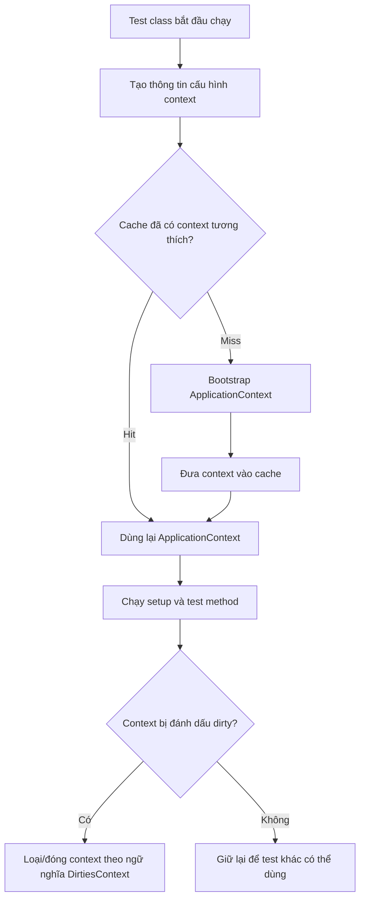

# Context cache giữa các module test

## 1. Tại sao hai bài module test có thể dùng chung `ApplicationContext`?

Trong Spring Modulith, một bài `@ApplicationModuleTest` thường cần khởi động Spring Boot `ApplicationContext`: tìm cấu hình ứng dụng, xác định phạm vi application module, đăng ký bean, thực hiện dependency injection và khởi tạo những thành phần hạ tầng cần thiết. Các bước này tốn thời gian, nhất là khi module dùng JPA, transaction, listener hoặc adapter tích hợp.

**Spring TestContext Framework có cơ chế cache `ApplicationContext`.** Nếu một test sau yêu cầu cấu hình context tương đương với context đã có, framework có thể tái sử dụng context ấy thay vì khởi động lại. Cơ chế này giúp một tập module test chạy nhanh hơn, nhưng cũng kéo theo các rủi ro như state rò giữa test, kết nối tới container đã dừng, hoặc một thay đổi annotation khiến cache bị phân mảnh.

Cần hiểu đúng hai điểm từ đầu:

- **Tái sử dụng context không có nghĩa tái sử dụng kết quả test.** Mỗi phương thức test vẫn cần chuẩn bị đầu vào và kiểm chứng đầu ra của chính nó.
- **Tái sử dụng context không làm hai application module trở thành một module.** Spring Modulith vẫn xác định phạm vi bootstrap của từng lớp test theo `@ApplicationModuleTest` và `BootstrapMode`; cache chỉ tối ưu hóa việc tạo một context đã có cấu hình tương thích.

Chủ đề này nằm trong chương **Bootstrap context** của học phần `SPRING_MODULITH_VERIFICATION_TESTING`. Ta dùng kiến thức về cache để thực hành module test đáng tin cậy, giữ quy tắc phụ thuộc được kiểm tra bằng `ApplicationModules`, tránh lỗi hồi quy về event/database/integration và thiết kế quality gate CI vừa nhanh vừa có tính tái lập.

## 2. Vòng đời cache trong Spring TestContext

Ở mức khái niệm, Spring TestContext làm việc như sau:



Cache mặc định của Spring TestContext được duy trì trong bộ nhớ **tĩnh của JVM đang chạy test**, không phải là database hay tệp cache giữa các lần CI. Trong cùng một JVM và cùng cơ chế TestContext, nhiều test class có thể chia sẻ context nếu thông tin cấu hình khớp.

Hệ quả thực tế:

1. Hai test class có cùng cấu hình **có thể** nhận lại một context đã bootstrap.
2. Hai test class ở hai module khác nhau **không nên được kỳ vọng** chia sẻ context nếu phạm vi module/điều kiện bootstrap khác nhau.
3. Một context có thể bị loại khỏi cache khi có `@DirtiesContext` hoặc cache hết chỗ.
4. Các JVM test fork khác nhau không dùng chung cache tĩnh trong bộ nhớ.
5. Khởi động một lần không có nghĩa bean singleton được làm mới trước mỗi method test.

Cache không có mục đích “ghi nhớ dữ liệu nghiệp vụ” hay “bỏ qua” những test trùng nhau. Nó chỉ tái sử dụng các đối tượng hạ tầng của context khi Spring đánh giá rằng cấu hình phù hợp.

## 3. Cache key dựa trên điều gì?

Spring TestContext dùng thông tin của `MergedContextConfiguration` để xác định ngữ cảnh có tương thích hay không. Những thành phần quan trọng thường bao gồm:

| Thành phần của cấu hình | Ví dụ | Tác động có thể có |
| --- | --- | --- |
| Lớp hoặc resource cấu hình | `@ContextConfiguration(classes = ...)` | Khác nguồn cấu hình có thể tạo cache key khác |
| Context loader và initializer | `@ContextConfiguration(initializers = ...)` | Thay đổi cách dựng context |
| Active profiles | `@ActiveProfiles("module-test")` | Profile khác thường không chia sẻ cache key |
| Property source và property inline | `@TestPropertySource(...)` | Khác location hoặc giá trị property tạo cấu hình khác |
| Context customizers | Mockito bean override, `@DynamicPropertySource`, Boot test customizers | Khác mock/override hoặc nguồn dynamic property có thể đổi key |
| Parent context | Khi sử dụng context hierarchy | Cấu trúc parent khác ảnh hưởng cache |
| Web resource base path | Khi dùng `@WebAppConfiguration` | Khác base path có thể đổi key |

**Bản thân tên lớp test không phải quy tắc tổng quát “mỗi class một context”.** Hai lớp khác nhau vẫn có thể dùng chung context nếu toàn bộ cấu hình liên quan tương thích. Ngược lại, hai lớp trong cùng package có thể tạo hai context do khác profile, mock, property hay mode.

Các yếu tố như thứ tự test chạy, cache eviction hoặc số JVM fork còn quyết định liệu một cache key khớp có thực sự dẫn đến cache hit hay không. Vì vậy, nói “cùng annotation là chắc chắn dùng chung” thường quá đơn giản.

### Riêng với `@ApplicationModuleTest`

Spring Modulith Test dựa trên Spring Boot test infrastructure và bổ sung cơ chế chọn application module. **Phạm vi module được chọn phải được giữ đúng trong cấu hình context của test**. Khi test ở `orders` và test ở `inventory` bootstrap các module khác nhau, không được giả định chúng sẽ chia sẻ cùng tập bean chỉ vì đều có `@ApplicationModuleTest`.

Nếu hai lớp test cùng nằm trong `orders`, dùng cùng mode và tương đương về profile, bean override, test configuration và các yếu tố còn lại, chúng là **ứng viên tái sử dụng context**. Cách chắc chắn để biết tại môi trường của dự án là bật thống kê cache hoặc kiểm tra log khởi động, thay vì suy luận chỉ từ annotation.

## 4. Bảng tình huống: test nào có thể dùng chung?

Giả sử hai bài test đều đặt dưới package `com.example.shop.orders`:

| Test A | Test B | Kỳ vọng hợp lý |
| --- | --- | --- |
| Cùng `STANDALONE`, profile, mock và property | Cấu hình tương đương | **Có thể tái sử dụng** context |
| `STANDALONE` | `DIRECT_DEPENDENCIES` | Phạm vi module khác; **không nên kỳ vọng** cùng context |
| `@ActiveProfiles("module-test")` | `@ActiveProfiles("integration-test")` | Active profile khác, thường là cache key khác |
| `@TestPropertySource(properties = "x=1")` | `@TestPropertySource(properties = "x=2")` | Property test khác tạo cấu hình khác |
| Mock `CatalogLookup` | Mock `CatalogLookup` và `PaymentGateway` | Tập bean override khác, thường context khác |
| Cùng `@TestConfiguration` | Một test import thêm cấu hình | Cấu hình được nhập khác, có thể tạo context khác |
| Không có `@DirtiesContext` | Test trước đánh dấu dirty | Context bị loại, test sau cần bootstrap lại |
| Chạy trong một JVM test | Chạy ở JVM fork khác | Không chia sẻ cache tĩnh |

Bảng mô tả nguyên tắc hoạt động, không phải cam kết về số cache hit. Một test có thể miss dù key giống nhau nếu context đã bị eviction hoặc một class trước đánh dấu dirty.

## 5. Ví dụ ứng dụng: `orders` dùng API ngoài module

Giả sử package gốc và module như sau:

```text
src/main/java/com/example/shop/
├── ShopApplication.java                 // @SpringBootApplication
├── orders/
│   ├── CheckoutService.java             // @Service
│   └── CheckoutCompleted.java            // record event
├── catalog/
│   ├── CatalogLookup.java               // API công khai
│   └── internal/
│       └── DatabaseCatalogLookup.java   // adapter thật
└── notifications/
    └── CheckoutListener.java

src/test/java/com/example/shop/orders/
├── CheckoutRulesTest.java
└── CheckoutEventsTest.java
```

Với cấu trúc module phổ biến, `orders`, `catalog` và `notifications` là các application module. Trong bài `@ApplicationModuleTest` ở `STANDALONE`, bean nghiệp vụ của `orders` được chọn; bean implementation của `catalog` không tự động được nạp. Để test logic `orders`, ta cung cấp một mock `CatalogLookup` giống nhau ở hai lớp test.

API thuộc module `catalog`:

```java
// src/main/java/com/example/shop/catalog/CatalogLookup.java
package com.example.shop.catalog;

public interface CatalogLookup {
    boolean exists(String sku);
}
```

Sự kiện thuộc module `orders`:

```java
// src/main/java/com/example/shop/orders/CheckoutCompleted.java
package com.example.shop.orders;

public record CheckoutCompleted(
    String orderId, String sku) {
}
```

Service thật trong `orders`:

```java
// src/main/java/com/example/shop/orders/CheckoutService.java
package com.example.shop.orders;

import com.example.shop.catalog.CatalogLookup;
import org.springframework.context.ApplicationEventPublisher;
import org.springframework.stereotype.Service;

@Service
public class CheckoutService {

    private final CatalogLookup catalog;
    private final ApplicationEventPublisher events;

    public CheckoutService(
            CatalogLookup catalog,
            ApplicationEventPublisher events) {
        this.catalog = catalog;
        this.events = events;
    }

    public String checkout(String orderId, String sku) {
        if (!catalog.exists(sku)) {
            throw new IllegalArgumentException(
                "Unknown SKU: " + sku);
        }

        events.publishEvent(
            new CheckoutCompleted(orderId, sku));

        return "ACCEPTED:" + orderId;
    }
}
```

`CheckoutService` không tự ghi database trong ví dụ. Khi cần kiểm chứng JPA, ta sẽ thêm bài test tích hợp riêng thay vì biến test logic này thành một test có persistence không cần thiết.

## 6. Hai lớp test tương thích có thể tái sử dụng context

### 6.1. Test thứ nhất: quy tắc đặt hàng

Ví dụ sau dùng `@MockitoBean` có trong Spring Framework 6.2+:

```java
// src/test/java/com/example/shop/orders/CheckoutRulesTest.java
package com.example.shop.orders;

import com.example.shop.catalog.CatalogLookup;
import org.junit.jupiter.api.Test;
import org.springframework.beans.factory.annotation.Autowired;
import org.springframework.modulith.test.ApplicationModuleTest;
import org.springframework.test.context.ActiveProfiles;
import org.springframework.test.context.TestPropertySource;
import org.springframework.test.context.bean.override.mockito.MockitoBean;

import static org.assertj.core.api.Assertions.assertThat;
import static org.assertj.core.api.Assertions.assertThatThrownBy;
import static org.mockito.BDDMockito.given;

@ApplicationModuleTest
@ActiveProfiles("module-test")
@TestPropertySource(properties = "orders.testing.mode=isolated")
class CheckoutRulesTest {

    @Autowired
    CheckoutService checkout;

    @MockitoBean(name = "catalogLookup")
    CatalogLookup catalogLookup;

    @Test
    void acceptsKnownSku() {
        given(catalogLookup.exists("SKU-1"))
            .willReturn(true);

        assertThat(checkout.checkout("ORD-1", "SKU-1"))
            .isEqualTo("ACCEPTED:ORD-1");
    }

    @Test
    void rejectsUnknownSku() {
        given(catalogLookup.exists("SKU-X"))
            .willReturn(false);

        assertThatThrownBy(() ->
            checkout.checkout("ORD-2", "SKU-X"))
            .isInstanceOf(IllegalArgumentException.class);
    }
}
```

### 6.2. Test thứ hai: sự kiện được phát

```java
// src/test/java/com/example/shop/orders/CheckoutEventsTest.java
package com.example.shop.orders;

import com.example.shop.catalog.CatalogLookup;
import org.junit.jupiter.api.Test;
import org.springframework.beans.factory.annotation.Autowired;
import org.springframework.modulith.test.ApplicationModuleTest;
import org.springframework.modulith.test.PublishedEvents;
import org.springframework.test.context.ActiveProfiles;
import org.springframework.test.context.TestPropertySource;
import org.springframework.test.context.bean.override.mockito.MockitoBean;

import static org.assertj.core.api.Assertions.assertThat;
import static org.mockito.BDDMockito.given;

@ApplicationModuleTest
@ActiveProfiles("module-test")
@TestPropertySource(properties = "orders.testing.mode=isolated")
class CheckoutEventsTest {

    @Autowired
    CheckoutService checkout;

    @MockitoBean(name = "catalogLookup")
    CatalogLookup catalogLookup;

    @Test
    void publishesEvent(PublishedEvents publishedEvents) {
        given(catalogLookup.exists("SKU-7"))
            .willReturn(true);

        checkout.checkout("ORD-7", "SKU-7");

        assertThat(publishedEvents.ofType(CheckoutCompleted.class))
            .anySatisfy(event -> {
                assertThat(event.orderId()).isEqualTo("ORD-7");
                assertThat(event.sku()).isEqualTo("SKU-7");
            });
    }
}
```

Cả hai test:

- Cùng module mục tiêu `orders` và mode mặc định `STANDALONE`.
- Cùng active profile `module-test`.
- Cùng một giá trị property inline `orders.testing.mode=isolated`.
- Cùng khai báo một Mockito bean theo tên `catalogLookup` và kiểu `CatalogLookup`.
- Không bổ sung test configuration riêng ở các ví dụ trên.

Do đó chúng là những **ứng viên hợp lý để Spring TestContext tái sử dụng context**, nếu các yếu tố cấu hình khác cũng tương đương và context còn trong cache. Tuy nhiên, test thứ hai vẫn có phiên quan sát event riêng cho test; không được suy rằng danh sách event của test thứ nhất được truyền nguyên vẹn sang test thứ hai.

**Lưu ý phiên bản:** ở dự án Spring Boot cũ hơn có thể cần `@MockBean` thay cho `@MockitoBean`. Hai cơ chế có thể có ảnh hưởng khác nhau lên context customizers/cache key; chọn đồng nhất với stack của dự án.

## 7. Cùng context có nghĩa mock dùng chung và giữ stubbing cũ không?

Mock được đăng ký dưới dạng Spring bean và vì vậy nằm trong context được cache. Nhưng các tích hợp Mockito của Spring Test thường quản lý việc **reset mock giữa các phương thức test** theo chính sách reset mặc định.

Vì vậy không viết test dựa trên việc `given(...)` ở bài trước sẽ còn hiệu lực. Mỗi test phải khai báo chính những stub cần dùng:

```java
@Test
void explicitBehaviorForThisScenario() {
    given(catalogLookup.exists("SKU-9"))
        .willReturn(true);

    assertThat(checkout.checkout("ORD-9", "SKU-9"))
        .isEqualTo("ACCEPTED:ORD-9");
}
```

Đây là đoạn code đặt **trong lớp test** có các trường `checkout` và `catalogLookup` đã inject, không phải class Java độc lập.

Cần phân biệt ba thứ:

1. **Spring bean instance:** `CheckoutService` singleton có thể tồn tại qua nhiều method test nếu context được cache.
2. **Mockito stubbing/invocations:** thường được reset theo listener của framework; có thể cấu hình khác, nên tránh giả định tùy tiện.
3. **Dữ liệu mutable của bean thật:** bộ đếm, cache nội bộ, queue in-memory, fake stateful **không tự được reset** chỉ vì test method mới bắt đầu.

Nếu bạn chủ động thay đổi chế độ reset mock, hãy biết rằng còn có thể dẫn đến state/tương tác từ test trước ảnh hưởng tới test sau. Với test tích hợp có xử lý async, lời gọi muộn từ thread khác cũng có thể tương tác với mock sau thời điểm bạn nghĩ test đã hoàn tất.

## 8. Những annotation khiến context cache bị phân mảnh

Khi hai lớp test tưởng giống nhau mà vẫn khởi động context nhiều lần, hãy so sánh từng thành phần cấu hình.

### 8.1. `@ActiveProfiles`

```java
@ApplicationModuleTest
@ActiveProfiles("module-test")
class OrdersWithModuleProfile {
}

@ApplicationModuleTest
@ActiveProfiles("database-test")
class OrdersWithDatabaseProfile {
}
```

Hai lớp có active profile khác nhau, nên Spring TestContext thường sử dụng cache key khác nhau. Ngoài tác động cache, profile cũng có thể làm bean `@Profile` hoặc cấu hình dữ liệu khác được bật, tức là **runtime context thật sự khác**.

### 8.2. `@TestPropertySource`

```java
@ApplicationModuleTest
@TestPropertySource(properties =
    "orders.max-items=3")
class OrdersLimitThreeTest {
}

@ApplicationModuleTest
@TestPropertySource(properties =
    "orders.max-items=5")
class OrdersLimitFiveTest {
}
```

Giá trị property khác làm cấu hình context khác. Không nên “chuẩn hóa” hai test này về cùng một property chỉ để tăng cache hit nếu mục tiêu là kiểm chứng hai chế độ cấu hình thực sự khác nhau.

Với `@TestPropertySource(locations = ...)`, đường dẫn resource và cấu hình property source cũng góp phần xác định context. Khi thay đổi file bên ngoài trong lúc test suite đang chạy, cache không có nghĩa vụ tự kiểm tra lại mọi giá trị để tạo context mới.

### 8.3. `@MockitoBean` và `@Import`

```java
@ApplicationModuleTest
class OrdersCatalogMockTest {
    @MockitoBean
    CatalogLookup catalogLookup;
}

@ApplicationModuleTest
class OrdersCatalogAndPaymentMockTest {
    @MockitoBean
    CatalogLookup catalogLookup;

    @MockitoBean
    PaymentGateway paymentGateway;
}
```

Đoạn trên minh họa **tập bean override khác nhau**; các class `CatalogLookup` và `PaymentGateway` là API giả định đã có trong ứng dụng. Các class chỉ mô tả cấu hình, chưa có phương thức `@Test`.

Spring TestContext xét context customizers liên quan bean override, nên không nên kỳ vọng hai cấu hình trên dùng chung một context. Với `@MockitoBean`, cả **tên trường được dùng làm qualifier fallback** cũng có thể ảnh hưởng tới định danh bean và cache key. Nên dùng tên field/qualifier nhất quán khi có chủ ý tạo cấu hình tương đương, nhưng không đổi tên biến chỉ vì tối ưu hóa nếu nó làm ý nghĩa dependency kém rõ.

Tương tự, một lớp có `@Import(FixedClockTestConfiguration.class)` và lớp không import cấu hình đó có thể có context khác; `@TestConfiguration` bổ sung cũng là một phần quyết định bootstrap.

## 9. `@DynamicPropertySource`: điểm dễ hiểu nhầm về cache key

Những bài tích hợp sử dụng Testcontainers thường cần JDBC URL hoặc broker address được cấp động:

```java
import org.springframework.test.context.DynamicPropertyRegistry;
import org.springframework.test.context.DynamicPropertySource;

class DatabaseTestSupport {

    @DynamicPropertySource
    static void registerProperties(
            DynamicPropertyRegistry registry) {

        registry.add("spring.datasource.url",
            SharedDatabase::jdbcUrl);
    }
}
```

`SharedDatabase` là helper giả định có phương thức tĩnh `jdbcUrl()` để minh họa supplier; đoạn code chưa tạo container hay thực hiện truy cập database.

**Điểm quan trọng:** `@DynamicPropertySource` tham gia vào context customization/cache key thông qua cấu hình phương thức dynamic property. Không nên giả định rằng **mỗi giá trị URL mới trả về từ supplier** sẽ tự động tạo một cache key mới. Nếu các lớp test dùng cùng phương thức được kế thừa nhưng trỏ đến những resource động khác nhau, Spring Test có thể tái sử dụng context với bean đã được khởi tạo từ giá trị cũ.

Ví dụ nguy cơ:

1. Test A đăng ký JDBC URL từ container A và khởi tạo `DataSource`.
2. Container A dừng sau khi lớp test kết thúc.
3. Test B dùng cấu hình test tương đương và có thể nhận lại cached context.
4. `DataSource` vẫn mang kết nối/URL của container A; test B gặp lỗi dù container B đang chạy.

Đừng khẳng định mọi test dùng container class-scoped đều gặp lỗi này: key thực tế còn phụ thuộc `@DynamicPropertySource`, `@ServiceConnection`, lớp cấu hình, annotation, lifecycle và framework. Nhưng **tuổi thọ của hạ tầng phải tương thích với tuổi thọ của cached context** là nguyên tắc đúng để thiết kế integration test.

## 10. Testcontainers và cache: chọn lifecycle ổn định

Có hai hướng thiết kế thường dùng:

| Chiến lược | Ý tưởng | Cần chú ý |
| --- | --- | --- |
| Container chia sẻ ổn định trong phạm vi test JVM/suite | Cung cấp một endpoint không đổi cho nhiều context/test class | Lifecycle container phải sống ít nhất lâu bằng các context dùng nó; reset dữ liệu giữa test |
| Container riêng cho một test class/nhóm test | Độc lập hạ tầng tốt hơn | Tránh tái sử dụng context có endpoint đã dừng; dùng cấu hình/key khác hoặc `@DirtiesContext` có chọn lọc |

Ví dụ **một** bài test có PostgreSQL container do JUnit/Testcontainers quản lý:

```java
package com.example.shop.orders;

import org.junit.jupiter.api.Test;
import org.springframework.modulith.test.ApplicationModuleTest;
import org.springframework.test.context.DynamicPropertyRegistry;
import org.springframework.test.context.DynamicPropertySource;
import org.testcontainers.containers.PostgreSQLContainer;
import org.testcontainers.junit.jupiter.Container;
import org.testcontainers.junit.jupiter.Testcontainers;

@Testcontainers
@ApplicationModuleTest
class OrdersDatabaseTest {

    @Container
    static PostgreSQLContainer<?> postgres =
        new PostgreSQLContainer<>("postgres:16-alpine");

    @DynamicPropertySource
    static void datasource(DynamicPropertyRegistry registry) {
        registry.add("spring.datasource.url",
            postgres::getJdbcUrl);
        registry.add("spring.datasource.username",
            postgres::getUsername);
        registry.add("spring.datasource.password",
            postgres::getPassword);
    }

    @Test
    void executesRepositoryAssertions() {
        // Chuẩn bị fixture và gọi repository thật.
        // Assert dữ liệu và transaction theo model ứng dụng.
    }
}
```

Đây là **khung kiểm thử**: để chạy thật cần JPA/repository/entity, migration, dependency Testcontainers và môi trường container phù hợp. Mục đích của ví dụ là thể hiện cách gắn dynamic properties vào `Environment`.

Vì container `@Container static` ở đây có vòng đời do JUnit extension quản lý theo lớp test, không được tùy tiện sao chép cùng cached context sang nhiều lớp rồi kỳ vọng container vẫn sống sau khi lớp sở hữu nó kết thúc. Với suite lớn, hãy chọn chiến lược container lifecycle và cách chia cache rõ ràng.

Nếu các lớp con kế thừa cùng một `@DynamicPropertySource` từ base class nhưng **dynamic properties thay đổi giữa các lớp con**, hướng dẫn Spring Test thường khuyến nghị dùng `@DirtiesContext` ở lớp nền khi cần để bảo đảm mỗi lớp con nhận cấu hình mới. Tuy nhiên, cách này có chi phí bootstrap; tốt hơn là làm các nhóm test có cấu hình endpoint tương đương dùng cùng resource ổn định khi điều đó không làm suy yếu tính cô lập.

## 11. State rò giữa các test: vấn đề lớn hơn hiệu năng

Spring cache `ApplicationContext`, nên những bean singleton của context đó cũng có thể được giữ lại. Giả sử test dùng một fake catalog chứa dữ liệu mutable:

```java
package com.example.shop.orders;

import com.example.shop.catalog.CatalogLookup;
import java.util.Set;
import java.util.concurrent.ConcurrentHashMap;
import org.junit.jupiter.api.BeforeEach;
import org.junit.jupiter.api.Test;
import org.springframework.beans.factory.annotation.Autowired;
import org.springframework.boot.test.context.TestConfiguration;
import org.springframework.context.annotation.Bean;
import org.springframework.modulith.test.ApplicationModuleTest;

import static org.assertj.core.api.Assertions.assertThat;

@ApplicationModuleTest
class OrdersWithMutableFakeTest {

    @Autowired
    CheckoutService checkout;

    @Autowired
    MutableCatalogFake catalog;

    @BeforeEach
    void resetCatalog() {
        catalog.clear();
    }

    @Test
    void acceptsItemAddedByThisTest() {
        catalog.add("SKU-1");

        assertThat(checkout.checkout("ORD-1", "SKU-1"))
            .isEqualTo("ACCEPTED:ORD-1");
    }

    @TestConfiguration(proxyBeanMethods = false)
    static class FakeConfiguration {

        @Bean
        MutableCatalogFake catalogLookup() {
            return new MutableCatalogFake();
        }
    }

    static class MutableCatalogFake implements CatalogLookup {

        private final Set<String> available =
            ConcurrentHashMap.newKeySet();

        void add(String sku) {
            available.add(sku);
        }

        void clear() {
            available.clear();
        }

        @Override
        public boolean exists(String sku) {
            return available.contains(sku);
        }
    }
}
```

Nhờ `@BeforeEach`, mỗi test bắt đầu với fake sạch ngay cả khi singleton bean nằm trong cached context. Nếu bỏ bước reset, testcase sau có thể vô tình nhìn thấy `SKU-1` từ testcase trước. **Một test xanh do dữ liệu còn sót là test không đáng tin cậy.**

Cần nhớ rằng `@BeforeEach` chỉ reset fake trong ví dụ. Nếu một test khác **cùng context** sử dụng fake này nhưng không reset, hoặc nếu test chạy song song và sửa cùng fake, rủi ro vẫn tồn tại.

### Các trạng thái thường cần làm sạch

| Thành phần | Có được reset chỉ vì Spring cache context không? | Chiến lược |
| --- | --- | --- |
| Fake mutable singleton | Không | `@BeforeEach` reset hoặc dùng fake bất biến |
| Mockito mock | Thường được Spring Test reset theo chính sách mock | Stub/verify trong từng test, kiểm tra lifecycle và async work |
| Bộ nhớ đệm nội bộ của service | Không | Clear cache có chủ đích, tránh state global |
| Database test | Không | Transaction rollback phù hợp, fixture độc lập, cleanup |
| Sự kiện xử lý bất đồng bộ | Không tự chờ xong | Đồng bộ hóa theo điều kiện, có timeout |
| Kafka topic/Rabbit queue | Không | Isolation theo topic/queue/group, cleanup, consumer offset |
| Static field/singleton ngoài Spring | Không | Tránh mutable static hoặc reset riêng |

## 12. `@DirtiesContext`: khi thật sự cần buộc tạo lại context

`@DirtiesContext` là annotation của Spring Test giúp đánh dấu cached context là đã bị thay đổi theo cách khiến việc tái sử dụng không còn an toàn. Khi đó context được loại khỏi cache và đóng theo thời điểm đã khai báo; test sau cần cấu hình tương đương phải bootstrap lại.

Ví dụ:

```java
package com.example.shop.orders;

import org.junit.jupiter.api.Test;
import org.springframework.modulith.test.ApplicationModuleTest;
import org.springframework.test.annotation.DirtiesContext;
import org.springframework.test.context.bean.override.mockito.MockitoBean;
import com.example.shop.catalog.CatalogLookup;

@ApplicationModuleTest
@DirtiesContext(
    classMode = DirtiesContext.ClassMode.AFTER_CLASS)
class OrdersContextMutationTest {

    @MockitoBean
    CatalogLookup catalogLookup;

    @Test
    void exercisesScenarioThatMutatesContextWideState() {
        // Tình huống thật có thể làm thay đổi bean definition,
        // environment hoặc trạng thái singleton không reset an toàn.
        // Bổ sung assertion nghiệp vụ tương ứng trong project.
    }
}
```

Đây là ví dụ về **cách dùng annotation**, không phải một testcase kiểm chứng nghiệp vụ hoàn chỉnh. Chỉ đánh dấu dirty khi có lý do cụ thể; việc test bình thường stub một mock không phải lý do bắt buộc để làm bẩn cả context.

Một số chế độ phổ biến:

- `@DirtiesContext` ở phương thức, với `methodMode = AFTER_METHOD`: sau một method test, context được đánh dấu dirty.
- `@DirtiesContext(classMode = AFTER_CLASS)`: sau toàn bộ lớp test, context bị loại.
- `@DirtiesContext(classMode = AFTER_EACH_TEST_METHOD)`: làm mới sau mỗi test method; đây thường là lựa chọn tốn thời gian.
- Có các chế độ before phù hợp khi phải bảo đảm context mới trước test, nhưng dùng khi thực sự cần và hiểu tác động đến các lớp khác.

**Không lạm dụng `@DirtiesContext` để chữa dữ liệu thử nghiệm bẩn.** Nếu chỉ một danh sách fake hoặc bảng database còn dữ liệu, reset/cleanup đúng phạm vi thường hiệu quả hơn nhiều.

## 13. Database, transaction và sự thật về rollback

Một hiểu nhầm phổ biến là “bài test có `@Transactional`, vậy không thể có dữ liệu rò giữa các test”. Điều này chỉ đúng trong phạm vi transaction được Spring Test quản lý và với những thao tác tham gia transaction đó.

Ví dụ một method test thao tác JPA trong cùng transaction:

```java
import org.junit.jupiter.api.Test;
import org.springframework.transaction.annotation.Transactional;

@Transactional
class OrdersRepositoryTest {

    @Test
    void writesAndReadsOrder() {
        // Repository thật ghi/đọc dữ liệu trong test transaction.
        // Mặc định Spring Test thường rollback transaction test
        // sau khi method kết thúc.
    }
}
```

Đây là khung minh họa; test thật cần annotation bootstrap, repository, entity, fixture và assertion. `@Transactional` không tự mở `ApplicationContext` và cũng không tự đảm bảo database đã cấu hình.

Những trường hợp có thể **thoát khỏi rollback**:

1. Logic dùng transaction khác, ví dụ `REQUIRES_NEW`, commit độc lập với transaction test.
2. Listener/event xử lý bất đồng bộ ở thread khác và tự mở transaction.
3. Message gửi ra Kafka/RabbitMQ hoặc gọi HTTP service ngoài JVM.
4. Dữ liệu được seed ở một bước setup không thuộc transaction của method test.
5. Tác vụ scheduled hoặc worker background tiếp tục chạy sau thời điểm method test kết thúc.

Tái sử dụng context làm các rò rỉ như vậy dễ gây lỗi phụ thuộc thứ tự hơn, nhưng **tắt cache không thay thế được dọn dữ liệu thực tế**. Database hoặc broker bên ngoài JVM có thể vẫn giữ trạng thái dù Spring context đã được đóng.

Khi thiết kế test JPA, cân nhắc `@Sql` với tập dữ liệu riêng, cleanup rõ ràng, transaction isolation hoặc database/container độc lập theo nhóm test. Chọn phương pháp theo mục tiêu thay vì luôn xóa toàn bộ database giữa mỗi method.

## 14. Sự kiện và listener có thể khiến context dùng chung khó kiểm soát

Giả sử `CheckoutService` phát `CheckoutCompleted`. Một module test ở `STANDALONE` có thể dùng `PublishedEvents` của Spring Modulith Test để kiểm tra event đã được công bố, còn listener ở `notifications` thường không có mặt nếu module ấy ngoài phạm vi bootstrap.

Nhưng trong integration test có listener thật, xử lý có thể **bất đồng bộ** hoặc gắn với transaction completion. Nếu một test kết thúc trong khi listener vẫn chạy:

- Listener có thể ghi database sau khi test rollback xong.
- Listener có thể tương tác với singleton/mock vừa được reset cho test tiếp theo.
- Việc dùng lại context khiến thread/executor/event infrastructure vẫn tồn tại.
- Một `@DirtiesContext` có thể đóng context trong khi task đang thực hiện, nhưng không bảo đảm broker/database bên ngoài đã trở về trạng thái sạch.

Khi kiểm thử event, nên:

1. Chỉ kiểm tra **event được phát** ở module behavior test nếu đó là mục tiêu.
2. Kiểm tra **listener thật hoàn tất** ở một bài integration riêng, với điều kiện chờ có giới hạn (chẳng hạn tiện ích `Scenario` của Spring Modulith Test).
3. Tránh `Thread.sleep(...)` cố định và tránh assertion xảy ra trước khi công việc async có điều kiện hoàn thành.
4. Dọn dữ liệu/message thật theo kịch bản, không phụ thuộc vào reset mock hoặc context cache.
5. Giữ cách cấu hình listener, executor, profile và event publication registry nhất quán trong từng nhóm test.

**Cache hit không chứng minh test độc lập.** Một suite có thể nhanh nhưng không ổn định nếu nhiều test dùng chung event consumer, table hoặc singleton mà không kiểm soát trạng thái.

## 15. Đọc thống kê cache thay vì đoán

Spring TestContext có logger `org.springframework.test.context.cache`. Bật mức `DEBUG` sẽ giúp quan sát các thống kê như số context hiện có, kích thước tối đa, số hit/miss và số lần lỗi khi framework cung cấp dữ liệu tương ứng.

Ví dụ cấu hình log dành cho test:

```properties
# Ví dụ trong application-module-test.properties hoặc
# nguồn logging config tương đương đã được nạp.
logging.level.org.springframework.test.context.cache=DEBUG
```

Hoặc trong cấu hình Logback/Spring Boot phù hợp, bật logger này theo framework của dự án.

Bạn có thể gặp thông tin dạng khái niệm:

```text
Spring test ApplicationContext cache statistics:
size = 5, maxSize = 32,
hitCount = 14, missCount = 5
```

Các số ở trên chỉ **minh họa**, không phải kết quả của việc chạy bộ test. Diễn giải:

- `hitCount` tăng: có yêu cầu context được phục vụ từ cache.
- `missCount` tăng: framework cần xử lý một cấu hình chưa có context khả dụng.
- `size` phản ánh số context hiện giữ trong cache, không phải số module nghiệp vụ.
- `maxSize` là giới hạn dung lượng cache đang dùng.

Cache hit trong TestContext có thể được tính ở nhiều thời điểm framework truy cập context; **không đồng nhất số hit với số lớp test đã chạy**. Quan sát số lần startup và thời gian chạy test cùng log mới phản ánh chi phí thực tế.

### Tối đa bao nhiêu context?

Cache mặc định của Spring TestContext có giới hạn **32 context** và chính sách loại theo **least recently used (LRU)**. Với những phiên bản/framework có hỗ trợ cấu hình tương ứng, có thể thay đổi qua JVM system property:

```text
-Dspring.test.context.cache.maxSize=64
```

Đây là **tham số cấu hình cache của Spring Test**, không phải một test property nghiệp vụ nên không nên đặt nó trong `@TestPropertySource` và kỳ vọng điều khiển mọi test JVM từ một lớp test.

Tăng kích thước cache có thể giảm startup lặp lại khi có nhiều cấu hình, nhưng cũng tăng mức dùng bộ nhớ vì các context giữ bean hạ tầng, thread pool, connection pool, metadata JPA và các tài nguyên khác. Không nên tăng vô hạn để che một suite có quá nhiều biến thể test configuration.

## 16. Vì sao cùng cấu hình nhưng không có cache hit trong CI?

Một số nguyên nhân thường gặp:

| Dấu hiệu | Nguyên nhân khả dĩ | Hướng điều tra |
| --- | --- | --- |
| Mỗi test class khởi động context mới | Profile/property/mock/`@Import` khác nhau | So sánh annotation và cache customizers |
| Context bị loại sau mỗi lớp | Có `@DirtiesContext` | Kiểm tra nơi đặt và class/method mode |
| Số miss tăng khi suite dài | Cache đầy và LRU eviction | Xem thống kê `size`/`maxSize`, nhóm test config |
| Chạy local có hit nhưng CI không | Test được chia thành nhiều JVM fork | Xem cấu hình Maven Surefire/Failsafe hoặc Gradle Test worker |
| Context đã cache nhưng test fail kết nối DB | Container/resource cũ đã dừng | Kiểm tra lifecycle Testcontainers và dynamic properties |
| Mock behavior từ test trước xuất hiện | Reset mock bị thay đổi hoặc công việc async vẫn chạy | Kiểm tra reset mode và completion của async task |
| Test chỉ fail khi chạy cả suite | Fake singleton, DB, queue, static field bị rò trạng thái | Chạy test cô lập và theo nhóm, reset/cleanup đúng tài nguyên |
| Hit nhiều nhưng suite vẫn chậm | JPA/migration, broker, SQL fixture, listener async tốn thời gian | Phân tích phần startup và phần thực thi riêng |

### JVM fork là ranh giới tự nhiên của cache

Vì cache tĩnh nằm trong một JVM, một build chia test thành nhiều process sẽ không chia sẻ context qua process. Đây là hành vi bình thường, không có lỗi cache. Các cấu hình như `forkEvery` của Gradle hoặc forking trong Maven có thể ảnh hưởng mạnh tới tỷ lệ hit, ngay cả khi annotation của các lớp test không đổi.

Nếu bộ test chỉ gồm vài class, đừng tối ưu cache trước khi đo. Trong nhiều dự án, một integration test với database migration và external broker chiếm phần lớn thời gian hơn nhiều lần context cache hit của một module test thuần.

## 17. Ngưỡng lỗi khởi tạo context và hiện tượng “không thử lại”

Từ Spring Framework 6.1, TestContext có **context failure threshold policy**. Ngưỡng mặc định là **1**: sau khi một cache key đã gặp đủ số lần không thể load context, những lần thử tiếp theo với cùng key có thể bị từ chối sớm thay vì tiếp tục bootstrap tốn thời gian.

Hệ quả dễ gây nhầm:

- Test A khởi động context thất bại vì thiếu bean `CatalogLookup`.
- Test B có cùng cấu hình context nên thay vì nhìn thấy toàn bộ chuỗi lỗi bootstrap lần nữa, có thể gặp thông báo failure threshold đã bị vượt.
- Lỗi gốc vẫn nằm ở lần load đầu tiên; cần tìm stack trace sớm nhất.

Cơ chế này giúp suite không lặp vô ích một lỗi cấu hình, nhưng **không sửa lỗi** và không chứng minh test B sai độc lập. Có thể cấu hình ngưỡng bằng JVM property `spring.test.context.failure.threshold` khi thật sự cần điều tra ở phiên bản hỗ trợ; không nên tăng ngưỡng chỉ để giấu lỗi thiếu bean.

Tình huống CI thường gặp: nhiều bài `@ApplicationModuleTest` của cùng module dùng chung mock/config; nếu một context configuration hỏng, hàng loạt test sẽ báo fail. Khi đó hãy tìm **lỗi khởi tạo đầu tiên** trước khi chỉnh từng test method.

## 18. Cân bằng tốc độ và tính cô lập

Mục tiêu không phải “tỷ lệ cache hit cao nhất bằng mọi giá”. Mục tiêu là **test đáng tin cậy với thời gian chạy hợp lý**.

### Cách làm nên ưu tiên

1. Giữ cách cấu hình các module test cùng mục đích **nhất quán** về profile, property, mode và mock declarations.
2. Chỉ tạo các cấu hình test khác nhau khi cần xác minh hành vi khác nhau thật sự.
3. Dùng fake bất biến hoặc reset mutable fake ở `@BeforeEach`.
4. Tránh thay đổi bean definition, system property global hoặc mutable static trong một test rồi kỳ vọng test sau không bị ảnh hưởng.
5. Với database/broker, chuẩn bị data độc lập và cleanup theo tài nguyên, không dựa vào đóng context để xóa dữ liệu.
6. Với Testcontainers, thiết kế lifecycle container đồng bộ với lifecycle của context muốn tái sử dụng.
7. Với async event, đợi điều kiện hoàn tất thay vì để công việc tràn sang test kế tiếp.
8. Chỉ dùng `@DirtiesContext` khi context thực sự không thể tái sử dụng an toàn.
9. Bật cache statistics khi thay đổi quy mô suite hoặc tối ưu thời gian CI.
10. Giữ `ApplicationModules.verify()` và integration tests quan trọng; không loại một bài test cần thiết chỉ vì nó tạo cache key mới.

### Các phản ví dụ

**Không tốt:** sao chép cùng một `@ApplicationModuleTest` thành nhiều lớp, mỗi lớp gắn một `@TestPropertySource` khác nhau chỉ để set một biến không ảnh hưởng bài test. Điều này gây context fragmentation không cần thiết.

**Không tốt:** chia sẻ một fake stateful giữa nhiều lớp nhưng chỉ lớp đầu tiên reset. Test có thể pass khi chạy một mình nhưng fail khi chạy toàn suite.

**Không tốt:** dùng `@DirtiesContext` cho mọi method, buộc dựng lại DataSource/JPA/transaction infrastructure liên tục dù trạng thái thật có thể dọn bằng rollback/fixture.

**Nên làm:** chuẩn hóa profile và cấu hình test theo nhóm hành vi, dùng test double rõ ràng ở ranh giới module, và reset đúng nguồn trạng thái thực tế.

## 19. Context cache không thay thế kiểm chứng kiến trúc

Một cached context có thể có đủ mock `CatalogLookup` để toàn bộ test `orders` chạy xanh, nhưng code production vẫn có thể import một class `catalog.internal` trái quy tắc. Hoặc context bootstrap thành công nhưng `JpaCatalogLookup` thật vẫn lỗi query do test luôn dùng mock.

Bởi vậy, cần các tầng kiểm chứng bổ trợ:

```java
package com.example.shop;

import org.junit.jupiter.api.Test;
import org.springframework.modulith.core.ApplicationModules;

class ModuleArchitectureTest {

    @Test
    void respectsModuleBoundaries() {
        ApplicationModules.of(ShopApplication.class).verify();
    }
}
```

| Kiểm chứng | Câu hỏi trả lời | Cache có thay thế được không? |
| --- | --- | --- |
| `ApplicationModules.verify()` | Phụ thuộc giữa các module có đúng quy tắc không? | Không; cache chỉ liên quan context runtime |
| `@ApplicationModuleTest` với mock/fake | Logic module mục tiêu đúng khi nhận phản hồi từ dependency ngoài không? | Không; vẫn phải chạy assertion |
| `PublishedEvents`/listener integration test | Event đã phát, listener thật đã xử lý theo kỳ vọng chưa? | Không; phải chờ và kiểm tra đúng tầng |
| Repository/transaction integration test | Mapping, SQL, dữ liệu và transaction đúng không? | Không; cần hạ tầng và fixture thật |
| Test cache statistics | Có đang tái sử dụng context hiệu quả không? | Đây là phép đo hiệu năng, không phải kiểm định nghiệp vụ |

Một quality gate CI đúng phải bắt được **lỗi dependency kiến trúc**, **lỗi bootstrap/context** và **lỗi hồi quy tích hợp**, thay vì chỉ tối đa hóa số lần context được dùng lại.

## 20. Quality gate CI và chiến lược nhóm test

Một cấu trúc pipeline có thể tổ chức:

1. **Architecture verification:** chạy `ApplicationModules.verify()` sớm để chặn vi phạm ranh giới nhanh.
2. **Module behavior tests:** nhóm những `@ApplicationModuleTest` có mode và cấu hình tương đương, dùng mock/fake cho API ngoài module.
3. **Context diagnostics:** khi suite chậm hoặc fail do bootstrap, bật log cache và condition report có chọn lọc.
4. **Database integration:** dùng database/container có lifecycle rõ, migration và fixture riêng, kiểm tra rollback/cleanup.
5. **Event/messaging integration:** bảo đảm công việc async đã hoàn tất trước khi xác nhận test và dọn message.
6. **Parallel/fork settings:** chọn số JVM và mức chạy song song dựa trên CPU, bộ nhớ và khả năng cô lập trạng thái của các bài test.
7. **Regression checks:** thêm test tương ứng khi thay đổi `@ActiveProfiles`, `@MockitoBean`, `@Import`, `BootstrapMode` hoặc cấu hình adapter thật.

Thay đổi cấu hình cache là **quyết định hiệu năng**, không phải quyết định kiến trúc. Nâng `maxSize` có thể làm suite nhanh hơn trong một số tình huống, nhưng không được dùng để bảo đảm test correctness. Kết quả đúng phải ổn định ngay cả khi test được chạy riêng lẻ, theo thứ tự khác hoặc cache miss.

## 21. Checklist chẩn đoán context được tái sử dụng bất ngờ

Khi test cho kết quả không ổn định hoặc khởi động quá nhiều context:

- [ ] Xác nhận lớp test nằm trong module nào và `@ApplicationModuleTest(mode = ...)` đang chọn phạm vi nào.
- [ ] So sánh `@ActiveProfiles`, `@TestPropertySource`, `@Import`, test configurations và các bean override.
- [ ] Kiểm tra dynamic property methods, container lifecycle và địa chỉ datasource/broker hiệu lực.
- [ ] Xem có `@DirtiesContext` trên method, class hoặc lớp nền kế thừa không.
- [ ] Bật DEBUG cho `org.springframework.test.context.cache` để kiểm tra hit/miss/size.
- [ ] Kiểm tra cache key có thay đổi do mock name, qualifier hoặc test customizer không.
- [ ] Kiểm tra bean singleton/fake mutable đã được reset sau mỗi test chưa.
- [ ] Kiểm tra database và message broker có dữ liệu sót hoặc async work chưa hoàn tất không.
- [ ] Đối chiếu cấu hình JVM fork và chạy song song ở local với CI.
- [ ] Nếu context không load được, tìm **exception đầu tiên** trước thông báo failure threshold.
- [ ] Chạy `ApplicationModules.verify()` riêng để chắc chắn một test xanh nhờ mock không che lỗi ranh giới module.

## 22. Bài tập tự kiểm tra

Giả sử module `orders` có hai test class `CheckoutRulesTest` và `CheckoutEventsTest`. Cả hai sử dụng `@ApplicationModuleTest` mặc định, `@ActiveProfiles("module-test")`, cùng `@TestPropertySource` và cùng `@MockitoBean CatalogLookup`.

1. Hai lớp test có chắc chắn dùng cùng `ApplicationContext` không? Nêu các điều kiện ngoài annotation ảnh hưởng kết quả.
2. Khi đổi test thứ hai sang `DIRECT_DEPENDENCIES`, nên kỳ vọng gì về phạm vi module và cache?
3. Nếu test thứ hai thêm `@MockitoBean PaymentGateway`, điều gì có thể xảy ra với cache key?
4. Nếu Spring TestContext tái sử dụng context, stubbing `given(catalog.exists(...))` của test trước có nên là điều kiện để test sau chạy đúng không?
5. Một fake singleton chứa `Set<String>` có được làm sạch tự động bởi context cache không?
6. `@DirtiesContext(classMode = AFTER_CLASS)` có tác động gì tới những test có cấu hình tương đương chạy sau đó?
7. Vì sao `@Transactional` không bảo đảm message Kafka đã gửi bị rollback cùng transaction test?
8. Nếu Testcontainers dừng container A nhưng cache giữ `DataSource` từng kết nối A, test sau có thể gặp lỗi gì?
9. Khi context fail một lần rồi những test tương đương báo “failure threshold exceeded”, nên tìm nguyên nhân ở đâu?
10. `ApplicationModules.verify()` có cần dùng cache `ApplicationContext` để phát hiện phụ thuộc module sai không?
11. Cache size mặc định là bao nhiêu, và tại sao tăng nó quá lớn có thể gây vấn đề?
12. Một suite có hitCount cao nhưng vẫn fail do event async, cần điều tra điều gì trước khi tắt cache?

**Đáp án gợi ý:** (1) không chắc; còn cache key đầy đủ, eviction, dirty state, JVM fork và thời điểm chạy; (2) tập module bootstrap thay đổi nên không kỳ vọng dùng cùng context như `STANDALONE`; (3) tập bean override khác, thường context khác; (4) không, mỗi test phải setup độc lập; (5) không, cần reset rõ ràng; (6) context đó bị loại sau lớp test, lần sau phải tạo mới nếu cần; (7) broker là hệ thống ngoài transaction test, side effect có thể commit độc lập; (8) stale JDBC URL/connection pool và lỗi kết nối; (9) stack trace của lần load context đầu tiên; (10) không, nó kiểm tra mô hình phụ thuộc kiến trúc; (11) mặc định 32, quá nhiều cached context có thể tốn heap, thread và connection; (12) listener completion, database/broker state, transaction và cleanup.

**Ghi nhớ:** **context cache tối ưu hóa bootstrap, không bảo đảm cô lập trạng thái hay tính đúng đắn của test**. Với Spring Modulith, hãy giữ cấu hình `@ApplicationModuleTest` nhất quán khi có thể, dùng `@DirtiesContext` có chọn lọc, quản lý lifecycle Testcontainers và dữ liệu sự kiện/cơ sở dữ liệu theo đúng phạm vi. Duy trì `ApplicationModules.verify()` song song với module test và integration test để quality gate CI vừa nhanh vừa bảo vệ ranh giới kiến trúc.
