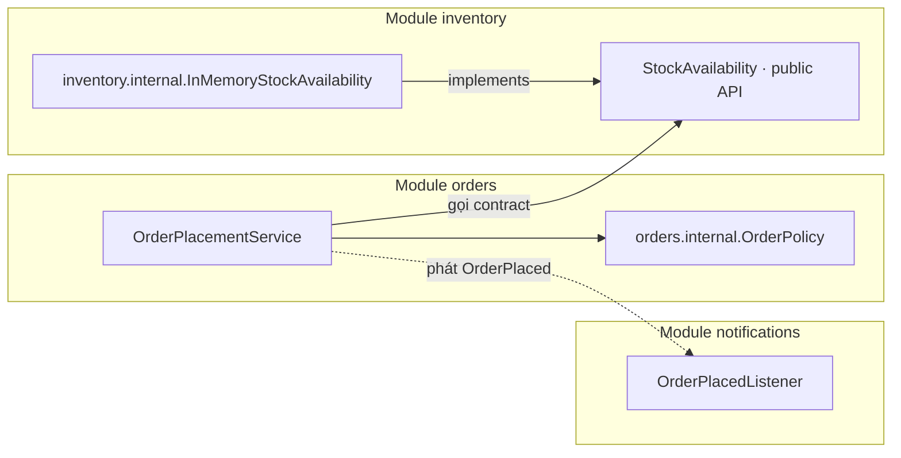
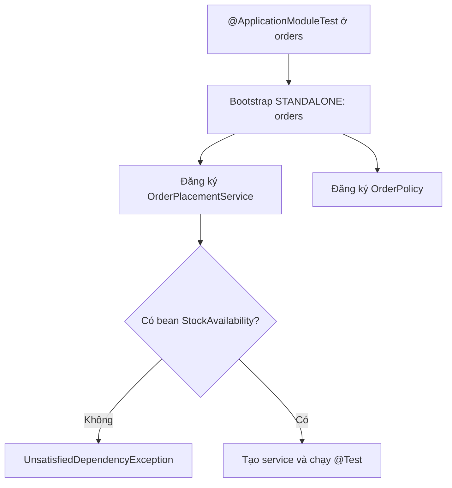
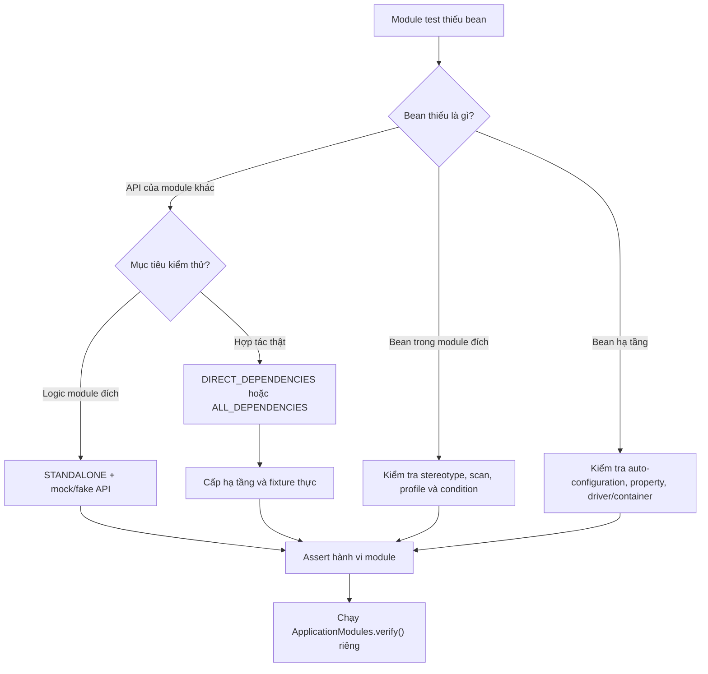

# Lỗi thiếu bean do module boundary

## 1. Vấn đề thực tế: bean tồn tại trong dự án nhưng biến mất khi chạy module test

Một tình huống phổ biến khi bắt đầu với Spring Modulith:

- Chạy toàn bộ ứng dụng bằng `@SpringBootApplication`: thành công.
- Chạy `@SpringBootTest` với cấu hình ứng dụng đầy đủ: thành công.
- Đổi sang `@ApplicationModuleTest` để kiểm thử riêng module `orders`: thất bại ngay khi khởi động context.

Thông báo thường có dạng:

```text
org.springframework.beans.factory.UnsatisfiedDependencyException:
  Error creating bean with name 'orderPlacementService':
  Unsatisfied dependency expressed through constructor parameter 0

Caused by: org.springframework.beans.factory.NoSuchBeanDefinitionException:
  No qualifying bean of type
  'com.example.shop.inventory.StockAvailability' available
```

Đây là ví dụ log minh họa, không phải output từ một lần chạy thực tế. Điểm đáng chú ý là **interface có trong code và có implementation production**, nhưng `ApplicationContext` của module test lại không tìm được bean phù hợp.

Nguyên nhân có thể rất đơn giản: Spring Modulith Test đang bootstrap module `orders` ở chế độ `STANDALONE`, còn implementation của `StockAvailability` thuộc module `inventory`, nằm ngoài phạm vi bean nghiệp vụ được chọn.

Bài học **“Lỗi thiếu bean do module boundary”** thuộc chương **Bootstrap context** của `SPRING_MODULITH_VERIFICATION_TESTING`. Mục đích không phải tìm mẹo làm mọi context chạy xanh bằng cách thêm bean tùy ý. Ta cần phân biệt:

1. Một quan hệ phụ thuộc module **đúng về kiến trúc**, nhưng test chưa cung cấp collaborator ở runtime.
2. Một quan hệ phụ thuộc **sai về kiến trúc**, chẳng hạn truy cập trực tiếp lớp nội bộ của module khác.
3. Một lỗi thiếu bean **không liên quan đến module boundary**, mà đến từ component scan, profile, property, auto-configuration hoặc hạ tầng dữ liệu.

Phân biệt đúng giúp viết `@ApplicationModuleTest` có ý nghĩa, kiểm thử sự kiện và tích hợp đúng mức, đồng thời xây dựng quality gate CI ngăn phụ thuộc sai và hồi quy.

## 2. Những khái niệm phải tách riêng

| Khái niệm | Câu hỏi nó trả lời | Công cụ/cơ chế điển hình |
| --- | --- | --- |
| **Application module** | Thành phần nghiệp vụ thuộc module nào? | Mô hình `ApplicationModules` của Spring Modulith |
| **Module API / internal** | Module khác được phép dùng kiểu hoặc package nào? | Package convention, named interfaces, allowed dependencies |
| **Module bootstrap scope** | Bài test chọn những module nào để khởi động? | `@ApplicationModuleTest` và `BootstrapMode` |
| **Spring bean registration** | Bean cụ thể nào được đăng ký trong context? | Component scan, `@Bean`, `@Import`, auto-configuration, mock override |
| **Dependency injection** | Có candidate bean phù hợp cho constructor/field không? | Bean type, bean name, `@Qualifier`, `@Primary` |
| **Architecture verification** | Quan hệ phụ thuộc giữa module có hợp lệ không? | `ApplicationModules.verify()` |

Một lỗi `NoSuchBeanDefinitionException` là **lỗi runtime bean resolution**. Nó không tự động là một vi phạm quy tắc module. Ngược lại, `ApplicationModules.verify()` có thể phát hiện phụ thuộc từ `orders` vào `inventory.internal` dù Spring context của test được cung cấp mock và khởi động thành công.

### Phân biệt hai loại “boundary”

**Boundary kiến trúc** là giới hạn mà source code được phép phụ thuộc. Ví dụ `orders` chỉ gọi `inventory.StockAvailability`, một API được công bố công khai.

**Boundary bootstrap** là giới hạn những application module mà bài test yêu cầu Spring khởi động. Trong `STANDALONE`, implementation `inventory.internal.DatabaseStockAvailability` có thể bị loại khỏi tập bean nghiệp vụ được chọn, dù `orders` dùng API của `inventory` hoàn toàn hợp lệ.

Hai boundary có liên quan, nhưng không thể dùng một cái để thay thế việc kiểm chứng cái kia.

## 3. Bối cảnh ví dụ: `orders` cần API của `inventory`

Giả sử ứng dụng bán hàng có package gốc `com.example.shop` và cấu trúc:

```text
src/main/java/com/example/shop/
├── ShopApplication.java
├── orders/
│   ├── OrderPlacementService.java
│   ├── OrderPlaced.java
│   └── internal/
│       └── OrderPolicy.java
├── inventory/
│   ├── StockAvailability.java
│   └── internal/
│       └── InMemoryStockAvailability.java
└── notifications/
    └── OrderPlacedListener.java

src/test/java/com/example/shop/
└── orders/
    └── OrdersModuleTest.java
```

Với cách phát hiện module thông dụng của Spring Modulith, các package con trực tiếp `orders`, `inventory` và `notifications` là những application module.

Quan hệ dependency hợp lệ trong ví dụ là:



Mũi tên từ `orders` tới interface `StockAvailability` thể hiện dependency code, **không bảo đảm** implementation bean của `inventory` sẽ được bootstrap khi test chỉ chọn `orders`.

### 3.1. Lớp ứng dụng ở package gốc

```java
// src/main/java/com/example/shop/ShopApplication.java
package com.example.shop;

import org.springframework.boot.SpringApplication;
import org.springframework.boot.autoconfigure.SpringBootApplication;

@SpringBootApplication
public class ShopApplication {

    public static void main(String[] args) {
        SpringApplication.run(ShopApplication.class, args);
    }
}
```

Ở ứng dụng đầy đủ, Spring Boot có thể component-scan những package con thích hợp. Nhưng `@ApplicationModuleTest` có thêm bước chọn phạm vi module. Vì thế việc chạy được toàn bộ ứng dụng không chứng minh module `orders` có thể tự bootstrap ở `STANDALONE` mà không cần test double.

### 3.2. API được module `inventory` công bố

```java
// src/main/java/com/example/shop/inventory/StockAvailability.java
package com.example.shop.inventory;

public interface StockAvailability {
    boolean hasStock(String sku, int quantity);
}
```

Đặt interface tại package gốc của module là cách đơn giản để diễn đạt API module trong mô hình mặc định. Dự án có thể cấu hình named interface hoặc quy tắc xuất API khác; khi đó phải tuân thủ cấu hình thật.

### 3.3. Implementation thuộc module bên ngoài

```java
// src/main/java/com/example/shop/inventory/internal/InMemoryStockAvailability.java
package com.example.shop.inventory.internal;

import com.example.shop.inventory.StockAvailability;
import java.util.Set;
import org.springframework.stereotype.Service;

@Service
class InMemoryStockAvailability implements StockAvailability {

    private static final Set<String> IN_STOCK =
        Set.of("SKU-1", "SKU-2");

    @Override
    public boolean hasStock(String sku, int quantity) {
        return quantity > 0 && IN_STOCK.contains(sku);
    }
}
```

Implementation này cố ý đơn giản để tập trung vào **module boundary**, chưa cần JPA hay cơ sở dữ liệu. Nó là một `@Service` của module `inventory`, **không phải** bean thuộc module `orders`.

### 3.4. Logic thật thuộc module mục tiêu

```java
// src/main/java/com/example/shop/orders/internal/OrderPolicy.java
package com.example.shop.orders.internal;

import org.springframework.stereotype.Component;

@Component
public class OrderPolicy {

    public void validate(String sku, int quantity) {
        if (sku == null || sku.isBlank()) {
            throw new IllegalArgumentException(
                "SKU must not be blank");
        }
        if (quantity <= 0) {
            throw new IllegalArgumentException(
                "Quantity must be positive");
        }
    }
}
```

```java
// src/main/java/com/example/shop/orders/OrderPlaced.java
package com.example.shop.orders;

public record OrderPlaced(
    String orderId, String sku, int quantity) {
}
```

```java
// src/main/java/com/example/shop/orders/OrderPlacementService.java
package com.example.shop.orders;

import com.example.shop.inventory.StockAvailability;
import com.example.shop.orders.internal.OrderPolicy;
import org.springframework.context.ApplicationEventPublisher;
import org.springframework.stereotype.Service;

@Service
public class OrderPlacementService {

    private final StockAvailability stock;
    private final OrderPolicy policy;
    private final ApplicationEventPublisher events;

    public OrderPlacementService(
            StockAvailability stock,
            OrderPolicy policy,
            ApplicationEventPublisher events) {
        this.stock = stock;
        this.policy = policy;
        this.events = events;
    }

    public String place(String orderId, String sku, int quantity) {
        policy.validate(sku, quantity);

        if (!stock.hasStock(sku, quantity)) {
            throw new IllegalStateException(
                "Stock unavailable: " + sku);
        }

        events.publishEvent(new OrderPlaced(
            orderId, sku, quantity));

        return "PLACED:" + orderId;
    }
}
```

`OrderPolicy` thuộc `orders.internal` vẫn là component của **chính module `orders`**. Đây không phải ví dụ về bean ngoài module. Dependency cần được xử lý khi bootstrap `STANDALONE` là `StockAvailability`.

## 4. Tái hiện lỗi: `@ApplicationModuleTest` mặc định

Lớp module test nằm trong package `com.example.shop.orders`:

```java
// Ví dụ cố tình thiếu collaborator, dùng để tái hiện lỗi.
package com.example.shop.orders;

import org.junit.jupiter.api.Test;
import org.springframework.beans.factory.annotation.Autowired;
import org.springframework.modulith.test.ApplicationModuleTest;

@ApplicationModuleTest
class OrdersMissingStockBeanTest {

    @Autowired
    OrderPlacementService service;

    @Test
    void shouldBootstrapOrders() {
        // Context có thể fail trước khi tới đây.
    }
}
```

`@ApplicationModuleTest` mặc định dùng `BootstrapMode.STANDALONE`. Vì `OrderPlacementService` cần `StockAvailability`, còn implementation ở module `inventory` không được tự nạp, Spring không có bean phù hợp và test có thể thất bại **trong giai đoạn tạo context**.

Đường đi của lỗi:



Không nên “sửa” bằng cách di chuyển `InMemoryStockAvailability` vào package `orders` chỉ vì muốn nó được scan. Làm như vậy thay đổi **quyền sở hữu module** của implementation. Một API thuộc `inventory` có thể cần được mock/fake trong bài test `orders`, hoặc phải nạp module `inventory` thật nếu muốn kiểm tra tích hợp.

### Dấu hiệu nhận biết lỗi bootstrap đúng loại

- Lỗi xuất hiện trước mọi assertion trong `@Test`.
- Chuỗi ngoại lệ có thể là `UnsatisfiedDependencyException`, với nguyên nhân gốc `NoSuchBeanDefinitionException` cho một interface ngoài module.
- Bean đang được tạo thuộc module mục tiêu; dependency bị thiếu do một module khác sở hữu.
- Ở ứng dụng đầy đủ, implementation có thể tồn tại và hoạt động.
- Thay `STANDALONE` bằng mode phù hợp hoặc cấp test double làm context tạo được bean.

Đó là dấu hiệu mạnh, **chưa phải kết luận tuyệt đối**: profile, `@ConditionalOnProperty` hoặc component scan sai cũng có thể gây hiện tượng tương tự. Phải kiểm tra nguồn gốc bean.

## 5. Quy trình chẩn đoán: từ lỗi Spring tới mô hình module

Đừng bắt đầu bằng cách thêm tất cả module. Hãy truy vấn theo thứ tự:

### Bước 1 — Tìm nguyên nhân gốc

Trong stack trace, xác định:

- Bean nào đang được tạo? Ví dụ `orderPlacementService`.
- Constructor parameter hoặc field nào không có candidate? Ví dụ `StockAvailability`.
- Ngoại lệ gốc là **thiếu**, **trùng candidate**, hay **bean có nhưng tạo thất bại**?

`UnsatisfiedDependencyException` là một lớp ngoại lệ bao ngoài. Nếu nguyên nhân thực là `BeanCreationException` của JPA adapter, thêm mock không nhất thiết đúng hướng. Cần đọc toàn bộ chuỗi `Caused by`.

### Bước 2 — Xác định module mục tiêu

Kiểm tra package của lớp test. Nếu `OrdersMissingStockBeanTest` nằm ở `com.example.shop.orders` thì Spring Modulith Test thường nhận diện `orders` là module mục tiêu.

Nếu vô tình đặt test ở package khác, phạm vi bootstrap có thể không đúng ý định. Đừng đổi package test tùy tiện; hãy nhất quán với cấu trúc module.

### Bước 3 — Xác định module sở hữu dependency

Hỏi:

1. `StockAvailability` là contract công khai của module `inventory` hay thuộc `inventory.internal`?
2. Có implementation bean nào của interface này trong module `orders` không?
3. Có production implementation ở `inventory` không?
4. Test có fake/mock hoặc cấu hình `@Bean` nào cung cấp interface đó chưa?

Tách **type Java của dependency** khỏi **nguồn đăng ký bean**. Mock `StockAvailability` do test tạo không chứng minh module `inventory` được bootstrap.

### Bước 4 — Kiểm tra `BootstrapMode`

| Mode | Module nghiệp vụ được chọn khi test `orders` | Khi nào cần |
| --- | --- | --- |
| `STANDALONE` (mặc định) | `orders` | Kiểm thử logic module độc lập với implementation của module khác |
| `DIRECT_DEPENDENCIES` | `orders` và dependency module trực tiếp, ví dụ `inventory` | Kiểm thử hợp tác giữa module gần nhất bằng bean thật |
| `ALL_DEPENDENCIES` | `orders` và các dependency trực tiếp/bắc cầu | Test tích hợp chuỗi dependency nhiều tầng có chủ đích |

`DIRECT_DEPENDENCIES` dựa trên quan hệ phụ thuộc **được Spring Modulith nhận diện**, không phải cơ chế tự lục tìm bất kỳ bean thiếu nào từ classpath. `ALL_DEPENDENCIES` không có nghĩa nạp mọi module độc lập trong ứng dụng.

### Bước 5 — Xem các điều kiện đăng ký bean khác

Ngay cả khi module `inventory` được chọn, bean `InMemoryStockAvailability` vẫn có thể vắng mặt vì:

- Không có `@Service`/`@Component` hoặc cấu hình `@Bean` tương ứng.
- Bị loại bởi `@Profile`, `@ConditionalOnProperty` hoặc exclude filter.
- `@Import`/cấu hình test ghi đè, thay đổi hoặc giới hạn nguồn bean.
- Có nhiều bean `StockAvailability` khiến injection mơ hồ.
- Một dependency của adapter không tạo được, ví dụ `DataSource` hoặc HTTP client.

Chẩn đoán đúng là phân biệt **không có bean definition** với **có bean definition nhưng không thể tạo instance**.

## 6. Giải pháp 1: mock API ngoài module để giữ `STANDALONE`

Đây là lựa chọn hợp lý khi mục tiêu là kiểm tra hành vi của `orders` trước phản hồi “có hàng/hết hàng” từ `inventory`.

Với Spring Framework 6.2+:

```java
// src/test/java/com/example/shop/orders/OrdersIsolatedTest.java
package com.example.shop.orders;

import com.example.shop.inventory.StockAvailability;
import org.junit.jupiter.api.Test;
import org.springframework.beans.factory.annotation.Autowired;
import org.springframework.modulith.test.ApplicationModuleTest;
import org.springframework.test.context.bean.override.mockito.MockitoBean;

import static org.assertj.core.api.Assertions.assertThat;
import static org.assertj.core.api.Assertions.assertThatThrownBy;
import static org.mockito.BDDMockito.given;
import static org.mockito.Mockito.verify;
import static org.mockito.Mockito.verifyNoInteractions;

@ApplicationModuleTest
class OrdersIsolatedTest {

    @Autowired
    OrderPlacementService orders;

    @MockitoBean
    StockAvailability stock;

    @Test
    void acceptsOrderWhenStockIsAvailable() {
        given(stock.hasStock("SKU-1", 2))
            .willReturn(true);

        String result = orders.place(
            "ORD-1", "SKU-1", 2);

        assertThat(result).isEqualTo("PLACED:ORD-1");
        verify(stock).hasStock("SKU-1", 2);
    }

    @Test
    void rejectsOrderWhenOutOfStock() {
        given(stock.hasStock("SKU-X", 2))
            .willReturn(false);

        assertThatThrownBy(() ->
            orders.place("ORD-2", "SKU-X", 2))
            .isInstanceOf(IllegalStateException.class)
            .hasMessageContaining("SKU-X");
    }

    @Test
    void rejectsInvalidQuantityBeforeConsultingStock() {
        assertThatThrownBy(() ->
            orders.place("ORD-3", "SKU-1", 0))
            .isInstanceOf(IllegalArgumentException.class);

        verifyNoInteractions(stock);
    }
}
```

Lớp test này giữ **`OrderPlacementService` và `OrderPolicy` thật**. Chỉ collaborator ngoài module được mock. Spring Test đăng ký mock `StockAvailability` trong cùng test context, thỏa dependency injection của service.

Đối với dự án Spring Boot cũ, có thể sử dụng `@MockBean` (package `org.springframework.boot.test.mock.mockito`) theo phiên bản tương thích. `@MockBean` bị deprecated từ Spring Boot 3.4; không đổi annotation nếu dependency hiện tại chưa có `@MockitoBean`.

**Phạm vi điều bài test chứng minh:** `orders` phản ứng đúng với các kết quả từ contract tồn kho. Test **không chạy** `InMemoryStockAvailability` hoặc repository/adapter thật của `inventory`.

### Vì sao không dùng `@Mock` thuần?

`@Mock` của Mockito hoặc `Mockito.mock(...)` tạo đối tượng mock cho mã Java; nó **không tự đăng ký làm Spring bean** trong `ApplicationContext`. Khi service được Spring tạo, Spring vẫn cần tìm bean phù hợp để inject.

Nếu đang kiểm thử thuần unit không khởi động Spring, có thể tạo `OrderPlacementService` bằng constructor với Mockito mock. Nhưng khi dùng `@ApplicationModuleTest`, hãy dùng bean override/test configuration phù hợp hoặc chủ động đăng ký mock như một bean.

### Khi nào không được mock?

Không nên mock chính `OrderPlacementService` rồi chỉ kiểm tra giá trị stub trả về; như vậy logic module mục tiêu không được chạy. Tương tự, nếu mục tiêu là truy vấn tồn kho thật, mock `StockAvailability` sẽ bỏ qua phần integration cần kiểm chứng.

## 7. Giải pháp 2: fake với `@TestConfiguration` và `@Import`

Nếu nhiều test cần hành vi tồn kho ổn định, một fake nhỏ có thể dễ đọc và dễ tái sử dụng hơn các lời gọi `given(...)`.

### Cấu hình test lồng tĩnh

```java
package com.example.shop.orders;

import com.example.shop.inventory.StockAvailability;
import org.junit.jupiter.api.Test;
import org.springframework.beans.factory.annotation.Autowired;
import org.springframework.boot.test.context.TestConfiguration;
import org.springframework.context.annotation.Bean;
import org.springframework.modulith.test.ApplicationModuleTest;

import static org.assertj.core.api.Assertions.assertThat;

@ApplicationModuleTest
class OrdersWithLocalFakeTest {

    @Autowired
    OrderPlacementService orders;

    @Test
    void authorizesKnownSku() {
        assertThat(orders.place(
            "ORD-4", "SKU-1", 1))
            .isEqualTo("PLACED:ORD-4");
    }

    @TestConfiguration(proxyBeanMethods = false)
    static class StockFakeConfiguration {

        @Bean
        StockAvailability stockAvailability() {
            return (sku, quantity) ->
                "SKU-1".equals(sku) && quantity <= 5;
        }
    }
}
```

Spring Boot Test thường nhận diện `static nested @TestConfiguration` và bổ sung những bean do nó khai báo vào context của lớp test. Fake chỉ mô phỏng contract; không cần module `inventory` thật.

### Cấu hình test top-level dùng chung

Nếu nhiều lớp test cần cùng fake, có thể đặt cấu hình ở `src/test/java/com/example/shop/testsupport/StockFakeConfiguration.java`:

```java
package com.example.shop.testsupport;

import com.example.shop.inventory.StockAvailability;
import org.springframework.boot.test.context.TestConfiguration;
import org.springframework.context.annotation.Bean;

@TestConfiguration(proxyBeanMethods = false)
public class StockFakeConfiguration {

    @Bean
    StockAvailability stockAvailability() {
        return (sku, quantity) ->
            "SKU-1".equals(sku) && quantity > 0;
    }
}
```

Và nhập tường minh trong bài test:

```java
package com.example.shop.orders;

import com.example.shop.testsupport.StockFakeConfiguration;
import org.springframework.context.annotation.Import;
import org.springframework.modulith.test.ApplicationModuleTest;

@ApplicationModuleTest
@Import(StockFakeConfiguration.class)
class OrdersWithSharedFakeTest {
    // Thêm các @Test và assertion nghiệp vụ phù hợp.
}
```

Với cấu hình top-level `@TestConfiguration`, **đặt trong `src/test/java` không tự bảo đảm Spring Boot sẽ scan và đăng ký**. `@Import` chỉ rõ cấu hình nào được thêm. Không nên import một configuration production của `inventory` có `@ComponentScan` rộng chỉ để tạo ra một bean đang thiếu, vì có thể kéo theo repository, listener, scheduled job và client không thuộc mục tiêu test.

**Cảnh báo về state:** nếu fake chứa dữ liệu mutable, singleton bean có thể được giữ trong Spring TestContext cache qua nhiều phương thức/lớp test. Reset fake ở `@BeforeEach` hoặc dùng fake bất biến; tránh test phụ thuộc thứ tự chạy.

## 8. Giải pháp 3: bootstrap module phụ thuộc thật

Khi muốn kiểm tra tích hợp giữa `orders` và `inventory`, việc nạp implementation thật là hợp lý:

```java
// src/test/java/com/example/shop/orders/OrdersInventoryIntegrationTest.java
package com.example.shop.orders;

import org.junit.jupiter.api.Test;
import org.springframework.beans.factory.annotation.Autowired;
import org.springframework.modulith.test.ApplicationModuleTest;
import org.springframework.modulith.test.ApplicationModuleTest.BootstrapMode;

import static org.assertj.core.api.Assertions.assertThat;

@ApplicationModuleTest(
    mode = BootstrapMode.DIRECT_DEPENDENCIES)
class OrdersInventoryIntegrationTest {

    @Autowired
    OrderPlacementService orders;

    @Test
    void usesRealInventoryModule() {
        assertThat(orders.place(
            "ORD-5", "SKU-1", 1))
            .isEqualTo("PLACED:ORD-5");
    }
}
```

Trong ví dụ, `orders` phụ thuộc trực tiếp API `StockAvailability` thuộc `inventory`; `DIRECT_DEPENDENCIES` có thể đưa module `inventory` cùng implementation `InMemoryStockAvailability` thật vào context. Assertion lúc này chạy cả logic tồn kho minh họa, không phải mock.

**Điều kiện để đoạn test hoạt động:** quan hệ module được Spring Modulith nhận diện đúng; `InMemoryStockAvailability` được đăng ký và không bị profile/condition loại; các bean khác được chọn không có dependency thiếu. Nếu implementation thực tế dùng JDBC hoặc HTTP, cần chuẩn bị database/test server và cấu hình tương ứng.

Không dùng `ALL_DEPENDENCIES` theo phản xạ. Nó mở rộng sang các dependency trực tiếp và bắc cầu của module mục tiêu, **không nạp tất cả module độc lập**.

### Chọn test double hay dependency thật?

| Mục tiêu test | Phương án phù hợp | Điều chưa được chứng minh |
| --- | --- | --- |
| `orders` xử lý hết hàng đúng | `STANDALONE` + mock `StockAvailability` | Adapter tồn kho production hoạt động |
| `orders` chạy với quy tắc fake ổn định | `STANDALONE` + fake test | SQL/HTTP thật của `inventory` |
| Wiring và hợp tác `orders–inventory` | `DIRECT_DEPENDENCIES` nếu `inventory` là dependency trực tiếp | Những module không thuộc dependency graph |
| Kiểm thử chuỗi module phụ thuộc bắc cầu | `ALL_DEPENDENCIES` theo nhu cầu | Mọi module trong ứng dụng |
| Kiểm tra truy vấn JPA ở `inventory` | Test module `inventory` với repository thật + DB test | Toàn bộ luồng hệ thống ngoài DB |
| Phát hiện phụ thuộc vào `inventory.internal` | `ApplicationModules.verify()` | Context/JPA/bootstrap runtime chạy đúng |

## 9. Đừng che một lỗi kiến trúc thật bằng mock

Xét đoạn code **sai ranh giới** trong module `orders`:

```java
package com.example.shop.orders;

import com.example.shop.inventory.internal.InMemoryStockAvailability;

// Ví dụ chống chỉ định: orders phụ thuộc implementation nội bộ.
class ForbiddenInventoryAccess {

    private final InMemoryStockAvailability adapter;

    ForbiddenInventoryAccess(InMemoryStockAvailability adapter) {
        this.adapter = adapter;
    }
}
```

Ví dụ này minh họa một phụ thuộc **bị cấm về ý nghĩa kiến trúc**. Trong mã minh họa ở phần 3, `InMemoryStockAvailability` là package-private, nên import như trên còn không biên dịch được — Java đã chặn truy cập. Trong ứng dụng thực, một implementation internal có thể khai báo `public` để phục vụ cấu hình nội bộ hoặc test của chính module, nhưng module `orders` vẫn **không nên** tham chiếu trực tiếp tới nó.

Nếu chỉ đổi visibility của class để Java biên dịch, quan hệ phụ thuộc xuyên module vẫn có thể vi phạm Spring Modulith. Cách đúng là phụ thuộc vào `StockAvailability` tại API module rồi xác minh quy tắc:

```java
package com.example.shop;

import org.junit.jupiter.api.Test;
import org.springframework.modulith.core.ApplicationModules;

class ModuleArchitectureTest {

    @Test
    void verifiesModuleDependencies() {
        ApplicationModules.of(ShopApplication.class).verify();
    }
}
```

`ApplicationModules.verify()` kiểm tra mô hình application module và các quy tắc dependency, không cần khởi động Spring Boot context đầy đủ để tìm bean. Kết quả test này **độc lập** với việc `@ApplicationModuleTest` dùng mock/fake hay adapter thật.

### Phân loại kết quả thành bốn trường hợp

| Kiến trúc | Context `STANDALONE` | Diễn giải |
| --- | --- | --- |
| Hợp lệ | Thiếu `StockAvailability` | Thường là thiếu collaborator test; chọn mock/fake hoặc mode khác |
| Hợp lệ | Khởi động được | Cấu hình runtime của test phù hợp; còn cần assertion nghiệp vụ |
| Vi phạm | Khởi động được nhờ mock/import | Mock không hợp thức hóa dependency code sai |
| Vi phạm | Bootstrap thất bại | Có thể đồng thời có lỗi kiến trúc và lỗi wiring; xử lý riêng cả hai |

**Không sử dụng sự thành công của `@SpringBootTest` để “bác bỏ” lỗi module boundary.** Full application context có thể chứa implementation mà `STANDALONE` cố ý không nạp.

## 10. Vì sao `@Import` trực tiếp implementation bên ngoài thường là lối tắt xấu?

Về kỹ thuật, Spring Framework cho phép `@Import` một class/configuration bổ sung vào context. Ví dụ:

```java
@ApplicationModuleTest
@Import(InventoryProductionConfiguration.class)
class OrdersWithImportedProductionConfig {
}
```

Đây là sơ đồ annotation minh họa: `InventoryProductionConfiguration` phải thực sự là một cấu hình được định nghĩa trong dự án và đoạn class cần đặt trong source có import Java tương ứng.

Nếu configuration production kích hoạt component scan trên `inventory`, Spring có thể đăng ký thêm nhiều bean ngoài ý định. Kết quả phụ thuộc phiên bản Spring/Spring Modulith, các điều kiện bean và cách test context xử lý cấu hình. Những hậu quả cần đề phòng:

- Nạp thêm adapter gọi database/network hoặc message broker.
- Có hai bean cùng kiểu sau khi một fake cũng được import.
- Lắng nghe event hoặc chạy scheduled job ngoài mục tiêu.
- Biến một test `STANDALONE` thành test tích hợp ngầm, khó xác định lỗi.
- Che một vấn đề thiết kế nơi module `orders` cần đúng **một** contract từ `inventory`.

Nếu chỉ cần một collaborator test, nhập **cấu hình test nhỏ**. Nếu cần chạy module phụ thuộc thật, sử dụng `BootstrapMode` phù hợp và mô tả rõ hạ tầng tích hợp. Hai ý định này phải phân biệt trong tên và assertion của test.

## 11. Trường hợp không phải lỗi boundary: profile và conditional bean

Không phải cứ bean nằm ở module khác là Spring Modulith đã loại nó. Có thể module ấy đã được chọn nhưng bean vẫn không có do điều kiện.

Ví dụ implementation thật chỉ bật ở profile `database`:

```java
package com.example.shop.inventory.internal;

import com.example.shop.inventory.StockAvailability;
import org.springframework.context.annotation.Profile;
import org.springframework.stereotype.Service;

@Service
@Profile("database")
class DatabaseStockAvailability implements StockAvailability {

    @Override
    public boolean hasStock(String sku, int quantity) {
        // Ví dụ minh họa hành vi; adapter production thật
        // cần truy vấn dữ liệu và xử lý lỗi phù hợp.
        return true;
    }
}
```

Khi test `DIRECT_DEPENDENCIES` nhưng không kích hoạt profile `database`, bean này vẫn bị loại bởi `@Profile`. Muốn dùng implementation đó cần cấu hình profile phù hợp:

```java
import org.springframework.modulith.test.ApplicationModuleTest;
import org.springframework.modulith.test.ApplicationModuleTest.BootstrapMode;
import org.springframework.test.context.ActiveProfiles;

@ApplicationModuleTest(
    mode = BootstrapMode.DIRECT_DEPENDENCIES)
@ActiveProfiles("database")
class OrdersWithDatabaseProfileTest {
}
```

Annotation `@ActiveProfiles` **không tự mở rộng module scope**. Cũng vậy, `@ConditionalOnProperty` chỉ xét property khi cấu hình có cơ hội được xử lý. Nếu một bean ở module ngoài đã bị giới hạn bởi `STANDALONE`, bật property cho bean đó không nhất thiết giúp nó xuất hiện.

Cần kiểm tra cả:

- Module nào được chọn?
- Bean nằm ở đâu và đăng ký bằng cơ chế nào?
- Active profile/property có thỏa điều kiện không?
- Bean được đăng ký nhưng tạo thất bại vì dependency cấp sau không?

## 12. Trường hợp không phải lỗi boundary: hạ tầng Spring Boot

Một bean như `DataSource`, `EntityManagerFactory`, `ObjectMapper` hoặc `ApplicationEventPublisher` không thể được xử lý giống hệt service của module `inventory`.

Bean hạ tầng có thể do Spring Framework/Boot auto-configuration hoặc cấu hình ứng dụng tạo, độc lập với việc các module nghiệp vụ khác có được bootstrap hay không.

| Bean thiếu | Nguyên nhân có thể | Cách xử lý phù hợp |
| --- | --- | --- |
| `StockAvailability` | Module `inventory` ngoài `STANDALONE` | Mock/fake hoặc mở rộng module mode |
| `DataSource` | Chưa có driver/URL hoặc auto-configuration không tạo bean | Cấp database test, chỉnh property/condition hoặc tách persistence khỏi bài test |
| `EntityManagerFactory` | JPA config, entity/repository scan hoặc DataSource lỗi | Kiểm tra JPA và schema/migration |
| `ObjectMapper` | Jackson/auto-configuration hoặc config bị loại | Kiểm tra web/serialization dependency và bean registration |
| `KafkaTemplate` | Messaging auto-configuration không thỏa hoặc thiếu config | Chọn mock port nếu test logic; cấu hình broker nếu test integration |
| `ApplicationEventPublisher` | Lỗi context/configuration đặc biệt | Kiểm tra Spring context setup; tránh tự thêm mock nếu cần event thật |

Việc có `DataSource` trong module test `orders` **không chứng minh** module `inventory` được nạp. Một test chỉ dùng fake `StockAvailability` nhưng vẫn có repository riêng thuộc `orders` có thể cần JDBC/JPA thật.

### Dấu hiệu thường bị đọc sai

```text
Error creating bean with name 'inventoryAdapter':
  Failed to configure a DataSource ...
```

Nếu `inventoryAdapter` đã được chọn nhưng lỗi khi tạo `DataSource`, đây **không còn chỉ là lỗi “module inventory không được bootstrap”**. Bean adapter đã nằm trong quá trình khởi tạo; cần giải quyết hạ tầng mà adapter yêu cầu hoặc quay lại mức test không cần adapter thật.

## 13. Kiểm thử dữ liệu: thiếu bean repository có thể đến từ cơ chế khác

Spring Data repository không phải một `@Service` được tạo bằng component scan đơn giản. Spring Data cần các cấu hình repository/JPA, cùng entity scan và hạ tầng persistence.

Giả sử có interface:

```java
package com.example.shop.inventory.persistence;

import org.springframework.data.jpa.repository.JpaRepository;

public interface StockJpaRepository
        extends JpaRepository<StockEntity, Long> {
}
```

`StockEntity` ở ví dụ là entity giả định đã có `@Entity` và khóa `Long`. Nếu một bài test muốn dùng `StockJpaRepository` thật, cần:

1. Module chứa repository nằm trong phạm vi test theo yêu cầu.
2. Repository interface được cơ chế Spring Data nhận diện.
3. Entity được đưa vào persistence unit.
4. `DataSource`/`EntityManagerFactory`/transaction manager tồn tại.
5. Schema/migration và dữ liệu fixture đúng.
6. Assertion kiểm tra truy vấn/thay đổi dữ liệu thật.

Nếu thiếu một điều, lỗi có thể trông giống thiếu bean do module boundary. Nhưng thêm `@MockitoBean StockJpaRepository` chỉ hợp lý khi **không cần chạy repository thật**. Nếu đây là integration test JPA, mock repository làm test đánh mất giá trị kiểm chứng dữ liệu.

### Khung integration test có PostgreSQL Testcontainers

```java
package com.example.shop.orders;

import org.junit.jupiter.api.Test;
import org.springframework.modulith.test.ApplicationModuleTest;
import org.springframework.modulith.test.ApplicationModuleTest.BootstrapMode;
import org.springframework.test.context.DynamicPropertyRegistry;
import org.springframework.test.context.DynamicPropertySource;
import org.testcontainers.containers.PostgreSQLContainer;
import org.testcontainers.junit.jupiter.Container;
import org.testcontainers.junit.jupiter.Testcontainers;

@Testcontainers
@ApplicationModuleTest(
    mode = BootstrapMode.DIRECT_DEPENDENCIES)
class OrdersInventoryDatabaseTest {

    @Container
    static PostgreSQLContainer<?> postgres =
        new PostgreSQLContainer<>("postgres:16-alpine");

    @DynamicPropertySource
    static void databaseProperties(
            DynamicPropertyRegistry registry) {
        registry.add("spring.datasource.url", postgres::getJdbcUrl);
        registry.add("spring.datasource.username",
            postgres::getUsername);
        registry.add("spring.datasource.password",
            postgres::getPassword);
    }

    @Test
    void checksRealInventoryPersistence() {
        // Seed dữ liệu thật; gọi service/repository thật.
        // Assert dữ liệu và kết quả nghiệp vụ.
    }
}
```

Đây là **khung cấu hình**, chưa phải integration test hoàn chỉnh: cần model dữ liệu, migration, fixture, dependency Testcontainers và assertion cụ thể của dự án. `@DynamicPropertySource` cung cấp property JDBC động, **không tự tạo repository/schema**, còn `DIRECT_DEPENDENCIES` chọn module, **không tự khởi động PostgreSQL**.

Nếu test `STANDALONE` chỉ cần logic `orders`, tránh dựng hạ tầng JPA của `inventory` không cần thiết. Nếu test cần SQL thật, giữ implementation và database thật ở môi trường test.

## 14. Sự kiện: thiếu listener ngoài module không đồng nghĩa thiếu bean gây lỗi

Service `OrderPlacementService` phát `OrderPlaced`. Listener của `notifications` có thể nhận event trong ứng dụng đầy đủ, nhưng test `orders` ở `STANDALONE` không tự bootstrap listener thuộc module `notifications`.

Vậy có hai mục tiêu khác nhau:

- **Kiểm chứng phát event:** có thể làm ngay trong test `orders` với `PublishedEvents`.
- **Kiểm chứng listener xử lý event:** cần bài test có listener thật, cấu hình giao dịch/async và collaborator của listener phù hợp.

Ví dụ test phát sự kiện:

```java
package com.example.shop.orders;

import com.example.shop.inventory.StockAvailability;
import org.junit.jupiter.api.Test;
import org.springframework.beans.factory.annotation.Autowired;
import org.springframework.modulith.test.ApplicationModuleTest;
import org.springframework.modulith.test.PublishedEvents;
import org.springframework.test.context.bean.override.mockito.MockitoBean;

import static org.assertj.core.api.Assertions.assertThat;
import static org.mockito.BDDMockito.given;

@ApplicationModuleTest
class OrdersPublishedEventsTest {

    @Autowired
    OrderPlacementService orders;

    @MockitoBean
    StockAvailability stock;

    @Test
    void publishesEventAfterSuccessfulOrder(
            PublishedEvents publishedEvents) {
        given(stock.hasStock("SKU-1", 1))
            .willReturn(true);

        orders.place("ORD-6", "SKU-1", 1);

        assertThat(publishedEvents.ofType(OrderPlaced.class))
            .anySatisfy(event -> {
                assertThat(event.orderId()).isEqualTo("ORD-6");
                assertThat(event.sku()).isEqualTo("SKU-1");
                assertThat(event.quantity()).isEqualTo(1);
            });
    }
}
```

**Điều bài test chứng minh:** `orders` đã công bố event có payload đúng. **Điều nó không chứng minh:** listener `notifications` đã xử lý, email đã gửi hoặc message broker đã nhận thông điệp.

Nếu test của `notifications` thiếu bean `OrderPlacedListener`, cần kiểm tra module chứa test, mode, profile, annotation listener và điều kiện đăng ký. Nếu listener có mặt nhưng không thực thi, cần kiểm tra transaction completion, async executor, event publication infrastructure và thời điểm assertion, không chỉ module boundary.

## 15. Kiểm tra bean thực tế để tránh phỏng đoán

Khi context đã khởi động, ta có thể quan sát bean theo type:

```java
package com.example.shop.orders;

import com.example.shop.inventory.StockAvailability;
import org.junit.jupiter.api.Test;
import org.springframework.beans.factory.annotation.Autowired;
import org.springframework.context.ApplicationContext;
import org.springframework.modulith.test.ApplicationModuleTest;
import org.springframework.test.context.bean.override.mockito.MockitoBean;

import static org.assertj.core.api.Assertions.assertThat;
import static org.mockito.Mockito.mockingDetails;

@ApplicationModuleTest
class OrdersBeanInspectionTest {

    @Autowired
    ApplicationContext context;

    @MockitoBean
    StockAvailability stock;

    @Test
    void usesTestDoubleAtInventoryBoundary() {
        String[] beanNames =
            context.getBeanNamesForType(StockAvailability.class);

        assertThat(beanNames).hasSize(1);
        assertThat(mockingDetails(
            context.getBean(StockAvailability.class)).isMock())
            .isTrue();
    }
}
```

Ví dụ giả định không có bean `StockAvailability` khác do configuration tùy chỉnh đưa vào; nếu bean count khác, cần xem tên và nguồn đăng ký trước khi sửa assertion.

Nếu cần xác định bean được tạo từ đâu, có thể dùng `ConfigurableApplicationContext` và `BeanDefinition`:

```java
// Đoạn mã minh họa bên trong một @Test đã inject context.
ConfigurableApplicationContext configurable =
    (ConfigurableApplicationContext) context;

for (String name :
        context.getBeanNamesForType(StockAvailability.class)) {
    var definition = configurable
        .getBeanFactory()
        .getBeanDefinition(name);

    System.out.println(
        name + ": " + definition.getResourceDescription());
}
```

Cần import `org.springframework.context.ConfigurableApplicationContext` khi dùng đoạn code. `getResourceDescription()` có thể không có giá trị hữu ích đối với bean được tạo qua factory/proxy/registrar; cần xem thêm bean definition, test annotation, profile và configuration source. Tránh in toàn bộ bean hoặc secret trong log CI.

**Giới hạn của cách này:** nếu lỗi xảy ra trong lúc bootstrap, method `@Test` chưa thể chạy để inspect. Khi đó đọc stack trace gốc, startup log, Spring Boot Conditions Evaluation Report và thông tin module bootstrap trước.

## 16. Các lỗi dễ bị nhầm lẫn

| Triệu chứng | Có chắc do module boundary? | Kiểm tra và xử lý |
| --- | --- | --- |
| `NoSuchBeanDefinitionException` cho API ở module khác trong `STANDALONE` | Có khả năng cao | Mock/fake đúng API hoặc chọn mode integration |
| `UnsatisfiedDependencyException` nhưng dependency là `DataSource` | Không | JDBC/Boot auto-configuration, property và database test |
| `NoUniqueBeanDefinitionException` khi vừa import fake vừa nạp module phụ thuộc | Không phải thiếu bean | Loại trừ duplicate, chọn qualifier/primary hoặc chỉ giữ một loại collaborator |
| Implementation có `@Profile("integration")` nhưng profile không active | Không đơn thuần | `@ActiveProfiles` hoặc điều kiện đăng ký |
| Bean có `@Bean` trong cấu hình chưa được import | Không đơn thuần | Đưa đúng configuration vào context |
| Bean tồn tại nhưng `BeanCreationException` vì network/SQL | Không | Cấu hình hạ tầng hoặc tách test logic |
| Listener ngoài module không chạy dù event đã phát | Có thể đúng phạm vi | Phân biệt test phát event và test xử lý listener |
| `@SpringBootTest` chạy được, `@ApplicationModuleTest` fail | Có thể | Kiểm tra scope module và dependency thực sự |
| Test chạy xanh nhưng `ApplicationModules.verify()` fail | Không phải lỗi wiring | Sửa quan hệ dependency code sai |
| Chạy lần đầu lỗi dài, test sau báo failure threshold | Không phải lỗi mới | Tìm lỗi context load đầu tiên, kiểm tra cache key |

Một lỗi có thể có **nhiều nguyên nhân đồng thời**. Ví dụ `orders` tham chiếu API hợp lệ của `inventory`, nhưng implementation đã được chọn ở `DIRECT_DEPENDENCIES` lại không tạo được vì thiếu database. Phải xử lý theo từng tầng, không phủ nhận ranh giới module.

### Những hướng “sửa nhanh” nên tránh

- Chuyển toàn bộ module test thành `@SpringBootTest` chỉ để nạp đủ bean.
- Đổi mọi bài test sang `ALL_DEPENDENCIES` mà không có mục tiêu tích hợp.
- Import production configuration có component scan toàn ứng dụng để thoát lỗi.
- Chuyển implementation của module khác vào package module mục tiêu.
- Mock cả service nghiệp vụ của module đang muốn kiểm chứng.
- Bật bean overriding toàn cục để che xung đột type/name.
- Dùng `@DirtiesContext` để chữa thiếu dependency; annotation này chỉ điều khiển cache/lifecycle context.
- Bỏ chạy `ApplicationModules.verify()` vì “runtime test đã xanh”.

Các cách làm trên có thể khiến test xanh cục bộ nhưng làm yếu đi việc phát hiện hồi quy.

## 17. Cây quyết định khi gặp lỗi thiếu bean



Cây trên chỉ là **hướng dẫn chọn nơi điều tra đầu tiên**. Nó không thể tự thay thế việc xem stack trace, mô hình module thực tế và điều kiện cấu hình của dự án.

## 18. Kiểm chứng trong CI: một lỗi dependency, nhiều trách nhiệm

Một quality gate tốt cho học phần `SPRING_MODULITH_VERIFICATION_TESTING` cần bảo vệ đồng thời:

1. **Tính hợp lệ của kiến trúc:** dùng `ApplicationModules.of(ShopApplication.class).verify()` phát hiện phụ thuộc sai chiều hoặc truy cập module internal.
2. **Tính độc lập của module mục tiêu:** dùng `@ApplicationModuleTest` ở `STANDALONE` với mock/fake API ngoài module; giữ logic bên trong module thật.
3. **Tính đúng của hợp tác liên module:** có integration test dùng bean thật ở mode phù hợp, không mock adapter cần kiểm chứng.
4. **Tính đúng của sự kiện:** test phát event ở module nguồn; test listener thật ở module đích hoặc trong context tích hợp.
5. **Tính đúng của dữ liệu:** test JPA/SQL với repository thật, schema/fixture và database test phù hợp.
6. **Tính tái lập:** profile và property test tường minh; Testcontainers/container lifecycle, cleanup và timeout có giới hạn; không gọi hạ tầng production.

Một thay đổi làm `OrderPlacementService` bắt đầu phụ thuộc `inventory.internal.DatabaseStockAvailability` cần bị architecture gate chặn, dù module test vẫn khởi động được nhờ cấu hình đặc biệt. Một thay đổi làm `@Profile` loại mất bean production cần bị bootstrap/integration test phát hiện. Không một nhóm test nào thay thế trọn vẹn nhóm còn lại.

### Tiêu chí review pull request

- [ ] Lớp `@ApplicationModuleTest` nằm ở đúng module đích.
- [ ] `BootstrapMode` được chọn có lý do và khớp mục tiêu test.
- [ ] Mọi collaborator bên ngoài được ghi rõ: mock, fake hay bean thật.
- [ ] API tham chiếu ở package công khai/named interface phù hợp, không dùng implementation nội bộ của module khác.
- [ ] Test có assertion nghiệp vụ; không chỉ chứng minh context khởi động.
- [ ] Test dữ liệu/sự kiện/tích hợp giữ đúng adapter thật khi cần.
- [ ] Không dùng `@Import` hoặc `@ComponentScan` rộng để che sai phạm vi.
- [ ] CI chạy `ApplicationModules.verify()` độc lập với runtime test.

## 19. Bài tập thực hành

Giả sử một dự án có các module:

- `orders` có `OrderPlacementService` và `OrderPolicy`.
- `inventory` công bố `StockAvailability` và có adapter `DatabaseStockAvailability` trong package `inventory.internal`.
- `notifications` chứa listener cho `OrderPlaced`.
- Một test ở `com.example.shop.orders` dùng `@ApplicationModuleTest` mặc định.

Hãy chọn giải pháp hợp lý cho từng trường hợp:

| Tình huống | Hướng thực hiện |
| --- | --- |
| Chỉ muốn kiểm thử nhánh “hết hàng” | Giữ `STANDALONE`, mock `StockAvailability` trả `false`, assert exception |
| Muốn nhiều test có cùng catalog/tồn kho giả | Dùng fake qua `@TestConfiguration`, reset state nếu mutable |
| Muốn dùng tồn kho thật có JPA | Bootstrap module phụ thuộc và chuẩn bị DB/schema/fixture |
| Implementation được chọn nhưng bị `@Profile` loại | Kiểm tra active profile và property, không chỉ mode |
| Có hai bean `StockAvailability` sau khi nạp dependency thật | Xem fake/adapter trùng type, bean name và lựa chọn injection |
| Muốn biết event `OrderPlaced` có phát đúng không | `PublishedEvents` tại module nguồn |
| Muốn kiểm tra `notifications` xử lý event | Test có listener thật và assertion kết quả |
| Muốn ngăn truy cập `inventory.internal` | Chạy `ApplicationModules.verify()` |

## 20. Câu hỏi tự kiểm tra

1. Vì sao `@ApplicationModuleTest` ở `STANDALONE` có thể thiếu `StockAvailability` dù class implementation tồn tại trong source code?
2. `NoSuchBeanDefinitionException` có luôn chứng minh phụ thuộc module bị cấm về kiến trúc không?
3. Một `@MockitoBean StockAvailability` trong test `orders` có đồng nghĩa module `inventory` thật được bootstrap không?
4. Khi nào nên dùng `DIRECT_DEPENDENCIES` thay vì mock?
5. Vì sao `@Import` một cấu hình production có component scan rộng là lựa chọn rủi ro?
6. Bean `DataSource` vắng mặt có chắc do ranh giới giữa `orders` và `inventory` không?
7. Nếu `OrderPolicy` thuộc `orders.internal` không được tạo, những nguyên nhân nào nên kiểm tra?
8. Vì sao `@ActiveProfiles("integration")` không đủ để nạp module `inventory` khi mode vẫn là `STANDALONE`?
9. Khi nào việc mock `StockJpaRepository` làm bài integration test mất giá trị?
10. `PublishedEvents` chứng minh được điều gì, và không chứng minh được điều gì về listener `notifications`?
11. Nếu `@SpringBootTest` chạy xanh nhưng `@ApplicationModuleTest` fail, có cần lập tức đổi tất cả test sang `@SpringBootTest` không?
12. Phép kiểm chứng nào có thể bắt `orders` import trực tiếp lớp nội bộ của `inventory` dù runtime test được cung cấp fake?
13. Khi stack trace có `BeanCreationException` của `JpaCatalogLookup`, câu hỏi tiếp theo nên là gì?
14. Nếu một context đã fail rồi các test sau báo context failure threshold, nên tìm lỗi ở lần thử nào?

**Gợi ý đáp án:** (1) `STANDALONE` chỉ chọn bean nghiệp vụ của module mục tiêu; (2) không, có thể là lỗi wiring của một phụ thuộc hợp lệ; (3) không, mock do test cung cấp; (4) khi cần kiểm chứng implementation thật của dependency trực tiếp; (5) có thể kéo thêm hạ tầng, bean trùng và side effect; (6) không, đây thường là vấn đề JDBC/auto-configuration; (7) stereotype/scan, profile, condition, cấu hình module và dependency của bean; (8) profile không đổi `BootstrapMode`; (9) khi mục tiêu chính là SQL/mapping/repository thật; (10) event đã phát đúng payload, không tự chứng minh listener đã xử lý; (11) không, cần chẩn đoán boundary và chủ đích test; (12) `ApplicationModules.verify()`; (13) adapter đã được chọn rồi, cần xem dependency/hạ tầng JPA tạo bean thất bại; (14) stack trace của lần load context đầu tiên.

## 21. Tổng kết: ba câu hỏi trước khi sửa lỗi

Khi một bean không xuất hiện trong `@ApplicationModuleTest`, hãy trả lời theo đúng thứ tự:

1. **Bean thuộc đâu?** Module mục tiêu, module khác, hạ tầng Spring hay cấu hình test?
2. **Test muốn chứng minh điều gì?** Logic module cô lập, wiring của dependency thật, SQL/JPA hay luồng event/messaging?
3. **Bean nên được cung cấp bằng cách nào?** Mock/fake nhỏ, `@Import` cấu hình test cụ thể, `BootstrapMode` phù hợp hay hạ tầng tích hợp thật?

**Ghi nhớ:** lỗi thiếu bean do module boundary thường phản ánh **sự cô lập có chủ đích của `@ApplicationModuleTest`**, không tự động là lỗi kiến trúc. Dùng mock/fake khi kiểm thử module đích; mở rộng bootstrap và chuẩn bị hạ tầng khi kiểm thử hợp tác thật. Đồng thời luôn chạy `ApplicationModules.verify()` để kiểm chứng quy tắc phụ thuộc giữa module — điều mà việc khởi động thành công một Spring `ApplicationContext` không thể thay thế.
