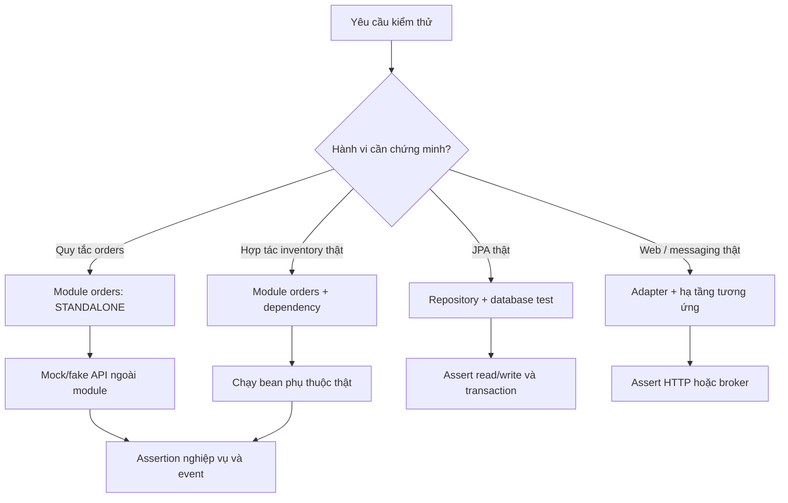
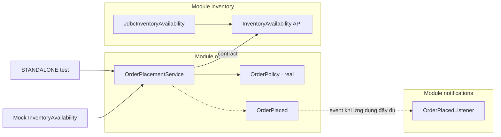
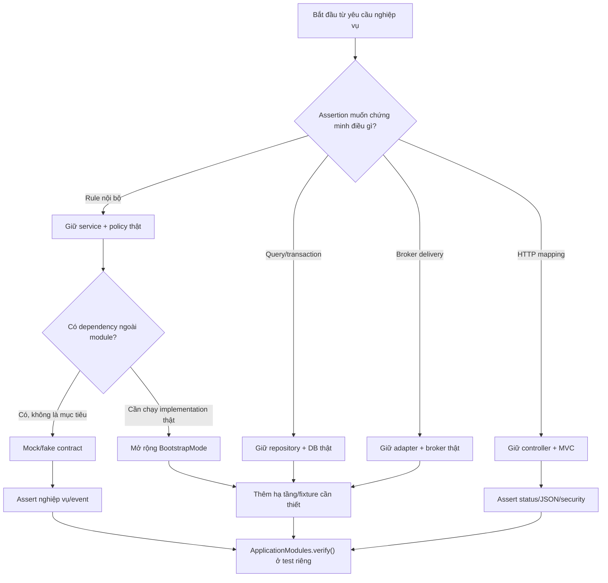

# Làm context nhỏ nhưng vẫn giữ hành vi cần kiểm chứng

## 1. Mục tiêu: “nhỏ” phải đi cùng “đúng”

Một bài kiểm thử `@ApplicationModuleTest` trong Spring Modulith không cần khởi động mọi module của ứng dụng. Đây là lợi thế lớn: khi kiểm thử module `orders`, ta có thể cô lập nó khỏi adapter thật của `inventory`, kết nối HTTP, message broker hoặc những module không liên quan. Nhưng một context có ít bean **chưa chắc là một bài test tốt**.

Hãy xét ba cách kiểm thử quy tắc đặt hàng:

- **Quá rộng:** khởi động toàn bộ ứng dụng, PostgreSQL, Kafka và tất cả listener chỉ để kiểm tra “số lượng phải lớn hơn 0”.
- **Quá hẹp:** mock luôn `OrderPlacementService` rồi xác nhận giá trị do mock trả về. Test chạy nhanh nhưng không thực thi quy tắc đặt hàng.
- **Vừa đủ:** giữ `OrderPlacementService` và `OrderPolicy` thật, thay duy nhất API tồn kho bên ngoài bằng mock/fake, đồng thời kiểm tra kết quả nghiệp vụ và sự kiện được phát.

Phương án thứ ba minh họa nguyên tắc **minimum sufficient context**: dùng tập bean và hạ tầng nhỏ nhất **vẫn thực thi đầy đủ đường hành vi mà assertion muốn chứng minh**.

Trong học phần `SPRING_MODULITH_VERIFICATION_TESTING`, mục tiêu rộng hơn là kiểm chứng ranh giới kiến trúc bằng `ApplicationModules` và quy tắc phụ thuộc, luyện `@ApplicationModuleTest` cho sự kiện, dữ liệu và tích hợp, sau đó kết hợp những bài kiểm tra này thành quality gate CI ngăn phụ thuộc sai và hồi quy.

**Kết quả cần đạt:** biết chọn ranh giới test dựa trên hành vi, nhận ra tình huống tối ưu quá mức khiến test mất giá trị, và tổ chức các mức kiểm thử bổ trợ nhau thay vì cố ép tất cả vào một context.

## 2. Ba câu hỏi phải trả lời trước khi chọn context

Trước khi thêm annotation, hãy trả lời:

1. **Hành vi nào phải chạy thật?** Ví dụ kiểm tra số lượng, tính tổng tiền, quyết định có đặt hàng, phát `OrderPlaced`, ghi database hay gửi message.
2. **Collaborator nào chỉ đóng vai trò cung cấp dữ liệu đầu vào?** Ví dụ API tồn kho của module khác, đồng hồ hệ thống, HTTP payment provider hoặc SMTP gateway.
3. **Đầu ra nào chứng minh yêu cầu?** Giá trị trả về, exception, trạng thái database, domain event, HTTP response, hay thông điệp đã được consumer nhận.

Nếu câu trả lời là “quy tắc đặt hàng”, hãy giữ bean chứa quy tắc đó là thật. Nếu câu trả lời là “câu SQL trên PostgreSQL”, hãy giữ repository, database và mapping thật. Nếu câu trả lời là “HTTP mapping”, phải thực sự đi qua web layer. Nếu câu trả lời là “Kafka producer gửi được message”, mock `KafkaTemplate` chưa đủ.

| Mục tiêu | Phần cần chạy thật | Có thể thay | Điều không được kết luận |
| --- | --- | --- | --- |
| Kiểm tra rule của `orders` | Domain policy và application service | API tồn kho ngoài module | SQL tồn kho đã đúng |
| Kiểm tra event từ `orders` | Service và event publisher | External gateway ngoài use case | Listener module khác đã chạy |
| Kiểm tra REST API `orders` | Controller, binding/serialization và phần logic được chọn | API ngoài module, đôi khi service nếu chỉ test web slice | Socket HTTP thật hoạt động |
| Kiểm tra JPA của `orders` | Repository, entity, transaction và database test | API bên ngoài không liên quan | Broker hay listener đã chạy |
| Kiểm tra Kafka adapter | Producer/serializer cùng broker test ở mức integration | Các module nghiệp vụ không liên quan | Toàn bộ kiến trúc module hợp lệ |
| Kiểm tra boundary kiến trúc | Mô hình `ApplicationModules` và quan hệ phụ thuộc code | Không cần bootstrap Spring Boot context | Runtime bean nào cũng khởi động được |

**Giảm context là quyết định về phạm vi, không phải phép thay thế assertion.**

## 3. Ba phạm vi thường bị nhầm với nhau

Trong một ứng dụng modulith, ta cần tách:

- **Module boundary:** class thuộc module nào và module nào được phép phụ thuộc vào API công khai của module nào.
- **Module test bootstrap scope:** `@ApplicationModuleTest` chọn module mục tiêu cùng các dependency theo `BootstrapMode`.
- **Spring bean/runtime scope:** bean thực sự xuất hiện do component scan, `@Bean`, auto-configuration, mock override hoặc test configuration.



`BootstrapMode.STANDALONE` không đồng nghĩa Spring không có `DataSource`, `ApplicationEventPublisher` hay `ObjectMapper`. Những bean hạ tầng có thể được Spring Framework/Boot tạo ra. Ngược lại, việc có kiểu `InventoryAvailability` trong classpath không có nghĩa implementation nghiệp vụ của module `inventory` được đăng ký trong context test.

**Giới hạn thực tế:** cùng là `STANDALONE`, một module có repository JPA, controller và listener nằm ngay trong package của nó có thể tạo context nặng hơn một module chỉ gồm service thuần. Tên mode không tự xác định số bean hay thời gian khởi động.

## 4. Kiến trúc ví dụ: bán hàng theo module

Giả sử ứng dụng `com.example.shop` gồm:

```text
src/main/java/com/example/shop/
├── ShopApplication.java
├── orders/
│   ├── OrderPlacementService.java
│   ├── OrderPlaced.java
│   └── internal/
│       └── OrderPolicy.java
├── inventory/
│   ├── InventoryAvailability.java       // API công khai
│   └── internal/
│       └── JdbcInventoryAvailability.java
└── notifications/
    └── OrderPlacedListener.java

src/test/java/com/example/shop/orders/
└── OrdersBehaviorModuleTest.java
```

Với cách nhận diện module mặc định phổ biến, `orders`, `inventory` và `notifications` là application module; `orders.internal` thuộc chính module `orders`. Một class trong package `internal` **vẫn có thể là bean thật của module sở hữu nó**. “Internal” là ranh giới truy cập giữa module, không phải lệnh loại component khỏi context.



Trong `STANDALONE`, ta muốn chạy thật `OrderPlacementService` và `OrderPolicy`; chỉ thay implementation `InventoryAvailability` của module `inventory`. Việc event được phát không yêu cầu listener bên ngoài module phải có mặt.

### 4.1. API thuộc module bên ngoài

```java
// src/main/java/com/example/shop/inventory/InventoryAvailability.java
package com.example.shop.inventory;

public interface InventoryAvailability {
    boolean isAvailable(String sku, int quantity);
}
```

Interface này là API của `inventory` theo cấu trúc ví dụ. Bản thân interface **không trở thành Spring bean** chỉ vì được Java import; context cần implementation thật, mock hoặc fake đã được đăng ký.

### 4.2. Policy nội bộ cần được giữ thật

```java
// src/main/java/com/example/shop/orders/internal/OrderPolicy.java
package com.example.shop.orders.internal;

import org.springframework.stereotype.Component;

@Component
public class OrderPolicy {

    public void validate(String sku, int quantity) {
        if (sku == null || sku.isBlank()) {
            throw new IllegalArgumentException(
                "SKU must not be blank");
        }
        if (quantity <= 0 || quantity > 10) {
            throw new IllegalArgumentException(
                "Quantity must be between 1 and 10");
        }
    }
}
```

`OrderPolicy` là một phần trách nhiệm nghiệp vụ của `orders`. Nếu mock bean này, bài test sẽ không còn phát hiện được lỗi hồi quy như đổi giới hạn `10` thành `0` hoặc bỏ kiểm tra SKU rỗng.

### 4.3. Event thuộc module nguồn

```java
// src/main/java/com/example/shop/orders/OrderPlaced.java
package com.example.shop.orders;

public record OrderPlaced(
    String orderId, String sku, int quantity) {
}
```

Record event là một payload Java, không nhất thiết là Spring singleton bean.

### 4.4. Application service thuộc module đích

```java
// src/main/java/com/example/shop/orders/OrderPlacementService.java
package com.example.shop.orders;

import com.example.shop.inventory.InventoryAvailability;
import com.example.shop.orders.internal.OrderPolicy;
import org.springframework.context.ApplicationEventPublisher;
import org.springframework.stereotype.Service;

@Service
public class OrderPlacementService {

    private final OrderPolicy policy;
    private final InventoryAvailability inventory;
    private final ApplicationEventPublisher events;

    public OrderPlacementService(
            OrderPolicy policy,
            InventoryAvailability inventory,
            ApplicationEventPublisher events) {
        this.policy = policy;
        this.inventory = inventory;
        this.events = events;
    }

    public String place(
            String orderId, String sku, int quantity) {

        policy.validate(sku, quantity);

        if (!inventory.isAvailable(sku, quantity)) {
            throw new IllegalStateException(
                "Insufficient stock: " + sku);
        }

        events.publishEvent(new OrderPlaced(
            orderId, sku, quantity));

        return "PLACED:" + orderId;
    }
}
```

Trong ví dụ này, đối tượng cần kiểm chứng là **`OrderPlacementService` cùng `OrderPolicy`**, không phải implementation JDBC của module `inventory`. Ta có thể giảm phần phụ thuộc ngoài mà vẫn giữ đường hành vi cần thiết.

## 5. Test tối thiểu có ý nghĩa: service thật, policy thật, boundary mock

Với Spring Framework 6.2+ và bộ thư viện Spring Boot/Spring Modulith tương thích:

```java
// src/test/java/com/example/shop/orders/OrdersBehaviorModuleTest.java
package com.example.shop.orders;

import com.example.shop.inventory.InventoryAvailability;
import org.junit.jupiter.api.Test;
import org.springframework.beans.factory.annotation.Autowired;
import org.springframework.modulith.test.ApplicationModuleTest;
import org.springframework.modulith.test.PublishedEvents;
import org.springframework.test.context.bean.override.mockito.MockitoBean;

import static org.assertj.core.api.Assertions.assertThat;
import static org.assertj.core.api.Assertions.assertThatThrownBy;
import static org.mockito.BDDMockito.given;
import static org.mockito.Mockito.verify;
import static org.mockito.Mockito.verifyNoInteractions;

@ApplicationModuleTest // Mặc định STANDALONE
class OrdersBehaviorModuleTest {

    @Autowired
    OrderPlacementService orders;

    @MockitoBean
    InventoryAvailability inventory;

    @Test
    void acceptsValidOrderAndPublishesEvent(
            PublishedEvents events) {

        given(inventory.isAvailable("SKU-1", 2))
            .willReturn(true);

        String result = orders.place(
            "ORD-1", "SKU-1", 2);

        assertThat(result).isEqualTo("PLACED:ORD-1");
        assertThat(events.ofType(OrderPlaced.class))
            .anySatisfy(event -> {
                assertThat(event.orderId())
                    .isEqualTo("ORD-1");
                assertThat(event.sku())
                    .isEqualTo("SKU-1");
                assertThat(event.quantity())
                    .isEqualTo(2);
            });

        verify(inventory).isAvailable("SKU-1", 2);
    }

    @Test
    void rejectsInvalidQuantityBeforeCheckingInventory() {

        assertThatThrownBy(() ->
            orders.place("ORD-2", "SKU-1", 0))
            .isInstanceOf(IllegalArgumentException.class)
            .hasMessageContaining("Quantity");

        verifyNoInteractions(inventory);
    }

    @Test
    void rejectsUnavailableProductWithoutPublishing(
            PublishedEvents events) {

        given(inventory.isAvailable("SKU-X", 3))
            .willReturn(false);

        assertThatThrownBy(() ->
            orders.place("ORD-3", "SKU-X", 3))
            .isInstanceOf(IllegalStateException.class)
            .hasMessageContaining("SKU-X");

        assertThat(events.ofType(OrderPlaced.class))
            .isEmpty();
    }
}
```

**Vì sao đây là một context đủ nhỏ mà có giá trị?**

1. `@ApplicationModuleTest` ở `STANDALONE` chọn module nghiệp vụ `orders`.
2. Bean `OrderPlacementService` và `OrderPolicy` là production code thật.
3. `@MockitoBean InventoryAvailability` cung cấp bean test cho API ở module `inventory` mà không cần JDBC adapter thật.
4. `ApplicationEventPublisher` của Spring tiếp tục được dùng để phát event.
5. `PublishedEvents` giúp assert sự kiện được phát trong bài test, không đòi hỏi khởi động bean listener của `notifications`.
6. Test kiểm chứng kết quả/exception **và** luồng event, thay vì chỉ kiểm tra Spring tạo được bean.

`@MockitoBean` thuộc Spring Test bean-override mechanism (Spring Framework 6.2 trở lên). Với dự án Spring Boot cũ hơn, có thể dùng `@MockBean` phù hợp phiên bản. Không dùng `@Mock` thuần của Mockito nếu bạn mong nó tự trở thành bean được inject vào service do Spring tạo.

### 5.1. Những gì bài test cố ý không chứng minh

- `JdbcInventoryAvailability` thực sự truy vấn tồn kho đúng.
- Database có schema và dữ liệu hợp lệ.
- `notifications.OrderPlacedListener` đã xử lý event.
- Message broker hoặc email provider bên ngoài đã nhận message.
- Mọi quan hệ giữa application module đều tuân thủ quy tắc kiến trúc.

Các câu hỏi này thuộc những phép kiểm chứng khác. Không nên gọi bộ test trên là “end-to-end integration test”.

### 5.2. Tại sao cần assertion nghiệp vụ?

Một bài chỉ chứa `verify(inventory).isAvailable(...)` có thể xanh khi service trả sai kết quả hoặc phát event sai payload. Hãy đặt assertion ở nơi thể hiện **contract nghiệp vụ**: giá trị trả về, exception, trạng thái, event hoặc response; dùng `verify(...)` bổ sung nếu việc gọi collaborator đúng cách cũng là một yêu cầu.

## 6. Test càng nhỏ có thể càng sai: ba phản ví dụ

### Phản ví dụ A — Mock chính đối tượng cần kiểm chứng

```java
@ApplicationModuleTest
class TooSmallOrderTest {

    @MockitoBean
    OrderPlacementService orders;

    @Test
    void appearsToPass() {
        given(orders.place("ORD-1", "SKU-1", 2))
            .willReturn("PLACED:ORD-1");

        assertThat(
            orders.place("ORD-1", "SKU-1", 2))
            .isEqualTo("PLACED:ORD-1");
    }
}
```

Đây là đoạn minh họa anti-pattern, được lược bỏ import. Nó kiểm tra Mockito trả lại giá trị đã stub; `OrderPlacementService` thật và `OrderPolicy` hoàn toàn không được chạy. Dù test rất nhanh, nó gần như không bảo vệ hành vi nghiệp vụ.

### Phản ví dụ B — Mock `ApplicationEventPublisher` khi mục tiêu là kiểm thử event

Nếu mock luôn event publisher rồi chỉ kiểm tra `publishEvent(...)` được gọi, bạn đã chứng minh rằng service gọi một method của mock. Điều đó khác với việc dùng `PublishedEvents` để quan sát sự kiện thật được công bố qua cơ chế event của Spring.

Mock publisher có thể hữu ích trong một unit test thuần về tương tác, nhưng không được coi là tương đương module test về event publication.

### Phản ví dụ C — Mock repository khi mục tiêu là truy vấn SQL

Nếu bài test cần xác minh mapping JPA, transaction, constraint hoặc câu query, thay `OrderJpaRepository` bằng Mockito mock khiến toàn bộ persistence adapter không được thực thi. Đó có thể là một **module behavior test hợp lệ**, nhưng không còn là **database integration test**.

**Nguyên tắc:** đừng làm context nhỏ bằng cách thay thế chính thành phần đang nằm trong yêu cầu kiểm chứng.

## 7. Mock hay fake: chọn theo loại hành vi

Một fake là implementation đơn giản của cùng contract, thường phù hợp cho nhiều kịch bản dùng dữ liệu ổn định.

Ví dụ tạo fake cho `InventoryAvailability` ngay trong module test:

```java
package com.example.shop.orders;

import com.example.shop.inventory.InventoryAvailability;
import org.junit.jupiter.api.Test;
import org.springframework.beans.factory.annotation.Autowired;
import org.springframework.boot.test.context.TestConfiguration;
import org.springframework.context.annotation.Bean;
import org.springframework.modulith.test.ApplicationModuleTest;

import static org.assertj.core.api.Assertions.assertThat;

@ApplicationModuleTest
class OrdersWithFakeInventoryTest {

    @Autowired
    OrderPlacementService orders;

    @Test
    void acceptsKnownSku() {
        assertThat(orders.place("ORD-4", "SKU-1", 2))
            .isEqualTo("PLACED:ORD-4");
    }

    @TestConfiguration(proxyBeanMethods = false)
    static class FakeInventoryConfiguration {

        @Bean
        InventoryAvailability inventoryAvailability() {
            return (sku, quantity) ->
                "SKU-1".equals(sku) && quantity <= 5;
        }
    }
}
```

Spring Boot Test thường nhận diện `static nested @TestConfiguration` để bổ sung bean vào context lớp test. Nếu đặt cấu hình top-level trong `src/test/java` để dùng chung, hãy nhập tường minh bằng `@Import(...)`.

| Tiêu chí | Mockito mock | Fake in-memory |
| --- | --- | --- |
| Điều khiển một phản hồi riêng | `given(...).willReturn(...)` rất thuận tiện | Phải tạo dữ liệu/hành vi |
| Kiểm tra tham số và số lần gọi | `verify(...)` trực tiếp | Cần API quan sát riêng nếu thật sự cần |
| Mô phỏng hành vi nhất quán qua nhiều lời gọi | Có thể, nhưng nhiều stub dễ khó đọc | Thường phù hợp |
| Nguy cơ state giữa các test | Mock thường được Spring Test reset theo chính sách mặc định | Fake mutable có thể rò state nếu không reset |
| Kiểm tra implementation production | Không | Cũng không |
| Mức phức tạp | Thấp cho scenario đơn lẻ | Có thể thấp hơn cho nhiều scenario |

Dù dùng cách nào, vẫn giữ **logic `orders` thật**. Fake đơn giản hơn production adapter không có nghĩa fake chứng minh tính đúng của adapter production.

## 8. Biết khi nào cần chọn `BootstrapMode` rộng hơn

Ba mode chính:

| Mode | Phạm vi application module được chọn | Sử dụng phù hợp |
| --- | --- | --- |
| `STANDALONE` | Module mục tiêu | Hành vi nội bộ có các API ngoài module được mock/fake |
| `DIRECT_DEPENDENCIES` | Module mục tiêu cùng các module phụ thuộc trực tiếp | Kiểm thử wiring/cộng tác với implementation thật của dependency gần nhất |
| `ALL_DEPENDENCIES` | Module mục tiêu và các dependency trực tiếp/bắc cầu | Luồng hợp tác nhiều tầng cần chạy thật |

```java
import org.springframework.modulith.test.ApplicationModuleTest;
import org.springframework.modulith.test.ApplicationModuleTest.BootstrapMode;

@ApplicationModuleTest(
    mode = BootstrapMode.DIRECT_DEPENDENCIES)
class OrdersWithRealInventoryTest {
    // Bổ sung setup và assertion kiểm thử hợp tác thật.
}
```

Trong cấu trúc ví dụ, nếu `orders` phụ thuộc trực tiếp API của `inventory`, `DIRECT_DEPENDENCIES` có thể chọn cả module `inventory`. Nhưng nó **không tự tạo database, HTTP server hoặc message broker** mà adapter của module phụ thuộc cần.

**Không dùng mode rộng chỉ để xóa `UnsatisfiedDependencyException`.** Tốt hơn là đọc nguyên nhân thiếu bean, xác định nó thuộc module ngoài, rồi quyết định giữa mock/fake và tích hợp thật dựa trên điều cần chứng minh.

Đặc biệt, module `notifications` lắng nghe `OrderPlaced` có thể **phụ thuộc vào module `orders`**, chứ không phải chiều ngược lại. Do đó `ALL_DEPENDENCIES` của `orders` không đồng nghĩa sẽ nạp `notifications` nếu module ấy không thuộc tập dependency mà mode chọn.

## 9. “Nhỏ” không chỉ là số module: bean bên trong module cũng có giá

Giả sử `orders` không còn đơn giản mà có:

```text
orders/
├── OrderPlacementService.java
├── internal/OrderPolicy.java
├── web/OrderRestController.java
├── persistence/OrderJpaRepository.java
├── persistence/OrderRow.java
└── messaging/OrderKafkaPublisher.java
```

Tất cả những thành phần này đều nằm **trong chính module `orders`**. Một module test `STANDALONE` không tự động bỏ controller, repository hay messaging adapter của module mục tiêu chỉ vì testcase không gọi chúng.

Các bean được đăng ký còn tùy stereotype, JPA repository scan, profile, property và auto-configuration. Vì vậy, việc thêm mock `InventoryAvailability` không bảo đảm database hoặc Kafka sẽ biến mất: chúng có thể cần cho bean khác đang được Spring tạo trong cùng module.

### Bảng chẩn đoán bề rộng context

| Phần làm context nặng | Câu hỏi cần hỏi | Cách giải quyết có mục tiêu |
| --- | --- | --- |
| JPA repository của `orders` | Bài test hiện tại có cần SQL thật không? | Tách test behavior và persistence, dùng cơ chế thay collaborator đúng phạm vi; vẫn kiểm tra auto-configuration |
| REST controller/Security | Có cần kiểm tra HTTP mapping không? | Dùng module web test hoặc MVC slice phù hợp |
| Kafka producer/listener | Có cần broker thật không? | Điều kiện profile/property hoặc mock port tại boundary khi chỉ test logic |
| Scheduled job | Test này có cần job chạy không? | Tách điều kiện kích hoạt job, không khởi chạy side effect không liên quan |
| HTTP client | Có cần kiểm tra request/response thật không? | Fake/mock client port cho logic; stub HTTP server cho adapter integration |
| Listener event ngoài module | Listener có thuộc tập dependency được chọn không? | Test phát event ở nguồn; test listener riêng ở module nhận |

Tách **vùng trách nhiệm cần kiểm chứng** không đồng nghĩa phải chia thêm application module chỉ để giảm số bean. Nếu kiến trúc có lý do chia module hoặc technical subpackage, việc tổ chức phù hợp có thể giúp test hẹp hơn; nhưng ranh giới module nên phản ánh trách nhiệm nghiệp vụ trước hết.

## 10. Chủ động chọn điều kiện đăng ký adapter

Có thể điều khiển adapter production có tạo bean hay không bằng những điều kiện Spring đã được thiết kế rõ trong dự án.

Ví dụ một adapter gọi external HTTP chỉ được bật khi feature tương ứng hoạt động:

```java
package com.example.shop.orders.integration;

import org.springframework.boot.autoconfigure.condition.ConditionalOnProperty;
import org.springframework.context.annotation.Configuration;
import org.springframework.context.annotation.Bean;

@Configuration(proxyBeanMethods = false)
class ExternalSyncConfiguration {

    @Bean
    @ConditionalOnProperty(
        prefix = "orders.external-sync",
        name = "enabled",
        havingValue = "true")
    ExternalSyncClient externalSyncClient() {
        return new ExternalSyncClient();
    }
}
```

`ExternalSyncClient` là kiểu minh họa, không phải phần bắt buộc của ví dụ `OrderPlacementService` ở trên. Nếu property không khớp, method `@Bean` không đăng ký client. Nhưng **một bean cần `ExternalSyncClient` qua constructor vẫn có thể thiếu dependency**; tắt adapter không phải cách hoàn chỉnh để sửa mọi lỗi bootstrap.

Một module test có thể đặt:

```java
@ApplicationModuleTest
@TestPropertySource(properties = {
    "orders.external-sync.enabled=false"
})
class OrdersWithoutExternalSyncTest {
}
```

Đây là cấu hình test rút gọn, cần bổ sung test method và các dependency của module. Dự án cần quy định rõ giá trị mặc định ở production và test để tránh việc tắt tính năng quan trọng ngoài ý định.

**Không sử dụng `@Profile("test")` để lén loại bỏ mọi adapter chỉ nhằm làm test xanh.** Nếu một test cần chứng minh adapter hoạt động, điều kiện làm nó biến mất sẽ khiến bài test thiếu đúng phần cần chạy.

## 11. `@TestConfiguration` và `@Import`: thêm ít nhưng đúng

Một số bean hỗ trợ test không thuộc module nghiệp vụ: `Clock` cố định, fake HTTP gateway hoặc một serializer đơn giản. `@TestConfiguration` là lựa chọn phù hợp để đăng ký chúng.

Ví dụ cấu hình thời gian dùng lại:

```java
package com.example.shop.testsupport;

import java.time.Clock;
import java.time.Instant;
import java.time.ZoneOffset;
import org.springframework.boot.test.context.TestConfiguration;
import org.springframework.context.annotation.Bean;

@TestConfiguration(proxyBeanMethods = false)
public class FixedClockTestConfiguration {

    @Bean
    Clock fixedClock() {
        return Clock.fixed(
            Instant.parse("2026-01-01T00:00:00Z"),
            ZoneOffset.UTC);
    }
}
```

Trong test có bean thực sự cần `Clock`:

```java
@ApplicationModuleTest
@Import(FixedClockTestConfiguration.class)
class OrdersWithFixedClockTest {
    // Test được bổ sung phù hợp với service dùng Clock.
}
```

`@Import` có thể đưa cấu hình vào test context dù source của nó nằm ngoài package module đích. Nhưng nó không thay đổi quyền truy cập API của module trong code production.

**Tránh import một cấu hình production có `@ComponentScan` toàn ứng dụng** để “có đủ bean”: cách này có thể kéo thêm database, listener, HTTP client, scheduler hoặc bean trùng kiểu, làm mất sự cô lập có chủ đích.

Nếu cả fake và implementation production của một API cùng xuất hiện, cần kiểm tra bean name, qualifier/`@Primary` hoặc cơ chế override. Bật `spring.main.allow-bean-definition-overriding=true` cho tất cả test thường chỉ che mâu thuẫn cấu hình.

## 12. Kiểm thử database: giữ repository thật khi SQL là yêu cầu

Một test về rule đặt hàng không nhất thiết cần PostgreSQL. Nhưng nếu yêu cầu là:

> “OrderRow được lưu đúng schema, `findById` đọc lại thông tin chính xác sau flush.”

Thì việc mock repository làm mất đường chạy cần kiểm chứng. Hãy thiết kế bài riêng cho persistence.

### 12.1. Entity và repository giả định thuộc `orders`

```java
// src/main/java/com/example/shop/orders/persistence/OrderRow.java
package com.example.shop.orders.persistence;

import jakarta.persistence.Entity;
import jakarta.persistence.Id;
import jakarta.persistence.Table;

@Entity
@Table(name = "orders")
public class OrderRow {

    @Id
    private String id;

    private String sku;
    private int quantity;

    protected OrderRow() {
    }

    public OrderRow(String id, String sku, int quantity) {
        this.id = id;
        this.sku = sku;
        this.quantity = quantity;
    }

    public String getId() {
        return id;
    }

    public String getSku() {
        return sku;
    }

    public int getQuantity() {
        return quantity;
    }
}
```

```java
// src/main/java/com/example/shop/orders/persistence/OrderJpaRepository.java
package com.example.shop.orders.persistence;

import org.springframework.data.jpa.repository.JpaRepository;

public interface OrderJpaRepository
        extends JpaRepository<OrderRow, String> {
}
```

`@Entity` không tự làm `OrderRow` thành singleton Spring bean. Spring Data tạo repository proxy khi cơ chế repository registration và JPA infrastructure phù hợp.

### 12.2. Test tích hợp với database thật

```java
// src/test/java/com/example/shop/orders/OrdersPersistenceTest.java
package com.example.shop.orders;

import com.example.shop.inventory.InventoryAvailability;
import com.example.shop.orders.persistence.OrderJpaRepository;
import com.example.shop.orders.persistence.OrderRow;
import jakarta.persistence.EntityManager;
import org.junit.jupiter.api.Test;
import org.springframework.beans.factory.annotation.Autowired;
import org.springframework.modulith.test.ApplicationModuleTest;
import org.springframework.test.context.DynamicPropertyRegistry;
import org.springframework.test.context.DynamicPropertySource;
import org.springframework.test.context.bean.override.mockito.MockitoBean;
import org.springframework.transaction.annotation.Transactional;
import org.testcontainers.containers.PostgreSQLContainer;
import org.testcontainers.junit.jupiter.Container;
import org.testcontainers.junit.jupiter.Testcontainers;

import static org.assertj.core.api.Assertions.assertThat;

@Testcontainers
@ApplicationModuleTest
@Transactional
class OrdersPersistenceTest {

    @Container
    static PostgreSQLContainer<?> postgres =
        new PostgreSQLContainer<>("postgres:16-alpine");

    @DynamicPropertySource
    static void databaseProperties(
            DynamicPropertyRegistry registry) {
        registry.add("spring.datasource.url",
            postgres::getJdbcUrl);
        registry.add("spring.datasource.username",
            postgres::getUsername);
        registry.add("spring.datasource.password",
            postgres::getPassword);
    }

    @MockitoBean
    InventoryAvailability inventory;

    @Autowired
    OrderJpaRepository repository;

    @Autowired
    EntityManager entityManager;

    @Test
    void persistsAndReadsAnOrderRow() {
        repository.saveAndFlush(
            new OrderRow("ORD-DB-1", "SKU-DB", 4));

        entityManager.clear();

        OrderRow restored = repository
            .findById("ORD-DB-1").orElseThrow();

        assertThat(restored.getSku()).isEqualTo("SKU-DB");
        assertThat(restored.getQuantity()).isEqualTo(4);
    }
}
```

**Điều kiện của ví dụ:** Spring Data JPA, driver PostgreSQL, Testcontainers và Docker được cấu hình tương thích; entity/repository được nhận diện; bảng `orders` tồn tại nhờ migration hoặc schema setup của môi trường test. Phần này không tự tạo schema.

Tại sao vẫn có `@MockitoBean InventoryAvailability` trong database test? Bởi vì Spring còn tạo `OrderPlacementService` của module `orders` và service này cần interface từ `inventory`. Mock chỉ **thỏa dependency ngoài mục tiêu**; `OrderJpaRepository`, JPA và PostgreSQL vẫn là thật, đúng với yêu cầu test persistence.

`@Transactional` trong test thường giúp rollback thay đổi tham gia transaction do Spring Test quản lý. Nhưng các giao dịch `REQUIRES_NEW`, công việc async hoặc side effect ra hệ thống khác không nhất thiết rollback cùng method test. Vì vậy phải có chiến lược fixture/cleanup tương ứng.

**Không rút ra kết luận rằng bài test này xác minh toàn bộ use case đặt hàng:** nó chỉ kiểm tra persistence đường ghi/đọc của entity đã được trình bày. Muốn kiểm tra service thật lưu đơn, production service phải có đường gọi repository và test phải đi qua đường đó.

## 13. Dùng test slice đúng mục đích, không thay nhầm module test

`@DataJpaTest` là một test slice thích hợp khi chỉ cần entity, repository và hạ tầng JPA; `@WebMvcTest` dành cho MVC controller và các thành phần web được chọn. Chúng có thể tạo context nhỏ hơn một module test khi mục tiêu chỉ nằm ở adapter đó.

| Annotation | Nên dùng khi | Không thay thế được |
| --- | --- | --- |
| `@ApplicationModuleTest` | Kiểm tra module thực hiện use case với bean nghiệp vụ thật | Không tự thay cho việc xác minh mỗi tích hợp ngoài JVM |
| `@DataJpaTest` | Kiểm tra entity mapping và repository query | Không tự kiểm chứng toàn module và dependency architecture |
| `@WebMvcTest` | Kiểm tra routing, binding, validation, JSON và web security phù hợp | Không tự chứng minh service trong module hoạt động thật nếu đã mock |
| `@SpringBootTest(webEnvironment = RANDOM_PORT)` | HTTP/integration theo mạng qua server thực | Không tự kiểm chứng quy tắc kiến trúc module |
| Mockito unit test | Kiểm tra thuật toán thuần không cần Spring | Không chứng minh wiring hoặc Spring behavior |

Không ghép bừa các annotation bootstrap có mục đích khác nhau vào cùng một class. **Chọn một mức kiểm thử cho một trách nhiệm rõ ràng**, rồi dùng nhóm test để có độ bao phủ tổng thể.

## 14. Web layer: giữ đường HTTP nếu HTTP là điều cần kiểm chứng

Nếu module `orders` có REST controller, một module test `STANDALONE` có thể phối hợp với `@AutoConfigureMockMvc` ở ứng dụng Spring MVC.

Ví dụ:

```java
package com.example.shop.orders;

import com.example.shop.inventory.InventoryAvailability;
import org.junit.jupiter.api.Test;
import org.springframework.beans.factory.annotation.Autowired;
import org.springframework.boot.test.autoconfigure.web.servlet.AutoConfigureMockMvc;
import org.springframework.modulith.test.ApplicationModuleTest;
import org.springframework.test.context.bean.override.mockito.MockitoBean;
import org.springframework.test.web.servlet.MockMvc;

import static org.mockito.BDDMockito.given;
import static org.springframework.test.web.servlet.request.MockMvcRequestBuilders.post;
import static org.springframework.test.web.servlet.result.MockMvcResultMatchers.status;

@ApplicationModuleTest
@AutoConfigureMockMvc
class OrdersWebModuleTest {

    @Autowired
    MockMvc mvc;

    @MockitoBean
    InventoryAvailability inventory;

    @Test
    void acceptsValidHttpRequest() throws Exception {
        given(inventory.isAvailable("SKU-1", 2))
            .willReturn(true);

        mvc.perform(post("/orders")
            .contentType("application/json")
            .content("""
                {"orderId":"ORD-HTTP-1","sku":"SKU-1","quantity":2}
                """))
            .andExpect(status().isCreated());
    }
}
```

Ví dụ này giả định ứng dụng đã có một `@RestController` trong module `orders` với endpoint `POST /orders`, request DTO và chính sách trả `201 Created` phù hợp. Đây là **ví dụ định hướng test adapter web**; chưa đầy đủ nếu chưa có controller thật và các assertion response body/validation của dự án.

`MockMvc` chạy request qua MVC infrastructure trong JVM, **không mở một cổng HTTP thật**. Nếu ứng dụng có Spring Security, filter chain/CSRF có thể trả `401` hoặc `403`; cần dùng test authentication và CSRF đúng contract, không đơn giản tắt toàn bộ security để đạt status mong đợi.

Nếu mục tiêu chỉ là rule đặt hàng, không cần thêm `@AutoConfigureMockMvc`. Nhưng nếu mục tiêu là kiểm tra HTTP mapping, bỏ controller và chỉ gọi service sẽ khiến bài test **quá nhỏ so với yêu cầu**.

## 15. Kiểm thử event: đừng nhầm “đã phát” với “đã xử lý”

Trong ví dụ `OrderPlacementService`, test `PublishedEvents` là đủ để chứng minh event `OrderPlaced` được công bố từ module `orders` với payload đúng.

Nhưng event có thể được tiêu thụ bởi `notifications.OrderPlacedListener` ở module khác. Trong `STANDALONE` của `orders`, listener của module ngoài không tự xuất hiện chỉ vì event được phát.

Cần chia mục tiêu:

| Mục tiêu | Context/đối tượng cần giữ thật | Assertion phù hợp |
| --- | --- | --- |
| `orders` phát `OrderPlaced` | `OrderPlacementService`, `ApplicationEventPublisher` | `PublishedEvents` chứa đúng event |
| `notifications` nhận và xử lý event | Listener thật trong context được chọn | Trạng thái/port thông báo phản ánh event |
| Event publication lưu bền vững | Registry/persistence backend thật nếu đó là yêu cầu | Bản ghi publication/transaction tương ứng |
| Message được externalize ra broker | Adapter externalization và broker test | Message được broker/consumer quan sát |

Với xử lý `@ApplicationModuleListener` hoặc các listener async/transactional, assertion phải đợi điều kiện hoàn tất theo cách có giới hạn, ví dụ dùng tiện ích `Scenario` của Spring Modulith Test phù hợp với phiên bản. `Thread.sleep(...)` cứng thường làm test flaky.

Cố đưa listener `notifications` vào test `orders` chỉ để nhìn thấy lời gọi listener có thể biến một behavior test nhỏ thành integration test ngoài chủ đích. Tốt hơn là có **bài riêng cho listener** và vài bài tích hợp xuyên module được chọn theo rủi ro.

## 16. Messaging: mock port nghiệp vụ, kiểm chứng broker bằng test khác

Giả sử module `orders` giao tiếp với một adapter Kafka hoặc RabbitMQ. Khi chỉ kiểm tra logic quyết định có tạo notification, một interface cổng như `OrderNotificationPort` và mock/fake của nó là đủ.

Ngược lại, nếu mục tiêu là “Kafka producer gửi thông điệp đúng topic/key và consumer đọc được”, phải kiểm tra adapter, serializer và broker thật hoặc broker test được kiểm soát.

| Kiểu kiểm thử | Có cần broker? | Chứng minh |
| --- | --- | --- |
| Module behavior với `@MockitoBean OrderNotificationPort` | Không | Service gọi đúng port và tạo payload đúng |
| Adapter test với `KafkaTemplate` mock | Không | Code adapter chọn topic/key/payload cho lời gọi producer |
| Integration test với Kafka Testcontainers | Có | Producer/broker/consumer tương tác qua hạ tầng thật trong môi trường test |

Nếu một `@KafkaListener` thuộc module mục tiêu và được tạo bởi component/auto-configuration, nó có thể kéo theo container factory hoặc kết nối broker dù testcase hiện tại không gọi adapter. Hãy xác định điều kiện kích hoạt listener, profile test và hạ tầng cần thiết thay vì loại toàn bộ messaging một cách tùy tiện.

**Cảnh báo:** tắt auto-configuration hoặc disable listener chỉ thích hợp với test không cần kiểm chứng listener. Một integration test mà listener bị tắt vẫn chạy xanh có thể là dấu hiệu test thiếu assertion quan trọng.

## 17. Loại bỏ phần không cần: profile, property và auto-configuration

Để giới hạn context, Spring cung cấp các cơ chế có trách nhiệm khác nhau:

| Cơ chế | Phù hợp để kiểm soát | Không tự làm được |
| --- | --- | --- |
| `@ActiveProfiles` | Bean/cấu hình gắn `@Profile` | Không tự thay `BootstrapMode` |
| `@TestPropertySource` | Giá trị property dùng cho bean condition | Không tự loại một module nghiệp vụ |
| `@TestConfiguration` | Thêm fake/bean hỗ trợ test | Không xóa mọi adapter production cùng kiểu |
| `@MockitoBean` | Mock/override một collaborator trong Spring context | Không biến repository thật thành database integration test |
| `spring.autoconfigure.exclude` | Loại một Boot auto-configuration ứng viên | Không xóa bean do ứng dụng đăng ký thủ công |
| `@ApplicationModuleTest(mode = ...)` | Tập application module được bootstrap | Không tự cung cấp database/broker |

Ví dụ muốn tắt auto-configuration JDBC trong **một bài behavior test thuần**:

```java
@ApplicationModuleTest
@TestPropertySource(properties = {
    "spring.autoconfigure.exclude=" +
        "org.springframework.boot.autoconfigure.jdbc.DataSourceAutoConfiguration"
})
class OrdersPureBehaviorTest {
    // Thêm mock/fake và assertions cụ thể.
}
```

Đây là lựa chọn **có điều kiện**: chỉ an toàn khi context thật sự không cần `DataSource` và không có auto-configuration phụ thuộc cần thiết. Nếu module `orders` chứa `JpaRepository` thật cần entity manager, exclusion có thể khiến test khởi động thất bại. Khi ấy phải xem lại phân tầng bean, hoặc dùng database test phù hợp, không tiếp tục tắt thêm các cấu hình cho đến khi context “tạm chạy”.

**Không đặt property exclude ở cấu hình toàn ứng dụng** chỉ vì một test nhỏ không cần JDBC; việc đó có thể phá production hoặc những integration test khác.

## 18. Rà soát bean thực tế: nhỏ bằng dữ liệu, không bằng suy đoán

Có thể inject `ApplicationContext` để kiểm tra bean quan trọng:

```java
package com.example.shop.orders;

import com.example.shop.inventory.InventoryAvailability;
import org.junit.jupiter.api.Test;
import org.springframework.beans.factory.annotation.Autowired;
import org.springframework.context.ApplicationContext;
import org.springframework.modulith.test.ApplicationModuleTest;
import org.springframework.test.context.bean.override.mockito.MockitoBean;

import static org.assertj.core.api.Assertions.assertThat;
import static org.mockito.Mockito.mockingDetails;

@ApplicationModuleTest
class OrdersContextFootprintTest {

    @Autowired
    ApplicationContext context;

    @MockitoBean
    InventoryAvailability inventory;

    @Test
    void keepsCoreBehaviorRealAndExternalPortMocked() {
        assertThat(context.getBeanNamesForType(
            OrderPlacementService.class)).hasSize(1);

        assertThat(context.getBeanNamesForType(
            com.example.shop.orders.internal.OrderPolicy.class))
            .hasSize(1);

        assertThat(mockingDetails(
            context.getBean(InventoryAvailability.class))
                .isMock()).isTrue();
    }
}
```

Assertion trên bảo vệ vài **bất biến về thành phần cốt lõi**: service/policy có mặt; port bên ngoài là mock. Tuy nhiên, nó không chứng minh database/broker vắng mặt hoặc module architecture hợp lệ.

Nếu cần truy nguồn một bean, có thể dùng `ConfigurableApplicationContext`/`BeanDefinition`; với Spring Boot auto-configuration, có thể xem Conditions Evaluation Report. Không khuyến khích assertion rằng “tổng số bean phải đúng 123”: số bean hạ tầng có thể thay đổi sau khi nâng phiên bản Spring Boot dù hành vi module vẫn đúng.

### Phân biệt “nhỏ” với “khởi động nhanh”

Một context ít bean vẫn có thể chậm vì migration, connection timeout hoặc scan classpath. Một context nhiều singleton bean đơn giản có thể khởi động nhanh hơn. Hãy đo:

- Thời gian bootstrap context đầu tiên.
- Thời gian chạy từng testcase.
- Số context khác nhau được tạo.
- Tỷ lệ context cache hit/miss.
- Số lần tạo database/broker container và chạy migration.
- Lỗi flaky khi chạy cả suite so với chạy từng test.

Mục tiêu là **đúng, ổn định và đủ nhanh**, không phải tối thiểu số bean bằng mọi giá.

## 19. Context cache: tránh tối ưu khiến test phụ thuộc thứ tự

Spring TestContext có cache `ApplicationContext` cho những cấu hình tương thích. Hai lớp `@ApplicationModuleTest` ở cùng module, mode, profile, property source và bean override tương đương có thể tái sử dụng context. Điều này giúp tiết kiệm bootstrap, nhưng cũng giữ lại singleton bean cùng state mutable của chúng.

Ví dụ fake inventory chứa một `Set<String>` có thể lưu SKU từ test trước. Nếu không reset, test chạy một mình và chạy cả suite có thể cho kết quả khác nhau.

Một số nguyên tắc:

1. Với Mockito mock, stub ngay trong từng test; Spring Test thường reset mock theo chính sách mặc định, nhưng không nên phụ thuộc stubbing từ method trước.
2. Với fake mutable, reset rõ ràng trong `@BeforeEach` hoặc dùng dữ liệu bất biến.
3. Với database, fixture độc lập và rollback/cleanup phù hợp; cache context không xóa dữ liệu bên ngoài.
4. Với event async, đợi công việc hoàn tất trước khi kết thúc test.
5. Với Testcontainers, đảm bảo container còn sống khi cached context còn tham chiếu tới JDBC/broker URL của nó.
6. Chỉ dùng `@DirtiesContext` khi context thật sự không còn an toàn để dùng lại, không phải để chữa mọi tình trạng dữ liệu bẩn.

Tối ưu cache có ý nghĩa khi giữ được tính độc lập. **Không đổi behavior test thành một chuỗi test phụ thuộc thứ tự chỉ để tăng cache hit.**

## 20. Ranh giới kiến trúc vẫn cần quality gate riêng

Một bài `orders` có mock `InventoryAvailability` có thể chạy xanh dù code production của `orders` trực tiếp import class ở `inventory.internal`. Spring có thể khởi động context với những bean test được cung cấp, nhưng việc này không làm quan hệ code trở nên hợp lệ.

Kiểm chứng bằng Spring Modulith:

```java
// src/test/java/com/example/shop/ModuleArchitectureTest.java
package com.example.shop;

import org.junit.jupiter.api.Test;
import org.springframework.modulith.core.ApplicationModules;

class ModuleArchitectureTest {

    @Test
    void dependenciesFollowModuleBoundaries() {
        ApplicationModules.of(ShopApplication.class).verify();
    }
}
```

`ApplicationModules.verify()` đánh giá mô hình application module và quy tắc dependency, không cần Spring Boot `ApplicationContext` đầy đủ. Vì vậy nó thường nhanh và không phụ thuộc vào database hoặc broker.

Một module test nhỏ cần đi cùng **kiểm chứng kiến trúc**:

- Kiểm tra `orders` chỉ sử dụng API của `inventory` theo quy tắc mô hình module.
- Kiểm tra không có phụ thuộc vòng hay truy cập vượt package/named interface.
- Kiểm tra use case `orders` hoạt động với mock/fake của API ngoài module.
- Kiểm tra implementation `inventory` thật ở test của module `inventory` hoặc bài integration.
- Kiểm tra event được phát và listener được xử lý ở những mức riêng.

Không dùng `ApplicationModules.verify()` thay cho kiểm thử hành vi, và không dùng việc module test chạy xanh thay cho `verify()`.

## 21. Ma trận “ít nhất nhưng đủ” cho một quality gate CI

Ví dụ một pipeline theo mức rủi ro:

| Cấp kiểm thử | Bài chạy | Hạ tầng cần | Phát hiện chính |
| --- | --- | --- | --- |
| **Kiến trúc** | `ApplicationModules.verify()` | Không cần Spring Boot context | Phụ thuộc sai chiều, vượt ranh giới module |
| **Core behavior** | `@ApplicationModuleTest(STANDALONE)` | Mock/fake API ngoài | Sai nghiệp vụ, thiếu bean cần thiết |
| **Event publication** | Module test + `PublishedEvents` | Event publisher trong context | Thiếu/sai payload event |
| **Web contract** | `MockMvc` hoặc MVC slice | MVC/security được chọn | Sai HTTP status, binding, JSON, validation |
| **Persistence** | JPA test + Testcontainers | Database/schema/transaction | Sai mapping, query, transaction |
| **Messaging/consumer** | Broker integration test | Kafka/RabbitMQ test | Sai topic, serialization, xử lý message |
| **Selected end-to-end** | Luồng liên module trọng yếu | Hạ tầng test cho đường đi ấy | Lỗi wiring và hồi quy nhiều adapter |

Cần chạy các tầng theo mức độ rủi ro và chi phí. Ví dụ architecture và core behavior có thể chạy trên mọi pull request; các integration test quan trọng vẫn phải được chạy trong quality gate phù hợp, không biến mất chỉ vì chúng tốn thời gian.

### Quy tắc tăng phạm vi khi có lỗi

Khi behavior test xanh nhưng integration test thất bại, **đừng tự động thay mọi behavior test bằng integration test**. Hãy xác định khoảng trống:

1. Contract mock/fake có khác response thật của collaborator không?
2. Có một adapter riêng cần bổ sung assertion không?
3. Có sự khác nhau về transaction/event timing không?
4. Profile/auto-configuration làm bean production khác bean trong test không?
5. Có vi phạm dependency module mà `ApplicationModules.verify()` cần chặn không?

Một integration test thất bại có thể dẫn đến bổ sung **một** bài kiểm chứng adapter thích hợp, thay vì phình mọi context.

## 22. Bài tập thực hành: thu nhỏ một test quá rộng

Giả sử test hiện tại viết:

```java
@SpringBootTest
class OrderServiceIntegrationEverythingTest {

    @Autowired
    OrderPlacementService orders;

    @Test
    void rejectsNegativeQuantity() {
        assertThatThrownBy(() ->
            orders.place("ORD-1", "SKU-1", -1))
            .isInstanceOf(IllegalArgumentException.class);
    }
}
```

Đây là ví dụ rút gọn, bỏ các import. Dự án có PostgreSQL, Kafka và một số external client. Test chỉ muốn kiểm tra quantity âm.

**Yêu cầu:** chuyển thành module behavior test nhỏ hơn mà không bỏ qua logic nghiệp vụ.

Hướng giải:

1. Đặt test ở package `com.example.shop.orders`.
2. Dùng `@ApplicationModuleTest` mặc định `STANDALONE`.
3. Giữ `OrderPlacementService` và `OrderPolicy` thật.
4. Cung cấp `@MockitoBean InventoryAvailability` cho collaborator ngoài module nếu service cần nó ở bootstrap.
5. Assert `IllegalArgumentException` khi quantity âm.
6. Dùng `verifyNoInteractions(inventory)` để chứng minh validation chặn trước khi gọi ra ngoài.
7. Không khởi động PostgreSQL/Kafka nếu không có thành phần được đăng ký nào của context còn cần chúng.
8. Giữ một bài DB/Kafka integration khác cho những hành vi thật sự cần hạ tầng.
9. Chạy `ApplicationModules.verify()` để xác minh ranh giới module.

**Điểm quan trọng:** nếu chính module `orders` còn chứa repository hoặc producer đang được Spring tạo, chỉ thay `@SpringBootTest` bằng `@ApplicationModuleTest` có thể **chưa đủ** để bỏ mọi hạ tầng. Phải đọc bean nào gây startup, điều kiện cấu hình và chọn cách tách kiểm thử phù hợp.

## 23. Cây quyết định: cần giữ gì, thay gì?



Nếu phần cần kiểm chứng là rule, chọn con đường **service thật + policy thật + boundary mock**. Nếu cần SQL/HTTP/broker, đừng tắt chính adapter cần quan sát. Bản chất của kiểm thử mô-đun là xác định ranh giới theo trách nhiệm, không chỉ tối ưu thời gian chạy.

## 24. Chẩn đoán khi test vẫn nặng hoặc sai ý định

| Dấu hiệu | Vấn đề thường gặp | Hướng xử lý |
| --- | --- | --- |
| `STANDALONE` vẫn cần `DataSource` | Repository/adapter trong chính module đang được tạo | Xem JPA scope và mục tiêu test; tách persistence test hoặc cấu hình adapter có chủ đích |
| Lỗi `NoSuchBeanDefinitionException` cho API ngoài module | Implementation ngoài phạm vi | Mock/fake đúng API hoặc chọn mode tích hợp thật |
| Test xanh nhưng không chạy logic chính | Mock service/policy đang được kiểm chứng | Giữ bean thật và bổ sung assertion nghiệp vụ |
| Event test xanh nhưng listener không chạy | Listener ở module khác hoặc async chưa hoàn tất | Phân biệt phát và xử lý event; test listener riêng |
| Integration test không chạm SQL | Repository đã bị mock | Dùng repository thật và DB test |
| Mock tồn kho bị gọi sau validation fail | Rule hoặc thứ tự xử lý thay đổi | Assertion `verifyNoInteractions` cùng exception |
| Kafka adapter vẫn mở kết nối trong behavior test | Bean/condition messaging còn active | Kiểm tra profile/property/auto-config, test port thay adapter nếu thích hợp |
| Context khởi động nhiều lần | Profile/mock/property/config khác nhau | Xem TestContext cache, chuẩn hóa cấu hình khi đúng ý định |
| Test pass riêng nhưng fail cả suite | Fake singleton, dữ liệu DB/broker hoặc async leak state | Reset/fixture/cleanup, kiểm soát parallel run |
| CI xanh nhưng module phụ thuộc sai | Thiếu architecture gate | Chạy `ApplicationModules.verify()` |
| Test chỉ assert “context loads” | Không chứng minh nghiệp vụ | Bổ sung assertion theo use case |

## 25. Câu hỏi tự kiểm tra

1. Vì sao một context chỉ có 20 bean chưa chắc là “tốt hơn” một context có 100 bean?
2. Khi kiểm tra quy tắc quantity của `orders`, vì sao không nên mock `OrderPolicy`?
3. `@ApplicationModuleTest` ở `STANDALONE` có tự động tắt repository JPA thuộc chính `orders` không?
4. Có `@MockitoBean InventoryAvailability` thì ta đã kiểm thử được adapter JDBC thật của `inventory` chưa?
5. Vì sao `PublishedEvents` phù hợp để xác nhận module `orders` đã phát event mà không cần nạp listener module `notifications`?
6. Nếu muốn chứng minh listener đã gửi notification, phần nào phải chạy thật và cần assertion nào?
7. Khi mục tiêu là mapping SQL trên PostgreSQL, nên dùng mock repository hay database test?
8. `@DataJpaTest` và `@WebMvcTest` có tự thay thế phép `ApplicationModules.verify()` không?
9. Khi nào `DIRECT_DEPENDENCIES` là lựa chọn tốt hơn `STANDALONE`?
10. Vì sao tắt `DataSourceAutoConfiguration` không nhất thiết làm database-related startup error biến mất?
11. Nếu test có fake mutable singleton, Spring context cache có tự làm sạch fake giữa mọi method không?
12. Test `MockMvc` có kiểm tra được TLS/reverse proxy/server port thật không?
13. Một `@KafkaListener` đang hoạt động trong context nhưng bài test không cần broker, nên xem lại những điều kiện nào?
14. Vì sao chỉ kiểm tra `verify(inventory).isAvailable(...)` là chưa đủ để bảo vệ logic đặt hàng?
15. Nếu muốn giảm thời gian CI, nên loại bỏ integration test quan trọng hay tổ chức theo các tầng có mục tiêu khác nhau?

**Đáp án gợi ý:** (1) quy mô không bảo đảm chạy đúng hành vi; (2) mock sẽ bỏ qua chính rule cần kiểm chứng; (3) không, adapter thuộc module vẫn có thể được đăng ký; (4) chưa; (5) kiểm chứng event được phát ngay trong context của module nguồn; (6) listener/port hoặc adapter thật tùy mục tiêu, assert kết quả xử lý sau khi hoàn tất; (7) database test với repository thật; (8) không; (9) khi cần kiểm chứng collaborator thật thuộc dependency module trực tiếp; (10) bean thủ công hoặc thành phần JPA khác vẫn có thể cần hạ tầng; (11) không, reset có chủ đích; (12) không, `MockMvc` chạy trong JVM; (13) profile, property và auto-configuration của listener/producer; (14) chưa assert kết quả/exception/event; (15) phân tầng test theo chi phí và rủi ro, vẫn giữ các phép kiểm chứng cần thiết.

## 26. Checklist thiết kế context nhỏ nhưng đủ

- [ ] Đã xác định **một hành vi cụ thể** mà bài test phải chứng minh.
- [ ] Bean chứa hành vi đó **được chạy thật**, không bị mock do thói quen.
- [ ] `@ApplicationModuleTest` nằm đúng package module mục tiêu; `BootstrapMode` có lý do rõ ràng.
- [ ] Collaborator ngoài module được mock/fake nếu chỉ là nguồn phản hồi.
- [ ] Repository, controller, listener hay broker được giữ thật khi chính chúng nằm trong yêu cầu.
- [ ] Có assertion kết quả nghiệp vụ, exception, event, HTTP response, dữ liệu hoặc message tương ứng.
- [ ] Không import một production configuration quét cả ứng dụng để chữa lỗi thiếu bean.
- [ ] Profile, property và test configuration không âm thầm tắt một adapter đang cần kiểm chứng.
- [ ] Có chiến lược reset fake, database fixture, async completion và Testcontainers lifecycle.
- [ ] Đã kiểm tra context thực tế và đo thời gian/độ ổn định nếu cần tối ưu hiệu năng.
- [ ] Có `ApplicationModules.verify()` trong CI để chặn phụ thuộc sai độc lập với runtime test.
- [ ] Các bài integration quan trọng vẫn hiện diện dù module behavior test đã chạy nhanh.

**Ghi nhớ:** context tốt không phải context có ít bean nhất, mà là **context nhỏ nhất vẫn giữ đường hành vi cần kiểm chứng chạy thật**. Với Spring Modulith, hãy bắt đầu từ `@ApplicationModuleTest` đúng module và `STANDALONE` khi phù hợp, thay collaborator ngoài phạm vi bằng mock/fake có chủ đích, mở rộng sang database/web/messaging chỉ khi assertion đòi hỏi. Kết hợp `ApplicationModules.verify()` với kiểm thử hành vi và tích hợp để CI vừa gọn vừa bảo vệ được kiến trúc và chức năng.
