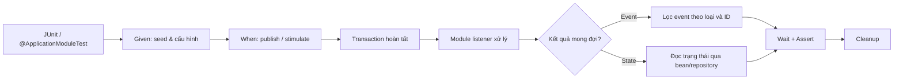

# Scenario biểu diễn một luồng kiểm thử module như thế nào?

## 1. Vị trí của Scenario trong kiểm thử Spring Modulith

Trong học phần **SPRING_MODULITH_VERIFICATION_TESTING**, mục tiêu là kiểm chứng cả **ranh giới kiến trúc** lẫn **hành vi tích hợp** của ứng dụng Spring Modulith: dùng `ApplicationModules` và các quy tắc phụ thuộc để phát hiện vi phạm cấu trúc, dùng `@ApplicationModuleTest` để khởi động module có kiểm soát, sau đó kiểm tra sự kiện, trạng thái cơ sở dữ liệu và các tương tác liên module trước khi đưa phép kiểm vào quality gate CI.

Ở chương **Scenario**, câu hỏi trọng tâm là: *một tác nhân kích hoạt module, module xử lý bất đồng bộ, và bài kiểm thử biết lúc nào kết quả đã xuất hiện bằng cách nào?*

**`org.springframework.modulith.test.Scenario`** là một DSL (ngôn ngữ mô tả kiểm thử) để diễn đạt luồng đó theo thứ tự:

> **Kích hoạt (stimulus) → chờ một kết quả có thể quan sát → lọc đúng kết quả → khẳng định → dọn dữ liệu thử nghiệm.**

`Scenario` phù hợp nhất với các bài kiểm thử tích hợp, đặc biệt khi module giao tiếp qua **Spring application events**, `@TransactionalEventListener` hoặc `@ApplicationModuleListener`. Nó gom việc phát sự kiện/thực thi lời gọi trong transaction, chờ bằng cơ chế polling và kiểm chứng kết quả thành một chuỗi lệnh có thể đọc như kịch bản nghiệp vụ.

`Scenario` **không tự kiểm tra luật phụ thuộc giữa các module**. Việc module A có import vào package nội bộ của module B, phụ thuộc vòng hoặc vi phạm `allowedDependencies` là nhiệm vụ của `ApplicationModules.verify()`. Hai lớp kiểm tra bổ sung cho nhau: **cấu trúc hợp lệ** và **hành vi thực tế đúng**.

## 2. Một Scenario có những pha nào?

| Pha | Ý nghĩa | API thường dùng |
| --- | --- | --- |
| **1. Given** | Chuẩn bị trạng thái đầu vào, fixture, mock hệ thống ngoài, dữ liệu DB. Pha này thường viết bằng setup JUnit hoặc repository. | `@BeforeEach`, repository, `@MockitoBean` |
| **2. When / stimulus** | Đưa một tín hiệu vào hệ thống: phát sự kiện hoặc gọi bean của module. | `scenario.publish(event)`, `scenario.stimulate(() -> service.action())` |
| **3. Wait / observe** | Nêu tín hiệu hoàn tất cần chờ, vì listener có thể chạy sau commit và bất đồng bộ. | `andWaitForEventOfType(...)`, `andWaitForStateChange(...)` |
| **4. Match / assert** | Lọc sự kiện của đúng giao dịch và kiểm tra dữ liệu nghiệp vụ. | `matching(...)`, `matchingMappedValue(...)`, `toArriveAndVerify(...)`, `andVerify(...)` |
| **5. Cleanup** | Xóa dữ liệu phát sinh từ stimulus đã commit, kể cả khi assertion thất bại. | `andCleanup(...)` hoặc cơ chế dọn dữ liệu độc lập |

`Given` là cách tổ chức của bài kiểm thử, không phải phương thức có tên `given(...)` trong DSL `Scenario`.



Có **hai cách quan sát đầu ra** quan trọng:

1. **Event-driven:** “Sau sự kiện `OrderPaid`, module vận chuyển phải phát `ShipmentRequested` cho cùng `orderId`”. Khi ấy bài kiểm thử chờ **event**.
2. **State-driven:** “Sau sự kiện `OrderPaid`, một bản ghi shipment phải đạt trạng thái `REQUESTED`”. Khi ấy bài kiểm thử chờ **trạng thái được truy vấn** từ module hoặc DB.

Cả hai đều dùng một stimulus; cách chọn phụ thuộc **hợp đồng đầu ra mà bài kiểm thử cần bảo đảm**.

## 3. Chuẩn bị môi trường kiểm thử

Thêm dependency thử nghiệm Spring Modulith (ví dụ Maven):

```xml
<dependency>
    <groupId>org.springframework.modulith</groupId>
    <artifactId>spring-modulith-starter-test</artifactId>
    <scope>test</scope>
</dependency>
```

Đặt lớp JUnit 5 trong package của module được kiểm thử, chẳng hạn `com.acme.shipping`, rồi sử dụng `@ApplicationModuleTest`. Spring Modulith có thể cấp `Scenario` trực tiếp cho tham số phương thức test:

```java
package com.acme.shipping;

import org.junit.jupiter.api.Test;
import org.springframework.modulith.test.ApplicationModuleTest;
import org.springframework.modulith.test.Scenario;

@ApplicationModuleTest // Mặc định BootstrapMode.STANDALONE
class ShippingScenarioTests {

    @Test
    void someBusinessFlow(Scenario scenario) {
        // Mô tả một luồng kích hoạt → chờ → kiểm chứng tại đây
    }
}
```

Các chế độ khởi động:

| Chế độ | Module được khởi động | Dùng khi |
| --- | --- | --- |
| `STANDALONE` (mặc định) | Chỉ module đang kiểm thử. | Muốn cô lập module và mock các bean bên ngoài. |
| `DIRECT_DEPENDENCIES` | Module hiện tại và các module phụ thuộc trực tiếp. | Muốn kiểm tra liên kết trực tiếp mà không bật toàn bộ cây phụ thuộc. |
| `ALL_DEPENDENCIES` | Module hiện tại và toàn bộ cây phụ thuộc của nó. | Thực sự cần luồng đi qua nhiều phụ thuộc. |

Nếu chạy `STANDALONE` mà bean của module cần gọi trực tiếp bean ở module khác, hãy xem xét mock qua `@MockitoBean` hoặc chọn bootstrap mode hợp lý. Một **event DTO thuộc API công khai** của module khác có thể xuất hiện trên classpath mà không đòi hỏi khởi tạo bean của module phát ra event.

## 4. Ví dụ xuyên suốt: thanh toán thành công → yêu cầu tạo vận đơn

Giả sử ứng dụng có hai module:

- **`order`** công bố event công khai `OrderPaid(orderId)`.
- **`shipping`** lắng nghe `OrderPaid`, rồi phát `ShipmentRequested(orderId, carrier)`.

Đây là ví dụ tối giản về phối hợp qua sự kiện; logic đặt hãng vận chuyển và thao tác kho thực tế đã được giản lược để tập trung vào DSL `Scenario`.

**Hợp đồng event do module `order` công bố** — `com/acme/order/api/OrderPaid.java`:

```java
package com.acme.order.api;

import java.util.UUID;

public record OrderPaid(UUID orderId) {}
```

**Event đầu ra của `shipping`** — `com/acme/shipping/ShipmentRequested.java`:

```java
package com.acme.shipping;

import java.util.UUID;

public record ShipmentRequested(UUID orderId, String carrier) {}
```

**Listener của module `shipping`** — `com/acme/shipping/ShippingEventHandler.java`:

```java
package com.acme.shipping;

import com.acme.order.api.OrderPaid;
import org.springframework.context.ApplicationEventPublisher;
import org.springframework.modulith.events.ApplicationModuleListener;
import org.springframework.stereotype.Component;

@Component
class ShippingEventHandler {

    private final ApplicationEventPublisher events;

    ShippingEventHandler(ApplicationEventPublisher events) {
        this.events = events;
    }

    @ApplicationModuleListener
    public void on(OrderPaid event) {
        // Ví dụ rút gọn: hệ thống thật sẽ kiểm tra nghiệp vụ trước bước này.
        events.publishEvent(new ShipmentRequested(event.orderId(), "STANDARD"));
    }
}
```

`@ApplicationModuleListener` là cách viết gọn cho listener theo transaction, xử lý bất đồng bộ và chạy trong transaction riêng. Bởi vậy, **không nên** gọi `events.publishEvent(...)` rồi lập tức assert trên kết quả trong luồng test như thể listener luôn chạy đồng bộ.

**Kịch bản tích hợp** — `src/test/java/com/acme/shipping/ShippingScenarioTests.java`:

```java
package com.acme.shipping;

import static org.assertj.core.api.Assertions.assertThat;

import java.time.Duration;
import java.util.UUID;

import com.acme.order.api.OrderPaid;
import org.junit.jupiter.api.Test;
import org.springframework.modulith.test.ApplicationModuleTest;
import org.springframework.modulith.test.Scenario;

@ApplicationModuleTest
class ShippingScenarioTests {

    @Test
    void requestsShipmentAfterOrderIsPaid(Scenario scenario) {
        UUID orderId = UUID.randomUUID();

        scenario.publish(new OrderPaid(orderId))
                .andWaitAtMost(Duration.ofSeconds(3))
                .forEventOfType(ShipmentRequested.class)
                .matchingMappedValue(ShipmentRequested::orderId, orderId)
                .toArriveAndVerify(event ->
                        assertThat(event.carrier()).isEqualTo("STANDARD"));
    }
}
```

Đọc từ trái sang phải:

1. `publish(new OrderPaid(orderId))`: kích hoạt luồng giống như module `order` vừa thông báo thanh toán thành công.
2. `andWaitAtMost(3s)`: xác định giới hạn chờ kết quả; nếu không đạt kỳ vọng trong thời gian đó, test thất bại.
3. `forEventOfType(ShipmentRequested.class)`: chỉ quan sát loại sự kiện được yêu cầu.
4. `matchingMappedValue(ShipmentRequested::orderId, orderId)`: nhận đúng sự kiện mang **cùng correlation ID**; tránh đạt nhầm do một test hay giao dịch khác.
5. `toArriveAndVerify(...)`: thực thi kịch bản, chờ sự kiện phù hợp và xác nhận nội dung `carrier`.

Cú pháp tương đương khi không cần cấu hình thời gian chờ ngay tại dòng đó:

```java
scenario.publish(new OrderPaid(orderId))
        .andWaitForEventOfType(ShipmentRequested.class)
        .matching(event -> event.orderId().equals(orderId))
        .toArrive();
```

`toArrive()` chỉ yêu cầu sự kiện phù hợp xuất hiện; `toArriveAndVerify(...)` còn cho phép kiểm tra các thuộc tính của sự kiện nhận được. Nếu stimulus là một lời gọi trả về dữ liệu, overload của `toArriveAndVerify` có thể kiểm tra cả **event** và **giá trị trả về của stimulus**.

## 5. Biến thể: gọi bean thay vì trực tiếp phát sự kiện

Khi mục tiêu là kiểm thử cổng vào công khai của module (API/service), chọn `stimulate`:

```java
@Test
void publishesEventWhenServiceAcceptsOrder(Scenario scenario) {
    UUID orderId = UUID.randomUUID();

    scenario.stimulate(() -> orderService.accept(orderId))
            .andWaitForEventOfType(OrderAccepted.class)
            .matching(event -> event.orderId().equals(orderId))
            .toArriveAndVerify(event ->
                    assertThat(event.orderId()).isEqualTo(orderId));
}
```

Trong ví dụ này, giả định `orderService` là bean được inject, `accept` là API nghiệp vụ và `OrderAccepted` là event mà API đó phát. `stimulate(Runnable)` hợp với lời gọi không cần giữ kết quả; `stimulate(Supplier<T>)` hợp khi muốn lấy và kiểm tra giá trị trả về.

Lưu ý khác biệt về phạm vi: `publish(...)` có thể **bỏ qua bước xử lý của module nguồn**. Nếu muốn xác nhận cả việc “dịch vụ xử lý đơn hàng thành công rồi mới phát sự kiện”, hãy bắt đầu từ lời gọi dịch vụ thích hợp hoặc viết test cấp cao hơn; test chỉ publish event thì mới chứng minh được **khả năng phản ứng của module nhận**.

## 6. Biến thể: chờ trạng thái trong cơ sở dữ liệu

Đôi khi hợp đồng quan trọng nhất không phải event được phát, mà là một trạng thái bền vững đã được ghi. Giả sử module `shipping` có bean truy vấn `shipmentQuery.findByOrderId(UUID)`, trả về `Optional<ShipmentView>`, và listener lưu bản ghi sau khi xử lý `OrderPaid`.

```java
@Test
void persistsShipmentRequest(Scenario scenario) {
    UUID orderId = UUID.randomUUID();

    scenario.publish(new OrderPaid(orderId))
            .andWaitForStateChange(() -> shipmentQuery.findByOrderId(orderId))
            .andVerify(result -> {
                assertThat(result).isPresent();
                assertThat(result.orElseThrow().status()).isEqualTo("REQUESTED");
            });
}
```

`andWaitForStateChange(...)` gọi lại supplier theo cơ chế polling, thay vì `Thread.sleep(...)` với thời gian cố định. Theo mặc định, giá trị **khác `null`** được coi là dấu hiệu hoàn tất; với `Optional` thì cần có phần tử và với `boolean` thì cần `true`. Có thể cung cấp predicate riêng khi muốn đợi điều kiện chặt hơn:

```java
scenario.publish(new OrderPaid(orderId))
        .andWaitForStateChange(
                () -> shipmentQuery.findByOrderId(orderId),
                found -> found.isPresent()
                        && found.orElseThrow().status().equals("REQUESTED"))
        .andVerify(found -> assertThat(found).isPresent());
```

Khi dùng DB thực, cần chuẩn bị dữ liệu đầu vào, cấu hình datasource phù hợp (ví dụ database thử nghiệm/Testcontainers), bảo đảm transaction của listener đã commit trước khi coi state là thành công và dọn dữ liệu sau test. **Đã quan sát được event không nhất thiết có nghĩa mọi ghi dữ liệu hậu xử lý đã commit**; nếu hợp đồng là trạng thái DB, hãy dùng nhánh chờ trạng thái.

## 7. Biến thể: chứng minh một event *không* xuất hiện

Một quy tắc thường gặp: thanh toán bị từ chối **không được** yêu cầu tạo vận đơn. Khi đó chờ một khoảng thời gian hữu hạn và thất bại ngay nếu event bị cấm xuất hiện:

```java
scenario.publish(new PaymentRejected(orderId))
        .andWaitAtMost(Duration.ofSeconds(1))
        .forEventOfType(ShipmentRequested.class)
        .matching(event -> event.orderId().equals(orderId))
        .notToArrive();
```

`PaymentRejected` là event minh họa; test này giả định hệ thống có thể nhận nó. `notToArrive()` thành công sau khi **hết cửa sổ chờ** mà không thấy event phù hợp; nó không chứng minh rằng event sẽ không bao giờ xuất hiện về sau. Hãy chọn thời gian chờ dựa trên SLA và đặc điểm xử lý, tránh timeout quá ngắn gây sai lệch.

## 8. Transaction và dọn dữ liệu: chỗ dễ hiểu nhầm nhất

Tín hiệu từ `Scenario.publish(...)` hoặc `Scenario.stimulate(...)` được thực thi trong một **transaction mới** để các `@TransactionalEventListener` nhận được event đúng thời điểm. Vì thế, thay đổi DB của stimulus **không tự động rollback** chỉ vì phương thức JUnit test kết thúc hoặc test có transaction bao ngoài. Listener bất đồng bộ có thể tự mở transaction khác.

Nếu stimulus tạo dữ liệu, đăng ký cleanup cho đúng đối tượng của scenario. Ví dụ giả định `orderService.submit(...)` trả về `UUID`, còn `testDataCleaner.removeOrderAndShipments(...)` xóa dữ liệu thử nghiệm có liên quan:

```java
scenario.stimulate(() -> orderService.submit("SKU-42", 2))
        .andCleanup(orderId ->
                testDataCleaner.removeOrderAndShipments(orderId))
        .andWaitForEventOfType(ShipmentRequested.class)
        .toArriveAndVerify((event, orderId) ->
                assertThat(event.orderId()).isEqualTo(orderId));
```

`andCleanup(...)` được đăng ký để chạy sau kịch bản **cả khi thành công lẫn khi thất bại**. Bên trong cleanup nên có transaction phù hợp và xóa dữ liệu theo thứ tự phụ thuộc khóa ngoại. Nếu handler còn xử lý nền sau khi event đích xuất hiện, phải chọn một tín hiệu hoàn tất đủ mạnh trước khi cleanup để không tạo race condition. Tránh phụ thuộc vào thứ tự test hoặc dùng chung `orderId` cố định.

Điểm cần phân biệt:

| Cơ chế | Bảo đảm điều gì? | Không bảo đảm điều gì? |
| --- | --- | --- |
| `ApplicationModules.verify()` | Kiến trúc không có phụ thuộc vòng, không truy cập package nội bộ trái phép, tôn trọng các khai báo phụ thuộc được giới hạn. | Một event sẽ đến đúng lúc hoặc repository lưu đúng dữ liệu. |
| `@ApplicationModuleTest` | Tạo Spring context cho module/nhóm module được chọn. | Tự động xác nhận nghiệp vụ của mọi luồng. |
| `Scenario` + event | Thấy event đúng loại, đúng correlation ID trong giới hạn chờ. | Mọi side effect hay hệ thống ngoài đã hoàn tất nếu chưa assert riêng. |
| `Scenario` + state | Quan sát trạng thái cuối cùng thỏa predicate. | Đúng toàn bộ thứ tự sự kiện hay không vi phạm ranh giới kiến trúc. |

## 9. Đưa Scenario vào quality gate CI

Một bộ kiểm tra module có thể có hai test độc lập:

```java
// Test ranh giới kiến trúc (đặt ở test source phù hợp)
@Test
void moduleDependenciesAreValid() {
    ApplicationModules.of(Application.class).verify();
}

// Test hành vi tích hợp (đặt trong package module shipping)
@ApplicationModuleTest
class ShippingScenarioTests {
    @Test
    void requestsShipmentAfterOrderIsPaid(Scenario scenario) {
        // Kịch bản ở mục 4
    }
}
```

Trong đó `Application.class` là lớp ứng dụng Spring Boot thực tế của dự án; thay tên này theo source code của ứng dụng. Chạy test bằng lệnh thích hợp của dự án, ví dụ `./mvnw test` hoặc `./gradlew test`, và yêu cầu CI **fail** khi bất kỳ test kiến trúc hoặc tích hợp nào thất bại. Nếu dùng DB, cấu hình datasource và migration tương tự môi trường chạy kiểm thử của CI; không phụ thuộc một DB cá nhân.

Để test ổn định, cần chú ý:

- **Tương quan event:** luôn lọc theo `orderId` hoặc mã nghiệp vụ duy nhất; chỉ kiểm tra loại event có thể bắt nhầm event từ luồng khác.
- **Thời gian chờ:** dùng `andWaitAtMost(...)` hoặc cấu hình chờ có chủ đích; không ngủ cố định bằng `Thread.sleep`.
- **Độ tin cậy của hợp đồng:** kiểm tra cả payload và trạng thái kinh doanh cần thiết, thay vì chỉ thấy “có event”.
- **Khả năng cô lập:** tạo fixture riêng, dọn dữ liệu đã commit, mock tích hợp bên ngoài hoặc dùng môi trường thử nghiệm có kiểm soát.
- **Phạm vi module:** chạy `STANDALONE` khi kiểm thử phản ứng của module hiện tại; mở rộng scope có giải thích rõ ràng khi cần phụ thuộc thực.
- **Phân lớp kiểm chứng:** giữ test cấu trúc `verify()` và test hành vi `Scenario`; mỗi loại bắt một lớp lỗi khác nhau.

### Bài tập thực hành

Với luồng **`OrderPaid` → `ShipmentRequested`**, hãy thử sửa listener để (a) phát event với `orderId` sai, (b) không phát event, (c) phát event đúng nhưng không lưu trạng thái vào repository. Tự trả lời:

1. Test event ở mục 4 phát hiện được lỗi nào và nhờ assertion/matcher nào?
2. Test state ở mục 6 phát hiện thêm lỗi nào?
3. Nếu module `shipping` import một class trong package `order.internal`, test nào phù hợp nhất để phát hiện?
4. Nếu chạy riêng lẻ thì pass nhưng chạy cả suite đôi khi fail, cần kiểm tra correlation ID, timeout, transaction và cleanup ra sao?

**Đáp án định hướng:** (a) và (b) bị test event bắt; (c) chỉ bị test trạng thái phát hiện nếu event vẫn đúng; truy cập `order.internal` là bài toán của `ApplicationModules.verify()`; lỗi không ổn định thường liên quan sự kiện bị bắt nhầm, thời gian chờ quá ngắn hoặc dữ liệu/transaction bị chia sẻ giữa các test.

## Tài liệu tham khảo

- [Spring Modulith — Integration Testing Application Modules](https://docs.spring.io/spring-modulith/reference/testing.html): `@ApplicationModuleTest`, `Scenario`, stimulus, chờ event/state và cleanup.
- [Spring Modulith — Scenario API](https://docs.spring.io/spring-modulith/docs/current/api/org/springframework/modulith/test/Scenario.html): các overload `publish` và `stimulate`.
- [Spring Modulith — Scenario.When API](https://docs.spring.io/spring-modulith/docs/current/api/org/springframework/modulith/test/Scenario.When.html): timeout, matcher và quy trình chờ kết quả.
- [Spring Modulith — Verifying Application Module Structure](https://docs.spring.io/spring-modulith/reference/verification.html): xác minh phụ thuộc module bằng `ApplicationModules.verify()`.
