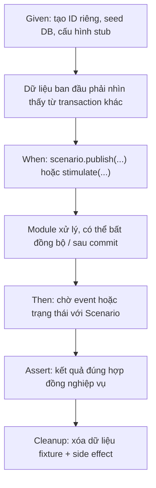

# Given trong Scenario để chuẩn bị dữ liệu hoặc trạng thái

## 1. Given là gì trong kiểm thử Spring Modulith?

Trong học phần **SPRING_MODULITH_VERIFICATION_TESTING**, một bài kiểm thử có giá trị phải chứng minh được hai mặt: **kiến trúc module** tuân thủ quy tắc phụ thuộc và **hành vi module** đúng khi nhận lời gọi, sự kiện hoặc làm việc với cơ sở dữ liệu. `ApplicationModules.verify()` phục vụ kiểm chứng cấu trúc; `@ApplicationModuleTest` và `Scenario` phục vụ kiểm thử tích hợp theo phạm vi module. Việc chuẩn bị dữ liệu đầu vào quyết định liệu những kiểm thử hành vi này có đáng tin cậy hay không.

Ở chương **Scenario**, **Given** có nghĩa là **đặt hệ thống về trạng thái ban đầu đã biết trước khi kích hoạt hành vi cần kiểm thử**. Ví dụ: trong module quản lý tồn kho, Given là “mặt hàng `SKU-42` hiện còn 10 sản phẩm”; When là “hệ thống nhận sự kiện đặt 3 sản phẩm”; Then là “tồn kho còn 7 và có bản ghi giữ hàng”.

> **Lưu ý về API:** `org.springframework.modulith.test.Scenario` **không có bước `scenario.given(...)` dành riêng**. DSL chính thức bắt đầu bằng `scenario.publish(...)` hoặc `scenario.stimulate(...)`. **Given là pha sắp xếp dữ liệu/fixture của JUnit và Spring Test trước lời gọi đó**, chẳng hạn `@BeforeEach`, một test helper, `JdbcTemplate`, repository, `@Sql` hoặc mock/stub.

Cách phân chia này giúp bài kiểm thử thể hiện rõ *điều kiện ban đầu*, *tác nhân kích hoạt* và *kết quả mong đợi*, thay vì trộn mọi thao tác vào một khối khó đọc.



## 2. Given cần chuẩn bị những gì?

Tùy hợp đồng của module, Given có thể bao gồm:

| Thành phần | Ví dụ trong module tồn kho | Vì sao quan trọng? |
| --- | --- | --- |
| **Dữ liệu nền** | Tạo hàng hóa `SKU-42` với số lượng 10. | Listener xử lý đơn hàng cần tìm thấy sản phẩm tồn tại. |
| **Trạng thái nghiệp vụ** | Sản phẩm đang bán, chưa khóa kho, chưa có reservation cho order ID hiện tại. | Giúp điều kiện đầu vào của nhánh nghiệp vụ có thể kiểm soát. |
| **Định danh tương quan** | Mỗi lần test có `orderId` và `sku` độc lập. | Không nhận nhầm sự kiện hay bản ghi từ bài test khác. |
| **Phụ thuộc ngoài module** | Stub client kiểm tra kho ngoài hoặc mock một port ở module khác. | Chỉ kiểm thử phần hành vi thuộc module cần kiểm tra. |
| **Hạ tầng kiểm thử** | Test database có schema/migration tương thích. | Code thực sự có thể đọc và ghi dữ liệu như lúc chạy ứng dụng. |
| **Điều kiện dọn dẹp** | Biết bản ghi fixture và reservation nào cần xóa sau scenario. | Tránh phụ thuộc vào thứ tự chạy test và các lần chạy CI trước. |

**Một Given tốt** phải cụ thể, tối thiểu, lặp lại được và độc lập: nếu xóa dữ liệu của test trước đó rồi chạy lại, kết quả không được thay đổi. Chỉ tạo dữ liệu cần cho nhánh hành vi đang kiểm tra; dữ liệu nền không nên tự kích hoạt toàn bộ luồng mà bài test định kiểm chứng.

## 3. Cần phân biệt Given và stimulus của Scenario

Giả sử module `inventory` lắng nghe event công khai của module `ordering`:

- `OrderPlaced(orderId, sku, quantity)`: đơn hàng mới được đặt.
- `StockReserved(orderId, sku, quantity)`: tồn kho đã được giữ thành công.

Tồn kho ban đầu là dữ liệu **Given**. Sự kiện `OrderPlaced` là **When**. Sự kiện `StockReserved` hoặc số lượng tồn kho còn lại là **Then**.

```java
// GIVEN: chuẩn bị trạng thái đã tồn tại từ trước
insertStock("SKU-42", 10);

// WHEN + THEN: trigger sự kiện và chờ phản ứng của module
scenario.publish(new OrderPlaced(orderId, "SKU-42", 3))
        .andWaitForEventOfType(StockReserved.class)
        .matching(event -> event.orderId().equals(orderId))
        .toArriveAndVerify(event ->
                assertThat(event.quantity()).isEqualTo(3));
```

`insertStock(...)` trong ví dụ trên là helper **do dự án tự định nghĩa**, không phải API của Spring Modulith. Khi đặt sự kiện khởi phát ở pha Given, bài kiểm thử có thể bắt đầu chạy nghiệp vụ trước khi đăng ký kỳ vọng, khiến hành vi bất đồng bộ khó dự đoán. Vì thế hãy chuẩn bị trạng thái nền trước, rồi để `Scenario` quản lý việc kích hoạt và quan sát kết quả.

Một stimulus có thể là lời gọi dịch vụ:

```java
// GIVEN: khách hàng có quyền đặt hàng và tồn kho còn 10
prepareCustomerWithPermission(customerId);
prepareStock("SKU-42", 10);

// WHEN + THEN: đi qua API nghiệp vụ của module
scenario.stimulate(() -> orderingService.place(customerId, "SKU-42", 3))
        .andWaitForEventOfType(OrderPlaced.class)
        .matching(event -> event.customerId().equals(customerId))
        .toArrive();
```

Ở đây `prepareCustomerWithPermission`, `prepareStock`, `orderingService` và event `OrderPlaced` là hợp đồng minh họa. Nên chọn `stimulate` khi mục tiêu là kiểm tra **hành vi bắt đầu từ API của module**; chọn `publish` khi mục tiêu là kiểm tra **phản ứng của module nhận đối với event đầu vào**. Test dùng `publish` không chứng minh được dịch vụ ở module phát đã hoạt động đúng.

## 4. Ví dụ thực hành: Given tạo tồn kho bằng giao dịch đã commit

Giả sử ứng dụng dùng Spring JDBC với hai bảng tối giản:

```sql
CREATE TABLE inventory_stock (
    sku VARCHAR(80) PRIMARY KEY,
    available INTEGER NOT NULL
);

CREATE TABLE stock_reservation (
    order_id VARCHAR(36) PRIMARY KEY,
    sku VARCHAR(80) NOT NULL,
    quantity INTEGER NOT NULL,
    FOREIGN KEY (sku) REFERENCES inventory_stock(sku)
);
```

Module `inventory` có listener `@ApplicationModuleListener` nhận `OrderPlaced`, kiểm tra `available >= quantity`, cập nhật tồn kho, ghi reservation và phát `StockReserved`. Bản thân listener là phần **production code** cần được kiểm thử, không bị mock trong test này. Các event dưới đây là những record minh họa cho hợp đồng công khai và kết quả của module:

```java
// Đặt trong package API được module ordering công bố
public record OrderPlaced(java.util.UUID orderId, String sku, int quantity) {}

// Đặt trong module inventory
public record StockReserved(java.util.UUID orderId, String sku, int quantity) {}
```

Lớp test nằm ở package module `inventory` để `@ApplicationModuleTest` nhận diện đúng module. Ví dụ này giả định schema và listener đã tồn tại, dự án có dependency Spring Modulith test starter và Spring JDBC; thay tên bảng, event và package tương ứng với ứng dụng thực tế.

```java
package com.acme.inventory;

import static org.assertj.core.api.Assertions.assertThat;

import java.util.UUID;

import com.acme.ordering.api.OrderPlaced;
import org.junit.jupiter.api.Test;
import org.springframework.beans.factory.annotation.Autowired;
import org.springframework.jdbc.core.JdbcTemplate;
import org.springframework.modulith.test.ApplicationModuleTest;
import org.springframework.modulith.test.Scenario;
import org.springframework.transaction.support.TransactionTemplate;

@ApplicationModuleTest
class InventoryGivenTests {

    @Autowired JdbcTemplate jdbc;
    @Autowired TransactionTemplate transactions;

    @Test
    void reservesThreeItemsFromExistingStock(Scenario scenario) {
        UUID orderId = UUID.randomUUID();
        String sku = "SKU-" + UUID.randomUUID();

        // GIVEN: có sẵn 10 sản phẩm; transaction setup sẽ COMMIT
        // trước khi Scenario kích hoạt listener.
        transactions.executeWithoutResult(tx -> jdbc.update(
                "INSERT INTO inventory_stock(sku, available) VALUES (?, ?)",
                sku, 10));

        // WHEN + THEN: listener phải trừ đúng 3 sản phẩm.
        scenario.publish(new OrderPlaced(orderId, sku, 3))
                .andCleanup(() -> transactions.executeWithoutResult(tx -> {
                    jdbc.update(
                            "DELETE FROM stock_reservation WHERE order_id = ?",
                            orderId.toString());
                    jdbc.update(
                            "DELETE FROM inventory_stock WHERE sku = ?",
                            sku);
                }))
                .andWaitForStateChange(
                        () -> jdbc.queryForObject(
                                "SELECT available FROM inventory_stock WHERE sku = ?",
                                Integer.class, sku),
                        available -> available != null && available == 7)
                .andVerify(available ->
                        assertThat(available).isEqualTo(7));
    }
}
```

**Đọc riêng pha Given:**

1. `UUID.randomUUID()` tạo định danh mới cho từng lần chạy; `sku` riêng ngăn các test giẫm lên dữ liệu.
2. `transactions.executeWithoutResult(...)` ghi trạng thái “còn 10 sản phẩm” vào DB. Ví dụ không gắn `@Transactional` lên lớp/phương thức test, vì vậy `TransactionTemplate` mở và commit giao dịch ngay khi callback hoàn thành.
3. Sau đó `scenario.publish(...)` chạy stimulus của nó trong một giao dịch do `Scenario` quản lý; `@ApplicationModuleListener` có thể xử lý bất đồng bộ, ở giao dịch khác.
4. `andWaitForStateChange(...)` đọc lại DB cho đến khi tồn kho bằng 7, hoặc hết giới hạn chờ. Assertion chỉ chạy khi kết quả phù hợp đã được quan sát.
5. `andCleanup(...)` đăng ký xóa cả reservation phát sinh và bản ghi Given để trạng thái không tồn tại sau bài test.

Vì mục tiêu của ví dụ là **Given dữ liệu DB**, bài test chờ trạng thái tồn kho thay vì chỉ kiểm tra event. Việc một event đã được phát **không luôn đồng nghĩa** dữ liệu DB mà bạn định kiểm chứng đã commit.

### Một phiên bản Then kiểm tra event

Dùng cùng cách chuẩn bị Given ở trên, nhưng nếu yêu cầu nghiệp vụ là “đặt hàng thành công phát `StockReserved`”, phần Scenario có thể viết:

```java
scenario.publish(new OrderPlaced(orderId, sku, 3))
        .andCleanup(() -> cleanupInventoryFixture(orderId, sku))
        .andWaitForEventOfType(StockReserved.class)
        .matching(event -> event.orderId().equals(orderId)
                && event.sku().equals(sku))
        .toArriveAndVerify(event ->
                assertThat(event.quantity()).isEqualTo(3));
```

`cleanupInventoryFixture(...)` là helper tùy dự án, cần thực thi trong transaction có hiệu lực. Matcher theo cả `orderId` và `sku` để hạn chế bắt nhầm sự kiện khác. Đừng kết luận rằng tồn kho đã ghi xong chỉ vì có `StockReserved`; muốn bảo đảm cả DB state, hãy thêm test chờ trạng thái hoặc kiểm chứng trạng thái sau tín hiệu commit thích hợp.

## 5. Nhiều cách triển khai Given

Không có một công cụ chuẩn cho mọi module. Chọn dựa vào hợp đồng cần kiểm chứng và chi phí hạ tầng:

| Cách chuẩn bị | Ví dụ | Phù hợp nhất khi | Cần chú ý |
| --- | --- | --- | --- |
| **Helper trong test** | `givenStock(sku, 10)` gọi repository. | Có nhiều test dùng cùng mô hình dữ liệu. | Helper phải tách biệt nghiệp vụ đang được kiểm thử. |
| **`@BeforeEach`** | Seed các cấu hình chung cho mỗi test. | Mọi test trong lớp cần cùng kiểu trạng thái. | Không tự giả định dữ liệu đã commit nếu test đang chạy trong transaction. |
| **`JdbcTemplate` / repository + `TransactionTemplate`** | Insert fixture vào DB thật và commit. | Listener đọc dữ liệu bằng transaction riêng. | Chuẩn bị cleanup và quản lý khóa ngoại. |
| **`@Sql`** | Nạp fixture SQL trước test, dọn sau test. | Dữ liệu SQL tương đối cố định, dễ kiểm tra bằng mắt. | Dữ liệu cố định có thể xung đột khi test chạy song song. |
| **`@MockitoBean` / test double** | Stub cổng gọi ra module/hệ thống ngoài. | Chỉ kiểm tra module hiện tại trong `STANDALONE`. | Không mock chính logic/side effect cần chứng minh. |
| **Testcontainers / database riêng** | PostgreSQL thử nghiệm có migrations. | Cần hành vi transaction và SQL giống môi trường chạy. | Tốn công khởi tạo, cần reset/cleanup dữ liệu. |

### Given dùng helper rõ nghĩa

Thay vì để mỗi test tự lắp SQL dài, có thể trích helper:

```java
private String givenStock(int quantity) {
    String sku = "SKU-" + UUID.randomUUID();

    transactions.executeWithoutResult(tx -> jdbc.update(
            "INSERT INTO inventory_stock(sku, available) VALUES (?, ?)",
            sku, quantity));

    return sku;
}
```

Bài test lúc đó đọc tự nhiên:

```java
String sku = givenStock(10); // GIVEN: kho hiện có 10
UUID orderId = UUID.randomUUID();

scenario.publish(new OrderPlaced(orderId, sku, 3))
        .andCleanup(() -> cleanupInventoryFixture(orderId, sku))
        .andWaitForEventOfType(StockReserved.class)
        .matching(event -> event.orderId().equals(orderId))
        .toArriveAndVerify(event ->
                assertThat(event.quantity()).isEqualTo(3));
```

Helper **không** nên gọi chính handler cần kiểm thử để làm sẵn reservation; nếu trạng thái Given đã là kết quả mong đợi của Then, bài kiểm thử có thể **pass giả**.

### Given dùng `@Sql`

Một chiến lược khác là khai báo bộ dữ liệu tĩnh, đặc biệt phù hợp cho cấu hình danh mục và bảng tham chiếu:

```java
@Sql(
    scripts = "/sql/inventory-before.sql",
    config = @SqlConfig(
        transactionMode = SqlConfig.TransactionMode.ISOLATED
    )
)
@Sql(
    scripts = "/sql/inventory-after.sql",
    executionPhase = Sql.ExecutionPhase.AFTER_TEST_METHOD,
    config = @SqlConfig(
        transactionMode = SqlConfig.TransactionMode.ISOLATED
    )
)
@ApplicationModuleTest
class InventorySqlGivenTests {
    // Các test Scenario ...
}
```

Ví dụ giả định dự án **đã có** hai script được chỉ rõ. `ISOLATED` yêu cầu thực thi script trong transaction riêng để dữ liệu setup được commit; script hậu kiểm cần xóa dữ liệu theo quan hệ khóa ngoại. Với test chạy song song, định danh cố định trong script có thể xung đột; fixture bằng ID duy nhất như phần trước thường dễ cô lập hơn.

### Given dùng stub cho phụ thuộc xuyên module

`@ApplicationModuleTest` mặc định dùng chế độ `STANDALONE`, chỉ khởi động module đang test. Nếu bean hiện tại phụ thuộc trực tiếp bean ở module khác, có thể mock phần **cổng ra** cần thiết, ví dụ:

```java
@ApplicationModuleTest
class InventoryExternalPortTests {

    @MockitoBean
    ExternalWarehouseClient warehouseClient;

    @BeforeEach
    void givenExternalWarehouseAvailable() {
        when(warehouseClient.isAvailable("MAIN"))
                .thenReturn(true);
    }

    // Test Scenario phản ứng của module inventory...
}
```

Ví dụ giả định `ExternalWarehouseClient` là port do module sử dụng; cần các import JUnit/Mockito và `org.springframework.test.context.bean.override.mockito.MockitoBean` trong các phiên bản Spring hỗ trợ annotation này. Cách này giữ Given xác định, không gọi dịch vụ thật ngoài phạm vi test. Nếu cần kiểm chứng tích hợp thực sự với module khác, cân nhắc `@ApplicationModuleTest(mode = BootstrapMode.DIRECT_DEPENDENCIES)` hoặc `ALL_DEPENDENCIES` thay vì mock, theo đúng mục tiêu test.

## 6. Transaction là yếu tố then chốt của Given

Đây là nguồn lỗi khó phát hiện nhất trong bài test `Scenario` có DB.

### Tình huống dễ gặp

```java
@Transactional
@Test
void naiveTest(Scenario scenario) {
    jdbc.update(
            "INSERT INTO inventory_stock(sku, available) VALUES (?, ?)",
            "SKU-42", 10);

    scenario.publish(new OrderPlaced(orderId, "SKU-42", 3))
            .andWaitForEventOfType(StockReserved.class)
            .toArrive();
}
```

Nếu test đang giữ transaction chưa commit, listener xử lý trong transaction khác **có thể không nhìn thấy** bản ghi `SKU-42`. Kết quả: timeout, truy vấn không có dữ liệu, đôi khi khóa DB hoặc hiện tượng test chạy độc lập thì pass nhưng chạy CI thì fail.

Nguyên tắc:

1. **Dữ liệu Given phải được commit trước khi listener khác transaction đọc nó.** Đối với test không có transaction bao ngoài, `TransactionTemplate` là cách rõ ràng để làm điều này.
2. Nếu buộc phải gắn `@Transactional` lên test, `TransactionTemplate` mặc định với `PROPAGATION_REQUIRED` có thể tham gia transaction hiện tại thay vì commit độc lập. Khi đó phải thiết kế transaction chuẩn bị riêng (ví dụ `PROPAGATION_REQUIRES_NEW`), hoặc đơn giản hơn là tách fixture sang quá trình/setup đã commit và tránh annotation này trên Scenario test nếu không cần.
3. `Scenario.publish(...)` và `Scenario.stimulate(...)` sử dụng transaction để các listener giao dịch có thể được gọi đúng lúc. Những thay đổi được commit từ stimulus **không mặc nhiên rollback** theo rollback của transaction test.
4. Khi kết quả chạy bất đồng bộ, `Thread.sleep(...)` không đảm bảo dữ liệu đã sẵn sàng; dùng `andWaitForEventOfType(...)` hoặc `andWaitForStateChange(...)` theo mục tiêu kiểm thử.

**Không nên** phụ thuộc vào thứ tự chạy JUnit, dữ liệu đã có trên máy lập trình viên hoặc transaction của test trước. Given phải dựng được trạng thái đầu vào một cách tự chủ.

## 7. Cleanup phải được thiết kế cùng với Given

Nếu Given insert một `inventory_stock`, còn When tạo thêm `stock_reservation`, cần dọn **cả hai nhóm dữ liệu**. Chỉ xóa bản ghi Given có thể bị ràng buộc khóa ngoại; chỉ xóa reservation để lại hàng hóa tồn đọng.

`Scenario.When.andCleanup(Runnable)` đăng ký callback chạy sau khi Scenario hoàn tất, kể cả khi các assertion trong Scenario thất bại. Một cách tổ chức an toàn là:

```java
UUID orderId = UUID.randomUUID();
String sku = givenStock(10);

scenario.publish(new OrderPlaced(orderId, sku, 3))
        .andCleanup(() -> transactions.executeWithoutResult(tx -> {
            jdbc.update("DELETE FROM stock_reservation WHERE order_id = ?",
                    orderId.toString());
            jdbc.update("DELETE FROM inventory_stock WHERE sku = ?", sku);
        }))
        .andWaitForEventOfType(StockReserved.class)
        .matching(event -> event.orderId().equals(orderId))
        .toArrive();
```

**Giới hạn cần biết:** nếu setup thất bại *trước* khi `Scenario` được khởi chạy, callback cleanup có thể chưa được đăng ký hoặc thực thi. Với hệ thống có dữ liệu quan trọng/fixture lớn, có thể kết hợp cleanup ở `@AfterEach`, cơ chế database reset hoặc test container riêng. Tránh tự xóa dữ liệu thuộc về test khác. Nếu timeout xảy ra khi listener vẫn đang xử lý nền, cân nhắc đợi tín hiệu hoàn tất, cô lập DB/test và thiết kế cleanup chịu được tình huống xử lý trễ.

## 8. Given cho các nhánh khác nhau của cùng nghiệp vụ

Một kịch bản tốt có thể biến đổi **chỉ một trạng thái Given** để kiểm tra nhiều nhánh:

| Test | Given | When | Then |
| --- | --- | --- | --- |
| Giữ hàng thành công | `available = 10` | `OrderPlaced(..., 3)` | `StockReserved` cùng `orderId`, tồn kho còn 7. |
| Không đủ tồn kho | `available = 2` | `OrderPlaced(..., 3)` | Không phát `StockReserved` hoặc phát `StockRejected` nếu đó là hợp đồng chính thức. |
| Sản phẩm bị khóa | `active = false` | `OrderPlaced(..., 1)` | Bị từ chối theo quy tắc nghiệp vụ. |
| Gửi trùng event | Đã tồn tại reservation cho `orderId` đó. | Gửi lại `OrderPlaced` | Không trừ kho lần thứ hai nếu module bảo đảm idempotency. |

Ví dụ nhánh **không đủ tồn kho**, với contract “không phát `StockReserved`”:

```java
String sku = givenStock(2);
UUID orderId = UUID.randomUUID();

scenario.publish(new OrderPlaced(orderId, sku, 3))
        .andCleanup(() -> cleanupInventoryFixture(orderId, sku))
        .andWaitAtMost(Duration.ofSeconds(1))
        .forEventOfType(StockReserved.class)
        .matching(event -> event.orderId().equals(orderId))
        .notToArrive();
```

`notToArrive()` phải chờ hết khoảng quan sát đã cấu hình; nó chứng minh **không xuất hiện trong cửa sổ đó**, chứ không chứng minh “không bao giờ xuất hiện”. Nhánh này còn nên có test kiểm chứng tồn kho vẫn bằng 2 hoặc event từ chối nếu hợp đồng đòi hỏi. Các test khác nhau cần Given rõ ràng để không bị nhầm vì dữ liệu cũ.

## 9. Các lỗi Given phổ biến và cách sửa

| Dấu hiệu | Nguyên nhân có thể | Cách xử lý |
| --- | --- | --- |
| Listener báo không tìm thấy SKU dù vừa insert. | Fixture chưa commit hoặc listener đọc qua connection/transaction khác. | Commit dữ liệu Given trước stimulus; kiểm tra propagation. |
| Test pass lẻ, fail khi chạy cả suite. | Chung ID, chung bản ghi, thiếu cleanup hoặc event không lọc correlation ID. | Tạo ID riêng, dọn cả fixture lẫn side effect, matcher theo order ID. |
| Test luôn pass kể cả khi tắt listener. | Given đã dựng sẵn trạng thái Then; assertion đọc dữ liệu cũ. | Chỉ seed tiền điều kiện; xác minh trạng thái chuyển đổi thực tế. |
| Test thành công khi DB trống nhưng thất bại trên CI. | Dựa vào dữ liệu ẩn trên máy dev hoặc khác migration/schema. | Tạo Given có thể tái lập từ test setup; chạy DB/migration nhất quán. |
| Test timeout vì service ngoài không sẵn sàng. | Module gọi phụ thuộc ngoài, Given chưa stub hoặc bootstrap sai phạm vi. | Stub port ngoài hoặc chọn integration scope đúng. |
| Test chậm và không ổn định. | `Thread.sleep` cố định, timeout không phù hợp với thực tế. | Poll theo kết quả với `Scenario`, timeout có lý do. |
| Cleanup xóa lỗi khóa ngoại. | Dọn bản ghi cha trước con. | Xóa reservation trước, stock sau; dùng transaction. |

### Checklist tự kiểm tra Given

- [ ] Given mô tả rõ tiền điều kiện nghiệp vụ và không thực thi thay hành vi đang test.
- [ ] Dữ liệu đầu vào được tạo từ code/script test, không phụ thuộc dữ liệu còn sót.
- [ ] Các ID, fixture và event có thể phân biệt giữa các lần chạy.
- [ ] Listener bất đồng bộ có thể đọc dữ liệu Given đã commit.
- [ ] Mock chỉ che chắn phụ thuộc ngoài phạm vi, không che logic cần kiểm chứng.
- [ ] Cleanup biết cả dữ liệu chuẩn bị lẫn dữ liệu phát sinh sau stimulus.
- [ ] Then có matcher/assertion cụ thể theo hợp đồng, không chỉ kiểm tra “không lỗi”.

## 10. Mối liên hệ với verification và quality gate trong CI

Given là đầu vào đáng tin cậy để kiểm chứng **hành vi**. Khi đưa bộ test vào CI, hãy kết hợp:

- **Kiểm chứng cấu trúc:** `ApplicationModules.of(Application.class).verify()` để phát hiện phụ thuộc vòng, truy cập nội bộ module và các phụ thuộc vi phạm ranh giới đã khai báo.
- **Kiểm chứng hành vi theo module:** `@ApplicationModuleTest` với Given đã commit và `Scenario` chờ event/state thực tế.
- **Kiểm chứng tích hợp có dữ liệu:** dùng test DB, migration và test isolation thống nhất giữa máy cá nhân với CI.
- **Quality gate:** không cho build đạt khi vi phạm kiến trúc, kết quả event/state sai hoặc fixture không ổn định khiến test thất bại.

Hai loại kiểm chứng bổ sung cho nhau. **Given không thể thay thế kiểm chứng kiến trúc**, và `ApplicationModules.verify()` không chứng minh listener sẽ trừ đúng số lượng tồn kho. Bài kiểm thử đáng tin cậy cần cả ranh giới module hợp lệ, tiền điều kiện chính xác và kết quả quan sát được.

### Bài tập vận dụng

Giữ nguyên luồng `OrderPlaced → StockReserved` và thực hiện:

1. Đổi `givenStock(10)` thành `givenStock(2)`. Viết test cho nhánh không đủ hàng; chọn rõ hợp đồng “không phát `StockReserved`” hay “phát `StockRejected`”.
2. Đặt `@Transactional` lên test rồi seed bằng repository. Giải thích tại sao listener bất đồng bộ có thể không thấy dữ liệu và sửa cách setup để dữ liệu đã commit.
3. Chạy hai test với cùng một `sku` cố định, sau đó với hai `sku` ngẫu nhiên. Phân tích việc trùng dữ liệu và cleanup.
4. Sửa listener để phát `StockReserved` nhưng không cập nhật `inventory_stock`. Test kiểm tra event và test kiểm tra state phản ứng khác nhau ra sao?
5. Tạo một dependency truy cập package `ordering.internal` từ `inventory`. Phép kiểm nào cần được bổ sung để phát hiện lỗi thiết kế này?

**Gợi ý trả lời:** với (2), quan tâm transaction propagation và điểm commit; với (3), fixture độc lập giúp tránh tranh chấp; với (4), test state bắt lỗi mà một test event thuần túy có thể bỏ sót; với (5), dùng `ApplicationModules.verify()`, vì `Scenario` chỉ quan sát kết quả thực thi.

## Tài liệu tham khảo

- [Spring Modulith – Integration Testing Application Modules](https://docs.spring.io/spring-modulith/reference/testing.html): `@ApplicationModuleTest`, chế độ bootstrap, `Scenario`, timeout, event/state và transaction của stimulus.
- [Spring Modulith – Scenario API](https://docs.spring.io/spring-modulith/docs/current/api/org/springframework/modulith/test/Scenario.html): danh sách API khởi tạo stimulus.
- [Spring Modulith – Scenario.When API](https://docs.spring.io/spring-modulith/docs/current/api/org/springframework/modulith/test/Scenario.When.html): `andCleanup`, chờ kết quả, kiểm chứng.
- [Spring Modulith – Verifying Application Module Structure](https://docs.spring.io/spring-modulith/reference/verification.html): sử dụng `ApplicationModules.verify()` cho ranh giới phụ thuộc.
