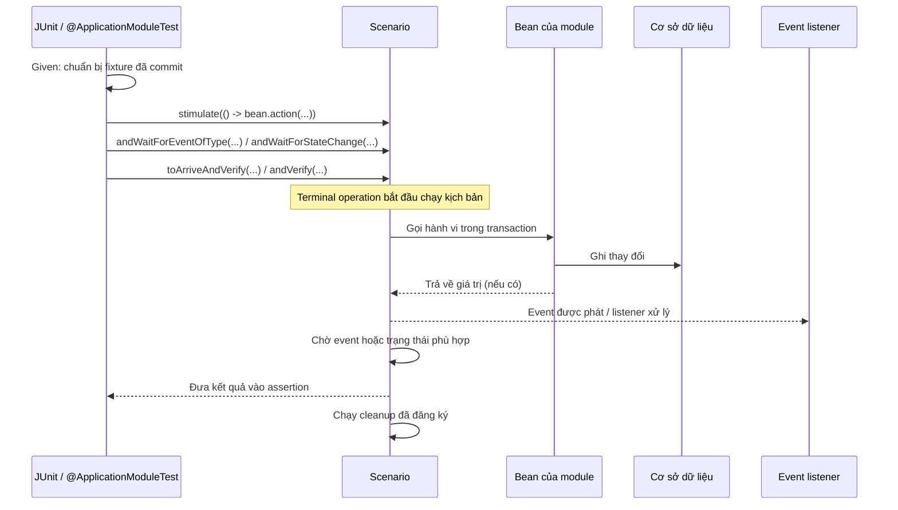

# Stimulate để kích hoạt hành vi

## 1. Vì sao cần `stimulate` trong bài kiểm thử module?

Học phần **SPRING_MODULITH_VERIFICATION_TESTING** hướng đến kiểm chứng ranh giới kiến trúc bằng `ApplicationModules`, các quy tắc phụ thuộc giữa module và kiểm thử hành vi bằng `@ApplicationModuleTest`. Ngoài việc xác nhận module không phụ thuộc sai, ta còn phải biết một **lời gọi vào module** có thực sự tạo ra kết quả mong đợi hay không: lưu dữ liệu, thay đổi trạng thái, phát sự kiện và kích hoạt các xử lý tích hợp.

Ở chương **Scenario**, phương thức **`Scenario.stimulate(...)`** diễn đạt **When**: thực hiện một hành động trên hệ thống — thường là gọi một Spring bean hoặc API của module — rồi để `Scenario` theo dõi kết quả. Ví dụ:

> **Given:** Mã đơn chưa tồn tại và số lượng đặt hàng là 2 sản phẩm.
>
> **When (stimulate):** Gọi `orderingService.placeOrder(...)`.
>
> **Then:** Đơn được ghi vào cơ sở dữ liệu và có `OrderPlaced` chứa đúng `orderId`.

Thay vì tự gọi bean rồi lập tức kiểm tra sự kiện bất đồng bộ, ta đưa lời gọi vào `Scenario` để framework thiết lập transaction, quan sát event hoặc trạng thái, chờ có giới hạn và thực hiện các assertion.



**Phân biệt:** `stimulate` không phải là mock hay lệnh “ép” một event nhất định xuất hiện. Nó **gọi hành vi thật** trong phạm vi Spring context đã khởi động; nếu bean, dữ liệu, hoặc listener cần thiết không có mặt, bài kiểm thử có thể thất bại. Muốn xác nhận hành vi thuộc module nào thì cần chọn đúng điểm bắt đầu và phạm vi `@ApplicationModuleTest`.

## 2. `stimulate` khác `publish` như thế nào?

`Scenario` có hai điểm bắt đầu thường dùng:

| API | Đầu vào của bài kiểm thử | Mục tiêu phù hợp | Điểm cần lưu ý |
| --- | --- | --- | --- |
| `scenario.publish(event)` | Một **sự kiện** đã được tạo sẵn. | Kiểm tra module phản ứng thế nào khi nhận event từ module khác. | Bỏ qua logic tạo ra event ở phía phát; không chứng minh module nguồn hoạt động đúng. |
| `scenario.stimulate(() -> service.method())` | Một **lời gọi phương thức** trên bean hoặc cổng vào của module. | Kiểm tra luồng bắt đầu từ API nghiệp vụ, bao gồm việc lưu dữ liệu, phát event, trả kết quả. | Phải khởi động đúng bean và các thành phần liên quan. |

Ví dụ với module `order`:

```java
// Chỉ kiểm tra phản ứng của module nhận với một event đã có.
scenario.publish(new OrderPlaced(orderId, "SKU-42", 2))
        .andWaitForEventOfType(ReservationRequested.class)
        .matching(event -> event.orderId().equals(orderId))
        .toArrive();

// Kiểm tra hành vi của service tạo đơn hàng.
scenario.stimulate(() -> {
            orderingService.placeOrder(orderId, "SKU-42", 2);
        })
        .andWaitForEventOfType(OrderPlaced.class)
        .matching(event -> event.orderId().equals(orderId))
        .toArrive();
```

Đây là hai mục tiêu kiểm thử khác nhau. `publish` hợp lý ở test của module **tiếp nhận sự kiện**; `stimulate` hợp lý ở test của module **chủ sở hữu nghiệp vụ gọi service**. Nếu module downstream không được khởi động trong test `STANDALONE`, một sự kiện do module hiện tại phát không tự động khiến listener ở module khác chạy.

## 3. Các overload của `Scenario.stimulate(...)`

API Spring Modulith cung cấp nhiều dạng stimulus. Hai dạng đầu là cơ bản nhất:

| Chữ ký | Dùng khi nào? | Có giữ giá trị trả về để assert? |
| --- | --- | --- |
| `stimulate(Runnable)` | Lời gọi chỉ quan trọng về side effect; không cần kết quả trả về. | Không, kiểu stimulus result là `Void`. |
| `stimulate(Supplier<S>)` | Lời gọi trả một `S` như `UUID`, DTO, mã giao dịch và cần so sánh với event/state. | Có, kết quả được giữ để dùng tại terminal operation. |
| `stimulate(Function<TransactionOperations, S>)` | Muốn chủ động sử dụng API transaction trong callback. | Có. |
| `stimulate(BiConsumer<TransactionOperations, ApplicationEventPublisher>)` | Cần cả transaction operations và event publisher trong stimulus, không trả kết quả. | Không. |
| `stimulate(BiFunction<TransactionOperations, ApplicationEventPublisher, S>)` | Cần hai thành phần trên và trả kết quả `S`. | Có. |

### Dạng `Runnable`

```java
scenario.stimulate(() -> {
            orderingService.confirmOrder(orderId);
        })
        .andWaitForEventOfType(OrderConfirmed.class)
        .matching(event -> event.orderId().equals(orderId))
        .toArriveAndVerify(event ->
                assertThat(event.orderId()).isEqualTo(orderId));
```

Cặp dấu ngoặc nhọn làm rõ lambda **không trả giá trị**, nên chọn overload `Runnable`. `confirmOrder` là API giả định của ứng dụng. Sau khi gọi, test chờ event nghiệp vụ; phương thức tự trả về `void` cũng phù hợp với dạng này.

### Dạng `Supplier<S>`

```java
scenario.stimulate(() -> {
            return orderingService.placeOrder(orderId, "SKU-42", 2);
        })
        .andWaitForEventOfType(OrderPlaced.class)
        .matching(event -> event.orderId().equals(orderId))
        .toArriveAndVerify((event, returnedOrderId) -> {
            assertThat(returnedOrderId).isEqualTo(orderId);
            assertThat(event.orderId()).isEqualTo(returnedOrderId);
        });
```

Ở đây giả định `placeOrder(...)` trả về `UUID`. Cách viết `return` trong lambda thể hiện rõ chọn `Supplier<UUID>`. Hàm `toArriveAndVerify((event, returnedOrderId) -> ...)` nhận **tham số thứ nhất là event** đã quan sát và **tham số thứ hai là kết quả của stimulus**. Nhờ vậy, test đối chiếu được **đầu ra đồng bộ của service** với **đầu ra sự kiện** của cùng một lần xử lý.

> Trong Java, một số method call biểu thức có thể dùng ở cả lambda trả về giá trị lẫn lambda `void` khi có overload. Để mã test rõ nghĩa, dùng block có `return` với `Supplier` và block không có `return` với `Runnable`; hoặc gán tường minh kiểu `Supplier<T>` / `Runnable`.

### Overload nâng cao có `TransactionOperations`

Nếu cần điều khiển transaction trong kích hoạt:

```java
scenario.stimulate(transactionOperations ->
            transactionOperations.execute(status ->
                    orderingService.placeOrder(orderId, "SKU-42", 2)))
        .andWaitForEventOfType(OrderPlaced.class)
        .matching(event -> event.orderId().equals(orderId))
        .toArriveAndVerify((event, id) ->
                assertThat(event.orderId()).isEqualTo(id));
```

`transactionOperations` là đối tượng được framework truyền vào callback. Ví dụ này minh họa dạng `Function<TransactionOperations, UUID>`; với use case đơn giản, `stimulate(Supplier)` thường dễ đọc hơn vì `Scenario` đã cung cấp transaction cần thiết. Các overload có `ApplicationEventPublisher` dành cho trường hợp phải phối hợp rõ ràng giữa thao tác transactional và việc phát event trong một stimulus.

## 4. Ví dụ xuyên suốt: gọi service tạo đơn và xác nhận event

Giả sử ứng dụng có module `com.acme.order`. Service cung cấp cổng nghiệp vụ `placeOrder`:

1. Kiểm tra số lượng đặt hàng hợp lệ.
2. Lưu một order `SUBMITTED` qua repository của module.
3. Phát sự kiện công khai `OrderPlaced`.
4. Trả lại mã đơn `UUID`.

**Contract sự kiện** (ví dụ trong `com/acme/order/api/OrderPlaced.java`):

```java
package com.acme.order.api;

import java.util.UUID;

public record OrderPlaced(UUID orderId, String sku, int quantity) {}
```

**Service ứng dụng** (minh họa phần logic liên quan):

```java
package com.acme.order;

import java.util.UUID;
import com.acme.order.api.OrderPlaced;
import org.springframework.context.ApplicationEventPublisher;
import org.springframework.stereotype.Service;
import org.springframework.transaction.annotation.Transactional;

@Service
public class OrderingService {

    private final OrderRepository orders;
    private final ApplicationEventPublisher events;

    public OrderingService(OrderRepository orders,
                           ApplicationEventPublisher events) {
        this.orders = orders;
        this.events = events;
    }

    @Transactional
    public UUID placeOrder(UUID orderId, String sku, int quantity) {
        if (quantity <= 0) {
            throw new IllegalArgumentException("quantity must be positive");
        }

        orders.save(new OrderEntity(orderId, sku, quantity, "SUBMITTED"));
        events.publishEvent(new OrderPlaced(orderId, sku, quantity));

        return orderId;
    }
}
```

`OrderRepository` và `OrderEntity` trong ví dụ là các thành phần của module do dự án định nghĩa, chẳng hạn JPA repository và entity với các trường `orderId`, `sku`, `quantity`, `status`. Để chạy ví dụ trong dự án thật, cần triển khai chúng, có schema DB và migration tương ứng. Mã minh họa không nhằm thay thế một dự án Spring Boot đầy đủ.

**Kiểm thử với `@ApplicationModuleTest`** (lớp test ở package `com.acme.order`):

```java
package com.acme.order;

import static org.assertj.core.api.Assertions.assertThat;

import java.time.Duration;
import java.util.UUID;

import com.acme.order.api.OrderPlaced;
import org.junit.jupiter.api.Test;
import org.springframework.beans.factory.annotation.Autowired;
import org.springframework.modulith.test.ApplicationModuleTest;
import org.springframework.modulith.test.Scenario;

@ApplicationModuleTest
class OrderingServiceScenarioTests {

    @Autowired OrderingService orderingService;
    @Autowired OrderRepository orders;

    @Test
    void createsOrderAndPublishesMatchingEvent(Scenario scenario) {
        UUID orderId = UUID.randomUUID();

        // GIVEN: mã đơn riêng, repository ở trạng thái sạch.
        assertThat(orders.existsById(orderId)).isFalse();

        // WHEN: gọi API thực tế của module, giữ UUID trả về.
        scenario.stimulate(() -> {
                    return orderingService.placeOrder(orderId, "SKU-42", 2);
                })
                .andCleanup(createdId -> orders.deleteById(createdId))
                .andWaitAtMost(Duration.ofSeconds(3))
                .forEventOfType(OrderPlaced.class)
                .matchingMappedValue(OrderPlaced::orderId, orderId)
                .toArriveAndVerify((event, returnedId) -> {
                    assertThat(returnedId).isEqualTo(orderId);
                    assertThat(event.sku()).isEqualTo("SKU-42");
                    assertThat(event.quantity()).isEqualTo(2);
                });
    }
}
```

Ý nghĩa của từng phần:

| Bước | Cụ thể trong mã | Tác dụng |
| --- | --- | --- |
| **Given** | `UUID.randomUUID()`; kiểm tra order chưa có. | Mỗi test độc lập và tránh sự kiện trùng ID. |
| **Stimulate** | `() -> { return orderingService.placeOrder(...); }` | Kích hoạt cổng nghiệp vụ thực của module. |
| **Transaction** | Do `Scenario` và `@Transactional` trên service phối hợp. | Bảo đảm event transactional có transaction phù hợp. |
| **Cleanup** | `andCleanup(createdId -> orders.deleteById(createdId))` | Xóa bản ghi sinh ra từ stimulus sau khi kịch bản kết thúc. |
| **Wait** | `andWaitAtMost(...).forEventOfType(...)` | Chờ tối đa thời gian định trước để nhận event đúng loại. |
| **Filter** | `matchingMappedValue(OrderPlaced::orderId, orderId)` | Tránh kiểm tra nhầm `OrderPlaced` của giao dịch khác. |
| **Assert** | `toArriveAndVerify((event, returnedId) -> ...)` | Đối chiếu event với kết quả service trả về. |

**Phạm vi bảo đảm:** test này chứng minh service đã trả UUID đúng và phát event `OrderPlaced` có dữ liệu phù hợp. Nó **chưa tự chứng minh** một module khác đã tiêu thụ event, hoặc mọi side effect của listener đã commit. Nếu hợp đồng cần bảo đảm DB state cuối cùng, cần bổ sung kiểm chứng trạng thái hoặc test khác chờ dữ liệu.

### Vì sao có terminal operation ở cuối?

`stimulate(...)` xây dựng một `Scenario.When<T>`, các phương thức như `andWaitForEventOfType(...)` hoặc `andWaitForStateChange(...)` xác định điều kiện hoàn tất. Chuỗi được **thực thi khi gọi terminal operation**:

- Với event: `toArrive()`, `toArriveAndVerify(...)`.
- Với state: `andVerify(...)`.
- Với event không được phép xuất hiện (nếu áp dụng): `notToArrive()`.

Không nên viết chuỗi dở dang như:

```java
// SAI: mới cấu hình kịch bản, thiếu terminal operation.
scenario.stimulate(() -> {
            orderingService.confirmOrder(orderId);
        })
        .andWaitForEventOfType(OrderConfirmed.class);
```

Mỗi test cần kết thúc bằng một phép kiểm cụ thể để stimulus và điều kiện quan sát được thực thi.

## 5. Khi cần chờ thay đổi trạng thái thay vì event

Event không phải lúc nào cũng là hợp đồng nghiệp vụ cần xác nhận. Ví dụ một thao tác gửi đơn sang bộ xử lý bất đồng bộ làm trạng thái của nó đổi từ `SUBMITTED` sang `READY`. Module cung cấp `orderQuery.findStatus(orderId)` trả về `Optional<String>`. Giả định listener của module đã xử lý yêu cầu và cập nhật DB.

```java
@Test
void eventuallyMarksOrderReady(Scenario scenario) {
    UUID orderId = UUID.randomUUID();

    scenario.stimulate(() -> {
                return orderingService.placeOrder(orderId, "SKU-42", 2);
            })
            .andCleanup(createdId -> orders.deleteById(createdId))
            .andWaitForStateChange(
                    () -> orderQuery.findStatus(orderId),
                    status -> status.filter("READY"::equals).isPresent())
            .andVerify((status, returnedId) -> {
                assertThat(returnedId).isEqualTo(orderId);
                assertThat(status).contains("READY");
            });
}
```

Trong ví dụ này, `orderQuery` là bean truy vấn giả định của module; có thể inject vào test như `orderingService`. Hai đối số của `andVerify((state, stimulusResult) -> ...)` lần lượt là **trạng thái được quan sát** và **kết quả stimulus**. Nhờ truyền predicate, test chờ **đúng trạng thái READY**, thay vì dừng ngay khi có một giá trị `Optional` chưa đạt yêu cầu.

`Scenario` dùng polling để liên tục đánh giá supplier trạng thái. Cần chọn dữ liệu truy vấn phản ánh trạng thái **đã commit** (ví dụ mỗi lần truy vấn qua cơ chế transaction phù hợp), tránh cache/transaction đang giữ snapshot cũ khiến test chờ mãi. Nếu chỉ cần sự hiện diện của một bản ghi, mặc định `andWaitForStateChange(Supplier)` coi giá trị khác `null`, `Optional` có phần tử hoặc `boolean` đúng là điều kiện hoàn tất.

Với trường hợp cần kiểm tra một event **không được xuất hiện** sau stimulus, có thể dùng một cửa sổ chờ hữu hạn:

```java
scenario.stimulate(() -> {
            orderingService.rejectOrder(orderId);
        })
        .andWaitAtMost(Duration.ofSeconds(1))
        .forEventOfType(OrderShipped.class)
        .matching(event -> event.orderId().equals(orderId))
        .notToArrive();
```

Ví dụ giả định có các contract `rejectOrder` và `OrderShipped`. `notToArrive()` chỉ chứng minh **không phát event phù hợp trong thời gian chờ**, không chứng minh event sẽ không bao giờ xuất hiện sau đó.

## 6. Transaction khi dùng `stimulate`

`@ApplicationModuleListener` thường chạy thông qua listener giao dịch, có thể thực thi bất đồng bộ và trong transaction riêng. Nếu gọi service từ JUnit bên ngoài transaction và lập tức assert, rất dễ không nhìn thấy kết quả hoặc không kích hoạt đúng listener đăng ký sau commit.

Spring Modulith xử lý stimulus được định nghĩa qua `scenario.stimulate(...)` trong **transaction mới**, kể cả khi bản thân test có transaction bao ngoài. Điều đó giúp sự kiện phát ra từ bean được đưa đến transactional event listener đúng nhịp commit. Nhưng phát sinh một hệ quả quan trọng:

> **Những ghi dữ liệu do stimulus đã commit sẽ không tự rollback khi test kết thúc.** Cần chủ động cleanup fixture và side effect.

Ví dụ không tốt:

```java
@Test
void fragileTest() {
    orderingService.placeOrder(orderId, "SKU-42", 2);
    assertThat(orderReadModel.findStatus(orderId))
            .contains("READY"); // Có thể còn đang xử lý bất đồng bộ.
}
```

Cách thể hiện ý định rõ ràng bằng `Scenario`:

```java
@Test
void robustTest(Scenario scenario) {
    scenario.stimulate(() -> {
                orderingService.placeOrder(orderId, "SKU-42", 2);
            })
            .andWaitForStateChange(
                    () -> orderReadModel.findStatus(orderId),
                    state -> state.filter("READY"::equals).isPresent())
            .andVerify(state -> assertThat(state).contains("READY"));
}
```

Trong test thực tế, bổ sung cleanup cho các bản ghi phát sinh. Đặc biệt, **Given** (chẳng hạn tạo khách hàng, sản phẩm, số dư, quyền truy cập) phải được commit **trước stimulus** nếu listener sẽ đọc dữ liệu từ transaction khác. Khi đã dùng `@Transactional` ở phương thức JUnit, cần hiểu rõ propagation và thời điểm commit; mặc định rollback test không xóa được kết quả đã commit của `stimulate`.

## 7. Đăng ký cleanup theo kết quả của stimulus

Khi overload `Supplier<S>` trả về ID, `andCleanup(Consumer<S>)` nhận chính giá trị đó. Nó hữu ích vì không phải xây một biến bên ngoài rồi mong mọi xử lý đều dùng cùng ID.

```java
scenario.stimulate(() -> {
            return orderingService.placeOrder(
                    UUID.randomUUID(), "SKU-42", 2);
        })
        .andCleanup(createdId -> {
            orderTestCleaner.deleteOrderAndProjections(createdId);
        })
        .andWaitForEventOfType(OrderPlaced.class)
        .toArriveAndVerify((event, createdId) ->
                assertThat(event.orderId()).isEqualTo(createdId));
```

`orderTestCleaner` là helper thử nghiệm **do dự án cung cấp**. Vì UUID được tạo ngay trong `Supplier`, toàn bộ luồng dùng một kết quả trả về duy nhất. `andCleanup(...)` được thiết kế để thực thi khi Scenario hoàn tất, bất kể phần kiểm chứng thành công hay thất bại.

Nếu stimulus không có kết quả trả về (`Runnable`), dùng `andCleanup(Runnable)` và capture ID đã tạo trước đó:

```java
UUID orderId = UUID.randomUUID();

scenario.stimulate(() -> {
            orderingService.confirmOrder(orderId);
        })
        .andCleanup(() -> orderTestCleaner.deleteOrderAndProjections(orderId))
        .andWaitForEventOfType(OrderConfirmed.class)
        .matching(event -> event.orderId().equals(orderId))
        .toArrive();
```

Một số điều kiện thực tế phải tự quản lý:

- Xóa cả dữ liệu **Given** lẫn những bản ghi tạo trong quá trình stimulus hoặc listener; dọn đúng thứ tự khóa ngoại.
- Thực hiện cleanup trong transaction phù hợp nếu thao tác ghi/xóa DB.
- Nếu handler vẫn chạy nền sau tín hiệu hoàn tất của Scenario, cleanup có thể đua với handler. Hãy chọn tín hiệu hoàn tất đủ mạnh hoặc cô lập dữ liệu thử nghiệm.
- Nếu lỗi xảy ra **trước khi** Scenario được xây dựng/thực thi (chẳng hạn tạo fixture bị lỗi), callback cleanup của Scenario có thể không đủ; cần cơ chế dọn nền khác như `@AfterEach`, reset DB hoặc container thử nghiệm.
- Không dùng ID cố định trên nhiều test chạy song song nếu dữ liệu cùng nằm trong một DB.

## 8. Chọn `@ApplicationModuleTest` đúng phạm vi

`@ApplicationModuleTest` mặc định khởi động module chứa lớp test ở chế độ `STANDALONE`. `Scenario.stimulate(...)` chỉ gọi được bean nằm trong Spring context đó.

| Nhu cầu | Gợi ý tổ chức test | Ý nghĩa |
| --- | --- | --- |
| Service ở module `order` phát `OrderPlaced`. | Đặt test trong module `order`, dùng `STANDALONE` và `stimulate(orderService)`. | Kiểm tra hành vi và event của module nguồn. |
| Listener ở module `inventory` nhận `OrderPlaced`. | Đặt test trong `inventory`, có thể `publish(OrderPlaced)` vào context chỉ chứa inventory. | Kiểm tra riêng hành vi của module nhận. |
| Luồng thực qua nhiều module và DB. | Chọn integration scope khởi động đủ bean; cân nhắc dependency modes hoặc test ứng dụng rộng hơn. | Xác nhận luồng đa module, đổi lại chạy nặng hơn. |
| Bean của module hiện tại tham chiếu bean ngoài phạm vi. | Dùng `@MockitoBean` cho cổng ra ngoài hoặc mở rộng bootstrap mode có chủ đích. | Tránh lỗi thiếu bean khi dựng context. |

Các chế độ `STANDALONE`, `DIRECT_DEPENDENCIES` và `ALL_DEPENDENCIES` đi theo **quan hệ phụ thuộc được module khai báo**. `ALL_DEPENDENCIES` không có nghĩa tự động bật mọi module tiêu thụ sự kiện theo chiều ngược lại. Vì vậy, khi muốn kiểm thử full flow, cần xác nhận listener ở module đích thực sự có mặt trong context. Số lượng bean được bật không phải thước đo chất lượng test; nên xuất phát từ hợp đồng cần bảo đảm.

## 9. Lỗi phổ biến khi dùng `stimulate`

| Hiện tượng | Nguyên nhân thường gặp | Cách khắc phục |
| --- | --- | --- |
| Test không chạy logic như mong muốn. | Chuỗi `Scenario` thiếu `toArrive...()` hoặc `andVerify(...)`. | Thêm terminal operation. |
| Test chờ event đến timeout. | Service không phát event, listener thiếu context, predicate lọc sai hoặc xử lý chậm. | Kiểm tra hợp đồng event, bootstrap, correlation ID và thời gian chờ. |
| Một test pass lẻ nhưng fail khi chạy suite. | Event trùng loại từ luồng khác hoặc dữ liệu DB bị chia sẻ. | Gắn mã `orderId` duy nhất, dùng `matching(...)` và cleanup. |
| State query trả dữ liệu cũ. | Query trong transaction/snapshot không nhìn thấy commit mới. | Quan sát trạng thái bằng truy vấn có transaction phù hợp. |
| Test pass dù không gọi API nghiệp vụ cần kiểm tra. | Dùng `publish` để thay thế hoàn toàn lời gọi service. | Chọn `stimulate` nếu yêu cầu cần chứng minh service xử lý đúng. |
| Giá trị trả về không có trong assertion. | Chọn `Runnable`, vốn không giữ kết quả. | Dùng `Supplier<S>` và overload `toArriveAndVerify((event, result) -> ...)`. |
| Dữ liệu tồn đọng sau khi test. | Tin rằng `@Transactional` của test sẽ rollback stimulus. | Đăng ký `andCleanup` và dọn dữ liệu đã commit. |
| Kiểm tra event nhưng side effect DB sai. | Chỉ có assertion cho event, không kiểm chứng DB state. | Thêm Scenario chờ state hoặc test riêng xác nhận trạng thái. |

Một sai lầm về ý nghĩa test cần tránh:

```java
UUID id = orderingService.placeOrder(orderId, "SKU-42", 2);

// SAI VỀ MỤC TIÊU: action đã chạy ngoài Scenario.
// Scenario này chỉ phát một event mới, không kiểm tra service ở trên.
scenario.publish(new OrderPlaced(id, "SKU-42", 2))
        .andWaitForEventOfType(ReservationRequested.class)
        .toArrive();
```

Nếu mục tiêu là kiểm tra `placeOrder` đã kích hoạt toàn bộ phản ứng mong đợi, nên đưa **chính lời gọi service** vào `stimulate`, sau đó quan sát đầu ra tương ứng.

## 10. Chất lượng kiểm thử và quality gate trong CI

Một nhóm test tốt cho Spring Modulith cần kết hợp **kiểm chứng cấu trúc** và **kiểm chứng hành vi**.

**Kiểm chứng kiến trúc** (ví dụ JUnit):

```java
@Test
void respectsApplicationModuleBoundaries() {
    ApplicationModules.of(Application.class).verify();
}
```

Đây là một test khác với `Scenario`; `Application.class` cần thay bằng lớp Spring Boot application thực của dự án. `ApplicationModules.verify()` phát hiện vấn đề phụ thuộc giữa module, package nội bộ và quy tắc kiến trúc được khai báo. `stimulate` không thay thế được phép kiểm này.

**Kiểm chứng hành vi**: dùng `@ApplicationModuleTest` và `Scenario.stimulate(...)` với Given được kiểm soát, event được lọc theo correlation ID, timeout hữu hạn, assertion trên payload hoặc DB state, cleanup sau khi commit.

Trong pipeline CI (ví dụ `./mvnw test` hoặc `./gradlew test` theo build tool của dự án), yêu cầu build thất bại khi test kiến trúc hoặc tích hợp thất bại. Với DB thật, dùng migration và datasource thử nghiệm nhất quán, tránh phụ thuộc dữ liệu còn sót; nếu cần có thể dùng Testcontainers để tái lập môi trường kiểm thử.

### Checklist trước khi chấp nhận một bài `stimulate`

- [ ] `stimulate` bắt đầu từ **bean/API cần kiểm thử**, không từ một lời gọi đã chạy trước đó.
- [ ] Đã xác định **Runnable hay Supplier** và có cần giữ giá trị trả về không.
- [ ] Đã tạo **Given** trước stimulus, dữ liệu cần thiết đã commit nếu listener dùng transaction khác.
- [ ] Chuỗi có **terminal operation** để thực thi Scenario.
- [ ] Kỳ vọng phù hợp với hợp đồng: **event có đúng payload**, **state cuối cùng** hoặc cả hai qua các test thích hợp.
- [ ] Matcher giới hạn theo mã giao dịch hoặc entity cụ thể.
- [ ] Timeout phù hợp với độ trễ của listener và môi trường CI.
- [ ] Có cleanup cho dữ liệu stimulus đã commit và side effect; mỗi test độc lập.
- [ ] Đã chọn đúng phạm vi `@ApplicationModuleTest` và mock phần phụ thuộc ngoài nếu cần.
- [ ] Có test `ApplicationModules.verify()` độc lập để kiểm chứng ranh giới kiến trúc.

## 11. Bài tập thực hành

Dùng hợp đồng `placeOrder(orderId, sku, quantity)` và `OrderPlaced` ở phần 4:

1. Viết `Scenario.stimulate(Runnable)` để xác nhận `confirmOrder(orderId)` phát `OrderConfirmed`. Giải thích vì sao không có giá trị trả về của stimulus trong assertion.
2. Viết lại bằng `stimulate(Supplier<UUID>)` để kiểm tra cả `returnedOrderId` và `event.orderId()` cùng một ID.
3. Tạo test cố tình tắt `events.publishEvent(...)` trong service. Chỉ ra phép kiểm nào sẽ timeout và khác gì với kiểm tra giá trị trả về.
4. Giả sử listener chuyển trạng thái `SUBMITTED` thành `READY` trong transaction riêng. Viết `andWaitForStateChange(...)` có predicate chờ đúng `READY`, thay vì `Thread.sleep(...)`.
5. Bỏ `andCleanup(...)` rồi chạy test nhiều lần. Phân tích rủi ro dữ liệu tồn đọng và lý do rollback của test không tự xử lý transaction đã commit của stimulus.
6. Tạo phụ thuộc từ `order` sang một package nội bộ của `inventory`. Phép kiểm nào phát hiện vấn đề kiến trúc đó, và tại sao test `stimulate` có thể vẫn pass?

**Gợi ý:** (1) dùng block lambda không có `return`; (2) dùng block có `return` và `toArriveAndVerify((event, result) -> ...)`; (3) phát event bị bỏ sẽ làm test chờ event thất bại dù service vẫn có thể trả UUID; (4) dùng `andWaitForStateChange(supplier, predicate)`; (5) cleanup chủ động; (6) dùng `ApplicationModules.verify()`.

## Tài liệu tham khảo

- [Spring Modulith – Integration Testing Application Modules](https://docs.spring.io/spring-modulith/reference/testing.html): `@ApplicationModuleTest`, `Scenario`, stimulate, transaction và các bước chờ kết quả.
- [Spring Modulith – Scenario API](https://docs.spring.io/spring-modulith/docs/current/api/org/springframework/modulith/test/Scenario.html): các overload của `stimulate`.
- [Spring Modulith – Scenario.When API](https://docs.spring.io/spring-modulith/docs/current/api/org/springframework/modulith/test/Scenario.When.html): `andCleanup`, `andWaitAtMost`, `andWaitForEventOfType` và `andWaitForStateChange`.
- [Spring Modulith – Scenario.When.EventResult API](https://docs.spring.io/spring-modulith/docs/current/api/org/springframework/modulith/test/Scenario.When.EventResult.html): lọc event và xác nhận event cùng kết quả stimulus.
- [Spring Modulith – Scenario.When.StateChangeResult API](https://docs.spring.io/spring-modulith/docs/current/api/org/springframework/modulith/test/Scenario.When.StateChangeResult.html): xác nhận trạng thái cùng giá trị trả về.
- [Spring Modulith – Verifying Application Module Structure](https://docs.spring.io/spring-modulith/reference/verification.html): kiểm chứng ranh giới phụ thuộc bằng `ApplicationModules.verify()`.
