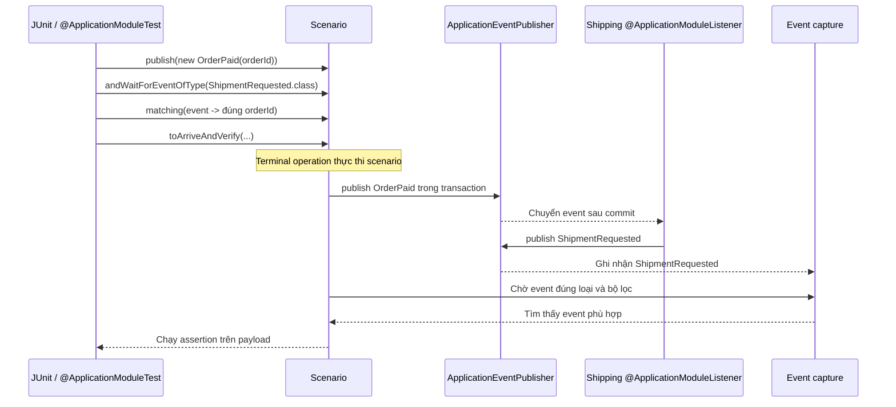

# AndWaitForEvent để chờ event được phát

## 1. Mục đích của việc chờ event trong Scenario

Học phần **SPRING_MODULITH_VERIFICATION_TESTING** rèn kỹ năng kiểm chứng ranh giới kiến trúc và hành vi của Spring Modulith: dùng `ApplicationModules.verify()` để kiểm soát phụ thuộc giữa module, `@ApplicationModuleTest` để kiểm thử một module trong Spring context phù hợp, rồi dùng `Scenario` để xác nhận các sự kiện, thay đổi cơ sở dữ liệu và tích hợp không bị hồi quy khi chạy CI.

Trong chương **Scenario**, đề bài “AndWaitForEvent để chờ event được phát” nói đến bước **quan sát kết quả là một application event**. API Java chính xác của Spring Modulith là **`andWaitForEventOfType(Class<E>)`** trên `Scenario.When<T>`, không phải một phương thức độc lập tên `andWaitForEvent(...)`.

Ví dụ nghiệp vụ:

> **Given:** Đơn `orderId` đã thanh toán hợp lệ.
>
> **When:** Module vận chuyển nhận `OrderPaid(orderId)`.
>
> **Then:** Module vận chuyển phát `ShipmentRequested(orderId, "STANDARD")`.

Nếu listener được đánh dấu `@ApplicationModuleListener`, công việc có thể bắt đầu **sau commit** và chạy **bất đồng bộ** trong transaction riêng. Assertion thực hiện ngay sau lệnh phát event có thể chạy trước listener. `Scenario.andWaitForEventOfType(...)` cho phép bài kiểm thử **chờ có giới hạn** đến khi quan sát được event đúng loại và đúng dữ liệu nghiệp vụ.



**Giới hạn cần hiểu:** DSL đang theo dõi **Spring application event trong context kiểm thử**. Một event được quan sát không tự động chứng minh Kafka/RabbitMQ đã nhận message, consumer của module khác đã xử lý thành công, hay dữ liệu ở hệ thống ngoài đã commit. Những hợp đồng đó cần test và tín hiệu hoàn tất riêng.

## 2. Cú pháp và ý nghĩa từng mắt xích

Một Scenario chờ event thường có dạng:

```java
scenario.publish(new OrderPaid(orderId))
        .andWaitForEventOfType(ShipmentRequested.class)
        .matching(event -> event.orderId().equals(orderId))
        .toArriveAndVerify(event ->
                assertThat(event.serviceLevel()).isEqualTo("STANDARD"));
```

| Mắt xích | Vai trò | Lưu ý |
| --- | --- | --- |
| `scenario.publish(...)` | **Stimulus:** phát một event đầu vào và kích hoạt nghiệp vụ. | `scenario.stimulate(() -> service.action())` cũng dùng được nếu test phải bắt đầu từ API service. |
| `andWaitForEventOfType(ShipmentRequested.class)` | Khai báo **loại event đầu ra** muốn chờ. | Chỉ chọn class không đủ phân biệt hai đơn hàng khác nhau. |
| `matching(...)` | Lọc event theo điều kiện nghiệp vụ. | Dùng mã tương quan `orderId`, `paymentId`, `aggregateId`... |
| `toArriveAndVerify(...)` | **Thực thi** kịch bản, chờ event, rồi kiểm chứng payload. | Nếu không có event phù hợp trước timeout, test thất bại. |

`andWaitForEventOfType(...)` **trả về `Scenario.When<T>.EventResult<E>`** để tiếp tục lọc và kết thúc kịch bản. Nó là một bước cấu hình kỳ vọng, **không phải terminal operation**.

Các terminal operation thường gặp:

- `toArrive()`: chỉ xác nhận một event phù hợp có xuất hiện.
- `toArriveAndVerify(Consumer<E>)`: xác nhận event rồi chạy assertion trên event.
- `toArriveAndVerify(BiConsumer<E,T>)`: đối chiếu event với **kết quả trả về của stimulus** nếu dùng `stimulate(Supplier<T>)`.
- `toArriveAndAssert(...)`: làm việc với API AssertJ hỗ trợ cho event nếu phiên bản Spring Modulith sử dụng có overload này.

Để thực sự bắt lỗi sai payload, bài kiểm thử nên chọn **`toArriveAndVerify(...)`** hoặc `toArriveAndAssert(...)` thay vì chỉ yêu cầu event “có mặt”.

## 3. Cấu hình dự án để có thể kiểm thử module

Thêm test starter của Spring Modulith (ví dụ Maven):

```xml
<dependency>
    <groupId>org.springframework.modulith</groupId>
    <artifactId>spring-modulith-starter-test</artifactId>
    <scope>test</scope>
</dependency>
```

Tạo lớp JUnit Jupiter trong package của module cần kiểm thử và gắn `@ApplicationModuleTest`. `Scenario` được hỗ trợ dưới dạng tham số của phương thức test:

```java
package com.acme.shipping;

import org.junit.jupiter.api.Test;
import org.springframework.modulith.test.ApplicationModuleTest;
import org.springframework.modulith.test.Scenario;

@ApplicationModuleTest
class ShippingScenarioTests {

    @Test
    void observesShipmentEvent(Scenario scenario) {
        // Kịch bản đầy đủ nằm ở mục 4.
    }
}
```

`@ApplicationModuleTest` mặc định chạy module hiện tại ở chế độ `STANDALONE`. Khi kiểm tra **phản ứng của module shipping** với event từ order, có thể phát trực tiếp event đã công bố công khai mà không cần bật bean của module order. Ngược lại, nếu muốn kiểm tra service order tạo event đúng, hãy viết test tại module order hoặc chọn phạm vi khởi động phù hợp.

## 4. Ví dụ hoàn chỉnh: OrderPaid dẫn đến ShipmentRequested

Giả sử hệ thống chia thành hai application module:

1. **order** xuất bản thông điệp nghiệp vụ `OrderPaid` qua API công khai.
2. **shipping** nhận `OrderPaid` bằng `@ApplicationModuleListener` rồi phát `ShipmentRequested`.

Đặt `OrderPaid` tại **package gốc của module `com.acme.order`**, tức package được Spring Modulith công khai theo mặc định. Nếu muốn đặt event trong subpackage như `com.acme.order.api`, dự án phải khai báo giao diện công khai cho subpackage đó theo cơ chế `@NamedInterface` hoặc cấu hình mô-đun tương ứng; không nên ngầm coi mọi subpackage đều được phép truy cập.

**Event đầu vào** — `com/acme/order/OrderPaid.java`:

```java
package com.acme.order;

import java.util.UUID;

public record OrderPaid(UUID orderId) {}
```

**Event đầu ra** — `com/acme/shipping/ShipmentRequested.java`:

```java
package com.acme.shipping;

import java.util.UUID;

public record ShipmentRequested(UUID orderId, String serviceLevel) {}
```

**Listener của shipping** — `com/acme/shipping/ShippingHandler.java`:

```java
package com.acme.shipping;

import com.acme.order.OrderPaid;
import org.springframework.context.ApplicationEventPublisher;
import org.springframework.modulith.events.ApplicationModuleListener;
import org.springframework.stereotype.Component;

@Component
class ShippingHandler {

    private final ApplicationEventPublisher publisher;

    ShippingHandler(ApplicationEventPublisher publisher) {
        this.publisher = publisher;
    }

    @ApplicationModuleListener
    public void on(OrderPaid paid) {
        // Production code tối giản: quyết định cấp vận chuyển.
        publisher.publishEvent(
                new ShipmentRequested(paid.orderId(), "STANDARD"));
    }
}
```

`@ApplicationModuleListener` là shortcut của mô hình listener giao dịch bất đồng bộ: nhận sự kiện sau commit và xử lý trong transaction riêng. Trong ứng dụng thực, listener có thể còn lưu shipment, kiểm tra tồn kho hoặc yêu cầu hệ thống vận chuyển. Ví dụ này cố ý giữ ít thành phần để tập trung vào **việc chờ event**.

**Test của module shipping** — `src/test/java/com/acme/shipping/ShippingScenarioTests.java`:

```java
package com.acme.shipping;

import static org.assertj.core.api.Assertions.assertThat;

import java.util.UUID;

import com.acme.order.OrderPaid;
import org.junit.jupiter.api.Test;
import org.springframework.modulith.test.ApplicationModuleTest;
import org.springframework.modulith.test.Scenario;

@ApplicationModuleTest
class ShippingScenarioTests {

    @Test
    void emitsShipmentRequestedForPaidOrder(Scenario scenario) {
        UUID orderId = UUID.randomUUID();

        scenario.publish(new OrderPaid(orderId))
                .andWaitForEventOfType(ShipmentRequested.class)
                .matching(event -> event.orderId().equals(orderId))
                .toArriveAndVerify(event -> {
                    assertThat(event.orderId()).isEqualTo(orderId);
                    assertThat(event.serviceLevel()).isEqualTo("STANDARD");
                });
    }
}
```

### Vì sao test này có ý nghĩa?

- `UUID.randomUUID()` tạo ID riêng, hạn chế trùng event giữa các bài test.
- `publish(new OrderPaid(orderId))` là hành động đưa event đầu vào vào context **trong transaction** phù hợp cho listener giao dịch.
- `andWaitForEventOfType(ShipmentRequested.class)` chờ đúng loại event đầu ra do shipping phát.
- `matching(...)` chỉ chấp nhận shipment của **đúng đơn đang test**.
- `toArriveAndVerify(...)` chờ event rồi kiểm tra payload. Nếu handler phát một service level sai, test vẫn fail dù event có xuất hiện.

**Được kiểm chứng:** module shipping phản ứng đúng với `OrderPaid` và phát event `ShipmentRequested` tương ứng. **Chưa được kiểm chứng:** module order có thực hiện thanh toán đúng, cơ sở dữ liệu shipping đã commit bản ghi, hoặc bên giao vận ngoài hệ thống đã tiếp nhận yêu cầu.

## 5. Lọc event: type, correlation ID và payload

### Chỉ lọc theo loại có thể bắt nhầm event

```java
// Quá yếu nếu nhiều giao dịch cùng phát ShipmentRequested.
scenario.publish(new OrderPaid(orderId))
        .andWaitForEventOfType(ShipmentRequested.class)
        .toArrive();
```

Nếu một đơn khác cũng tạo `ShipmentRequested` gần thời điểm đó, test có thể pass sai. Nên dùng matcher theo ID.

### `matching(Predicate<E>)`: lọc theo nhiều trường

```java
scenario.publish(new OrderPaid(orderId))
        .andWaitForEventOfType(ShipmentRequested.class)
        .matching(event -> event.orderId().equals(orderId)
                && "STANDARD".equals(event.serviceLevel()))
        .toArrive();
```

Đoạn trên chờ cho đến khi cả `orderId` lẫn `serviceLevel` phù hợp. Khi cần thông báo lỗi rõ ràng hơn, có thể chỉ lọc theo ID, sau đó dùng AssertJ trên các trường còn lại để thấy chính xác giá trị sai:

```java
scenario.publish(new OrderPaid(orderId))
        .andWaitForEventOfType(ShipmentRequested.class)
        .matching(event -> event.orderId().equals(orderId))
        .toArriveAndVerify(event ->
                assertThat(event.serviceLevel()).isEqualTo("STANDARD"));
```

Nếu `serviceLevel` bị lỗi, cách thứ nhất thường chờ hết timeout; cách thứ hai tìm được event nhưng **thất bại ngay ở assertion có thông báo chi tiết**. Lựa chọn dựa trên hợp đồng: muốn “chờ event có đầy đủ thuộc tính” hay “nhận đúng event rồi kiểm tra thuộc tính”.

### `matchingMappedValue(Function<E,S>, S)`: so sánh một giá trị

```java
scenario.publish(new OrderPaid(orderId))
        .andWaitForEventOfType(ShipmentRequested.class)
        .matchingMappedValue(ShipmentRequested::orderId, orderId)
        .toArriveAndVerify(event ->
                assertThat(event.serviceLevel()).isEqualTo("STANDARD"));
```

Nó trích `orderId` từ từng `ShipmentRequested` và chỉ chấp nhận event có giá trị bằng ID yêu cầu.

### `matchingMapped(Function<E,S>, Predicate<S>)`: lọc sau phép trích xuất

```java
scenario.publish(new OrderPaid(orderId))
        .andWaitForEventOfType(ShipmentRequested.class)
        .matchingMapped(
                ShipmentRequested::orderId,
                observedId -> observedId.equals(orderId))
        .toArrive();
```

Với so sánh bằng đơn giản, `matchingMappedValue` ngắn và dễ đọc hơn. Với điều kiện phức tạp trên giá trị đã trích xuất, `matchingMapped` thể hiện ý định rõ ràng.

| Phương thức | Câu hỏi được trả lời |
| --- | --- |
| `andWaitForEventOfType(E.class)` | Có event thuộc loại `E` không? |
| `matching(e -> ...)` | Event `E` có thỏa điều kiện nhiều trường không? |
| `matchingMapped(E::property, predicate)` | Một thuộc tính được trích từ `E` có thỏa predicate không? |
| `matchingMappedValue(E::property, expected)` | Thuộc tính đó có bằng giá trị mong đợi không? |

## 6. Timeout: chờ bao lâu là đủ?

Với listener bất đồng bộ, độ trễ phụ thuộc thời gian commit, lịch xử lý thread, DB và tài nguyên CI. Không nên kiểm thử bằng `Thread.sleep(1000)` vì một giây có thể **dài không cần thiết** ở máy nhanh nhưng vẫn **quá ngắn** ở máy chậm.

Spring Modulith cung cấp hai cách tùy biến thời gian chờ theo từng scenario.

**Cách chuyên dụng: `andWaitAtMost(Duration)`**

```java
import java.time.Duration;

scenario.publish(new OrderPaid(orderId))
        .andWaitAtMost(Duration.ofSeconds(5))
        .forEventOfType(ShipmentRequested.class)
        .matchingMappedValue(ShipmentRequested::orderId, orderId)
        .toArriveAndVerify(event ->
                assertThat(event.serviceLevel()).isEqualTo("STANDARD"));
```

Ở đây `forEventOfType(...)` là dạng thay thế `andWaitForEventOfType(...)` nhằm giữ chuỗi đọc tự nhiên sau bước cấu hình timeout. Cả hai đều trả về `EventResult<E>`.

**Cách linh hoạt: `customize(...)`**

```java
scenario.publish(new OrderPaid(orderId))
        .customize(wait -> wait.atMost(Duration.ofSeconds(5)))
        .andWaitForEventOfType(ShipmentRequested.class)
        .matching(event -> event.orderId().equals(orderId))
        .toArrive();
```

`customize(...)` nhận cơ chế cấu hình Awaitility để có thêm tùy chọn chờ khi cần. Với yêu cầu chỉ đặt giới hạn thời gian, `andWaitAtMost(...)` thường là đủ.

**Hướng dẫn chọn timeout:**

1. Ước lượng độ trễ nghiệp vụ và hạ tầng thử nghiệm, bao gồm thời gian listener chạy sau commit.
2. Chọn giới hạn có dư địa cho CI nhưng vẫn phát hiện hồi quy trong thời gian hợp lý.
3. Quan sát tỷ lệ timeout và nguyên nhân thực tế; không tự động tăng timeout để che lỗi chức năng.
4. Dùng cùng chuẩn timeout theo lớp test hoặc `ScenarioCustomizer` nếu cả nhóm bài có nhu cầu nhất quán.

**Khi quá thời gian:** nếu không nhận event đúng loại *và* đúng matcher, test không đạt. Timeout có thể do listener không chạy, listener chạy lỗi, event sai ID, sai type, context thiếu bean, DB không sẵn sàng hoặc thời gian chờ không phù hợp.

## 7. Bắt đầu từ lời gọi service và so sánh với event

`publish(...)` kiểm tra **module nhận** xử lý một event. Đôi khi cần kiểm tra **API của module phát** tạo đúng event tương ứng. Khi đó dùng `stimulate(...)` rồi chờ event cùng một cách.

Giả sử `shippingService.request(orderId)` là bean trong module shipping: nó trả về `UUID` và phát `ShipmentRequested`. Đoạn dưới là biến thể minh họa; bean/service phải được dự án hiện thực và inject vào lớp test.

```java
scenario.stimulate(() -> {
            return shippingService.request(orderId);
        })
        .andWaitForEventOfType(ShipmentRequested.class)
        .matchingMappedValue(ShipmentRequested::orderId, orderId)
        .toArriveAndVerify((event, returnedOrderId) -> {
            assertThat(returnedOrderId).isEqualTo(orderId);
            assertThat(event.orderId()).isEqualTo(returnedOrderId);
        });
```

Khi dùng `stimulate(Supplier<T>)`:

- `T` là **giá trị của stimulus**, ở đây là `UUID`.
- `E` là **loại event được chờ**, ở đây là `ShipmentRequested`.
- `toArriveAndVerify((event, result) -> ...)` nhận **event trước**, **kết quả stimulus sau**.

Cách này bắt được các lỗi như service trả về ID A nhưng lại phát event cho ID B.

Nếu phương thức service trả về `void`, dùng `stimulate(Runnable)` và chỉ assert event:

```java
scenario.stimulate(() -> {
            shippingService.requestWithoutResult(orderId);
        })
        .andWaitForEventOfType(ShipmentRequested.class)
        .matching(event -> event.orderId().equals(orderId))
        .toArriveAndVerify(event ->
                assertThat(event.serviceLevel()).isEqualTo("STANDARD"));
```

**Đừng gọi service trước Scenario**, rồi mới tạo một event giả khác bằng `publish` để “kiểm thử service”; khi đó test chỉ chứng minh được hệ thống phản ứng với event do test phát.

## 8. Kiểm thử event không được phép xuất hiện

Một quy tắc nghiệp vụ có thể yêu cầu: “Đơn thanh toán thất bại **không được** yêu cầu giao hàng”.

Với Spring Modulith **2.2 trở lên**, `EventResult` có `notToArrive()` và `notToArriveAndVerify(...)` để kiểm tra sự vắng mặt của event trong **cửa sổ chờ hữu hạn**:

```java
scenario.publish(new PaymentFailed(orderId))
        .andWaitAtMost(Duration.ofSeconds(2))
        .forEventOfType(ShipmentRequested.class)
        .matching(event -> event.orderId().equals(orderId))
        .notToArrive();
```

Trong ví dụ, `PaymentFailed` là loại event giả định do hệ thống định nghĩa. Test sẽ **thất bại ngay** nếu `ShipmentRequested` đúng `orderId` được phát, và chỉ thành công sau khi hết khoảng chờ mà không có event phù hợp.

**Chú ý phiên bản:** `notToArrive()` và `notToArriveAndVerify(...)` được ghi nhận từ Spring Modulith 2.2 trong Javadoc hiện hành. Nếu dự án dùng phiên bản cũ, hãy kiểm tra API thực tế trước khi áp dụng đoạn mã này.

**Giới hạn của test phủ định:** không thể kết luận “sự kiện này sẽ không bao giờ xuất hiện”. Ta mới biết nó **không xuất hiện trong 2 giây đã quan sát**. Với hành vi có thể xử lý rất trễ hoặc được retry, nên kết hợp trạng thái nghiệp vụ bền vững, event từ chối hoặc ràng buộc idempotency phù hợp.

## 9. Phân biệt event được phát và trạng thái đã commit

Ví dụ listener phát `ShipmentRequested` rồi một tiến trình khác mới ghi `Shipment` vào DB. Test chờ event có thể thành công **trước khi** dữ liệu cuối cùng xuất hiện. Để chứng minh bản ghi đã có trạng thái `READY`, dùng `andWaitForStateChange(...)` trong một bài test riêng hoặc chọn tín hiệu hoàn tất sau commit:

```java
scenario.publish(new OrderPaid(orderId))
        .andWaitForStateChange(
                () -> shipmentQuery.findByOrderId(orderId),
                found -> found.isPresent()
                        && found.orElseThrow().status().equals("READY"))
        .andVerify(found ->
                assertThat(found.orElseThrow().status()).isEqualTo("READY"));
```

Ở ví dụ này, `shipmentQuery` là bean truy vấn của module giả định, trả về `Optional<ShipmentView>`; test cần inject bean và chuẩn bị database phù hợp. `andWaitForStateChange(...)` truy vấn lặp cho đến khi predicate đúng; nó không yêu cầu sự kiện phải được phát.

| Kỳ vọng của test | Cơ chế nên dùng |
| --- | --- |
| Sau `OrderPaid` có `ShipmentRequested` đúng ID. | `andWaitForEventOfType(...)` + matcher. |
| Sau `OrderPaid` bản ghi shipment đạt `READY`. | `andWaitForStateChange(...)` + predicate đọc DB. |
| Event không được phát trong một cửa sổ thời gian. | `notToArrive()` nếu phiên bản hỗ trợ. |
| Không được import package nội bộ của module khác. | `ApplicationModules.verify()`. |
| Broker ngoài nhận message và consumer hoàn tất. | Kiểm thử tích hợp broker/consumer hoặc kết quả được quan sát ở biên hệ thống ngoài. |

Đặc biệt, Spring application event và external message broker là **hai lớp giao tiếp khác nhau**. Test Spring event không kiểm tra được khả năng phân phối message của broker nếu không kích hoạt thành phần tích hợp tương ứng.

## 10. Transaction, cleanup và chống test không ổn định

### Transaction của stimulus

`Scenario.publish(...)` và `Scenario.stimulate(...)` thực thi stimulus trong transaction mới để hỗ trợ `@TransactionalEventListener` và `@ApplicationModuleListener`. Vì thế, nếu stimulus cập nhật DB, dữ liệu đã commit **không tự rollback** theo transaction bao ngoài của test JUnit.

Ví dụ `ShippingHandler` không ghi DB nên test ở mục 4 không nhất thiết cần cleanup. Nhưng nếu listener còn tạo `ShipmentEntity`, hãy đăng ký cleanup cho ID cụ thể:

```java
scenario.publish(new OrderPaid(orderId))
        .andCleanup(() ->
                shipmentTestDataCleaner.deleteShipmentByOrderId(orderId))
        .andWaitForEventOfType(ShipmentRequested.class)
        .matching(event -> event.orderId().equals(orderId))
        .toArrive();
```

`shipmentTestDataCleaner` là helper do dự án cung cấp, cần xóa dữ liệu trong transaction hợp lệ. `andCleanup(...)` được đăng ký để chạy sau scenario kể cả khi điều kiện chờ/assertion lỗi. Nếu listener vẫn tiếp tục ghi dữ liệu *sau* khi `ShipmentRequested` được quan sát, cleanup có thể xảy ra quá sớm; cần chờ tín hiệu hoàn tất chắc chắn hơn hoặc cô lập dữ liệu/test.

### Những nguyên nhân gây flaky test

| Triệu chứng | Nguyên nhân khả dĩ | Cách xử lý |
| --- | --- | --- |
| Thỉnh thoảng timeout dù listener có chạy. | Listener bận, timeout quá nhỏ, tài nguyên CI hạn chế. | Kiểm tra độ trễ thật, dùng timeout có mục đích. |
| Event xuất hiện nhưng test vẫn timeout. | `matching(...)` lọc sai `orderId` hoặc giá trị nhận khác kỳ vọng. | Log correlation ID và payload theo từng test. |
| Test pass dù listener bị tắt. | Bắt nhầm event cùng loại từ một luồng khác. | Dùng ID duy nhất và matcher phù hợp. |
| Bài test chạy đơn lẻ pass, cả suite fail. | Chia sẻ DB fixture, ID cố định, context chạy song song. | Cô lập dữ liệu và cleanup sau mỗi scenario. |
| Listener không được gọi. | Thiếu bean trong `@ApplicationModuleTest`, dùng sai annotation, event không có transaction. | Kiểm tra bootstrap mode, đăng ký listener và transaction. |
| Thấy event nhưng DB không như mong muốn. | Event được phát trước khi side effect đã commit. | Chờ trạng thái DB hoặc tín hiệu hoàn tất mạnh hơn. |
| Cleanup thất bại do khóa ngoại. | Dọn bản ghi cha trước bản ghi con. | Dọn theo thứ tự phụ thuộc hoặc dùng test database độc lập. |

**Kiểm soát event trùng:** đặc biệt khi có retry, có thể xuất hiện **nhiều** event giống nhau. `toArrive()` chỉ chứng minh **ít nhất một** event phù hợp được quan sát; nó không tự xác minh “chính xác một lần”. Nếu yêu cầu là “không xử lý trùng”, cần thêm assertion trên trạng thái/idempotency hoặc cơ chế đếm sự kiện phù hợp với contract.

## 11. Kết nối với xác minh kiến trúc và quality gate CI

Một suite Spring Modulith nên có cả **kiểm tra cấu trúc** và **kiểm tra event/state**.

**Kiểm tra cấu trúc:**

```java
@Test
void verifiesModuleBoundaries() {
    ApplicationModules.of(Application.class).verify();
}
```

Trong đó `Application.class` là lớp Spring Boot application thực tế của dự án; cần import `ApplicationModules` và lớp `Application` tương ứng. `verify()` kiểm tra các ranh giới/phụ thuộc giữa module, không yêu cầu `Scenario`.

**Kiểm tra hành vi:** bài `ShippingScenarioTests` ở mục 4 dùng `@ApplicationModuleTest`, `publish`, `andWaitForEventOfType`, matcher, assertion và timeout khi cần. Nó bảo vệ contract “nhận OrderPaid, phát ShipmentRequested” khỏi hồi quy.

Quality gate CI có thể chạy test bằng `./mvnw test` hoặc `./gradlew test` theo build tool. Pipeline nên đánh dấu thất bại nếu test phụ thuộc module hoặc test tích hợp fail. Nếu cần DB, broker hoặc mô phỏng hệ thống ngoài, môi trường test phải tạo được dữ liệu độc lập, dùng migration phù hợp và cleanup để không phụ thuộc máy cá nhân. Tránh chỉnh tăng timeout vô hạn để CI “xanh” vì sẽ che lỗi sự kiện không được phát.

### Checklist thiết kế bài kiểm thử chờ event

- [ ] Test nằm trong đúng package module và dùng `@ApplicationModuleTest` phù hợp.
- [ ] **Given** tạo dữ liệu đầu vào đầy đủ và đã commit nếu listener ở transaction khác cần đọc.
- [ ] **When** kích hoạt đúng nghiệp vụ qua `publish(...)` hoặc `stimulate(...)`.
- [ ] `andWaitForEventOfType(...)` chỉ định chính xác **loại event đầu ra**.
- [ ] Matcher dùng mã tương quan của **giao dịch test hiện tại**.
- [ ] Terminal operation là `toArrive()` hoặc `toArriveAndVerify(...)`; có assertion payload khi cần.
- [ ] Timeout được chọn dựa trên độ trễ thực tế, không dùng `Thread.sleep(...)`.
- [ ] Cleanup bao phủ dữ liệu đã commit và cả dữ liệu phát sinh từ listener nếu có.
- [ ] Hợp đồng cần trạng thái DB/broker được kiểm tra bằng cơ chế thích hợp.
- [ ] Có phép kiểm `ApplicationModules.verify()` độc lập cho ranh giới module.

## 12. Bài tập thực hành

Sử dụng `OrderPaid`, `ShipmentRequested` và `ShippingHandler` ở mục 4:

1. Tạo hai `orderId` khác nhau, lần lượt gửi `OrderPaid`. Viết matcher để kịch bản chỉ nhận `ShipmentRequested` tương ứng với ID đang test.
2. Thay `serviceLevel` trong handler từ `STANDARD` thành `EXPRESS`. So sánh hai test: (a) chỉ gọi `toArrive()`, (b) gọi `toArriveAndVerify(...)` với assertion `STANDARD`. Test nào phát hiện thay đổi?
3. Bỏ lệnh `publisher.publishEvent(...)` trong handler. Giải thích vì sao kịch bản không nhận được event, test sẽ kết thúc thế nào và timeout đóng vai trò gì.
4. Dùng `andWaitAtMost(Duration.ofSeconds(5)).forEventOfType(...)` thay cho `andWaitForEventOfType(...)`. Giải thích hai tên API khác nhau ở đâu.
5. Nếu shipping ghi dữ liệu vào bảng `shipment` sau khi publish event, hãy bổ sung test `andWaitForStateChange(...)` để chứng minh bản ghi đã commit. Cho biết vì sao test chỉ quan sát event chưa đủ.
6. Với Spring Modulith 2.2+, viết một test xác nhận `PaymentFailed(orderId)` không phát `ShipmentRequested` trong thời gian chờ 2 giây.
7. Giả sử module shipping import trực tiếp một lớp `com.acme.order.internal.OrderRepositoryImpl`. Test nào phù hợp để phát hiện vi phạm ranh giới kiến trúc?

**Định hướng đáp án:** (1) dùng `matchingMappedValue(ShipmentRequested::orderId, orderId)`; (2) chỉ (b) chắc chắn bắt thay đổi thuộc tính; (3) timeout vì thiếu kết quả chờ; (4) `forEventOfType` là biến thể đọc tự nhiên sau cấu hình timeout; (5) chờ predicate về state; (6) dùng `notToArrive()` với giới hạn phiên bản; (7) dùng `ApplicationModules.verify()`, vì test event không tự phát hiện phụ thuộc nội bộ sai.

## Tài liệu tham khảo

- [Spring Modulith – Integration Testing Application Modules](https://docs.spring.io/spring-modulith/reference/testing.html): mô hình Scenario, stimulus, expected event, matcher, timeout và cleanup.
- [Spring Modulith – Scenario.When API](https://docs.spring.io/spring-modulith/docs/current/api/org/springframework/modulith/test/Scenario.When.html): `andWaitForEventOfType`, `forEventOfType`, `andWaitAtMost` và `customize`.
- [Spring Modulith – Scenario.When.EventResult API](https://docs.spring.io/spring-modulith/docs/current/api/org/springframework/modulith/test/Scenario.When.EventResult.html): các overload `matching`, `matchingMapped`, `matchingMappedValue` và terminal operations.
- [Spring Modulith – Scenario API](https://docs.spring.io/spring-modulith/docs/current/api/org/springframework/modulith/test/Scenario.html): `publish` và `stimulate`.
- [Spring Modulith – Working with Application Events](https://docs.spring.io/spring-modulith/reference/events.html): `@ApplicationModuleListener`, transaction và tích hợp giữa module qua event.
- [Spring Modulith – Verifying Application Module Structure](https://docs.spring.io/spring-modulith/reference/verification.html): kiểm chứng phụ thuộc module bằng `ApplicationModules.verify()`.
