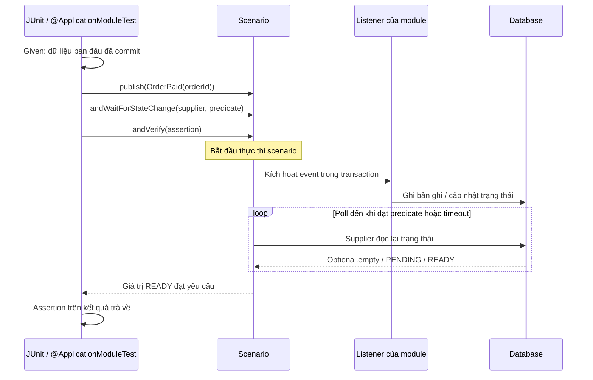

# AndWaitForStateChange để chờ trạng thái đổi

## 1. Khi nào nên chờ trạng thái thay vì chờ event?

Trong học phần **SPRING_MODULITH_VERIFICATION_TESTING**, mục tiêu là kiểm chứng ranh giới kiến trúc của ứng dụng Spring Modulith bằng `ApplicationModules` và quy tắc phụ thuộc giữa module; đồng thời thực hành `@ApplicationModuleTest`, kiểm thử sự kiện, cơ sở dữ liệu và tích hợp để đưa các phép kiểm vào quality gate CI.

Ở chương **Scenario**, yêu cầu **“AndWaitForStateChange để chờ trạng thái đổi”** tập trung vào một kết quả có thể quan sát **từ dữ liệu hoặc API truy vấn của module**. Ví dụ, sau khi module `shipping` nhận sự kiện `OrderPaid`, hệ thống phải lưu bản ghi vận chuyển với `status = READY`. Một bài kiểm thử chỉ chờ sự kiện `ShipmentRequested` chưa chắc chứng minh bản ghi cuối cùng đã tồn tại hoặc transaction ghi dữ liệu đã commit.

Spring Modulith cung cấp:

```java
scenario.publish(new OrderPaid(orderId))
        .andWaitForStateChange(() -> shipmentRepository.findByOrderId(orderId))
        .andVerify(result -> {
            // Kiểm tra giá trị quan sát được khi điều kiện chờ thành công.
        });
```

**`andWaitForStateChange(...)`** thuộc `org.springframework.modulith.test.Scenario.When<T>`. Nó nhận một hàm đọc trạng thái, đánh giá hàm đó lặp lại theo cơ chế chờ và chuyển kết quả vào `andVerify(...)` khi thỏa điều kiện hoàn tất. Đó là cách kiểm chứng **trạng thái cuối cùng** trong các luồng có xử lý sau commit, listener bất đồng bộ hoặc cập nhật dữ liệu qua module khác.

> **Phân biệt quan trọng:** `Scenario` không tự so sánh giá trị trước/sau để suy luận “đã thay đổi”. Nó coi trạng thái đã đạt khi **giá trị của supplier thỏa tiêu chí chấp nhận**. Tiêu chí mặc định có quy tắc cụ thể; khi cần chờ `READY`, `PAID` hoặc một giá trị định lượng, phải khai báo `Predicate` rõ ràng.



## 2. Các API chính và thứ tự thực thi

Hai overload quan trọng:

```java
<S> Scenario.When<T>.StateChangeResult<S>
    andWaitForStateChange(Supplier<S> supplier);

<S> Scenario.When<T>.StateChangeResult<S>
    andWaitForStateChange(
        Supplier<S> supplier,
        Predicate<? super S> acceptanceCriteria);
```

Đây là **chữ ký rút gọn để giải thích generic**; không phải các method cần chép vào lớp test. Trong đó:

| Thành phần | Vai trò |
| --- | --- |
| `T` | Kiểu kết quả của **stimulus** trước đó, ví dụ `UUID` nếu gọi `stimulate(Supplier<UUID>)`. |
| `S` | Kiểu dữ liệu hàm **đọc trạng thái** trả về, ví dụ `Boolean`, `Optional<ShipmentView>` hoặc `String`. |
| `Supplier<S>` | Cách quan sát trạng thái hiện tại của module, được gọi nhiều lần trong giai đoạn chờ. |
| `Predicate<? super S>` | Quyết định giá trị nào chứng tỏ trạng thái mục tiêu đã đạt. |
| `StateChangeResult<S>` | Bước tiếp theo của DSL, cho phép xác nhận trạng thái bằng `andVerify(...)`. |

Luồng điển hình:

```java
scenario.publish(event)                   // WHEN: kích hoạt nghiệp vụ
        .andWaitForStateChange(            // WAIT: quan sát trạng thái
                () -> query.read(id),
                value -> matches(value))
        .andVerify(value -> assertResult(value)); // THEN: kiểm chứng
```

`andWaitForStateChange(...)` cấu hình phép quan sát. **`andVerify(...)` là terminal operation**: nó khiến scenario được thực thi và đưa giá trị đạt điều kiện vào assertion. Đừng dừng bài test ở bước cấu hình `andWaitForStateChange(...)` mà không kết thúc bằng một phép xác nhận.

## 3. Điều kiện mặc định: biết rõ để tránh test pass giả

Overload chỉ nhận `Supplier<S>` sử dụng các tiêu chí mặc định được Spring Modulith định nghĩa:

| Giá trị do supplier trả về | Được xem là hoàn tất? | Ví dụ |
| --- | --- | --- |
| Object hoặc `String` khác `null` | **Có** | `"PENDING"` cũng đủ để hoàn tất, dù chưa phải `"READY"`. |
| `null` | **Chưa** | Chưa có kết quả truy vấn. |
| `Optional.empty()` | **Chưa** | Chưa tìm được bản ghi. |
| `Optional.of(value)` | **Có** | Đã tìm được bản ghi, bất kể nội dung record. |
| `Boolean.TRUE` / `true` | **Có** | `repository.existsById(id)` trả về true. |
| `Boolean.FALSE` / `false` | **Chưa** | Điều kiện boolean chưa đạt. |
| `Integer.valueOf(0)` | **Có** | Zero vẫn là một object khác `null`. |
| `List.of()` (danh sách rỗng) | **Có** | List rỗng là object khác `null`; không đồng nghĩa có phần tử. |

Vì vậy, đoạn sau **chỉ** khẳng định “đã tìm thấy bản ghi”:

```java
scenario.publish(new OrderPaid(orderId))
        .andWaitForStateChange(() -> repository.findByOrderId(orderId))
        .andVerify(found -> assertThat(found).isPresent());
```

Nếu bản ghi có thể tồn tại từ trước với trạng thái `PENDING`, test trên sẽ hoàn tất **ngay khi nhận `Optional.of(PENDING)`**. Nó không tự chờ trạng thái `READY`.

Để kiểm tra điều kiện nghiệp vụ cụ thể, dùng overload `Supplier + Predicate`:

```java
scenario.publish(new OrderPaid(orderId))
        .andWaitForStateChange(
                () -> repository.findByOrderId(orderId),
                found -> found.isPresent()
                        && "READY".equals(found.orElseThrow().status()))
        .andVerify(found ->
                assertThat(found.orElseThrow().status()).isEqualTo("READY"));
```

**Quy tắc thực hành:** nếu giá trị khác `null` **chưa đủ để chứng minh thành công** (enum, status string, số dư, số lượng, danh sách, trạng thái trung gian), hãy cung cấp `Predicate` cho `andWaitForStateChange`.

## 4. Given, When, Wait, Then trong một kịch bản

Một ca kiểm thử module có thể đọc như sau:

| Pha | Ví dụ với module shipping | Triển khai |
| --- | --- | --- |
| **Given** | Đơn hàng `orderId` hợp lệ, chưa có bản ghi shipment. | Tạo ID riêng; chuẩn bị fixture, database/migration; seed và commit dữ liệu cần thiết. |
| **When** | Phát `OrderPaid(orderId)` hoặc gọi API service thực của module. | `scenario.publish(...)` hoặc `scenario.stimulate(...)`. |
| **Wait** | Chờ dữ liệu shipping xuất hiện với `status = READY`. | `andWaitForStateChange(supplier, predicate)`. |
| **Then** | Kiểm tra `orderId`, `status` và các thuộc tính nghiệp vụ. | `andVerify(result -> ...)`. |
| **Cleanup** | Xóa shipment và fixture đã commit. | `andCleanup(...)` và/hoặc cơ chế test database phù hợp. |

Đây là cách tổ chức theo kiểu Given–When–Then, **không có** method `scenario.given(...)` trong API `Scenario`. Chuẩn bị dữ liệu đầu vào bằng JUnit setup, repository, SQL fixture, `TransactionTemplate` hoặc test double là việc của bài kiểm thử.

## 5. Ví dụ xuyên suốt: listener ghi trạng thái READY vào DB

Giả sử ứng dụng có hai module:

- **`order`** công bố event `OrderPaid(UUID orderId)` ở API công khai.
- **`shipping`** nghe `OrderPaid`, rồi tạo shipment có trạng thái `READY`.

Ví dụ dùng Spring Boot, Spring Modulith, JUnit 5 và Spring JDBC. Những đoạn mã dưới đây mô tả một mô hình nhỏ hoàn chỉnh về mặt ý tưởng; dự án thật cần dependency, datasource và migration phù hợp.

### 5.1. Dữ liệu và event

Schema minh họa:

```sql
CREATE TABLE shipments (
    order_id VARCHAR(36) PRIMARY KEY,
    status   VARCHAR(32) NOT NULL
);
```

Event công khai trong package gốc của module order, `com/acme/order/OrderPaid.java`:

```java
package com.acme.order;

import java.util.UUID;

public record OrderPaid(UUID orderId) {}
```

Trạng thái trả về của module shipping, `com/acme/shipping/ShipmentView.java`:

```java
package com.acme.shipping;

import java.util.UUID;

public record ShipmentView(UUID orderId, String status) {}
```

### 5.2. Repository có truy vấn an toàn khi chưa có bản ghi

```java
package com.acme.shipping;

import java.util.List;
import java.util.Optional;
import java.util.UUID;

import org.springframework.jdbc.core.JdbcTemplate;
import org.springframework.stereotype.Repository;

@Repository
class ShipmentRepository {

    private final JdbcTemplate jdbc;

    ShipmentRepository(JdbcTemplate jdbc) {
        this.jdbc = jdbc;
    }

    void insert(UUID orderId, String status) {
        jdbc.update(
            "INSERT INTO shipments (order_id, status) VALUES (?, ?)",
            orderId.toString(), status);
    }

    Optional<ShipmentView> findByOrderId(UUID orderId) {
        List<ShipmentView> found = jdbc.query(
            "SELECT order_id, status FROM shipments WHERE order_id = ?",
            (rs, rowNum) -> new ShipmentView(
                UUID.fromString(rs.getString("order_id")),
                rs.getString("status")),
            orderId.toString());

        return found.stream().findFirst();
    }

    void deleteByOrderId(UUID orderId) {
        jdbc.update("DELETE FROM shipments WHERE order_id = ?",
                orderId.toString());
    }
}
```

Repository trả `Optional.empty()` khi bản ghi chưa tồn tại. Cách này **không ném ngoại lệ mỗi lần polling** như việc dùng `queryForObject` trên truy vấn không trả dòng nào. Nhờ vậy, trong lúc listener chưa tạo shipment, supplier chỉ trả giá trị “chưa sẵn sàng”.

### 5.3. Listener của module

```java
package com.acme.shipping;

import com.acme.order.OrderPaid;
import org.springframework.modulith.events.ApplicationModuleListener;
import org.springframework.stereotype.Component;

@Component
class ShippingHandler {

    private final ShipmentRepository shipments;

    ShippingHandler(ShipmentRepository shipments) {
        this.shipments = shipments;
    }

    @ApplicationModuleListener
    public void on(OrderPaid event) {
        shipments.insert(event.orderId(), "READY");
    }
}
```

`@ApplicationModuleListener` là cách khai báo listener giao dịch bất đồng bộ do Spring Modulith cung cấp: nó xử lý sự kiện ở nhịp transaction phù hợp, thường sau khi giao dịch phát event commit. Dữ liệu shipment được ghi trong transaction của listener. Thời điểm JUnit gọi `scenario.publish(...)` không đồng nghĩa với lúc bản ghi đã commit.

### 5.4. Test chờ trạng thái đã commit

```java
package com.acme.shipping;

import static org.assertj.core.api.Assertions.assertThat;

import java.time.Duration;
import java.util.UUID;

import com.acme.order.OrderPaid;
import org.junit.jupiter.api.Test;
import org.springframework.beans.factory.annotation.Autowired;
import org.springframework.modulith.test.ApplicationModuleTest;
import org.springframework.modulith.test.Scenario;

@ApplicationModuleTest
class ShippingStateScenarioTests {

    @Autowired ShipmentRepository shipments;

    @Test
    void createsReadyShipmentAfterOrderPaid(Scenario scenario) {
        UUID orderId = UUID.randomUUID();

        // GIVEN: ID riêng, chưa có shipment.
        assertThat(shipments.findByOrderId(orderId)).isEmpty();

        // WHEN + WAIT + THEN.
        scenario.publish(new OrderPaid(orderId))
                .andCleanup(() -> shipments.deleteByOrderId(orderId))
                .andWaitAtMost(Duration.ofSeconds(5))
                .forStateChange(
                        () -> shipments.findByOrderId(orderId),
                        found -> found.isPresent()
                                && "READY".equals(
                                        found.orElseThrow().status()))
                .andVerify(found -> {
                    ShipmentView shipment = found.orElseThrow();
                    assertThat(shipment.orderId()).isEqualTo(orderId);
                    assertThat(shipment.status()).isEqualTo("READY");
                });
    }
}
```

Đoạn test có các ý nghĩa chính:

1. **`@ApplicationModuleTest`** dựng Spring context theo module chứa test (`shipping`). Trong phạm vi mặc định `STANDALONE`, module shipping và listener đang được kiểm tra phải có mặt; không cần khởi tạo service của module order nếu test chỉ phát event `OrderPaid`.
2. **`UUID.randomUUID()`** giúp mỗi lượt test có dữ liệu riêng, tránh khẳng định nhầm trên shipment từ luồng khác.
3. **`publish(new OrderPaid(orderId))`** đưa stimulus vào transaction được `Scenario` quản lý để listener giao dịch xử lý đúng thời điểm.
4. **`forStateChange(...)`** là biến thể dễ đọc sau `andWaitAtMost(...)`; nó có cùng ý nghĩa chờ trạng thái như `andWaitForStateChange(...)`.
5. **`Predicate`** đòi `Optional` có giá trị và trạng thái thật sự là `READY`. Nếu bản ghi chưa có hoặc mới `PENDING`, cơ chế chờ sẽ tiếp tục thử.
6. **`andVerify(...)`** nhận chính giá trị `Optional<ShipmentView>` đã thỏa điều kiện để assert ID và status.
7. **`andCleanup(...)`** xóa shipment do listener tạo. Khi stimulus/handler có side effect đã commit, không nên dựa vào rollback mặc định của một transaction bao quanh test.

**Điều kiện để ví dụ chạy:** project phải có Spring Modulith test starter, `JdbcTemplate`, datasource/schema test và cấu hình phù hợp cho `@ApplicationModuleListener`. Không giả định một bộ dữ liệu sẵn có trên máy lập trình viên.

## 6. Chờ trạng thái cụ thể khi bản ghi đã tồn tại

Tình huống khác: shipment đã tồn tại với `status = PENDING`, sau một tín hiệu xác nhận mới chuyển thành `READY`.

Nếu dùng overload mặc định:

```java
// SAI VỀ Ý NGHĨA: tìm được PENDING cũng khiến chờ kết thúc.
scenario.publish(new ShipmentApproved(orderId))
        .andWaitForStateChange(() -> repository.findByOrderId(orderId))
        .andVerify(found -> assertThat(found).isPresent());
```

`ShipmentApproved` là một event minh họa, và `repository` là bean truy vấn tương ứng trong test. Test trên có thể thành công ngay **trước khi xử lý chuyển trạng thái**.

Cách đúng để chờ `READY`:

```java
scenario.publish(new ShipmentApproved(orderId))
        .andWaitForStateChange(
                () -> repository.findByOrderId(orderId),
                found -> found.filter(
                        view -> "READY".equals(view.status()))
                        .isPresent())
        .andVerify(found ->
                assertThat(found.orElseThrow().status()).isEqualTo("READY"));
```

Với DB thật, record `PENDING` phải được **commit trong pha Given** trước khi phát event. Nếu test đang giữ một transaction không commit mà listener lại chạy transaction khác, listener có thể không nhìn thấy dữ liệu chuẩn bị. Ví dụ dùng `TransactionTemplate` để seed:

```java
UUID orderId = UUID.randomUUID();

// GIVEN: commit bản ghi PENDING.
transactions.executeWithoutResult(tx ->
        repository.insert(orderId, "PENDING"));

scenario.publish(new ShipmentApproved(orderId))
        .andCleanup(() -> transactions.executeWithoutResult(tx ->
                repository.deleteByOrderId(orderId)))
        .andWaitForStateChange(
                () -> repository.findByOrderId(orderId),
                found -> found.filter(
                        view -> "READY".equals(view.status()))
                        .isPresent())
        .andVerify(found ->
                assertThat(found.orElseThrow().status()).isEqualTo("READY"));
```

Trong ví dụ mở rộng này, cần có listener xử lý `ShipmentApproved` để cập nhật bản ghi; `transactions` là `TransactionTemplate` được inject; code repository phải có thao tác cập nhật phù hợp. Đoạn mã tập trung vào **cách chuẩn bị và chờ trạng thái**, không ngụ ý toàn bộ listener đã được định nghĩa ở trên.

## 7. Các dạng supplier thường gặp

### 7.1. `Optional<T>`: chờ entity xuất hiện

```java
scenario.publish(new OrderPaid(orderId))
        .andWaitForStateChange(() -> shipments.findByOrderId(orderId))
        .andVerify(found -> assertThat(found).isPresent());
```

Thích hợp khi yêu cầu chỉ là **có bản ghi**, bất kể thuộc tính. Nếu yêu cầu status, dùng `Predicate`.

### 7.2. `Boolean`: chờ điều kiện trở thành true

```java
scenario.publish(new OrderPaid(orderId))
        .andWaitForStateChange(() -> shipments.findByOrderId(orderId).isPresent())
        .andVerify(exists -> assertThat(exists).isTrue());
```

Bởi vì `Boolean.FALSE` không phải giá trị hoàn tất mặc định, test chờ đến khi supplier trả `true`.

### 7.3. `String` hoặc enum: bắt buộc so sánh trạng thái mục tiêu

```java
scenario.publish(new OrderPaid(orderId))
        .andWaitForStateChange(
                () -> shipmentQuery.statusOf(orderId),
                status -> status == ShipmentStatus.READY)
        .andVerify(status ->
                assertThat(status).isEqualTo(ShipmentStatus.READY));
```

`ShipmentStatus` và `shipmentQuery` là các kiểu/bean giả định của dự án, được dùng để minh họa việc đọc một enum có thể trả `null` trước khi có bản ghi. Cách so sánh `==` đúng cho enum.

Nếu không có predicate, giá trị enum `ShipmentStatus.PENDING` cũng **khác `null`** và làm phép chờ kết thúc sai mục đích.

### 7.4. Số lượng/giá trị số: tiêu chí định lượng

```java
scenario.publish(new StockReserved(orderId, "SKU-42", 3))
        .andWaitForStateChange(
                () -> stockQuery.availableUnits("SKU-42"),
                available -> available != null && available == 7)
        .andVerify(available -> assertThat(available).isEqualTo(7));
```

`StockReserved` và `stockQuery` là hợp đồng minh họa. Nếu available trả về `Integer.valueOf(10)` trước khi xử lý, tiêu chí mặc định sẽ kết thúc **quá sớm**; tiêu chí `available == 7` mới mô tả trạng thái cuối cùng.

### 7.5. Collection: chờ đúng phần tử cần thiết

```java
scenario.publish(new OrderPaid(orderId))
        .andWaitForStateChange(
                () -> shipmentQuery.findAllByOrderId(orderId),
                rows -> rows.stream().anyMatch(
                        row -> "READY".equals(row.status())))
        .andVerify(rows -> assertThat(rows)
                .anySatisfy(row ->
                        assertThat(row.status()).isEqualTo("READY")));
```

Đừng nhầm `List.of()` (khác `null`) với một collection đã có bản ghi. Trong trường hợp này, predicate phải chỉ rõ phần tử/cấu trúc cần thấy.

## 8. Bắt đầu bằng `stimulate` và kiểm tra cả kết quả trả về

`publish(...)` hợp với test phản ứng của **module nhận event**. Nếu muốn kiểm thử từ cổng service của module nguồn, dùng `stimulate(...)` rồi chờ trạng thái:

```java
UUID orderId = UUID.randomUUID();

scenario.stimulate(() -> {
            return shippingService.requestShipment(orderId);
        })
        .andCleanup(createdOrderId ->
                shipmentTestCleaner.deleteByOrderId(createdOrderId))
        .andWaitForStateChange(
                () -> shipmentQuery.findByOrderId(orderId),
                result -> result.filter(
                        view -> "READY".equals(view.status()))
                        .isPresent())
        .andVerify((state, createdOrderId) -> {
            assertThat(createdOrderId).isEqualTo(orderId);
            assertThat(state.orElseThrow().orderId()).isEqualTo(createdOrderId);
            assertThat(state.orElseThrow().status()).isEqualTo("READY");
        });
```

Ví dụ giả định:

- `shippingService.requestShipment(UUID)` là API thực của module đang test và trả về `UUID`.
- `shipmentQuery.findByOrderId(...)` trả `Optional<ShipmentView>`.
- Một xử lý theo transaction hoặc bất đồng bộ đưa shipment đến `READY`.
- `shipmentTestCleaner` dọn dữ liệu đã commit trong transaction phù hợp.

Ở đây **`andVerify((state, stimulusResult) -> ...)`** nhận **trạng thái quan sát được trước**, **kết quả của stimulus sau**. Đây là overload `BiConsumer<S,T>` của `Scenario.When.StateChangeResult<S>`. Nó giúp so sánh trạng thái cuối cùng với ID do lời gọi dịch vụ trả về.

Nếu service không trả giá trị, dùng `stimulate(Runnable)` và `andVerify(Consumer<S>)`; không cố kiểm tra “result trả về” trong overload đó.

## 9. Timeout và polling: ổn định trên máy dev và CI

Trong hệ thống có listener bất đồng bộ, một thao tác insert/update có thể mất vài mili giây hoặc nhiều giây tùy môi trường. Viết `Thread.sleep(1000)` sẽ khiến test luôn chờ cố định nhưng vẫn có thể quá ngắn khi CI bận. `Scenario` dùng cơ chế polling dựa trên Awaitility để chờ đến khi supplier thỏa tiêu chí.

Có thể cấu hình thời gian chờ theo scenario:

```java
import java.time.Duration;

scenario.publish(new OrderPaid(orderId))
        .andWaitAtMost(Duration.ofSeconds(5))
        .forStateChange(
                () -> shipments.findByOrderId(orderId),
                found -> found.filter(
                        view -> "READY".equals(view.status()))
                        .isPresent())
        .andVerify(found ->
                assertThat(found).isPresent());
```

`forStateChange(...)` tương đương về mục đích với `andWaitForStateChange(...)`, được cung cấp để chuỗi tự nhiên hơn sau bước tùy biến thời gian chờ.

Khi cần điều chỉnh nhiều thuộc tính chờ, `Scenario.When.customize(...)` nhận cấu hình Awaitility:

```java
scenario.publish(new OrderPaid(orderId))
        .customize(wait -> wait.atMost(Duration.ofSeconds(5)))
        .andWaitForStateChange(
                () -> shipments.findByOrderId(orderId),
                found -> found.filter(
                        view -> "READY".equals(view.status()))
                        .isPresent())
        .andVerify(found -> assertThat(found).isPresent());
```

**Nguyên tắc timeout:** chọn một mức đủ rộng cho độ trễ hợp lý của CI, nhưng có giới hạn để phát hiện handler treo hoặc bị lỗi. Một test timeout cần được điều tra: điều kiện predicate sai, listener không chạy, database chưa sẵn sàng, dữ liệu Given chưa commit, transaction snapshot cũ, hoặc timeout không phù hợp. Tăng thời gian chờ liên tục có thể che nguyên nhân thật.

**Supplier phải có thể được gọi nhiều lần.** Nên là phép đọc ít side effect, ví dụ repository query hoặc method trả trạng thái đã lưu. Không nên dùng supplier để **đưa event mới, trừ tồn kho, tạo entity hoặc gọi lại nghiệp vụ chính** mỗi lần polling; như vậy việc chờ có thể tự thay đổi hệ thống và tạo kết quả sai.

## 10. Transaction và khả năng quan sát state

Để chờ dữ liệu DB một cách tin cậy, cần phân biệt **thời điểm đã phát event**, **thời điểm handler hoàn thành** và **thời điểm transaction chứa dữ liệu đã commit**.

### 10.1. Vì sao test có thể không thấy trạng thái mới?

- Given insert dữ liệu nhưng đang ở transaction của JUnit chưa commit; listener ở transaction khác không đọc được record.
- Listener vẫn đang chạy, transaction chưa commit.
- Supplier đọc DB qua transaction dài hoặc cache giữ trạng thái cũ.
- Supplier gọi service trả DTO được cache, không phản ánh DB hiện tại.
- Handler báo lỗi hoặc không được khởi động trong `@ApplicationModuleTest`.

Với test có `@Transactional`, **đừng mặc định** một lệnh lưu dữ liệu Given sẽ được nhìn thấy bởi listener sau commit ở transaction khác. Nếu cần, chuẩn bị dữ liệu trong transaction độc lập đã commit hoặc thiết kế test không dùng `@Transactional` bao quanh.

### 10.2. Vì sao không nên dựa vào rollback tự động?

`Scenario.publish(...)` và `Scenario.stimulate(...)` sử dụng transaction cho stimulus. Một listener giao dịch có thể tiếp tục ghi và commit kết quả trong transaction riêng. Kết quả đã commit **không tự bị rollback** chỉ vì phương thức test kết thúc.

Trong bài test shipping, `andCleanup(() -> shipments.deleteByOrderId(orderId))` dọn record cuối cùng. Nếu dữ liệu Given cũng đã commit, cần dọn cả Given và dữ liệu phát sinh. Khi có khóa ngoại, dọn bản ghi con trước bản ghi cha.

### 10.3. Dùng transaction mới để quan sát kết quả?

Không phải cứ thêm `@Transactional` vào phương thức supplier là tốt. Nếu supplier tham gia vào một transaction dài/snapshot cố định, nhiều lần đọc có thể nhìn cùng dữ liệu cũ. Với Spring JDBC và các repository thông thường, thiết kế truy vấn ngắn, được thực thi mỗi lần poll, để đọc kết quả đã commit là cách dễ hiểu. Chọn isolation level/propagation theo DB và ứng dụng thực tế.

## 11. Phối hợp kiểm tra trạng thái và event

Spring Modulith hỗ trợ hai cách quan sát chính trong `Scenario`:

| Điều cần chứng minh | Nên quan sát bằng gì? | Ví dụ |
| --- | --- | --- |
| Module phát một sự kiện đúng loại và payload. | `andWaitForEventOfType(...)` | `OrderPaid` dẫn tới `ShipmentRequested` cùng `orderId`. |
| DB hoặc API của module đạt giá trị cuối cùng. | `andWaitForStateChange(...)` | Bản ghi shipment có `status = READY`. |
| Service trả đúng mã và dữ liệu cuối đúng mã đó. | `stimulate(Supplier<T>)` + state + `andVerify((state, result) -> ...)` | Return `UUID` khớp `ShipmentView.orderId()`. |
| Phụ thuộc giữa module không vi phạm kiến trúc. | `ApplicationModules.verify()` | Không import package nội bộ của module khác. |
| Thông điệp đã đến broker/được consumer ngoài xử lý. | Test tích hợp broker hoặc quan sát trạng thái bên ngoài. | Xác minh queue, consumer hoặc effect thực tế. |

`Scenario.When.StateChangeResult<S>` còn có các phương thức như `andVerifyEvents(...)` và `andExpect(Class<E>)` trong API để kết hợp yêu cầu về event với việc chờ state. Tuy nhiên, một test tích hợp lớn có thể khó phân tích nguyên nhân thất bại. Khi hợp đồng khác nhau, hãy cân nhắc **tách test event và test state**, mỗi test kiểm chứng một hành vi cụ thể và dùng fixture độc lập.

Nếu chỉ thấy `ShipmentRequested` mà bảng shipment chưa đúng, event test có thể vẫn pass. Ngược lại, state test có thể pass ngay cả khi module quên phát một event mà module khác cần tiêu thụ. Chọn cả hai loại kiểm chứng theo hợp đồng được công bố.

## 12. Những lỗi phổ biến và cách sửa

| Triệu chứng | Nguyên nhân điển hình | Cách sửa |
| --- | --- | --- |
| Test pass ngay khi DB còn `PENDING`. | Dùng overload mặc định với chuỗi/enum khác `null`. | Thêm predicate `status == READY`. |
| Test pass dù danh sách rỗng. | `List.of()` khác `null`. | Predicate kiểm tra có phần tử đúng điều kiện. |
| Test pass khi số lượng còn 10 thay vì 7. | `Integer(10)` đã đáp ứng tiêu chí không null. | Predicate `available == 7`. |
| Test timeout dù thao tác ghi có chạy. | Listener chưa commit, supplier đọc snapshot/cache cũ. | Kiểm tra propagation, isolation, commit và phép truy vấn của supplier. |
| Test fail do `EmptyResultDataAccessException` trước khi có record. | `queryForObject` đòi bản ghi tồn tại ngay. | Trả `Optional.empty()` từ truy vấn có thể không có dòng. |
| Suite chạy lặp lại tạo duplicate key. | Không dọn record của kịch bản trước. | ID riêng, `andCleanup`, test DB cô lập. |
| Test chỉ pass trên máy cá nhân. | Dựa vào dữ liệu/migration sẵn có không tái lập trên CI. | Seed Given, migration và datasource thử nghiệm nhất quán. |
| Không thấy listener cập nhật DB. | Phạm vi `@ApplicationModuleTest` thiếu bean, hoặc listener bị mock. | Kiểm tra package module, bootstrap mode, listener và dependency. |
| Test chạy rất chậm. | `Thread.sleep` hoặc polling nặng, timeout quá rộng. | Dùng Scenario và supplier truy vấn gọn, timeout có lý do. |
| Cleanup xóa dữ liệu trong lúc xử lý chưa kết thúc. | Predicate mới chứng minh trạng thái trung gian. | Chờ tín hiệu hoàn tất mạnh hơn và thiết kế cleanup an toàn. |

### Checklist khi viết `andWaitForStateChange`

- [ ] Supplier **chỉ quan sát**, không kích hoạt lại nghiệp vụ.
- [ ] Đã xác định rõ `S` trả về là `Optional`, boolean, enum, DTO, số hay collection.
- [ ] Predicate mô tả **trạng thái nghiệp vụ đích**, không đơn giản là khác `null` nếu chưa đủ.
- [ ] Given đã commit khi listener khác transaction cần đọc.
- [ ] Khi không có record, supplier trả trạng thái hợp lý, không ném lỗi ngoài dự kiến.
- [ ] Có terminal operation `andVerify(...)` để chạy kịch bản và assert kết quả.
- [ ] Timeout hữu hạn, đủ cho độ trễ thông thường trên CI.
- [ ] Dữ liệu và event dùng ID riêng từng lần chạy; có cleanup cho side effect đã commit.
- [ ] Đã chọn đúng phạm vi `@ApplicationModuleTest` và datasource.
- [ ] Còn có test `ApplicationModules.verify()` độc lập để kiểm chứng kiến trúc.

## 13. Đưa kiểm thử state vào quality gate CI

**Kiểm thử cấu trúc** và **kiểm thử trạng thái** bắt hai nhóm lỗi khác nhau.

Đối với ranh giới module, có thể dùng test sau (thay `Application` bằng lớp Spring Boot application thực):

```java
import org.junit.jupiter.api.Test;
import org.springframework.modulith.core.ApplicationModules;

class ArchitectureVerificationTests {

    @Test
    void verifiesDependencies() {
        ApplicationModules.of(Application.class).verify();
    }
}
```

Nó kiểm soát phụ thuộc vòng, truy cập package nội bộ và quy tắc phụ thuộc module đã khai báo. Nó không biết shipment có được ghi `READY` hay không.

Đối với hành vi, `@ApplicationModuleTest` + `Scenario.andWaitForStateChange` chứng minh trạng thái cuối cùng qua một truy vấn thực. Trong CI, chạy các test phù hợp bằng `./mvnw test` hoặc `./gradlew test` và chặn merge/deploy khi test thất bại. Với DB, cần migration tự động, datasource thử nghiệm, fixture tái lập và cleanup. Có thể dùng Testcontainers khi cần kiểm tra behavior transaction/SQL đúng với engine production.

Một test **đạt trên CI** nên dựa vào điều kiện rõ ràng, không phụ thuộc tốc độ máy, bản ghi cũ hay thứ tự test. Timeout không phải “đợi cho có”; nó là giới hạn để phát hiện lỗi hồi quy trong việc đạt trạng thái nghiệp vụ.

## 14. Bài tập thực hành

Giả sử `shipping` nhận `OrderPaid(orderId)` rồi xử lý shipment.

1. **Phát hiện test pass giả:** một query luôn trả `"PENDING"`. Hãy giải thích vì sao `andWaitForStateChange(() -> statusQuery.read(id))` có thể thành công và sửa bằng predicate chờ `"READY"`.
2. **Optional:** listener tạo shipment bất đồng bộ. Viết supplier trả `Optional<ShipmentView>` và test kết thúc khi đã có record. Sau đó sửa test để đợi record có `status = READY`.
3. **Boolean:** dùng `repository.existsById(orderId)` làm supplier. So sánh hành vi của giá trị `false` và `true` với overload không truyền predicate.
4. **Số lượng tồn kho:** đầu vào `available = 10`, sự kiện đặt 3 sản phẩm. Viết test chỉ đạt khi available bằng 7; chỉ ra vì sao `Integer` không null là điều kiện quá yếu.
5. **Giao dịch Given:** tạo shipment `PENDING` bằng repository trong một test `@Transactional`. Listener update ở transaction riêng. Dự đoán lỗi có thể xảy ra và đề xuất cách commit fixture trước stimulus.
6. **Return value:** một `shippingService.requestShipment` trả `UUID`. Dùng `stimulate(Supplier<UUID>)` và `andVerify((state, result) -> ...)` để khẳng định dữ liệu DB có cùng mã.
7. **Hồi quy:** sửa handler chỉ phát `ShipmentRequested` nhưng không ghi DB. Test event và test state phản ứng ra sao?
8. **Ranh giới kiến trúc:** module shipping truy cập `com.acme.order.internal`. Phép kiểm nào phát hiện vi phạm này và vì sao test state có thể vẫn pass?

**Gợi ý đáp án:** (1) string `PENDING` khác null; (2) `Optional` đủ chứng minh hiện diện nhưng cần predicate cho status; (3) boolean true mới hoàn tất; (4) số 10 cũng khác null nên phải so sánh bằng 7; (5) xác định commit và transaction propagation; (6) callback hai đối số nhận state trước, stimulus result sau; (7) test DB bắt được lỗi mà test event thuần túy có thể bỏ sót; (8) dùng `ApplicationModules.verify()`.

## Tài liệu tham khảo

- [Spring Modulith – Integration Testing Application Modules](https://docs.spring.io/spring-modulith/reference/testing.html): kịch bản kiểm thử và ví dụ chờ state change.
- [Spring Modulith – Scenario.When API](https://docs.spring.io/spring-modulith/docs/current/api/org/springframework/modulith/test/Scenario.When.html): hai overload `andWaitForStateChange`, `forStateChange`, timeout và cleanup.
- [Spring Modulith – Scenario.When.StateChangeResult API](https://docs.spring.io/spring-modulith/docs/current/api/org/springframework/modulith/test/Scenario.When.StateChangeResult.html): các overload `andVerify`, `andVerifyEvents` và `andExpect`.
- [Spring Modulith – Scenario API](https://docs.spring.io/spring-modulith/docs/current/api/org/springframework/modulith/test/Scenario.html): `publish` và `stimulate`.
- [Spring Modulith – Working with Application Events](https://docs.spring.io/spring-modulith/reference/events.html): `@ApplicationModuleListener` và giao tiếp giữa module bằng event.
- [Spring Modulith – Verifying Application Module Structure](https://docs.spring.io/spring-modulith/reference/verification.html): kiểm chứng ranh giới phụ thuộc bằng `ApplicationModules.verify()`.
