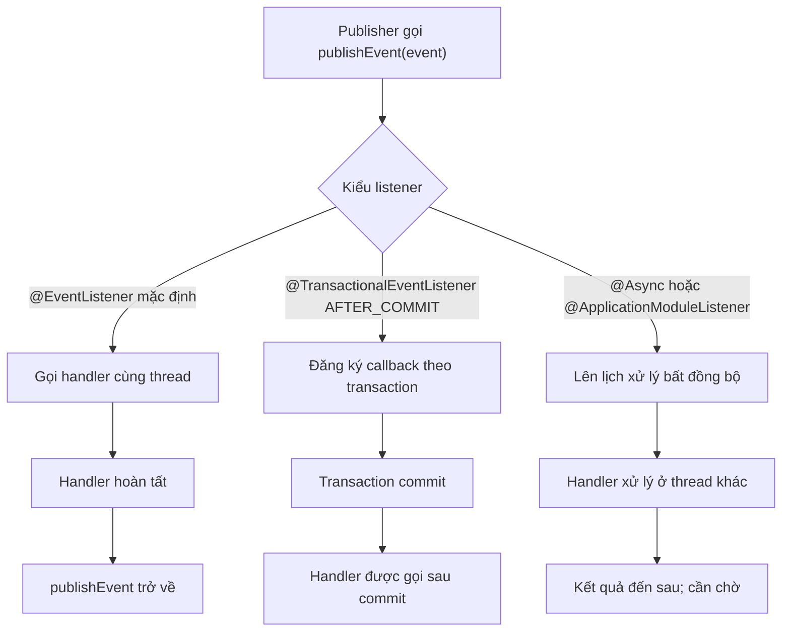

# Synchronous event publication trong scenario

## 1. Synchronous event publication là gì?

Trong học phần **SPRING_MODULITH_VERIFICATION_TESTING**, chúng ta kiểm chứng **ranh giới kiến trúc** của Spring Modulith bằng `ApplicationModules` và quy tắc phụ thuộc giữa module, đồng thời dùng `@ApplicationModuleTest`, `Scenario`, test sự kiện và cơ sở dữ liệu để phát hiện hồi quy trước khi qua quality gate CI.

Ở chương **Scenario**, *synchronous event publication* (công bố sự kiện đồng bộ) cần được hiểu đúng theo cơ chế của **Spring application events**:

- Một component gọi `ApplicationEventPublisher.publishEvent(event)` để phát sự kiện vào `ApplicationContext`.
- Với cấu hình multicaster mặc định, các listener `@EventListener` thông thường được gọi **trên thread đang phát sự kiện**. Lệnh `publishEvent(...)` chỉ trả về sau khi những listener đồng bộ đó chạy xong.
- Khi viết `Scenario.publish(event)` hoặc `Scenario.stimulate(...)`, Spring Modulith kích hoạt nghiệp vụ **trong một transaction riêng**; nó không mặc định chuyển tất cả listener thành đồng bộ hoặc bất đồng bộ.
- `@ApplicationModuleListener` là cách khai báo listener **giao dịch, bất đồng bộ, sau commit**. Vì vậy, `publishEvent(...)` trả về chưa có nghĩa loại listener này đã hoàn thành.

Điểm trọng tâm: **“phát sự kiện đồng bộ”, “listener hoàn tất” và “transaction đã commit” là ba điều kiện khác nhau**. Muốn kiểm tra chính xác, phải biết annotation của listener, cấu hình phát event và kết quả nghiệp vụ cần được chứng minh.

> **Không có API mang tên `Scenario.publishSynchronously(...)`**. Bài này giải thích tính đồng bộ của quá trình công bố Spring event khi dùng `Scenario.publish(...)` / `Scenario.stimulate(...)`, cách kiểm chứng nó và cách phân biệt với xử lý bất đồng bộ.

Ví dụ: module `shipping` nhận `ShipmentRequested(orderId)`; listener đồng bộ tạo trạng thái `READY` và phát `ShipmentPrepared(orderId)`. Khi publisher trở về, listener đồng bộ đã xử lý xong. Nếu listener đổi sang `@ApplicationModuleListener`, việc xử lý có thể xảy ra **sau đó**, trên thread khác.

## 2. Phân biệt bốn kiểu listener phổ biến

| Cơ chế | Thời điểm chạy | Có nhất thiết cùng thread với publisher? | Điều gì test cần lưu ý? |
| --- | --- | --- | --- |
| `@EventListener` thông thường, multicaster mặc định | Khi `publishEvent(...)` phân phối event | **Có**, theo cơ chế mặc định | Listener có thể trả kết quả/throw exception ngay trong lời gọi phát sự kiện. |
| `@TransactionalEventListener` (mặc định `AFTER_COMMIT`), không `@Async` | Sau khi transaction phát event commit thành công | Thường được gọi trong luồng xử lý commit, **không phải tại thời điểm publish** | Cần transaction; nếu không có transaction, mặc định listener không chạy. |
| `@EventListener` + `@Async` | Lập lịch xử lý qua executor | **Không** | `publishEvent(...)` có thể trở về trước kết quả; lỗi async không truyền trực tiếp về publisher. |
| `@ApplicationModuleListener` | Sau commit, xử lý bất đồng bộ và trong transaction riêng | **Không** | Dùng `Scenario` để chờ event hoặc trạng thái; chủ động cleanup dữ liệu đã commit. |

**Ngoại lệ về cấu hình:** nếu ứng dụng thay `applicationEventMulticaster` bằng multicaster dùng executor riêng, ngay cả listener `@EventListener` không gắn `@Async` cũng có thể được đưa sang executor (tùy khả năng thực thi async của listener). Vì thế, mọi khẳng định “synchronous” phải đi cùng điều kiện **cấu hình phát event mặc định**.



Sơ đồ chỉ diễn đạt **thứ tự logic**. Việc callback giao dịch và sự kiện tiếp theo xuất hiện lúc nào phụ thuộc transaction manager, thread executor và cấu hình sự kiện thực tế.

## 3. Vai trò của `Scenario` trong luồng đồng bộ

`org.springframework.modulith.test.Scenario` là DSL cho kiểm thử tích hợp module. Nó thường đi theo thứ tự:

1. **Given**: dựng dữ liệu hoặc trạng thái ban đầu (fixture), bảo đảm dữ liệu cần thiết đã commit.
2. **When**: `scenario.publish(event)` hoặc `scenario.stimulate(() -> service.action())`.
3. **Wait/expect**: `andWaitForEventOfType(...)` hoặc `andWaitForStateChange(...)`.
4. **Verify**: `toArriveAndVerify(...)` hoặc `andVerify(...)`.
5. **Cleanup**: xóa dữ liệu được tạo bởi stimulus/listener khi có side effect.

Ví dụ căn bản:

```java
scenario.publish(new ShipmentRequested(orderId))
        .andWaitForEventOfType(ShipmentPrepared.class)
        .matching(event -> event.orderId().equals(orderId))
        .toArriveAndVerify(event ->
                assertThat(event.serviceLevel()).isEqualTo("STANDARD"));
```

Nếu `ShipmentRequested` được xử lý bởi `@EventListener` đồng bộ, event `ShipmentPrepared` có thể được phát **trong cùng lời gọi** của stimulus. `Scenario` vẫn quan sát được event đó và kiểm chứng payload.

**Tuy nhiên, bài test trên không chứng minh listener là đồng bộ.** Một listener bất đồng bộ phát cùng event trước timeout cũng làm test pass. `Scenario` kiểm chứng **kết quả được quan sát**, còn muốn kiểm chứng **phải chạy xong trước khi `publishEvent(...)` trở về** thì cần một assertion về thứ tự thực thi riêng.

Đây là điểm khác biệt quan trọng nhất của chủ đề này.

## 4. Chuẩn bị dự án để chạy `Scenario`

Thêm dependency test Spring Modulith, ví dụ với Maven:

```xml
<dependency>
    <groupId>org.springframework.modulith</groupId>
    <artifactId>spring-modulith-starter-test</artifactId>
    <scope>test</scope>
</dependency>
```

Tạo lớp JUnit 5 trong package của module cần kiểm thử và gắn `@ApplicationModuleTest`. Spring Modulith hỗ trợ inject `Scenario` trực tiếp vào tham số của phương thức `@Test`.

```java
package com.acme.shipping;

import org.junit.jupiter.api.Test;
import org.springframework.modulith.test.ApplicationModuleTest;
import org.springframework.modulith.test.Scenario;

@ApplicationModuleTest
class ShippingScenarioTests {

    @Test
    void verifiesPublication(Scenario scenario) {
        // Các ví dụ bên dưới.
    }
}
```

Ví dụ `Scenario` cần một Spring test context có transaction infrastructure, vì `Scenario` thực thi stimulus trong transaction mới. Tùy dự án, hạ tầng này được cung cấp bởi JPA/JDBC datasource và `PlatformTransactionManager` hoặc cấu hình transaction thích hợp. Mã trong các mục tiếp theo mô tả **logic của module**; muốn thực thi cần thêm Spring Boot application, dependency và cấu hình test hợp lệ.

### Phạm vi module

`@ApplicationModuleTest` mặc định chạy ở chế độ `STANDALONE`, chỉ khởi động module chứa test. Nếu event được công bố bởi module `order` nhưng listener ở module `shipping`, test trong `shipping` có thể **phát trực tiếp event đầu vào** qua `Scenario.publish(...)` để kiểm tra phản ứng của shipping. Test đó không tự chứng minh service của order phát event đúng.

Khi cần kiểm thử luồng thực qua nhiều module, hãy chọn bootstrap mode hoặc test integration scope phù hợp, bảo đảm bean listener cần thiết thực sự có trong context. Chế độ `ALL_DEPENDENCIES` chỉ thêm cây **module mà module hiện tại phụ thuộc**, không có nghĩa tự bật mọi module tiêu thụ event.

## 5. Ví dụ xuyên suốt: listener xử lý đồng bộ trong shipping

Giả sử module `com.acme.shipping` có các trách nhiệm:

- API `ShippingService.requestShipment(orderId)` phát `ShipmentRequested`.
- Listener `@EventListener` xử lý ngay, cập nhật mô hình đọc `READY` và phát `ShipmentPrepared`.
- Bài kiểm thử xác minh vừa **hành vi nghiệp vụ**, vừa **thứ tự đồng bộ**.

Để minh họa dễ quan sát, ví dụ dùng `ConcurrentHashMap` làm read model trong bộ nhớ, **không đại diện cho dữ liệu bền vững của production**. Khi dùng DB thật, cần thay bằng repository, migration và transaction phù hợp.

### 5.1. Event đầu vào

File `com/acme/shipping/ShipmentRequested.java`:

```java
package com.acme.shipping;

import java.util.UUID;

public record ShipmentRequested(UUID orderId) {}
```

File `com/acme/shipping/ShipmentPrepared.java`:

```java
package com.acme.shipping;

import java.util.UUID;

public record ShipmentPrepared(UUID orderId, String serviceLevel) {}
```

Hai record ở **package gốc của cùng module** nên có thể làm hợp đồng được module công bố ra bên ngoài nếu cần. Trong ứng dụng nhiều module, event thuộc subpackage nội bộ của module khác phải được công bố theo cơ chế API/`@NamedInterface` tương ứng trước khi module khác được phép dùng.

### 5.2. Service phát sự kiện

File `com/acme/shipping/ShippingService.java`:

```java
package com.acme.shipping;

import java.util.UUID;
import org.springframework.context.ApplicationEventPublisher;
import org.springframework.stereotype.Service;

@Service
public class ShippingService {

    private final ApplicationEventPublisher publisher;

    public ShippingService(ApplicationEventPublisher publisher) {
        this.publisher = publisher;
    }

    public void requestShipment(UUID orderId) {
        publisher.publishEvent(new ShipmentRequested(orderId));
    }
}
```

`ApplicationEventPublisher` là API **phát Spring application event trong context**, không phải Kafka/RabbitMQ producer. Phương thức này không cần `@Async`; với multicaster mặc định, listener `@EventListener` tương ứng được gọi đồng bộ.

### 5.3. Read model minh họa

File `com/acme/shipping/ShipmentReadModel.java`:

```java
package com.acme.shipping;

import java.util.Optional;
import java.util.UUID;
import java.util.concurrent.ConcurrentHashMap;
import java.util.concurrent.ConcurrentMap;

import org.springframework.stereotype.Component;

@Component
class ShipmentReadModel {

    private final ConcurrentMap<UUID, String> statuses =
            new ConcurrentHashMap<>();

    void markReady(UUID orderId) {
        statuses.put(orderId, "READY");
    }

    Optional<String> status(UUID orderId) {
        return Optional.ofNullable(statuses.get(orderId));
    }

    void clear(UUID orderId) {
        statuses.remove(orderId);
    }
}
```

Mỗi lần test dùng `UUID.randomUUID()` để không nhận nhầm dữ liệu của test khác. `clear(orderId)` phục vụ cleanup. Mô hình trong bộ nhớ giúp ta quan sát thứ tự xử lý mà không trộn vào vấn đề commit DB; phần transaction với DB được phân tích riêng ở mục 9.

### 5.4. Listener đồng bộ

File `com/acme/shipping/ShippingPreparationListener.java`:

```java
package com.acme.shipping;

import org.springframework.context.ApplicationEventPublisher;
import org.springframework.context.event.EventListener;
import org.springframework.stereotype.Component;

@Component
class ShippingPreparationListener {

    private final ShipmentReadModel readModel;
    private final ApplicationEventPublisher publisher;

    ShippingPreparationListener(ShipmentReadModel readModel,
                                ApplicationEventPublisher publisher) {
        this.readModel = readModel;
        this.publisher = publisher;
    }

    @EventListener
    public void on(ShipmentRequested event) {
        readModel.markReady(event.orderId());
        publisher.publishEvent(
                new ShipmentPrepared(event.orderId(), "STANDARD"));
    }
}
```

Trong cấu hình mặc định, khi `ShippingService.requestShipment(orderId)` gọi `publishEvent(new ShipmentRequested(...))`:

1. Spring gọi `ShippingPreparationListener.on(...)` trên thread hiện tại.
2. Listener ghi `READY` vào read model.
3. Listener phát `ShipmentPrepared`, cũng được công bố trong context.
4. Listener kết thúc; `ShippingService.requestShipment(...)` mới trở về.

Nếu thay `@EventListener` bằng `@ApplicationModuleListener` thì **trình tự trên không còn là cam kết**: callback chuyển sang xử lý sau commit và bất đồng bộ.

### 5.5. Test bằng `Scenario.stimulate(...)`

File `src/test/java/com/acme/shipping/ShippingSynchronousScenarioTests.java`:

```java
package com.acme.shipping;

import static org.assertj.core.api.Assertions.assertThat;

import java.util.UUID;

import org.junit.jupiter.api.Test;
import org.springframework.beans.factory.annotation.Autowired;
import org.springframework.modulith.test.ApplicationModuleTest;
import org.springframework.modulith.test.Scenario;

@ApplicationModuleTest
class ShippingSynchronousScenarioTests {

    @Autowired ShippingService shippingService;
    @Autowired ShipmentReadModel readModel;

    @Test
    void publishesPreparedEventWhenRequestingShipment(Scenario scenario) {
        UUID orderId = UUID.randomUUID();

        scenario.stimulate(() -> {
                    shippingService.requestShipment(orderId);
                })
                .andCleanup(() -> readModel.clear(orderId))
                .andWaitForEventOfType(ShipmentPrepared.class)
                .matching(event -> event.orderId().equals(orderId))
                .toArriveAndVerify(event -> {
                    assertThat(event.serviceLevel()).isEqualTo("STANDARD");
                    assertThat(readModel.status(orderId)).contains("READY");
                });
    }
}
```

Đọc bài kiểm thử:

- **Given:** `orderId` mới, chưa có trạng thái cũ tương ứng.
- **When:** `stimulate(Runnable)` gọi **service thật**, service phát event đầu vào.
- **Observe:** `andWaitForEventOfType(ShipmentPrepared.class)` chờ event đầu ra.
- **Match:** lọc cùng `orderId`; test không pass nhầm vì một shipment khác.
- **Verify:** kiểm tra service level và read model đã ghi `READY`.
- **Cleanup:** xóa trạng thái đã tạo. Callback được đăng ký trước terminal operation để cleanup khi kịch bản hoàn tất.

Cách này chứng minh **hành vi của module**, nhưng nếu muốn chứng minh tính **đồng bộ theo nghĩa thời điểm trở về của `publishEvent`**, cần test bổ sung dưới đây.

## 6. Kiểm chứng riêng tính đồng bộ

Một bài test `toArriveAndVerify(...)` có thể pass với cả listener đồng bộ lẫn listener bất đồng bộ. Để xác nhận **listener chạy xong trước khi service trả về**, hãy gọi service và đọc kết quả **ngay sau lời gọi**:

```java
@Test
void synchronouslyPreparesShipmentBeforeRequestReturns() {
    UUID orderId = UUID.randomUUID();

    try {
        shippingService.requestShipment(orderId);

        // Không có Awaitility, không sleep hay polling.
        assertThat(readModel.status(orderId)).contains("READY");
    } finally {
        readModel.clear(orderId);
    }
}
```

Test này có ý nghĩa rõ ràng trong bối cảnh `@EventListener` và multicaster mặc định: sau `requestShipment`, trạng thái đã được listener cập nhật. Nếu handler chuyển sang `@Async` hoặc `@ApplicationModuleListener`, test có thể thất bại vì không còn bảo đảm hoàn tất trước khi service trả về.

**Lưu ý phương pháp:** một bài test chạy nhanh đôi khi vẫn pass dù handler bất đồng bộ tình cờ hoàn tất trước lúc assertion đọc. Vì thế, test trực tiếp giúp phát hiện hồi quy về thời điểm xử lý nhưng **không phải chứng minh hình thức về mô hình thread**. Nếu đồng bộ là ràng buộc nghiêm ngặt, kiểm tra cả annotation/cấu hình event multicaster, hoặc instrument thread và thứ tự vào/ra một cách có kiểm soát.

Một cách rõ hơn để test hợp đồng hệ thống là **không ép listener phải đồng bộ nếu nghiệp vụ không đòi hỏi**. Với các luồng sau commit, hãy test kết quả bằng `Scenario` và điều kiện chờ phù hợp.

## 7. Dùng `Scenario.publish(...)` để kiểm thử riêng listener

Khi mục tiêu là kiểm tra `ShippingPreparationListener` nhận event và phản ứng đúng, không cần đưa `ShippingService` vào stimulus:

```java
@Test
void reactsToShipmentRequested(Scenario scenario) {
    UUID orderId = UUID.randomUUID();

    scenario.publish(new ShipmentRequested(orderId))
            .andCleanup(() -> readModel.clear(orderId))
            .andWaitForEventOfType(ShipmentPrepared.class)
            .matchingMappedValue(ShipmentPrepared::orderId, orderId)
            .toArriveAndVerify(event ->
                    assertThat(event.serviceLevel()).isEqualTo("STANDARD"));
}
```

`Scenario.publish(Object)` trực tiếp công bố event đầu vào trong transaction. Với `@EventListener` mặc định, listener vẫn xử lý đồng bộ trong callback phát event. Với `@ApplicationModuleListener`, Scenario tiếp tục chờ điều kiện khi xử lý diễn ra bất đồng bộ.

Bảng chọn điểm bắt đầu:

| Mục tiêu | API thích hợp | Điều được chứng minh |
| --- | --- | --- |
| “Listener xử lý đúng khi nhận `ShipmentRequested`.” | `scenario.publish(new ShipmentRequested(id))` | Khả năng **phản ứng với sự kiện** của module. |
| “`shippingService.requestShipment` thực sự phát ra kết quả đúng.” | `scenario.stimulate(() -> shippingService.requestShipment(id))` | Luồng bắt đầu từ **cổng nghiệp vụ của service**. |
| “Listener hoàn tất trước khi `publishEvent` trở về.” | Gọi service rồi assert ngay, kiểm tra cả cấu hình listener/multicaster | Tính **đồng bộ theo thứ tự thực thi** trong cấu hình đã xác định. |
| “Có đúng một event được công bố.” | `PublishedEvents` / `AssertablePublishedEvents` với assertion số lượng | **Cardinality** của event quan sát được. |

Nếu test dùng `publish`, nó **bỏ qua logic tạo event của service nguồn**. Khi chỉnh sửa service làm quên phát event, test chỉ `publish` vẫn có thể pass; vì vậy cần chọn API phù hợp với hợp đồng định kiểm.

## 8. Kiểm tra trực tiếp sự kiện đồng bộ bằng `PublishedEvents`

Với `@ApplicationModuleTest`, Spring Modulith còn cấp `PublishedEvents` hoặc `AssertablePublishedEvents` làm tham số test. Chúng hữu ích khi luồng xử lý đồng bộ và cần xác minh chính xác **số event được công bố** mà không phải xây cả một Scenario chờ bất đồng bộ.

Ví dụ test cùng service ở mục 5:

```java
import static org.assertj.core.api.Assertions.assertThat;

import java.util.UUID;
import org.junit.jupiter.api.Test;
import org.springframework.modulith.test.PublishedEvents;

@Test
void emitsExactlyOnePreparedEvent(PublishedEvents events) {
    UUID orderId = UUID.randomUUID();

    try {
        shippingService.requestShipment(orderId);

        var matching = events.ofType(ShipmentPrepared.class)
                .matching(ShipmentPrepared::orderId, orderId);

        assertThat(matching).hasSize(1);
    } finally {
        readModel.clear(orderId);
    }
}
```

Đoạn này là phương thức được đặt **bên trong lớp `@ApplicationModuleTest`** có hai field inject `shippingService` và `readModel` như mục 5. `PublishedEvents` thu thập Spring events trong lần chạy test; matcher theo `orderId` tránh nhầm kết quả.

`Scenario.andWaitForEventOfType(...).toArrive()` thường chỉ kiểm chứng **ít nhất một event phù hợp đã xuất hiện** trong khoảng thời gian chờ. Nếu yêu cầu nghiệp vụ là **chính xác một lần**, nên bổ sung assertion số lượng, kiểm tra idempotency hoặc trạng thái bền vững. Một test “có event” không đủ để xác nhận không công bố trùng.

**Khi nào chọn cách nào?**

- Với xử lý **đồng bộ, đơn giản**, `PublishedEvents` làm test ngắn và dễ hiểu.
- Với **@ApplicationModuleListener**, xử lý sau commit hoặc thay đổi trạng thái bất đồng bộ, `Scenario` cung cấp transaction, chờ và cleanup trong cùng DSL.
- Khi cần xác nhận cả event và dữ liệu DB, có thể kết hợp các phép kiểm phù hợp; không nên giả định “event đã xuất hiện” nghĩa là mọi side effect đã commit.

## 9. Transaction: đồng bộ chưa chắc đã commit

Đây là điểm rất quan trọng trong kiểm thử tích hợp:

**Listener đồng bộ chạy trong luồng phát event** thường có thể tham gia transaction của publisher. Nhưng khi handler đang chạy, transaction đó có thể **chưa commit**. Một kết quả được đọc từ bộ nhớ hoặc transaction hiện tại không chứng minh được dữ liệu đã bền vững trong DB.

Giả sử service đặt hàng có `@Transactional`:

```java
@Service
class OrderService {

    private final OrderRepository orders;
    private final ApplicationEventPublisher publisher;

    OrderService(OrderRepository orders,
                 ApplicationEventPublisher publisher) {
        this.orders = orders;
        this.publisher = publisher;
    }

    @Transactional
    public void submit(UUID orderId) {
        orders.save(new OrderEntity(orderId, "SUBMITTED"));
        publisher.publishEvent(new OrderSubmitted(orderId));
    }
}
```

Giả định `OrderRepository`, `OrderEntity` và `OrderSubmitted` là các kiểu ứng dụng do dự án định nghĩa, với datasource/transaction manager và schema đã được cấu hình.

Nếu một `@EventListener` đồng bộ dùng cùng transaction manager để ghi projection:

- Nó có thể chạy **trước khi transaction của `submit` commit**.
- Khi listener ném unchecked exception và lỗi truyền ngược về publisher, transaction có thể bị đánh dấu rollback.
- Việc ghi projection chưa phải cam kết dữ liệu bền vững cho tới khi transaction commit thành công.

Ngược lại, `@TransactionalEventListener(phase = AFTER_COMMIT)` chỉ được gọi sau commit (mặc định, không gắn `@Async`). Khi listener cần ghi DB trong một transaction mới sau commit, hãy cấu hình transaction **riêng** phù hợp, ví dụ một service được gọi qua proxy với `@Transactional(propagation = REQUIRES_NEW)`; tránh ngầm hiểu callback sau commit vẫn còn transaction có thể ghi và commit như ban đầu.

### `Scenario` khởi tạo transaction thế nào?

Tài liệu Spring Modulith nêu rõ `Scenario.publish(...)` và `Scenario.stimulate(...)` thực thi stimulus trong **transaction mới**, kể cả khi JUnit test đang ở trong một transaction khác. Mục đích là để các listener `@TransactionalEventListener` thấy một transaction hợp lệ và nhận sự kiện ở pha thích hợp.

Hệ quả:

> Ghi dữ liệu do stimulus thực hiện và commit **không tự được rollback bởi transaction bao ngoài của phương thức test**.

Khi bài kiểm thử có DB, dùng `andCleanup(...)` hoặc chiến lược xóa fixture sau test. Ví dụ:

```java
scenario.stimulate(() -> {
            orderService.submit(orderId);
        })
        .andCleanup(() -> testDataCleaner.deleteOrderAndProjections(orderId))
        .andWaitForEventOfType(OrderSubmitted.class)
        .matching(event -> event.orderId().equals(orderId))
        .toArrive();
```

`testDataCleaner` là helper thử nghiệm do dự án định nghĩa; cần triển khai xóa dữ liệu trong transaction hợp lệ và đúng thứ tự ràng buộc khóa ngoại. Nếu listener còn xử lý nền sau điều kiện chờ, cleanup quá sớm có thể gây race condition. Chọn tín hiệu hoàn tất phản ánh đúng dữ liệu cần dọn, hoặc cô lập DB cho từng bài test.

### Transactional listener không có transaction

`@TransactionalEventListener` mặc định **không chạy** nếu không có transaction. Có thể cho phép fallback qua `fallbackExecution = true`, nhưng đó là quyết định nghiệp vụ và không nên thêm chỉ để test pass. Khi test sự kiện giao dịch, dùng transaction thực hoặc để `Scenario` quản lý stimulus đúng như thiết kế.

## 10. So sánh chuỗi sự kiện đồng bộ và sau commit

Hai đoạn listener sau đều có thể phát `ShipmentPrepared`, nhưng thứ tự và tác động khác nhau:

**Phương án A: đồng bộ mặc định**

```java
@Component
class ImmediateShipmentListener {

    private final ApplicationEventPublisher events;

    ImmediateShipmentListener(ApplicationEventPublisher events) {
        this.events = events;
    }

    @EventListener
    public void on(ShipmentRequested event) {
        events.publishEvent(
                new ShipmentPrepared(event.orderId(), "STANDARD"));
    }
}
```

**Phương án B: sau commit, bất đồng bộ**

```java
@Component
class AsyncShipmentListener {

    private final ApplicationEventPublisher events;

    AsyncShipmentListener(ApplicationEventPublisher events) {
        this.events = events;
    }

    @ApplicationModuleListener
    public void on(ShipmentRequested event) {
        events.publishEvent(
                new ShipmentPrepared(event.orderId(), "STANDARD"));
    }
}
```

Hai snippet này là **hai lựa chọn thay thế**, không đăng ký cả hai làm bean xử lý cùng `ShipmentRequested` trong một demo, vì như vậy mỗi yêu cầu có thể phát trùng `ShipmentPrepared`.

| Hành vi | A: `@EventListener` | B: `@ApplicationModuleListener` |
| --- | --- | --- |
| Thời điểm gọi listener | Khi phát event, ở cấu hình multicaster mặc định | Sau commit |
| Thread xử lý | Thread của publisher | Thread executor riêng |
| Transaction | Thường tham gia transaction của publisher nếu có | Transaction mới cho listener |
| `publishEvent` có đợi xử lý xong? | Có, với listener đồng bộ | Không, với phần xử lý bất đồng bộ |
| Phương pháp test phù hợp | `PublishedEvents` hoặc `Scenario`; test thứ tự nếu cần | `Scenario` + timeout, chờ event/state |
| Xử lý lỗi | Lỗi đồng bộ có thể truyền về caller | Lỗi bất đồng bộ cần theo dõi bằng test, log, retry/event registry phù hợp |

**Lưu ý:** điều kiện đồng bộ là thuộc tính của cách *phân phối đến listener*, không phải chỉ của class event hoặc việc dùng `Scenario.publish(...)`. Một publisher có thể phát event đồng bộ đến một listener và kích hoạt xử lý bất đồng bộ ở một listener khác cùng lúc.

## 11. Kết quả event và thay đổi DB là hai hợp đồng khác nhau

Nếu listener tạo `ShipmentPrepared` nhưng việc ghi shipment xảy ra ở một tiến trình khác, bài test chờ event có thể pass dù DB chưa sẵn sàng. Khi hợp đồng cần bảo đảm trạng thái cuối, dùng `andWaitForStateChange(...)`:

```java
scenario.publish(new ShipmentRequested(orderId))
        .andWaitForStateChange(
                () -> shipmentQuery.findByOrderId(orderId),
                found -> found.isPresent()
                        && "READY".equals(found.orElseThrow().status()))
        .andVerify(found -> {
            assertThat(found).isPresent();
            assertThat(found.orElseThrow().orderId()).isEqualTo(orderId);
        });
```

Ví dụ giả định `shipmentQuery.findByOrderId(...)` trả `Optional<ShipmentView>` và một listener ghi DB. Nó minh họa điều kiện chờ state **đã quan sát được qua repository**; mã cụ thể cần được ánh xạ theo ứng dụng thật.

`andWaitForStateChange` gọi supplier theo cơ chế polling. `Predicate` yêu cầu `READY`, tránh trường hợp `Optional` đã có `PENDING` khiến test pass sớm. Truy vấn nên thực hiện bằng transaction đọc phù hợp để thấy các commit mới; không đặt `Thread.sleep(...)` cố định làm tiêu chí đồng bộ.

**Nên dùng event assertion khi hợp đồng là “event này được công bố”. Dùng state assertion khi hợp đồng là “trạng thái này đã đạt”.** Cả hai bổ sung cho kiểm chứng kiến trúc, không thay thế nhau.

## 12. Những lỗi thường gặp khi test synchronous event publication

| Triệu chứng | Nguyên nhân có thể | Cách xử lý |
| --- | --- | --- |
| `toArrive()` pass nhưng listener đang chạy async. | `Scenario` chờ được kết quả, không đo tính đồng bộ. | Kiểm tra annotation/multicaster và assertion thời điểm hoàn tất khi cần. |
| `publishEvent` trả về nhưng event handler sau commit chưa chạy. | Handler dùng `@TransactionalEventListener` hoặc `@ApplicationModuleListener`. | Chờ kết quả bằng `Scenario`; không assert ngay. |
| Handler đồng bộ chạy nhưng DB chưa thấy dữ liệu. | Ghi dữ liệu chưa commit, transaction/snapshot cách ly. | Test transaction commit và truy vấn state đúng cách. |
| Test có event nhưng thiếu listener thật. | Test trực tiếp `publish` đầu ra hoặc mock chính handler cần kiểm chứng. | Kích hoạt từ đúng cổng, đưa listener cần test vào module context. |
| Test thấy hai event giống nhau nhưng vẫn pass. | `toArrive()` chỉ cần có một event. | Dùng `PublishedEvents` đếm hoặc kiểm chứng idempotency. |
| Không thấy `@TransactionalEventListener` khi phát trực tiếp. | Phát event ngoài transaction, listener mặc định bị bỏ qua. | Dùng `Scenario.publish` hoặc transaction đã cấu hình đúng. |
| Suite fail không ổn định. | Dùng ID cố định, fixture bị chia sẻ, test chạy song song. | Tạo ID riêng, lọc correlation ID, cleanup đầy đủ. |
| Test timeout khi CI bận. | Event thật chạy async hoặc timeout không phù hợp. | Dùng `andWaitAtMost(...)` có giới hạn và phân tích nguyên nhân. |
| Service rollback do listener lỗi. | `@EventListener` đồng bộ ném exception trong transaction publisher. | Cân nhắc ranh giới transaction, handling lỗi và loại listener theo contract. |
| Import class từ package nội bộ module khác vẫn chạy được. | Test hành vi không kiểm tra luật phụ thuộc package. | Thêm `ApplicationModules.verify()`. |

### Timeout khi dùng cùng DSL cho synchronous và asynchronous

`Scenario` cho phép giới hạn thời gian chờ:

```java
scenario.publish(new ShipmentRequested(orderId))
        .andWaitAtMost(Duration.ofSeconds(3))
        .forEventOfType(ShipmentPrepared.class)
        .matchingMappedValue(ShipmentPrepared::orderId, orderId)
        .toArriveAndVerify(event ->
                assertThat(event.serviceLevel()).isEqualTo("STANDARD"));
```

Với listener synchronous, event có thể đã sẵn sàng gần như ngay lập tức. Với listener async, `Scenario` tiếp tục chờ cho tới khi nhận event phù hợp hoặc hết thời gian. **Timeout là giới hạn kiểm chứng kết quả**, không ép listener chạy đồng bộ. Chọn thời gian phù hợp CI và SLA xử lý thay vì tăng vô hạn để che lỗi.

## 13. Đưa vào quality gate CI và kiểm chứng ranh giới module

Một bộ test Spring Modulith đáng tin cậy cần ít nhất hai nhóm phép kiểm:

**A. Kiểm chứng kiến trúc**

```java
import org.junit.jupiter.api.Test;
import org.springframework.modulith.core.ApplicationModules;

class ModuleArchitectureTests {

    @Test
    void respectsModuleBoundaries() {
        ApplicationModules.of(Application.class).verify();
    }
}
```

`Application.class` là lớp Spring Boot application của dự án, cần thay bằng lớp thực tế. `ApplicationModules.verify()` phát hiện phụ thuộc vòng, truy cập vào package nội bộ của module khác và vi phạm quy tắc module đã khai báo. Một bài test synchronous event có thể pass dù kiến trúc sai, vì thế không thể bỏ phép kiểm cấu trúc.

**B. Kiểm chứng hành vi sự kiện và trạng thái**

Dùng `@ApplicationModuleTest`, `Scenario.publish(...)`/`stimulate(...)`, matcher theo correlation ID, assertion payload và cleanup. Với luồng đồng bộ đơn giản, `PublishedEvents` giúp kiểm tra số event; với callback sau commit, dùng `Scenario` chờ event/state. Với DB thật, dựng fixture có thể tái lập và dùng migration phù hợp môi trường CI.

Ví dụ chạy test trên CI, tùy build tool:

```bash
./mvnw test
```

hoặc:

```bash
./gradlew test
```

Pipeline cần thất bại khi test kiến trúc hoặc test tích hợp thất bại. Tránh phụ thuộc vào trạng thái DB trên máy cá nhân, thứ tự chạy JUnit hoặc việc một listener async “thường kịp” trước assertion.

### Checklist trước khi hoàn thành Scenario về synchronous event

- [ ] Đã xác định **event đầu vào**, **listener**, **event/state đầu ra** và phạm vi module.
- [ ] Đã phân biệt `@EventListener`, `@TransactionalEventListener`, `@Async`, `@ApplicationModuleListener`.
- [ ] Nếu yêu cầu **đồng bộ nghiêm ngặt**, có kiểm chứng thứ tự/thời điểm và cấu hình multicaster, không chỉ `toArrive()`.
- [ ] Dùng `publish` để test listener phản ứng hoặc `stimulate` để test cổng nghiệp vụ của service.
- [ ] `@ApplicationModuleTest` khởi động đủ bean cần test.
- [ ] Event matcher lọc đúng `orderId`/correlation ID.
- [ ] Có terminal operation như `toArriveAndVerify(...)` để thực thi Scenario.
- [ ] Biết transaction nào đã commit; cleanup bao phủ dữ liệu fixture và side effect.
- [ ] Hợp đồng DB được kiểm tra bằng `andWaitForStateChange(...)` nếu cần.
- [ ] Số lần phát event được assert riêng nếu contract yêu cầu “chính xác một”.
- [ ] Có test `ApplicationModules.verify()` độc lập để bảo vệ ranh giới kiến trúc và CI.

## 14. Bài tập thực hành

Với `ShippingService`, `ShippingPreparationListener` và `ShipmentPrepared` ở mục 5:

1. **Synchronous hay asynchronous?** Chạy test `synchronouslyPreparesShipmentBeforeRequestReturns` khi listener dùng `@EventListener`. Sau đó thay thành `@ApplicationModuleListener`. Giải thích vì sao assertion ngay sau service có thể không còn ổn định, và dùng `Scenario` để chờ thế nào.
2. **Phân biệt contract:** So sánh `scenario.publish(new ShipmentRequested(id))` và `scenario.stimulate(() -> shippingService.requestShipment(id))`. Cái nào còn phát hiện lỗi nếu service quên gọi `publisher.publishEvent(...)`?
3. **Event trùng:** Sửa handler cố tình phát `ShipmentPrepared` hai lần. Vì sao `toArrive()` có thể vẫn pass? Viết `PublishedEvents` assertion để phát hiện số event khác 1.
4. **Transaction:** Chuyển listener thành `@TransactionalEventListener` mặc định, gọi `shippingService.requestShipment(id)` trực tiếp ngoài transaction. Listener sẽ ra sao? Dùng `Scenario.publish(...)` để thử trong transaction.
5. **Lỗi đồng bộ:** Cho `@EventListener` ném `IllegalStateException`. Điều gì xảy ra với `publishEvent(...)` và transaction publisher nếu exception không bị bắt? Phân biệt với listener `@Async`.
6. **Kiểm chứng dữ liệu:** Giả sử `ShipmentPrepared` được phát trước khi một tác vụ khác ghi DB. Viết test `andWaitForStateChange(...)` yêu cầu `status = READY`, thay vì dựa vào event.
7. **Ranh giới kiến trúc:** Nếu `shipping` import `com.acme.order.internal.OrderRepositoryImpl`, test nào phù hợp để bắt vi phạm dù synchronous event test vẫn pass?
8. **CI:** Phân tích tại sao dùng chung `UUID` giữa test hoặc không cleanup sẽ làm pipeline thất bại không ổn định, kể cả khi listener hoàn toàn đồng bộ.

**Gợi ý:** (1) `@ApplicationModuleListener` xử lý sau commit và async; (2) `stimulate` kiểm tra cả service, `publish` bỏ qua service; (3) `PublishedEvents.ofType(...).matching(...)` rồi assert `hasSize(1)`; (4) transactional listener mặc định không chạy ngoài transaction nếu không bật `fallbackExecution`; (5) exception sync có thể propagate và rollback transaction, async xử lý lỗi theo cơ chế executor; (6) state query + predicate; (7) `ApplicationModules.verify()`; (8) correlation ID và cleanup.

## Tài liệu tham khảo

- [Spring Modulith — Integration Testing Application Modules](https://docs.spring.io/spring-modulith/reference/testing.html): `Scenario.publish`, `stimulate`, transaction mới, event/state completion và cleanup.
- [Spring Modulith — Working with Application Events](https://docs.spring.io/spring-modulith/reference/events.html): đồng bộ mặc định, `@ApplicationModuleListener`, cơ chế sự kiện giao dịch và `PublishedEvents`.
- [Spring Modulith — Scenario Javadoc](https://docs.spring.io/spring-modulith/docs/current/api/org/springframework/modulith/test/Scenario.html): overload `publish` và `stimulate`.
- [Spring Modulith — Scenario.When Javadoc](https://docs.spring.io/spring-modulith/docs/current/api/org/springframework/modulith/test/Scenario.When.html): `andWaitForEventOfType`, `andWaitForStateChange`, `andCleanup` và timeout.
- [Spring Framework — ApplicationContext Events](https://docs.spring.io/spring-framework/reference/core/beans/context-introduction.html): event multicaster và listener đồng bộ mặc định.
- [Spring Framework — Transaction-bound Events](https://docs.spring.io/spring-framework/reference/data-access/transaction/event.html): pha transaction của `@TransactionalEventListener`, `AFTER_COMMIT` và `fallbackExecution`.
- [Spring Framework — Async Scheduling and Execution](https://docs.spring.io/spring-framework/reference/integration/scheduling.html): `@Async`, task executor và xử lý exception bất đồng bộ.
- [Spring Modulith — Verifying Application Module Structure](https://docs.spring.io/spring-modulith/reference/verification.html): kiểm chứng phụ thuộc module bằng `ApplicationModules.verify()`.
